# بنك أسئلة الرياضيات — المستوى الخامس — الفصل الدراسي الأول

- العدد الكسري مكتوب بالصورة 2 1/3 (اثنان وثلث). الفراغ يُكتب ____.
- الأسئلة بدون إجابات نموذجية.

- كل الدروس منقولة من كتاب الطالب (الجزآن 1 و2): أسئلة "تدرّب موجّه" و"تدرّب مستقل" و"ممارسات الرياضيات وحل المسائل" و"تقويم"، بنصّها وأعدادها كما في الكتاب. الرسوم والجداول والنماذج مقتطعة كصور (مجلد images).

## الفهرس

- الوحدة 1: فهم القيمة المنزلية
  - الدرس 1-1: الأنماط التي تتضمن الأسس وقوى العدد 10
  - الدرس 1-2: فهم القيمة المنزلية لعدد كلي
  - الدرس 1-3: الكسور العشرية حتى الأجزاء من الألف
  - الدرس 1-4: فهم القيمة المنزلية للكسر العشري
  - الدرس 1-5: مقارنة الكسور العشرية
  - الدرس 1-6: تقريب الكسور العشرية
  - الدرس 1-7: البحث عن البنية في الحل واستعمالها
- الوحدة 2: جمع وطرح الكسور العشرية حتى الأجزاء من مئة
  - الدرس 2-1: تقدير نواتج الجمع والطرح
  - الدرس 2-2: استعمال النماذج لجمع وطرح الكسور العشرية
  - الدرس 2-3: جمع الكسور العشرية
  - الدرس 2-4: طرح الكسور العشرية
  - الدرس 2-5: جمع وطرح الكسور العشرية
  - الدرس 2-6: النمذجة في الرياضيات
- الوحدة 3: الطلاقة في ضرب الأعداد الكلية المتعددة الأرقام
  - الدرس 3-1: ضرب الأعداد الكبيرة في قوى العدد 10
  - الدرس 3-2: تقدير نواتج الضرب
  - الدرس 3-3: ضرب أعداد من 3 أرقام في أعداد من رقمين
  - الدرس 3-4: ضرب أعداد كلية تتضمن أصفارًا
  - الدرس 3-5: النقد والتبرير
- الوحدة 4: استعمال النماذج والطرائق لضرب الكسور العشرية
  - الدرس 4-1: ضرب الكسور العشرية في قوى العدد 10
  - الدرس 4-2: تقدير ناتج ضرب كسر عشري وعدد كلي
  - الدرس 4-3: استعمال النماذج لضرب كسر عشري في عدد كلي
  - الدرس 4-4: ضرب كسر عشري في عدد كلي
  - الدرس 4-5: استعمال النماذج لضرب كسر عشري في كسر عشري
  - الدرس 4-6: ضرب الكسور العشرية باستعمال نواتج الضرب الجزئية
  - الدرس 4-7: ضرب الكسور العشرية
  - الدرس 4-8: النمذجة في الرياضيات
- الوحدة 5: استعمال النماذج والطرائق لقسمة الأعداد الكلية
  - الدرس 5-1: استعمال الأنماط والحساب الذهني في القسمة
  - الدرس 5-2: تقدير نواتج القسمة على عدد من رقمين
  - الدرس 5-3: استعمال النماذج للقسمة على عدد من رقمين
  - الدرس 5-4: استعمال نواتج القسمة الجزئية في القسمة
  - الدرس 5-5: القسمة على مضاعفات العدد 10
  - الدرس 5-6: استعمال التقدير لتحديد منزلة الرقم الأول في ناتج القسمة
  - الدرس 5-7: القسمة على عدد من رقمين
  - الدرس 5-8: فهم المسألة والمثابرة في حلها
- الوحدة 6: استعمال النماذج والطرائق لقسمة الكسور العشرية
  - الدرس 6-1: الأنماط لقسمة الكسور العشرية
  - الدرس 6-2: تقدير نواتج قسمة الكسور العشرية
  - الدرس 6-3: استعمال النماذج للقسمة على عدد كلي من رقم واحد
  - الدرس 6-4: القسمة على عدد كلي من رقم واحد
  - الدرس 6-5: القسمة على عدد كلي من رقمين
  - الدرس 6-6: القسمة على كسر عشري
  - الدرس 6-7: التبرير المنطقي

---

## الوحدة 1: فهم القيمة المنزلية

### الدرس 1-1: الأنماط التي تتضمن الأسس وقوى العدد 10

#### رابعًا: أجب عن الأسئلة الآتية (مسائل وتفكير)

1. لماذا توجد ثلاثة أصفار في ناتج ضرب 6 × 10³؟
2. تقول سوسن إنّ 10⁵ تساوي 50، ما الخطأ الذي وقعت فيه سوسن؟ ثمّ أوجد الإجابة الصحيحة.
3. أكمل النمط: 10¹ = ____ ، 10² = ____ ، 10³ = ____ ، 10⁴ = ____
4. أكمل النمط: 7 × 10¹ = ____ ، 7 × 10² = ____ ، 7 × 10³ = ____ ، 7 × 10⁴ = ____
5. أوجد كلّ ناتج ضرب. استعمل الأنماط للمساعدة: 3 × 10¹ = ____ ، 3 × 10² = ____ ، 3 × 10³ = ____ ، 3 × 10⁴ = ____
6. أوجد كلّ ناتج ضرب. استعمل الأنماط للمساعدة: 2 × 10 = ____ ، 2 × 100 = ____ ، 2 × 1 000 = ____ ، 2 × 10 000 = ____
7. أوجد كلّ ناتج ضرب. استعمل الأنماط للمساعدة: 9 × 10¹ = ____ ، 9 × 10² = ____ ، 9 × 10³ = ____ ، 9 × 10⁴ = ____
8. أوجد ناتج الضرب: 8 × 10⁴
9. أوجد ناتج الضرب: 4 × 1 000
10. أوجد ناتج الضرب: 5 × 10²
11. أوجد ناتج الضرب: 6 × 10 000
12. أوجد ناتج الضرب: 4 × 10¹
13. أوجد ناتج الضرب: 100 × 9
14. أوجد ناتج الضرب: 10³ × 6
15. أوجد ناتج الضرب: 8 × 10⁵
16. اكتب 10 × 10 × 10 × 10 × 10 × 10 باستعمال الأسس. وضّح كيف حدّدت الأس الذي يجب استعماله.
17. يحتوي صندوق واحد من ورق الطابعة على 3 × 10² ورقة. ويحتوي صندوق طابعة آخر على 10³ ورقة. أوجد إجمالي عدد الأوراق في الصندوقين؟
18. اختر كلّ الجمل العددية الصحيحة: 10 × 10 × 10 × 10 = 40 / 10 × 10 × 10 × 10 = 10⁴ / 10 × 10 × 10 × 10 = 1 000 / 10 × 10 × 10 × 10 = 10 000 / 10 × 10 × 10 × 10 = 4 × 10⁴
19. اختر كلّ الجمل العددية الصحيحة: 6 × 10⁵ = 6 × 100 000 / 6 × 10⁵ = 6 × 10 000 / 6 × 10⁵ = 600 000 / 6 × 10⁵ = 60 000 / 6 × 10⁵ = 650 000
20. اكتب 10 × 10 × 10 × 10 × 10 × 10 × 10 باستعمال الأسس.
21. اكتب 10 × 10 × 10 × 10 × 10 × 6 باستعمال الأسس.
22. كم صفرًا يوجد في الصيغة القياسية للعدد 10⁷؟ اكتب هذا العدد في الصيغة القياسية.
23. أوجد كلّ ناتج ضرب. استعمل الأنماط للمساعدة: 4 × 10¹ = ____ ، 4 × 10² = ____ ، 4 × 10³ = ____ ، 4 × 10⁴ = ____
24. أوجد كلّ ناتج ضرب. استعمل الأنماط للمساعدة: 7 × 10 = ____ ، 7 × 100 = ____ ، 7 × 1 000 = ____ ، 7 × 10 000 = ____
25. أوجد كلّ ناتج ضرب. استعمل الأنماط للمساعدة: 5 × 10¹ = ____ ، 5 × 10² = ____ ، 5 × 10³ = ____ ، 5 × 10⁴ = ____
26. أوجد ناتج الضرب: 3 × 10¹
27. أوجد ناتج الضرب: 2 × 100
28. أوجد ناتج الضرب: 3 × 10⁴
29. أوجد ناتج الضرب: 1 000 × 9
30. أوجد ناتج الضرب: 6 × 10²
31. أوجد ناتج الضرب: 3 × 10³
32. بلغت قيمة مبيعات إحدى الشركات العام الماضي QR 9 × 10⁶. وضّح كيفية إيجاد ناتج 9 × 10⁶.
33. يقطع حامد بدراجته المسافة من منزله في أعلى التل نزولًا إلى مدرسته في 5 دقائق، ويقطعها صعودًا في 10 دقائق. يذهب إلى المدرسة من الأحد إلى الخميس. أوجد عدد الدقائق التي يقضيها حامد في الطريق من وإلى المدرسة خلال أسبوعين. اكتب جملة عددية لنمذجة حلّك.
34. في أي منزلة يكون الرقم 5 في العدد 5 341؟ إذا سيتم تغيير الرقم ليشكل العدد 5 841، كيف تقارن قيم العددين؟
35. يوجد 2 000 باوند في الطن الواحد. كيف يمكنك كتابة 2 000 باستعمال الأسس؟
36. اشترت ليلى 3 كيلوجرام من التفاح. سعر الكيلوجرام الواحد من التفاح هو QR 12. إذا دفعت للبائع 4 أوراق نقدية من فئة QR 10، فكم يجب أن يرد لها البائع؟
37. يستغرق تدرّب جمال على الخط العربي 48 دقيقة في اليوم الواحد. أما سالم فيستغرق تدرّبه 5 أضعاف ذلك. كم دقيقة يتدرّب سالم في اليوم الواحد؟ ما إجمالي عدد الدقائق التي يستغرقها تدرّب جمال وسالم؟
38. يريد مزارع وضع عمود كلّ 6 أقدام على امتداد سياج يحيط بحقل مستطيل الشكل طوله 42 قدم وعرضه 36 قدم. أوجد عدد الأعمدة اللازمة.
39. يرغب صاحب مزرعة خيول في شراء مقطورة خيل بمبلغ QR 12 000 تقريبًا. صف كلّ الأعداد التي عند تقريبها إلى أقرب مئة تصبح 12 000.
40. يقول جابر إن 10³ × 6 تساوي 180، هل تتفق مع جابر؟ إذا كنت لا تتفق معه بيّن الخطأ الذي وقع فيه، ثمّ أوجد الإجابة الصحيحة.

#### أولًا: اختر الإجابة الصحيحة (أسئلة محوّلة)

1. لماذا توجد ثلاثة أصفار في ناتج ضرب 6 × 10³؟
   - أ) لأنّ 10³ تساوي 1 000 أي فيها ثلاثة أصفار
   - ب) لأنّ 10³ تساوي 10 × 3
   - ج) لأنّ 6 + 3 = 9
   - د) لأنّ 6 × 3 = 18
2. تقول سوسن إنّ 10⁵ تساوي 50. ما قيمة 10⁵ الصحيحة؟
   - أ) 50
   - ب) 500 000
   - ج) 10 000
   - د) 100 000
3. أيّ النماذج الآتية صحيح؟
   - أ) 10¹ = 10 ، 10² = 20 ، 10³ = 30 ، 10⁴ = 40
   - ب) 10¹ = 10 ، 10² = 100 ، 10³ = 1 000 ، 10⁴ = 10 000
   - ج) 10¹ = 1 ، 10² = 10 ، 10³ = 100 ، 10⁴ = 1 000
   - د) 10¹ = 10 ، 10² = 1 000 ، 10³ = 100 000 ، 10⁴ = 10 000 000
4. أيّ نمطٍ من الأنماط الآتية لضرب العدد 7 في قوى العدد 10 صحيح؟
   - أ) 7 × 10¹ = 7 ، 7 × 10² = 70 ، 7 × 10³ = 700
   - ب) 7 × 10¹ = 70 ، 7 × 10² = 7 000 ، 7 × 10³ = 700 000
   - ج) 7 × 10¹ = 17 ، 7 × 10² = 27 ، 7 × 10³ = 37
   - د) 7 × 10¹ = 70 ، 7 × 10² = 700 ، 7 × 10³ = 7 000 ، 7 × 10⁴ = 70 000
5. ما ناتج 3 × 10⁴؟
   - أ) 30 000
   - ب) 3 000
   - ج) 300
   - د) 300 000
6. ما ناتج 2 × 1 000؟
   - أ) 20
   - ب) 2 000
   - ج) 200
   - د) 20 000
7. ما ناتج 9 × 10²؟
   - أ) 90
   - ب) 92
   - ج) 9 000
   - د) 900
8. ما ناتج 4 × 10³؟
   - أ) 40
   - ب) 4 000
   - ج) 400
   - د) 40 000
9. ما ناتج 5 × 10¹؟
   - أ) 5
   - ب) 50
   - ج) 500
   - د) 15
10. ما ناتج 7 × 10 000؟
   - أ) 7 000
   - ب) 70 000
   - ج) 700 000
   - د) 10 007
11. كيف تكتب 10 × 10 × 10 × 10 × 10 × 10 باستعمال الأسس؟
   - أ) 10⁶
   - ب) 6¹⁰
   - ج) 10⁵
   - د) 10 × 6
12. أيّ الجمل العددية الآتية صحيحة؟
   - أ) 10 × 10 × 10 × 10 = 40
   - ب) 10 × 10 × 10 × 10 = 1 000
   - ج) 10 × 10 × 10 × 10 = 10⁴
   - د) 10 × 10 × 10 × 10 = 4 × 10⁴
13. أيّ الجمل العددية الآتية عن العدد 6 × 10⁵ صحيحة؟
   - أ) 6 × 10⁵ = 6 × 100 000
   - ب) 6 × 10⁵ = 60 000
   - ج) 6 × 10⁵ = 650 000
   - د) 6 × 10⁵ = 6 × 10 000
14. كم صفرًا يوجد في الصيغة القياسية للعدد 10⁷؟
   - أ) 6
   - ب) 8
   - ج) 7
   - د) 10
15. بلغت قيمة مبيعات شركةٍ العام الماضي QR 9 × 10⁶. ما قيمة المبيعات بالصيغة القياسية؟
   - أ) QR 900 000
   - ب) QR 9 000 000
   - ج) QR 90 000 000
   - د) QR 9 000
16. يقطع حامدٌ المسافة من منزله إلى مدرسته نزولًا في 5 دقائق وصعودًا في 10 دقائق، ويذهب إلى المدرسة من الأحد إلى الخميس (5 أيّامٍ في الأسبوع). كم دقيقةً يقضيها في الطريق من وإلى المدرسة خلال أسبوعين؟
   - أ) 150
   - ب) 100
   - ج) 75
   - د) 300
17. في أيّ منزلةٍ يقع الرقم 5 في العدد 5 341؟
   - أ) الآحاد
   - ب) العشرات
   - ج) الآلاف
   - د) المئات
18. يوجد 2 000 باوند في الطن الواحد. كيف تكتب 2 000 باستعمال الأسس؟
   - أ) 2 × 10²
   - ب) 2 × 10³
   - ج) 2 × 10
   - د) 2 × 10⁴
19. يستغرق تدرّب جمال على الخطّ العربيّ 48 دقيقةً في اليوم، ويستغرق تدرّب سالم 5 أضعاف ذلك. كم دقيقةً يتدرّب سالم في اليوم؟
   - أ) 240
   - ب) 144
   - ج) 53
   - د) 288
20. يستغرق تدرّب جمال على الخطّ العربيّ 48 دقيقةً في اليوم، ويستغرق تدرّب سالم 5 أضعاف ذلك. ما إجماليّ دقائق تدرّبهما في اليوم؟
   - أ) 288
   - ب) 240
   - ج) 192
   - د) 336
21. أيّ الأعداد الآتية يصبح 12 000 عند تقريبه إلى أقرب مئةٍ؟
   - أ) 11 940
   - ب) 12 060
   - ج) 12 040
   - د) 12 150
22. يقول جابرٌ إنّ 10³ × 6 تساوي 180. ما الإجابة الصحيحة؟
   - أ) 60
   - ب) 180
   - ج) 6 000
   - د) 600

### الدرس 1-2: فهم القيمة المنزلية لعدد كلي

#### رابعًا: أجب عن الأسئلة الآتية (مسائل وتفكير)

1. اكتب 4 050 بالصيغة التحليلية.
2. اكتب قيم الأرقام المحددة: الرقمان 7 في العدد 7 700
3. اكتب قيم الأرقام المحددة: الرقمان 2 في العدد 522
4. اكتب كلّ عدد بالصيغة القياسية: 8 000 000 + 300 + 9
5. اكتب كلّ عدد بالصيغة القياسية: (4 × 10⁴) + (6 × 10²)
6. اكتب كلّ عدد بالصيغة القياسية: 10 000 + 20 + 3
7. اكتب كلّ عدد بالصيغة التحليلية: 5 360
8. اكتب كلّ عدد بالصيغة التحليلية: 102 200
9. اكتب كلّ عدد بالصيغة التحليلية: 85 000 011
10. اكتب قيم الأرقام المحددة: الرقمان 7 في العدد 6 778
11. اكتب قيم الأرقام المحددة: الرقمان 9 في العدد 990 250
12. اكتب قيم الأرقام المحددة: الأرقام 1 في العدد 2 011 168
13. اكتب الصيغة اللفظية والصيغة التحليلية لعدد سكّان النمل التي قد توجد في مستعمرتين من المستعمرات المعروضة إلى اليسار. (يبلغ عدد سكّان مستعمرة النمل هذه تقريبًا 22 000 000)
   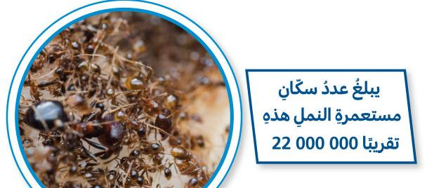
14. تستطيع ملكة النمل إنتاج تسعة ملايين نملة تقريبًا طوال حياتها. اكتب هذا العدد بالصيغة القياسية.
15. رسم منصور مربعًا طول ضلعه 8 سنتمتر. كم يبلغ محيط المربع الذي رسمه منصور؟
16. أكمل كتابة 720 080 بالصيغة التحليلية باستعمال الأسس: (7 × 10⁵) + ____
17. اكتب الصيغة اللفظية للعدد 43 080 700.
18. اكتب قيم الأرقام المحددة: الرقمان 2 في العدد 42 256
19. اكتب قيم الأرقام المحددة: الرقمان 9 في العدد 9 905 482
20. اكتب قيم الأرقام المحددة: الأرقام 4 في العدد 305 444
21. اكتب العدد 12 000 430 بالصيغة التحليلية.
22. اكتب العدد 337 060 بالصيغة التحليلية باستعمال الأسس.
23. اكتب عدد سكّان تشيلي بالصيغة التحليلية.
   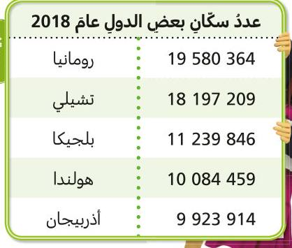
24. في العدد 9 290، هل قيمة الرقم 9 الأول تساوي عشرة أمثال قيمة الرقم 9 الثاني؟
25. يقول صالح إنّ في العدد 6 367 قيمة أحد الرقمين 6 تُساوي 10 أمثال قيمة الرقم 6 الآخر. هل ما قاله صالح صحيح؟
26. تفكّر ليلى في عدد مكوّن من 4 أرقام وكلّ أرقامه متماثلة. قيمة الرقم في منزلة المئات هي 200. الجزء A: ما هذا العدد؟ الجزء B: صف العلاقة بين قيم الأرقام في العدد.
27. اختارت منال ومها أعدادًا للعبة القيم المنزلية. اختارت منال العدد مئة واثنين وخمسين ألفًا. واختارت مها العدد خمسة ملايين. من التي اختارت العدد الأكبر؟
28. ذهبت شيخة وأسرتها في عطلة لمدة 10 أيام. قرأت 12 صفحة من كتابها في كلّ يوم. ما العدد الكلّي للصفحات التي قرأتها في أثناء العطلة؟
29. هل قيمة الرقم 9 الثاني في عدد سكّان أذربيجان مُساوٍ لـ 10 أمثال قيمة الرقم 9 الثالث؟
   
30. يقول يوسف إنّه في العدد 9 999 999، كلّ الأرقام لها القيمة نفسها. الجزء A: هل ما قاله يوسف صحيح؟ الجزء B: صف العلاقة بين قيم الأرقام في العدد.
31. كتب حمد الصيغة التحليلية لمليونين وثلاثمائة وخمسين ألفًا وأربعة كالتالي: 4 + (10³ × 5) + (10⁴ × 3) + (10⁶ × 2)، ما الخطأ الذي وقع فيه حمد؟ ما الصيغة القياسية للعدد؟
32. في يوم ما كان عدد زوّار مركز تجاريّ 126 945، قرّب 126 945 إلى أقرب مئة ألف وأقرب عشرة آلاف وأقرب ألف. أيّ هذه المقادير المقرّبة أقرب إلى الحضور الفعليّ؟

#### أولًا: اختر الإجابة الصحيحة (أسئلة محوّلة)

1. ما قيمتا الرقمين 7 في العدد 7 700؟
   - أ) 7 000 و 700
   - ب) 7 و 7
   - ج) 700 و 70
   - د) 7 000 و 70
2. ما قيمتا الرقمين 2 في العدد 522؟
   - أ) 2 و 2
   - ب) 20 و 2
   - ج) 200 و 20
   - د) 200 و 2
3. ما قيمتا الرقمين 9 في العدد 990 250؟
   - أ) 9 000 و 900
   - ب) 90 000 و 9 000
   - ج) 900 000 و 90 000
   - د) 900 و 90
4. ما قيم الأرقام 1 في العدد 2 011 168؟
   - أ) 10 000 و 1 000 و 100
   - ب) 1 و 1 و 1
   - ج) 100 000 و 10 000 و 1 000
   - د) 10 و 100 و 1 000
5. ما الصيغة اللفظيّة للعدد 43 080 700؟
   - أ) ثلاثةٌ وأربعون مليونًا وثمانمئة ألفٍ وسبعة
   - ب) أربعةٌ وثلاثون مليونًا وثمانون ألفًا وسبعمئة
   - ج) ثلاثةٌ وأربعون مليونًا وثمانون ألفًا وسبعمئة
   - د) ثلاثةٌ وأربعون ألفًا وثمانون مليونًا وسبعمئة
6. ما قيمتا الرقمين 2 في العدد 42 256؟
   - أ) 2 000 و 200
   - ب) 200 و 20
   - ج) 2 000 و 20
   - د) 20 000 و 2 000
7. ما قيمتا الرقمين 9 في العدد 9 905 482؟
   - أ) 9 000 000 و 90 000
   - ب) 900 000 و 90 000
   - ج) 9 000 000 و 900 000
   - د) 900 000 و 9 000
8. ما قيم الأرقام 4 في العدد 305 444؟
   - أ) 4 و 4 و 4
   - ب) 4 000 و 400 و 40
   - ج) 40 و 4 و 0.4
   - د) 400 و 40 و 4
9. ما الصيغة التحليليّة للعدد 12 000 430؟
   - أ) (1 × 10 000 000) + (2 × 1 000 000) + (4 × 10) + (3 × 1)
   - ب) (1 × 1 000 000) + (2 × 100 000) + (4 × 100) + (3 × 10)
   - ج) (1 × 10 000 000) + (2 × 1 000 000) + (4 × 100) + (3 × 10)
   - د) (1 × 10 000) + (2 × 1 000) + (4 × 100) + (3 × 10)
10. تفكّر ليلى في عددٍ من 4 أرقامٍ كلّ أرقامه متماثلةٌ، وقيمة الرقم في منزلة المئات 200. ما هذا العدد؟
   - أ) 2 000
   - ب) 2 222
   - ج) 2 200
   - د) 200
11. يقول يوسف إنّ كلّ الأرقام في العدد 9 999 999 لها القيمة نفسها. هل كلامه صحيحٌ؟
   - أ) نعم، لأنّ كلّ الأرقام متماثلةٌ
   - ب) لا، لأنّ لكلّ رقمٍ قيمةً مختلفةً بحسب منزلته
   - ج) نعم، لأنّ العدد كلّه من التسعات
   - د) لا، لأنّ العدد ليس مكوّنًا من التسعات
12. كتب حمدٌ الصيغة التحليليّة لمليونين وثلاثمائة وخمسين ألفًا وأربعة. ما الصيغة التحليليّة الصحيحة؟
   - أ) 4 + (10³ × 5) + (10⁴ × 3) + (10⁶ × 2)
   - ب) 4 + (10⁴ × 5) + (10⁵ × 3) + (10⁶ × 2)
   - ج) 4 + (10² × 5) + (10³ × 3) + (10⁶ × 2)
   - د) 4 + (10⁵ × 5) + (10⁴ × 3) + (10⁶ × 2)
13. ما الصيغة القياسيّة للعدد: مليونان وثلاثمائة وخمسون ألفًا وأربعة؟
   - أ) 2 350 400
   - ب) 23 504
   - ج) 2 305 004
   - د) 2 350 004
14. كان عدد زوّار مركزٍ تجاريٍّ في يومٍ ما 126 945. ما العدد مقرّبًا إلى أقرب ألفٍ؟
   - أ) 126 000
   - ب) 127 000
   - ج) 130 000
   - د) 100 000

### الدرس 1-3: الكسور العشرية حتى الأجزاء من الألف

#### أولًا: اختر الإجابة الصحيحة

1. إذا كان 0.04 يساوي 10 أمثال كسر عشريّ، فما هذا الكسر؟
   - أ) 0.4
   - ب) 0.1
   - ج) 0.004
   - د) 0.001
2. إذا كان 0.009 يساوي 1/10 كسر عشريّ، فما هذا الكسر؟
   - أ) 0.9
   - ب) 0.09
   - ج) 0.99
   - د) 0.999

#### رابعًا: أجب عن الأسئلة الآتية (مسائل وتفكير)

3. إذا كان 0.3 يساوي 10 أمثال كسر عشريّ، فما هذا الكسر؟ إذا كان 0.003 يساوي 1/10 كسر عشريّ، فما هذا الكسر؟
4. اكتب كلّ كسر عشريّ في صورة كسر اعتياديّ: 0.001
5. اكتب كلّ كسر عشريّ في صورة كسر اعتياديّ: 0.05
6. اكتب كلّ كسر عشريّ في صورة كسر اعتياديّ: 0.512
7. اكتب كلّ كسر عشريّ في صورة كسر اعتياديّ: 0.309
8. اكتب كلّ كسر اعتياديّ في صورة كسر عشريّ: 2/1 000
9. اكتب كلّ كسر اعتياديّ في صورة كسر عشريّ: 34/100
10. اكتب كلّ كسر اعتياديّ في صورة كسر عشريّ: 508/1 000
11. اكتب كلّ كسر اعتياديّ في صورة كسر عشريّ: 99/1 000
12. اكتب كلّ كسر عشريّ في صورة كسر اعتياديّ: 0.007
13. اكتب كلّ كسر عشريّ في صورة كسر اعتياديّ: 0.08
14. اكتب كلّ كسر عشريّ في صورة كسر اعتياديّ: 0.065
15. اكتب كلّ كسر عشريّ في صورة كسر اعتياديّ: 0.9
16. اكتب كلّ كسر عشريّ في صورة كسر اعتياديّ: 0.832
17. اكتب كلّ كسر عشريّ في صورة كسر اعتياديّ: 0.203
18. اكتب كلّ كسر عشريّ في صورة كسر اعتياديّ: 0.78
19. اكتب كلّ كسر عشريّ في صورة كسر اعتياديّ: 0.999
20. اكتب كلّ كسر اعتياديّ في صورة كسر عشريّ: 434/1 000
21. اكتب كلّ كسر اعتياديّ في صورة كسر عشريّ: 3/10
22. اكتب كلّ كسر اعتياديّ في صورة كسر عشريّ: 873/1 000
23. اكتب كلّ كسر اعتياديّ في صورة كسر عشريّ: 17/1 000
24. اكتب كلّ كسر اعتياديّ في صورة كسر عشريّ: 309/1 000
25. اكتب كلّ كسر اعتياديّ في صورة كسر عشريّ: 5/1 000
26. اكتب كلّ كسر اعتياديّ في صورة كسر عشريّ: 6/100
27. اكتب كلّ كسر اعتياديّ في صورة كسر عشريّ: 999/1 000
28. سجّل سيف 10² × 4 نقطة في لعبة. وسجّل علي 10³ × 2 نقطة في اللعبة نفسها. من منهما سجّل نقاطًا أكثر؟ وبكم أكثر؟
29. 0.08 يساوي 10 أمثال ____
30. انظر إلى الرقم 9 في المنتصف ما علاقة قيمته بقيمة الرقم 9 على يساره؟ وبقيمة الرقم 9 على يمينه؟
31. يريد فيصل شراء جهاز كمبيوتر جديد لمكتبه بقيمة QR 3 513. سدّد دفعة أولى قيمتها QR 1 757. ما المبلغ الذي يتعيّن على فيصل دفعه مقابل إتمام عملية شراء الكمبيوتر؟ اكتب جملة عددية لتمثيل الحلّ.
32. اكتب الكسور الاعتيادية 22/100 و 22/1 000 في صورة كسور عشرية. ما العلاقة بين قيم الرقم 2 في كلّ كسر عشريّ؟
33. فكّر فارس أنّه في العدد 0.555 تبلغ قيمة الرقم 5 في منزلة الأجزاء من ألف عشرة أمثال قيمة الرقم 5 في منزلة الأجزاء من مئة. هل ما قاله فارس صحيح؟
34. ما عدد المكعّبات في الصندوق؟ ما الكسر الاعتيادي الذي تمثّله الـ 7 مكعّبات من الصندوق بأكمله؟
   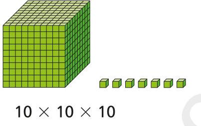
35. قال عثمان إنّه يمكن كتابة 0.029 في الصورة 29/100، هل ما قاله عثمان صحيح؟
36. مساحة قارة أمريكا الشمالية تقريبًا 9 540 000 ميل مربع. اكتب 9 540 000 بالصيغة التحليلية مستعملًا الأسس لإظهار قوى العدد 10.
37. ما قيمة الجزء المظلّل في المربع بأكمله؟ اكتب إجابتك في صورة كسر اعتياديّ وكسر عشريّ.
   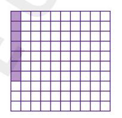
38. شاهد حسن 40 فيلمًا خلال ثلاثة أشهر. إذا شاهد 12 فيلمًا في يونيو و 13 فيلمًا في يوليو، ما عدد الأفلام التي شاهدها في أغسطس؟ اكتب معادلة باستعمال المتغيّر a لتمثيل حلّك.
39. قالت خولة إنّه يمكن كتابة 97/1 000 بالصورة 0.97، هل ما قالته خولة صحيح؟
40. اكتب الكسور الاعتيادية 5/10 و 5/100 و 5/1 000 في صورة كسور عشرية. ما العلاقة بين هذه الكسور العشرية؟

### الدرس 1-4: فهم القيمة المنزلية للكسر العشري

#### رابعًا: أجب عن الأسئلة الآتية (مسائل وتفكير)

1. يوجد في العدد 3.453 رقمًا 3، لماذا لكلّ رقم 3 قيمة مختلفة؟
2. اكتب كلّ عدد بالصيغة القياسية: (4 × 100) + (7 × 10) + (6 × 1) + (6 × 1/10) + (3 × 1/100) + (7 × 1/1 000)
3. اكتب كلّ عدد بالصيغة القياسية: أربعة صحيح وثمانية وستّون جزءًا من ألف
4. اكتب كلّ عدد بالصيغة القياسية: (2 × 1) + (6 × 1/1 000)
5. اكتب كلّ عدد بالصيغة القياسية: (3 × 1) + (3 × 1/10) + (9 × 1/1 000)
6. اكتب كلّ عدد بالصيغة القياسية: تسعة صحيح وعشرون جزءًا من مئة
7. اكتب كسرين عشريين مكافئين لكلّ كسر عشريّ معطى: 2.200
8. اكتب كسرين عشريين مكافئين لكلّ كسر عشريّ معطى: 8.1
9. اكتب كسرين عشريين مكافئين لكلّ كسر عشريّ معطى: 9.50
10. اكتب كسرين عشريين مكافئين لكلّ كسر عشريّ معطى: 4.200
11. لدى سعود حبل طوله 205.95 سنتمتر. اكتب هذا العدد بالصيغة التحليلية.
12. كيف تعرف أنّ 7.630 و 7.63 كسران عشريان متكافئان؟
13. اكتب 863.141 بالصيغة التحليلية.
14. اكتب كلّ عدد بالصيغة القياسية: (8 × 1) + (5 × 1/100) + (9 × 1/1 000)
15. اكتب كلّ عدد بالصيغة القياسية: 1 + 0.9 + 0.08 + 0.001
16. اكتب كلّ عدد بالصيغة القياسية: أربعمائة وخمسة وعشرون صحيح، واثنان وخمسون جزءًا من مئة
17. اكتب كسرين عشريين مكافئين لكلّ كسر عشريّ معطى: 5.300
18. اكتب كسرين عشريين مكافئين لكلّ كسر عشريّ معطى: 3.7
19. اكتب كسرين عشريين مكافئين لكلّ كسر عشريّ معطى: 0.9
20. اكتب كسرين عشريين مكافئين لكلّ كسر عشريّ معطى: 2.50
21. تهدف جمعية خيرية سنويًّا إلى جمع تبرّعات قيمتها الإجمالية QR 100 000. هذه السنة، تمّ جمع QR 63 482 حتّى الآن. ما مقدار المبلغ الباقي للوصول إلى الهدف؟
22. في مدرسة جاسم، يشارك 0.825 من الطلاب في اليوم الرياضي. إن كان عدد الطلاب الكلّي في المدرسة ألف طالب، فما عدد الطلاب الذين شاركوا في اليوم الرياضي؟
23. وضعت مريم الفاصلة العشرية بشكل خاطئ عندما كتبت أنّ 0.65 إنش هو طول حاسوبها اللوحيّ. ما الكسر العشريّ الصحيح الذي يمثّل طول حاسوبها؟
   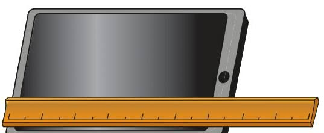
24. أوجد كسرين عشريّين مكافئين لـ (4 × 10) + (7 × 1/100)، اكتب الكسور العشرية في الصندوق المعروض.
   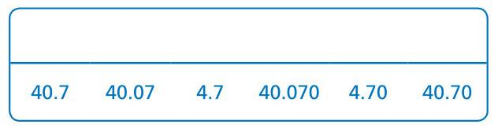
25. يوجد 275 شخصًا في صالة السينما. يجلس نفس العدد من الأشخاص في كلّ من الأقسام الـ 5 المختلفة في الصالة. ما عدد الأشخاص الجالسين في كلّ قسم؟
26. يبلغ متوسّط ضربات عيسى في كرة التنس 0.340، ومتوسّط ضربات بدر 0.304، يقول بدر إنّ لديهما نفس متوسّط الضربات. ما الخطأ الذي ارتكبه؟
27. أوجد كسرين عشريّين مكافئين لـ (8 × 100) + (3 × 1/10) + (6 × 1/100). اكتب الكسور العشرية في الصندوق المعروض.
   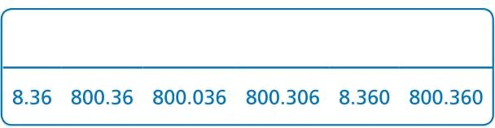
28. ظلّل كلّ واحد من ثلاثة فتيان نماذج يمثّل كلّ منها الأجزاء من مئة. لم يظلّل بلال أيّ نموذج. ظلّل ناصر نصف نموذج. وظلّل عمر نموذجين وجزءًا واحدًا من عشرة من نموذج آخر. ما الكسر العشريّ الذي يمثّل المقدار الذي ظلّله كلّ واحد منهم؟
   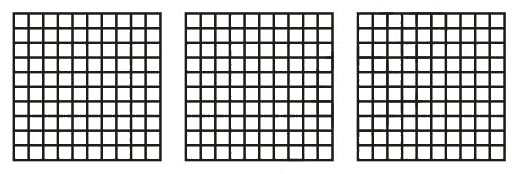

#### أولًا: اختر الإجابة الصحيحة (أسئلة محوّلة)

1. ما قيمتا الرقمين 3 في العدد 3.453؟
   - أ) 3 و 0.3
   - ب) 3 و 0.03
   - ج) 30 و 0.003
   - د) 3 و 0.003
2. أيّ كسرٍ عشريٍّ يكافئ 2.200؟
   - أ) 2.02
   - ب) 0.22
   - ج) 22
   - د) 2.2
3. أيّ كسرٍ عشريٍّ يكافئ 8.1؟
   - أ) 8.01
   - ب) 8.10
   - ج) 81
   - د) 0.81
4. أيّ كسرٍ عشريٍّ يكافئ 9.50؟
   - أ) 95
   - ب) 9.05
   - ج) 0.95
   - د) 9.5
5. أيّ كسرٍ عشريٍّ يكافئ 4.200؟
   - أ) 4.020
   - ب) 4.002
   - ج) 42
   - د) 4.2
6. أيّ كسرٍ عشريٍّ يكافئ 5.300؟
   - أ) 5.03
   - ب) 53
   - ج) 0.53
   - د) 5.3
7. أيّ كسرٍ عشريٍّ يكافئ 2.50؟
   - أ) 2.05
   - ب) 25
   - ج) 2.5
   - د) 0.25
8. كيف تعرف أنّ 7.630 و 7.63 كسران عشريّان متكافئان؟
   - أ) لأنّ كليهما يحتوي على الرقم 7
   - ب) لأنّ الصفر في آخر 7.630 لا يغيّر قيمة العدد
   - ج) لأنّ 7.630 أكبر من 7.63
   - د) لأنّ عدد الأرقام بعد الفاصلة متساوٍ
9. متوسّط ضربات عيسى في التنس 0.340 ومتوسّط ضربات بدر 0.304. يقول بدرٌ إنّ لهما المتوسّط نفسه. ما الخطأ الذي ارتكبه؟
   - أ) لا خطأ، فالمتوسّطان متساويان
   - ب) نسي أنّ 0.340 أكبر من 0.304
   - ج) نسي أنّ 0.304 أكبر من 0.340
   - د) ظنّ أنّ 0.304 أكبر من 1
10. ما الكسر العشريّ الذي يمثّل (4 × 10) + (7 × 1/100)؟
   - أ) 40.7
   - ب) 40.07
   - ج) 4.07
   - د) 47.01
11. ما الكسر العشريّ الذي يمثّل (8 × 100) + (3 × 1/10) + (6 × 1/100)؟
   - أ) 83.6
   - ب) 800.63
   - ج) 80.36
   - د) 800.36
12. لوّن ناصرٌ نصف نموذجٍ يمثّل الأجزاء من مئةٍ. ما الكسر العشريّ الذي يمثّل المقدار الملوّن؟
   - أ) 0.05
   - ب) 0.25
   - ج) 5.0
   - د) 0.5
13. لوّن عمرُ نموذجين كاملين وجزءًا واحدًا من عشرةٍ من نموذجٍ آخر. ما الكسر العشريّ الذي يمثّل المقدار الملوّن؟
   - أ) 2.01
   - ب) 2.1
   - ج) 0.21
   - د) 21

### الدرس 1-5: مقارنة الكسور العشرية

#### رابعًا: أجب عن الأسئلة الآتية (مسائل وتفكير)

1. اكتب > أو < أو = في كلّ ○ : 3.692 ○ 3.697
2. اكتب > أو < أو = في كلّ ○ : 7.216 ○ 7.203
3. رتّب الكسور العشرية من الأصغر إلى الأكبر: 5.540 ، 5.631 ، 5.625
4. رتّب الكسور العشرية من الأصغر إلى الأكبر: 0.675 ، 1.529 ، 1.35 ، 0.693
5. قارن بين كلّ عددين. اكتب > أو < أو = في كلّ ○ : 0.890 ○ 0.89
6. قارن بين كلّ عددين. اكتب > أو < أو = في كلّ ○ : 5.733 ○ 5.693
7. قارن بين كلّ عددين. اكتب > أو < أو = في كلّ ○ : 9.707 ○ 9.717
8. رتّب الكسور العشرية من الأكبر إلى الأصغر: 878.403 ، 887.304 ، 887.043
9. رتّب الكسور العشرية من الأكبر إلى الأصغر: 435.566 ، 436.565 ، 435.665
10. هل العدد 0.5 أكبر من العدد 6/10 أم أقلّ منه؟ ارسم خطّ أعداد لتوضيح إجابتك.
11. يمكن أن يبلغ طول قطر حبّة رمل ناعمة 0.125 ملّمتر. أيّ الأعداد التالية أصغر من طول قطر الحبّة؟ (أ) 0.1  (ب) 0.2  (ج) 0.13  (د) 0.12  (هـ) 0.126
12. وزنت سميرة بعض التفاح في متجر البقالة. كان وزن التفاح 4.16 كيلوجرام. أيّ الأعداد التالية أكبر من العدد 4.16؟ (أ) 4.15  (ب) 4.19  (ج) 4.2  (د) 4.09  (هـ) 4.1
13. قاس العلماء طول صرصور ماديرا فوجدوا أنّ طوله 3.44 سنتمتر. يقول سلطان إنّ صرصور ماديرا أقصر من الصرصور الشرقي لأنّ العدد 3.44 يحتوي على أرقام أقلّ من العدد 3.432. هل هو على صواب؟
14. بيّن سبب عدم منطقية القول إنّ العدد 4.23 أصغر من العدد 4.135 لأنّ العدد 4.23 يحتوي على أرقام أقلّ بعد الفاصلة العشرية من العدد 4.135
15. يكتب سليم ثلاثة أعداد تقع بين العددين 0.33 و 0.34، ما الأعداد التي يمكن أن يكتبها سليم؟
16. المصطلحات: صل بين كلّ كسر عشريّ على اليمين وبين الكسر العشريّ المكافئ له على اليسار. (0.75 ، 1.50 ، 1.05 ، 0.075) و (0.750 ، 0.075 ، 1.500 ، 1.050)
17. كانت نتيجة ليلى في القفز 15.050، كيف تُقارن هذه النتيجة بنتيجة سلمى؟
   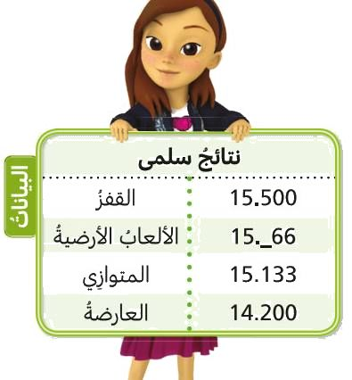
18. نشرت النتائج التي أحرزتها سلمى في رياضة الجمباز على لوحة النتائج مرتبة من الأعلى إلى الأدنى. يوجد رقم ناقص من نتيجة سلمى في الألعاب الأرضية. اذكر كلّ الأرقام التي يمكن أن يكون أحدها الرقم الناقص من تلك النتيجة.
   

#### أولًا: اختر الإجابة الصحيحة (أسئلة محوّلة)

1. أيّ ترتيبٍ صحيحٌ للكسور العشريّة 5.540 ، 5.631 ، 5.625 من الأصغر إلى الأكبر؟
   - أ) 5.540 ، 5.625 ، 5.631
   - ب) 5.631 ، 5.625 ، 5.540
   - ج) 5.625 ، 5.540 ، 5.631
   - د) 5.540 ، 5.631 ، 5.625
2. أيّ ترتيبٍ صحيحٌ للأعداد 0.675 ، 1.529 ، 1.35 ، 0.693 من الأصغر إلى الأكبر؟
   - أ) 0.675 ، 0.693 ، 1.35 ، 1.529
   - ب) 0.693 ، 0.675 ، 1.35 ، 1.529
   - ج) 0.675 ، 0.693 ، 1.529 ، 1.35
   - د) 1.35 ، 1.529 ، 0.675 ، 0.693
3. هل العدد 0.5 أكبر من العدد 6/10 أم أقلّ منه؟
   - أ) أقلّ منه
   - ب) أكبر منه
   - ج) يساويه
   - د) لا يمكن المقارنة
4. يبلغ طول قطر حبّة رملٍ ناعمةٍ 0.125 ملّيمترًا. أيّ الأعداد الآتية أصغر من طول قطر الحبّة؟
   - أ) 0.12
   - ب) 0.13
   - ج) 0.2
   - د) 0.126
5. وزن تفّاحٍ 4.16 كيلوجرام. أيّ الأعداد الآتية أكبر من 4.16؟
   - أ) 4.15
   - ب) 4.19
   - ج) 4.1
   - د) 4.09
6. طول صرصور ماديرا 3.44 سنتمترًا. يقول سلطان إنّه أقصر من الصرصور الشرقيّ الذي طوله 3.432 لأنّ 3.44 يحتوي على أرقامٍ أقلّ. هل هو على صوابٍ؟
   - أ) نعم، لأنّ عدد الأرقام أقلّ
   - ب) لا، لأنّ العددين متساويان
   - ج) نعم، لأنّ 3.44 أصغر من 3.432
   - د) لا، لأنّ 3.44 أكبر من 3.432
7. لماذا ليس من المنطقيّ القول إنّ 4.23 أصغر من 4.135 لأنّ 4.23 فيه أرقامٌ أقلّ بعد الفاصلة؟
   - أ) لأنّ 4.23 أكبر من 4.135 (2 أعشارٍ أكبر من 1 عشرٍ)
   - ب) لأنّ 4.23 يساوي 4.135
   - ج) لأنّ عدد الأرقام بعد الفاصلة يحدّد الأكبر
   - د) لأنّ 4.135 أكبر لأنّ فيه رقمين أكثر
8. أيّ العددين الآتيين يقع بين 0.33 و 0.34؟
   - أ) 0.329
   - ب) 0.34
   - ج) 0.345
   - د) 0.335
9. سجّلت ليلى 15.050 في القفز، وسجّلت سلمى 15.500 في القفز نفسه. كيف تُقارَن نتيجة ليلى بنتيجة سلمى؟
   - أ) نتيجة ليلى أصغر من نتيجة سلمى
   - ب) نتيجة ليلى أكبر من نتيجة سلمى
   - ج) نتيجة ليلى تساوي نتيجة سلمى
   - د) لا يمكن المقارنة بينهما
10. نتائج سلمى مرتّبة من الأعلى إلى الأدنى: القفز 15.500، والألعاب الأرضية 15.؟66، والمتوازي 15.133، والعارضة 14.200. أيّ الأرقام الآتية يمكن أن يكون الرقم الناقص؟
   - أ) 5
   - ب) 0
   - ج) 3
   - د) 8
11. كم نتيجة من نتائج سلمى الآتية أكبر من 15.050؟ (القفز 15.500، المتوازي 15.133، العارضة 14.200)
   - أ) نتيجتان
   - ب) نتيجة واحدة
   - ج) ثلاث نتائج
   - د) لا توجد نتيجة
12. رتّب الأعداد 15.500 ، 15.133 ، 14.200 من الأكبر إلى الأصغر.
   - أ) 15.133 ، 15.500 ، 14.200
   - ب) 14.200 ، 15.133 ، 15.500
   - ج) 15.500 ، 15.133 ، 14.200
   - د) 15.500 ، 14.200 ، 15.133
13. أيّ العددين الآتيين أكبر: 5.608 أم 5.68؟
   - أ) 5.68
   - ب) 5.608
   - ج) متساويان
   - د) لا يمكن المقارنة

### الدرس 1-6: تقريب الكسور العشرية

#### رابعًا: أجب عن الأسئلة الآتية (مسائل وتفكير)

1. لتقريب 74.58 إلى أقرب جزء من عشرة، إلى أيّ رقم تنظر؟ ما مقدار 74.58 مقرّبًا إلى أقرب جزء من عشرة؟
2. قرّب كلّ عدد إلى منزلة الرقم الذي تحته خطّ.
   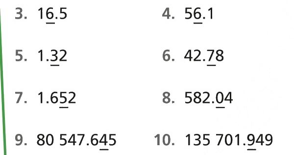
3. قرّب كلّ كسر عشريّ إلى أقرب عدد كلّي: 4.5
4. قرّب كلّ كسر عشريّ إلى أقرب عدد كلّي: 57.3
5. قرّب كلّ كسر عشريّ إلى أقرب عدد كلّي: 34.731
6. قرّب كلّ كسر عشريّ إلى أقرب عدد كلّي: 215.39
7. قرّب كلّ عدد إلى منزلة الرقم الذي تحته خطّ.
   
8. تعرض الصورة المجاورة طول تمساح. ما طول التمساح مقرّبًا إلى أقرب جزء من عشرة؟
   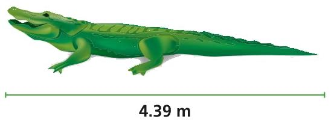
9. ارسم كلّ محاور التناظر في الشكل الموضّح أدناه.
   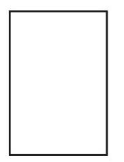
10. تتقاضى خدمة تأجير سيارات رسومًا من العملاء وفقًا لعدد الكيلومترات التي قطعوها، مقرّبًا إلى أقرب كيلومتر كلّي. سافر عمر مسافة 40.8 km، ما عدد الكيلومترات التي سيُحاسَب عليها؟
11. اذكر رقمين مختلفين يكون العدد 8.21 هو نتيجة تقريبهما إلى أقرب جزء من مئة.
12. بالتقريب إلى أقرب مئة، ما أكبر عدد كلّي يقرّب إلى 2 500؟ وما أصغر عدد كلّي؟
13. اشترى راشد ما يكفي من الخبز لعمل 12 شطيرة. أعدّ 3 شطائر من شاورما الدجاج و 5 شطائر فلافل، والباقي شطائر لحم. ما الكسر الاعتياديّ الذي يمثّل شطائر اللحم من الشطائر التي أعدّها راشد؟
14. بعد شراء المستلزمات المدرسية، بقي مع ريم QR 32، أنفقت QR 4 على مشابك الورق و QR 18 على دفاتر الملاحظات و QR 30 على حاسبة جديدة. ما المبلغ، m، الذي بدأت به ريم؟ اكتب جملة عددية تمثّل حلّك.
15. أوجد عددين يكون العدد 35.4 نتيجة تقريبهما إلى أقرب جزء من عشرة. اكتب العددين في الصندوق.
   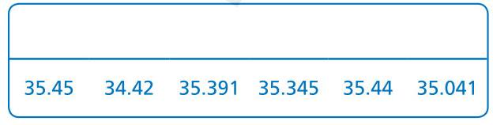
16. تحتاج هدى إلى 2 kg من اللحم المفروم لتحضير وجبة العشاء. لديها عبوة فيها 2.36 kg وعبوة أخرى فيها 2.09 kg، استعملت التقريب ووجدت أنّ كلتا العبوتين قريبتان من 2 kg، اشرح كيف تستطيع هدى اختيار العبوة الأقرب إلى 2 kg

#### أولًا: اختر الإجابة الصحيحة (أسئلة محوّلة)

1. لتقريب 74.58 إلى أقرب جزءٍ من عشرةٍ، إلى أيّ رقمٍ تنظر؟
   - أ) رقم الأجزاء من مئةٍ
   - ب) رقم الأعشار
   - ج) رقم الآحاد
   - د) رقم الأجزاء من ألفٍ
2. ما مقدار 74.58 مقرّبًا إلى أقرب جزءٍ من عشرةٍ؟
   - أ) 74.6
   - ب) 74.5
   - ج) 74.7
   - د) 75.0
3. أيّ العدد يُقرَّب إلى 8.21 عند التقريب إلى أقرب جزءٍ من مئةٍ؟
   - أ) 8.216
   - ب) 8.229
   - ج) 8.226
   - د) 8.206
4. ما أكبر عددٍ كلّيٍّ يُقرَّب إلى 2 500 عند التقريب إلى أقرب مئةٍ؟
   - أ) 2 549
   - ب) 2 550
   - ج) 2 599
   - د) 2 500
5. ما أصغر عددٍ كلّيٍّ يُقرَّب إلى 2 500 عند التقريب إلى أقرب مئةٍ؟
   - أ) 2 400
   - ب) 2 449
   - ج) 2 450
   - د) 2 451
6. بعد شراء المستلزمات المدرسيّة بقي مع ريم QR 32، بعد أن أنفقت QR 4 على مشابك الورق و QR 18 على دفاتر الملاحظات و QR 30 على حاسبةٍ. كم ريالًا بدأت به؟
   - أ) QR 84
   - ب) QR 74
   - ج) QR 52
   - د) QR 94
7. أيّ العدد يُقرَّب إلى 35.4 عند التقريب إلى أقرب جزءٍ من عشرةٍ؟
   - أ) 35.34
   - ب) 35.46
   - ج) 35.36
   - د) 35.52
8. تحتاج هدى إلى 2 kg من اللحم المفروم، ولديها عبوةٌ فيها 2.36 kg وعبوةٌ أخرى فيها 2.09 kg. أيّ العبوتين أقرب إلى 2 kg؟
   - أ) عبوة 2.36 kg
   - ب) عبوة 2.09 kg
   - ج) العبوتان متساويتان في القرب
   - د) لا يمكن المقارنة
9. قرّب 16.5 إلى أقرب عدد كلّي.
   - أ) 15
   - ب) 16
   - ج) 17
   - د) 20
10. قرّب 42.78 إلى أقرب جزء من عشرة.
   - أ) 42.9
   - ب) 42.7
   - ج) 43.0
   - د) 42.8
11. قرّب 1.652 إلى أقرب جزء من مئة.
   - أ) 1.7
   - ب) 1.66
   - ج) 1.65
   - د) 1.6
12. قرّب 80 547.645 إلى أقرب جزء من مئة.
   - أ) 80 547.65
   - ب) 80 547.64
   - ج) 80 547.7
   - د) 80 548
13. قرّب 7.158 إلى أقرب جزء من عشرة.
   - أ) 7
   - ب) 7.1
   - ج) 7.16
   - د) 7.2
14. أيّ الأعداد الآتية يكون ناتج تقريبه إلى أقرب جزء من عشرة هو 35.4؟
   - أ) 35.34
   - ب) 35.47
   - ج) 35.43
   - د) 35.51

### الدرس 1-7: البحث عن البنية في الحل واستعمالها

#### رابعًا: أجب عن الأسئلة الآتية (مسائل وتفكير)

2. كيف يمكنك استعمال الأنماط لإيجاد العدد الذي قد يكون في المربع أسفل 0.52؟
   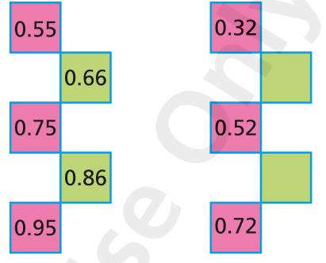
3. أثناء عودة سمير من نزهة استكشافية مع رفاقه في المعسكر الصيفي، مرّ بالعلامات الموضحة في الشكل المجاور. اشرح كيف يمكنك استعمال البنية في الحلّ لإيجاد الكسور العشرية التي ستظهر على العلامات الأربع القادمة.
   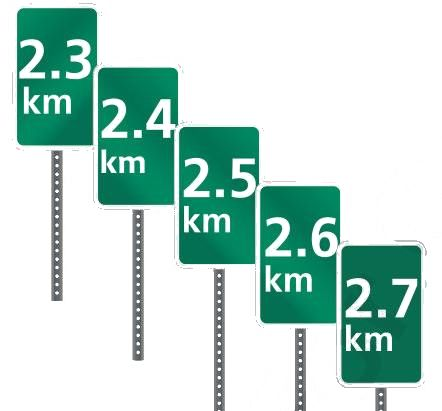
4. توقف سمير عند العلامة 1.8 km، أين سيكون إذا مشى جزءًا من عشرة من الكيلومتر تجاه المعسكر؟ كيلومترًا واحدًا تجاه المعسكر؟
   
5. كتب الطلاب في صفّ فيصل على السبورة جدول الكسور العشرية بأجزاء من ألف. تمّ محو بعض الأعداد. صف نمط التحرك عبر صفّ من اليسار إلى اليمين.
   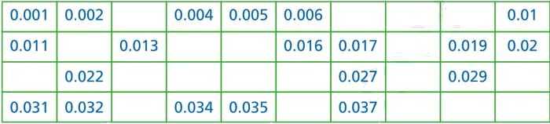
6. كيف يتغيّر النمط في آخر مربع من كلّ صفّ؟
   
7. صف نمط التحرك إلى الأسفل في كلّ عمود.
   
8. استعمل التبرير المنطقي المتكرر: اكتب العدد الناقص في جدول الكسور العشرية أعلاه.
   
9. افترض أنّ الطلاب أضافوا إلى الجدول. اكتب الأعداد الناقصة في الصفّ والعمود أدناه.
   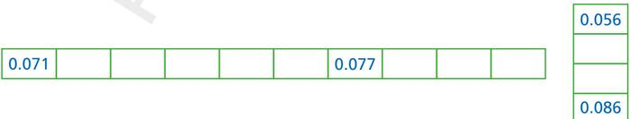

#### أولًا: اختر الإجابة الصحيحة (أسئلة محوّلة)

1. ما العدد التالي في النمط: 0.52 ، 0.53 ، 0.54 ، ؟
   - أ) 5.5
   - ب) 0.56
   - ج) 0.64
   - د) 0.55
2. ما العدد التالي في النمط: 1.8 ، 1.9 ، 2.0 ، ؟
   - أ) 3.0
   - ب) 2.01
   - ج) 2.1
   - د) 1.10
3. ما العدد التالي في النمط: 0.097 ، 0.098 ، 0.099 ، ؟
   - أ) 0.100
   - ب) 0.1000
   - ج) 0.1
   - د) 0.0100
4. ما العدد الناقص في النمط: 0.3 ، 0.6 ، 0.9 ، ؟ ، 1.5
   - أ) 1.2
   - ب) 1.1
   - ج) 1.0
   - د) 1.3
5. ما العدد التالي في النمط: 2.5 ، 2.25 ، 2.0 ، ؟
   - أ) 1.5
   - ب) 1.75
   - ج) 1.25
   - د) 2.75
6. توقّف سميرٌ عند العلامة 1.8 km. أين يكون إذا مشى جزءًا من عشرةٍ من الكيلومتر تجاه المعسكر (أي ينقص بعده عن المعسكر)؟
   - أ) 1.7 km
   - ب) 1.9 km
   - ج) 1.79 km
   - د) 0.8 km
7. توقّف سميرٌ عند العلامة 1.8 km. أين يكون إذا مشى كيلومترًا واحدًا تجاه المعسكر؟
   - أ) 2.8 km
   - ب) 1.7 km
   - ج) 0.18 km
   - د) 0.8 km
8. في جدول الكسور العشريّة بأجزاءٍ من ألفٍ، كلّما انتقلنا خطوةً إلى اليمين في الصفّ زاد العدد بمقدار:
   - أ) 0.1
   - ب) 0.01
   - ج) 1
   - د) 0.001
9. ما العدد الناقص في النمط: 0.5 ، 0.55 ، ؟ ، 0.65 ، 0.7
   - أ) 0.56
   - ب) 0.62
   - ج) 0.6
   - د) 0.605
10. ما العدد التالي في النمط: 3.4 ، 3.3 ، 3.2 ، ؟
   - أ) 3.21
   - ب) 3.0
   - ج) 2.2
   - د) 3.1
11. تظهر على علامات الطريق الأعداد 2.3 km ثمّ 2.4 km ثمّ 2.5 km ثمّ 2.6 km ثمّ 2.7 km. ما العدد على العلامة التالية في النمط نفسه؟
   - أ) 3.7 km
   - ب) 2.71 km
   - ج) 2.8 km
   - د) 2.9 km
12. في نمط علامات الطريق 2.3 km ، 2.4 km ، 2.5 km ، 2.6 km ، 2.7 km، ما العدد الذي كان على العلامة التي قبل 2.3 km؟
   - أ) 2.1 km
   - ب) 2.2 km
   - ج) 1.3 km
   - د) 2.33 km
13. في جدول الكسور العشرية بأجزاء من ألف يظهر في الصفّ الأوّل: 0.001 ، 0.002 ، ؟ ، 0.004 ، 0.005 ، 0.006. ما العدد الناقص؟
   - أ) 0.3
   - ب) 0.03
   - ج) 0.0003
   - د) 0.003
14. في جدول الكسور العشرية، العمود الأوّل هو: 0.001 ، 0.011 ، ؟ ، 0.031 (النزول في العمود يزيد 0.010 كلّ مرّة). ما العدد الناقص؟
   - أ) 0.201
   - ب) 0.012
   - ج) 0.021
   - د) 0.022
15. في جدول الكسور العشرية، الأعداد في آخر الصفوف الأربعة هي: 0.01 ، 0.02 ، 0.03 ، ؟ . ما العدد في آخر الصفّ الرابع؟
   - أ) 0.004
   - ب) 0.4
   - ج) 0.04
   - د) 0.40
16. كم عددًا ناقصًا بين 0.006 و 0.01 في جدول الكسور العشرية بأجزاء من ألف (0.007 و0.008 و0.009)؟
   - أ) 2 عددان
   - ب) 3 أعداد
   - ج) 4 أعداد
   - د) 5 أعداد
17. ما العدد التالي في النمط: 4.6 ، 4.7 ، 4.8 ، ؟
   - أ) 5.8
   - ب) 4.9
   - ج) 4.10
   - د) 4.81
18. ما العدد التالي في النمط: 7.5 ، 7.4 ، 7.3 ، ؟
   - أ) 6.3
   - ب) 7.6
   - ج) 7.2
   - د) 7.35
19. توقّف عادل عند العلامة 3.4 km، فأين يكون إذا مشى جزءًا من عشرة من الكيلومتر تجاه المعسكر (أي ينقص بعده عن المعسكر)؟
   - أ) 3.41 km
   - ب) 3.5 km
   - ج) 2.4 km
   - د) 3.3 km
20. ما العدد الناقص في النمط: 0.05 ، 0.10 ، 0.15 ، ؟ ، 0.25
   - أ) 0.20
   - ب) 0.30
   - ج) 0.18
   - د) 0.02

## الوحدة 2: جمع وطرح الكسور العشرية حتى الأجزاء من مئة

### الدرس 2-1: تقدير نواتج الجمع والطرح

#### أولًا: اختر الإجابة الصحيحة

1. ثلاث عيّنات من الصخور لها الكتل التالية: 74.05 جرام و 9.72 جرام و 45.49 جرام. قدّر أحد علماء الجيولوجيا الكتلة الكلّية للعيّنات الثلاث بتقريب كلّ كتلة إلى أقرب عدد كلّي. ما الأعداد التي جمعها؟
   - أ) 75 و 10 و 46
   - ب) 74.1 و 9.7 و 45.5
   - ج) 74 و 10 و 45
   - د) 75 و 10 و 50
2. اشترى حسن لعبة بمبلغ QR 7.75 وبعض البطاريات بمبلغ QR 5.25، ودفع لموظف الصندوق ورقتين نقديّتين من فئة QR 10، ما أفضل تقدير لمقدار الباقي الذي حصل عليه؟
   - أ) QR 5.00
   - ب) QR 7.00
   - ج) QR 13
   - د) QR 17.00

#### رابعًا: أجب عن الأسئلة الآتية (مسائل وتفكير)

3. قدّر ناتج التالي: 49 + 22.88
4. قدّر ناتج التالي: 86.9 − 18
5. قدّر ناتج التالي: 179 + 277.1
6. قدّر ناتج التالي: 23.2 − 9.71
7. قدّر ناتج التالي: 23.8 − 4.7
8. قدّر ناتج التالي: 87.2 + 3.9
9. قدّر ناتج التالي: 38.9 − 21.4
10. قدّر ناتج التالي: 576 + 94.6
11. قدّر ناتج التالي: 79.1 + 32.4
12. قدّر ناتج التالي: 788.9 − 572
13. قدّر ناتج التالي: 837 + 488.12
14. قدّر ناتج التالي: 418.5 − 23.7
15. قدّر ناتج التالي: 2.9 + 3.9
16. قدّر ناتج التالي: 12.99 − 3.95
17. قدّر ناتج التالي: 8.1 + 3.7 + 7.9
18. قدّر ناتج التالي: 3.8 + 4.1 + 3.3
21. تكلفة قرص DVD هي QR 16.98 وتكلفة قرص DVD آخر هي QR 9.29، قدّر ناصر تكلفة شراء القرصين بمبلغ QR 27 تقريبًا. هل هذا التقدير أكبر أم أصغر من التكلفة الدقيقة؟
22. قارنت سعاد بين مساحة وشكل الحديقة A ومساحة وشكل الحديقة B. بكم تزيد تقريبًا مساحة الحديقة A عن مساحة الحديقة B؟ (مساحة الحديقة A: 1 017 متر مربع، مساحة الحديقة B: 843 متر مربع)
   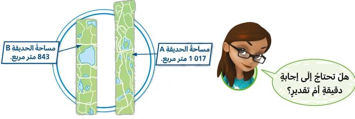
23. نظّمت إدارة إحدى المدارس رحلة ميدانية إلى محمية طبيعية في حافلات. تسع الحافلة الواحدة منها 46 طالبًا. هل من الأفضل أن يكون تقدير عدد الطلاب الذاهبين إلى الرحلة أكبر أم أصغر من عددهم الدقيق؟ ولماذا؟

#### أولًا: اختر الإجابة الصحيحة (أسئلة محوّلة)

1. قدّر ناتج 49 + 22.88 بتقريب كلّ عددٍ إلى أقرب عددٍ كلّيٍّ.
   - أ) 62
   - ب) 82
   - ج) 72
   - د) 71
2. قدّر ناتج 86.9 − 18 بتقريب كلّ عددٍ إلى أقرب عددٍ كلّيٍّ.
   - أ) 59
   - ب) 79
   - ج) 69
   - د) 68
3. قدّر ناتج 179 + 277.1 بتقريب كلّ عددٍ إلى أقرب عددٍ كلّيٍّ.
   - أ) 446
   - ب) 456
   - ج) 466
   - د) 457
4. قدّر ناتج 23.2 − 9.71 بتقريب كلّ عددٍ إلى أقرب عددٍ كلّيٍّ.
   - أ) 13
   - ب) 12
   - ج) 14
   - د) 23
5. قدّر ناتج 23.8 − 4.7 بتقريب كلّ عددٍ إلى أقرب عددٍ كلّيٍّ.
   - أ) 18
   - ب) 28
   - ج) 20
   - د) 19
6. قدّر ناتج 87.2 + 3.9 بتقريب كلّ عددٍ إلى أقرب عددٍ كلّيٍّ.
   - أ) 90
   - ب) 81
   - ج) 92
   - د) 91
7. قدّر ناتج 38.9 − 21.4 بتقريب كلّ عددٍ إلى أقرب عددٍ كلّيٍّ.
   - أ) 17
   - ب) 18
   - ج) 19
   - د) 60
8. قدّر ناتج 576 + 94.6 بتقريب كلّ عددٍ إلى أقرب عددٍ كلّيٍّ.
   - أ) 671
   - ب) 670
   - ج) 661
   - د) 681
9. قدّر ناتج 79.1 + 32.4 بتقريب كلّ عددٍ إلى أقرب عددٍ كلّيٍّ.
   - أ) 101
   - ب) 111
   - ج) 110
   - د) 112
10. قدّر ناتج 788.9 − 572 بتقريب كلّ عددٍ إلى أقرب عددٍ كلّيٍّ.
   - أ) 207
   - ب) 217
   - ج) 227
   - د) 1 361
11. قدّر ناتج 837 + 488.12 بتقريب كلّ عددٍ إلى أقرب عددٍ كلّيٍّ.
   - أ) 1 215
   - ب) 1 425
   - ج) 1 335
   - د) 1 325
12. قدّر ناتج 2.9 + 3.9 بتقريب كلّ عددٍ إلى أقرب عددٍ كلّيٍّ.
   - أ) 6
   - ب) 7
   - ج) 8
   - د) 6.8
13. قدّر ناتج 12.99 − 3.95 بتقريب كلّ عددٍ إلى أقرب عددٍ كلّيٍّ.
   - أ) 8
   - ب) 10
   - ج) 9
   - د) 16
14. قدّر ناتج 8.1 + 3.7 + 7.9 بتقريب كلّ عددٍ إلى أقرب عددٍ كلّيٍّ.
   - أ) 18
   - ب) 20
   - ج) 19
   - د) 21
15. قدّر ناتج 3.8 + 4.1 + 3.3 بتقريب كلّ عددٍ إلى أقرب عددٍ كلّيٍّ.
   - أ) 11
   - ب) 10
   - ج) 12
   - د) 15
16. تكلفة قرص DVD هي QR 16.98 وتكلفة قرصٍ آخر QR 9.29. قدّر ناصرٌ تكلفة القرصين بمبلغ QR 27. هل هذا التقدير أكبر أم أصغر من التكلفة الدقيقة؟
   - أ) أصغر منها
   - ب) أكبر منها
   - ج) يساويها تمامًا
   - د) لا يمكن المعرفة
17. تسع الحافلة الواحدة 46 طالبًا في رحلةٍ مدرسيّةٍ. عند تقدير عدد الطلّاب الذاهبين لحجز الحافلات، أيّ تقديرٍ أفضل؟
   - أ) تقديرٌ أصغر من عددهم الدقيق حتى توفّر المدرسة المال
   - ب) تقديرٌ أكبر من عددهم الدقيق حتى تتوافر مقاعد كافيةٌ
   - ج) التقدير لا يهمّ
   - د) يجب ألّا نقدّر أبدًا

### الدرس 2-2: استعمال النماذج لجمع وطرح الكسور العشرية

#### رابعًا: أجب عن الأسئلة الآتية (مسائل وتفكير)

1. استعمل شبكة الأجزاء من مئة في الجمع: 1.22 + 0.34
2. استعمل شبكة الأجزاء من مئة في الجمع: 0.63 + 0.41
3. استعمل شبكة الأجزاء من مئة في الطرح: 2.73 − 0.94
4. استعمل شبكة الأجزاء من مئة في الطرح: 1.38 − 0.73
5. استعمل شبكة الأجزاء من مئة في الطرح: 0.47 − 0.21
6. استعمل شبكة الأجزاء من مئة في الجمع: 2.02 + 0.8
7. اجمع أو اطرح. استعمل شبكة الأجزاء من مئة لتساعدك: 0.1 + 0.73
8. اجمع أو اطرح. استعمل شبكة الأجزاء من مئة لتساعدك: 1.33 − 0.35
9. اجمع أو اطرح. استعمل شبكة الأجزاء من مئة لتساعدك: 0.37 + 0.47
10. اجمع أو اطرح. استعمل شبكة الأجزاء من مئة لتساعدك: 1.11 + 0.89
11. هل ناتج جمع 0.25 + 0.46 أصغر أم أكبر من 1؟
12. قدّر لتحديد ما إذا كان ناتج 175 + 314 أكبر أم أصغر من 600
13. المصطلحات: قدّر 27.6 − 53.8. حوّط الأعداد المتناغمة للتعويض بها: 54 − 28 / 53 − 28 / 55 − 27 / 55 − 25
14. ما وجه التشابه بين جمع 2.25 + 4.50 وجمع 4.50 QR + 2.25 QR؟
15. اكتب المقدار الذي يمثّله النموذج أدناه.
   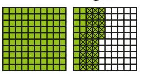
16. اكتب مقدارًا يمكن استعماله لإيجاد محيط بركة السباحة المجاورة. تذكّر أنّ المحيط هو طول المسافة المحيطة بالشكل. (الطول يساوي 50 مترًا، العرض يساوي 25 مترًا)
   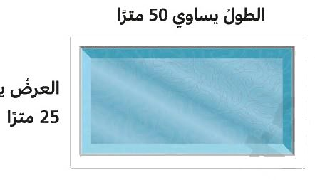
17. كلّ جزء من الجزأين المظلّلين في الشبكتين أدناه يمثّل كسرًا عشريًّا. الجزء A: ما ناتج جمع الكسرين العشريين؟ الجزء B: وضّح طريقة توصّلك إلى الإجابة.
   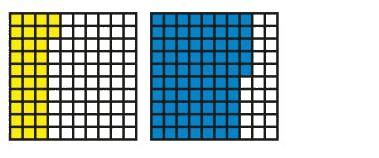
18. هل ناتج 0.95 − 1.4 أصغر أم أكبر من 1؟

#### أولًا: اختر الإجابة الصحيحة (أسئلة محوّلة)

1. قدّر لتحديد ما إذا كان ناتج 175 + 314 أكبر أم أصغر من 600.
   - أ) أصغر من 600
   - ب) أكبر من 600
   - ج) يساوي 600 تمامًا
   - د) لا يمكن التقدير
2. قدّر ناتج 27.6 + 53.8 باستعمال أعدادٍ متناغمةٍ.
   - أ) حوالي 60
   - ب) حوالي 80
   - ج) حوالي 70
   - د) حوالي 90
3. استعمل شبكة الأجزاء من مئة في الجمع: 1.34 + 0.45
   - أ) 1.89
   - ب) 17.90
   - ج) 0.18
   - د) 1.79
4. استعمل شبكة الأجزاء من مئة في الطرح: 0.68 − 0.29
   - أ) 0.04
   - ب) 3.90
   - ج) 0.39
   - د) 0.49
5. استعمل شبكة الأجزاء من مئة في الجمع: 2.15 + 1.23
   - أ) 0.34
   - ب) 33.80
   - ج) 3.38
   - د) 3.48
6. استعمل شبكة الأجزاء من مئة في الطرح: 0.92 − 0.36
   - أ) 0.56
   - ب) 5.60
   - ج) 0.06
   - د) 0.66
7. استعمل شبكة الأجزاء من مئة في الجمع: 0.56 + 0.27
   - أ) 0.08
   - ب) 8.30
   - ج) 0.83
   - د) 0.93

### الدرس 2-3: جمع الكسور العشرية

#### رابعًا: أجب عن الأسئلة الآتية (مسائل وتفكير)

1. أوجد ناتج التالي: 0.82 + 4.21
2. أوجد ناتج التالي: 9.1 + 7.21
3. أوجد ناتج التالي: 0.26 + 8.3
4. أوجد ناتج التالي: 4.98 + 3.02
5. أوجد ناتج التالي: 271.90 + 34.22
6. أوجد ناتج التالي: 7.2 + 3.96 + 8.8
7. أوجد ناتج التالي: 16.62 + 4 + 2.38
8. اختر ممّا يلي كلّ مقدار مساوٍ للعدد 12.9 (أ) 0.02 + 12 + 0.88  (ب) 0.06 + 12.03  (ج) 11.9 + 1  (د) 6.2 + 3.4 + 2.3  (هـ) 3.01 + 2.01 + 7.7
9. اختر ممّا يلي كلّ مقدار مساوٍ للعدد 16.02 (أ) 16 + 0.02  (ب) 3.42 + 8 + 4.6  (ج) 16.01 + 1  (د) 12.06 + 3.14  (هـ) 7.36 + 8.66
11. باع مزارع 53.2 كيلوجرام من الجزر و 29.4 كيلوجرام من الخيار للمطعم. ما عدد الكيلوجرامات من هذين النوعين التي باعها للمطعم؟
12. أيّ مدينتين تتلقّيان أكبر كمية من سقوط الأمطار في السنة؟ (المدينة A: 45 إنش، B: 12.19 إنش، C: 37.44 إنش، D: 44.97 إنش)
13. ما المدينة التي تتلقّى أقلّ من 45 إنش لكن أكثر من 40 إنش من الأمطار في السنة؟ (المدينة A: 45 إنش، B: 12.19 إنش، C: 37.44 إنش، D: 44.97 إنش)
14. جمع جابر 4.6 + 3.8 وحصل على الناتج 84، هل إجابته صحيحة؟ اذكر كيف عرفت ذلك.
15. لدى سمير QR 16 وأعطاه والدُه QR 17.50. دفع QR 8.50 مقابل شراء سيّارة لعبة و QR 1.75 مقابل علبة حلوى صغيرة. اكتب مقدارًا لتوضيح ما بقي معه من مال.

#### أولًا: اختر الإجابة الصحيحة (أسئلة محوّلة)

1. أيّ المقادير الآتية يساوي العدد 12.9؟
   - أ) 0.06 + 12.03
   - ب) 6.2 + 3.4 + 2.3
   - ج) 3.01 + 2.01 + 7.7
   - د) 0.02 + 12 + 0.88
2. أيّ المقادير الآتية يساوي العدد 16.02؟
   - أ) 16.01 + 1
   - ب) 3.42 + 8 + 4.6
   - ج) 12.06 + 3.14
   - د) 7.36 + 8.5
3. كمّيّات الأمطار السنويّة: المدينة A: 45 إنشًا، B: 12.19 إنشًا، C: 37.44 إنشًا، D: 44.97 إنشًا. أيّ المدن تتلقّى أكبر كمّيّةٍ من الأمطار؟
   - أ) المدينة A
   - ب) المدينة C
   - ج) المدينة D
   - د) المدينة B
4. جمع جابرٌ 4.6 + 3.8 وحصل على الناتج 84. ما الناتج الصحيح؟
   - أ) 84
   - ب) 7.4
   - ج) 0.84
   - د) 8.4
5. لدى سميرٍ QR 16 وأعطاه والده QR 17.50. دفع QR 8.50 مقابل سيّارة لعبةٍ و QR 1.75 مقابل علبة حلوى. كم بقي معه؟
   - أ) QR 24.75
   - ب) QR 23.25
   - ج) QR 25.00
   - د) QR 7.25
6. أوجد ناتج التالي: 0.73 + 3.18
   - أ) 39.10
   - ب) 3.91
   - ج) 0.39
   - د) 4.01
7. أوجد ناتج التالي: 5.46 + 21.07
   - أ) 26.63
   - ب) 265.30
   - ج) 2.65
   - د) 26.53
8. أوجد ناتج التالي: 138.40 + 52.35
   - أ) 1907.50
   - ب) 190.75
   - ج) 19.08
   - د) 190.85
9. أوجد ناتج التالي: 9.88 + 6.15
   - أ) 16.03
   - ب) 160.30
   - ج) 1.60
   - د) 16.13
10. أوجد ناتج التالي: 47.60 + 8.94
   - أ) 56.54
   - ب) 565.40
   - ج) 5.65
   - د) 56.64
11. أوجد ناتج التالي: 0.95 + 12.30
   - أ) 13.25
   - ب) 132.50
   - ج) 1.33
   - د) 13.35

### الدرس 2-4: طرح الكسور العشرية

#### رابعًا: أجب عن الأسئلة الآتية (مسائل وتفكير)

1. اطرح الكسرين العشريين: 16.82 − 5.21
2. اطرح الكسرين العشريين: 7.21 − 6.1
3. اطرح الكسرين العشريين: 23.06 − 8.24
4. اطرح الكسرين العشريين: 4.08 − 2.12
5. اطرح الكسرين العشريين: 56.8 − 2.76
6. اطرح الكسرين العشريين: 43.80 − 16.00
7. اطرح الكسرين العشريين: 22.4 − 10.7
8. اطرح الكسرين العشريين: 36.40 − 21.16
9. اطرح لإيجاد الفرق: 7.8 − 4.9
10. اطرح لإيجاد الفرق: 20.60 − 14.35
11. اطرح لإيجاد الفرق: 43.90 − 7.52
12. اطرح لإيجاد الفرق: 65.9 − 28.38
13. اطرح لإيجاد الفرق: 15.03 − 4.12
14. اطرح لإيجاد الفرق: 13.9 − 3.8
15. اطرح لإيجاد الفرق: 65.18 − 12.05
16. اطرح لإيجاد الفرق: 52.02 − 0.83
17. اطرح لإيجاد الفرق: 7.09 − 3.65
18. اطرح لإيجاد الفرق: 34.49 − 12.61
19. اطرح لإيجاد الفرق: 85.22 − 43.5
20. اطرح لإيجاد الفرق: 10.05 − 4.50
21. اطرح لإيجاد الفرق: 5.27 − 3.4
22. اطرح لإيجاد الفرق: 23.6 − 8.27
23. اطرح لإيجاد الفرق: 8.04 − 0.3
24. اطرح لإيجاد الفرق: 21.37 − 10.95
25. يبلغ ارتفاع هرم خفرع 143.5 متر، ويبلغ ارتفاع هرم منقرع 65.5 متر. اكتب جملة طرح وحلّها لإيجاد الفرق بين ارتفاعي الهرمين.
26. أعادت منى كتابة 7.9 − 45.59 في صورة 45.59 − 7.90. هل تغيّرت قيمة 7.9 بإضافة صفر بعد 7.9؟ ولماذا؟
27. طرحت ندى 2.9 من 20.9 وحصلت على الناتج 1.8، وضّح السبب في أنّ هذه الإجابة غير منطقية.
28. لدى أحمد $156.43 في حسابه المصرفيّ في بداية الشهر. أجرى السحبين الموضحين في الجدول. ما المبلغ الباقي لديه في حسابه المصرفيّ؟ يجب أن يكون في حسابه $100 على الأقلّ في نهاية الشهر وإلا فستُفرَض عليه رسوم إضافية. ما المبلغ الذي يجب أن يودعه ليتجنّب دفع الرسوم الإضافية؟ (الجدول: 1 سبتمبر إيداع 17.85 ورصيد 156.43 ، 8 سبتمبر سحب 24.97 ، 10 سبتمبر سحب 39.41)
   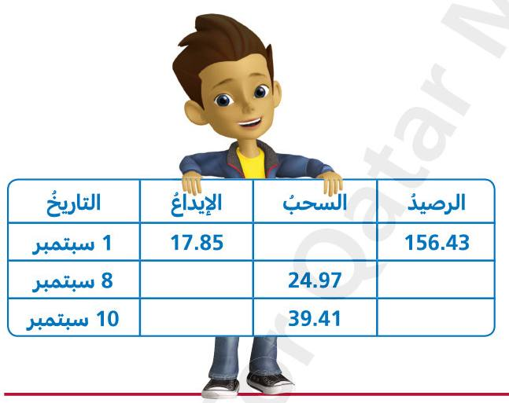
29. أيّ مسألتَي طرح ناتج كلّ منهما 1.65؟ اكتب هاتين المسألتين في الصندوق. (27.30 − 16.65 ، 11.23 − 9.58 ، 20.09 − 21.74 ، 12.68 − 2.03 ، 40.4 − 23.9)
   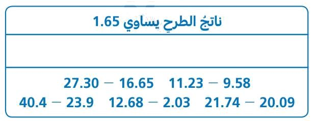
30. اشترى عبدالرحمن زجاجة مياه سعتها 1.5 لتر. استعمل 0.8 لتر من المياه في إعداد عصير الفاكهة. أيّهما أكبر، الكمية المستعملة أم الكمية المتبقية؟

### الدرس 2-5: جمع وطرح الكسور العشرية

#### رابعًا: أجب عن الأسئلة الآتية (مسائل وتفكير)

1. أوجد ناتج التالي: 5.9 + 2.7
2. أوجد ناتج التالي: 4.01 − 2.95
3. أوجد ناتج التالي: 2.57 + 7.7
4. أوجد ناتج التالي: 1.5 − 1.05
5. أوجد ناتج التالي: 10 + 3.28
6. أوجد ناتج التالي: 15 − 6.01
7. أوجد ناتج التالي: 3.45 − 1.6
8. أوجد ناتج التالي: 9.12 + 2.06
9. أوجد ناتج التالي: 2.17 − 0.8
10. أوجد ناتج التالي: 4.3 + 4.16
11. أوجد ناتج التالي: 7.62 − 3.86
12. أوجد ناتج التالي: 4.81 + 2.7
13. أوجد ناتج التالي: 5.87 − 0.48
14. أوجد ناتج التالي: 5.78 + 16.59
15. أوجد ناتج التالي: 9.5 − 9.45
16. أوجد ناتج التالي: 14 + 9.8
17. أوجد ناتج التالي: 46.91 − 28.7
18. أوجد ناتج التالي: 5.61 + 2.4
19. أوجد ناتج التالي: 27 + 0.18
20. أوجد ناتج التالي: 0.46 − 0.33
21. أوجد ناتج التالي: 8.92 + 56 + 3.08
22. أوجد ناتج التالي: 219.51 + 127.2 + 2.49
23. اختر كلّ المقادير المساوية للكسر العشريّ 3.89 (أ) 16.09 − 12.2  (ب) 48.5 − 9.6  (ج) 4.01 − 0.12  (د) 128 − 124.11  (هـ) 6 − 3.89
24. اختر كلّ مسائل الجمع التي تحتاج فيها إلى إضافة أصفار لترتيب القيم المنزلية في الأعداد المضافة. (أ) 4 + 1.23 + 45.62  (ب) 0.09 + 12  (ج) 0.11 + 12.11  (د) 19.9 + 0.6  (هـ) 8.3 + 2 + 6.01
25. ما أوجه الشبه والاختلاف بين جمع وطرح الكسور العشرية، وجمع وطرح الأعداد الكلّية؟
26. بيّن كيف تعرف ما إذا كان عليك أن تجمع أم تطرح لحل مسألة كسور عشرية.
27. أعطى سعيد البائع ورقة مالية من فئة QR 50 لدفع ثمن مشترياتٍ قيمتها QR 38.75 فأعاد له البائع ورقة مالية من فئة QR 10 وورقتين قيمة كلّ منهما ريال قطريّ واحد وقطعة نقود معدنية قيمتها 25 درهمًا. هل حصل سعيد على الباقي الصحيح؟ لماذا؟
28. كتبت منى الجملة العددية التالية: 5.9 = 0.33 + 2.6 + 6. استعمل التقدير لتبيّن أن إجابة منى غير صحيحة.
29. تعدّ بدور تنازليًا بدءًا من 18.5، حدّد النمط الذي تستعمله وأكمل تسلسل الأعداد. 18.5 ، 17.25 ، 16 ، ____ ، ____
30. كان سعر السهم في إحدى الشركات في نهاية يوم الإثنين QR 126.38، وانخفض بمقدار QR 7.95 في نهاية اليوم التالي. كم كان سعر السهم في نهاية يوم الثلاثاء؟
31. قام سائح في مدينة الدوحة بتسجيل المسافة التي يمشيها في كلّ موقع يزوره. في اليوم الأول سار حول الكورنيش وحديقة إسباير. وفي اليوم الثاني سار حول "اللؤلؤة". ما المسافة التي قطعها في اليوم الأول؟ بكمْ تزيد المسافة التي قطعها في اليوم الأول عن المسافة التي قطعها في اليوم الثاني؟ بكم تزيد المسافة التي قطعها في اليومين الأول والثاني عن المسافة التي قطعها في اليوم الثالث عندما زار حديقة البدع؟ (الكورنيش 10.1 ، حديقة إسباير 2.7 ، اللؤلؤة 12.6 ، حديقة البدع 22.9)
   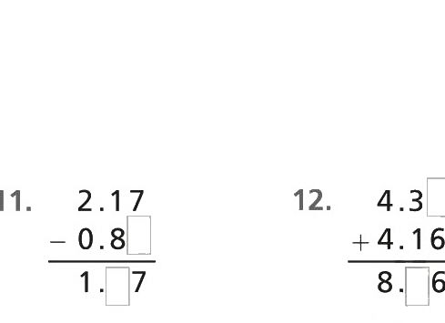

### الدرس 2-6: النمذجة في الرياضيات

#### رابعًا: أجب عن الأسئلة الآتية (مسائل وتفكير)

1. لدى ممدوح QR 30.50، ويريد أن يشتري قبّعة ثمنها QR 15، ولعبة ثمنها QR 3.75، وسلسلة مفاتيح ثمنها QR 14.50. ما المبلغ الإضافي الذي يحتاج إليه؟ ما الذي تحتاج إلى إيجاده قبل أن تتمكن من حلّ المسألة؟
2. لدى ممدوح QR 30.50، ويريد أن يشتري قبّعة ثمنها QR 15، ولعبة ثمنها QR 3.75، وسلسلة مفاتيح ثمنها QR 14.50. ارسم لوحة أجزاء لتمثيل المسألة ثمّ حلّها.
3. لدى فهد QR 15، اشترى تذكرة فيلم وكوبًا من عصير التفاح. ما المبلغ الباقي لديه؟ (التذكرة QR 9.50 ، الحلوى QR 4.50 ، عصير التفاح QR 2.75) ما الذي تحتاج إلى إيجاده قبل أن تتمكن من حلّ المسألة؟
4. لدى فهد QR 15، اشترى تذكرة فيلم وكوبًا من عصير التفاح. (التذكرة QR 9.50 ، الحلوى QR 4.50 ، عصير التفاح QR 2.75) ارسم لوحتي أجزاء لتمثيل المسألة.
5. لدى فهد QR 15، اشترى تذكرة فيلم وكوبًا من عصير التفاح. (التذكرة QR 9.50 ، الحلوى QR 4.50 ، عصير التفاح QR 2.75) ما حلّ المسألة؟
6. رحلة إلى خارج المدينة: يدّخر ماهر للقيام برحلة إلى خارج المدينة. يحتاج إلى 180 ريال لتذاكر الحافلة، و 215 ريال للفندق، و 80 ريال للوجبات. يوضح الجدول المجاور مقدار المبلغ الذي وفّره هو وأخوه كمال على مدى 4 أشهر. ما المبلغ الإضافي الذي يحتاجه ماهر للرحلة؟ افهم وثابر في الحلّ: ما الذي تحاول إيجاده؟
   
7. هل ينبغي عليك ضرب مدخرات ماهر لشهر سبتمبر في 4 نظرًا لوجود أربعة أشهر في الجدول؟
   
8. ارسم لوحتي أجزاء لتمثيل التكلفة الكلية لرحلة ماهر والمقدار الكلي للمال الذي ادخره. ثمّ أوجد التكلفة الكلّية للرحلة والمقدار الكلي للمدخرات.
   
9. اكتب جملة عددية وحُلّها لتحديد مقدار المبلغ الإضافي الذي يحتاج إليه ماهر للرحلة.
   

#### أولًا: اختر الإجابة الصحيحة (أسئلة محوّلة)

1. لدى ممدوحٍ QR 30.50، ويريد شراء قبّعةٍ بـ QR 15 ولعبةٍ بـ QR 3.75 وسلسلة مفاتيح بـ QR 14.50. ما المبلغ الإضافيّ الذي يحتاج إليه؟
   - أ) QR 2.75
   - ب) QR 33.25
   - ج) QR 3.25
   - د) QR 1.75
2. لدى ممدوحٍ QR 30.50، ويريد شراء قبّعةٍ بـ QR 15 ولعبةٍ بـ QR 3.75 وسلسلة مفاتيح بـ QR 14.50. ما الذي تحتاج إلى إيجاده أوّلًا قبل أن تحسب المبلغ الإضافيّ؟
   - أ) الفرق بين سعر القبّعة وسعر اللعبة
   - ب) نصف المبلغ الذي مع ممدوح
   - ج) سعر أرخص شيءٍ فقط
   - د) مجموع أسعار الأشياء الثلاثة
3. لدى فهدٍ QR 15، فاشترى تذكرة فيلمٍ بـ QR 9.50 وكوبًا من عصير التفّاح بـ QR 2.75. كم بقي معه؟
   - أ) QR 5.50
   - ب) QR 3.25
   - ج) QR 12.25
   - د) QR 2.75
4. لدى ريمٍ QR 20، فاشترت دفترًا بـ QR 6.50 وقلمًا بـ QR 3.25. كم بقي معها؟
   - أ) QR 29.75
   - ب) QR 9.75
   - ج) QR 13.50
   - د) QR 10.25
5. لدى حمدٍ QR 25، ويريد شراء كرةٍ بـ QR 12.40 وقبّعةٍ بـ QR 9.85. هل يكفيه المبلغ؟ وكم يبقى أو ينقص؟
   - أ) يكفي ويبقى QR 3.75
   - ب) لا يكفي وينقصه QR 2.75
   - ج) يكفي ويبقى QR 2.75
   - د) لا يكفي وينقصه QR 3.75
6. يحتاج ماهرٌ إلى 180 ريالًا لتذاكر الحافلة و 215 ريالًا للفندق و 80 ريالًا للوجبات. ما التكلفة الكلّيّة لرحلته؟
   - أ) 395 ريالًا
   - ب) 475 ريالًا
   - ج) 460 ريالًا
   - د) 295 ريالًا
7. لدى ممدوح QR 28.50، ويريد شراء: قبّعة ثمنها QR 12.00، لعبة ثمنها QR 4.25، سلسلة مفاتيح ثمنها QR 13.75. ما المبلغ الإضافيّ الذي يحتاج إليه؟
   - أ) QR 30.00
   - ب) QR 1.50
   - ج) QR 28.50
   - د) QR 6.50
8. لدى سلمان QR 30.00، ويريد شراء: حقيبة ثمنها QR 19.50، دفتر ثمنها QR 6.25، علبة ألوان ثمنها QR 12.80. ما المبلغ الإضافيّ الذي يحتاج إليه؟
   - أ) QR 38.55
   - ب) QR 8.55
   - ج) QR 30.00
   - د) QR 13.55
9. لدى فهد QR 15.25، ويريد شراء: ساندويتش ثمنها QR 7.50، عصير ثمنها QR 3.25، حلوى ثمنها QR 5.75. ما المبلغ الإضافيّ الذي يحتاج إليه؟
   - أ) QR 16.50
   - ب) QR 1.25
   - ج) QR 15.25
   - د) QR 6.25
10. لدى منير QR 22.00، ويريد شراء: كتاب ثمنها QR 11.50، مسطرة ثمنها QR 2.75، أقلام ثمنها QR 9.90. ما المبلغ الإضافيّ الذي يحتاج إليه؟
   - أ) QR 22.00
   - ب) QR 24.15
   - ج) QR 2.15
   - د) QR 7.15
11. لدى ناصر QR 50.00، ويريد شراء: كرة ثمنها QR 24.50، قبّعة ثمنها QR 18.75، زجاجة ماء ثمنها QR 9.25. ما المبلغ الإضافيّ الذي يحتاج إليه؟
   - أ) QR 52.50
   - ب) QR 2.50
   - ج) QR 50.00
   - د) QR 7.50
12. لدى رامي QR 33.60، ويريد شراء: وشاح ثمنها QR 16.40، مشبك ثمنها QR 3.95، حقيبة صغيرة ثمنها QR 21.30. ما المبلغ الإضافيّ الذي يحتاج إليه؟
   - أ) QR 8.05
   - ب) QR 41.65
   - ج) QR 33.60
   - د) QR 13.05
13. لدى سعيد QR 10.00، ويريد شراء: مجلّة ثمنها QR 6.50، قلم ثمنها QR 2.95، بطاقة ثمنها QR 4.80. ما المبلغ الإضافيّ الذي يحتاج إليه؟
   - أ) QR 4.25
   - ب) QR 14.25
   - ج) QR 10.00
   - د) QR 9.25
14. اشترى مروان 18 قلمًا ثمن القلم الواحد QR 2.50. ما الذي يجب إيجاده أوّلًا لمعرفة المبلغ الذي سيبقى معه من QR 100.00؟ ثمّ أوجد المبلغ الباقي.
   - أ) QR 55.00
   - ب) QR 45.00
   - ج) QR 145.00
   - د) QR 97.50
15. اشترى خالد 24 قلمًا ثمن القلم الواحد QR 1.25. ما الذي يجب إيجاده أوّلًا لمعرفة المبلغ الذي سيبقى معه من QR 100.00؟ ثمّ أوجد المبلغ الباقي.
   - أ) QR 98.75
   - ب) QR 30.00
   - ج) QR 130.00
   - د) QR 70.00
16. اشترى هادي 30 قلمًا ثمن القلم الواحد QR 0.80. ما الذي يجب إيجاده أوّلًا لمعرفة المبلغ الذي سيبقى معه من QR 100.00؟ ثمّ أوجد المبلغ الباقي.
   - أ) QR 24.00
   - ب) QR 76.00
   - ج) QR 124.00
   - د) QR 99.20
17. اشترى جاسم 15 قلمًا ثمن القلم الواحد QR 3.20. ما الذي يجب إيجاده أوّلًا لمعرفة المبلغ الذي سيبقى معه من QR 100.00؟ ثمّ أوجد المبلغ الباقي.
   - أ) QR 52.00
   - ب) QR 48.00
   - ج) QR 148.00
   - د) QR 96.80
18. اشترى نواف 40 قلمًا ثمن القلم الواحد QR 0.75. ما الذي يجب إيجاده أوّلًا لمعرفة المبلغ الذي سيبقى معه من QR 100.00؟ ثمّ أوجد المبلغ الباقي.
   - أ) QR 70.00
   - ب) QR 30.00
   - ج) QR 130.00
   - د) QR 99.25
19. اشترى عمر 12 قلمًا ثمن القلم الواحد QR 4.50. ما الذي يجب إيجاده أوّلًا لمعرفة المبلغ الذي سيبقى معه من QR 100.00؟ ثمّ أوجد المبلغ الباقي.
   - أ) QR 54.00
   - ب) QR 46.00
   - ج) QR 154.00
   - د) QR 95.50

## الوحدة 3: الطلاقة في ضرب الأعداد الكلية المتعددة الأرقام

### الدرس 3-1: ضرب الأعداد الكبيرة في قوى العدد 10

#### رابعًا: أجب عن الأسئلة الآتية (مسائل وتفكير)

1. ما عدد الأصفار في ناتج 39 × 1 000؟ وما عدد الأصفار في ناتج 50 × 1 000؟
2. وضّح كيفية إيجاد ناتج 90 × 10⁴
3. اكتب ناتج الضرب: 60 × 1 ، 60 × 10 ، 60 × 100 ، 60 × 1 000 ، 60 × 10 000
4. اكتب ناتج الضرب: 13 × 10⁰ ، 13 × 10¹ ، 13 × 10² ، 13 × 10³ ، 13 × 10⁴
5. أوجد ناتج الضرب: 89 × 1 ، 89 × 10 ، 89 × 100 ، 89 × 1 000 ، 89 × 10 000
6. أوجد ناتج الضرب: 30 × 1 ، 30 × 10 ، 30 × 100 ، 30 × 1 000 ، 30 × 10 000
7. أوجد ناتج الضرب: 41 × 10⁰ ، 41 × 10¹ ، 41 × 10² ، 41 × 10³ ، 41 × 10⁴
8. أوجد ناتج الضرب: 90 × 10⁰ ، 90 × 10¹ ، 90 × 10² ، 90 × 10³ ، 90 × 10⁴
9. أوجد ناتج الضرب: 4 × 10³
10. أوجد ناتج الضرب: 85 × 100
11. أوجد ناتج الضرب: 16 × 10²
12. أوجد ناتج الضرب: 10³ × 38
13. أوجد ناتج الضرب: 52 × 10⁵
14. أوجد ناتج الضرب: 4 × 10⁴
15. أوجد ناتج الضرب: 29 × 10 000
16. أوجد ناتج الضرب: 10 × 6 837
17. أوجد ناتج الضرب: 1 000 × 10
18. أوجد ناتج الضرب: 10¹ × 615
19. أوجد ناتج الضرب: 250 × 10⁰
20. أوجد ناتج الضرب: 328 × 10 000
21. أوجد ناتج الضرب: 1 000 × 57
22. أوجد ناتج الضرب: 80 × 10³
23. أوجد ناتج الضرب: 10³ × 374
24. أوجد ناتج الضرب: 194 × 100
25. اختر كلّ الجمل العددية الصحيحة: 48 × 1 000 = 4 800 / 48 × 10² = 4 800 / 48 × 10⁴ = 480 000 / 48 × 10³ = 4 800 / 48 × 10³ = 48 000
26. اختر كلّ الجمل العددية الصحيحة: 20 × 100 = 2 000 / 20 × 10³ = 20 000 / 20 × 1 000 = 2 000 / 20 × 10 = 2 000 / 20 × 10⁵ = 2 000 000
27. خلال إحدى مباريات كرة القدم، قدّم الفريق المضيف كرة قدم لأوّل 100 مشجّع وصلوا إلى الملعب. إذا كان سعر الكرة الواحدة QR 98، فكم دفع الفريق ثمن كرات القدم التي قدّمها للمشجّعين؟
28. أيّ المقدارين أكبر 10³ × 93 أم 10⁴ × 11؟ كيف عرفت ذلك؟
29. تنقل شاحنة 10² صندوق من البصل و 10¹ صندوق من الخوخ و 10³ صندوق من الذرة. أوجد الكتلة الإجمالية لحمولة الشاحنة. (كتلة الصندوق الواحد بالكيلوجرام: تفاح 48 ، بصل 57 ، خوخ 50 ، ذرة 70)
   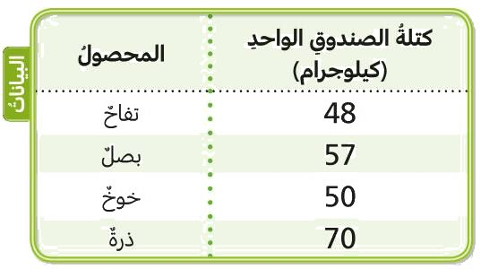
30. اشترى ناصر كيسًا من الفحم كتلته 16 kg وسعرُه QR 25.75 وكيسًا آخر من الفحم كتلته 10.4 kg وسعره QR 20.25. ما الكتلة الإجمالية لكيسي الفحم؟
31. في كلّ 1 طنّ 2 000 باوند. إذا كان الحدّ الأقصى المسموح لكتلة شاحنة مع حمولتها 45 طنًّا، فما وزنها بالباوند؟ كيف وجدت الإجابة؟

#### أولًا: اختر الإجابة الصحيحة (أسئلة محوّلة)

1. ما عدد الأصفار في ناتج 39 × 1 000؟
   - أ) 2
   - ب) 5
   - ج) 4
   - د) 3
2. ما عدد الأصفار في ناتج 50 × 1 000؟
   - أ) 4
   - ب) 3
   - ج) 5
   - د) 2
3. ما ناتج 90 × 10⁴؟
   - أ) 90 000
   - ب) 900 000
   - ج) 9 000 000
   - د) 94
4. ما ناتج الضرب 60 × 1 ، 60 × 10 ، 60 × 100 ، 60 × 1 000 ، 60 × 10 000 على الترتيب؟
   - أ) 6 ، 60 ، 600 ، 6 000 ، 60 000
   - ب) 60 ، 600 ، 6 000 ، 60 000 ، 600 000
   - ج) 60 ، 70 ، 160 ، 1 060 ، 10 060
   - د) 60 ، 600 ، 60 000 ، 600 000 ، 6 000 000
5. ما ناتج الضرب 13 × 10⁰ ، 13 × 10¹ ، 13 × 10² ، 13 × 10³ ، 13 × 10⁴ على الترتيب؟
   - أ) 130 ، 1 300 ، 13 000 ، 130 000 ، 1 300 000
   - ب) 13 ، 130 ، 1 300 ، 13 000 ، 130 000
   - ج) 0 ، 13 ، 130 ، 1 300 ، 13 000
   - د) 13 ، 23 ، 113 ، 1 013 ، 10 013
6. ما ناتج 89 × 10 000؟
   - أ) 89 000
   - ب) 890 000
   - ج) 8 900 000
   - د) 8 900
7. ما ناتج 30 × 1 000؟
   - أ) 3 000
   - ب) 300
   - ج) 300 000
   - د) 30 000
8. ما ناتج 41 × 10²؟
   - أ) 410
   - ب) 41 000
   - ج) 4 100
   - د) 4 110
9. ما ناتج 90 × 10³؟
   - أ) 9 000
   - ب) 90 000
   - ج) 900 000
   - د) 93
10. أيّ الجمل العددية الآتية صحيحة؟
   - أ) 48 × 1 000 = 4 800
   - ب) 48 × 10² = 480
   - ج) 48 × 10⁴ = 480 000
   - د) 48 × 10³ = 4 800
11. أيّ الجمل العددية الآتية عن العدد 20 صحيحة؟
   - أ) 20 × 100 = 20 000
   - ب) 20 × 10³ = 2 000
   - ج) 20 × 10⁵ = 2 000 000
   - د) 20 × 10 = 2 000
12. أيّ المقدارين أكبر: 10³ × 93 أم 10⁴ × 11؟
   - أ) 10³ × 93
   - ب) هما متساويان
   - ج) 10⁴ × 11
   - د) لا يمكن المقارنة
13. في كلّ طنٍّ 2 000 باوند. إذا كان الحدّ الأقصى المسموح لكتلة شاحنةٍ مع حمولتها 45 طنًّا، فما وزنها بالباوند؟
   - أ) 9 000
   - ب) 47 000
   - ج) 900 000
   - د) 90 000

### الدرس 3-2: تقدير نواتج الضرب

#### أولًا: اختر الإجابة الصحيحة

1. لدى عامر 102 رزمة من البطاقات الرياضية. كلّ رزمة تتكوّن من 28 بطاقة. استعمل التقريب للتقدير. كم بطاقة تقريبًا لدى عامر؟
   - أ) 2 000
   - ب) 2 500
   - ج) 3 000
   - د) 3 500
2. أيٌّ من الأعداد أدناه ليس تقديرًا منطقيًّا لناتج 338 × 24؟
   - أ) 6 000
   - ب) 7 500
   - ج) 7 000
   - د) 11 000

#### رابعًا: أجب عن الأسئلة الآتية (مسائل وتفكير)

3. قدّر، ثمّ حدّد هل تقديرك مرتفع أم منخفض: 29 × 688
4. قدّر، ثمّ حدّد هل تقديرك مرتفع أم منخفض: 210 × 733
5. قدّر، ثمّ حدّد هل تقديرك مرتفع أم منخفض: 43 × 108
6. قدّر، ثمّ حدّد هل تقديرك مرتفع أم منخفض: 380 × 690
7. قدّر ناتج الضرب: 180 × 586
8. قدّر ناتج الضرب: 300 × 118
9. قدّر ناتج الضرب: 19 × 513
10. قدّر ناتج الضرب: 38 × 249
11. قدّر ناتج الضرب: 11 × 803
12. قدّر ناتج الضرب: 44 × 212
13. قدّر ناتج الضرب: 790 × 397
14. قدّر ناتج الضرب: 42 × 598
15. قدّر ناتج الضرب: 25 × 191
16. قدّر ناتج الضرب: 408 × 676
17. قدّر ناتج الضرب: 290 × 12
18. قدّر ناتج الضرب: 854 × 733
19. تستوعب كلّ كرتونة بيض 12 بيضة. عبّأ العمّال في مزرعة حسّان للدواجن 121 كرتونة بيض، وهو يعتقد أنّ عدد البيض يزيد عن 1 500 بيضة. هل هو على صواب؟ استعمل التقدير لمعرفة ذلك.
20. قدّر ناتج 375 × 530، هل تقديرك أقربُ إلى 150 000 أم إلى 200 000؟
21. المصطلحات: هل 500 تقدير منخفض أم مرتفع لناتج ضرب 12 في 53؟
22. يحتاج خالد إلى تقدير ناتج 395 × 23، اشرح طريقتين يمكن لخالد بهما استعمال التقدير.
23. تقول دانة إنّ 10³ يساوي 30 لأنّ 30 = 10 + 10 + 10، هل هي على صواب؟
24. استعملت سوسن التقريب لتقدير ناتج 413 × 24 فحصلت على 400 × 20، واستعملت جهينة الأعداد المتناغمة فحصلت على 400 × 25، أيّ طريقة تُعطي تقديرًا أقرب إلى ناتج الضرب الدقيق؟
25. أحضر عبير في غرفة القرطاسية المدرسية 12 صندوقًا كبيرًا و 18 صندوقًا صغيرًا من أقلام الرصاص. كلّ صندوق كبير يحتوي على 144 قلم رصاص، وكلّ صندوق صغير يحتوي على 24 قلم رصاص. قدّر العدد الإجمالي لأقلام الرصاص. هل تقديرك مرتفع أم منخفض؟ وضّح لماذا من الأفضل أن يكون تقديرك منخفضًا وليس مرتفعًا.

#### أولًا: اختر الإجابة الصحيحة (أسئلة محوّلة)

1. قدّرتَ ناتج 29 × 688 بتقريب 29 إلى 30 و688 إلى 700 فكان التقدير 21 000. هل التقدير مرتفعٌ أم منخفضٌ؟
   - أ) مرتفعٌ
   - ب) منخفضٌ
   - ج) مساوٍ للناتج الدقيق
   - د) لا يمكن المعرفة
2. قدّرتَ ناتج 210 × 733 بتقريب 210 إلى 200 و733 إلى 700 فكان التقدير 140 000. هل التقدير مرتفعٌ أم منخفضٌ؟
   - أ) مرتفعٌ
   - ب) مساوٍ للناتج الدقيق
   - ج) منخفضٌ
   - د) لا يمكن المعرفة
3. قدّرتَ ناتج 43 × 108 بتقريب 43 إلى 40 و108 إلى 100 فكان التقدير 4 000. هل التقدير مرتفعٌ أم منخفضٌ؟
   - أ) مرتفعٌ
   - ب) مساوٍ للناتج الدقيق
   - ج) منخفضٌ
   - د) لا يمكن المعرفة
4. قدّرتَ ناتج 380 × 690 بتقريب 380 إلى 400 و690 إلى 700 فكان التقدير 280 000. هل التقدير مرتفعٌ أم منخفضٌ؟
   - أ) مرتفعٌ
   - ب) منخفضٌ
   - ج) مساوٍ للناتج الدقيق
   - د) لا يمكن المعرفة
5. قدّر ناتج 180 × 586 بتقريب كلّ عددٍ إلى أقرب مئةٍ.
   - أ) 120 000
   - ب) 100 000
   - ج) 108 000
   - د) 180 000
6. قدّر ناتج 300 × 118 بتقريب 118 إلى أقرب مئةٍ.
   - أ) 30 000
   - ب) 3 000
   - ج) 300 000
   - د) 35 400
7. قدّر ناتج 19 × 513 بتقريب 19 إلى 20 و513 إلى 500.
   - أ) 10 000
   - ب) 1 000
   - ج) 100 000
   - د) 9 747
8. قدّر ناتج 38 × 249 بتقريب كلّ عددٍ إلى أقرب عشرةٍ.
   - أ) 1 000
   - ب) 10 000
   - ج) 100 000
   - د) 9 500
9. قدّر ناتج 11 × 803 بتقريب 11 إلى 10 و803 إلى 800.
   - أ) 800
   - ب) 8 000
   - ج) 80 000
   - د) 8 833
10. قدّر ناتج 44 × 212 بتقريب 44 إلى 40 و212 إلى 200.
   - أ) 800
   - ب) 9 000
   - ج) 8 000
   - د) 80 000
11. قدّر ناتج 790 × 397 بتقريب 790 إلى 800 و397 إلى 400.
   - أ) 32 000
   - ب) 3 200 000
   - ج) 320 000
   - د) 300 000
12. قدّر ناتج 42 × 598 بتقريب 42 إلى 40 و598 إلى 600.
   - أ) 2 400
   - ب) 24 000
   - ج) 240 000
   - د) 25 116
13. قدّر ناتج 25 × 191 بتقريب 191 إلى 200.
   - أ) 500
   - ب) 5 000
   - ج) 50 000
   - د) 4 775
14. قدّر ناتج 408 × 676 بتقريب 408 إلى 400 و676 إلى 700.
   - أ) 28 000
   - ب) 270 000
   - ج) 2 800 000
   - د) 280 000
15. قدّر ناتج 290 × 12 بتقريب 290 إلى 300 و12 إلى 10.
   - أ) 300
   - ب) 30 000
   - ج) 3 000
   - د) 3 480
16. قدّر ناتج 854 × 733 بتقريب كلّ عددٍ إلى أقرب مئةٍ.
   - أ) 56 000
   - ب) 6 300 000
   - ج) 560 000
   - د) 630 000
17. تستوعب كلّ كرتونة بيضٍ 12 بيضةً. عبّأ العمّال 121 كرتونةً، ويعتقد حسّانٌ أنّ عدد البيض يزيد على 1 500 بيضةٍ. هل هو على صوابٍ؟
   - أ) لا، لأنّ 121 × 12 = 1 452 وهو أقلّ من 1 500
   - ب) نعم، لأنّ 121 أكبر من 100
   - ج) نعم، لأنّ 121 × 12 = 1 600
   - د) لا، لأنّ 121 × 12 = 1 200
18. قدّر ناتج 375 × 530. هل تقديرك أقرب إلى 150 000 أم إلى 200 000؟
   - أ) أقرب إلى 150 000
   - ب) في منتصفهما تمامًا
   - ج) أقرب إلى 200 000
   - د) لا يمكن المعرفة
19. هل 500 تقديرٌ منخفضٌ أم مرتفعٌ لناتج ضرب 12 في 53؟
   - أ) مرتفعٌ لأنّه أكبر من الناتج
   - ب) منخفضٌ لأنّه أصغر من الناتج الدقيق 636
   - ج) مساوٍ للناتج الدقيق
   - د) لا يمكن المعرفة
20. تقول دانة إنّ 10³ يساوي 30 لأنّ 30 = 10 + 10 + 10. هل هي على صوابٍ؟
   - أ) نعم، لأنّ الأسّ 3 يعني الجمع ثلاث مرّاتٍ
   - ب) لا، لأنّ 10³ = 10 × 10 × 10 = 1 000
   - ج) لا، لأنّ 10³ = 300
   - د) نعم، لأنّ 10 × 3 = 30
21. في غرفة القرطاسيّة 12 صندوقًا كبيرًا في كلّ منها 144 قلم رصاصٍ و 18 صندوقًا صغيرًا في كلّ منها 24 قلمًا. ما العدد الإجماليّ لأقلام الرصاص؟
   - أ) 1 728
   - ب) 2 160
   - ج) 432
   - د) 3 600

### الدرس 3-3: ضرب أعداد من 3 أرقام في أعداد من رقمين

#### رابعًا: أجب عن الأسئلة الآتية (مسائل وتفكير)

1. هل 30 × 500 تقدير جيّد لعدد التذاكر التي بيعت على مدى شهر؟
2. أوجد ناتج الضرب. قدّر لتتحقّق من أنّ إجابتك منطقية: 236 × 46
3. أوجد ناتج الضرب. قدّر لتتحقّق من أنّ إجابتك منطقية: 61 × 25
4. أوجد ناتج الضرب. قدّر لتتحقّق من أنّ إجابتك منطقية: 951 × 62
5. أوجد ناتج الضرب. قدّر لتتحقّق من أنّ إجابتك منطقية: 185 × 5
6. أوجد ناتج الضرب. قدّر لتتحقّق من أنّ إجابتك منطقية: 51 × 10
7. أوجد ناتج الضرب. قدّر لتتحقّق من أنّ إجابتك منطقية: 892 × 18
8. أوجد ناتج الضرب. قدّر لتتحقّق من أنّ إجابتك منطقية: 946 × 33
9. أوجد ناتج الضرب. قدّر لتتحقّق من أنّ إجابتك منطقية: 735 × 41
10. أوجد ناتج الضرب. قدّر لتتحقّق من أنّ إجابتك منطقية: 25 × 100
11. أوجد ناتج الضرب. قدّر لتتحقّق من أنّ إجابتك منطقية: 81 × 11
12. أوجد ناتج الضرب. قدّر لتتحقّق من أنّ إجابتك منطقية: 106 × 7
13. أوجد ناتج الضرب. قدّر لتتحقّق من أنّ إجابتك منطقية: 90 × 59
14. أوجد ناتج الضرب. قدّر لتتحقّق من أنّ إجابتك منطقية: 18 × 360
15. أوجد ناتج الضرب. قدّر لتتحقّق من أنّ إجابتك منطقية: 75 × 222
16. أوجد ناتج الضرب. قدّر لتتحقّق من أنّ إجابتك منطقية: 481 × 35
17. أوجد ناتج الضرب. قدّر لتتحقّق من أنّ إجابتك منطقية: 659 × 17
18. أوجد ناتج الضرب. قدّر لتتحقّق من أنّ إجابتك منطقية: 340 × 89
19. أوجد ناتج الضرب. قدّر لتتحقّق من أنّ إجابتك منطقية: 439 × 22
20. أوجد ناتج الضرب. قدّر لتتحقّق من أنّ إجابتك منطقية: 273 × 9
21. أوجد ناتج الضرب. قدّر لتتحقّق من أنّ إجابتك منطقية: 64 × 475
22. تستوعب صالة مسرح 540 شخصًا. كم من التذاكر باع المسرح خلال 30 يومًا إذا نفذت جميع التذاكر يوميًا؟
23. كم مرّة ينبض قلب الأرنب في الساعة الواحدة؟ (تذكّر أنّ هناك 60 دقيقة في الساعة الواحدة. معدّل نبضات القلب بنبضة في الدقيقة: الكلب 100 ، الجربوع 360 ، الأرنب 212)
   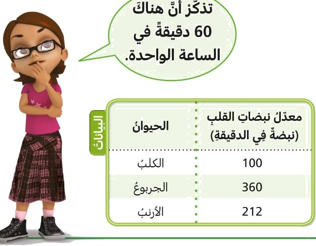
24. بكمْ يزيد عدد نبضات قلب الأرنب عن عدد نبضات قلب الكلب في الساعة الواحدة؟ اكتب جملة عددية لتوضّح حلّك. (معدّل نبضات القلب بنبضة في الدقيقة: الكلب 100 ، الجربوع 360 ، الأرنب 212)
   
25. هل العدد 3 198 ناتج منطقيّ لجملة الضرب 44 × 727؟ لماذا؟
27. يبيع مشتلٌ زراعيّ النباتات في صوانٍ مسطحة. تتكوّن كلّ صينيةٍ من 6 أوعيةٍ. ويحتوي كلّ وعاءٍ على 6 نباتاتٍ. إذا باع المشتل 18 صينيةً يوم السبت و 21 صينيةً يوم الأحد، فما العدد الكلّي للنباتات الّتي باعها المشتل في هذين اليومين؟

### الدرس 3-4: ضرب أعداد كلية تتضمن أصفارًا

#### رابعًا: أجب عن الأسئلة الآتية (مسائل وتفكير)

1. أوجد ناتج الضرب. قدّر لتتحقّق من أنّ إجابتك منطقيّة: 205 × 23
2. أوجد ناتج الضرب. قدّر لتتحقّق من أنّ إجابتك منطقيّة: 108 × 34
3. أوجد ناتج الضرب. قدّر لتتحقّق من أنّ إجابتك منطقيّة: 410 × 44
4. أوجد ناتج الضرب. قدّر لتتحقّق من أنّ إجابتك منطقيّة: 302 × 30
5. أوجد ناتج الضرب. قدّر لتتحقّق من أنّ إجابتك منطقيّة: 302 × 17
6. أوجد ناتج الضرب. قدّر لتتحقّق من أنّ إجابتك منطقيّة: 608 × 23
7. أوجد ناتج الضرب. قدّر لتتحقّق من أنّ إجابتك منطقيّة: 109 × 47
8. أوجد ناتج الضرب. قدّر لتتحقّق من أنّ إجابتك منطقيّة: 510 × 72
9. أوجد ناتج الضرب. قدّر لتتحقّق من أنّ إجابتك منطقيّة: 902 × 35
10. أوجد ناتج الضرب. قدّر لتتحقّق من أنّ إجابتك منطقيّة: 207 × 61
11. أوجد ناتج الضرب. قدّر لتتحقّق من أنّ إجابتك منطقيّة: 108 × 58
12. أوجد ناتج الضرب. قدّر لتتحقّق من أنّ إجابتك منطقيّة: 505 × 77
13. أوجد ناتج الضرب. قدّر لتتحقّق من أنّ إجابتك منطقيّة: 407 × 39
14. أوجد ناتج الضرب. قدّر لتتحقّق من أنّ إجابتك منطقيّة: 280 × 66
15. أوجد ناتج الضرب. قدّر لتتحقّق من أنّ إجابتك منطقيّة: 105 × 24
16. أوجد ناتج الضرب. قدّر لتتحقّق من أنّ إجابتك منطقيّة: 360 × 48
17. تتضمن إحدى القاعات 104 صفوفٍ من المقاعد، في كلّ صفٍ منها 24 مقعدًا. ما عدد المقاعد في هذه القاعة؟
18. لماذا من المهم "أن تقدّر لتتحقّق من أنّ إجابتك منطقيّة"؟
19. في صفّ الأستاذ خليل 27 طالبًا. أوجد مجموع الصفحات الّتي يكون قد قرأها جميع الطلّاب عند نهاية شهر نوفمبر. (سجلّ القراءة: سبتمبر الوحدة 1، 35 صفحة؛ أكتوبر الوحدة 2، 38 صفحة؛ نوفمبر الوحدة 3، 35 صفحة)
   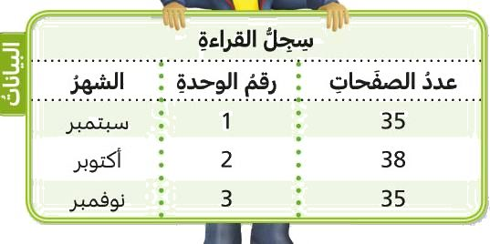
20. إذا قرأ كلّ طالبٍ في شهر ديسمبر 41 صفحةً، أوجد مجموع الصفحاتِ الّتي يكون قد قرأها جميع الطلّابِ عند نهاية شهر ديسمبر.
   
21. تقول مروى إنّ العدد 15.17 أكبر من العدد 15.8 لأنّ 17 أكبر من 8، هل هي على صواب؟ المنطقيّ.
22. تريد فاطمة أن تُوجد ناتج 606 × 66، وتقول إنّ كلّ ما عليها القيام به هو أن توجد ناتج 606 × 6، ثمّ تضاعف هذا الناتج. وضّح لماذا لن تعطي طريقة حل فاطمة الإجابة الصحيحة. ثمّ بيّن طريقة إيجاد ناتج الضرب الصحيح.
23. يقدّم موقع إلكتروني آخر نفس البرنامج مقابل QR 30 شهريًا مع رسوم سنوية قدرها QR 48. أيّ الصفقتين أفضل؟ هل تنصح مريم بتغيير خطة الدفع؟
24. اختر من الصندوق ناتجَي الضرب الجزئيّين اللذين يجب أن تجمعهما لإيجاد ناتج 709 × 41، اكتبهما في الفراغ داخل الصندوق. (709 ، 710 ، 719 ، 2 836 ، 3 545 ، 28 360 ، 28 760)
   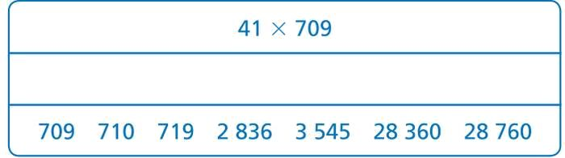
25. تحتاج مريم إلى استعمال أحد البرامج الإلكترونية لمدّة 12 شهرًا. إذا كانت التكلفة الشهرية لاستعمال البرنامج QR 34 في الشهر، ويمكنها شراء البرنامج بمبلغ مقداره QR 495، هل من الأفضل لها شراء البرنامج أم الدفع شهريًا؟ وما المبلغ الذي ستدفعه؟

#### أولًا: اختر الإجابة الصحيحة (أسئلة محوّلة)

1. تتضمّن قاعةٌ 104 صفوفٍ من المقاعد، في كلّ صفٍّ 24 مقعدًا. ما عدد المقاعد في القاعة؟
   - أ) 2 096
   - ب) 2 496
   - ج) 2 506
   - د) 2 400
2. لماذا من المهمّ أن تقدّر لتتحقّق من أنّ إجابتك منطقيّةٌ؟
   - أ) لأنّ الناتج يجب أن يكون عددًا مقرَّبًا
   - ب) لأنّ التقدير يعطي الناتج الدقيق دائمًا
   - ج) لأتجنّب إجراء عمليّة الضرب
   - د) لأتأكّد أنّ الناتج قريبٌ من المتوقّع وأكتشف الأخطاء الكبيرة
3. في صفّ الأستاذ خليل 27 طالبًا. قرأ كلّ طالبٍ 35 صفحةً في سبتمبر و 38 في أكتوبر و 35 في نوفمبر. ما مجموع الصفحات التي قرأها جميع الطلّاب حتى نهاية نوفمبر؟
   - أ) 2 646
   - ب) 3 105
   - ج) 2 808
   - د) 2 916
4. قرأ كلّ طالبٍ من طلّاب صفّ الأستاذ خليل (27 طالبًا) 108 صفحاتٍ حتى نهاية نوفمبر، ثمّ 41 صفحةً في ديسمبر. ما مجموع الصفحات التي قرأها جميع الطلّاب حتى نهاية ديسمبر؟
   - أ) 3 969
   - ب) 4 023
   - ج) 4 050
   - د) 2 916
5. تقول مروى إنّ العدد 15.17 أكبر من 15.8 لأنّ 17 أكبر من 8. هل هي على صوابٍ؟
   - أ) لا، لأنّ 15.17 أصغر من 15.8 (1 عشرٌ أقلّ من 8 أعشارٍ)
   - ب) نعم، لأنّ 17 أكبر من 8
   - ج) لا، لأنّ العددين متساويان
   - د) نعم، لأنّ 15.17 فيه رقمان بعد الفاصلة
6. تريد فاطمة إيجاد ناتج 606 × 66، وتقول إنّ كلّ ما عليها هو إيجاد 606 × 6 ثمّ مضاعفة الناتج. ما ناتج 606 × 66 الصحيح؟
   - أ) 7 272
   - ب) 36 360
   - ج) 39 996
   - د) 40 000
7. تحتاج مريم إلى برنامجٍ إلكترونيٍّ لمدّة 12 شهرًا. تكلفته QR 34 شهريًّا، أو يمكنها شراؤه بمبلغ QR 495. ما الأفضل لها؟
   - أ) الشراء بـ QR 495
   - ب) الدفع شهريًّا وستدفع QR 408
   - ج) الدفع شهريًّا وستدفع QR 428
   - د) الدفع شهريًّا وستدفع QR 546

### الدرس 3-5: النقد والتبرير

#### رابعًا: أجب عن الأسئلة الآتية (مسائل وتفكير)

1. تتكوّن المدرّجات في أحد الملاعب من 58 قسمًا. عدد المقاعد في كلّ قسم منها 288 مقعدًا. قدّرت مريم العدد الإجمالي للمقاعد في مدرّجات الملعب بضرب 300 × 60 واستنتجت أنّ عددها أقلّ من 18 000 مقعد. ما حجّة مريم في عملية التقدير؟ وكيف دعمتها؟
2. تتكوّن المدرّجات في أحد الملاعب من 58 قسمًا. عدد المقاعد في كلّ قسم منها 288 مقعدًا. قدّرت مريم العدد الإجمالي للمقاعد بضرب 300 × 60 واستنتجت أنّ عددها أقلّ من 18 000 مقعد. اذكر أمرًا واحدًا يمكنك القيام به لنقد تبرير مريم.
3. تتكوّن المدرّجات في أحد الملاعب من 58 قسمًا. عدد المقاعد في كلّ قسم منها 288 مقعدًا. قدّرت مريم العدد الإجمالي للمقاعد بضرب 300 × 60 واستنتجت أنّ عددها أقلّ من 18 000 مقعد. هل استنتاج مريم منطقيّ؟
4. خصّص مدير إحدى الشركات QR 10 000 لإنفاقها على شراء تجهيزاتٍ جديدةٍ، فقرّر شراء 300 فأرة كمبيوتر، سعر الواحدة منها QR 72، وبعدما أنهى الحساباتِ المبيّنة في الصورة المجاورة، استنتج أنّه سيبقى لديه مبلغ كبير من المال لشراء تجهيزات إضافية. ماذا فعل المدير لدعم صحة طريقة تفكيره؟
   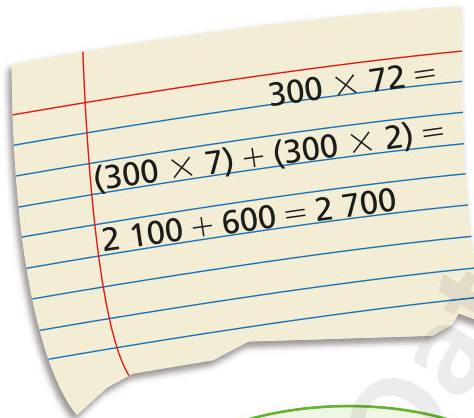
5. (حسابات المدير: 300 × 72 = ؛ (300 × 7) + (300 × 2) = ؛ 2 100 + 600 = 2 700) اذكر كيف يمكنك تحديد ما إذا كانت حسابات المدير منطقية.
   
6. (حسابات المدير: 300 × 72 = ؛ (300 × 7) + (300 × 2) = ؛ 2 100 + 600 = 2 700) هل استنتاج المدير منطقيّ؟
   
7. شراء مُعدّات زراعية: باع مُزارع خلال الصيف 1 092 صندوقًا من الطماطم، وحقّق ربحًا قدرُه QR 12 من بيع كلّ صندوق. ويريد استعمال المال الّذي كسبه لشراء المجموعة 2 من المُعدّات الزراعية. يقول المزارع: "بما أنّ 12 000 = 12 × 1 000 وأنّ 1 092 أكبر من 1 000، وأنا أعلمُ أنّ أرباحي تفوق مبلغ QR 12 000، إذن يمكنني شراء المجموعة 2 من المُعدّات". افهم وثابر في الحلّ: هل ينبغي للمزارع أن يجد تقديرًا مرتفعًا أم تقديرًا منخفضًا للمبلغ الذي كسبه ليحدّد ما إذا كان يكفي لشراء المجموعة 2؟ لماذا؟ (السعر: المجموعة 1 QR 8 675 ، المجموعة 2 QR 11 500 ، المجموعة 3 QR 14 250)
   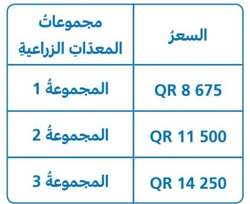
8. هل ينبغي للمزارع أن يستعمل الضرب لتقدير المبلغ الإجمالي الذي كسبه؟ المنطقي.
9. هل تقدير المزارع مناسب؟ وهل حساباته صحيحة؟
10. وضّح ما إذا كان استنتاج المزارع منطقيًّا. كيف عرفت ذلك؟ إذا لمْ يكنْ استنتاجه منطقيًّا، فماذا يُمكنك أن تفعل لتحسين تبريره؟

#### أولًا: اختر الإجابة الصحيحة (أسئلة محوّلة)

1. المدرّجات في ملعبٍ من 58 قسمًا في كلّ منها 288 مقعدًا. قدّرت مريم العدد بضرب 300 × 60 واستنتجت أنّه أقلّ من 18 000. لماذا يدعم تقديرها هذا الاستنتاج؟
   - أ) لأنّها قرّبت العددين إلى الأعلى فالناتج الدقيق أصغر من 18 000
   - ب) لأنّها قرّبت العددين إلى الأسفل فالناتج الدقيق أكبر من 18 000
   - ج) لأنّ 300 × 60 يساوي الناتج الدقيق
   - د) لأنّها لم تقرّب أيّ عددٍ
2. خصّص مديرٌ QR 10 000 لشراء 300 فأرة كمبيوترٍ سعر الواحدة QR 72. ما ناتج 300 × 72؟
   - أ) 2 700
   - ب) 21 600
   - ج) 2 160
   - د) 216 000
3. خصّص مديرٌ QR 10 000 لشراء 300 فأرة كمبيوترٍ سعر الواحدة QR 72، وحسب أنّ التكلفة 2 700 فاستنتج أنّه سيبقى لديه مال كثير. هل استنتاجه منطقيّ؟
   - أ) لا، لأنّ التكلفة الصحيحة 21 600 وهي أكبر من 10 000
   - ب) نعم، لأنّ 2 700 أقلّ من 10 000
   - ج) نعم، لأنّ 300 × 72 = 2 700
   - د) لا، لأنّ التكلفة 10 000 تمامًا
4. باع مزارعٌ 1 092 صندوق طماطم بربحٍ QR 12 للصندوق، ويريد شراء مجموعة معدّاتٍ سعرها QR 11 500. ما الأفضل ليتأكّد أنّ ما كسبه يكفي: تقدير مرتفعٌ أم منخفضٌ؟
   - أ) تقديرٌ مرتفعٌ لأنّه أكبر من المبلغ الفعليّ
   - ب) لا يحتاج إلى أيّ تقديرٍ
   - ج) لا فرق بين التقديرين
   - د) تقديرٌ منخفضٌ، فإذا كان كافيًا فالمبلغ الفعليّ كافٍ
5. باع مزارعٌ 1 092 صندوق طماطم بربحٍ QR 12 للصندوق. ما المبلغ الذي كسبه؟
   - أ) QR 12 000
   - ب) QR 13 104
   - ج) QR 11 004
   - د) QR 1 104
6. قال المزارع: بما أنّ 12 × 1 000 = 12 000 و1 092 أكبر من 1 000، فأرباحي تفوق QR 12 000 فيمكنني شراء مجموعةٍ سعرها QR 11 500. هل استنتاجه منطقيّ؟
   - أ) لا، لأنّ 12 000 أقلّ من 11 500
   - ب) نعم، لأنّ التقدير المنخفض 12 000 أكبر من 11 500
   - ج) لا، لأنّ الضرب لا يُستعمل في التقدير
   - د) نعم، لأنّ 11 500 أكبر من 12 000
7. خصّص مدير شركة QR 10 000 لشراء 300 فأرة كمبيوتر سعر الواحدة QR 72، وحسب 300 × 72 = 2 700 فاستنتج أنّه سيبقى لديه مبلغ كبير. هل استنتاجه منطقي؟
   - أ) لا، لأنّ 300 × 72 = 2 160
   - ب) نعم، لأنّ 2 700 أقلّ من 10 000
   - ج) لا، لأنّ 300 × 72 = 21 600 وهو أكبر من 10 000
   - د) نعم، لأنّ 72 أصغر من 300
8. باع مزارع 1 092 صندوقًا من الطماطم وربح QR 12 من كلّ صندوق، ويريد شراء المجموعة 2 من المعدّات الزراعية سعرها QR 11 500. هل يكفيه ربحه؟
   - أ) لا، لأنّ ربحه QR 11 000 فقط
   - ب) لا، لأنّ ربحه QR 10 920 فقط
   - ج) نعم، لكن لا يبقى معه شيء
   - د) نعم، فربحه QR 13 104 ويبقى معه QR 1 604
9. ربح مزارع من بيع الطماطم QR 13 104، ويريد شراء المجموعة 3 من المعدّات الزراعية سعرها QR 14 250. كم ريالًا ينقصه؟
   - أ) QR 1 604
   - ب) QR 1 146
   - ج) QR 1 246
   - د) لا ينقصه شيء
10. قدّر سامي ناتج 48 × 312 بضرب 50 × 300 فحصل على 15000. كيف يكون الناتج الدقيق بالنسبة لتقديره؟
   - أ) الناتج الدقيق 14976 وهو أكبر من التقدير
   - ب) الناتج الدقيق 15976 وهو أقلّ من التقدير
   - ج) الناتج الدقيق 14976 وهو أقلّ من التقدير
   - د) الناتج الدقيق يساوي 15000 تمامًا
11. قدّر سامي ناتج 62 × 205 بضرب 60 × 200 فحصل على 12000. كيف يكون الناتج الدقيق بالنسبة لتقديره؟
   - أ) الناتج الدقيق 12710 وهو أكبر من التقدير
   - ب) الناتج الدقيق 13710 وهو أكبر من التقدير
   - ج) الناتج الدقيق 12710 وهو أقلّ من التقدير
   - د) الناتج الدقيق يساوي 12000 تمامًا
12. قدّر سامي ناتج 39 × 498 بضرب 40 × 500 فحصل على 20000. كيف يكون الناتج الدقيق بالنسبة لتقديره؟
   - أ) الناتج الدقيق 19422 وهو أكبر من التقدير
   - ب) الناتج الدقيق 20422 وهو أقلّ من التقدير
   - ج) الناتج الدقيق 19422 وهو أقلّ من التقدير
   - د) الناتج الدقيق يساوي 20000 تمامًا
13. قدّر سامي ناتج 71 × 189 بضرب 70 × 200 فحصل على 14000. كيف يكون الناتج الدقيق بالنسبة لتقديره؟
   - أ) الناتج الدقيق 13419 وهو أقلّ من التقدير
   - ب) الناتج الدقيق 14419 وهو أقلّ من التقدير
   - ج) الناتج الدقيق 13419 وهو أكبر من التقدير
   - د) الناتج الدقيق يساوي 14000 تمامًا
14. قدّر سامي ناتج 57 × 603 بضرب 60 × 600 فحصل على 36000. كيف يكون الناتج الدقيق بالنسبة لتقديره؟
   - أ) الناتج الدقيق 35371 وهو أقلّ من التقدير
   - ب) الناتج الدقيق 34371 وهو أقلّ من التقدير
   - ج) الناتج الدقيق 34371 وهو أكبر من التقدير
   - د) الناتج الدقيق يساوي 36000 تمامًا
15. حسب المدير ناتج 250 × 36 فحصل على 900. هل حسابه منطقيّ؟
   - أ) نعم، لأنّ 250 أكبر من 36
   - ب) نعم، لأنّ الناتج صحيح 900
   - ج) لا، لأنّ 250 × 36 = 90000
   - د) لا، لأنّ 250 × 36 = 9000
16. حسب المعلّم ناتج 180 × 45 فحصل على 810. هل حسابه منطقيّ؟
   - أ) نعم، لأنّ 180 أكبر من 45
   - ب) نعم، لأنّ الناتج صحيح 810
   - ج) لا، لأنّ 180 × 45 = 81000
   - د) لا، لأنّ 180 × 45 = 8100
17. حسب التاجر ناتج 320 × 28 فحصل على 896. هل حسابه منطقيّ؟
   - أ) لا، لأنّ 320 × 28 = 8960
   - ب) نعم، لأنّ الناتج صحيح 896
   - ج) لا، لأنّ 320 × 28 = 89600
   - د) نعم، لأنّ 320 أكبر من 28
18. حسب المهندس ناتج 75 × 120 فحصل على 900. هل حسابه منطقيّ؟
   - أ) لا، لأنّ 75 × 120 = 90000
   - ب) نعم، لأنّ الناتج صحيح 900
   - ج) لا، لأنّ 75 × 120 = 9000
   - د) نعم، لأنّ 75 أكبر من 120
19. حسب المشرف ناتج 64 × 150 فحصل على 960. هل حسابه منطقيّ؟
   - أ) نعم، لأنّ الناتج صحيح 960
   - ب) لا، لأنّ 64 × 150 = 9600
   - ج) لا، لأنّ 64 × 150 = 96000
   - د) نعم، لأنّ 64 أكبر من 150

## الوحدة 4: استعمال النماذج والطرائق لضرب الكسور العشرية

### الدرس 4-1: ضرب الكسور العشرية في قوى العدد 10

#### رابعًا: أجب عن الأسئلة الآتية (مسائل وتفكير)

1. أوجد ناتج كلّ عملية ضرب: 0.009 × 10
2. أوجد ناتج كلّ عملية ضرب: 3.1 × 10³
3. أوجد ناتج كلّ عملية ضرب: 0.062 × 10²
4. أوجد ناتج كلّ عملية ضرب: 1.24 × 0.01
5. أوجد ناتج كلّ عملية ضرب: 42.3 × 1 ، 42.3 × 0.1 ، 42.3 × 0.01
6. أوجد ناتج كلّ عملية ضرب: 0.086 × 10¹ ، 0.086 × 10² ، 0.086 × 10³
7. أوجد ناتج كلّ عملية ضرب: 63.7 × 0.01
8. أوجد ناتج كلّ عملية ضرب: 563.7 × 10²
9. أوجد ناتج كلّ عملية ضرب: 0.365 × 10⁴
10. أوجد ناتج كلّ عملية ضرب: 5.02 × 0.1
11. أوجد ناتج كلّ عملية ضرب: 94.6 × 10³
12. أوجد ناتج كلّ عملية ضرب: 0.9463 × 10²
13. أوجد ناتج كلّ عملية ضرب: 0.678 × 0.1
14. أوجد ناتج كلّ عملية ضرب: 681.7 × 0.01
15. اختر كلّ الجمل العددية الصحيحة: 4.82 × 1 000 = 482 000 / 4.82 × 10² = 482 / 0.482 × 10¹ = 48.2 / 0.482 × 10³ = 482 / 0.0482 × 10⁴ = 4 820
16. اختر كلّ الجمل العددية الصحيحة: 37 × 0.01 = 0.37 / 0.37 × 0.1 = 0.037 / 370 × 0.1 = 3.7 / 0.37 × 0.01 = 0.037 / 3.7 × 0.01 = 0.037
17. اذكر كيف يمكنك استعمال الحساب الذهني لإيجاد 45.8 × 10³ و 45.8 × 0.01
18. استعمل البنية في الحلّ والجدول لإيجاد الإجابات: استعملت منال مجهرًا لملاحظة العيّنات في مختبر العلوم. يكبّر المجهر الأجسام فتبيّن 100 ضعف حجمها الفعليّ. أوجد حجم كلّ عيّنة كما ترى في المجهر. (العيّنة A: الطول الفعلي 0.008 cm ، B: 0.011 ، C: 0.0025 ، D: 0.004)
   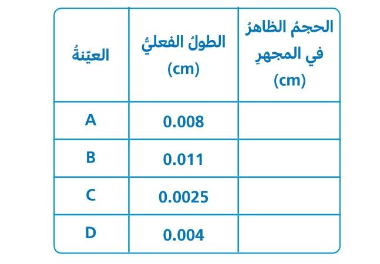
19. أرادت المعلمة أن ترسم كلّ طالبة مخططًا لأطوال العيّنات. أيّ عيّنة هي الأطول؟ (العيّنة A: الطول الفعلي 0.008 cm ، B: 0.011 ، C: 0.0025 ، D: 0.004)
   
20. يبلغ طول إحدى العيّنات 0.75 سنتمتر كما ترى بالمجهر. ما طولها الفعلي؟
21. يكبّر منظار أحمد قياسات الأجسام 10 أضعاف قياساتها الفعلية. إذا كان الطول الفعليّ للنملة 0.43 إنش، فما الطول الّذي تبدو عليه النملة من خلال المنظار؟
22. ركض سعد مسافة 2.6 كيلومتر، وركض عمرو مسافة 2.60 كيلومتر، من منهما ركض مسافة أطول؟
23. رسمت جميلة مستقيمًا طولُه 9.5 سنتمتر، ورسمت بدرية مستقيمًا طولُه 10 أضعاف طول المستقيم الّذي رسمته جميلة. ما الفرق في الطول بين المستقيمين؟

#### أولًا: اختر الإجابة الصحيحة (أسئلة محوّلة)

1. ما ناتج 42.3 × 0.1؟
   - أ) 423
   - ب) 42.3
   - ج) 0.423
   - د) 4.23
2. ما ناتج 42.3 × 0.01؟
   - أ) 4.23
   - ب) 0.0423
   - ج) 0.423
   - د) 423
3. ما ناتج 0.086 × 10²؟
   - أ) 0.86
   - ب) 8.6
   - ج) 86
   - د) 0.0086
4. ما ناتج 0.086 × 10³؟
   - أ) 86
   - ب) 8.6
   - ج) 0.86
   - د) 860
5. أيّ الجمل العددية الآتية صحيحة؟
   - أ) 4.82 × 1 000 = 482 000
   - ب) 0.482 × 10¹ = 48.2
   - ج) 4.82 × 10² = 482
   - د) 0.0482 × 10⁴ = 4 820
6. أيّ الجمل العددية الآتية عن الضرب في 0.1 و0.01 صحيحة؟
   - أ) 370 × 0.1 = 3.7
   - ب) 0.37 × 0.01 = 0.037
   - ج) 37 × 0.01 = 0.37
   - د) 3.7 × 0.1 = 3.7
7. ما ناتج 45.8 × 10³ ذهنيًّا؟
   - أ) 458
   - ب) 45 800
   - ج) 4 580
   - د) 458 000
8. ما ناتج 45.8 × 0.01 ذهنيًّا؟
   - أ) 0.458
   - ب) 4.58
   - ج) 0.0458
   - د) 458
9. يكبّر مجهرٌ الأجسام 100 ضعف حجمها الفعليّ. عيّنةٌ طولها الفعليّ 0.0025 cm. ما طولها كما تُرى في المجهر؟
   - أ) 0.025 cm
   - ب) 2.5 cm
   - ج) 0.25 cm
   - د) 25 cm
10. يكبّر مجهرٌ الأجسام 100 ضعف حجمها الفعليّ. عيّنةٌ طولها الفعليّ 0.011 cm. ما طولها كما تُرى في المجهر؟
   - أ) 1.1 cm
   - ب) 0.11 cm
   - ج) 11 cm
   - د) 0.0011 cm
11. طول عيّنةٍ كما تُرى في المجهر 0.75 سنتمتر، والمجهر يكبّر 100 ضعف. ما طولها الفعليّ؟
   - أ) 0.0075 cm
   - ب) 7.5 cm
   - ج) 0.075 cm
   - د) 75 cm

### الدرس 4-2: تقدير ناتج ضرب كسر عشري وعدد كلي

#### رابعًا: أجب عن الأسئلة الآتية (مسائل وتفكير)

1. قدّر ناتج كلّ عملية ضرب باستعمال التقريب أو الأعداد المتناغمة: 0.87 × 112
2. قدّر ناتج كلّ عملية ضرب باستعمال التقريب أو الأعداد المتناغمة: 104 × 0.33
3. قدّر ناتج كلّ عملية ضرب باستعمال التقريب أو الأعداد المتناغمة: 9.02 × 80
4. قدّر ناتج كلّ عملية ضرب باستعمال التقريب أو الأعداد المتناغمة: 0.54 × 24
5. قدّر ناتج كلّ عملية ضرب باستعمال التقريب أو الأعداد المتناغمة: 33.05 × 200
6. قدّر ناتج كلّ عملية ضرب باستعمال التقريب أو الأعداد المتناغمة: 0.79 × 51
7. قدّر ناتج كلّ عملية ضرب: 0.12 × 105
8. قدّر ناتج كلّ عملية ضرب: 45.3 × 4
9. قدّر ناتج كلّ عملية ضرب: 99.2 × 82
10. قدّر ناتج كلّ عملية ضرب: 37 × 0.93
11. قدّر ناتج كلّ عملية ضرب: 1.67 × 4
12. قدّر ناتج كلّ عملية ضرب: 3.2 × 184
13. قدّر ناتج كلّ عملية ضرب: 12 × 0.37
14. قدّر ناتج كلّ عملية ضرب: 0.904 × 75
15. ما المبلغ الّذي يحتاجُه سلطان تقريبًا لشراء 5 مقالم و 10 أقلام؟ (قلم QR 1.95 ، مقلمة QR 12.50)
   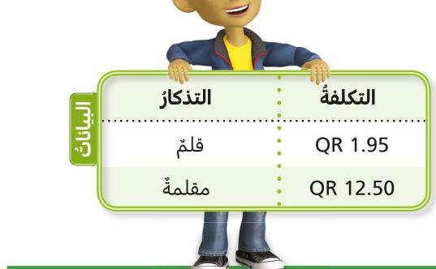
16. اشترى يوسف قميصًا مقابل QR 17.95 و 4 مقالم. كمْ من المال تقريبًا أنفق؟ (قلم QR 1.95 ، مقلمة QR 12.50)
   
17. بالتقريب إلى أقرب جزء من عشرة، أيٌّ ممّا يلي يعطي تقديرًا منخفضًا؟ (أ) 39.45 × 1.7  (ب) 27.54 × 0.74  (ج) 9.91 × 8.74  (د) 78.95 × 1.26  (هـ) 18.19 × 2.28
18. بالتقريب إلى أقرب عدد كلّيّ، أيٌّ ممّا يلي يعطي تقديرًا مرتفعًا؟ (أ) 11.6 × 9.5  (ب) 4.49 × 8.3  (ج) 12.9 × 0.9  (د) 0.62 × 1.5  (هـ) 8.46 × 7.38
19. يوجد تقريبًا 20 يومًا دراسيًّا في الشهر. كمْ كيلومترًا تقريبًا يقطع هشام كلّ شهر؟ اكتب جملة عددية لتبيّن عملك. (يقطع هشام مسافة 0.75 كيلومتر إلى المدرسة ذهابًا وإيابًا كلّ يوم)
20. من دون إجراء عملية الضرب، ما التقدير الوارد في مثال آخر وتعتقد أنّه أقرب إلى الإجابة الدقيقة؟
21. اشترى عبدالله 18.8 كيلوجرامًا من الخوخ. إذا كان ثمنُ الكيلوجرام الواحد QR 3.28، كمْ من المال تقريبًا دفع عبدالله مقابل الخوخ؟ اكتب جملة عددية لنمذجة حلّك.
22. لدى جاسم QR 20 أنفقَ منها QR 4.75 يومَ الجمعة، و QR 7.50 يومَ السبت، و QR 3.50 يومَ الأحد. كمْ من المال بقي لديْه؟ وضّح كيف توصّلت إلى الإجابة.
23. يعمل عبدالرحمن 4 أيام في الأسبوع في مكتبه ويومًا واحدًا في الأسبوع في منزله. مسافة الطريق من منزله إلى مكتبه 23.7 كيلومتر، ومسافةُ الطريق مِن مكتبه إلى منزلِه 21.8 كيلومتر. كمْ كيلومترًا تقريبًا يقطعُ عبدُ الرحمن إلى العملِ كلّ أسبوعٍ ذهابًا وإيابًا؟ وضّح كيف توصلت إلى الإجابة.

#### أولًا: اختر الإجابة الصحيحة (أسئلة محوّلة)

1. قدّر ناتج 0.87 × 112 بتقريب 0.87 إلى 1 و112 إلى 100.
   - أ) 10
   - ب) 1 000
   - ج) 100
   - د) 87
2. قدّر ناتج 104 × 0.33 بتقريب 104 إلى 100 و0.33 إلى 0.3.
   - أ) 3
   - ب) 300
   - ج) 30
   - د) 10
3. قدّر ناتج 9.02 × 80 بتقريب 9.02 إلى 9.
   - أ) 720
   - ب) 72
   - ج) 7 200
   - د) 90
4. قدّر ناتج 0.54 × 24 بتقريب 0.54 إلى 0.5.
   - أ) 1.2
   - ب) 12
   - ج) 120
   - د) 24
5. قدّر ناتج 33.05 × 200 بتقريب 33.05 إلى 33.
   - أ) 660
   - ب) 6 600
   - ج) 66 000
   - د) 6 000
6. قدّر ناتج 0.79 × 51 بتقريب 0.79 إلى 0.8 و51 إلى 50.
   - أ) 4
   - ب) 30
   - ج) 400
   - د) 40
7. قدّر ناتج 0.12 × 105 بتقريب 0.12 إلى 0.1 و105 إلى 100.
   - أ) 1
   - ب) 100
   - ج) 10
   - د) 12
8. قدّر ناتج 45.3 × 4 بتقريب 45.3 إلى 45.
   - أ) 180
   - ب) 18
   - ج) 1 800
   - د) 200
9. قدّر ناتج 99.2 × 82 بتقريب 99.2 إلى 100 و82 إلى 80.
   - أ) 800
   - ب) 8 000
   - ج) 80 000
   - د) 9 000
10. قدّر ناتج 37 × 0.93 بتقريب 0.93 إلى 1.
   - أ) 37
   - ب) 3.7
   - ج) 370
   - د) 30
11. قدّر ناتج 1.67 × 4 بتقريب 1.67 إلى 2.
   - أ) 6
   - ب) 80
   - ج) 8
   - د) 16
12. قدّر ناتج 3.2 × 184 بتقريب 3.2 إلى 3 و184 إلى 200.
   - أ) 600
   - ب) 60
   - ج) 6 000
   - د) 550
13. قدّر ناتج 12 × 0.37 بتقريب 0.37 إلى 0.4.
   - أ) 0.48
   - ب) 5
   - ج) 48
   - د) 4.8
14. قدّر ناتج 0.904 × 75 بتقريب 0.904 إلى 0.9 و75 إلى 80.
   - أ) 7.2
   - ب) 720
   - ج) 72
   - د) 68
15. يقطع هشامٌ 0.75 كيلومتر إلى المدرسة ذهابًا وإيابًا كلّ يومٍ، وفي الشهر تقريبًا 20 يومًا دراسيًّا. كم كيلومترًا تقريبًا يقطع كلّ شهرٍ؟
   - أ) 1.5 km
   - ب) 75 km
   - ج) 150 km
   - د) 15 km
16. اشترى عبدالله 18.8 كيلوجرامًا من الخوخ، وثمن الكيلوجرام QR 3.28. كم ريالًا تقريبًا دفع؟
   - أ) حوالي QR 22
   - ب) حوالي QR 6
   - ج) حوالي QR 120
   - د) حوالي QR 62
17. لدى جاسمٍ QR 20 أنفق منها QR 4.75 يوم الجمعة و QR 7.50 يوم السبت و QR 3.50 يوم الأحد. كم بقي لديه؟
   - أ) QR 15.75
   - ب) QR 4.25
   - ج) QR 5.25
   - د) QR 3.75
18. يعمل عبدالرحمن 4 أيّامٍ في الأسبوع في مكتبه، ومسافة الطريق من منزله إلى مكتبه 23.7 كيلومتر ومن مكتبه إلى منزله 21.8 كيلومتر. كم كيلومترًا تقريبًا يقطع كلّ أسبوعٍ ذهابًا وإيابًا؟
   - أ) حوالي 45 km
   - ب) حوالي 90 km
   - ج) حوالي 360 km
   - د) حوالي 180 km

### الدرس 4-3: استعمال النماذج لضرب كسر عشري في عدد كلي

#### رابعًا: أجب عن الأسئلة الآتية (مسائل وتفكير)

1. أوجد ناتج الضرب: 0.8 × 4
2. أوجد ناتج الضرب: 0.7 × 21
3. أوجد ناتج الضرب: 0.5 × 6
4. أوجد ناتج الضرب: 0.6 × 5
5. أوجد ناتج الضرب. استعمل شبكات الأجزاء العشرية لمساعدتك: 0.55 × 3
   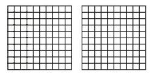
6. أوجد ناتج الضرب. استعمل شبكات الأجزاء العشرية لمساعدتك: 0.45 × 2
   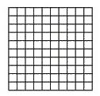
7. أوجد ناتج الضرب: 5 × 0.5
8. أوجد ناتج الضرب: 4 × 0.27
9. أوجد ناتج الضرب: 6 × 0.13
10. أوجد ناتج الضرب: 0.78 × 5
11. أوجد ناتج الضرب: 10 × 0.32
12. أوجد ناتج الضرب: 6 × 2.03
13. أوجد ناتج الضرب: 1.35 × 5
14. أوجد ناتج الضرب: 100 × 0.12
15. أوجد ناتج الضرب: 4 × 0.15
16. أوجد ناتج الضرب: 3 × 2.5
17. أوجد ناتج الضرب: 0.9 × 7
18. أوجد ناتج الضرب: 0.35 × 3
19. أوجد ناتج الضرب: 0.25 × 5
20. أوجد ناتج الضرب: 2.5 × 5
21. أوجد ناتج الضرب: 2.04 × 2
22. أوجد ناتج الضرب: 3 × 4.8
23. كيف يساعدك استعمال الشبكة على إيجاد ناتج ضرب كسر عشريّ وعددٍ كلّيّ؟
24. يتمّ التخطيط لبناء 3 حدائق جديدة في إحدى المدن. ستكون مساحة كلّ حديقة 1.25 كيلومتر مربع. ما العدد الكلّيّ للكيلومترات المربعة في الحدائق الثلاثة؟ استعمل النماذج لمساعدتك.
   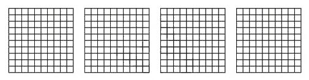
25. اكتب جملة ضرب تمثّل التظليل الذي تلاحظه على الشبكة.
   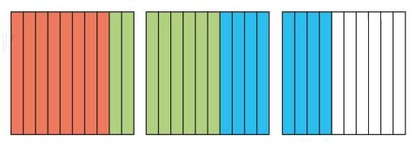
26. ضربت فدوى 9 في 0.989 فكانت الإجابة 89.01، كيف تستعمل التقدير لإثبات أنّ إجابة فدوى ليست صحيحة؟ في رأيك، ما الخطأ الذي وقعت فيه فدوى؟
27. تحتاج منى إلى 5 شرائط لتغليف الهدايا. يجب أن يكون طول كلّ شريط 0.50 متر. الجزء A: كيف يمكن أن تستعمل منى خطّ الأعداد لإيجاد طول الشريط الكلّيّ الذي تحتاج لشرائه؟ أوجد طول الشريط الكلّيّ. الجزء B: كيف يمكن لمنى أن تستعمل أنماط القيمة المنزلية للتحقّق من إجابتها؟
   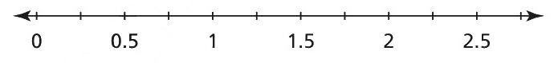
28. إذا أرادت البلدية زيادة مساحة الأراضي المخصّصة للحدائق بحيث تصبح مساحة كلّ حديقة 12.5 كيلومتر مربع، فكم كيلومترًا مربعًا إضافيًّا ستغطي هذه الحدائق؟

### الدرس 4-4: ضرب كسر عشري في عدد كلي

#### أولًا: اختر الإجابة الصحيحة

1. أيٌّ من الجمل العددية التالية ليس صحيحًا؟
   - أ) 75 × 3 = 225
   - ب) 75 × 0.3 = 22.5
   - ج) 7.5 × 3 = 2.25
   - د) 75 × 0.03 = 2.25

#### رابعًا: أجب عن الأسئلة الآتية (مسائل وتفكير)

2. أوجد ناتج الضرب: 9.8 × 2
3. أوجد ناتج الضرب: 0.67 × 8
4. أوجد ناتج الضرب: 34 × 5.3
5. أوجد ناتج الضرب: 4.6 × 21
6. أوجد ناتج الضرب: 0.6 × 15
7. أوجد ناتج الضرب: 55 × 1.1
8. أوجد ناتج الضرب: 34.6 × 9
9. أوجد ناتج الضرب: 64.2 × 20
10. أوجد ناتج الضرب: 40 × 0.22
11. أوجد ناتج الضرب: 57 × 2.3
12. أوجد ناتج الضرب: 5.8 × 11
13. أوجد ناتج الضرب: 56 × 0.4
14. أوجد ناتج الضرب: 170 × 0.003
15. أوجد ناتج الضرب: 0.3 × 99
16. أوجد ناتج الضرب: 26 × 1.61
17. أوجد ناتج الضرب: 50 × 0.914
18. أوجد ناتج الضرب: 10.76 × 100
19. أوجد ناتج الضرب: 2.54 × 12
20. ما وجه الاختلاف بين ضرب عدد كلي في كسر عشريّ وضرب عددين كليين؟
21. حدّدت المؤسسة العامة للكهرباء والماء تعرفة الكهرباء للشقق السكنية بـ QR 0.09 لكلّ كيلوواط ساعة، لاستهلاكٍ يقلّ عن 2 000 كيلوواط ساعة. احسب المبلغ المترتبَ على شقة استهلكَت 956 كيلوواط ساعة.
22. لشركة الخطوط الجوية التي يتعامل معها ثامر حدّ لوزن الأمتعة يبلغ 41 كيلوجرامًا. لدى ثامر حقيبتان خضراوان، تزن كلّ منها 18.4 كيلوجرام، وحقيبة واحدة زرقاء تزن 3.7 كيلوجرام. هل تقع حقائبه ضمن حدّ الوزن؟
23. يحسب محمد وقت استعماله لحاسوبه في كلّ أسبوع لمدة 10 أسابيع. وأنشأ الجدول المجاور باستعمال البيانات التي جمعها. ما عدد الساعات التي قضاها محمد في استعمال حاسوبه؟ (التكرار 2: 3 1/2 ساعة ؛ التكرار 4: 4 ساعات ؛ التكرار 3: 4 1/2 ساعة ؛ التكرار 1: 5 ساعات)
   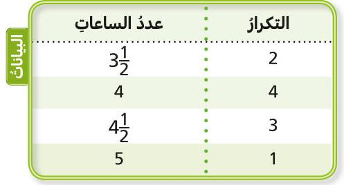
24. تجري سارة عملية ضرب لعاملين، أحدهما له منزلة عشرية واحدة والآخر له منزلتان عشريتان. وهي تقول إنّ ناتج الضرب يمكن أن يكون له منزلتين عشريتين. هل هي على صواب؟
25. خصّصت حصة حيزًا مستطيلًا في فنائها لتحويله إلى حديقة. إذا كان طول أحد بُعديه عبارة عن عدد كلّي من رقم واحد وكان طول البعد الآخر 5.5 أمتار، فما أصغر مساحة ممكنة؟ وما أكبر مساحة ممكنة؟ وضّح طريقة توصّلك إلى الإجابات.

### الدرس 4-5: استعمال النماذج لضرب كسر عشري في كسر عشري

#### رابعًا: أجب عن الأسئلة الآتية (مسائل وتفكير)

1. ظلّل شبكات الأجزاء من مئة لإيجاد ناتج الضرب: 0.7 × 0.8
   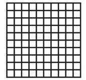
2. ظلّل شبكات الأجزاء من مئة لإيجاد ناتج الضرب: 0.1 × 2.1
   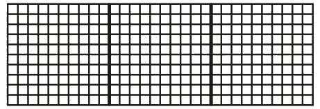
3. ظلّل شبكات الأجزاء من مئة لإيجاد ناتج الضرب: 0.4 × 0.5
   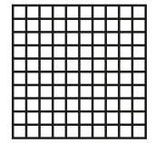
4. ظلّل شبكات الأجزاء من مئة لإيجاد ناتج الضرب: 0.3 × 0.7
   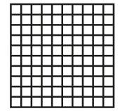
5. ظلّل شبكات الأجزاء من مئة لإيجاد ناتج الضرب: 0.5 × 1.7
   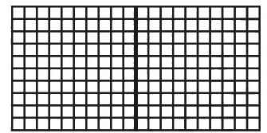
6. ظلّل شبكات الأجزاء من مئة لإيجاد ناتج الضرب: 0.6 × 1.2
   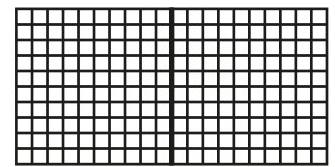
7. أوجد ناتج الضرب: 0.2 × 0.8
8. أوجد ناتج الضرب: 2.4 × 0.7
9. أوجد ناتج الضرب: 3.9 × 0.4
10. أوجد ناتج الضرب: 0.5 × 0.7
11. أوجد ناتج الضرب: 0.9 × 0.1
12. أوجد ناتج الضرب: 0.2 × 1.5
13. أوجد ناتج الضرب: 0.6 × 0.6
14. أوجد ناتج الضرب: 2.8 × 0.3
15. طول ضلع كلّ مربع موضّح أدناه يساوي 0.1 وحدة. اكتب جملة ضرب لتمثيل النموذج.
   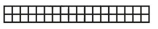
16. اشرح لماذا الكسر العشريّ 2.7 ليس إجابة منطقية للمقدار 0.9 × 0.3؛ ما هي الإجابة الصحيحة؟
17. اكتب جملة ضرب تمثّل النموذج العشريّ أدناه.
   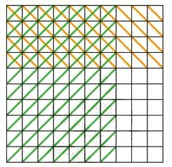
18. تتألّف مكتبة رامي من 6 رفوف، كلّ رفّ يمكن أن يحمل 12 كتابًا كحدّ أقصى. وضع على الرفوف حتى الآن 54 كتابًا. كم كتابًا يمكن أن تستوعب المكتبة بعدُ؟
19. اكتب عددًا يقع فيه الرقم 6 في منزلة الأجزاء من ألفٍ، والرقم 5 في منزلة الأجزاء من مئة، والرقم 0 في منزلة الأجزاء من عشرة. ثمّ اكتب العدد الأصغر مباشرة من هذا العدد والعدد الأكبر مباشرة من هذا العدد.
20. إذا ضربت كسرين عشريين كلّ منهما أصغر من 1، فهل يمكنك أن تتوقّع ما إذا كان الناتج سيكون أصغر أم أكبر من أيّ من العاملين؟
21. تقول سناء إنّ بإمكانها إيجاد ناتج 2.4 × 0.5 بقسمة العدد 2.4 إلى جزأين متساويين. هل هي على صواب؟ ارسم نموذجًا عشريًّا لشرح إجابتك.
22. اختر عددَين ناتج ضربهما يساوي 0.54 اكتب العددين في الصندوق. (6 ، 0.7 ، 0.9 ، 0.8 ، 7 ، 8 ، 0.6 ، 9)
   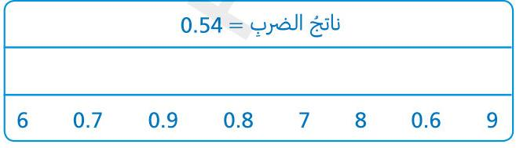
23. أظهرت شاشة الآلة الحاسبة لدى أيمن الجملة العددية 0.5 × 3.4 = 1.7؛ اشرح لماذا عدد المنازل العشرية في الناتج يختلف عن عدد المنازل العشرية في العاملين.

#### أولًا: اختر الإجابة الصحيحة (أسئلة محوّلة)

1. لماذا الكسر العشريّ 2.7 ليس إجابةً منطقيّةً للمقدار 0.9 × 0.3؟ وما الإجابة الصحيحة؟
   - أ) الناتج الصحيح 2.7 فعلًا
   - ب) الناتج يجب أن يكون أكبر من 1، والصحيح 3.0
   - ج) الناتج يجب أن يكون أصغر من 0.3، والصحيح 0.27
   - د) الناتج الصحيح 0.027
2. أيّ عددٍ فيه الرقم 6 في منزلة الأجزاء من ألفٍ والرقم 5 في منزلة الأجزاء من مئةٍ والرقم 0 في منزلة الأجزاء من عشرةٍ؟
   - أ) 0.506
   - ب) 0.605
   - ج) 0.650
   - د) 0.056
3. إذا ضربتَ كسرين عشريّين كلٌّ منهما أصغر من 1، فهل يكون الناتج:
   - أ) أصغر من كلّ من العاملين
   - ب) أكبر من كلّ من العاملين
   - ج) مساويًا لأحد العاملين
   - د) أكبر من 1 دائمًا
4. تقول سناء إنّ بإمكانها إيجاد ناتج 2.4 × 0.5 بقسمة 2.4 إلى جزأين متساويين. هل هي على صوابٍ؟
   - أ) لا، لأنّ القسمة لا تفيد هنا
   - ب) لا، لأنّ الضرب في 0.5 يعني مضاعفة العدد
   - ج) نعم، لأنّ الضرب في 0.5 يعني أخذ نصف العدد
   - د) نعم، لأنّ الناتج 2.9
5. أظهرت شاشة آلةٍ حاسبةٍ 0.5 × 3.4 = 1.7. لماذا لم يظهر الناتج 1.70؟
   - أ) لأنّ الناتج الصحيح 1.7 ولا يوجد صفرٌ آخر
   - ب) لأنّ الصفر الأخير في 1.70 لا يغيّر القيمة فلا يُكتب
   - ج) لأنّ الآلة الحاسبة لا تعرض الأصفار
   - د) لأنّ الناتج الدقيق 17
6. أيّ مما يأتي هو ناتج 0.7 × 0.8 (يمكن إيجاده بتظليل شبكات الأجزاء من مئة)؟
   - أ) 0.056
   - ب) 5.6
   - ج) 0.56
   - د) 1.5
7. أيّ مما يأتي هو ناتج 0.1 × 2.1؟
   - أ) 2.1
   - ب) 0.21
   - ج) 0.021
   - د) 2.2
8. أيّ مما يأتي هو ناتج 0.4 × 0.5؟
   - أ) 0.02
   - ب) 2
   - ج) 0.2
   - د) 0.9
9. أيّ مما يأتي هو ناتج 0.5 × 1.7؟
   - أ) 0.085
   - ب) 8.5
   - ج) 0.85
   - د) 2.2
10. أيّ مما يأتي هو ناتج 0.6 × 1.2؟
   - أ) 0.72
   - ب) 7.2
   - ج) 0.072
   - د) 1.8

### الدرس 4-6: ضرب الكسور العشرية باستعمال نواتج الضرب الجزئية

#### أولًا: اختر الإجابة الصحيحة

1. تستعملُ جميلةُ 4.5 عبوة من سائلٍ كيميائيّ لإجراء تجربةٍ في مختبر العلوم. تحتوي كلُّ عبوّةٍ على 16.5 مللتر من السائل. كمْ مللترًا من السائل الكيميائيّ استعملت جميلةُ في التجربة؟
   - أ) 20.10 مللتر
   - ب) 64.00 مللتر
   - ج) 74.25 مللتر
   - د) 82.50 مللتر
2. الميلُ المربّعُ الواحد يساوي 2.6 كيلومتر مربع. كم كيلومترًا مربّعًا في 14.4 ميل مربّع؟
   - أ) 11.52 كيلومتر مربع
   - ب) 17.00 كيلومتر مربع
   - ج) 37.44 كيلومتر مربع
   - د) 86.40 كيلومتر مربع

#### رابعًا: أجب عن الأسئلة الآتية (مسائل وتفكير)

3. قدّر أولًا ثمّ أوجد ناتج الضرب. تحقّق ممّا إذا كانت إجابتك منطقيّة: 9.3 × 4.1
4. قدّر أولًا ثمّ أوجد ناتج الضرب. تحقّق ممّا إذا كانت إجابتك منطقيّة: 3.2 × 0.6
5. قدّر أولًا ثمّ أوجد ناتج الضرب. تحقّق ممّا إذا كانت إجابتك منطقيّة: 0.7 × 1.9
6. قدّر أولًا ثمّ أوجد ناتج الضرب. تحقّق ممّا إذا كانت إجابتك منطقيّة: 12.6 × 0.2
7. أوجد ناتج ضرب 1.8 × 7.5 باستعمال نواتج الضرب الجزئية. قدّر: 1.8 × 7.5
8. قدّر أولًا ثمّ أوجد ناتج الضرب. تحقّق ممّا إذا كانت إجابتك منطقيّة: 5.2 × 4.6
9. قدّر أولًا ثمّ أوجد ناتج الضرب: 19.1 × 8.5
10. قدّر أولًا ثمّ أوجد ناتج الضرب: 0.5 × 4.5
11. قدّر أولًا ثمّ أوجد ناتج الضرب: 8.6 × 0.8
12. قدّر أولًا ثمّ أوجد ناتج الضرب: 5.5 × 0.6
13. قدّر أولًا ثمّ أوجد ناتج الضرب: 3.5 × 0.4
14. قدّر أولًا ثمّ أوجد ناتج الضرب: 6.8 × 7.2
15. قدّر أولًا ثمّ أوجد ناتج الضرب: 8.3 × 6.4
16. قدّر أولًا ثمّ أوجد ناتج الضرب: 9.1 × 11.6
17. قدّر أولًا ثمّ أوجد ناتج الضرب: 18.1 × 3.7
18. قدّر أولًا ثمّ أوجد ناتج الضرب: 0.6 × 1.5
19. قدّر أولًا ثمّ أوجد ناتج الضرب: 2.8 × 3.7
20. ما أوجه الاختلاف بين ضرب كسر عشريّ في كسر عشريّ وضرب كسر عشريّ في عدد كلّيّ؟ اشرح طريقة تفكيرك.
21. قطف كامل كمّيةً من الطماطم ووزّعها على صناديق يحوي كلّ منها 6.5 كيلوجرام. إذا ملأ 7.5 من الصناديق فكمْ كيلوجرامًا من الطماطم قطف كامل؟
22. إذا كانت قوّة جاذبيّة كوكب الزهرة 0.35 ضعف قوّة جاذبيّة كوكب المشتري، فما قوّة جاذبيّة كوكب الزهرة نسبةً إلى قوّة جاذبيّة كوكب الأرض؟ (الجاذبية النسبية: عطارد 0.39 ، نبتون 1.22 ، المشتري 2.6)
   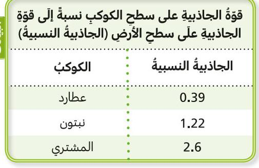
23. تساوي الجاذبيّة النسبيّة على سطح المشتري تقريبًا عددًا كلّيًّا من أضعاف الجاذبيّة النسبيّة على سطح نبتون. ما هذا العدد؟ (الجاذبية النسبية: عطارد 0.39 ، نبتون 1.22 ، المشتري 2.6)
   
24. اشترت هند 4 عبوّاتٍ من الزيت النباتي، سعةُ الواحدة منها 2.1 لتر. ما الكمّية الكلّيّة للتراتِ الزيت التي اشترتها هند؟
   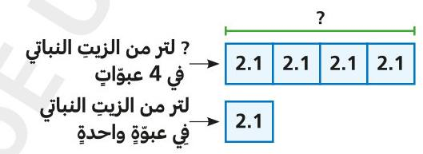
25. اشترى عيسى ثلاث عبواتٍ من المكسرات. إحدى العبواتِ تحتوي على اللوز وكتلتُها 3.07 كيلوجرام. أمّا العبوتان الأخريان فتحتويان على الجوز، وكتلة إحداهما 1.46 كيلوجرام وكتلة الأخرى 1.5 كيلوجرام. أيّ الكمّيتين كتلتُهما أكبر: اللوز أم الجوز؟ بكم أكبر؟
26. كيف يساعدك التقدير على وضع الفاصلة العشريّة في موقعها الصحيح في ناتج الضرب؟ اشرح طريقة تفكيرك.
27. تساوي مساحة سطح طاولة محمود عددًا كلّيًّا من الأقدام المربّعات. هل يمكن أن يكون قياس كلّ من الطول والعرض كسرًا عشريًّا له منزلة عشريّة واحدة؟

### الدرس 4-7: ضرب الكسور العشرية

#### رابعًا: أجب عن الأسئلة الآتية (مسائل وتفكير)

1. أوجد ناتج ضرب كلّ مقدار. استعمل الحسّ العددي والتقدير للتحقّق من إجابتك: 12.5 × 0.09
2. أوجد ناتج ضرب كلّ مقدار: 9.1 × 6.8
3. أوجد ناتج ضرب كلّ مقدار: 0.8 × 5.4
4. أوجد ناتج ضرب كلّ مقدار: 0.4 × 0.07
5. أوجد ناتج ضرب كلّ مقدار. استعمل الحسّ العدديّ أو التقدير للتحقّق من إجابتك: 0.4 × 1.3
6. أوجد ناتج ضرب كلّ مقدار: 0.63 × 5.5
7. أوجد ناتج ضرب كلّ مقدار: 6.5 × 4.4
8. أوجد ناتج ضرب كلّ مقدار: 10.3 × 0.3
9. أوجد ناتج ضرب كلّ مقدار: 2.9 × 2.9
10. أوجد ناتج ضرب كلّ مقدار: 27 × 4.9
11. أوجد ناتج ضرب كلّ مقدار: 0.8 × 0.09
12. أوجد ناتج ضرب كلّ مقدار: 5.6 × 100
13. تريد أميرة ضرب الكسرين العشريين 0.8 × 0.5، كم منزلة عشرية سيكون في ناتج الضرب؟
14. إذا كان 4 256 = 38 × 112، فما هو ناتج ضرب 3.8 × 1.12؟
15. اشترى زياد مكبّرًا للصوتِ ثمنُه QR 187.90 وتمّ احتساب رسوم الشحنِ عبر ضربِ ثمنِ مكبّرِ الصوتِ في 0.08، ما التكلفةُ الكلّيّة لمكبّر الصوت ورسومِ الشحنِ معًا؟ قرّبِ الإجابة إلى أقربِ جزءٍ مِن مئة.
16. يقودُ حمدٌ سيّارتَهُ مسافةَ 8 كيلومترٍ مِن منزلِه إلى عملِه ونفسَ المسافة إيابًا. إذا كرّر الأمرَ 5 أيامٍ في الأسبوع على مدًى 10 أسابيع، فما العددُ الكلّيُّ للكيلومتراتِ التي قطعَها؟
17. اشترى أيمن 3.9 كيلوجرام مِن التفّاح و 2.3 كيلوجرام مِن الموز، و 3.7 كيلوجرام مِن حبّاتِ الكيوي لإعدادِ سلطةِ الفاكهة. ما التكلفةُ الكلّيّةُ لمكوّناتِ السلطة؟ قرّبِ الإجابة إلى أقربِ جزءٍ مِن مئة. (سعر الكيلوجرام: تفاح QR 4.25 ، موز QR 3.75 ، كيوي QR 3.50)
   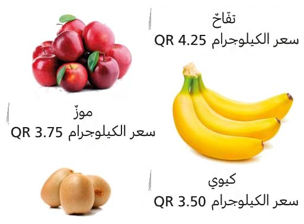
18. قاسَ هند بعضَ المسافاتِ على خريطةِ مدينتها. كلُّ سنتمتر على الخريطة يمثّلُ 4.5 كيلومتر على الأرض. الجزءُ A: ما المسافةُ الدقيقةُ بين المطار والمتحف؟ الجزءُ B: ما المسافةُ الدقيقةُ بينَ المطار وحديقةِ الزهور؟ (على الخريطة: المطار إلى حديقة الزهور 1.75 cm ، المطار إلى المتحف 2.5 cm)
   
19. في رأيك، كم منزلةً عشريةً يوجدُ في ناتجِ ضربِ 1.6 × 0.77 × 3.2؟ وضّح إجابتك، ثمّ اضرب لتتحقّقَ مِن الإجابة.

#### أولًا: اختر الإجابة الصحيحة (أسئلة محوّلة)

1. كلّ سنتمترٍ على خريطة مدينةٍ يمثّل 4.5 كيلومتر على الأرض. ما المسافة الدقيقة بين المطار والمتحف إذا كانت على الخريطة 2.5 cm؟
   - أ) 10.25 km
   - ب) 11.25 km
   - ج) 12.5 km
   - د) 7 km
2. كلّ سنتمترٍ على خريطة مدينةٍ يمثّل 4.5 كيلومتر على الأرض. ما المسافة الدقيقة بين المطار وحديقة الزهور إذا كانت على الخريطة 1.75 cm؟
   - أ) 7.875 km
   - ب) 6.25 km
   - ج) 7.5 km
   - د) 8.25 km
3. كم منزلةً عشريّةً في ناتج ضرب 1.6 × 0.77 × 3.2؟
   - أ) 2
   - ب) 4
   - ج) 3
   - د) 5

### الدرس 4-8: النمذجة في الرياضيات

#### رابعًا: أجب عن الأسئلة الآتية (مسائل وتفكير)

1. اشترت شيماء 14 ملصقًا صغيرًا بسعر QR 0.99 لكلّ منها، كما اشترت قلمًا واحدًا مقابل QR 1.29. حصلت على قسيمة حسم قيمتها QR 2.50. ما المبلغ الكلّي الذي دفعَتْه شيماء؟ ما الذي تحتاج إلى إيجاده أوّلًا؟
2. اشترت شيماء 14 ملصقًا صغيرًا بسعر QR 0.99 لكلّ منها، كما اشترت قلمًا واحدًا مقابل QR 1.29. حصلت على قسيمة حسم قيمتها QR 2.50. اكتب جملة عددية لتمثيل المسألة.
3. اشترت شيماء 14 ملصقًا صغيرًا بسعر QR 0.99 لكلّ منها، كما اشترت قلمًا واحدًا مقابل QR 1.29. حصلت على قسيمة حسم قيمتها QR 2.50. ما حلّ المسألة؟
4. اشترى ناصر 2.5 كيلوجرام مِن كلّ نوعٍ مِن الخضراوات المذكورة على اللافتة. كم كانتِ التكلفةُ الكلّيّةُ للخضراتِ التي اشتراها؟ ما الذي يجب عليك إيجادُه؟ (الخسّ QR 1.30/kg ، السّبانخ QR 1.65/kg ، البقدونس QR 0.49/kg)
   
5. اشترى ناصر 2.5 كيلوجرام مِن كلّ نوعٍ مِن الخضراوات المذكورة على اللافتة. اكتب جملةً عدديةً لتمثيل المسألة. (الخسّ QR 1.30/kg ، السّبانخ QR 1.65/kg ، البقدونس QR 0.49/kg)
   
6. اشترى ناصر 2.5 كيلوجرام مِن كلّ نوعٍ مِن الخضراوات المذكورة على اللافتة. ما حلّ المسألة؟ (الخسّ QR 1.30/kg ، السّبانخ QR 1.65/kg ، البقدونس QR 0.49/kg)
   
7. منافسة الحبل الأطول: يتبارى فريقُ آمنة وفريقُ شيماء لصنع الحبلِ الأطولِ باستعمال الأشرطةِ الملونةِ التي لدى كلّ منهُما. تختلفُ أطوالُ الأشرطةِ باختلافِ ألوانِها. يزيدُ عددُ الأشرطةِ لدى فريقِ آمنة على عددِ الأشرطة التي لدى فريقِ شيماء بـ 538، أيٌّ مِن الفريقينِ يصنعُ الحبلَ الأطولَ؟ بكم يزيدُ طولُ حبلِ هذا الفريقِ على طولِ الحبلِ الآخرِ؟ افهمْ وثابِر في الحلّ: هل تحتاجُ إلى كلّ المعلوماتِ المعطاةِ لحلّ المسألةِ؟
   
8. كيفَ يكونُ إيجادُ طول الحبلِ في مجموعةِ آمنة مشابهًا لإيجادِ طولِ الحبلِ في مجموعةِ شيماء؟
   
9. اكتبْ جملةً عدديةً وحُلّها لتمثيلِ الطولِ الكلّيّ للحبلِ الذي يصنعُهُ فريقُ آمنة. ثمّ اكتبْ جملةً عدديةً وحُلّها لتمثيلِ الطولِ الكلّيّ للحبلِ الذي يصنعُهُ فريقُ شيماء. استعملْ آلةً حاسبةً لمساعدتِكَ في حلّ الجملِ العدديةِ.
   
10. أيٌّ مِن الفريقينِ يصنعُ الحبلَ الأطولَ؟ بكم يزيدُ طولُ حبلِ هذا الفريقِ عَن طولِ الحبلِ الآخرِ؟
   

#### أولًا: اختر الإجابة الصحيحة (أسئلة محوّلة)

1. اشترت شيماء 14 ملصقًا صغيرًا بسعر QR 0.99 لكلّ منها، واشترت قلمًا بـ QR 1.29، وحصلت على قسيمة حسمٍ قيمتها QR 2.50. ما الذي تحتاج إلى إيجاده أوّلًا؟
   - أ) عدد الملصقات فقط
   - ب) ثمن القلم فقط
   - ج) قيمة القسيمة فقط
   - د) ثمن الملصقات الـ 14 معًا
2. اشترت شيماء 14 ملصقًا صغيرًا بسعر QR 0.99 لكلّ منها، واشترت قلمًا بـ QR 1.29، وحصلت على قسيمة حسمٍ قيمتها QR 2.50. ما المبلغ الكلّيّ الذي دفعته؟
   - أ) QR 13.86
   - ب) QR 15.15
   - ج) QR 12.65
   - د) QR 17.65
3. اشترى ناصرٌ 2.5 كيلوجرام من كلّ نوعٍ: الخسّ QR 1.30 للكيلوجرام، والسبانخ QR 1.65، والبقدونس QR 0.49. ما التكلفة الكلّيّة؟
   - أ) QR 8.60
   - ب) QR 3.44
   - ج) QR 8.00
   - د) QR 9.25
4. اشترى سالمٌ 12 قلمًا ثمن القلم QR 0.75، ودفترًا بـ QR 2.40، وحصل على حسمٍ قيمته QR 1. كم دفع؟
   - أ) QR 12.15
   - ب) QR 11.40
   - ج) QR 10.40
   - د) QR 9.40
5. اشترت منى 8 علبٍ من العصير ثمن العلبة QR 1.85 وكيس حلوى بـ QR 4.60. كم دفعت؟
   - أ) QR 6.45
   - ب) QR 14.80
   - ج) QR 19.40
   - د) QR 20.20
6. لدى عمر QR 50. اشترى 6 كتبٍ ثمن الكتاب QR 6.25. كم بقي معه؟
   - أ) QR 6.25
   - ب) QR 37.50
   - ج) QR 43.75
   - د) QR 12.50
7. اشترى ناصر 2.5 kg من كلّ نوع من الخضراوات: الخسّ QR 1.30 لكلّ kg والسبانخ QR 1.65 لكلّ kg والبقدونس QR 0.49 لكلّ kg. ما التكلفة الكلّيّة؟
   - أ) QR 10.75
   - ب) QR 3.44
   - ج) QR 8.60
   - د) QR 6.88
8. يصنع فريق آمنة حبلًا من الأشرطة: 917 شريطًا طول كلّ منها 0.01 m، و100 شريط طول كلّ منها 0.05 m، و45 شريطًا طول كلّ منها 0.10 m، و19 شريطًا طول كلّ منها 0.25 m. ما الطول الكلّيّ للحبل؟
   - أ) 2 342 m
   - ب) 12.53 m
   - ج) 10.89 m
   - د) 23.42 m
9. يصنع فريق شيماء حبلًا من الأشرطة: 488 شريطًا طول كلّ منها 0.01 m، و23 شريطًا طول كلّ منها 0.05 m، و10 أشرطة طول كلّ منها 0.10 m، و22 شريطًا طول كلّ منها 0.25 m. ما الطول الكلّيّ للحبل؟
   - أ) 12.53 m
   - ب) 23.42 m
   - ج) 10.89 m
   - د) 1 253 m
10. طول حبل فريق آمنة 23.42 m وطول حبل فريق شيماء 12.53 m. أيّ الفريقين حبله أطول وبكم؟
   - أ) فريق آمنة بزيادة 35.95 m
   - ب) فريق شيماء بزيادة 10.89 m
   - ج) فريق آمنة بزيادة 10.89 m
   - د) الحبلان متساويان
11. اشترت شيماء 12 ملصقًا ثمن كلّ منها QR 0.85، وقلمًا واحدًا بـ QR 1.35، وحصلت على قسيمة حسم قيمتها QR 2.00. ما المبلغ الكلّيّ الذي دفعته؟
   - أ) QR 0.95
   - ب) QR 95.50
   - ج) QR 9.55
   - د) QR 9.65
12. اشترت منى 9 ملصقات ثمن كلّ منها QR 1.45، وقلمًا واحدًا بـ QR 2.60، وحصلت على قسيمة حسم قيمتها QR 1.50. ما المبلغ الكلّيّ الذي دفعته؟
   - أ) QR 14.25
   - ب) QR 141.50
   - ج) QR 1.41
   - د) QR 14.15
13. اشترى أحمد 16 ملصقًا ثمن كلّ منها QR 0.75، وقلمًا واحدًا بـ QR 3.20، وحصل على قسيمة حسم قيمتها QR 3.00. ما المبلغ الكلّيّ الذي دفعه؟
   - أ) QR 12.30
   - ب) QR 122.00
   - ج) QR 1.22
   - د) QR 12.20
14. اشترت نادية 8 ملصقات ثمن كلّ منها QR 2.15، وقلمًا واحدًا بـ QR 0.95، وحصلت على قسيمة حسم قيمتها QR 2.50. ما المبلغ الكلّيّ الذي دفعته؟
   - أ) QR 156.50
   - ب) QR 15.65
   - ج) QR 1.57
   - د) QR 15.75
15. اشترى علي 20 ملصقًا ثمن كلّ منها QR 0.65، وقلمًا واحدًا بـ QR 1.80، وحصل على قسيمة حسم قيمتها QR 1.00. ما المبلغ الكلّيّ الذي دفعه؟
   - أ) QR 13.90
   - ب) QR 138.00
   - ج) QR 1.38
   - د) QR 13.80
16. اشترت ليلى 11 ملصقًا ثمن كلّ منها QR 1.20، وقلمًا واحدًا بـ QR 4.35، وحصلت على قسيمة حسم قيمتها QR 2.25. ما المبلغ الكلّيّ الذي دفعته؟
   - أ) QR 153.00
   - ب) QR 15.30
   - ج) QR 1.53
   - د) QR 15.40
17. اشترى سالم 15 ملصقًا ثمن كلّ منها QR 0.90، وقلمًا واحدًا بـ QR 2.45، وحصل على قسيمة حسم قيمتها QR 1.75. ما المبلغ الكلّيّ الذي دفعه؟
   - أ) QR 14.20
   - ب) QR 142.00
   - ج) QR 1.42
   - د) QR 14.30
18. اشترت هند 6 ملصقات ثمن كلّ منها QR 3.25، وقلمًا واحدًا بـ QR 1.70، وحصلت على قسيمة حسم قيمتها QR 2.00. ما المبلغ الكلّيّ الذي دفعته؟
   - أ) QR 192.00
   - ب) QR 19.20
   - ج) QR 1.92
   - د) QR 19.30
19. اشترى يوسف 25 ملصقًا ثمن كلّ منها QR 0.60، وقلمًا واحدًا بـ QR 5.50، وحصل على قسيمة حسم قيمتها QR 4.00. ما المبلغ الكلّيّ الذي دفعه؟
   - أ) QR 16.60
   - ب) QR 165.00
   - ج) QR 1.65
   - د) QR 16.50

## الوحدة 5: استعمال النماذج والطرائق لقسمة الأعداد الكلية

### الدرس 5-1: استعمال الأنماط والحساب الذهني في القسمة

#### أولًا: اختر الإجابة الصحيحة

1. أيٌّ ممّا يلي ناتجُ قسمةِ 2 400 علَى 80؟
   - أ) 3
   - ب) 4
   - ج) 30
   - د) 40
2. ما المقدارُ الذي له ناتجُ القسمةِ 70؟
   - أ) 420 ÷ 60
   - ب) 4 200 ÷ 6
   - ج) 4 200 ÷ 60
   - د) 4 200 ÷ 600

#### رابعًا: أجب عن الأسئلة الآتية (مسائل وتفكير)

3. لماذا يعدُّ 30 ÷ 210 مماثلًا لـ 21 عشرة تقسيم 3 عشراتٍ؟
4. أوجد كلّ ناتج قسمة. استعمل الحساب الذهني: 210 ÷ 30، مماثل لـ 21 عشرة تقسيم 3 عشراتٍ يساوي ____
5. أوجد كلّ ناتج قسمة: 480 ÷ 60، مماثل لـ 48 عشرة تقسيم 6 عشراتٍ يساوي ____
6. أوجد كلّ ناتج قسمة: 15 000 ÷ 30، مماثل لـ 1 500 عشرة تقسيم 3 عشراتٍ يساوي ____
7. أوجد كلّ ناتج قسمة: 8 100 ÷ 90 = ____
8. أوجد كلّ ناتج قسمة: 2 800 ÷ 70 = ____
9. أوجد كلّ ناتج قسمة: 30 000 ÷ 50 = ____
10. أوجد كلّ ناتج قسمة: 1 800 ÷ 60 = ____
11. استعمل الحساب الذهني لإيجاد الأعداد الناقصة: 560 ÷ 70، مماثل لـ 56 عشرة تقسيم 7 عشراتٍ يساوي ____
12. استعمل الحساب الذهني لإيجاد الأعداد الناقصة: 360 ÷ 60، مماثل لـ 36 عشرة تقسيم 6 عشراتٍ يساوي ____
13. استعمل الحساب الذهني لإيجاد الأعداد الناقصة: 6 000 ÷ 50، مماثل لـ 600 عشرة تقسيم 5 عشراتٍ يساوي ____
14. استعمل الحساب الذهني لإيجاد الأعداد الناقصة: 24 000 ÷ 60، مماثل لـ 2 400 عشرة تقسيم 6 عشراتٍ يساوي ____
15. استعمل الحساب الذهني لإيجاد الأعداد الناقصة: 2 000 ÷ 20 = ____
16. استعمل الحساب الذهني لإيجاد الأعداد الناقصة: 6 300 ÷ 90 = ____
17. استعمل الحساب الذهني لإيجاد الأعداد الناقصة: ____ ÷ 10 = 24
18. استعمل الحساب الذهني لإيجاد الأعداد الناقصة: 21 000 ÷ ____ = 700
19. استعمل الحساب الذهني لإيجاد الأعداد الناقصة: 2 500 ÷ 50 = ____
20. استعمل الحساب الذهني لإيجاد الأعداد الناقصة: 72 000 ÷ ____ = 800
21. استعمل الحساب الذهني لإيجاد الأعداد الناقصة: 56 000 ÷ ____ = 800
22. استعمل الحساب الذهني لإيجاد الأعداد الناقصة: ____ ÷ 10 = 100
23. استعمل الحساب الذهني لإيجاد الأعداد الناقصة: 45 000 ÷ 90 = ____
24. استعمل الحساب الذهني لإيجاد الأعداد الناقصة: 42 000 ÷ 70 = ____
25. استعمل الحساب الذهني لإيجاد الأعداد الناقصة: 64 000 ÷ ____ = 800
26. استعمل الحساب الذهني لإيجاد الأعداد الناقصة: 32 000 ÷ ____ = 400
27. حملت طائرة ركّاب 12 000 راكبٍ في 40 رحلة. إذا كانت الطائرة ممتلئةً في كلّ رحلةٍ، فما عدد الأشخاص الذين حملتهم في كلّ رحلةٍ؟
28. يبيّن الجدول المجاور أعداد الركّاب في عددٍ من رحلاتِ الطيران. إذا كان في كلّ رحلةٍ نفسُ عددِ الركّاب، فما عددُ الركّاب في كلّ رحلةٍ؟ (عدد الركاب الكلّي 27 000 ، عدد الرحلات 90 ، عدد أفراد الطاقم الكلّي 900)
   
29. توزّعُ شاحنةٌ 478 دزّينةً من البيض إلى المتاجر في يومٍ واحد. اكتب جملةً عدديةً لإيجاد عدد البيض، n، الذي توزّعُه الشاحنةُ في يومٍ واحدٍ، وحلّها.
30. تريدُ روضةُ توزيعَ 480 حبةَ طماطم بالتساوي علَى 80 سلّةً. كمْ حبةَ طماطم وضعت روضةُ في كلّ سلّةٍ؟
31. قاس عيسى طول كلّ رفٍّ من الرفوف الثلاثة المبيّنة أدناه. ما الفرقُ في الطول بين الرفّ الأطول والأقصر؟ (الرفوف: 0.7 m ، 0.84 m ، 0.74 m)
   
32. يستعمل خبازٌ 30 جرامًا من الملح لكلّ كمّيةِ عجينٍ معدّةٍ للخبز. يأتي الملحُ في عبوةٍ كتلتُها 18 كيلوجرامٍ أو في عبوةٍ كتلتها 800 جرام. ما العبوةُ التي ينبغي على الخبازِ شراؤها حتّى لا يتبقّى شيءٌ من الملح بعدَ الانتهاءِ من كلّ كميات العجينِ المعدّةِ؟ (1 كيلوجرام يساوي 1 000 جرام)

### الدرس 5-2: تقدير نواتج القسمة على عدد من رقمين

#### أولًا: اختر الإجابة الصحيحة

1. اشترتْ لطيفةُ 225 زهرةً و 12 مزهريةً. ووضعتْ نفسَ العددِ من الزهورِ تقريبًا في كلّ مزهريةٍ. مَا أفضلُ تقديرٍ لعددِ الزهورِ في كلّ مزهريةٍ؟
   - أ) 40 زهرة
   - ب) 30 زهرة
   - ج) 20 زهرة
   - د) 10 زهراتٍ
2. عددُ طلابِ إحدى المدارسِ 617 طالبًا. يحوي كلُّ صفٍّ مَا بينَ 28 و 32 طالبًا. مَا أفضلُ تقديرٍ لعددِ الصفوفِ في المدرسةِ؟
   - أ) 14 صفًّا
   - ب) 20 صفًّا
   - ج) 30 صفًّا
   - د) 60 صفًّا

#### رابعًا: أجب عن الأسئلة الآتية (مسائل وتفكير)

3. قدّر باستعمال أعداد متناغمة: 287 ÷ 42
4. قدّر باستعمال أعداد متناغمة: 320 ÷ 11
5. قدّر باستعمال أعداد متناغمة: 208 ÷ 72
6. قدّر باستعمال أعداد متناغمة: 554 ÷ 62
7. قدّر باستعمال أعداد متناغمة: 815 ÷ 23
8. قدّر باستعمال أعداد متناغمة: 2 491 ÷ 48
9. املأ الفراغات لإيجاد كلّ تقدير: 412 ÷ 84 ، 288 ÷ 37 ، 2 964 ÷ 73
   
10. قدّر باستعمال أعداد متناغمة: 228 ÷ 19
11. قدّر باستعمال أعداد متناغمة: 1 784 ÷ 64
12. قدّر باستعمال أعداد متناغمة: 7 260 ÷ 83
13. قدّر باستعمال أعداد متناغمة: 2 280 ÷ 12
14. قدّر باستعمال أعداد متناغمة: 485 ÷ 92
15. قدّر باستعمال أعداد متناغمة: 540 ÷ 61
16. قدّر باستعمال أعداد متناغمة: 1 710 ÷ 32
17. قدّر باستعمال أعداد متناغمة: 2 740 ÷ 67
18. قدّر باستعمال أعداد متناغمة: 4 322 ÷ 81
19. قدّر باستعمال أعداد متناغمة: 5 700 ÷ 58
20. قدّر باستعمال أعداد متناغمة: 7 810 ÷ 44
21. قدّر باستعمال أعداد متناغمة: 6 395 ÷ 84
22. لدى بدر 425 سوارًا إضافيًّا للبيع، ويريد أن يخزّنَها في علبٍ تتّسعُ الواحدةُ منها لـ 20 سوارًا، فقدّر أنّه يحتاج إلى 25 علبةً. هل توافقه على هذا التقدير؟ لماذا؟
23. متجر للأدوات الرياضية لديه تخفيضاتٌ كبيرةٌ على الأسعار. تبيّن اللافتة أسعار قبعاتٍ بيسبول بأحجامٍ مختلفة. يرغبُ زياد في شراءِ علبة القبعاتِ ذاتِ المقاس المتوسط. كمْ ستكون تكلفة كلّ قبعةٍ تقريبًا؟ اكتب جملة عددية لنمذجة حلّك. (علب من قبّعات البيسبول: 50 قبعة كبيرة QR 360 ، 32 قبعة متوسطة QR 270 ، 20 قبعة صغيرة QR 180)
   
24. بقي 91 يومًا على بدايةِ معرضِ المشغولاتِ اليدويّة. تحتاجُ نورة إلى صنعِ 817 خاتمًا قبلَ موعدِ البيع. تريدُ أن تصنعَ نفسَ العددِ من الخواتم تقريبًا كلّ يوم. كمْ خاتمًا تقريبًا عليها أن تصنعَ كلّ يومٍ؟ وضّح كيف يمكن لنورة استعمال أعدادٍ متناغمةٍ للتقدير.
25. كان لدى سارة QR 20، ادخرتْ QR 5.75 كلّ أسبوعٍ لمدةِ 8 أسابيعٍ. كمْ أصبحَ لدَيْها مِنَ المال الآن؟ استعملْ لوحةَ الأجزاءِ لحلّ المسألةِ.
   
26. اشترتْ شركةٌ 3 128 زجاجةَ ماءٍ. يحتاجُ كلُّ قسمٍ إلى 55 زجاجةً. ما الأعدادُ المتناغمةُ التي تعطيكَ تقديرًا أفضلَ لعددِ الأقسام التي تستطيعُ الحصولَ على الزجاجاتِ اللازمة: 3 000 ÷ 60 أو 3 000 ÷ 50؟ ثمّ قمْ بالتقدير.

#### أولًا: اختر الإجابة الصحيحة (أسئلة محوّلة)

1. قدّر ناتج 287 ÷ 42 باستعمال الأعداد المتناغمة 280 ÷ 40.
   - أ) 6
   - ب) 8
   - ج) 7
   - د) 70
2. قدّر ناتج 320 ÷ 11 باستعمال الأعداد المتناغمة 300 ÷ 10.
   - أ) 3
   - ب) 30
   - ج) 300
   - د) 32
3. قدّر ناتج 208 ÷ 72 باستعمال الأعداد المتناغمة 210 ÷ 70.
   - أ) 3
   - ب) 30
   - ج) 4
   - د) 2
4. قدّر ناتج 554 ÷ 62 باستعمال الأعداد المتناغمة 540 ÷ 60.
   - أ) 9
   - ب) 8
   - ج) 10
   - د) 90
5. قدّر ناتج 815 ÷ 23 باستعمال الأعداد المتناغمة 800 ÷ 20.
   - أ) 4
   - ب) 400
   - ج) 45
   - د) 40
6. قدّر ناتج 2 491 ÷ 48 باستعمال الأعداد المتناغمة 2 500 ÷ 50.
   - أ) 50
   - ب) 5
   - ج) 500
   - د) 52
7. قدّر ناتج 228 ÷ 19 باستعمال الأعداد المتناغمة 240 ÷ 20.
   - أ) 12
   - ب) 11
   - ج) 120
   - د) 14
8. قدّر ناتج 1 784 ÷ 64 باستعمال الأعداد المتناغمة 1 800 ÷ 60.
   - أ) 3
   - ب) 300
   - ج) 30
   - د) 28
9. قدّر ناتج 7 260 ÷ 83 باستعمال الأعداد المتناغمة 7 200 ÷ 80.
   - أ) 90
   - ب) 9
   - ج) 900
   - د) 87
10. قدّر ناتج 485 ÷ 92 باستعمال الأعداد المتناغمة 450 ÷ 90.
   - أ) 50
   - ب) 4
   - ج) 6
   - د) 5
11. قدّر ناتج 540 ÷ 61 باستعمال الأعداد المتناغمة 540 ÷ 60.
   - أ) 9
   - ب) 8
   - ج) 90
   - د) 10
12. قدّر ناتج 1 710 ÷ 32 باستعمال الأعداد المتناغمة 1 600 ÷ 32.
   - أ) 5
   - ب) 500
   - ج) 50
   - د) 60
13. قدّر ناتج 2 740 ÷ 67 باستعمال الأعداد المتناغمة 2 800 ÷ 70.
   - أ) 4
   - ب) 40
   - ج) 400
   - د) 45
14. قدّر ناتج 5 700 ÷ 58 باستعمال الأعداد المتناغمة 6 000 ÷ 60.
   - أ) 10
   - ب) 1 000
   - ج) 100
   - د) 90
15. قدّر ناتج 6 395 ÷ 84 باستعمال الأعداد المتناغمة 6 400 ÷ 80.
   - أ) 8
   - ب) 800
   - ج) 80
   - د) 76
16. لدى بدرٍ 425 سوارًا ويريد تخزينها في علبٍ تتّسع الواحدة لـ 20 سوارًا، فقدّر أنّه يحتاج إلى 25 علبةً. هل توافقه؟
   - أ) لا، لأنّ 425 ÷ 20 ≈ 21 فيحتاج إلى 22 علبةً
   - ب) نعم، لأنّ 425 ÷ 20 = 25 تمامًا
   - ج) لا، لأنّه يحتاج إلى 40 علبةً
   - د) نعم، لأنّ 25 × 20 = 425
17. في علبة قبّعاتٍ متوسّطةٍ 32 قبّعةً بسعر QR 270. كم تكلفة القبّعة الواحدة تقريبًا (استعمل 240 ÷ 30)؟
   - أ) حوالي QR 0.8
   - ب) حوالي QR 80
   - ج) حوالي QR 8
   - د) حوالي QR 18
18. بقي 91 يومًا على بداية معرضٍ، وتحتاج نورة إلى صنع 817 خاتمًا. كم خاتمًا تقريبًا تصنع كلّ يومٍ (استعمل 810 ÷ 90)؟
   - أ) حوالي 8
   - ب) حوالي 90
   - ج) حوالي 19
   - د) حوالي 9
19. اشترت شركةٌ 3 128 زجاجة ماءٍ، ويحتاج كلّ قسمٍ إلى 55 زجاجةً. أيّ الأعداد المتناغمة تعطي تقديرًا أفضل لعدد الأقسام؟
   - أ) 3 000 ÷ 60 = 50
   - ب) 3 000 ÷ 50 = 60
   - ج) 3 000 ÷ 55 = 55
   - د) 3 000 ÷ 100 = 30

### الدرس 5-3: استعمال النماذج للقسمة على عدد من رقمين

#### أولًا: اختر الإجابة الصحيحة

1. في قاعةِ مسرحٍ 16 صفًّا مِنَ المقاعد. ويوجدُ في كلّ صفٍّ نفسُ العددِ من المقاعد. إذا كانَ العددُ الكلّيُّ منَ المقاعدِ في القاعةِ 512 مقعدًا، فما عددُ المقاعدِ في كلّ صفٍّ؟
   - أ) 22 مقعدًا
   - ب) 30 مقعدًا
   - ج) 32 مقعدًا
   - د) 33 مقعدًا
2. مساحةُ فناءٍ 286 مترًا مربعًا. إذا كانَ طولُ الفناءِ 22 مترًا، فما عرضُه؟
   - أ) 10 m
   - ب) 13 m
   - ج) 14 m
   - د) 144 m

#### رابعًا: أجب عن الأسئلة الآتية (مسائل وتفكير)

3. استعمل ورقة المربعات أو ارسم صورة لإيجاد ناتج القسمة: 682 ÷ 22
4. استعمل ورقة المربعات أو ارسم صورة لإيجاد ناتج القسمة: 143 ÷ 11
5. استعمل ورقة المربعات أو ارسم صورة لإيجاد ناتج القسمة: 342 ÷ 38
6. استعمل ورقة المربعات أو ارسم صورة لإيجاد ناتج القسمة: 720 ÷ 16
7. استعمل ورقة المربعات أو ارسم صورة لإيجاد ناتج القسمة: 608 ÷ 19
8. استعمل ورقة المربعات أو ارسم صورة لإيجاد ناتج القسمة: 752 ÷ 47
9. استعمل ورقة المربعات أو ارسم صورة لإيجاد ناتج القسمة: 375 ÷ 25
10. استعمل ورقة المربعات أو ارسم صورة لإيجاد ناتج القسمة: 576 ÷ 24
11. اكتب الأعداد الناقصة لإيجاد ناتج 154 ÷ 11 باستعمال النموذج الموضّح.
   
12. اكتب جملة ضربٍ وجملة قسمةٍ تمثلانِ النموذجَ الموضّحَ أدناه. ثمّ حُلّ.
   
13. استعمل النموذج لإيجاد ناتج 156 ÷ 12
   
14. استعمل النموذج لإيجاد ناتج 182 ÷ 13
   
15. يتدرّبُ أحمد على ركوبِ درّاجتِه الهوائيّةِ لمسافةٍ طويلة. يقطعُ 15 كيلومتر في الساعة. ما عدد الساعاتِ التي سيستغرقُها ليقطعَ بدرّاجتِه مسافة 210 كيلومتر؟
   
16. استعمل الخريطة. بكم تزيدُ المسافةُ مِن المكتبة إلى المتنزّه ثمّ إلى محطةِ القطارِ عنِ المسافةِ مِن المكتبةِ إلى محطةِ القطارِ مباشرةً؟
   
17. إذا تنقلتَ منْ محطةِ القطارِ إلى المكتبةِ ثمّ إلى المتنزّه، ثمّ عُدتَ إلى محطةِ القطارِ، فما العددُ الكلّيُّ للكيلومتراتِ التي تكونُ قد قطعتَها؟ اكتبْ جملةً عدديةً تمثلُ حلَّك.
   
18. اشرح طريقة استعمال الصورة المجاورة لتمثيل أنّ 17 = 23 ÷ 391
   
19. لديك سجادة مستطيلةُ الشكلِ طول أحدِ بعدَيها 21 إنش ومساحتُها 714 إنش مربع. أوجد طول البعد الآخر. هل يمكن وضعُ السجادة في ممرّ بحيثُ يوازي بعدُها الأطولُ عرض هذا الممرّ ومقدارُه 36 إنش؟

#### أولًا: اختر الإجابة الصحيحة (أسئلة محوّلة)

1. أوجد ناتج القسمة: 682 ÷ 22
   - أ) 30
   - ب) 31
   - ج) 32
   - د) 41
2. أوجد ناتج القسمة: 143 ÷ 11
   - أ) 12
   - ب) 14
   - ج) 13
   - د) 15
3. أوجد ناتج القسمة: 342 ÷ 38
   - أ) 9
   - ب) 8
   - ج) 10
   - د) 12
4. أوجد ناتج القسمة: 720 ÷ 16
   - أ) 45
   - ب) 40
   - ج) 50
   - د) 54
5. أوجد ناتج القسمة: 608 ÷ 19
   - أ) 30
   - ب) 31
   - ج) 32
   - د) 34
6. أوجد ناتج القسمة: 752 ÷ 47
   - أ) 14
   - ب) 16
   - ج) 15
   - د) 17
7. أوجد ناتج القسمة: 375 ÷ 25
   - أ) 13
   - ب) 25
   - ج) 17
   - د) 15
8. أوجد ناتج القسمة: 576 ÷ 24
   - أ) 22
   - ب) 28
   - ج) 26
   - د) 24
9. أوجد ناتج القسمة: 154 ÷ 11
   - أ) 12
   - ب) 13
   - ج) 15
   - د) 14
10. أوجد ناتج القسمة: 156 ÷ 12
   - أ) 12
   - ب) 15
   - ج) 14
   - د) 13
11. أوجد ناتج القسمة: 182 ÷ 13
   - أ) 12
   - ب) 13
   - ج) 14
   - د) 15
12. أوجد ناتج القسمة: 391 ÷ 23
   - أ) 16
   - ب) 19
   - ج) 18
   - د) 17
13. سجّادةٌ مستطيلةٌ طول أحد بعديها 21 إنشًا ومساحتها 714 إنشًا مربّعًا. ما طول البعد الآخر؟
   - أ) 34 إنشًا
   - ب) 24 إنشًا
   - ج) 44 إنشًا
   - د) 15 156 إنشًا
14. سجّادةٌ بعداها 21 إنشًا و 34 إنشًا. هل يمكن وضعها في ممرٍّ عرضه 36 إنشًا بحيث يوازي بعدها الأطول عرض الممرّ؟
   - أ) لا، لأنّ 21 أقلّ من 36
   - ب) لا، لأنّ 34 أكبر من 36
   - ج) نعم، لأنّ 34 أقلّ من 36
   - د) نعم، لأنّ 21 + 34 = 55
15. أوجد ناتج 154 ÷ 11 (يمكن استعمال نموذج المساحة).
   - أ) 14
   - ب) 15
   - ج) 13
   - د) 140
16. أوجد ناتج 156 ÷ 12.
   - أ) 14
   - ب) 12
   - ج) 13
   - د) 130
17. المسافة من المكتبة إلى المتنزّه 2.14 km ومن المتنزّه إلى محطّة القطار 2.96 km، والمسافة المباشرة من المكتبة إلى المحطّة 3.82 km. بكم تزيد المسافة عبر المتنزّه عن المسافة المباشرة؟
   - أ) 0.82 km
   - ب) 5.10 km
   - ج) 6.78 km
   - د) 1.28 km

### الدرس 5-4: استعمال نواتج القسمة الجزئية في القسمة

#### رابعًا: أجب عن الأسئلة الآتية (مسائل وتفكير)

1. أوجد ناتج القسمة: 210 ÷ 15
2. أوجد ناتج القسمة: 286 ÷ 13
3. أوجد ناتج القسمة: 575 ÷ 25
4. أوجد ناتج القسمة: 960 ÷ 32
5. أوجد ناتج القسمة: 247 ÷ 19 (اضرب ____ في 19 ، اضرب ____ في 19 ، اجمع نواتج القسمة الجزئية)
   
6. أوجد ناتج القسمة: 630 ÷ 14 (اضرب ____ في 14 ، اضرب ____ في 14 ، اجمع نواتج القسمة الجزئية)
   
7. أوجد ناتج القسمة: 132 ÷ 11
8. أوجد ناتج القسمة: 840 ÷ 21
9. أوجد ناتج القسمة: 304 ÷ 16
10. أوجد ناتج القسمة: 480 ÷ 32
11. أوجد ناتج القسمة: 713 ÷ 23
12. أوجد ناتج القسمة: 660 ÷ 30
13. أوجد ناتج القسمة: 731 ÷ 43
14. أوجد ناتج القسمة: 608 ÷ 16
15. أيٌّ مِن المقادير التالية مكافئٌ للعددِ 35؟ (أ) 1 400 ÷ 4  (ب) 420 ÷ 12  (ج) 875 ÷ 25  (د) 7 700 ÷ 22  (هـ) 14 000 ÷ 40
16. أيٌّ مِن المقادير التالية مكافئٌ للعددِ 22؟ (أ) 704 ÷ 32  (ب) 1 078 ÷ 49  (ج) 1 890 ÷ 30  (د) 1 430 ÷ 65  (هـ) 4 500 ÷ 50
17. وضّح طريقةَ استعمالِ نواتجِ القسمةِ الجزئيةِ لإيجادِ ناتج 231 ÷ 11
19. يتجولُ 19 أسدًا في محميةٍ طبيعيةٍ مساحتُها 969 هكتارًا. إذا كانت مساحة المحميةِ موزعةً تقريبًا بالتساوي على الأسود، فما عددُ الهكتاراتِ المخصّصةِ لكلّ أسدٍ؟
20. ينتجُ مصنعٌ 272 كرسيًّا في مناوبةِ عملٍ تدومُ 8 ساعاتٍ. إذا أنتجَ المصنعُ نفسَ العددِ مِن الكراسيّ في كلّ ساعةٍ، فما عددُ الكراسيّ التي ينتجُها في 30 دقيقةً؟
21. يتسعُ مقصفُ المدرسةِ لـ 10² × 5 طالبًا. ولكلِّ طاولةٍ فيه 10¹ × 2 مقعدًا. ما عدد الطاولاتِ في مقصفِ المدرسةِ؟
22. يقودُ سعيدٌ مسافةَ 992 كيلومتر من المدينةِ A إلى المدينةِ B. ويقودُ صديقُهُ عمرُ مسافةَ 1 068 كيلومتر مِن المدينةِ C إلى المدينةِ B. اكتب جملةً عدديةً وحُلّها لإيجادِ بكمْ تزيدُ المسافةُ التي قادها عمرُ عنِ المسافةِ التي قادها سعيدٌ.
23. اكتبْ جملةَ ضربٍ وجملةَ قسمةٍ تمثلانِ النموذجَ أدناهُ.
   
24. كيفَ يمكنكَ استعمالُ نواتجِ القسمةِ الجزئيةِ لإيجادِ 13 ÷ 325؟

#### أولًا: اختر الإجابة الصحيحة (أسئلة محوّلة)

1. أوجد ناتج القسمة: 247 ÷ 19
   - أ) 12
   - ب) 13
   - ج) 14
   - د) 15
2. أوجد ناتج القسمة: 630 ÷ 14
   - أ) 45
   - ب) 40
   - ج) 50
   - د) 54
3. أيّ المقادير الآتية يساوي 35؟
   - أ) 1 400 ÷ 4
   - ب) 420 ÷ 12
   - ج) 14 000 ÷ 40
   - د) 7 700 ÷ 22
4. أيّ المقادير الآتية يساوي 22؟
   - أ) 1 890 ÷ 30
   - ب) 4 500 ÷ 50
   - ج) 1 078 ÷ 49
   - د) 900 ÷ 30
5. أوجد ناتج القسمة: 231 ÷ 11
   - أ) 20
   - ب) 22
   - ج) 21
   - د) 23
6. يقود سعيدٌ مسافة 992 كيلومترًا ويقود عمر مسافة 1 068 كيلومترًا. بكم تزيد المسافة التي قادها عمر على مسافة سعيد؟
   - أ) 66 km
   - ب) 2 060 km
   - ج) 86 km
   - د) 76 km
7. أوجد ناتج القسمة: 325 ÷ 13
   - أ) 25
   - ب) 20
   - ج) 15
   - د) 30

### الدرس 5-5: القسمة على مضاعفات العدد 10

#### رابعًا: أجب عن الأسئلة الآتية (مسائل وتفكير)

1. اقسم. اكتب الأعداد الناقصة: 280 ÷ 20
   
2. اقسم. اكتب الأعداد الناقصة: 766 ÷ 80 (الباقي 46)
   
3. اقسم. اكتب الأعداد الناقصة: 300 ÷ 20 ، 593 ÷ 60 ، 360 ÷ 30
   
4. اقسم: 453 ÷ 40
5. اقسم: 250 ÷ 50
6. اقسم: 867 ÷ 70
7. اقسم: 720 ÷ 60
8. اقسم: 492 ÷ 80
9. اقسم: 375 ÷ 40
10. سافرت أسرةُ ريم بالحافلةِ مِن المدينةِ A إلى المدينةِ B. كان معدلُ سرعةِ الحافلةِ 60 ميل في كلّ ساعةٍ. كم ساعةً تقريبًا استغرقتِ الحافلةُ للوصولِ إلى المدينةِ B؟ (من المدينة A إلى المدينة B: 980 ميل)
   
11. نظرًا لأعمال البناء، تتأخر الرحلةُ من المدينة O إلى المدينة P. إذا كان معدلُ سرعةِ الحافلة 50 ميل في كلّ ساعةٍ، فكمْ ساعةً تقريبًا تستغرقُ لقطعِ المسافة بينَ هاتين المدينتين؟ (من المدينة O إلى المدينة P: 660 ميل)
   
12. يبلغُ طولُ رصيفٍ مخصّصٍ لصيدِ السمكِ 3 200 متر، تفصلُ بينَ كلّ صيادِ سمكٍ وآخر 10 أمتار، اكتب جملةً عدديةً لإيجادِ عددِ صيادي السمكِ على رصيفِ الصيدِ، وحُلّها.
13. أنشأ بدرٌ جدولًا لعرضِ خططٍ مختلفةٍ تُمكّنُهُ مِن ادّخار QR 500. أكمل الجدول. ما الخطةُ التي يمكنُ أن يتّبعَها بدرٌ لادخار QR 500 في أقلّ مِن 16 أسبوعًا مع QR 20 إضافيًّا؟ وضح كيف توصلت إلى الإجابة.
   
14. أوجد مقدارًا يكونُ ناتجُ القسمةِ فيهِ 9 R15، اكتب المقدارَ في الصندوق المجاور. (335 ÷ 40 ، 360 ÷ 40 ، 365 ÷ 40 ، 375 ÷ 40 ، 409 ÷ 40 ، 415 ÷ 40)
   
15. يحتاج عالمٌ إلى 70 مللتر مِن الماءِ المقطّرِ لإجراءِ تجربةٍ واحدةٍ مِن أصلِ 15 تجربةً. لدى العالم زجاجةٌ تحتوي على 975 مللتر مِن الماءِ المقطّرِ. هلْ كميةُ الماءِ المقطّرِ هذه كافيةٌ لإجراءِ 15 تجربةً؟

#### أولًا: اختر الإجابة الصحيحة (أسئلة محوّلة)

1. أوجد ناتج القسمة: 280 ÷ 20
   - أ) 12
   - ب) 13
   - ج) 14
   - د) 16
2. أوجد ناتج القسمة والباقي: 766 ÷ 80
   - أ) 9 والباقي 36
   - ب) 9 والباقي 46
   - ج) 8 والباقي 126
   - د) 10 والباقي 0
3. أوجد ناتج القسمة: 300 ÷ 20
   - أ) 15
   - ب) 12
   - ج) 20
   - د) 30
4. أوجد ناتج القسمة والباقي: 593 ÷ 60
   - أ) 9 والباقي 33
   - ب) 9 والباقي 53
   - ج) 8 والباقي 113
   - د) 10 والباقي 0
5. أوجد ناتج القسمة: 360 ÷ 30
   - أ) 10
   - ب) 30
   - ج) 13
   - د) 12
6. يبلغ طول رصيفٍ مخصّصٍ لصيد السمك 3 200 متر، وتفصل بين كلّ صيّاد وآخر 10 أمتارٍ. كم صيّادًا على الرصيف؟
   - أ) 32
   - ب) 3 210
   - ج) 320
   - د) 3 190
7. أوجد ناتج 280 ÷ 20.
   - أ) 14
   - ب) 140
   - ج) 1.4
   - د) 12
8. أوجد ناتج 766 ÷ 80.
   - أ) 9 والباقي 46
   - ب) 9 والباقي 6
   - ج) 10 والباقي 0
   - د) 8 والباقي 126
9. أوجد ناتج 593 ÷ 60.
   - أ) 9 والباقي 3
   - ب) 9 والباقي 53
   - ج) 8 والباقي 113
   - د) 10 والباقي 0
10. أوجد ناتج 360 ÷ 30.
   - أ) 120
   - ب) 12
   - ج) 1.2
   - د) 13

### الدرس 5-6: استعمال التقدير لتحديد منزلة الرقم الأول في ناتج القسمة

#### رابعًا: أجب عن الأسئلة الآتية (مسائل وتفكير)

1. في أيّ منزلةٍ ينبغي أن تكتب الرقم الأول من ناتج قسمة 18 ÷ 3 710؟ أكمل التالي لمساعدتك على التحديد: 18 × 10 = ، 18 × 100 = ، 18 × 1 000 =
2. اذكر المنزلة التي ستكتب فيها الرقم الأول من ناتج القسمة: 4 632 ÷ 15
3. اذكر المنزلة التي ستكتب فيها الرقم الأول من ناتج القسمة: 3 332 ÷ 30
4. اذكر المنزلة التي ستكتب فيها الرقم الأول من ناتج القسمة: 1 013 ÷ 25
5. اذكر المنزلة التي ستكتب فيها الرقم الأول من ناتج القسمة: 916 ÷ 40
6. من دون إكمال القسمة، ظلّل خانة لتحديد موقع الرقم الأول لناتج القسمة: 3 418 ÷ 16 ، 1 577 ÷ 50 ، 8 045 ÷ 24
   
7. من دون إكمال القسمة، اذكر المنزلة التي ستكتب فيها الرقم الأول لناتج القسمة: 7 905 ÷ 35
8. من دون إكمال القسمة، اذكر المنزلة التي ستكتب فيها الرقم الأول لناتج القسمة: 5 500 ÷ 90
9. من دون إكمال القسمة، اذكر المنزلة التي ستكتب فيها الرقم الأول لناتج القسمة: 2 838 ÷ 11
10. من دون إكمال القسمة، اذكر المنزلة التي ستكتب فيها الرقم الأول لناتج القسمة: 875 ÷ 46
11. من دون إكمال القسمة، اذكر المنزلة التي ستكتب فيها الرقم الأول لناتج القسمة: 1 240 ÷ 28
12. من دون إكمال القسمة، اذكر المنزلة التي ستكتب فيها الرقم الأول لناتج القسمة: 6 020 ÷ 18
13. قطف عمالُ المزرعةِ 1370 تفاحةً. ويريدون تعبئةَ التفاحِ في صناديق، سعةُ كلّ صندوقٍ 15 تفاحةً. هل يمكنُهم تعبئةُ التفاحِ في 100 صندوقٍ على الأقلّ؟
14. يعطي طلالٌ دروسًا في لعبةِ الشطرنج. ويكسبُ QR 24.50 مقابلَ كلّ درسٍ. فكمْ سيكسبُ في 5 أيامٍ إذا أعطى 6 دروسٍ كلّ يومٍ؟
15. استلمَ متجرٌ للأزهارِ الكمياتِ الموضحةَ على اليسار. يقومُ صاحبُ المتجرِ بتشكيلِ باقاتٍ من 36 زهرةً، مستعملًا نوعًا واحدًا من الزهورِ في الباقةِ الواحدة. هل يتمكنُ مِن تكوينِ 10 باقاتٍ علَى الأقلّ مِن كلّ نوعٍ مِن الأزهارِ؟ 100 على الأقلّ؟ (زهرة توليب 580 ، زهرة أقحوان 2 810 ، زهرة قرنفل 4 000)
   
16. لدى هند ودانة إجابتانِ مختلفتانِ لناتج 85 ÷ 1 955 مِن دون إجراءِ القسمةِ، كيفَ تعرفُ مِن منهمًا على صوابٍ؟ هند: 23 = 85 ÷ 1 955 ، دانة: 203 = 85 ÷ 1 955
17. في أيّ منزلةٍ ينبغي أن تكتبَ الرقم الأول من ناتجِ قسمةِ 38 ÷ 5 075؟ كيفَ يمكنكَ تحديدُ ذلكَ مِن دون استعمالِ القسمةِ؟
18. اذكر منزلةَ الرقمِ الأولِ مِن ناتجِ القسمةِ 15 ÷ 4 839 ثمَّ حدِّد الرقمَ الأول واشرح كيفَ حددتَ ذلك.

#### أولًا: اختر الإجابة الصحيحة (أسئلة محوّلة)

1. في أيّ منزلةٍ ينبغي أن تكتب الرقم الأوّل من ناتج قسمة 3 710 ÷ 18؟ (18 × 100 = 1 800 و 18 × 1 000 = 18 000)
   - أ) الآحاد
   - ب) المئات
   - ج) العشرات
   - د) الآلاف
2. لدى هندٍ ودانة إجابتان لناتج 1 955 ÷ 85: هند 23 ودانة 203. أيّهما على صوابٍ؟
   - أ) دانة، لأنّ 1 955 ÷ 85 أكبر من 200
   - ب) هند، لأنّ 1 800 ÷ 90 = 20 تقريبًا
   - ج) كلتاهما
   - د) لا واحدةٌ منهما
3. في أيّ منزلةٍ ينبغي أن تكتب الرقم الأوّل من ناتج قسمة 5 075 ÷ 38؟
   - أ) الآحاد
   - ب) المئات
   - ج) العشرات
   - د) الآلاف
4. ما منزلة الرقم الأوّل في ناتج القسمة 4 839 ÷ 15؟
   - أ) الآحاد
   - ب) المئات
   - ج) العشرات
   - د) الآلاف
5. من دون إكمال القسمة، في أيّ منزلة يقع الرقم الأوّل من ناتج 3 418 ÷ 16؟
   - أ) الآلاف
   - ب) الآحاد
   - ج) العشرات
   - د) المئات
6. من دون إكمال القسمة، في أيّ منزلة يقع الرقم الأوّل من ناتج 1 577 ÷ 50؟
   - أ) العشرات
   - ب) الآحاد
   - ج) المئات
   - د) الآلاف
7. من دون إكمال القسمة، في أيّ منزلة يقع الرقم الأوّل من ناتج 8 045 ÷ 24؟
   - أ) الآلاف
   - ب) الآحاد
   - ج) العشرات
   - د) المئات

### الدرس 5-7: القسمة على عدد من رقمين

#### رابعًا: أجب عن الأسئلة الآتية (مسائل وتفكير)

1. قدّر ناتج 452 ÷ 21
2. أكمل. (452 ÷ 21 ، الناتج والباقي)
   
3. املأ الفراغات: 468 ÷ 18 ، 658 ÷ 94 ، 9 227 ÷ 41
   
4. قدّر ثمّ أكمل ناتج القسمة. استعمل تقديرك للتحقق من أنّ الإجابات منطقيّة: 378 ÷ 54
5. قدّر ثمّ أكمل ناتج القسمة: 664 ÷ 83
6. قدّر ثمّ أكمل ناتج القسمة: 761 ÷ 5
7. قدّر ثمّ أكمل ناتج القسمة: 510 ÷ 30
8. قدّر ثمّ أكمل ناتج القسمة: 7 704 ÷ 24
9. قدّر ثمّ أكمل ناتج القسمة: 7 830 ÷ 33
10. قدّر ثمّ أكمل ناتج القسمة: 3 136 ÷ 64
11. قدّر ثمّ أكمل ناتج القسمة: 6 253 ÷ 71
12. هل يمكنُ أن يكون باقي القسمةِ أكبرَ مِن المقسومِ عليه؟ لماذا؟
13. كيف يمكنكَ استعمالُ التقدير للتحقق من أنّ ناتجَ القسمة منطقيٌّ؟
14. استعمل الجدول المجاور. افهم وثابر في الحلّ: يرتبُ مزارعٌ الحمضياتِ في صناديق. لديهِ 5 643 برتقالةً لتعبئتِهَا في الصناديق. ما عددُ الصناديق التي يمكنُه أن يملأها؟ (صناديق الحمضيات، العدد في كلّ صندوق: الليمون 18 ، البرتقال 24 ، اليوسفي 12)
   
15. قطفَ المزارعُ 4 325 حبّةَ ليمونٍ. إذا باعَ منها 1 250 حبّةَ ليمونٍ لمحلّاتِ بيعِ الخضار، فما عددُ الصناديقِ التي يُمكنُ للمزارعِ ملؤها بما بقيَ من حبّاتِ الليمونِ؟ وَما الباقي؟ (العدد في كلّ صندوق: الليمون 18)
   
16. يبيعُ المزارعُ صناديقَ اليوسفيّ كلَّ شهرِ ديسمبر. وقدْ باعَ 3 300 حبةَ يوسفي العامَ الماضيِ. إذَا بيعَ كلُّ صندوقٍ مقابلَ QR 28، فكمْ كسبَ المزارعُ مِنْ صناديقِ اليوسفيّ؟ (العدد في كلّ صندوق: اليوسفي 12)
   
17. في مصنعٍ للسياراتِ، يفحصُ 34 عاملًا مختلفًا كلّ سيارةٍ قبلَ شحنِها إلى الموزّع. أجرى العمالُ في أحدِ الأيامِ 9 690 فحصًا. ما عددُ السياراتِ التي شُحنَتْ؟
   
18. في أيٍّ مِن مسائلِ القسمةِ التالية ناتجُ القسمةِ يساوي 46؟ اكتبْ مسائلَ القسمةِ هذهِ في الصندوق. (4 600 ÷ 10 ، 966 ÷ 21 ، 2 385 ÷ 53 ، 946 ÷ 43 ، 2 116 ÷ 46)
   
19. تُسمَّى مدةُ 10 سنواتٍ عَقْدًا. أقيمتْ أولُ دورةٍ للألعابِ الأولمبيةِ الحديثةِ في العامِ 1896، منذُ كمْ عقدًا تقريبًا كانَ ذلكَ؟

#### أولًا: اختر الإجابة الصحيحة (أسئلة محوّلة)

1. قدّر ناتج 452 ÷ 21 باستعمال الأعداد المتناغمة 440 ÷ 20.
   - أ) 22
   - ب) 2
   - ج) 220
   - د) 24
2. ما ناتج القسمة والباقي في 452 ÷ 21؟
   - أ) 22 والباقي 0
   - ب) 21 والباقي 11
   - ج) 20 والباقي 32
   - د) 21 والباقي 21
3. أوجد ناتج القسمة: 468 ÷ 18
   - أ) 26
   - ب) 24
   - ج) 28
   - د) 36
4. أوجد ناتج القسمة: 658 ÷ 94
   - أ) 6
   - ب) 9
   - ج) 8
   - د) 7
5. أوجد ناتج القسمة والباقي: 9 227 ÷ 41
   - أ) 225 والباقي 0
   - ب) 224 والباقي 2
   - ج) 225 والباقي 2
   - د) 226 والباقي 1
6. أوجد ناتج القسمة والباقي: 7 830 ÷ 33
   - أ) 237 والباقي 0
   - ب) 236 والباقي 9
   - ج) 237 والباقي 9
   - د) 238 والباقي 5
7. أوجد ناتج القسمة والباقي: 6 253 ÷ 71
   - أ) 88 والباقي 0
   - ب) 87 والباقي 5
   - ج) 88 والباقي 5
   - د) 89 والباقي 3
8. هل يمكن أن يكون باقي القسمة أكبر من المقسوم عليه؟
   - أ) نعم، أحيانًا
   - ب) لا، لأنّ الباقي يساوي المقسوم عليه دائمًا
   - ج) نعم، دائمًا
   - د) لا، لأنّ الباقي يجب أن يكون أصغر من المقسوم عليه
9. أيّ مسائل القسمة الآتية ناتجها 46؟
   - أ) 966 ÷ 21
   - ب) 2 385 ÷ 53
   - ج) 946 ÷ 43
   - د) 4 600 ÷ 10
10. كيف تستعمل التقدير للتحقّق من أنّ ناتج القسمة منطقيّ؟
   - أ) لا يُستعمل التقدير في القسمة
   - ب) أضرب الناتج في نفسه
   - ج) أجمع المقسوم والمقسوم عليه
   - د) أقرّب الأعداد وأقسم ثمّ أقارن بالناتج

### الدرس 5-8: فهم المسألة والمثابرة في حلها

#### رابعًا: أجب عن الأسئلة الآتية (مسائل وتفكير)

1. بدأت دانة بعددِ 875 طابعًا في مجموعتِها للطوابع. أعطاها جداها 332 طابعًا. ثمّ اشترت 72 طابعًا إضافيًّا. كمْ صفحةً يمكنُ لدانة ملؤها في ألبومِ الطوابعِ؟ (24 طابعًا في الصفحة) ما الذي تعرفُهُ؟ ما الذي تحاولُ إيجادَه؟ ما العلاقةُ بين الكمياتِ؟ ما جوابُ المسألةِ؟ اكتبْ جملًا عدديةً لنمذجةِ حلّك.
   
2. تخطّطُ خولةُ لادّخارِ مالٍ لقضاءِ عطلتِها، حيثُ يلزمُها QR 75 علَى الأقلّ كلّ يومٍ خلالَ رحلتِهَا الممتدةِ 12 يومًا. إذا ادخرتْ خولةُ QR 85 كلّ شهرٍ لمدةِ 10 أشهرٍ، فهلْ يكفيها هذا المبلغُ؟ استعملْ طريقةَ الحسابِ الذهنيّ لإيجادِ إجماليّ المبلغِ الذي ادّخرتْه. ثمّ اكتبْ جملةَ قسمةٍ لتتحققَ ممّا إذا كانَ هذا المبلغُ كافيًا.
3. تقولُ جميلةُ إنّ بإمكانها حلّ هذه المسألةِ بطريقةٍ مختلفةٍ. تقولُ إنّ بإمكانها مقارنة 10 × 85 و 12 × 75، فهلْ توافقُها الرأيَ؟ اشرح طريقةَ تفكيرِك.
4. مزرعةُ البطيخ: يوضّحُ الجدولُ المبينُ عددَ البذورِ التي اشتراها أصحابُ مزرعةِ بطيخٍ مِن مورّدي بذورٍ مختلفين. يتراوحُ وزنُ كلّ بطيخةٍ عادةً بين 10 كيلوجرامًا و 12 كيلوجرامًا، يوجدُ 60 صفًّا، وسيزرعُ المزارعونَ نفسَ العددِ مِن البذورِ في كلّ صفّ. ما عددُ البذورِ التي سيزرعونَهَا في كلّ صفٍّ؟ افهمْ وثابِر في الحلّ: ما الذي تعرفُهُ؟ مَا الذي تحاولُ إيجادَه؟ (عدد البذور: مؤسسة سعيد للبذور 1 220 ، متجر عليّ لتوريد البذور 750 ، محلات "بذور وأكثر" 1 450)
   
5. مَا العلاقةُ بينَ الكمياتِ في المسألةِ؟ مَا الخطواتُ اللازمةُ لحلّ المسألةِ؟
6. اكتبْ جملًا عدديةً بمتغيراتٍ لتمثيلِ الخطواتِ اللازمةِ لحلّ المسألةِ.
7. حُلّ الجملَ العدديةَ وأجبْ عنِ السؤالِ.
8. مَا الطرائقُ التي يمكنُ أن تستعملَها للتحققِ من أنّ إجابتَكَ منطقيةٌ؟

#### أولًا: اختر الإجابة الصحيحة (أسئلة محوّلة)

1. بدأت دانة بعدد 875 طابعًا، فأعطاها جداها 332 طابعًا، ثمّ اشترت 72 طابعًا إضافيًّا. كم طابعًا لديها الآن؟
   - أ) 1 279
   - ب) 1 207
   - ج) 1 011
   - د) 947
2. لدى دانة 1 279 طابعًا، وتتّسع صفحة الألبوم لـ 24 طابعًا. كم صفحةً يمكنها ملؤها بالكامل؟
   - أ) 52
   - ب) 53
   - ج) 54
   - د) 55
3. تحتاج خولة إلى QR 75 على الأقلّ كلّ يومٍ في رحلةٍ مدّتها 12 يومًا. إذا ادّخرت QR 85 كلّ شهرٍ لمدّة 10 أشهرٍ، فهل يكفيها المبلغ؟
   - أ) نعم، لأنّ 850 أكبر من 900
   - ب) نعم، لأنّ 85 أكبر من 75
   - ج) لا، لأنّ المدّخرات 850 والمطلوب 900
   - د) لا، لأنّ المدّخرات 120
4. تقول جميلة إنّ بإمكانها حلّ المسألة بمقارنة 10 × 85 و 12 × 75. هل توافقها؟
   - أ) نعم، لأنّ 10 × 85 هو ما ادّخرته و12 × 75 هو ما تحتاجه
   - ب) لا، لأنّ المقارنة لا تفيد
   - ج) نعم، لأنّ 10 × 85 يساوي 12 × 75
   - د) لا، لأنّ العددين مختلفان
5. يلزم ترتيب 1 296 كتابًا في رفوفٍ يتّسع كلّ رفٍّ منها لـ 24 كتابًا. كم رفًّا يلزم؟
   - أ) 52
   - ب) 54
   - ج) 56
   - د) 60
6. اشترى معلّمٌ 18 صندوق أقلامٍ في كلّ صندوق 36 قلمًا، ووزّعها بالتساوي على 12 صفًّا. كم قلمًا يأخذ كلّ صفٍّ؟
   - أ) 54
   - ب) 48
   - ج) 60
   - د) 648
7. قطع قطارٌ 2 380 كيلومترًا في 14 ساعةً بسرعةٍ ثابتةٍ. كم كيلومترًا يقطع في الساعة؟
   - أ) 160
   - ب) 190
   - ج) 180
   - د) 170
8. جمعت ثلاثة فرقٍ QR 1 450 و QR 1 260 و QR 1 340 ثمّ قُسّم المبلغ كلّه بالتساوي على 25 طالبًا. كم يأخذ كلّ طالبٍ؟
   - أ) QR 162
   - ب) QR 152
   - ج) QR 172
   - د) QR 182
9. أيّ طريقةٍ تستعملها للتحقّق من أنّ ناتج القسمة صحيحٌ؟
   - أ) أجمع الناتج مع المقسوم عليه
   - ب) أضرب الناتج في المقسوم عليه وأضيف الباقي وأقارن بالمقسوم
   - ج) أطرح المقسوم عليه من الناتج
   - د) أقسم الناتج على نفسه
10. بدأت دانة بمجموعة من 875 طابعًا، وأعطاها جدّاها 332 طابعًا، ثمّ اشترت 72 طابعًا إضافيًّا. كم صفحة يمكنها أن تملأ بالكامل في ألبوم طوابع يتّسع كلّ صفحة فيه لـ 24 طابعًا؟
   - أ) 54 صفحة
   - ب) 53 صفحة
   - ج) 51 صفحة
   - د) 1 279 صفحة
11. اشترى أصحاب مزرعة بطيخ بذورًا من ثلاثة موردين: 1 220 بذرة من الأوّل و750 من الثاني و1 450 من الثالث. ما عدد البذور الكلّيّ؟
   - أ) 3 520 بذرة
   - ب) 3 320 بذرة
   - ج) 2 970 بذرة
   - د) 3 420 بذرة
12. قطع قطار 2850 كيلومترًا في 15 ساعة بسرعة ثابتة. كم كيلومترًا يقطع في الساعة؟
   - أ) 205
   - ب) 1900
   - ج) 190
   - د) 19
13. قطعت حافلة 1960 كيلومترًا في 14 ساعة بسرعة ثابتة. كم كيلومترًا يقطع في الساعة؟
   - أ) 154
   - ب) 1400
   - ج) 140
   - د) 14
14. قطعت سيّارة 3240 كيلومترًا في 18 ساعة بسرعة ثابتة. كم كيلومترًا يقطع في الساعة؟
   - أ) 18
   - ب) 1800
   - ج) 198
   - د) 180
15. قطعت طائرة 4125 كيلومترًا في 25 ساعة بسرعة ثابتة. كم كيلومترًا يقطع في الساعة؟
   - أ) 190
   - ب) 1650
   - ج) 165
   - د) 16.5
16. قطعت سفينة 2688 كيلومترًا في 12 ساعة بسرعة ثابتة. كم كيلومترًا يقطع في الساعة؟
   - أ) 2240
   - ب) 224
   - ج) 236
   - د) 22.4
17. قطع درّاج 5040 كيلومترًا في 24 ساعة بسرعة ثابتة. كم كيلومترًا يقطع في الساعة؟
   - أ) 234
   - ب) 2100
   - ج) 210
   - د) 21
18. قطعت شاحنة 1792 كيلومترًا في 16 ساعة بسرعة ثابتة. كم كيلومترًا يقطع في الساعة؟
   - أ) 11.2
   - ب) 1120
   - ج) 128
   - د) 112
19. قطع قارب 3780 كيلومترًا في 27 ساعة بسرعة ثابتة. كم كيلومترًا يقطع في الساعة؟
   - أ) 140
   - ب) 1400
   - ج) 167
   - د) 14
20. قطع قطار آخر 2548 كيلومترًا في 13 ساعة بسرعة ثابتة. كم كيلومترًا يقطع في الساعة؟
   - أ) 19.6
   - ب) 1960
   - ج) 209
   - د) 196

## الوحدة 6: استعمال النماذج والطرائق لقسمة الكسور العشرية

### الدرس 6-1: الأنماط لقسمة الكسور العشرية

#### رابعًا: أجب عن الأسئلة الآتية (مسائل وتفكير)

1. استعمل الحساب الذهنيّ لإيجاد ناتج القسمة: 370.2 ÷ 10²
2. استعمل الحساب الذهنيّ لإيجاد ناتج القسمة: 126.4 ÷ 10¹
3. استعمل الحساب الذهنيّ لإيجاد ناتج القسمة: 7.25 ÷ 10
4. استعمل الحساب الذهنيّ لإيجاد ناتج القسمة: 72.5 ÷ 10³
5. استعمل الحساب الذهنيّ لإيجاد ناتج القسمة: 281.4 ÷ 10⁰
6. استعمل الحساب الذهنيّ لإيجاد ناتج القسمة: 2 810 ÷ 10⁴
7. استعمل الحساب الذهنيّ لإيجاد ناتج القسمة: 3 642.4 ÷ 10²
8. استعمل الحساب الذهنيّ لإيجاد ناتج القسمة: 364.24 ÷ 10¹
9. أوجد ناتج القسمة. استعمل الحساب الذهنيّ: 4 600 ÷ 10 ، 460 ÷ 10 ، 46 ÷ 10 ، 4.6 ÷ 10
10. أوجد ناتج القسمة. استعمل الحساب الذهنيّ: 134.4 ÷ 10³ ، 134.4 ÷ 10² ، 134.4 ÷ 10¹ ، 134.4 ÷ 10⁰
11. أوجد ناتج القسمة. استعمل الحساب الذهنيّ: 98.6 ÷ 1 ، 98.6 ÷ 100 ، 98.6 ÷ 10 ، 98.6 ÷ 1 000
12. أوجد ناتج القسمة: 136.5 ÷ 10
13. أوجد ناتج القسمة: 753 ÷ 100
14. أوجد ناتج القسمة: 890.1 ÷ 10⁰
15. أوجد ناتج القسمة: 3.71 ÷ 10²
16. أوجد ناتج القسمة: 8 100 ÷ 10⁴
17. أوجد ناتج القسمة: 864 ÷ 10³
18. أوجد ناتج القسمة: 0.52 ÷ 10¹
19. أوجد ناتج القسمة: 15.7 ÷ 1 000
20. أوجد ناتج القسمة: 7 700 ÷ 10²
21. أوجد ناتج القسمة: 770 ÷ 10²
22. أوجد ناتج القسمة: 77 ÷ 10¹
23. أوجد ناتج القسمة: 7.7 ÷ 10¹
24. اخترِ المعادلاتِ التي تصبحُ صحيحةً عندما n = 1 000 (أ) 2.5 ÷ n = 0.025  (ب) 947.5 ÷ n = 0.9475  (ج) 8 350 ÷ n = 8.35  (د) 16.4 ÷ n = 0.0164  (هـ) 0.57 ÷ n = 0.0057
25. اخترِ المعادلاتِ التي تصبحُ صحيحةً عندما d = 10² (أ) 386.2 ÷ d = 3.862  (ب) 4 963.6 ÷ d = 4.9636  (ج) 0.6 ÷ d = 0.006  (د) 5.8 ÷ d = 0.58  (هـ) 15.3 ÷ d = 0.153
26. افترض أنّ شهد أرادت قصّ قطعةِ القماش إلى 10² شريط متساوٍ في القياس. أوجد عرض كلّ شريط.
27. قسّمت إيمانُ عددًا على 10، ثمّ قسمت نفس العدد على 50؛ أيُّ ناتجِ قسمةٍ هو الأكبر؟
28. استعمل الجدول الذي يبيّنُ الأزمنةَ التي سجّلَها الفائزونَ في سباقِ سباحة. ما الفرقُ بينَ الزمن المُسجّلِ في سباحةِ الفراشةِ والزمن المُسجّلِ في سباحةِ الظهرِ؟ (50 متر سباحة حرة 22.17 ثانية ، 100 متر سباحة الظهر 53.83 ثانية ، 100 متر سباحة الفراشة 58.49 ثانية)
   
29. في السباحةِ الحرّة، إذَا افترضنا أنّ الزمنَ الذي يمكنُ تسجيلُهُ في سباقِ 100 متر يساوي ضعفَ الزمنِ المسجّلِ في سباقِ 50 مترًا، فمَا مقدارُ هذَا الزمنِ؟ (50 متر سباحة حرة 22.17 ثانية)
   
30. مَا الفرقُ بينَ الزمنِ المُسجّلِ في سباقِ 100 متر سباحةٍ حرةً والزمنِ المُسجّلِ في سباحةِ الفراشةِ؟ (50 متر سباحة حرة 22.17 ثانية ، 100 متر سباحة الظهر 53.83 ثانية ، 100 متر سباحة الفراشة 58.49 ثانية)
   
31. وزنُ شاحنةٍ تحملُ 10³ قطعةٍ متطابقةً من القرميد 6 755 كيلوجرامًا، إذَا كانتِ الشاحنةُ فارغةً تزنُ 6 240 كيلوجرامًا، فمَا وزنُ كلّ قطعةِ قرميدٍ؟
32. لاحظتْ هدَى نمطًا في إجاباتِ كلّ مِن المقادير أدناه. ما الذي تلاحظُه أنتَ؟ 14.6 × 0.1 ، 14.6 ÷ 10 ، 146 × 0.01 ، 146 ÷ 100 ، 146 × 0.001 ، 146 ÷ 1 000

### الدرس 6-2: تقدير نواتج قسمة الكسور العشرية

#### أولًا: اختر الإجابة الصحيحة

1. دفعَ جمالٌ QR 117.50 مقابلَ 18 قلمًا مِن النوعِ نفسِه. مَا أفضلُ تقديرٍ لثمنِ كلّ قلمٍ؟
   - أ) QR 6
   - ب) QR 10
   - ج) QR 12
   - د) QR 60
2. أحرزَ غانمٌ مجموعَ 34.42 نقطةً في خمسِ مسابقاتٍ للجمباز. أيُّ جملةٍ عدديةٍ تبيّنُ أفضلَ طريقةٍ لتقديرِ متوسطِ نقاطِ غانمٍ في كلّ مسابقةٍ؟
   - أ) 35 ÷ 5 = 7
   - ب) 35 ÷ 7 = 5
   - ج) 30 ÷ 10 = 3
   - د) 40 ÷ 10 = 4

#### رابعًا: أجب عن الأسئلة الآتية (مسائل وتفكير)

3. قدّر ناتج القسمة. استعمل التقريبَ أو الأعدادَ المتناغمة: 42 ÷ 6.8
4. قدّر ناتج القسمة: 102 ÷ 9.6
5. قدّر ناتج القسمة: 48.9 ÷ 4
6. قدّر ناتج القسمة: 72.59 ÷ 7
7. قدّر ناتج القسمة: 15.4 ÷ 1.9
8. قدّر ناتج القسمة: 44.07 ÷ 6.3
9. أكمل الحلّ لتقدير ناتج القسمة: قدّر 12.3 ÷ 64.5 باستعمال التقريب (65 ÷ 10) ، وباستعمال الأعداد المتناغمة (60 ÷ 12)
   
10. قدّر ناتج القسمة: 7 ÷ 0.85
11. قدّر ناتج القسمة: 9.6 ÷ 0.91
12. قدّر ناتج القسمة: 17.7 ÷ 3.2
13. قدّر ناتج القسمة: 91.02 ÷ 4.9
14. قدّر ناتج القسمة: 45.64 ÷ 6.87
15. قدّر ناتج القسمة: 821.22 ÷ 79.4
16. قدّر ناتج القسمة: 22.5 ÷ 3
17. قدّر ناتج القسمة: 15.66 ÷ 9.3
18. قدّر ناتج القسمة: 156.3 ÷ 14.5
19. يقدّر يوسفُ ناتجَ قسمةِ 8.4 ÷ 53.1؛ هل تعتقدُ أنّهُ يجبُ أن يستعمل 8 ÷ 53 أمْ 9 ÷ 54 للتقدير؟ ولماذا؟
20. هلْ ناتجُ القسمةِ أكبرُ أمْ أصغرُ من 1؟ كيفَ تعرفُ ذلك؟ A: 0.2 ÷ 4 ، B: 1.35 ÷ 0.6
21. مع لطيفة QR 7.50 لشراء 8 أقلام رصاص. ثمنُ كلّ قلمٍ QR 1.05. هل تملك لطيفة مَا يكفي مِن المالِ لشراءِ الأقلام؟ استعملِ الأعدادَ المتناغمةَ والتقديرَ لمساعدتِكَ علَى التوصلِ إلى الإجابةِ.
22. قالتْ خولةُ إنّ ناتجَ قسمةِ 5 ÷ 4.2 يساوي تقريبًا 8 أجزاءٍ من عشرةٍ. وبرّرتْ إجابتَها بأنّ 5 ÷ 4.2 قريبٌ مِن 40 جزءًا مِن عشرةٍ تقسيم 5؛ هل تتفقُ مع المنطقِ الذي استعملتْهُ خولةُ في تبريرِها؟
23. تسيرُ سيارةُ لولوةَ بمعدّلِ 14.5 ميل لكلّ جالون، بينَما تسيرُ سيارةُ ريمَ بمعدّلِ 28.5 ميل لكلّ جالون. استعملِ التقديرَ لإيجادِ عددِ المراتِ مِنَ الأميالِ التي تقطعُها سيارةُ ريمَ لكلّ جالونٍ مقارنةً بالمسافةِ التي تقطعُها سيارةُ لولوةَ لكلّ جالون.
24. استعمل الجدول. الرياضياتُ والعلومُ: أيُّ عيّنةٍ في التجربة كانَ لهَا الكتلةُ الأصغرُ؟ وأيُّها كانَ لها درجةُ الحرارةِ الأكثرُ انخفاضًا؟ (العيّنة 1: 37.57°C ، 0.98 g ؛ 2: 57.37°C ، 0.58 g ؛ 3: 75.50°C ، 0.058 g ؛ 4: 73.57°C ، 0.098 g)
   
25. استُعملتِ العيّنةُ 3 في تجربةٍ أخرى. وسُجّلتْ درجةُ الحرارةِ 82.14°C، ما مقدارُ التغيّر في درجةِ الحرارة؟ (العيّنة 3: 75.50°C ، 0.058 g)
   
26. ما الفرقُ في الكتلةِ بينَ العيّنةِ 1 والعيّنةِ 2؟ (العيّنة 1: 0.98 g ، العيّنة 2: 0.58 g)
   
27. اكتب مسألةَ قسمةِ كسورٍ عشريةٍ لها ناتجُ قسمةٍ تقديريٌّ يساوي 4؛ وضّح كيفيةَ التوصل إلى ذلك التقدير.

#### أولًا: اختر الإجابة الصحيحة (أسئلة محوّلة)

1. قدّر ناتج القسمة 15.66 ÷ 9.3 باستعمال الأعداد المتناغمة 18 ÷ 9.
   - أ) 20
   - ب) 2
   - ج) 0.2
   - د) 9
2. دفع جمالٌ QR 117.50 مقابل 18 قلمًا من النوع نفسه. ما أفضل تقديرٍ لثمن كلّ قلمٍ؟
   - أ) QR 60
   - ب) QR 6
   - ج) QR 12
   - د) QR 10
3. قدّر ناتج القسمة 42 ÷ 6.8 باستعمال 42 ÷ 7.
   - أ) 5
   - ب) 6
   - ج) 7
   - د) 60
4. قدّر ناتج القسمة 102 ÷ 9.6 باستعمال 100 ÷ 10.
   - أ) 1
   - ب) 11
   - ج) 100
   - د) 10
5. قدّر ناتج القسمة 48.9 ÷ 4 باستعمال 48 ÷ 4.
   - أ) 10
   - ب) 120
   - ج) 14
   - د) 12
6. قدّر ناتج القسمة 72.59 ÷ 7 باستعمال 70 ÷ 7.
   - أ) 1
   - ب) 100
   - ج) 10
   - د) 11
7. قدّر ناتج القسمة 15.4 ÷ 1.9 باستعمال 16 ÷ 2.
   - أ) 6
   - ب) 80
   - ج) 10
   - د) 8
8. قدّر ناتج القسمة 44.07 ÷ 6.3 باستعمال 42 ÷ 6.
   - أ) 6
   - ب) 7
   - ج) 8
   - د) 70
9. قدّر ناتج القسمة 9.6 ÷ 0.91 باستعمال 10 ÷ 1.
   - أ) 1
   - ب) 100
   - ج) 10
   - د) 9
10. قدّر ناتج القسمة 17.7 ÷ 3.2 باستعمال 18 ÷ 3.
   - أ) 5
   - ب) 7
   - ج) 6
   - د) 60
11. قدّر ناتج القسمة 91.02 ÷ 4.9 باستعمال 90 ÷ 5.
   - أ) 18
   - ب) 8
   - ج) 28
   - د) 180
12. قدّر ناتج القسمة 45.64 ÷ 6.87 باستعمال 49 ÷ 7.
   - أ) 6
   - ب) 7
   - ج) 8
   - د) 70
13. قدّر ناتج القسمة 821.22 ÷ 79.4 باستعمال 800 ÷ 80.
   - أ) 10
   - ب) 1
   - ج) 100
   - د) 11
14. قدّر ناتج القسمة 156.3 ÷ 14.5 باستعمال 150 ÷ 15.
   - أ) 1
   - ب) 100
   - ج) 10
   - د) 11
15. أيّ العبارتين صحيحةٌ؟ (A: 0.2 ÷ 4 ، B: 1.35 ÷ 0.6)
   - أ) ناتج A أكبر من 1 وناتج B أصغر من 1
   - ب) ناتج A أصغر من 1 وناتج B أكبر من 1
   - ج) ناتج A وناتج B كلاهما أصغر من 1
   - د) ناتج A وناتج B كلاهما أكبر من 1
16. ما التقدير الأقرب لناتج 5 ÷ 4.2؟
   - أ) حوالي 1.2
   - ب) حوالي 0.8
   - ج) حوالي 8
   - د) حوالي 12

### الدرس 6-3: استعمال النماذج للقسمة على عدد كلي من رقم واحد

#### رابعًا: أجب عن الأسئلة الآتية (مسائل وتفكير)

1. استعمل النماذجَ لمساعدتِكَ على قسمةِ 4 ÷ 2.16؛ أكمل عملية القسمة.
   
2. اقسم. استعمل النماذج لتساعدك على الحلّ: 3 ÷ 1.35 ، 6 ÷ 2.76 ، 5 ÷ 6.85 ، 4 ÷ 5.72
   
3. اقسم: 7 ÷ 2.38
4. اقسم: 3 ÷ 4.71
5. اقسم: 8 ÷ 1.76
6. اقسم: 2 ÷ 5.36
7. هلْ يجبُ البدءُ بقسمةِ الآحادِ أوّلًا أمِ الأجزاءِ من عشرةٍ لإيجادِ 4 ÷ 9.36؟
8. ما وجهُ الشبهِ بين قسمةِ كسرٍ عشريّ على عددٍ كلّيّ وقسمةِ عددٍ كلّيّ على عددٍ كلّيّ؟
9. يقومُ فهدٌ بنمذجةِ 5 ÷ 2.65؛ كيفَ يمكنُهُ استبدالُ قوالبِ القيمةِ المنزليةِ بحيثُ يكوّنُ 5 حصصٍ متساويةً؟
   
10. تريدُ سلمى معرفةَ قيمةِ n في المعادلةِ 7.913 × n = 791.3؛ ما قيمةُ n التي تجعلُ المعادلةَ صحيحةً؟
11. لإيجادِ 6 ÷ 5.16، هلْ يجبُ عليكَ قسمةُ الآحادِ أوّلًا أمِ الأجزاءِ منْ عشرةٍ؟ ولماذا؟
12. يريدُ 264 طالبًا أن يذهبوا في رحلةٍ ميدانيّةٍ. هلْ تكفي 5 حافلاتٍ إذا كانَ العددُ الذي تتّسعُ لهُ كلُّ حافلةٍ 52؟
13. رسمتْ منى النموذجَ أدناهُ لتمثيلِ 3 ÷ 1.35. الجزءُ A: وضّح الخطأ الذي وقعتْ فيهِ منى. الجزءُ B: ارسم النموذجَ الصحيحَ وأوجد ناتج القسمة.
   
14. حصلَ حسام على 49.50 $ مقابل 6 ساعاتِ عملٍ في نادٍ لتدريب كرةِ القدم؛ وحصل على 38.60 $ مقابل 4 ساعاتِ عملٍ في مركزٍ للفنونِ اليدويّةِ. مَا الوظيفةُ التي حصلَ منها على مبلغٍ أكبرَ في الساعةِ؟ بكمْ يزيدُ المبلغُ الأكبر الذي حصلَ عليهِ في الساعةِ عن المبلغِ الأصغرِ؟ وضّحْ طريقةَ توصّلِكَ إلى الإجاباتِ.

#### أولًا: اختر الإجابة الصحيحة (أسئلة محوّلة)

1. أوجد ناتج القسمة: 2.16 ÷ 4
   - أ) 0.504
   - ب) 5.4
   - ج) 0.54
   - د) 0.45
2. أوجد ناتج القسمة: 1.35 ÷ 3
   - أ) 0.405
   - ب) 4.5
   - ج) 0.45
   - د) 0.35
3. أوجد ناتج القسمة: 2.76 ÷ 6
   - أ) 0.46
   - ب) 4.6
   - ج) 0.406
   - د) 0.56
4. أوجد ناتج القسمة: 6.85 ÷ 5
   - أ) 13.7
   - ب) 1.37
   - ج) 0.137
   - د) 1.307
5. أوجد ناتج القسمة: 5.72 ÷ 4
   - أ) 1.403
   - ب) 14.3
   - ج) 1.43
   - د) 1.33
6. أوجد ناتج القسمة: 2.38 ÷ 7
   - أ) 0.34
   - ب) 3.4
   - ج) 0.304
   - د) 0.24
7. أوجد ناتج القسمة: 4.71 ÷ 3
   - أ) 1.57
   - ب) 1.507
   - ج) 15.7
   - د) 1.47
8. أوجد ناتج القسمة: 1.76 ÷ 8
   - أ) 2.2
   - ب) 0.22
   - ج) 0.202
   - د) 0.12
9. أوجد ناتج القسمة: 5.36 ÷ 2
   - أ) 26.8
   - ب) 2.68
   - ج) 2.608
   - د) 2.38
10. لإيجاد 9.36 ÷ 4، بأيّ منزلةٍ نبدأ القسمة؟
   - أ) بالأجزاء من عشرةٍ أوّلًا
   - ب) بالأجزاء من مئةٍ أوّلًا
   - ج) بالآحاد أوّلًا
   - د) بأيّ منزلةٍ نشاء
11. حصل حسام على $ 49.50 مقابل 6 ساعات عملٍ في نادٍ، وعلى $ 38.60 مقابل 4 ساعات عملٍ في مركزٍ للفنون. أيّ الوظيفتين أعطته مبلغًا أكبر في الساعة؟
   - أ) النادي
   - ب) مركز الفنون
   - ج) كلتاهما متساويتان
   - د) لا يمكن المعرفة
12. بكم يزيد المبلغ الأكبر في الساعة على المبلغ الأصغر (8.25 و 9.65 دولارًا في الساعة)؟
   - أ) $ 1.60
   - ب) $ 1.40
   - ج) $ 0.40
   - د) $ 17.90
13. أوجد ناتج 2.16 ÷ 4.
   - أ) 0.054
   - ب) 5.4
   - ج) 0.54
   - د) 0.64
14. أوجد ناتج 1.35 ÷ 3.
   - أ) 0.045
   - ب) 4.5
   - ج) 0.45
   - د) 0.35
15. أوجد ناتج 2.76 ÷ 6.
   - أ) 4.6
   - ب) 0.46
   - ج) 0.046
   - د) 0.36
16. أوجد ناتج 6.85 ÷ 5.
   - أ) 13.7
   - ب) 1.37
   - ج) 0.137
   - د) 1.47
17. أوجد ناتج 5.72 ÷ 4.
   - أ) 0.143
   - ب) 14.3
   - ج) 1.43
   - د) 1.33
18. أوجد ناتج 7.28 ÷ 4.
   - أ) 0.182
   - ب) 18.2
   - ج) 1.82
   - د) 1.72

### الدرس 6-4: القسمة على عدد كلي من رقم واحد

#### رابعًا: أجب عن الأسئلة الآتية (مسائل وتفكير)

1. أكمل القسمة: 43.8 ÷ 6 ، 37.4 ÷ 4
   
2. أوجد ناتج القسمة: 4.56 ÷ 6 ، 32 ÷ 5 ، 20.3 ÷ 7 ، 33.8 ÷ 4
   
3. أوجد ناتج القسمة: 19 ÷ 5
4. أوجد ناتج القسمة: 7.83 ÷ 3
5. أوجد ناتج القسمة: 48.62 ÷ 2
6. أوجد ناتج القسمة: 62 ÷ 8
7. أوجد ناتج القسمة: 35.5 ÷ 5
8. أوجد ناتج القسمة: 100 ÷ 8
9. أوجد ناتج القسمة: 1.44 ÷ 9
10. أوجد ناتج القسمة: 7.20 ÷ 6
11. اكتبْ ثلاثةَ كسورٍ عشريةٍ تقرّبُ كلٌّ منها إلى 2.7 عندَ تقريبها إلى أقربِ جزءٍ من عشرةٍ.
12. عندما تقسمُ كسرًا عشريًّا على عددٍ كلّيٍّ، أينَ تضعُ الفاصلةَ العشريةَ في ناتجِ القسمةِ؟
13. لماذا يُضافُ الصفرُ في المقسومِ عند قسمة عدد كسري على عددٍ كلّيّ؟
14. قطعَ ماجد 32 كيلومترًا في 5 ساعات. اكتبْ جملةً عدديةً وحُلّها لإيجادِ عددِ الكيلومتراتِ التي قطعها في ساعةٍ واحدةٍ.
15. أيّ علبتَي الجبن فيها شرائحُ أثقلُ؟ وكيفَ عرفتَ ذلك؟ (8 شرائح من جبنة القشقوان 7.6 أونصة، 6 شرائح من جبنة الشيدر 7.2 أونصة)
   
16. معَ خالد QR 75، اشترى دفترَ رسمٍ بمبلغِ QR 24. هلْ يبقى معَهُ ما يكفي من المالِ لشراءِ 4 ملصقاتٍ ثمنُ كلٍّ منها QR 12.25؟ وضّح طريقةَ توصّلِك إلى الإجابة.
17. اشترى عمر الطوابعَ العشرةَ المجاورةَ. الجزءُ A: ما طولُ الطابعِ الواحدِ؟ الجزءُ B: ما عرضُ الطابعِ الواحدِ؟ (الطول 3.75 in. ، الارتفاع 2.2 in.)
   
18. حسبتْ هدى 6.75 = 4 ÷ 27، كيفَ يمكنُها إيجادُ 4 ÷ 270 مِن دونِ استعمالِ القسمةِ؟

#### أولًا: اختر الإجابة الصحيحة (أسئلة محوّلة)

1. أوجد ناتج القسمة: 43.8 ÷ 6
   - أ) 7.3
   - ب) 73
   - ج) 0.73
   - د) 7.03
2. أوجد ناتج القسمة: 37.4 ÷ 4
   - أ) 9.53
   - ب) 9.35
   - ج) 93.5
   - د) 8.35
3. أوجد ناتج القسمة: 4.56 ÷ 6
   - أ) 0.67
   - ب) 7.6
   - ج) 0.76
   - د) 0.076
4. أوجد ناتج القسمة: 32 ÷ 5
   - أ) 6.4
   - ب) 0.64
   - ج) 64
   - د) 6.04
5. أوجد ناتج القسمة: 20.3 ÷ 7
   - أ) 29
   - ب) 2.9
   - ج) 2.09
   - د) 0.29
6. أوجد ناتج القسمة: 33.8 ÷ 4
   - أ) 84.5
   - ب) 8.45
   - ج) 8.54
   - د) 8.05
7. أيّ الكسور العشريّة الآتية يُقرَّب إلى 2.7 عند التقريب إلى أقرب جزءٍ من عشرةٍ؟
   - أ) 2.64
   - ب) 2.74
   - ج) 2.76
   - د) 2.84
8. عندما تقسم كسرًا عشريًّا على عددٍ كلّيٍّ، أين تضع الفاصلة العشريّة في الناتج؟
   - أ) في آخر الناتج
   - ب) فوق الفاصلة العشريّة في المقسوم مباشرةً
   - ج) قبل الرقم الأوّل بمنزلتين
   - د) لا نضع فاصلةً
9. قطع ماجدٌ 32 كيلومترًا في 5 ساعاتٍ. كم كيلومترًا قطع في الساعة الواحدة؟
   - أ) 64 km
   - ب) 6.4 km
   - ج) 0.64 km
   - د) 6 km
10. في علبة جبن قشقوان 8 شرائح وزنها 7.6 أونصة، وفي علبة جبن شيدر 6 شرائح وزنها 7.2 أونصة. أيّ الجبنتين شريحتها أثقل؟
   - أ) القشقوان
   - ب) الشيدر
   - ج) متساويتان
   - د) لا يمكن المعرفة
11. مع خالدٍ QR 75 اشترى بها دفتر رسمٍ بـ QR 24. هل يبقى معه ما يكفي لشراء 4 ملصقاتٍ ثمن كلٍّ منها QR 12.25؟
   - أ) نعم، ويبقى QR 12
   - ب) لا، وينقصه QR 2
   - ج) نعم، ويبقى QR 2
   - د) لا، وينقصه QR 12
12. حسبت هدى 27 ÷ 4 = 6.75. كيف تجد 270 ÷ 4 من دون القسمة؟
   - أ) بضرب 6.75 في 4
   - ب) بنقل الفاصلة منزلةً إلى اليسار فيصبح 0.675
   - ج) بإضافة صفرٍ إلى 6.75 فيصبح 6.750
   - د) بنقل الفاصلة منزلةً إلى اليمين فيصبح 67.5

### الدرس 6-5: القسمة على عدد كلي من رقمين

#### أولًا: اختر الإجابة الصحيحة

1. أيٌّ مما يلي هو ناتجُ قسمةِ 27.3 علَى 13؟
   - أ) 0.21
   - ب) 2.01
   - ج) 2.1
   - د) 21
2. أيٌّ مما يلي هو ناتجُ قسمةِ 73.5 علَى 21؟
   - أ) 0.35
   - ب) 3.05
   - ج) 3.5
   - د) 30.5

#### رابعًا: أجب عن الأسئلة الآتية (مسائل وتفكير)

3. أكمل حلّ مسألة القسمة: 306.25 ÷ 49 ، 14.4 ÷ 15
   
4. أوجد ناتج القسمة: 78.2 ÷ 17 ، 232.0 ÷ 40 ، 304.75 ÷ 53 ، 15.3 ÷ 18
   
5. أوجد ناتج القسمة: 91.8 ÷ 27
6. أوجد ناتج القسمة: 3.9 ÷ 15
7. أوجد ناتج القسمة: 396 ÷ 88
8. أوجد ناتج القسمة: 247.5 ÷ 50
9. دفعتْ شيخةُ QR 98.75 مقابلَ خمسٍ وعشرينَ علبةً صغيرةً من رقائقِ الحبوبِ، وزنُ العلبةِ منها 27 جرامًا. أوجدْ ثمنَ العلبةِ الواحدةِ.
10. اشترى راشدٌ جهازًا لوحيًّا جديدًا ثمنُه QR 479.76. وسيدفعُ المبلغَ بأقساطٍ شهريةٍ متساويةٍ لمدةِ عامينِ. كيفَ يستطيعُ راشدٌ استعمالَ الأعدادِ المتناغمةِ لتقديرِ قيمةِ كلّ قسطٍ؟
11. قصدتْ والدةُ جميلةَ السوقَ لشراءِ ثلاجةٍ جديدةٍ. النوعُ A ثمنُه QR 1 569 ويستهلكُ 635 كيلوواط ساعة منَ الكهرباءِ في السنةِ. والنوعُ B ثمنُه QR 1 647 ويستهلكُ 582 كيلوواط ساعة منَ الكهرباءِ في السنةِ. إذا كانتْ تكلفةُ الكهرباءِ QR 0.18 لكلّ كيلوواط ساعة، فكمْ ستوفّرُ والدةُ جميلةَ منْ فاتورةِ الكهرباءِ سنويًّا بشراءِ ثلاجةٍ منَ النوعِ B؟
12. قادَ سعيدٌ سيارتَهُ مِنَ المدينةِ A إلى المدينةِ B. المسافةُ بينَ المدينتينِ 1 135 كيلومترًا. في أولِ 250 كيلومترًا، كانتْ كلفةُ الوقودِ للكيلومترِ الواحدِ QR 0.29. في الكيلومتراتِ اللاحقةِ أصبحتْ كلفةُ الوقودِ للكيلومترِ الواحدِ QR 0.16. كمْ دفعَ سعيدٌ ثمنَ الوقودِ لاجتيازِ المسافةِ بينَ المدينتينِ؟
13. مساحةُ حوضِ الزهورِ المستطيلِ الشكلِ 20.4 متر مربع. كمْ مترًا مِن السياجِ يلزمُ للإحاطةِ بحوضِ الزهورِ؟ (الأبعاد: 10 m ، 2 m)
   

#### أولًا: اختر الإجابة الصحيحة (أسئلة محوّلة)

1. أوجد ناتج القسمة: 306.25 ÷ 49
   - أ) 6.25
   - ب) 62.5
   - ج) 0.625
   - د) 6.05
2. أوجد ناتج القسمة: 14.4 ÷ 15
   - أ) 9.6
   - ب) 0.96
   - ج) 0.096
   - د) 1.44
3. أوجد ناتج القسمة: 78.2 ÷ 17
   - أ) 46
   - ب) 4.6
   - ج) 0.46
   - د) 5.6
4. أوجد ناتج القسمة: 232.0 ÷ 40
   - أ) 0.58
   - ب) 58
   - ج) 5.8
   - د) 6.8
5. أوجد ناتج القسمة: 304.75 ÷ 53
   - أ) 5.75
   - ب) 57.5
   - ج) 5.57
   - د) 6.75
6. أوجد ناتج القسمة: 15.3 ÷ 18
   - أ) 8.5
   - ب) 0.085
   - ج) 0.85
   - د) 1.53
7. اشترى راشدٌ جهازًا لوحيًّا ثمنه QR 479.76 وسيدفعه بأقساطٍ شهريّةٍ متساويةٍ لمدّة عامين. كيف يقدّر قيمة كلّ قسطٍ باستعمال الأعداد المتناغمة؟
   - أ) 480 ÷ 24 ≈ 20
   - ب) 480 ÷ 12 ≈ 40
   - ج) 480 ÷ 2 ≈ 240
   - د) 480 ÷ 6 ≈ 80
8. قاد سعيدٌ سيّارته بين مدينتين تبعدان 1 135 كيلومترًا. في أوّل 250 كيلومترًا كانت كلفة الوقود QR 0.29 للكيلومتر، وفي الباقي QR 0.16 للكيلومتر. كم دفع ثمن الوقود؟
   - أ) QR 181.60
   - ب) QR 214.10
   - ج) QR 72.50
   - د) QR 306.35
9. أوجد ناتج 306.25 ÷ 49.
   - أ) 6.25
   - ب) 62.5
   - ج) 0.625
   - د) 6.52
10. أوجد ناتج 14.4 ÷ 15.
   - أ) 0.096
   - ب) 9.6
   - ج) 0.96
   - د) 1.04
11. أوجد ناتج 78.2 ÷ 17.
   - أ) 4.6
   - ب) 46
   - ج) 0.46
   - د) 4.06

### الدرس 6-6: القسمة على كسر عشري

#### رابعًا: أجب عن الأسئلة الآتية (مسائل وتفكير)

1. أوجد ناتج القسمة: 2 ÷ 0.5
2. أوجد ناتج القسمة: 1.25 ÷ 0.25
3. أوجد ناتج القسمة: 2.1 ÷ 0.7
4. أوجد ناتج القسمة: 6.6 ÷ 0.3
5. اكتبْ أيًّا مِن قوى العددِ 10 التي قد تختارُها لتضربَ فيها المقسومَ عليهِ ليصبحَ عددًا كليًّا. ثمّ اكتبْ حقيقةَ القسمةِ المكافئةَ: 23.56 ÷ 0.04
6. اكتب أيًّا من قوى العدد 10: 73.2 ÷ 0.6
7. اكتب أيًّا من قوى العدد 10: 0.3 ÷ 0.5
8. اكتب أيًّا من قوى العدد 10: 2.73 ÷ 0.78
9. أوجد ناتج القسمة: 0.62 ÷ 0.25
10. أوجد ناتج القسمة: 4.56 ÷ 0.04
11. أوجد ناتج القسمة: 0.02 ÷ 0.05
12. أوجد ناتج القسمة: 182.8 ÷ 0.1
13. أوجد ناتج القسمة: 17.25 ÷ 0.03
14. أوجد ناتج القسمة: 56.8 ÷ 0.8
15. أوجد ناتج القسمة: 6.24 ÷ 0.06
16. أوجد ناتج القسمة: 1.5 ÷ 2.5
17. أوجد ناتج القسمة: 24.2 ÷ 5.5
18. أوجد ناتج القسمة: 0.34 ÷ 0.85
19. أوجد ناتج القسمة: 0.36 ÷ 0.09
20. أوجد ناتج القسمة: 48.62 ÷ 0.22
21. حينَ تقسمُ على كسرٍ عشريٍّ، لماذا يمكنُكَ أن تضربَ المقسومَ والمقسومَ عليهِ في قوةِ العددِ 10 نفسِها؟
22. أيٌّ مِن قوى العددِ 10 قَدْ تختارُ لتضربَ فيها المقسومَ والمقسومَ عليهِ لتسهيل قسمةِ 0.95 ÷ 2.85؟
23. ما العددُ الذي يمكنكَ أنْ تضربَ فيهِ المقسومَ والمقسومَ عليهِ لتسهيلِ قسمةِ المقدارِ 5.72 ÷ 0.52؟
24. اشترتْ نورةُ 4 قطعِ دجاجٍ و 3 شرائحَ لحمٍ، وزنُ كلّ قطعةِ دجاجٍ 0.35 كيلوجرام ووزنُ كلّ شريحةِ لحمٍ 0.8 كيلوجرام. كمْ كيلوجرامًا منْ قطعِ الدجاجِ وشرائحِ اللحمِ اشترتْ نورةُ إجمالًا؟
25. قدّرَ جميلٌ أنّ ناتجَ قسمةِ 5.7 ÷ 60 هو 10 تقريبًا. هلْ ناتجُ القسمةِ الدقيقُ هوَ أكبرُ أمْ أصغرُ مِن 10؟
26. قدّرَ علاءٌ أنّ ناتجَ قسمةِ 0.89 ÷ 4 989 هو 500 تقريبًا. هلْ تقديرُهُ منطقيٌّ؟ لماذا؟
27. قُسمَ نفسُ المقسومِ على 0.1 وعلى 0.01؛ قارنْ بينَ ناتجَي القسمةِ. اشرحْ طريقةَ تفكيرِكَ.
28. المصطلحات: أعطِ ثلاثةَ أمثلةٍ عن قوى العددِ 10؛ اشرح لماذا أيٌّ مِن هذه الأمثلةِ هوَ مِن قوى العددِ 10
29. هلْ ناتجُ قسمةِ هذهِ الجملِ يساوي 4؟ اختر نعم أو لا: 2.8 ÷ 0.7 ، 0.28 ÷ 7 ، 2.8 ÷ 0.07 ، 0.28 ÷ 0.07
30. هلْ ناتجُ قسمةِ هذهِ الجملِ يساوي 9؟ اختر نعم أو لا: 1.35 ÷ 1.5 ، 1.35 ÷ 0.15 ، 13.5 ÷ 1.5 ، 13.5 ÷ 0.15
31. حلّتْ سحرُ ناتجَ قسمةِ 0.2 ÷ 1.4 مستعملةً المخططَ المجاورَ. هلْ تبريرُها صحيحٌ؟ اشرح طريقةَ تفكيرِها.
   

### الدرس 6-7: التبرير المنطقي

#### رابعًا: أجب عن الأسئلة الآتية (مسائل وتفكير)

1. التبرير المنطقيّ: خلطتْ مها 34.5 أونصة سائلة منَ الدهانِ الأزرقِ و 40.5 أونصة سائلة منَ الدهانِ الأحمرِ و 2 أونصة سائلة منَ الدهانِ الأسودِ لتحصلَ على دهانٍ بنفسجيّ. سكبتْ نفسَ الكميةِ منَ الدهانِ البنفسجيّ في كلّ منْ 14 عبوةً. ما كميةُ الدهانِ الذي سكبَتْهُ في كلّ عبوةٍ؟ اشرح ما تعنيهِ كلُّ كمّيةٍ منَ الكمّيّاتِ في المسألةِ.
2. التبرير المنطقيّ: صفْ طريقةً لحلّ المسألةِ.
3. التبرير المنطقيّ: ما حلُّ المسألةِ؟
4. التبرير المنطقيّ: أعدّتْ كلثم بعضَ الحساءِ بمزجها كلّ كميةِ الحساءِ المركّزِ في العبوةِ المبيّنةِ في الشكلِ المجاورِ معَ كميّةٍ مماثلةٍ منَ الماءِ. كمْ وعاءً سعتُها 10 أونصاتٍ سائلةٍ تستطيعُ كلثم ملأها بالحساءِ المُعدّ؟ كمْ يبقى منَ الحساءِ المركّزِ؟ وضّحْ ما تمثّلُهُ كلُّ كمّيةٍ منَ الكمّيّاتِ في المسألةِ. (18.6 أونصة سائلة)
   
5. مسابقةُ طهيٍ: اشتركتْ 6 فرقٍ في مسابقةِ طهيٍ، منْ بينها فريقُ إلهام. أحضرَتْ كلُّ طالبةٍ موادَّ غذائيةً لتوزّعَها بالتساوي على كلّ فريقٍ. يبيّنُ الجدولُ المجاورُ الموادَّ التي أحضرتْها إلهامُ. إذا تمّ توزيعُ الموادّ بالتساوي على الفرقِ، ما الكميةُ التي حصلَ عليها كلُّ فريقٍ منْ كلّ نوعٍ منَ الموادّ؟ (كيسان من الدقيق، كلّ كيس فيه 4.5 kg بسعر QR 21.67 للكيس ؛ 3 علب من الأرز، 3.5 أكواب في العلبة بسعر QR 6.89 للعلبة ؛ 15 kg من اللحم بسعر QR 19.36 لكل kg)
   
6. هلْ تحتاجُ إلى كلّ المعلوماتِ المعطاةِ أعلاهُ لحلّ المسألةِ؟
   
7. صِفْ طريقةَ حلّ المسألةِ.
8. اكتبْ جملًا عدديةً لتمثيلِ الكميةِ التي حصلَ عليها كلُّ فريقٍ منْ كلّ نوعٍ منَ المستلزماتِ.
9. أوجدْ حلّ المسألةِ.
10. قالتْ إلهامُ إنهُ لإيجادِ التكلفةِ الكليةِ للأرزّ، عليكَ أنْ تضربَ 3.5 في QR 6.89. هلْ تتفقُ معها في ذلك؟

#### أولًا: اختر الإجابة الصحيحة (أسئلة محوّلة)

1. خلطت مها 34.5 أونصة من الدهان الأزرق و 40.5 أونصة من الأحمر و 2 أونصة من الأسود لتحصل على دهانٍ بنفسجيٍّ. ما كمّيّة الدهان البنفسجيّ كلّها؟
   - أ) 75 oz
   - ب) 79 oz
   - ج) 77 oz
   - د) 73 oz
2. خلطت مها 77 أونصةً من الدهان البنفسجيّ وسكبتها بالتساوي في 14 عبوةً. ما كمّيّة الدهان في كلّ عبوةٍ؟
   - أ) 5.5 oz
   - ب) 5 oz
   - ج) 6 oz
   - د) 5.05 oz
3. أعدّت كلثم حساءً بمزج 18.6 أونصةً من الحساء المركّز بكمّيّةٍ مماثلةٍ من الماء. كم أونصةً من الحساء المعدّ لديها؟
   - أ) 18.6 oz
   - ب) 37.2 oz
   - ج) 9.3 oz
   - د) 55.8 oz
4. لدى كلثم 37.2 أونصةً من الحساء المعدّ. كم وعاءً سعته 10 أونصاتٍ تستطيع ملأه بالكامل؟
   - أ) 2
   - ب) 3
   - ج) 4
   - د) 37
5. اشتركت 6 فرقٍ في مسابقة طهيٍ. أحضرت إلهام كيسين من الدقيق، في كلّ كيسٍ 4.5 kg. إذا وُزّع الدقيق بالتساوي على الفرق الستّة، فكم يأخذ كلّ فريقٍ؟
   - أ) 0.75 kg
   - ب) 1.5 kg
   - ج) 9 kg
   - د) 3 kg
6. أحضرت إلهام 3 علبٍ من الأرز، في كلّ علبةٍ 3.5 أكوابٍ. إذا وُزّع الأرز بالتساوي على 6 فرقٍ، فكم كوبًا يأخذ كلّ فريقٍ؟
   - أ) 1.5 كوب
   - ب) 2.5 كوب
   - ج) 1.75 كوب
   - د) 10.5 كوب
7. أحضرت إلهام 15 kg من اللحم لتوزّعه بالتساوي على 6 فرقٍ. كم كيلوجرامًا يأخذ كلّ فريقٍ؟
   - أ) 2 kg
   - ب) 9 kg
   - ج) 3 kg
   - د) 2.5 kg
8. قالت إلهام إنّ التكلفة الكلّيّة للأرز تُوجد بضرب 3.5 في QR 6.89. هل تتّفق معها؟ (3 علبٍ، في كلّ علبةٍ 3.5 أكوابٍ، وثمن العلبة QR 6.89)
   - أ) نعم، فالتكلفة 3.5 × 6.89
   - ب) لا، فنجمع 3.5 و6.89
   - ج) نعم، لأنّ 3.5 هو عدد العلب
   - د) لا، فالسعر للعلبة فنضرب عدد العلب 3 في QR 6.89
9. سكبت سارةٌ 27.6 لترًا من العصير بالتساوي في 8 زجاجاتٍ. كم لترًا في كلّ زجاجةٍ؟
   - أ) 3.5 L
   - ب) 34.5 L
   - ج) 3.45 L
   - د) 3.05 L
10. وزن 6 علبٍ متماثلةٍ 7.2 kg. ما وزن العلبة الواحدة؟
   - أ) 0.12 kg
   - ب) 12 kg
   - ج) 1.2 kg
   - د) 1.02 kg
11. قطع درّاجٌ 45.6 كيلومترًا في 4 ساعاتٍ بسرعةٍ ثابتةٍ. كم كيلومترًا يقطع في الساعة؟
   - أ) 11.04 km
   - ب) 114 km
   - ج) 10.4 km
   - د) 11.4 km
12. أعدّت كلثم حساءً بمزج 18.6 أونصة سائلة من الحساء المركّز في العبوة مع كمّيّة مماثلة من الماء. كم وعاءً سعته 10 أونصات سائلة تستطيع ملأه بالكامل؟
   - أ) 2 وعاءان
   - ب) 4 أوعية
   - ج) 3 أوعية
   - د) 37 وعاءً
13. أحضرت إلهام كيسين من الدقيق، في كلّ كيس 4.5 kg، لتوزّعهما بالتساوي على 6 فرق. كم kg من الدقيق ينال كلّ فريق؟
   - أ) 0.75 kg
   - ب) 1.5 kg
   - ج) 3 kg
   - د) 9 kg
14. أحضرت إلهام 3 علب من الأرزّ، في كلّ علبة 3.5 أكواب، لتوزّعها بالتساوي على 6 فرق. كم كوبًا ينال كلّ فريق؟
   - أ) 0.58 كوب
   - ب) 2 كوب
   - ج) 10.5 أكواب
   - د) 1.75 كوب
15. أحضرت إلهام 15 kg من اللحم لتوزّعها بالتساوي على 6 فرق. كم kg من اللحم ينال كلّ فريق؟
   - أ) 2 kg
   - ب) 2.5 kg
   - ج) 3 kg
   - د) 9 kg
16. سكب سالم 34.8 لترًا من العصير بالتساوي في 6 زجاجات. كم لترًا في كلّ زجاجة؟
   - أ) 5.8 L
   - ب) 58 L
   - ج) 0.58 L
   - د) 6.8 L
17. سكب وائل 58.5 لترًا من العصير بالتساوي في 9 زجاجات. كم لترًا في كلّ زجاجة؟
   - أ) 0.65 L
   - ب) 65 L
   - ج) 6.5 L
   - د) 7.5 L
18. سكب ماجد 21.6 لترًا من العصير بالتساوي في 8 زجاجات. كم لترًا في كلّ زجاجة؟
   - أ) 0.27 L
   - ب) 27 L
   - ج) 2.7 L
   - د) 3.7 L
19. سكب سامر 47.25 لترًا من العصير بالتساوي في 5 زجاجات. كم لترًا في كلّ زجاجة؟
   - أ) 0.945 L
   - ب) 94.5 L
   - ج) 9.45 L
   - د) 10.45 L
20. سكب بدر 92.4 لترًا من العصير بالتساوي في 12 زجاجة. كم لترًا في كلّ زجاجة؟
   - أ) 77 L
   - ب) 7.7 L
   - ج) 0.77 L
   - د) 8.7 L
