# بنك أسئلة الرياضيات — المستوى الخامس — الفصل الدراسي الثاني

- كل الدروس منقولة من كتاب الطالب (الجزآن 1 و2): أسئلة "تدرّب موجّه" و"تدرّب مستقل" و"ممارسات الرياضيات وحل المسائل" و"تقويم"، بنصّها وأعدادها كما في الكتاب. الرسوم والجداول والنماذج مقتطعة كصور (مجلد images).
- العدد الكسري مكتوب بالصورة 2 1/3 (اثنان وثلث). الفراغ يُكتب ____.
- الأسئلة بدون إجابات نموذجية.

- الدروس المنقولة من الكتاب: 13-1 ، 13-2 ، 13-3 ، 13-4 ، 14-1 ، 14-2 ، 14-3 ، 14-4 ، 15-1 ، 15-2 ، 15-3 ، 15-4 ، 15-5 ، 15-6 ، 15-7 (أسئلة الكتاب كما هي، بأعدادها ونصّها).

- الدروس المنقولة من الكتاب: 13-1 ، 13-2 ، 13-3 ، 13-4 ، 14-1 ، 14-2 ، 14-3 ، 14-4 ، 15-1 ، 15-2 ، 15-3 ، 15-4 ، 15-5 ، 15-6 ، 15-7 (أسئلة الكتاب كما هي، بأعدادها ونصّها).

## الفهرس

- الوحدة 7: استعمال الكسور المتكافئة لجمع وطرح الكسور الاعتيادية
  - الدرس 7-1: تقدير نواتج جمع وطرح الكسور الاعتيادية
  - الدرس 7-2: إيجاد المقامات المشتركة
  - الدرس 7-3: جمع الكسور الاعتيادية ذات المقامات المختلفة
  - الدرس 7-4: طرح الكسور الاعتيادية ذات المقامات المختلفة
  - الدرس 7-5: جمع وطرح الكسور الاعتيادية
  - الدرس 7-6: تقدير نواتج جمع وطرح الأعداد الكسرية
  - الدرس 7-7: استعمال النماذج لجمع الأعداد الكسرية
  - الدرس 7-8: جمع الأعداد الكسرية
  - الدرس 7-9: استعمال النماذج لطرح الأعداد الكسرية
  - الدرس 7-10: طرح الأعداد الكسرية
  - الدرس 7-11: جمع وطرح الأعداد الكسرية
  - الدرس 7-12: النمذجة في الرياضيات
- الوحدة 8: تطبيق مفهوم الضرب على ضرب الكسور
  - الدرس 8-1: استعمال النماذج لضرب عدد كلي في كسر اعتيادي
  - الدرس 8-2: استعمال النماذج لضرب كسر اعتيادي في عدد كلي
  - الدرس 8-3: ضرب الكسور الاعتيادية في الأعداد الكلية
  - الدرس 8-4: استعمال النماذج لضرب كسرين اعتياديين
  - الدرس 8-5: ضرب كسرين اعتياديين
  - الدرس 8-6: مساحة المستطيل
  - الدرس 8-7: ضرب الأعداد الكسرية
  - الدرس 8-8: فهم المسألة والمثابرة في حلها
- الوحدة 9: تطبيق مفهوم القسمة على قسمة الكسور
  - الدرس 9-1: الكسور والقسمة
  - الدرس 9-2: نواتج القسمة في صورة كسور وأعداد كسرية
  - الدرس 9-3: قسمة أعداد كلية على كسور الوحدة
  - الدرس 9-4: قسمة كسور وحدة على أعداد كلية عدا الصفر
  - الدرس 9-5: التبرير باستعمال تكرار العمليات
- الوحدة 10: استيعاب مفهوم الحجم
  - الدرس 10-1: نمذجة الحجم
  - الدرس 10-2: استكشاف صيغة للحجم
  - الدرس 10-3: أحجام أشباه المكعب
  - الدرس 10-4: تجميع أحجام أشباه المكعب
  - الدرس 10-5: حل مسائل لفظية باستعمال الحجم
  - الدرس 10-6: استعمال الأدوات المناسبة
- الوحدة 11: تحويل القياسات
  - الدرس 11-1: التحويل بين وحدات الطول المترية
  - الدرس 11-2: التحويل بين وحدات السعة المترية
  - الدرس 11-3: التحويل بين وحدات الكتلة
  - الدرس 11-4: حل مسائل لفظية باستعمال تحويل وحدات القياس
  - الدرس 11-5: الدقة
- الوحدة 12: الجبر: كتابة وتفسير المقادير العددية
  - الدرس 12-1: ترتيب العمليات
  - الدرس 12-2: إيجاد قيمة المقادير العددية
  - الدرس 12-3: كتابة المقادير العددية
  - الدرس 12-4: التبرير المنطقي
- الوحدة 13: تمثيل النقاط بيانيًا على المستوى الإحداثي
  - الدرس 13-1: النظام الإحداثي
  - الدرس 13-2: تمثيل البيانات بيانيًا باستعمال الأزواج المرتبة
  - الدرس 13-3: حل المسائل باستعمال الأزواج المرتبة
  - الدرس 13-4: التبرير المنطقي
- الوحدة 14: في الجبر: تحليل الأنماط والعلاقات
  - الدرس 14-1: الأنماط العددية
  - الدرس 14-2: المزيد من الأنماط العددية
  - الدرس 14-3: تحليل العلاقات وتمثيلها بيانيًا
  - الدرس 14-4: فهم المسألة والمثابرة في حلها
- الوحدة 15: القياس الهندسي: تصنيف الأشكال الثنائية الأبعاد
  - الدرس 15-1: المستقيمات
  - الدرس 15-2: تصنيف المثلثات
  - الدرس 15-3: تصنيف الأشكال الرباعية
  - الدرس 15-4: متابعة تصنيف الأشكال الرباعية
  - الدرس 15-5: محور التناظر
  - الدرس 15-6: رسم الأشكال باستعمال محور التناظر
  - الدرس 15-7: بناء الحجج الرياضية

---

## الوحدة 7: استعمال الكسور المتكافئة لجمع وطرح الكسور الاعتيادية

### الدرس 7-1: تقدير نواتج جمع وطرح الكسور الاعتيادية

#### رابعًا: أجب عن الأسئلة الآتية (مسائل وتفكير)

1. استعمل خط الأعداد لتحديد ما إذا كان الكسر أقرب إلى 0 أو 1/2 أو 1، ثم قدّر ناتج الجمع أو ناتج الطرح: 11/12 أقرب إلى ____ ، 1/6 أقرب إلى ____ ، قدّر ناتج جمع 1/6 + 11/12
   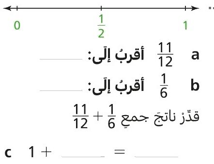
2. استعمل خط الأعداد لتحديد ما إذا كان الكسر أقرب إلى 0 أو 1/2 أو 1، ثم قدّر ناتج الجمع أو ناتج الطرح: 14/16 أقرب إلى ____ ، 5/8 أقرب إلى ____ ، قدّر ناتج طرح 5/8 − 14/16
   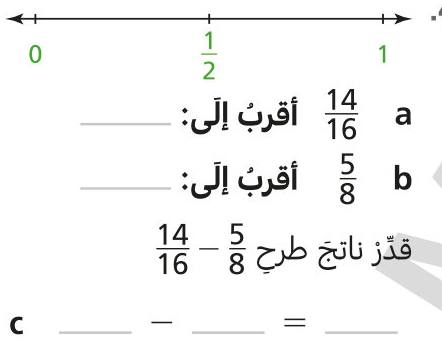
3. استعمل خط الأعداد لتحديد ما إذا كان الكسر أقرب إلى 0 أو 1/2 أو 1: 7/8 أقرب إلى ____ ، 5/12 أقرب إلى ____ ، قدّر ناتج طرح 7/8 − 5/12
   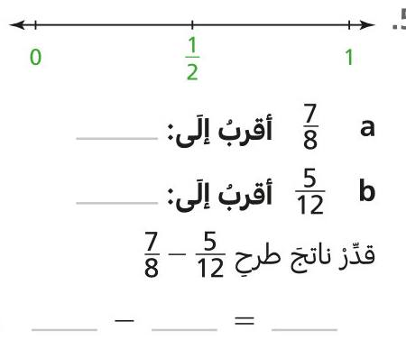
4. قدّر ناتج التالي باستبدال الكسر بالعدد 0 أو 1/2 أو 1: 9/10 + 5/6
5. قدّر ناتج التالي باستبدال الكسر بالعدد 0 أو 1/2 أو 1: 11/18 − 2/9
6. قدّر ناتج التالي باستبدال الكسر بالعدد 0 أو 1/2 أو 1: 1/16 + 2/15
7. قدّر ناتج التالي باستبدال الكسر بالعدد 0 أو 1/2 أو 1: 24/25 − 1/9
8. قدّر ناتج التالي باستبدال الكسر بالعدد 0 أو 1/2 أو 1: 3/36 + 1/10
9. قدّر ناتج التالي باستبدال الكسر بالعدد 0 أو 1/2 أو 1: 37/40 − 26/50
10. صِل كلّ مقدار بتقديره: 11/12 − 5/6 ، 5/9 − 1/10 ، 15/16 − 1/12 ، مع التقديرات 0 ، 1/2 ، 1
   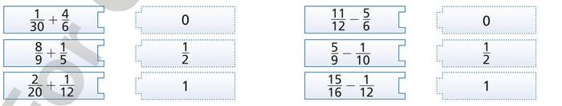
11. صِل كلّ مقدار بتقديره: 1/30 + 4/6 ، 8/9 + 1/5 ، 2/20 + 1/12 ، مع التقديرات 0 ، 1/2 ، 1
   
13. إذا كان بسط أحد الكسور الاعتيادية 1 ومقامه عددًا أكبر من 2، فهل يكون الكسر أقرب إلى 0 أو 1/2 أو 1؟
14. اكتب كسرين أقرب إلى 1 منه إلى 1/2، ثم اكتب كسرين أقرب إلى 1/2 منه إلى 0 أو إلى 1، وكسرين آخرين أقرب إلى 0 منه إلى 1/2، حدّد اثنين من الكسور التي كتبتها ناتج جمعهما يساوي 1 1/2 تقريبًا.
   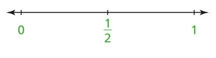
15. حضّرت سمية خليط مكسرات باستعمال 1/2 كوب من الزبيب و 3/5 كوب من الجوز و 3/8 كوب من اللوز. كم كوبًا تقريبًا من خليط المكسرات حضّرت سمية؟
16. يقام أطول سباق للمراكب الشراعية النهرية في العالم في نهر سانت جونز. طول النهر 310 أميال. بكم مرّة تقريبًا يزيد طول النهر عن مسافة السباق؟ هل تحتاج إلى إجابة دقيقة أم إلى تقدير؟ كيف عرفت ذلك؟ (مسافة السباق 42 ميل)
   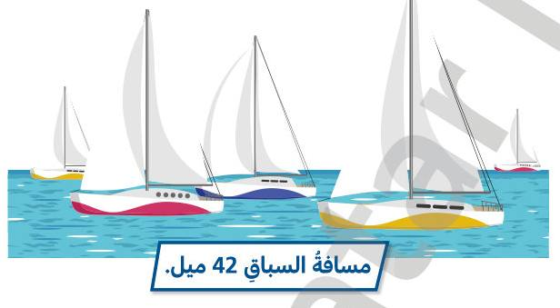
17. كيف تُقرّر ما إذا كان الكسر 27/50 أقرب إلى 1/2 أم إلى 1 من دون أن تستعمل خط الأعداد؟

#### أولًا: اختر الإجابة الصحيحة (أسئلة محوّلة)

1. الكسر 27/50 أقرب إلى أيّ عدد: 0 أم 1/2 أم 1؟
   - أ) 1/2
   - ب) 0
   - ج) 1
   - د) لا يمكن تحديد ذلك
2. قدّر ناتج 11/12 − 5/6 بتقريب كلّ كسر إلى 0 أو 1/2 أو 1.
   - أ) 0
   - ب) 1/2
   - ج) 1
   - د) 2
3. قدّر ناتج 5/9 − 1/10 بتقريب كلّ كسر إلى 0 أو 1/2 أو 1.
   - أ) 1/2
   - ب) 0
   - ج) 1
   - د) 1 1/2
4. قدّر ناتج 15/16 − 1/12 بتقريب كلّ كسر إلى 0 أو 1/2 أو 1.
   - أ) 2
   - ب) 1/2
   - ج) 0
   - د) 1
5. قدّر ناتج 1/30 + 4/6 بتقريب كلّ كسر إلى 0 أو 1/2 أو 1.
   - أ) 0
   - ب) 1/2
   - ج) 1
   - د) 1 1/2
6. قدّر ناتج 8/9 + 1/5 بتقريب كلّ كسر إلى 0 أو 1/2 أو 1.
   - أ) 2
   - ب) 1/2
   - ج) 0
   - د) 1
7. قدّر ناتج 2/20 + 1/12 بتقريب كلّ كسر إلى 0 أو 1/2 أو 1.
   - أ) 0
   - ب) 1/2
   - ج) 1
   - د) 2
8. قدّر ناتج 1/6 + 11/12 بتقريب كلّ كسر إلى 0 أو 1/2 أو 1.
   - أ) 1
   - ب) 0
   - ج) 1/2
   - د) 2
9. قدّر ناتج 7/8 − 5/12 بتقريب كلّ كسر إلى 0 أو 1/2 أو 1.
   - أ) 1
   - ب) 0
   - ج) 1/2
   - د) 1 1/2
10. قدّر ناتج 5/6 + 1/12 بتقريب كلّ كسر إلى 0 أو 1/2 أو 1.
   - أ) 1 1/2
   - ب) 0
   - ج) 1/2
   - د) 1
11. قدّر ناتج 3/8 + 9/10 بتقريب كلّ كسر إلى 0 أو 1/2 أو 1.
   - أ) 1/2
   - ب) 0
   - ج) 1 1/2
   - د) 1
12. قدّر ناتج 7/9 − 2/15 بتقريب كلّ كسر إلى 0 أو 1/2 أو 1.
   - أ) 0
   - ب) 1
   - ج) 1/2
   - د) 1 1/2
13. قدّر ناتج 11/12 − 4/9 بتقريب كلّ كسر إلى 0 أو 1/2 أو 1.
   - أ) 0
   - ب) 1/2
   - ج) 1
   - د) 1 1/2

### الدرس 7-2: إيجاد المقامات المشتركة

#### رابعًا: أجب عن الأسئلة الآتية (مسائل وتفكير)

1. أوجد المقام المشترك لكلّ زوج من الكسور: 3/8 و 2/3
2. أوجد المقام المشترك لكلّ زوج من الكسور: 1/6 و 4/3
3. أوجد المقام المشترك لكلّ زوج من الكسور. ثمّ اكتب كسورًا متكافئة لها هذا المقام المشترك: 2/5 و 1/6
4. أوجد المقام المشترك لكلّ زوج من الكسور: 1/3 و 4/5
5. أوجد المقام المشترك لكلّ زوج من الكسور: 5/8 و 3/4
6. أوجد المقام المشترك لكلّ زوج من الكسور: 3/10 و 9/8
7. أوجد المقام المشترك لكلّ زوج من الكسور: 3/7 و 1/2
8. أوجد المقام المشترك لكلّ زوج من الكسور: 5/12 و 3/5
9. أوجد المقام المشترك لكلّ زوج من الكسور: 7/9 و 2/3
10. أوجد المقام المشترك لكلّ زوج من الكسور: 3/8 و 9/20
11. ما سعر الوقود الممتاز مقرّبًا إلى أقرب ريال؟
   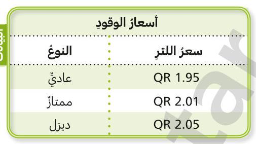
12. اختر كلّ المقامات المشتركة للكسرين 3/4 و 2/3 (أ) 8  (ب) 12  (ج) 16  (د) 36  (هـ) 48
13. اختر كلّ المقامات المشتركة للكسرين 11/12 و 4/5 (أ) 12  (ب) 17  (ج) 30  (د) 60  (هـ) 125
15. وضّح كلّ خطأ تجده في إعادة تسمية الكسور أدناه. وصحّحه. 3/4 = 9/12 ، 2/3 = 6/12
16. خبزت صباح نوعين من البيتزا في طبقين لهما نفس الأبعاد. قطعت البيتزا الأولى إلى 6 قطع متساوية، وقطعت البيتزا الأخرى إلى 8 قطع متساوية. كيف يمكن تقطيع طبقي البيتزا بحيث تكون قطع البيتزا متساوية في الطبقين؟ استعمل الصور لتمثيل حلّك. إذا كانت صباح قد قدّمت 6 قطع من طبق واحد حتى الآن، فما الكسر الذي يمثّل ما قدّمته؟
   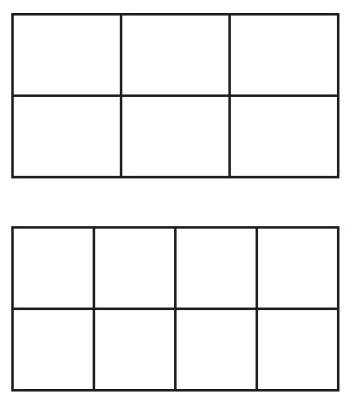
17. في سجلات الشركات التجارية، تُسمّى كلّ ثلاثة أشهر من السنة بالرّبع السنويّ. ما عدد الأشهر الذي يساوي ثلاثة أرباع السنة؟ وضّح طريقة توصّلك إلى الإجابة.

#### أولًا: اختر الإجابة الصحيحة (أسئلة محوّلة)

1. ما المقام المشترك الأصغر للكسرين 2/5 و 1/6؟
   - أ) 12
   - ب) 11
   - ج) 30
   - د) 60
2. اكتب الكسر 2/5 بمقامٍ مشترك مع 1/6 (المقام 30).
   - أ) 10/30
   - ب) 2/30
   - ج) 12/30
   - د) 6/30
3. أيّ المقامات الآتية مقامٌ مشتركٌ للكسرين 3/4 و 2/3؟
   - أ) 20
   - ب) 8
   - ج) 16
   - د) 12
4. أيّ المقامات الآتية مقامٌ مشتركٌ للكسرين 11/12 و 4/5؟
   - أ) 12
   - ب) 60
   - ج) 17
   - د) 30
5. أعاد طالبٌ تسمية الكسرين: 3/4 = 9/12 و 2/3 = 6/12. أيّ العبارات الآتية صحيحة؟
   - أ) الخطأ في 2/3 والصحيح 8/12
   - ب) الخطأ في 3/4 والصحيح 8/12
   - ج) كلاهما صحيح
   - د) كلاهما خطأ
6. تُسمّى كلّ ثلاثة أشهر من السنة ربعًا سنويًّا. كم شهرًا يساوي ثلاثة أرباع السنة؟
   - أ) 12 شهرًا
   - ب) 6 أشهر
   - ج) 3 أشهر
   - د) 9 أشهر
7. قطعت صباح بيتزا إلى 6 قطع متساوية، وبيتزا أخرى إلى 8 قطع متساوية. لتقطيع الطبقين إلى قطع متساوية الحجم بأقلّ عدد ممكن من القطع في كلّ طبق، إلى كم قطعة يُقطَّع كلّ طبق؟
   - أ) 12
   - ب) 14
   - ج) 48
   - د) 24
8. ما أصغر مقام مشترك للكسرين 3/4 و 5/6؟
   - أ) 16
   - ب) 24
   - ج) 12
   - د) 6
9. ما أصغر مقام مشترك للكسرين 5/8 و 1/12؟
   - أ) 32
   - ب) 96
   - ج) 24
   - د) 12
10. ما أصغر مقام مشترك للكسرين 2/9 و 3/4؟
   - أ) 45
   - ب) 72
   - ج) 36
   - د) 9

### الدرس 7-3: جمع الكسور الاعتيادية ذات المقامات المختلفة

#### رابعًا: أجب عن الأسئلة الآتية (مسائل وتفكير)

1. أوجد ناتج الجمع: 1/2 + 1/4
   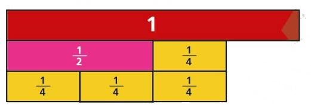
2. أوجد ناتج الجمع: 1/2 + 2/5
   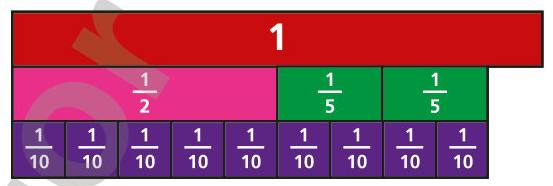
3. أوجد ناتج الجمع: 1/6 + 1/3 + 1/6
   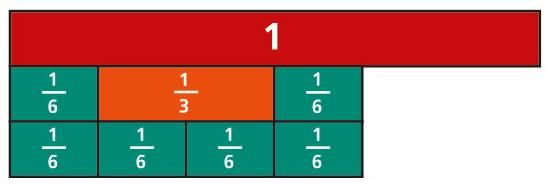
4. اختر نعم أو لا لتحدّد ما إذا كان الكسر 1/2 سيجعل كلّ جملة عددية صحيحة.
   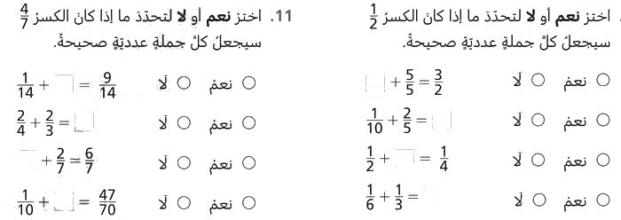
5. اختر نعم أو لا لتحدّد ما إذا كان الكسر 4/7 سيجعل كلّ جملة عددية صحيحة.
   
7. المصطلحات: حلّ طارق وعمر نفس المسألة. توصّل طارق إلى الإجابة 6/8، بينما توصّل عمر إلى 3/4، أيُّ الإجابتين صحيحة؟ استعمل المصطلح كسر مكافئ في توضيحك.
8. وضّح سبب عدم تغيّر المقام 6 في الكسر 3/6 عند جمع الكسرين.
   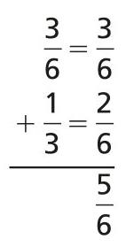
9. 1/10 من عظام جسمك تقريبًا موجودة في جمجمتك. و 1/4 من عظام جسمك تقريبًا موجودة في يديك. اكتب جملة عددية لإيجاد الكسر الذي يمثّل مجموع العظام الموجودة في يديك وجمجمتك من عظام جسمك، وحلّها.
10. من أصل 36 عنصرًا كيميائيًّا، أطلق اسما عالمَين على 2 منها وأسماء أماكن على 25 عنصرًا منها. ما الكسر الذي يعبّر عن العناصر المسمّاة باسمي العالمين أو أسماء الأماكن من هذه العناصر الـ 36؟
11. أنشأ فواز جدولًا يوضّح كيف يقضي وقته في يوم واحد. بعد كم يوم يكون فواز قد نام ما يعادل يومًا واحدًا؟ وضّح كيف توصّلت إلى الإجابة.
   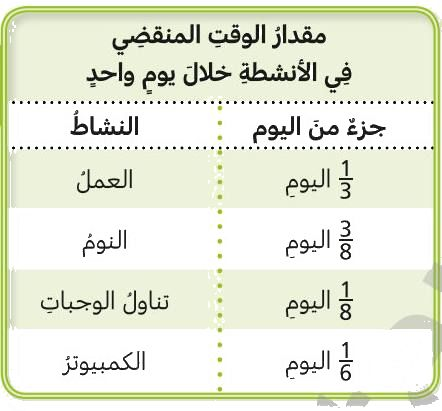

#### أولًا: اختر الإجابة الصحيحة (أسئلة محوّلة)

1. حلّ طارق وعمر المسألة نفسها، فتوصّل طارق إلى 6/8 وتوصّل عمر إلى 3/4. أيّ الإجابتين صحيحة؟
   - أ) كلتاهما صحيحة لأنّ 6/8 كسر مكافئ لـ 3/4
   - ب) إجابة طارق فقط
   - ج) إجابة عمر فقط
   - د) لا إجابة منهما صحيحة
2. 1/10 من عظام جسمك في جمجمتك و 1/4 منها في يديك. ما الكسر الذي يمثّل مجموع العظام في الجمجمة واليدين؟
   - أ) 1/14
   - ب) 2/14
   - ج) 5/14
   - د) 7/20
3. أوجد ناتج الجمع: 1/2 + 1/3
   - أ) 1/3
   - ب) 2/5
   - ج) 5/6
   - د) 1
4. أوجد ناتج الجمع: 2/3 + 1/6
   - أ) 1
   - ب) 1/3
   - ج) 1/2
   - د) 5/6
5. أوجد ناتج الجمع: 3/4 + 1/8
   - أ) 7/8
   - ب) 1/3
   - ج) 1/2
   - د) 1
6. أوجد ناتج الجمع: 1/5 + 1/2
   - أ) 7/10
   - ب) 2/7
   - ج) 1/5
   - د) 4/5
7. أوجد ناتج الجمع: 2/5 + 1/4
   - أ) 13/20
   - ب) 1/3
   - ج) 3/20
   - د) 7/10
8. أوجد ناتج الجمع: 5/6 + 1/3
   - أ) 1 1/3
   - ب) 2/3
   - ج) 1
   - د) 1 1/6
9. أوجد ناتج الجمع: 3/8 + 1/4
   - أ) 5/8
   - ب) 1/3
   - ج) 1/2
   - د) 3/4
10. أوجد ناتج الجمع: 2/7 + 1/2
   - أ) 1/3
   - ب) 11/14
   - ج) 3/14
   - د) 6/7
11. أوجد ناتج الجمع: 1/6 + 3/4
   - أ) 1/3
   - ب) 2/5
   - ج) 11/12
   - د) 1
12. أوجد ناتج الجمع: 4/9 + 1/3
   - أ) 5/9
   - ب) 5/12
   - ج) 7/9
   - د) 8/9
13. أوجد ناتج الجمع: 3/10 + 1/2
   - أ) 2/5
   - ب) 1/3
   - ج) 4/5
   - د) 9/10
14. أوجد ناتج الجمع: 5/12 + 1/4
   - أ) 3/4
   - ب) 3/8
   - ج) 1/2
   - د) 2/3
15. أوجد ناتج الجمع: 1/4 + 2/3
   - أ) 1
   - ب) 3/7
   - ج) 1/4
   - د) 11/12
16. أوجد ناتج الجمع: 7/10 + 1/5
   - أ) 4/5
   - ب) 8/15
   - ج) 9/10
   - د) 1

### الدرس 7-4: طرح الكسور الاعتيادية ذات المقامات المختلفة

#### رابعًا: أجب عن الأسئلة الآتية (مسائل وتفكير)

1. أوجد ناتج التالي: 4/7 − 1/3
2. أوجد ناتج التالي: 5/8 − 1/4
3. أوجد ناتج التالي: 7/8 − 1/3
4. أوجد ناتج التالي: 4/5 − 1/6
5. أوجد ناتج التالي: 1/4 − 1/8
6. أوجد ناتج التالي: 2/3 − 1/2
7. أوجد ناتج التالي: 2/3 − 5/9
8. أوجد ناتج التالي: 4/5 − 1/4
9. أوجد ناتج التالي: 3/2 − 7/12
10. أوجد ناتج التالي: 6/7 − 1/2
11. أوجد ناتج التالي: 7/10 − 2/5
12. أوجد ناتج التالي: 13/16 − 1/4
13. أوجد ناتج التالي: 2/9 − 1/6
14. أوجد ناتج التالي: 6/5 − 3/8
15. كيف توجد ناتج جمع 9.8 و 2.6 من دون استعمال الورقة والقلم؟
16. اختر الكسور المناسبة من الصندوق أدناه لإكمال جملة الطرح: ____ − 1/3 = ____ (9/10 ، 2/3 ، 1/30 ، 6/7 ، 17/30)
   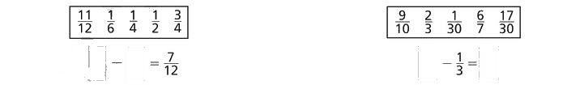
17. اختر الكسور المناسبة من الصندوق أدناه لإكمال جملة الطرح: ____ − ____ = 7/12 (11/12 ، 1/6 ، 1/4 ، 1/2 ، 3/4)
   
20. اكتب جملة عددية وحلّها لإيجاد الفرق بين موقع النقطة A وموقع النقطة B على المسطرة.
   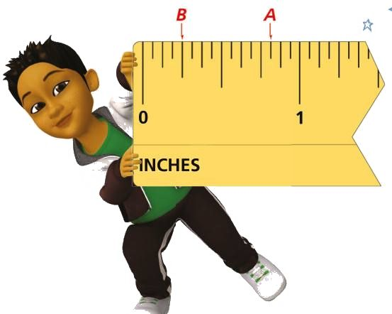
21. اكتب جملة جمع وجملة طرح للوحة الأجزاء. ثمّ أوجد القيمة المجهولة.
   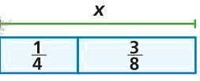
22. لماذا تحتاج إلى إيجاد المقام المشترك قبل أن تجمع أو تطرح الكسور؟
23. أوجد كسرين ناتج طرحهما 1/5، شرط ألّا يساوي أيٌّ من المقامين 5

#### أولًا: اختر الإجابة الصحيحة (أسئلة محوّلة)

1. ما ناتج جمع 9.8 + 2.6 ذهنيًّا؟
   - أ) 11.4
   - ب) 12.4
   - ج) 12.14
   - د) 11.8
2. لماذا نحتاج إلى إيجاد المقام المشترك قبل جمع الكسور أو طرحها؟
   - أ) لنجعل الكسور أكبر
   - ب) لتكون الأجزاء متساوية في الحجم فنستطيع جمعها أو طرحها
   - ج) لنجعل الكسور أصغر
   - د) لا حاجة لذلك أبدًا
3. أيّ جمل الطرح الآتية ناتجها 1/5 ولا يساوي أيٌّ من مقامَي كسريها 5؟
   - أ) 3/5 − 2/5
   - ب) 2/5 − 1/5
   - ج) 1/2 − 3/10
   - د) 4/5 − 3/5
4. أيّ جمل الطرح الآتية صحيحة؟
   - أ) 9/10 − 1/3 = 6/7
   - ب) 9/10 − 1/3 = 2/7
   - ج) 9/10 − 1/3 = 8/30
   - د) 9/10 − 1/3 = 17/30
5. أيّ زوجٍ من الكسور فرقه 7/12؟
   - أ) 1/2 و 1/6
   - ب) 11/12 و 1/4
   - ج) 3/4 و 1/6
   - د) 3/4 و 1/4
6. أوجد ناتج 9/10 − 1/3.
   - أ) 6/7
   - ب) 2/3
   - ج) 1/30
   - د) 17/30

### الدرس 7-5: جمع وطرح الكسور الاعتيادية

#### أولًا: اختر الإجابة الصحيحة

1. أعدّت أمل عددًا من الكعكات. أعطت 1/4 العدد إلى جارتها. وأخذت 3/8 العدد إلى المدرسة. ما الكسر الذي يمثّل عدد الكعكات الباقية؟
   - أ) 4/12
   - ب) 3/8
   - ج) 5/12
   - د) 8/8
2. إذا كان قياس كلّ من ضلعين في مثلث متطابق الضلعين 1/4 متر وقياس الضلع الثالث 3/8 متر، فما هو محيط المثلث؟
   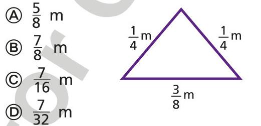
   - أ) 5/8 m
   - ب) 7/8 m
   - ج) 7/16 m
   - د) 7/32 m

#### رابعًا: أجب عن الأسئلة الآتية (مسائل وتفكير)

3. أوجد ناتج التالي: 1/15 + 1/6
4. أوجد ناتج التالي: 7/16 − 1/4
5. أوجد ناتج التالي: 7/8 − 3/6
6. أوجد ناتج التالي: 7/8 + (4/8 − 2/4)
7. أوجد ناتج التالي: 4/50 + 3/5
8. أوجد ناتج التالي: 2/3 − 7/12
9. أوجد ناتج التالي: 9/10 + 2/100
10. أوجد ناتج التالي: 4/9 + 1/4
11. أوجد ناتج التالي: 17/15 − 1/3
12. أوجد ناتج التالي: 7/16 + 3/8
13. أوجد ناتج التالي: 2/5 + 1/4
14. أوجد ناتج التالي: 1/7 + 1/2
15. أوجد ناتج التالي: 1/2 − 3/16
16. أوجد ناتج التالي: 7/8 − 2/3
17. أوجد ناتج التالي: 11/12 − 4/6
18. أوجد ناتج التالي: 7/18 + 5/9
19. أوجد ناتج التالي: (7/8 + 1/12) − 1/2
20. أوجد ناتج التالي: (11/18 − 4/9) + 1/6
21. أوجد ناتج التالي: 13/14 − (1/2 + 2/7)
22. أوجد ناتج التالي: 1/6 + (15/15 − 7/10)
24. قدّر حمد أنّ ناتج طرح 9/10 − 4/8 يساوي 0؛ هل تقديره منطقي؟
25. يوضّح الجدول المجاور مقادير بعض المكونات اللازمة لإعداد البيتزا. بكم يزيد مقدار الجبن الذي تحتاج إليه عن مقدار الدجاج والفطر معًا؟ وضّح طريقة حلّك للمسألة.
   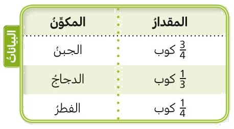
26. يهدف حسن إلى استعمال أقلّ من 50 جالون من الماء في اليوم الواحد. أفادت فاتورة الماء للشهر أنّه استعمل 1 524 جالون من الماء في 30 يومًا. هل حقّق حسن هدفه لهذا الشهر؟
27. قضت خلود 1/4 ساعة في عمل الواجب المنزلي قبل ذهابها إلى المدرسة و 1/2 ساعة إضافية بعدما عادت إلى المنزل و 1/3 ساعة بعد العشاء. فهل قضت أكثر من ساعة واحدة أم أقلّ في أداء الواجب المنزلي؟
28. لدى سيف ثلاثة أسلاك بأطوال تساوي 5/6 متر و 1/4 متر و 2/3 متر. إذا استعمل مترًا واحدًا من السلك، فكم سيبقى من السلك؟ وضّح عملك.
   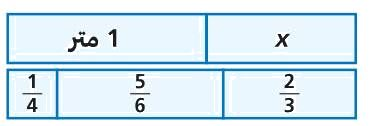
29. أوجد كسرين اعتياديين ناتج جمعهما يساوي 2/3، شرط ألّا يساوي أيٌّ من المقامين 3

#### أولًا: اختر الإجابة الصحيحة (أسئلة محوّلة)

1. قدّر حمد أنّ ناتج 9/10 − 4/8 يساوي 0. هل تقديره منطقيّ؟
   - أ) نعم، لأنّ الكسرين متساويان
   - ب) لا، لأنّ 9/10 قريب من 1 و4/8 = 1/2 فالتقدير نحو 1/2
   - ج) نعم، لأنّ الناتج دائمًا 0
   - د) لا يمكن معرفة ذلك
2. يهدف حسنٌ إلى استعمال أقلّ من 50 جالونًا من الماء في اليوم. استعمل 1 524 جالونًا في 30 يومًا. هل حقّق هدفه؟
   - أ) نعم، لأنّه استعمل 30 جالونًا في اليوم
   - ب) لا، لأنّه استعمل نحو 50.8 جالونًا في اليوم
   - ج) نعم، لأنّه استعمل 45 جالونًا في اليوم
   - د) لا، لأنّه استعمل 150 جالونًا في اليوم
3. قضت خلود 1/4 ساعة قبل المدرسة و 1/2 ساعة بعد عودتها و 1/3 ساعة بعد العشاء في الواجب. هل قضت أكثر من ساعةٍ أم أقلّ؟
   - أ) أكثر من ساعة لأنّ المجموع 13/12
   - ب) أقلّ من ساعة لأنّ المجموع 3/4
   - ج) ساعة بالضبط
   - د) لا يمكن معرفة ذلك
4. أيّ كسرين اعتياديين مجموعهما 2/3 ولا يساوي أيٌّ من مقامَيهما 3؟
   - أ) 1/6 و 1/3
   - ب) 1/3 و 1/3
   - ج) 2/9 و 1/3
   - د) 1/2 و 1/6

### الدرس 7-6: تقدير نواتج جمع وطرح الأعداد الكسرية

#### أولًا: اختر الإجابة الصحيحة

1. أيٌّ ممّا يلي هو أفضل تقدير لناتج 9 3/4 + 2 2/9؟
   - أ) 8
   - ب) 10
   - ج) 12
   - د) 13
2. أيٌّ ممّا يلي هو أفضل تقدير لناتج 13 1/12 − 1 9/10؟
   - أ) 11
   - ب) 12
   - ج) 14
   - د) 15

#### رابعًا: أجب عن الأسئلة الآتية (مسائل وتفكير)

3. قرّب إلى أقرب عدد كلّيّ: 3/4
4. قرّب إلى أقرب عدد كلّيّ: 1 5/7
5. قرّب إلى أقرب عدد كلّيّ: 2 3/10
6. قدّر ناتج الجمع أو ناتج الطرح مستعملًا الكسور المرجعية: 2 5/9 − 1 1/3
7. قدّر ناتج الجمع أو ناتج الطرح مستعملًا الكسور المرجعية: 2 4/10 + 3 5/8
8. استعمل خطّ الأعداد لتقريب الأعداد الكسرية إلى أقرب عدد كلّيّ: 11 4/6
   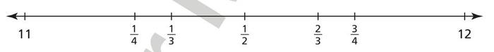
9. استعمل خطّ الأعداد لتقريب الأعداد الكسرية إلى أقرب عدد كلّيّ: 11 2/8
   
10. استعمل خطّ الأعداد لتقريب الأعداد الكسرية إلى أقرب عدد كلّيّ: 11 8/12
   
11. استعمل خطّ الأعداد لتقريب الأعداد الكسرية إلى أقرب عدد كلّيّ: 11 4/10
   
12. قدّر ناتج الجمع أو ناتج الطرح: 2 1/8 − 5/7
13. قدّر ناتج الجمع أو ناتج الطرح: 12 1/3 + 2 1/4
14. قدّر ناتج الجمع أو ناتج الطرح: 2 2/3 + 7/8 + 6 7/12
15. قدّر ناتج الجمع أو ناتج الطرح: 1 10/15 − 8/9
16. قدّر ناتج الجمع أو ناتج الطرح: 10 5/6 − 2 3/8
17. قدّر ناتج الجمع أو ناتج الطرح: 12 8/25 + 13 5/9
18. قدّر ناتج الجمع أو ناتج الطرح: 48 1/10 − 2 7/9
19. قدّر ناتج الجمع أو ناتج الطرح: 33 14/15 + 23 9/25
20. قدّر ناتج الجمع أو ناتج الطرح: 14 4/9 + 25 1/6 + 7 11/18
21. لتقدير نواتج الجمع والطرح للأعداد الكسرية، متى يجب عليك التقريب إلى العدد الكلي الأكبر التالي؟
22. متى يجب عليك تقدير ناتج جمع أو ناتج طرح؟
23. استعمل الوصفات المجاورة للإجابة عن الأسئلة. a. قدّر عدد الأكواب التي يمكن أن تكوّنها وصفة خليط الفاكهة المجفّفة والمكسرات. b. قدّر عدد الأكواب التي يمكن أن تكوّنها وصفة خليط المكسرات التقليدية. c. قدّر كمّية خليط المكسرات الذي سيتكوّن لديك إذا حضّرت كلا الوصفتين.
   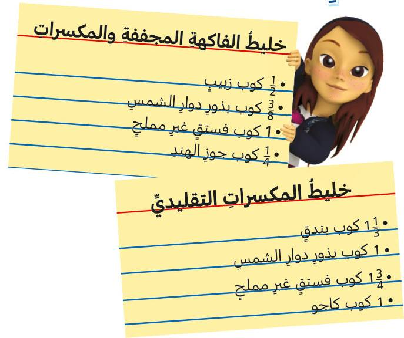
24. يزيد طول كمال عن طول حمد بمقدار 3 5/8 إنش. إذا كان طول كمال 60 3/4 إنش، فما أفضل تقدير لحساب طول حمد؟
25. لدى عمر QR 12.50. يريد أن يركب العربة الأفعوانية مرتين والعجلة الدوارة مرة واحدة. هل لدى عمر ما يكفي من المال لذلك؟ ما التشكيلات الممكنة من 3 جولات التي يستطيع عمر القيام بها بما لدية من مال؟
   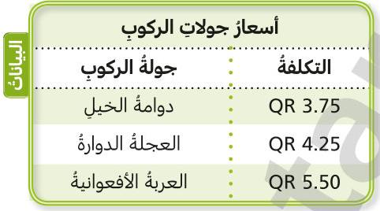
26. في الأسبوع الماضي، مشى جاسم 3 1/4 كيلومتر يوميًّا لمدة 3 أيام. و 4 5/8 كيلومتر يوميًّا لمدة 4 أيام. ما عدد الكيلومترات التي مشاها جاسم تقريبًا في الأسبوع الماضي؟

#### أولًا: اختر الإجابة الصحيحة (أسئلة محوّلة)

1. قدّر ناتج 2 1/8 − 5/7 بتقريب كلّ عددٍ إلى أقرب عددٍ كلّيّ.
   - أ) 3
   - ب) 2
   - ج) 0
   - د) 1
2. قدّر ناتج 12 1/3 + 2 1/4 بتقريب كلّ عددٍ إلى أقرب عددٍ كلّيّ.
   - أ) 15
   - ب) 14
   - ج) 13
   - د) 16
3. قدّر ناتج 2 2/3 + 7/8 + 6 7/12 بتقريب كلّ عددٍ إلى أقرب عددٍ كلّيّ.
   - أ) 12
   - ب) 10
   - ج) 11
   - د) 9
4. قدّر ناتج 1 10/15 − 8/9 بتقريب كلّ عددٍ إلى أقرب عددٍ كلّيّ.
   - أ) 1
   - ب) 0
   - ج) 2
   - د) 3
5. قدّر ناتج 10 5/6 − 2 3/8 بتقريب كلّ عددٍ إلى أقرب عددٍ كلّيّ.
   - أ) 9
   - ب) 8
   - ج) 10
   - د) 11
6. قدّر ناتج 12 8/25 + 13 5/9 بتقريب كلّ عددٍ إلى أقرب عددٍ كلّيّ.
   - أ) 27
   - ب) 25
   - ج) 26
   - د) 24
7. قدّر ناتج 48 1/10 − 2 7/9 بتقريب كلّ عددٍ إلى أقرب عددٍ كلّيّ.
   - أ) 50
   - ب) 46
   - ج) 44
   - د) 45
8. قدّر ناتج 33 14/15 + 23 9/25 بتقريب كلّ عددٍ إلى أقرب عددٍ كلّيّ.
   - أ) 58
   - ب) 56
   - ج) 57
   - د) 60
9. قدّر ناتج 14 4/9 + 25 1/6 + 7 11/18 بتقريب كلّ عددٍ إلى أقرب عددٍ كلّيّ.
   - أ) 46
   - ب) 47
   - ج) 48
   - د) 49
10. عند تقدير ناتج جمع أو طرح الأعداد الكسريّة، متى نقرّب إلى العدد الكلّيّ الأكبر التالي؟
   - أ) عندما نريد تقديرًا أصغر من الناتج الدقيق
   - ب) عندما نريد تقديرًا أكبر من الناتج الدقيق
   - ج) لا نقرّب إلى الأكبر أبدًا
   - د) عندما يكون الكسر صفرًا
11. متى نستعمل التقدير بدلًا من الحساب الدقيق؟
   - أ) لا نستعمله أبدًا
   - ب) عندما نحتاج إلى الدقّة التامّة دائمًا
   - ج) عندما لا نحتاج إلى إجابة دقيقة أو نريد التحقّق من معقوليّة الناتج
   - د) عندما تكون الأعداد صغيرة جدًّا فقط

### الدرس 7-7: استعمال النماذج لجمع الأعداد الكسرية

#### أولًا: اختر الإجابة الصحيحة

1. استعملت هيفاء 2 3/4 كوب من الحليب و 1 1/2 كوب من الجبن في وصفة. كم كوبًا من الحليب والجبن استعملت هيفاء؟
   - أ) 3 أكواب
   - ب) 3 4/6 كوب
   - ج) 4 1/4 كوب
   - د) 4 3/4 كوب
2. ركض مبارك مسافة 21 1/2 كيلومتر في الأسبوع الماضي. وركض 17 7/8 كيلومتر هذا الأسبوع. كم كيلومترًا ركض مبارك في الأسبوعين؟
   - أ) 38 كيلومتر
   - ب) 38 1/2 كيلومتر
   - ج) 39 3/8 كيلومتر
   - د) 39 7/8 كيلومتر

#### رابعًا: أجب عن الأسئلة الآتية (مسائل وتفكير)

3. أوجد ناتج الجمع: 1 1/10 + 2 4/5
4. أوجد ناتج الجمع: 1 1/2 + 2 3/4
5. أوجد ناتج الجمع: 3 2/3 + 1 4/6
6. أوجد ناتج الجمع: 3 1/6 + 2 2/3
7. أوجد ناتج الجمع: 2 6/10 + 1 3/5
8. أوجد ناتج الجمع: 4 5/6 + 1 7/12
9. أوجد ناتج الجمع: 4 2/5 + 3 7/10
10. أوجد ناتج الجمع: 3 1/2 + 1 3/4
11. أوجد ناتج الجمع: 1 7/8 + 5 1/4
12. أوجد ناتج الجمع: 2 6/12 + 1 1/2
13. أوجد ناتج الجمع: 3 2/5 + 1 9/10
14. أوجد ناتج الجمع: 2 7/12 + 1 3/4
15. أوجد ناتج الجمع: 2 7/8 + 5 1/2
16. عند جمع عددين كسريين، في أيّ حالة تكون إعادة تسمية ناتج جمع الكسرين مفيدة؟
17. استعمل النموذج لإيجاد ناتج الجمع. استعملت ريم 1 2/3 كوب من البندق و 2 1/6 كوب من التوت البرّي لصنع الكعك. ما إجمالي عدد أكواب البندق والتوت البرّي التي استعملتها؟
   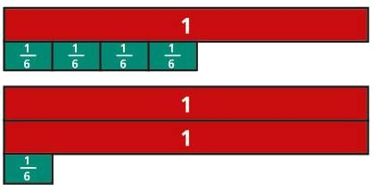
18. عملت فاطمة 2 3/4 ساعة يوم الإثنين و 1 1/2 ساعة يوم الثلاثاء. ما إجمالي عدد الساعات التي عملتها فاطمة يومي الإثنين والثلاثاء معًا؟
   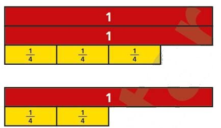
19. استعمل إبراهيم 1 1/4 جالون من الطلاء الأبيض للسقف و 4 3/8 جالون من الطلاء الأخضر لجدران مطبخه. ما إجمالي ما استعمله إبراهيم من الطلاء؟
20. قال محمد: "مشيت 2 1/2 كيلومتر يوم الجمعة و 2 3/4 كيلومتر يوم السبت". كم كيلومترًا مشى محمد في اليومين إجمالًا؟
21. استعمل الخريطة. تمثّل كلّ وحدة مبنًى واحدًا. غادر ناصر المتحف وقطع مسافة 4 مبانٍ إلى وجهته التالية. ما وجهة ناصر؟
   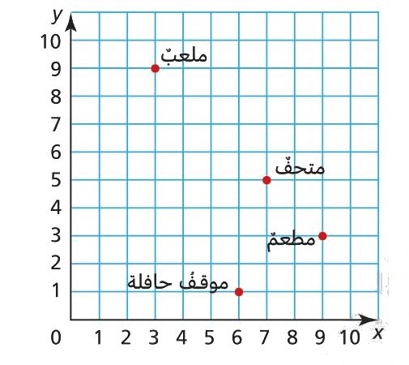
22. مشى ناصر من المطعم إلى موقف الحافلات، ثمّ استقلّ الحافلة إلى الملعب. إذا سلك الطريق الأقصر، فما عدد المباني التي قطعها ناصر؟ لاحظ أنّ بإمكان ناصر التنقّل على امتداد خطوط الشبكة فقط.
   
23. تصنع ليلى الكعك. تتطلّب الوصفة 2 5/6 كوب من السكّر الأسمر للكعك و 1 1/3 كوب من السكّر الأسمر للزينة. لدى ليلى 4 أكواب من السكّر الأسمر. هل لديها ما يكفي من السكّر الأسمر للكعك والزينة؟

#### أولًا: اختر الإجابة الصحيحة (أسئلة محوّلة)

1. عند جمع عددين كسريين، متى تكون إعادة تسمية ناتج جمع الكسرين مفيدة؟
   - أ) عندما يكون مجموع الكسرين أكبر من 1
   - ب) عندما يكون مجموع الكسرين أصغر من 1
   - ج) عندما يكون المقاما متساويين فقط
   - د) لا تكون مفيدة أبدًا

### الدرس 7-8: جمع الأعداد الكسرية

#### رابعًا: أجب عن الأسئلة الآتية (مسائل وتفكير)

1. قدّر ثمّ أوجد ناتج الجمع: 1 7/8 + 1 1/4
2. قدّر ثمّ أوجد ناتج الجمع: 2 2/5 + 5 5/6
3. قدّر ثمّ أوجد ناتج الجمع: 4 1/9 + 1 1/3
4. قدّر ثمّ أوجد ناتج الجمع: 6 5/12 + 4 5/8
5. قدّر ثمّ أوجد ناتج الجمع: 3 1/6 + 5 2/3
6. قدّر ثمّ أوجد ناتج الجمع: 11 1/2 + 10 3/5
7. قدّر ثمّ أوجد ناتج الجمع: 9 3/16 + 7 5/8
8. قدّر ثمّ أوجد ناتج الجمع: 5 6/7 + 8 1/14
9. قدّر ثمّ أوجد ناتج الجمع: 4 1/10 + 6 1/2
10. قدّر ثمّ أوجد ناتج الجمع: 9 7/12 + 4 3/4
11. قدّر ثمّ أوجد ناتج الجمع: 5 + 3 1/8
12. قدّر ثمّ أوجد ناتج الجمع: 8 3/4 + 7 3/4
13. قدّر ثمّ أوجد ناتج الجمع: 2 3/4 + 7 3/5
14. قدّر ثمّ أوجد ناتج الجمع: 3 8/9 + 8 1/2
15. قدّر ثمّ أوجد ناتج الجمع: 1 7/12 + 2 3/8
16. قدّر ثمّ أوجد ناتج الجمع: 3 11/12 + 9 1/16
17. ما وجه الشبه بين جمع الأعداد الكسرية وجمع الكسور والأعداد الكلّية؟
19. استعمل الخريطة لإيجاد الإجابة. a. ما المسافة من بداية الطريق إلى نهايته؟ b. مشى خليفة من بداية الطريق إلى موقع مراقبة الطيور ذهابًا وإيابًا. هل يكون قد مشى مسافة أطول أم أقصر مما إذا كان قد مشى من بداية الطريق إلى نهايته؟ c. في يوم آخر، مشى خليفة من بداية الطريق إلى نهايته. وعند النهاية تذكّر أنّه نسي منظارة في موقع مراقبة الطيور. فمشى من نهاية الطريق إلى هذا الموقع ذهابًا وإيابًا. ما مجموع المسافة التي قطعها؟
   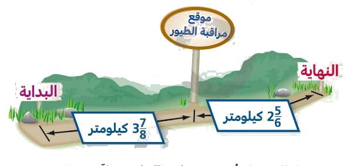
20. اشترت جميلة 12 كيسًا من بذور الخيار. يحتوي كلّ كيس على 42 بذرة. إذا زرعت نصف البذور، ما عدد البذور الباقية لديها؟
21. جمع راشد 2 7/12 و 5 2/3 وحصل على ناتج الجمع 7 1/4؛ هل إجابة راشد منطقية؟
22. يمكن لحرباء طولها 23 1/2 إنش أن تمدّد لسانها ليصل إلى 35 1/4 إنش لصيد طعامها. اكتب جملة جمع لتوضيح الطول الكلّي للحرباء عندما يكون لسانها ممتدًّا إلى آخره.
23. قطع عادل مسافة 1 3/4 كيلومتر من المنزل إلى المتنزه على دراجته. وقطع بدراجته 1 1/3 كيلومتر حول المتنزه ثمّ عاد إلى المنزل. اكتب جملة جمع لتوضيح مجموع عدد الكيلومترات التي قطعها عادل على دراجته.
24. تُطعم روضة عصفورًا 4 جرام من بذور النوع A و 2 جرام من بذور النوع B مرتين يوميًّا. تأتي بذور النوع A في علبة فيها 5 أكياس، فيما تأتي بذور النوع B في علب من 6 جرام. a. أوجد عدد علب بذور النوع B التي على روضة شراؤها لإطعام العصفور لمدة أسبوع. b. كم جرامًا من بذور النوع B سيبقى في نهاية الأسبوع؟ c. ما عدد الأيام التي تستطيع فيها روضة إطعام العصفور إذا اشترت علبة من بذور النوع A؟ (1 كيس = 16 جرام)

#### أولًا: اختر الإجابة الصحيحة (أسئلة محوّلة)

1. ما وجه الشبه بين جمع الأعداد الكسريّة وجمع الكسور والأعداد الكلّيّة؟
   - أ) نجمع الأجزاء الكلّيّة معًا والكسور معًا
   - ب) لا يوجد شبه بينهما
   - ج) نضرب الأجزاء الكلّيّة
   - د) نطرح الكسور فقط
2. طول حرباء 23 1/2 إنش، ويمكن لسانها الوصول إلى 35 1/4 إنش. ما الطول الكلّيّ للحرباء عندما يكون لسانها ممتدًّا؟
   - أ) 58 1/4 إنش
   - ب) 58 3/4 إنش
   - ج) 57 3/4 إنش
   - د) 59 1/2 إنش
3. قطع عادلٌ 1 3/4 km من المنزل إلى المتنزّه ثمّ 1 1/3 km حول المتنزّه. ما مجموع ما قطعه؟
   - أ) 3 1/12 km
   - ب) 2 4/7 km
   - ج) 3 km
   - د) 3 1/7 km
4. تطعم روضة عصفورًا 2 جرام من بذور النوع B مرتين يوميًّا، وتأتي بذور النوع B في علب كلّ منها 6 جرام. كم علبةً يلزم لإطعامه أسبوعًا؟
   - أ) 28 علبة
   - ب) 4 علب
   - ج) 7 علب
   - د) 5 علب
5. اشترت روضة 5 علب من بذور النوع B (6 جرام في العلبة) لإطعام العصفور 28 جرامًا في الأسبوع. كم جرامًا يبقى في نهاية الأسبوع؟
   - أ) 30 جرامًا
   - ب) 4 جرام
   - ج) 6 جرام
   - د) 2 جرام
6. تأتي بذور النوع A في علبة فيها 5 أكياس، وفي الكيس 16 جرامًا. يأكل العصفور 4 جرام مرتين يوميًّا. كم يومًا يكفيه علبة واحدة؟
   - أ) 8 أيّام
   - ب) 10 أيّام
   - ج) 20 يومًا
   - د) 80 يومًا

### الدرس 7-9: استعمال النماذج لطرح الأعداد الكسرية

#### رابعًا: أجب عن الأسئلة الآتية (مسائل وتفكير)

1. أوجد ناتج الطرح: 4 5/6 − 2 1/3
2. أوجد ناتج الطرح: 4 1/8 − 3 3/4
3. أوجد ناتج الطرح: 5 1/2 − 2 5/6
4. أوجد ناتج الطرح: 5 4/10 − 3 4/5
5. أوجد ناتج الطرح: 12 3/4 − 9 5/8
6. أوجد ناتج الطرح: 8 1/6 − 7 2/3
7. أوجد ناتج الطرح: 13 7/9 − 10 2/3
8. أوجد ناتج الطرح: 3 1/12 − 2 3/4
9. أوجد ناتج الطرح: 6 3/4 − 3 11/12
10. أوجد ناتج الطرح: 4 3/5 − 1 1/10
11. أوجد ناتج الطرح: 6 1/2 − 3 7/10
12. أوجد ناتج الطرح: 6 2/3 − 4 2/9
13. صِل كلّ جملة طرح بناتجها: 12 1/2 − 10 11/12 ، 5 2/3 − 4 4/9 ، 12 3/4 − 11 1/2 ، 6 1/4 − 4 1/2 ، مع النواتج 1 3/4 ، 1 7/12 ، 1 2/9 ، 1 1/4
   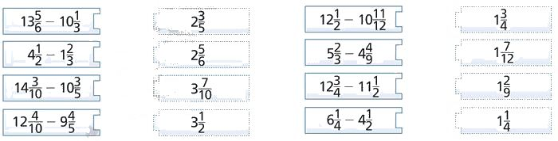
14. صِل كلّ جملة طرح بناتجها: 13 5/6 − 10 1/3 ، 4 1/2 − 1 2/3 ، 14 3/10 − 10 3/5 ، 12 4/10 − 9 4/5 ، مع النواتج 2 3/5 ، 2 5/6 ، 3 7/10 ، 3 1/2
   
15. عند طرح عددين كسريّين، هل من الضروري دائمًا إعادة تسمية أحد العددين الكلّيّين؟
16. استعمل النموذج لإيجاد ناتج الطرح. يبعد منزل طارق 2 5/6 كيلومتر عن منزل صديقه. وتبعد مدرسته 4 1/3 كيلومتر في نفس الاتجاه. إذا توقف عند منزل صديقه أوّلًا، فما المسافة الباقية إلى المدرسة؟
   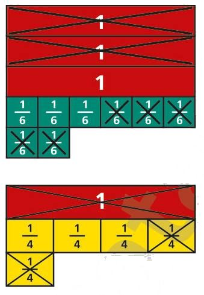
17. اشترت نوال 3 1/2 كيلوجرام من اللحم و 2 1/4 كيلوجرام من الجبن. استعملت 1 1/2 كيلوجرام من الجبن لصنع فطائر بالجبن. كم بقي لديها من الجبن؟
   
18. استعمل الجدول المجاور. بكم يزيد طول ورقة التين عن طول ورقة الغار؟ اكتب جملة عددية لنمذجة حلّك.
   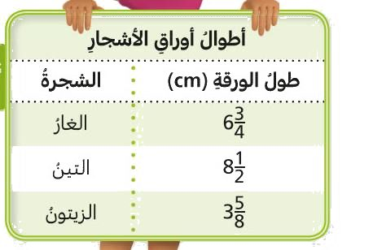
19. بكم يزيد طول ورقة التين عن طول ورقة الزيتون؟ اكتب جملة عددية لنمذجة حلّك.
   
20. اشترى عمر 4 عبواتٍ عصير ثمن الواحدة منها QR 1.75 و 4 شطائر ثمن الواحدة منها QR 7.50. إذا دفع عمر أيضًا QR 7 بدل خدمة، فما إجمالي ما أنفقه؟ اكتب جملة عددية لتوضيح حلّك.
21. مشى فهد 3 1/2 كيلومتر يوم الجمعة و 4 3/4 كيلومتر يوم السبت. ومشى عيسى 5 3/8 كيلومتر يوم الجمعة. من منهما مشى مسافة أطول؟ وبكم تزيد؟

#### أولًا: اختر الإجابة الصحيحة (أسئلة محوّلة)

1. مشى فهدٌ 3 1/2 km يوم الجمعة، ومشى عيسى 5 3/8 km يوم الجمعة نفسه. من مشى مسافةً أطول وبكم؟
   - أ) عيسى بزيادة 2 1/8 km
   - ب) فهد بزيادة 1 7/8 km
   - ج) عيسى بزيادة 1 7/8 km
   - د) متساويان
2. أوجد ناتج الطرح: 12 1/2 − 10 11/12
   - أ) 1 1/4
   - ب) 1 3/4
   - ج) 1 7/12
   - د) 1 2/9
3. أوجد ناتج الطرح: 5 2/3 − 4 4/9
   - أ) 1 1/4
   - ب) 1 7/12
   - ج) 1 2/9
   - د) 1 3/4
4. أوجد ناتج الطرح: 12 3/4 − 11 1/2
   - أ) 1 3/4
   - ب) 1 1/4
   - ج) 1 2/9
   - د) 1 7/12
5. أوجد ناتج الطرح: 6 1/4 − 4 1/2
   - أ) 1 1/4
   - ب) 1 3/4
   - ج) 1 7/12
   - د) 1 2/9
6. أوجد ناتج الطرح: 13 5/6 − 10 1/3
   - أ) 3 1/2
   - ب) 2 5/6
   - ج) 3 7/10
   - د) 2 3/5
7. أوجد ناتج الطرح: 4 1/2 − 1 2/3
   - أ) 2 3/5
   - ب) 3 1/2
   - ج) 2 5/6
   - د) 3 7/10
8. أوجد ناتج الطرح: 14 3/10 − 10 3/5
   - أ) 2 3/5
   - ب) 2 5/6
   - ج) 3 1/2
   - د) 3 7/10
9. أوجد ناتج الطرح: 12 4/10 − 9 4/5
   - أ) 3 1/2
   - ب) 3 7/10
   - ج) 2 3/5
   - د) 2 5/6
10. اشترت نوال 3 1/2 kg من اللحم و 2 1/4 kg من الجبن، واستعملت 1 1/2 kg من الجبن لصنع فطائر. كم بقي لديها من الجبن؟
   - أ) 2 kg
   - ب) 1 3/4 kg
   - ج) 1 kg
   - د) 3/4 kg
11. اشترى عمر 4 عبوات عصير ثمن الواحدة QR 1.75 و 4 شطائر ثمن الواحدة QR 7.50، ودفع QR 7 بدل خدمة. ما إجمالي ما أنفقه؟
   - أ) QR 36
   - ب) QR 44
   - ج) QR 39
   - د) QR 37

### الدرس 7-10: طرح الأعداد الكسرية

#### رابعًا: أجب عن الأسئلة الآتية (مسائل وتفكير)

1. قدّر ثمّ أوجد ناتج الطرح: 7 2/3 − 3 5/6
2. قدّر ثمّ أوجد ناتج الطرح: 5 − 2 3/4
3. قدّر ثمّ أوجد ناتج الطرح: 6 3/10 − 1 4/5
4. قدّر ثمّ أوجد ناتج الطرح: 9 1/3 − 4 3/4
5. قدّر ثمّ أوجد ناتج الطرح: 8 1/4 − 2 7/8
6. قدّر ثمّ أوجد ناتج الطرح: 3 1/2 − 1 1/3
7. قدّر ثمّ أوجد ناتج الطرح: 4 1/8 − 1 1/2
8. قدّر ثمّ أوجد ناتج الطرح: 6 − 2 4/5
9. قدّر ثمّ أوجد ناتج الطرح: 6 1/3 − 5 2/3
10. قدّر ثمّ أوجد ناتج الطرح: 9 1/2 − 6 3/4
11. قدّر ثمّ أوجد ناتج الطرح: 8 3/16 − 3 5/8
12. قدّر ثمّ أوجد ناتج الطرح: 7 1/2 − 7/10
13. قدّر ثمّ أوجد ناتج الطرح: 15 1/6 − 4 3/8
14. قدّر ثمّ أوجد ناتج الطرح: 13 1/12 − 8 1/4
15. قدّر ثمّ أوجد ناتج الطرح: 6 1/3 − 2 3/5
16. قدّر ثمّ أوجد ناتج الطرح: 10 5/12 − 4 7/8
17. اختر العدد الصحيح من الصندوق أدناه لإكمال جملة الطرح التالية: 3 5/8 − 1 ____/4 = 2 3/8 (1 ، 2 ، 3 ، 4 ، 5)
18. اختر العدد الصحيح من الصندوق أدناه لإكمال جملة الطرح التالية: 14 1/10 − 3 1/____ = 10 3/5 (2 ، 4 ، 5 ، 10 ، 15)
21. وزن سعود الآن 21 1/10 كيلوجرام. وكان وزنه 3 1/4 كيلوجرام عندما وُلد. كم ازداد وزن سعود منذ أن وُلد؟ اكتب الأعداد الناقصة في لوحة الأجزاء.
   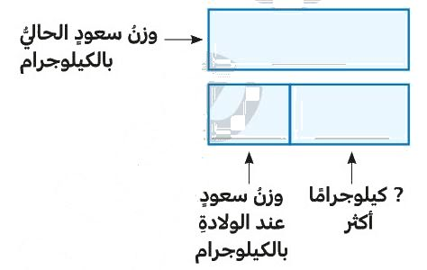
23. ما أوجه الشبه بين الشكل الرباعي الأخضر والشكل الرباعي البنفسجي؟ وما أوجه الاختلاف بينهما؟
   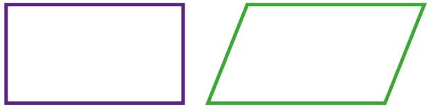
24. استعملت هدى النموذج المجاور لإيجاد 2 5/12 − 1 7/12؛ هل نمذجت هدى المسألة بشكل صحيح؟ إذا لم يكن الأمر كذلك، بيّن كيف كان يجب نمذجتها وأوجد ناتج الطرح.
   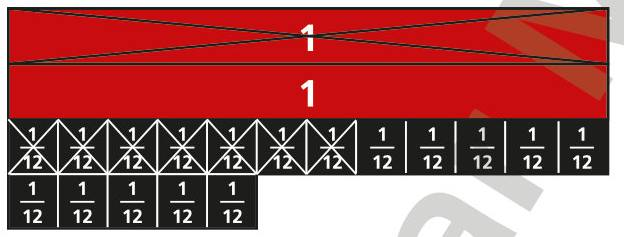

#### أولًا: اختر الإجابة الصحيحة (أسئلة محوّلة)

1. وزن سعود الآن 21 1/10 kg، وكان وزنه 3 1/4 kg عندما وُلد. كم ازداد وزنه؟
   - أ) 18 kg
   - ب) 18 3/20 kg
   - ج) 17 3/20 kg
   - د) 17 17/20 kg
2. وزن سعود الآن 21 1/10 kg، وكان وزنه 3 1/4 kg عندما وُلد. كم ازداد وزنه منذ أن وُلد؟
   - أ) 24 7/20 kg
   - ب) 18 3/20 kg
   - ج) 17 3/20 kg
   - د) 17 17/20 kg

### الدرس 7-11: جمع وطرح الأعداد الكسرية

#### رابعًا: أجب عن الأسئلة الآتية (مسائل وتفكير)

1. أوجد ناتج التالي: 5 1/9 − 2 2/3
2. أوجد ناتج التالي: 2 1/4 + 8 2/3
3. أوجد ناتج التالي: 6 7/25 − 3 9/50
4. حُلّ. اجمع ما بداخل الأقواس أوّلًا: 4 3/5 + 11 2/15
5. حُلّ. اجمع ما بداخل الأقواس أوّلًا: 8 2/3 − 3 3/4
6. حُلّ. اجمع ما بداخل الأقواس أوّلًا: (7 2/3 + 3 4/5) − 1 4/15
7. حُلّ. اجمع ما بداخل الأقواس أوّلًا: 8 2/5 − (3 2/3 + 2 3/5)
8. أوجد ناتج التالي: 9 1/3 − 4 1/6
9. أوجد ناتج التالي: 12 1/4 − 9 3/5
10. أوجد ناتج التالي: 6 3/5 + 1 3/25
11. أوجد ناتج التالي: 3 4/9 + 2 2/3
12. أوجد ناتج التالي: 5 31/75 − 3 2/25
13. حُلّ. اجمع ما بداخل الأقواس أوّلًا: (2 5/8 + 2 1/2) − 4 2/3
14. حُلّ. اجمع ما بداخل الأقواس أوّلًا: (5 3/4 + 1 5/6) − 6 7/12
15. حُلّ. اجمع ما بداخل الأقواس أوّلًا: 4 3/5 + (8 1/5 − 7 3/10)
16. حُلّ. اجمع ما بداخل الأقواس أوّلًا: (13 − 10 1/3) + 2 2/3
17. حُلّ. اجمع ما بداخل الأقواس أوّلًا: (2 1/2 + 3 1/4) − 1 1/4
18. حُلّ. اجمع ما بداخل الأقواس أوّلًا: 2 3/14 + (15 4/7 − 6 3/4)
21. استعمل الجدول الوارد أدناه. كن دقيقًا: بكم يزيد طول أقصى قفزة للضفدع الإفريقي عن طول أقصى قفزة للضفدع النمري؟
   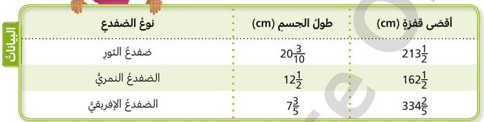
22. كم يبلغ طول ضفدع الثور بالسنتمترات؟ قرّب إلى أقرب عدد كلّيّ.
   
23. المصطلحات: اكتب ثلاثة أعداد هي مقامات مشتركة للكسرين 7/15 و 3/5
24. زرعت علياء محتوى 12 كيسًا من بذور الخضروات في حديقة عامة. سعر الكيس الواحد QR 1.75. ما التكلفة الكلّية للبذور؟
25. هل العدد الكسري 5 3/8 يجعل كلًّا من المعادلات أو الجمل العددية التالية صحيحة؟ اختر نعم أو لا.
   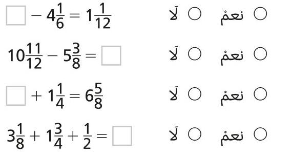
26. هل العدد الكسري 3 1/3 يجعل كلًّا من المعادلات أو الجمل العددية التالية صحيحة؟ اختر نعم أو لا.
   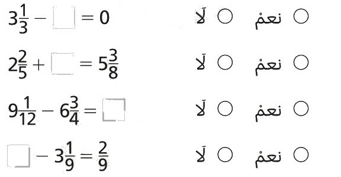
27. أيّ الضفادع يقفز 10 أمثال طول جسمه تقريبًا؟ وضّح طريقة توصّلك إلى الإجابة.
   

#### أولًا: اختر الإجابة الصحيحة (أسئلة محوّلة)

1. أيّ الأعداد الآتية مقامٌ مشتركٌ للكسرين 7/15 و 3/5؟
   - أ) 15
   - ب) 20
   - ج) 25
   - د) 10

### الدرس 7-12: النمذجة في الرياضيات

#### رابعًا: أجب عن الأسئلة الآتية (مسائل وتفكير)

1. يريد سيف أن يركض 3 كيلومتر كلّ يوم. ركض صباح يوم الإثنين 1 7/8 كيلومتر. كم كيلومترًا لا يزال عليه أن يركض؟ ارسم لوحة الأجزاء لتمثيل المسألة.
2. اكتب معادلة لهذه المسألة وحُلّها. كيف توصّلت إلى الحلّ؟
3. كم كيلومترًا لا يزال على سيف أن يركض؟
4. يستعمل منسّق حدائق 2 1/2 طن من الحصى الأصفر و 3 1/4 طن من الحصى الأسود و 5/8 طنّ من حصى النهر. ما الوزن الكلّيّ للحصى؟ ارسم لوحة الأجزاء واكتب جملة عددية لتمثيل المسألة.
5. حُلّ الجملة العددية. ما حسابات الكسور التي قمت بها؟
6. كم طنًّا من الحصى استعمل منسّق الحدائق؟
7. أنشطة المخيّم: أثناء دورة مدتها 6 ساعات في مخيّم يوميّ، شارك فواز في رحلة بالقارب ونزهة في البريّة وتناول الغداء، وما بقيَ من الدورة كان وقت فراغ. كمْ من الوقتِ أمضى فواز في هذه الأنشطة الثلاثة؟ وكمْ كان لديهِ من وقتِ الفراغ؟ افهم وثابر في الحلّ: ما الذي تعرفُهُ وما الذي تريد إيجادَه؟
   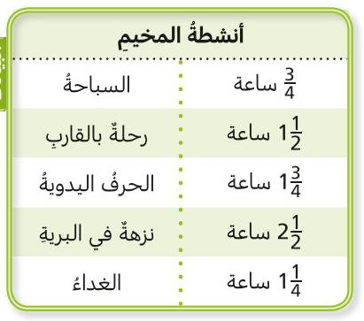
8. صِف الكميات والعمليات التي ستستعملُها لإيجاد مقدار الوقتِ الذي أمضاهُ فوازٌ في الأنشطة الثلاثة. ما الكميات والعمليات التي ستستعملُها لإيجاد كمْ كان لدى فواز من وقتِ الفراغ؟
9. ارسم لوحة الأجزاء واستعمل جملة عددية لمساعدتك على إيجاد مقدار الوقتِ الذي أمضاهُ فوازٌ في الأنشطة، ثمّ ارسم لوحة الأجزاء واستعمل جملة عددية لمساعدتك على إيجاد كم كان لدى فوازٍ من وقتِ الفراغ.

#### أولًا: اختر الإجابة الصحيحة (أسئلة محوّلة)

1. يريد سيف أن يركض 3 km كلّ يوم، وركض صباح الإثنين 1 7/8 km. ما المعادلة التي تمثّل المسافة المتبقية d؟
   - أ) 1 7/8 − d = 3
   - ب) 1 7/8 + d = 3
   - ج) d − 3 = 1 7/8
   - د) d × 3 = 1 7/8
2. يريد سيف أن يركض 3 km، وركض 1 7/8 km. كم كيلومترًا لا يزال عليه أن يركض؟
   - أ) 2 1/8 km
   - ب) 1 1/8 km
   - ج) 1 7/8 km
   - د) 4 7/8 km
3. يستعمل منسّق حدائق 2 1/2 طن من الحصى الأصفر و 3 1/4 طن من الحصى الأسود و 5/8 طن من حصى النهر. ما الجملة العدديّة التي تمثّل وزن الحصى الكلّيّ؟
   - أ) 2 1/2 + 3 1/4 + 5/8
   - ب) 2 1/2 − 3 1/4 − 5/8
   - ج) 2 1/2 × 3 1/4 × 5/8
   - د) 2 1/2 ÷ 3 1/4 ÷ 5/8
4. يستعمل منسّق حدائق 2 1/2 طن من الحصى الأصفر و 3 1/4 طن من الحصى الأسود و 5/8 طن من حصى النهر. ما الوزن الكلّيّ للحصى؟
   - أ) 7 3/8 طن
   - ب) 5 3/8 طن
   - ج) 6 1/8 طن
   - د) 6 3/8 طن
5. يريد سيف أن يقطع 3 km كلّ يوم، وقطع صباحًا 1 7/8 km. ما المعادلة التي تمثّل المسافة المتبقية d؟
   - أ) 3 + d = 1 7/8
   - ب) 1 7/8 − d = 3
   - ج) d − 1 7/8 = 0
   - د) 1 7/8 + d = 3
6. تريد ليلى أن تقطع 4 km كلّ يوم، وقطعت صباحًا 1 3/4 km. ما المعادلة التي تمثّل المسافة المتبقية d؟
   - أ) 1 3/4 − d = 4
   - ب) 1 3/4 + d = 4
   - ج) d − 1 3/4 = 0
   - د) 4 + d = 1 3/4
7. يريد ماهر أن يقطع 5 km كلّ يوم، وقطع صباحًا 2 1/2 km. ما المعادلة التي تمثّل المسافة المتبقية d؟
   - أ) d − 2 1/2 = 0
   - ب) 2 1/2 − d = 5
   - ج) 2 1/2 + d = 5
   - د) 5 + d = 2 1/2
8. تريد دانة أن تقطع 6 km كلّ يوم، وقطعت صباحًا 3 5/6 km. ما المعادلة التي تمثّل المسافة المتبقية d؟
   - أ) d − 3 5/6 = 0
   - ب) 3 5/6 − d = 6
   - ج) 3 5/6 + d = 6
   - د) 6 + d = 3 5/6
9. يريد راشد أن يقطع 2 km كلّ يوم، وقطع صباحًا 3/4 km. ما المعادلة التي تمثّل المسافة المتبقية d؟
   - أ) 3/4 + d = 2
   - ب) 3/4 − d = 2
   - ج) d − 3/4 = 0
   - د) 2 + d = 3/4
10. تريد هدى أن تقطع 10 km كلّ يوم، وقطعت صباحًا 4 2/5 km. ما المعادلة التي تمثّل المسافة المتبقية d؟
   - أ) 4 2/5 − d = 10
   - ب) 4 2/5 + d = 10
   - ج) d − 4 2/5 = 0
   - د) 10 + d = 4 2/5
11. يريد فيصل أن يقطع 8 km كلّ يوم، وقطع صباحًا 2 3/8 km. ما المعادلة التي تمثّل المسافة المتبقية d؟
   - أ) 2 3/8 + d = 8
   - ب) 2 3/8 − d = 8
   - ج) d − 2 3/8 = 0
   - د) 8 + d = 2 3/8
12. تريد نورة أن تقطع 7 km كلّ يوم، وقطعت صباحًا 3 1/4 km. ما المعادلة التي تمثّل المسافة المتبقية d؟
   - أ) d − 3 1/4 = 0
   - ب) 3 1/4 − d = 7
   - ج) 3 1/4 + d = 7
   - د) 7 + d = 3 1/4
13. يريد سيف أن يقطع 3 km كلّ يوم، وقطع صباحًا 1 7/8 km. كم km بقي عليه؟
   - أ) 1 1/8 km
   - ب) 1 7/8 km
   - ج) 4 7/8 km
   - د) 2 1/8 km
14. تريد ليلى أن تقطع 4 km كلّ يوم، وقطعت صباحًا 1 3/4 km. كم km بقي عليها؟
   - أ) 2 1/4 km
   - ب) 1 3/4 km
   - ج) 5 3/4 km
   - د) 3 1/4 km
15. يريد ماهر أن يقطع 5 km كلّ يوم، وقطع صباحًا 2 1/2 km. كم km بقي عليه؟
   - أ) 6 km
   - ب) 7 1/2 km
   - ج) 3 1/2 km
   - د) 2 1/2 km
16. تريد دانة أن تقطع 6 km كلّ يوم، وقطعت صباحًا 3 5/6 km. كم km بقي عليها؟
   - أ) 3 1/6 km
   - ب) 3 5/6 km
   - ج) 9 5/6 km
   - د) 2 1/6 km
17. يريد راشد أن يقطع 2 km كلّ يوم، وقطع صباحًا 3/4 km. كم km بقي عليه؟
   - أ) 2 1/4 km
   - ب) 3/4 km
   - ج) 2 3/4 km
   - د) 1 1/4 km
18. تريد هدى أن تقطع 10 km كلّ يوم، وقطعت صباحًا 4 2/5 km. كم km بقي عليها؟
   - أ) 4 2/5 km
   - ب) 5 3/5 km
   - ج) 14 2/5 km
   - د) 6 3/5 km
19. يريد فيصل أن يقطع 8 km كلّ يوم، وقطع صباحًا 2 3/8 km. كم km بقي عليه؟
   - أ) 5 5/8 km
   - ب) 2 3/8 km
   - ج) 10 3/8 km
   - د) 6 5/8 km
20. تريد نورة أن تقطع 7 km كلّ يوم، وقطعت صباحًا 3 1/4 km. كم km بقي عليها؟
   - أ) 4 3/4 km
   - ب) 3 1/4 km
   - ج) 10 1/4 km
   - د) 3 3/4 km

## الوحدة 8: تطبيق مفهوم الضرب على ضرب الكسور

### الدرس 8-1: استعمال النماذج لضرب عدد كلي في كسر اعتيادي

#### رابعًا: أجب عن الأسئلة الآتية (مسائل وتفكير)

1. أوجد ناتج الضرب. ظلّل النموذج للمساعدة على الحلّ: 3 × 2/3
   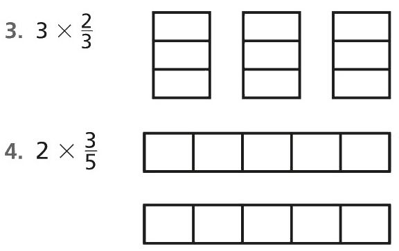
2. أوجد ناتج الضرب. ظلّل النموذج للمساعدة على الحلّ: 2 × 3/5
   
3. أكمل الجملة العددية لإيجاد ناتج الضرب: 6 × 3/4
4. أكمل الجملة العددية لإيجاد ناتج الضرب: 16 × 3/8
5. أكمل الجملة العددية لإيجاد ناتج الضرب: 500 × 2/5
6. أوجد ناتج الضرب. استعمل النماذج للمساعدة على الحلّ: 35 × 2/5
7. أوجد ناتج الضرب: 7 × 5/12
8. أوجد ناتج الضرب: 9 × 2/3
9. أوجد ناتج الضرب: 300 × 1/2
10. أوجد ناتج الضرب: 64 × 3/8
11. أوجد ناتج الضرب: 900 × 2/3
12. أوجد ناتج الضرب: 84 × 1/4
13. أوجد ناتج الضرب: 42 × 2/7
14. اكتب جملة ضرب تمثّل 10⁶
15. اختر نعم أو لا لتوضّح ما إذا كان الكسر 3/8 يجعل أيًّا من المعادلات التالية صحيحة. 96 × ____ = 36 ، 38 × ____ = 14 ، 16 × ____ = 6 ، 56 × ____ = 21
16. اختر نعم أو لا لتوضّح ما إذا كان العدد 56 يجعل أيًّا من المعادلات التالية صحيحة. ____ × 1/2 = 28 ، ____ × 2/7 = 16 ، ____ × 8/9 = 49 ، ____ × 1/4 = 14
17. استعملت حنان وصفة جواهر لصنع 9 أوعية من عصير الفاكهة. ما عدد أكواب عصير البرتقال التي احتاجتها؟
18. وضّح لماذا ناتج عملية ضرب 3/4 × 8 هو نفسه ناتج عملية جمع 3/4 + 3/4 + 3/4 + 3/4 + 3/4 + 3/4 + 3/4 + 3/4
19. تقضي الأسود تقريبًا 5/6 يومها في النوم. كم ساعة في اليوم ينام الأسد؟ اكتب جملة عددية لنمذجة حلّك.
20. على المريخ، يساوي وزنك 1/3 وزنك على الأرض تقريبًا. إذا كان وزن حمد 96 باوند على الأرض، فما وزنه بالباوند على المريخ؟
21. أعدّت هيفاء سلطة فواكه. احتاجت 3/4 كوب من العنب لكلّ وعاء من سلطة الفواكه. ما عدد أكواب العنب التي استعملتها لإعداد 24 وعاء من سلطة الفواكه؟
22. هل تظنّ أنّ ناتج 0.95 − 1.4 أصغر أم أكبر من 1؟
23. يوضّح الجدول عدد الكيلومترات التي ركضها كلّ شخص هذا الأسبوع. من الذي يكون قد ركض كيلومترات أكثر عند انقضاء الأسبوع؟ بكم أكثر؟
   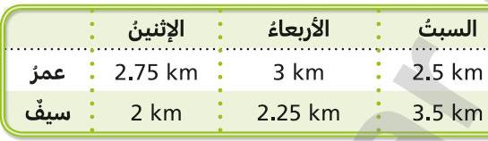
24. وضّح كيف يمكنك إيجاد ناتج 3/4 × 36 ذهنيًّا.

#### أولًا: اختر الإجابة الصحيحة (أسئلة محوّلة)

1. أيّ جمل الضرب الآتية تمثّل 10⁶؟
   - أ) 6 × 6 × 6 × 6 × 6 × 6 × 6 × 6 × 6 × 6
   - ب) 10 × 6
   - ج) 10 × 10 × 10 × 10 × 10 × 10
   - د) 10 + 10 + 10 + 10 + 10 + 10
2. أيّ المعادلات الآتية لا يجعلها الكسر 3/8 صحيحةً؟
   - أ) 38 × ___ = 14
   - ب) 96 × ___ = 36
   - ج) 16 × ___ = 6
   - د) 56 × ___ = 21
3. أيّ المعادلات الآتية لا يجعلها العدد 56 صحيحةً؟
   - أ) ___ × 8/9 = 49
   - ب) ___ × 1/2 = 28
   - ج) ___ × 2/7 = 16
   - د) ___ × 1/4 = 14
4. لماذا ناتج 3/4 × 8 هو نفسه ناتج جمع 3/4 ثماني مرّات؟
   - أ) لأنّ الكسر لا يُضرب
   - ب) لأنّ الجمع والضرب عمليّتان مختلفتان تمامًا
   - ج) لأنّ 3/4 أكبر من 8
   - د) لأنّ الضرب في عددٍ كلّيّ جمعٌ متكرّر
5. تقضي الأسود تقريبًا 5/6 يومها في النوم. كم ساعةً تنام في اليوم؟
   - أ) 20 ساعة
   - ب) 24 ساعة
   - ج) 5 ساعات
   - د) 4 ساعات
6. كيف تجد ناتج 3/4 × 36 ذهنيًّا؟
   - أ) أقسم 36 على 4 ثمّ أضرب الناتج في 3 فيكون 27
   - ب) أضرب 36 في 4 فقط
   - ج) أطرح 3 من 36
   - د) أجمع 3 و4 ثمّ أضرب في 36
7. أوجد ناتج 3 × 2/3.
   - أ) 2/9
   - ب) 2
   - ج) 9/2
   - د) 1

### الدرس 8-2: استعمال النماذج لضرب كسر اعتيادي في عدد كلي

#### رابعًا: أجب عن الأسئلة الآتية (مسائل وتفكير)

1. استعمل النموذج لإيجاد ناتج الضرب: 2/3 × 6
   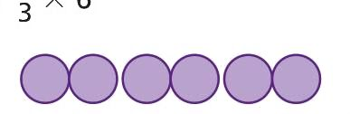
2. استعمل النموذج لإيجاد ناتج الضرب: 3/8 × 4
   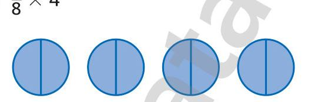
3. أوجد ناتج الضرب. ارسم نموذجًا لمساعدتك على الحلّ: 2/3 × 15
4. أوجد ناتج الضرب. ارسم نموذجًا لمساعدتك على الحلّ: 11/12 × 6
5. أوجد ناتج الضرب. ارسم نموذجًا لمساعدتك على الحلّ: 5/8 × 16
6. صِل كلّ مقدار بناتج ضربه: 3/4 × 16 ، 5/12 × 12 ، 9/10 × 5 ، 2/3 × 15 ، مع النواتج 10 ، 5 ، 12 ، 4 1/2
   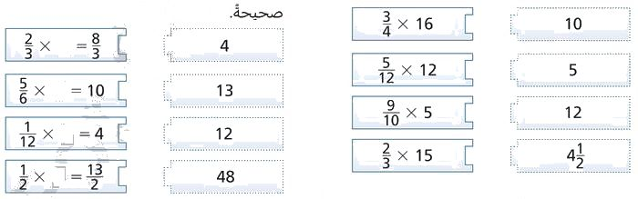
7. صِل كلّ معادلة بالعدد الذي يجعل المعادلة صحيحة: 2/3 × ____ = 8/3 ، 5/6 × ____ = 10 ، 1/12 × ____ = 4 ، 1/2 × ____ = 13/2 ، مع الأعداد 4 ، 13 ، 12 ، 48
   
8. وضّح لماذا ناتج 2/3 × 4 هو نفسه ناتج 4 × 2/3
10. قالت منى إنّه عندما تضرب كسرًا أصغر من 1 في عدد كلّيّ عدا الصفر، فإنّ ناتج الضرب يكون دائمًا أصغر من العدد الكلّيّ. هل توافقها الرأي؟
11. أرادت معلمة العلوم اكتشاف كيف تتغير خواص الماء عندما يضاف إليه الملح. استبدلت كلّ 1/8 كوب من الماء بالملح. إذا كان لديها 24 كوبًا من الماء، فما عدد الأكواب التي استبدلتها بالملح؟
12. ذهبت ريم إلى المدرسة لمدة تزيد بأسبوع عن 3/4 العام. ما عدد الأسابيع التي ذهبت فيها ريم إلى المدرسة خلال العام؟
13. الثمن الكلّيّ لكتابين مستعملين بغلاف ورقيّ هو QR 10. كم الباقي الذي ستحصل عليه ثرية إذا اشترت كتابين مستعملين بغلاف مقوّى وكتابين مستعملين بغلاف ورقيّ بعد أن تعطي الموظف خمس أوراق نقدية فئة QR 10.
   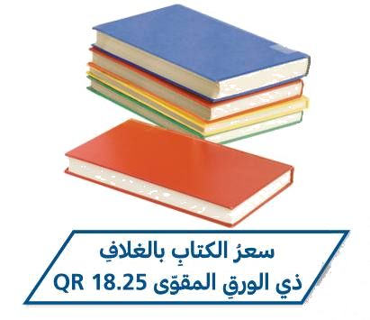
14. لدى نوال 48 ملصقًا. 3/8 منها ملصقات صور زهور. و 1/8 منها ملصقات صور نباتات، والباقي ملصقات صور طيور. ما عدد ملصقات صور الطيور؟ وضّح كيف توصلت إلى الإجابة.

#### أولًا: اختر الإجابة الصحيحة (أسئلة محوّلة)

1. أوجد ناتج الضرب: 2/3 × 15
   - أ) 10
   - ب) 30
   - ج) 5
   - د) 7 1/2
2. أوجد ناتج الضرب: 11/12 × 6
   - أ) 5 1/2
   - ب) 66
   - ج) 11
   - د) 6 1/2
3. أوجد ناتج الضرب: 5/8 × 16
   - أ) 10
   - ب) 8
   - ج) 80
   - د) 5
4. لماذا ناتج 2/3 × 4 هو نفسه ناتج 4 × 2/3؟
   - أ) لأنّ 2/3 يساوي 4
   - ب) لأنّ ترتيب العاملين لا يغيّر ناتج الضرب
   - ج) لأنّ الكسر دائمًا أكبر
   - د) لأنّ الضرب لا يُحسب
5. قالت منى: عند ضرب كسرٍ أصغر من 1 في عددٍ كلّيّ غير الصفر يكون الناتج دائمًا أصغر من العدد الكلّيّ. هل توافقها؟
   - أ) نعم، لأنّنا نأخذ جزءًا من العدد فقط
   - ب) لا، لأنّ الناتج دائمًا أكبر
   - ج) لا، لأنّ الناتج دائمًا مساوٍ له
   - د) لا يمكن معرفة ذلك
6. ذهبت ريم إلى المدرسة مدّةً تزيد أسبوعًا واحدًا على 3/4 العام (52 أسبوعًا). كم أسبوعًا ذهبت؟
   - أ) 41 أسبوعًا
   - ب) 39 أسبوعًا
   - ج) 40 أسبوعًا
   - د) 53 أسبوعًا
7. لدى نوال 48 ملصقًا: 3/8 منها صور زهور و 1/8 صور نباتات، والباقي صور طيور. كم ملصقًا من صور الطيور؟
   - أ) 18
   - ب) 24
   - ج) 6
   - د) 30
8. أوجد ناتج 3/4 × 16.
   - أ) 48
   - ب) 4
   - ج) 10
   - د) 12
9. أوجد ناتج 5/12 × 12.
   - أ) 12
   - ب) 5
   - ج) 10
   - د) 60
10. أوجد ناتج 9/10 × 5.
   - أ) 4 1/2
   - ب) 5
   - ج) 9
   - د) 4/9
11. أوجد ناتج 2/3 × 15.
   - أ) 5
   - ب) 10
   - ج) 13
   - د) 45
12. ما العدد الذي يجعل المعادلة 2/3 × ؟ = 8/3 صحيحة؟
   - أ) 48
   - ب) 13
   - ج) 12
   - د) 4
13. ما العدد الذي يجعل المعادلة 5/6 × ؟ = 10 صحيحة؟
   - أ) 48
   - ب) 4
   - ج) 13
   - د) 12
14. ما العدد الذي يجعل المعادلة 1/12 × ؟ = 4 صحيحة؟
   - أ) 12
   - ب) 4
   - ج) 48
   - د) 13
15. ما العدد الذي يجعل المعادلة 1/2 × ؟ = 13/2 صحيحة؟
   - أ) 4
   - ب) 13
   - ج) 12
   - د) 48
16. أوجد ناتج 5/8 × 16.
   - أ) 2
   - ب) 10
   - ج) 8
   - د) 80

### الدرس 8-3: ضرب الكسور الاعتيادية في الأعداد الكلية

#### أولًا: اختر الإجابة الصحيحة

1. أيٌّ ممّا يلي هو ناتج ضرب 14 و 3/7؟
   - أ) 2 3/7
   - ب) 5
   - ج) 6
   - د) 32 2/3
2. أيٌّ ممّا يلي هو ناتج ضرب 11/12 و 4؟
   - أ) 1 1/4
   - ب) 3 2/3
   - ج) 4 1/3
   - د) 33

#### رابعًا: أجب عن الأسئلة الآتية (مسائل وتفكير)

3. أوجد ناتج الضرب واكتبه في صورة عدد كسري: 3/8 × 4
4. أوجد ناتج الضرب واكتبه في صورة عدد كسري: 8 × 5/6
5. أوجد ناتج الضرب واكتبه في صورة عدد كسري: 5 × 4/7
6. أوجد ناتج الضرب واكتبه في صورة عدد كسري: 3/4 × 14
7. أوجد ناتج الضرب واكتبه في صورة عدد كسري: 600 × 2/3
8. أوجد ناتج الضرب واكتبه في صورة عدد كسري: 5/9 × 37
9. أوجد ناتج الضرب واكتبه في صورة عدد كسري: 4/5 × 500
10. أوجد ناتج الضرب واكتبه في صورة عدد كسري: 5 × 2/3
11. أوجد ناتج الضرب واكتبه في صورة عدد كسري: 17 × 6/8
12. أوجد ناتج الضرب واكتبه في صورة عدد كسري: 9/10 × 25
13. أوجد ناتج الضرب واكتبه في صورة عدد كسري: 7/8 × 320
14. أوجد ناتج الضرب واكتبه في صورة عدد كسري: 28 × 7/12
15. أوجد ناتج الضرب واكتبه في صورة عدد كسري: 2/3 × 1 287
16. أوجد ناتج الضرب واكتبه في صورة عدد كسري: 900 × 2/9
17. كيف يمكنك استعمال الحساب الذهني لإيجاد ناتج 3/10 × 25؟
19. إذا قضى عيسى 2/3 ساعة في القراءة كلّ يوم لمدة 7 أيام، ما العدد الكلّي للساعات التي قضاها في القراءة؟ وضّح كيف توصّلت إلى الإجابة.
20. يشكّل الماء 0.6 تقريبًا من جسم الإنسان. إذا كانت كتلة شخصٍ 75 كيلوجرامًا، فما كتلة الماء في جسم هذا الشخص؟
21. أثناء نزهة في الطبيعة، تعرّفت غادة على 20 نوعًا من الحيوانات والنباتات. a. ابن الحجج الرياضية: قالت غادة إنّ 1/3 الأنواع التي تعرّفت عليها كانت حيوانات. هل يمكن أن يكون هذا صحيحًا؟ b. إذا كان 3/5 الأنواع التي تعرّفت عليها غادة حيوانات، فما عدد النباتات التي تعرّفت عليها غادة؟
22. لوحة مستطيلة طولها 2 قدم وعرضها 5/6 قدم. ما مساحة اللوحة؟
   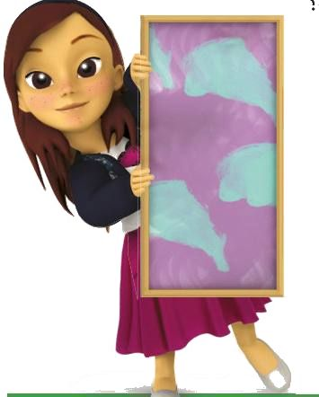
23. جزيءُ الماءِ مكوّنٌ من 3 ذرات. يمثل الأكسجين ثلث هذه الذرات ويمثل الهيدروجين باقي الذرات. إذا كان هناك 114 جزيءَ ماءٍ، فما عدد ذرات الهيدروجين؟
24. أعدّت معلمة الفنون خليطًا من الطلاء البنفسجي بمزج 3/4 كوب من الطلاء الأحمر مع 3/4 كوب من الطلاء الأزرق. ما عدد أكواب الطلاء البنفسجي التي ستحصل عليها إذا أعدّت 13 خليطًا؟

#### أولًا: اختر الإجابة الصحيحة (أسئلة محوّلة)

1. كيف تستعمل الحساب الذهنيّ لإيجاد ناتج 3/10 × 25؟
   - أ) أضرب 25 في 10 فقط
   - ب) أجمع 3 و10 و25
   - ج) أطرح 3 من 25
   - د) أضرب 25 في 3 ثمّ أقسم الناتج على 10 فيكون 7 1/2
2. قضى عيسى 2/3 ساعة في القراءة كلّ يوم لمدّة 7 أيّام. ما العدد الكلّيّ للساعات؟
   - أ) 1 1/3 ساعة
   - ب) 14 ساعة
   - ج) 4 2/3 ساعات
   - د) 9 ساعات
3. تعرّفت غادة على 20 نوعًا من الحيوانات والنباتات، وقالت إنّ 1/3 الأنواع كانت حيوانات. هل يمكن أن يكون هذا صحيحًا؟
   - أ) نعم، لأنّ 1/3 من 20 يساوي 6
   - ب) نعم، لأنّ 1/3 من 20 يساوي 7
   - ج) نعم، لأنّ 1/3 من 20 يساوي 10
   - د) لا، لأنّ 1/3 من 20 ليس عددًا كلّيًّا

### الدرس 8-4: استعمال النماذج لضرب كسرين اعتياديين

#### أولًا: اختر الإجابة الصحيحة

1. مثّل عادل النموذج لإظهار ضرب كسر اعتياديّ في كسر اعتياديّ آخر. ما جملة الضرب التي يوضّحها النموذج؟
   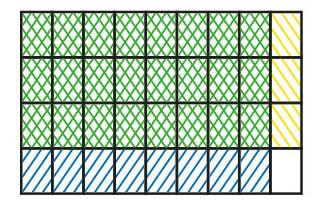
   - أ) 3/4 × 8/9 = 2/3
   - ب) 1/3 × 1/8 = 1/24
   - ج) 3/4 × 3/9 = 1/4
   - د) 3/9 × 8/9 = 8/27

#### رابعًا: أجب عن الأسئلة الآتية (مسائل وتفكير)

2. أوجد ناتج 1/2 × 5/6؛ ظلّل النموذج لمساعدتك على الحلّ.
   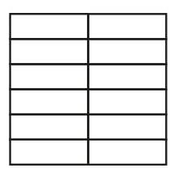
3. أوجد 3/4 من 4/9
4. أوجد ناتج الضرب. ظلّل النموذج لمساعدتك على الحلّ: 1/3 × 5/6
   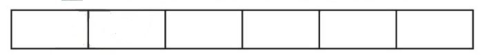
5. أوجد ناتج الضرب. ظلّل النموذج لمساعدتك على الحلّ: 2/3 × 1/12
   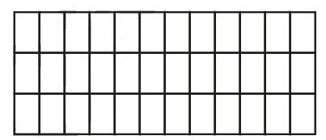
6. أوجد ناتج الضرب. استعمل نماذج لمساعدتك على الحلّ: 7/8 × 1/2
7. أوجد ناتج الضرب: 2/5 × 1/12
8. أوجد ناتج الضرب: 1/4 × 1/8
9. أوجد ناتج الضرب: 1/2 × 3/4
10. أوجد ناتج الضرب: 1/4 من 7/8
11. أوجد ناتج الضرب: 5/6 من 9/10
12. أوجد ناتج الضرب: 5/7 من 7/9
13. أوجد ناتج الضرب: 1/3 من 3/7
14. اكتب مقدارًا يساوي 10⁴
15. بعد الانتهاء من مأدبة عشاء الليلة الماضية، بقي لدى فاتن 1/2 فطيرة. أكلت 1/2 الجزء الباقي منها. ما هي الكمية التي تناولتها من كامل الفطيرة؟ اكتب جملة عددية لنمذجة عملك.
17. هل يكفي QR 50 لشراء 6 علب دهان؟
   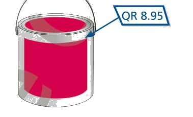
18. كان لدى معلمة العلوم 3/4 زجاجة محلول. استعملت 1/6 المحلول في تجربة. ما الكمية التي استعملتها من الزجاجة؟
19. ما قيمة n التي تجعل المعادلة 2/3 × n = 4/9 صحيحة؟
20. يتقاضى عامل QR 45 عن أوّل ساعة عمل و QR 30 عن كلّ ساعة عمل إضافية. كم يتقاضى هذا العامل إذا استغرق 4 ساعات لإتمام العمل؟
21. شارك 1/2 طلّاب الصفّ الخامس في نشاط رياضي بعد الدوام المدرسيّ. ما الكسر الذي يمثّل عدد الطلاب المشاركين الذين اختاروا نشاط كرة القدم؟ والذين اختاروا سباق الحواجز؟ في أيّ النشاطين شارك أكبر عدد من الطلاب؟
   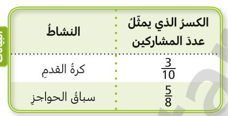
22. إذا ضُرب 7/8 في 4/5، فهل يكون ناتج الضرب أكبر من أيٍّ من هذين العاملين؟

#### أولًا: اختر الإجابة الصحيحة (أسئلة محوّلة)

1. بقي لدى فاتن 1/2 فطيرة، وأكلت 1/2 الجزء الباقي. ما الكمّية التي تناولتها من كامل الفطيرة؟
   - أ) 1/4
   - ب) 1/2
   - ج) 1
   - د) 2/4 من الفطيرة كلّها
2. إذا ضُرب 7/8 في 4/5، فهل يكون ناتج الضرب أكبر من أيٍّ من هذين العاملين؟
   - أ) نعم، لأنّ الناتج 11/13
   - ب) نعم، لأنّ الناتج 28/13
   - ج) لا، لأنّ الناتج 7/10 وهو أصغر من العاملين
   - د) لا، لأنّ الناتج 4/5 تمامًا
3. أوجد ناتج 1/2 × 5/6.
   - أ) 5/12
   - ب) 5/8
   - ج) 6/12
   - د) 6/8
4. أوجد ناتج 1/3 × 5/6.
   - أ) 5/9
   - ب) 5/18
   - ج) 6/9
   - د) 5/6
5. أوجد ناتج 2/3 × 1/12.
   - أ) 2/15
   - ب) 1/18
   - ج) 3/36
   - د) 2/12

### الدرس 8-5: ضرب كسرين اعتياديين

#### رابعًا: أجب عن الأسئلة الآتية (مسائل وتفكير)

1. أوجد كلّ ناتج ضرب: 2/3 × 1/2
2. أوجد كلّ ناتج ضرب: 1/3 × 1/4
3. أوجد كلّ ناتج ضرب: 7/10 × 3/4
4. أوجد كلّ ناتج ضرب: 3/5 × 11/12
5. أوجد كلّ ناتج ضرب: 4/10 × 2/5
6. أوجد كلّ ناتج ضرب: 3/4 × 2/9
7. أوجد كلّ ناتج ضرب: 5/6 من 3/7
8. أوجد كلّ ناتج ضرب: 5/9 من 1/9
9. أوجد كلّ ناتج ضرب: 9/10 × 1/2
10. أوجد كلّ ناتج ضرب: 5/6 × 1/3
11. أوجد كلّ ناتج ضرب: 2/3 × 4/5
12. أوجد كلّ ناتج ضرب: 3/4 × 4/5
13. أوجد كلّ ناتج ضرب: 2/3 × 7/8
14. أوجد كلّ ناتج ضرب: 1/2 × 1/2
15. أوجد كلّ ناتج ضرب: 1/3 × 3/4
16. أوجد كلّ ناتج ضرب: 6/7 × 3/8
17. أوجد كلّ ناتج ضرب: 2/5 من 5/12
18. أوجد كلّ ناتج ضرب: 5/6 من 11/12
19. أوجد كلّ ناتج ضرب: 4/7 من 7/9
20. أوجد كلّ ناتج ضرب: 1/2 من 8/9
21. أوجد كلّ ناتج ضرب: (1/6 + 1/6) × 3/4
22. أوجد كلّ ناتج ضرب: (3/7 + 2/7) × 2/3
23. أوجد كلّ ناتج ضرب: 1/2 × (1/3 + 1/3)
24. أوجد كلّ ناتج ضرب: (9/10 − 3/10) × 1/4
25. أوجد كلّ ناتج ضرب: 2/3 × (3/5 + 1/5)
26. أوجد كلّ ناتج ضرب: (8/9 − 1/3) × 3/4
27. أوجد كلّ ناتج ضرب: (5/12 + 1/6) × 5/6
28. أوجد كلّ ناتج ضرب: 11/12 × (3/4 − 1/2)
29. اختر جميع المقادير التي ناتج ضربها 3/4: 1/2 × 1/2 ، 9/10 × 5/6 ، 7/8 × 6/7 ، 3/4 × 3/4 ، 1/4 × 1/2
30. اختر كلّ جملة ضرب يكون الجزء الناقص فيها 1/3: 4/5 × ____ = 5/12 ، 1/4 × ____ = 1/6 ، 7/8 × ____ = 7/24 ، 5/6 × 2/5 = ____ ، 1/6 × 2/3 = ____
31. هل ناتج ضرب 5/4 × 3/6 يساوي ناتج ضرب 5/6 × 3/4؟
32. لماذا يختلف جمع الكسرين 3/9 و 6/9 عن ضربهما؟
33. ركض أحمد 6 دورات حول المضمار في مدرسته. ثمّ ركض مسافة 3 1/2 كيلومتر للعودة إلى المنزل. ما المسافة الكلّية التي ركضها؟ اكتب الحلّ.
   
34. يتألّف اختبار من 50 سؤالًا. ينجح في الاختبار كلّ طالب يجيب بشكل صحيح عن 3/4 الأسئلة. إذا أجاب أحد الطلاب عن 35 سؤالًا إجابة صحيحة، هل ينجح في الاختبار؟
35. يوضّح الشكل المجاور صفحة طوابع واحدة. تحتاج نادية إلى 50 طابعًا لإرسال دعوات لحفلها. هل تكفيها صفحتان من الطوابع لإرسال الدعوات؟ كيف عرفت ذلك؟
   
36. لعب 2/5 طلّاب الصفّ الخامس الشطرنج. من بين هؤلاء الطلّاب لعب 5/6 السودوكو أيضًا. إذا كان عدد الطلّاب في الصفّ الخامس 30 طالبًا، ما عدد الطلّاب الذين لعبوا الشطرنج والسودوكو؟

#### أولًا: اختر الإجابة الصحيحة (أسئلة محوّلة)

1. أيّ المقادير الآتية ناتج ضربها 3/4؟
   - أ) 1/2 × 1/2
   - ب) 9/10 × 5/6
   - ج) 3/4 × 3/4
   - د) 1/4 × 1/2
2. أيّ جمل الضرب الآتية الجزء الناقص فيها 1/3؟
   - أ) 1/4 × ___ = 1/6
   - ب) 7/8 × ___ = 7/24
   - ج) 1/6 × 2/3 = ___
   - د) 4/5 × ___ = 5/12
3. هل ناتج ضرب 5/4 × 3/6 يساوي ناتج ضرب 5/6 × 3/4؟
   - أ) نعم، كلاهما 15/24
   - ب) لا، الأوّل أكبر
   - ج) لا، الثاني أكبر
   - د) لا يمكن معرفة ذلك
4. ما ناتج 3/9 × 6/9؟
   - أ) 6/9
   - ب) 1
   - ج) 9/18
   - د) 2/9

### الدرس 8-6: مساحة المستطيل

#### أولًا: اختر الإجابة الصحيحة

1. حسب غانم مساحة مربّع فوجدَها 4/9 متر مربع. أيّ ممّا يلي يوضّح طول ضلع هذا المربّع؟
   - أ) 2/9 متر
   - ب) 4/9 متر
   - ج) 2/3 متر
   - د) 8/9 متر
2. حسب جابر مساحة مربّع فوجدَها 25/4 سنتمتر مربّع. أيّ ممّا يلي يوضّح طول ضلع هذا المربّع؟
   - أ) 25/2 سنتمتر
   - ب) 25/8 سنتمتر
   - ج) 5/2 سنتمتر
   - د) 5/4 سنتمتر

#### رابعًا: أجب عن الأسئلة الآتية (مسائل وتفكير)

3. أوجد مساحة مستطيل أبعاده 2/3 متر و 1/2 متر.
4. أوجد مساحة مربّع طول ضلعه 5/4 سنتمتر.
5. أوجد مساحة الجزء المظلّل في كلّ رسم: الرسم 5
   
6. أوجد مساحة الجزء المظلّل في كلّ رسم: الرسم 6
   
7. أوجد مساحة الجزء المظلّل في كلّ رسم: الرسم 7
   
8. أوجد مساحة الجزء المظلّل في كلّ رسم: الرسم 8
   
9. أوجد مساحة الجزء المظلّل في كلّ رسم: الرسم 9
   
10. أوجد مساحة الجزء المظلّل في كلّ رسم: الرسم 10
   
11. أوجد مساحة مستطيل أبعاده 5/3 متر و 3/4 متر.
12. أوجد مساحة مربّع طول ضلعه 3/8 سنتمتر.
13. أوجد مساحة مستطيل أبعاده 7/2 سنتمتر و 5/4 سنتمتر.
14. أعدّت سلمى 8.3 لتر من العصير. إذا سكبت نفس كمّية العصير في 5 عبوّات، فما كمّية العصير في كلّ عبوّة؟
15. إذا كنت لا تتذكّر صيغة إيجاد مساحة المستطيل، فكيف يمكنك إيجاد مساحته؟
16. كيف تُعرّف المساحة؟
17. حاول يوسف وهاشم حلّ مسألة ضرب 7/4 × 3/8 = 21/32، قال يوسف أنّ 21/32 ، وقال هاشم أنّ الإجابة الصحيحة هي 21/8 ، من منهما على صواب؟
18. أراد سامح معرفة المساحة التي يجب أن يخصّصها في الحديقة لوضع صندوق رمل قاعدته مربّعة. قياس كلّ ضلع من أضلاع هذه القاعدة 3/4 متر. أوجد المساحة التي سيشغلها هذا الصندوق.
19. اشترت أمل بساطًا قياسه 1/2 متر في 2/3 متر لوضعه على عتبة باب بيتها. مساحة هذه العتبة 1/4 متر مربع، فهل تُلائمُ أبعاد البساط هذه العتبة؟
20. ثمن التذكرة الواحدة لركوب دولاب الهواء QR 6.50. ركب في الدولاب 72 شخصًا. ما إجمالي المبلغ الذي دفعه هؤلاء الركّاب لركوب الدولاب؟
21. يحتوي إناء 20 مللترًا من محلول. استعملت منه منى 10.66 مللتر في الاختبار الأوّل، ثمّ استعملت 4.22 مللتر في الاختبار الثاني. قدّر إلى أقرب جزء من عشرة الكمّية الباقية في الإناء.
22. ركّب سالم بلاطًا أزرق وأبيض في دورة المياه. رسم مخططًا يوضّح المساحة التي يشغلها اللونان. اكتب مقدارين يصفان المساحة التي يشغلها البلاط الأزرق.
   

#### أولًا: اختر الإجابة الصحيحة (أسئلة محوّلة)

1. ما صيغة مساحة المستطيل؟
   - أ) بجمع الطول والعرض
   - ب) بضرب الطول في العرض
   - ج) بطرح العرض من الطول
   - د) بقسمة الطول على العرض
2. كيف تُعرَّف المساحة؟
   - أ) حجم الشكل
   - ب) طول حدود الشكل
   - ج) مقدار السطح الذي يغطّيه الشكل
   - د) وزن الشكل
3. اشترت أمل بساطًا قياسه 1/2 m في 2/3 m، ومساحة عتبة بيتها 1/4 m². هل يلائم البساط العتبة؟
   - أ) نعم، لأنّ مساحته 1/6 m²
   - ب) نعم، لأنّ مساحته 1/4 m² بالضبط
   - ج) لا، لأنّ مساحة البساط 1/3 m² وهي أكبر من 1/4 m²
   - د) لا، لأنّ مساحته 1/2 m²

### الدرس 8-7: ضرب الأعداد الكسرية

#### رابعًا: أجب عن الأسئلة الآتية (مسائل وتفكير)

1. قدّر ناتج الضرب. ثمّ أكمل عملية الضرب: 2 3/4 × 8
2. قدّر ناتج الضرب. ثمّ أكمل عملية الضرب: 4 1/2 × 1 1/4
3. قدّر ناتج الضرب. ثمّ أكمل عملية الضرب: 3 4/5 × 5
4. قدّر ناتج الضرب. ثمّ أكمل عملية الضرب: 1 3/5 × 2 1/4
5. قدّر ناتج الضرب. ثمّ أكمل عملية الضرب: 1 1/2 × 3 5/6
6. قدّر ناتج الضرب. ثمّ أكمل عملية الضرب: 4 2/3 × 4
7. قدّر ناتج الضرب. ثمّ أكمل عملية الضرب: 3 1/7 × 1 1/4
8. قدّر ناتج الضرب. ثمّ أكمل عملية الضرب: 1 1/3 × 2 1/6
9. قدّر ناتج الضرب. ثمّ أوجد كلّ ناتج ضرب: 2 1/6 × 4 1/2
10. قدّر ناتج الضرب. ثمّ أوجد كلّ ناتج ضرب: 3/4 × 8 1/2
11. قدّر ناتج الضرب. ثمّ أوجد كلّ ناتج ضرب: 1 1/8 × 3 1/3
12. قدّر ناتج الضرب. ثمّ أوجد كلّ ناتج ضرب: 3 1/5 × 2/3
13. قدّر ناتج الضرب. ثمّ أوجد كلّ ناتج ضرب: 3 1/4 × 6
14. قدّر ناتج الضرب. ثمّ أوجد كلّ ناتج ضرب: 5 1/3 × 3
15. قدّر ناتج الضرب. ثمّ أوجد كلّ ناتج ضرب: 2 3/8 × 4
16. قدّر ناتج الضرب. ثمّ أوجد كلّ ناتج ضرب: 4 1/8 × 5 1/2
17. قدّر ناتج الضرب. ثمّ أوجد كلّ ناتج ضرب: (1/6 + 2 2/3) × (1 1/4 − 1/2)
18. قدّر ناتج الضرب. ثمّ أوجد كلّ ناتج ضرب: (2 4/9 + 1/3) × (1 1/4 − 1/8)
19. قدّر ناتج الضرب. ثمّ أوجد كلّ ناتج ضرب: (1 7/8 + 2 1/2) × (1 1/5 − 1/10)
20. اختر كلّ ما هو صحيح: 4 1/12 × 2 3/4 = 11 11/48 ، 5 1/2 × 5 = 25 1/2 ، 1 1/2 × 3 1/5 = 4 1/2 ، 3/4 × 8 1/5 = 6 3/20 ، 2 1/5 × 6 1/4 = 13 3/4
21. اختر كلّ ما هو صحيح: 15 1/4 = 5 × 3 1/4 ، 4 1/3 = 4 1/3 × 1 ، 9 3/4 = 4 1/2 × 2 1/6 ، 3 1/3 = 6 2/3 × 1/2 ، 13 3/5 = 7 1/3 × 2 2/5
22. وضّح كيف يمكن إيجاد ناتج ضرب 2 1/2 × 5
23. استعمل المخطّط المجاور. افهم وثابر في الحلّ: مشى خالد وراشد الطريق الأول كلّه ذهابًا وإيابًا. ثمّ مشيا الطريق الثاني كلّه قبل أن يتوقّفا لتناول العشاء. ما المسافة التي اجتازاها خلال تجوّلهما قبل أن يتناولا العشاء؟
   
24. تخطط البلدية لزيادة طول الطريق الثاني بحيث يصبح طولُه 2 1/2 من أمثال طوله الحالي في السنوات الخمس المقبلة. كم سيبلغ طول الطريق الثاني بنهاية السنوات الخمس المقبلة؟
   
25. كيف يمكنك استعمال الضرب لإيجاد ناتج 3 3/5 + 3 3/5 + 3 3/5؟
26. بلغ طول نبتة بعد أسبوع من زرعها 3/4 سنتمتر. بعد شهرين، بلغ طولها 7 1/3 من أمثال طولها السابق. ما طول النبتة بعد شهرين من زرعها؟
27. الجسر الكونفدراليّ في كندا هو أطول جسرٍ ممتدّ فوق الجليد في العالم. يساوي طولُه تقريبًا 1 4/9 من أمثال طول جسر في مدينة سان فرانسيسكو. طول الجسر في سان فرانسيسكو 9 000 متر تقريبًا. ما طول الجسر الكونفدراليّ تقريبًا؟
28. أنفقت خولة مبلغًا يساوي 3.5 من أمثال المبلغ الذي أنفقته هالة في المتجر. إذا أنفقت هالة مبلغ QR 20.50، كمْ أنفقت خولة؟
29. في أحد الأيام، مشى جمال مسافة تساوي 2 2/3 من أمثال المسافة التي مشاها خالد وراشد قبل أن يتناولا العشاء. ما المسافة التي مشاها جمال؟
   

#### أولًا: اختر الإجابة الصحيحة (أسئلة محوّلة)

1. أوجد ناتج الضرب: 2 3/4 × 8
   - أ) 22
   - ب) 16 3/4
   - ج) 21
   - د) 24
2. أوجد ناتج الضرب: 3 1/7 × 1 1/4
   - أ) 3 1/28
   - ب) 3 13/14
   - ج) 4 1/7
   - د) 3 9/28
3. أوجد ناتج الضرب: 3 1/5 × 2/3
   - أ) 2 2/15
   - ب) 2 1/3
   - ج) 1 7/8
   - د) 3 2/15
4. أيّ جمل الضرب الآتية خاطئة؟
   - أ) 3/4 × 8 1/5 = 6 3/20
   - ب) 4 1/12 × 2 3/4 = 11 11/48
   - ج) 5 1/2 × 5 = 25 1/2
   - د) 2 1/5 × 6 1/4 = 13 3/4
5. أيّ المساويات الآتية صحيحة؟
   - أ) 15 1/4 = 5 × 3 1/4
   - ب) 3 1/3 = 6 2/3 × 1/2
   - ج) 13 3/5 = 7 1/3 × 2 2/5
   - د) 4 1/3 = 4 1/3 × 2
6. أوجد ناتج ضرب 2 1/2 × 5
   - أ) 12 1/2
   - ب) 10 1/2
   - ج) 11
   - د) 12
7. كيف يمكنك استعمال الضرب لإيجاد ناتج 3 3/5 + 3 3/5 + 3 3/5؟
   - أ) أقسم 3 3/5 على 3
   - ب) أضرب 3 3/5 في 5
   - ج) أجمع 3 و5
   - د) أضرب 3 3/5 في 3 فيكون 10 4/5

### الدرس 8-8: فهم المسألة والمثابرة في حلها

#### رابعًا: أجب عن الأسئلة الآتية (مسائل وتفكير)

1. أقام أحد المواقع الإلكترونية مسابقة ثقافية يومية. في أيام الأحد، والثلاثاء، والخميس، خصّص الموقع 1 1/2 ساعة لتلقّي الإجابة من المشتركين. وفي أيام الإثنين والأربعاء، خصّص الموقع 1 1/4 ساعة. في أيام الجمعة والسبت، خصّص الموقع 3/4 ساعة فقط. كم ساعة خصّص الموقع في الأسبوع لتلقّي الإجابة؟ قدّر إجمالي الساعات التي خصّصها الموقع في الأسبوع لتلقّي الإجابة. اكتب جملة عددية لتبيّن عملك.
2. اكتب جملة عددية باستعمال الضرب ومتغيّر لتمثيل المسألة. ثمّ حُلّ الجملة العددية وأجب عن السؤال.
3. تريد خديجة أن تشتري إطارًا لواحدة من لوحاتها. سعر الإنش الواحد من الإطار QR 0.40. ما التكلفة الكلّية لإطار اللوحة؟ ما الخطوة الأولى لحلّ المسألة؟ ما الإجابة على هذه الخطوة الأولى؟ اكتب جملة عددية لتبيّن عملك.
   
4. ما الخطوة التالية لحلّ المسألة؟ ما الإجابة على المسألة؟ اكتب جملة عددية لتبيّن عملك.
   
5. كيف يمكنك التحقّق من أنّ إجابتك منطقيّة؟
6. طرق التنزه: قضت عائلة صالح أسبوعًا في منتجع جبليّ في أوروبّا. مشى سالم الطريق A مرتين والطريق D مرةً واحدةً. ومشى راشد في كلٍّ من الطرق A و B و D مرةً واحدةً. بكمْ كيلومترٍ تزيد المسافة التي مشاها راشد عن المسافة التي مشاها سالم؟ افهم وثابر في الحلّ: ماذا تعرف؟ ما المطلوب منك إيجادُه؟ ما المعلومات التي لا تحتاجُها؟
   
7. ما المعلومات التي تحتاج إلى العثور عليها لتتمكّن من حلّ المسألة؟
9. حُلّ المسألة.
10. وضّح لماذا تُعدّ إجابتك منطقيّة.

#### أولًا: اختر الإجابة الصحيحة (أسئلة محوّلة)

1. يخصّص موقعٌ 1 1/2 ساعة في أيّام الأحد والثلاثاء والخميس، و 1 1/4 ساعة في الإثنين والأربعاء، و 3/4 ساعة في الجمعة والسبت لتلقّي الإجابات. أيّ جملة عدديّة تمثّل مجموع الساعات في الأسبوع؟
   - أ) 7 × 1 1/2
   - ب) 3 + 2 + 2
   - ج) 1 1/2 + 1 1/4 + 3/4
   - د) (3 × 1 1/2) + (2 × 1 1/4) + (2 × 3/4)
2. يخصّص موقعٌ 1 1/2 ساعة في 3 أيّام و 1 1/4 ساعة في يومين و 3/4 ساعة في يومين. كم ساعةً يخصّص في الأسبوع؟
   - أ) 9 ساعات
   - ب) 7 ساعات
   - ج) 8 1/2 ساعة
   - د) 8 ساعات
3. يريد خليل شراء إطار للوحة بعداها 24 in و 18 in. سعر الإنش الواحد من الإطار QR 0.40. ما التكلفة الكلّيّة للإطار؟
   - أ) QR 172.80
   - ب) QR 33.60
   - ج) QR 16.80
   - د) QR 84.00
4. يريد مازن شراء إطار للوحة بعداها 30 in و 20 in. سعر الإنش الواحد من الإطار QR 0.50. ما التكلفة الكلّيّة للإطار؟
   - أ) QR 25.00
   - ب) QR 300.00
   - ج) QR 50.00
   - د) QR 100.00
5. يريد عليّ شراء إطار للوحة بعداها 16 in و 12 in. سعر الإنش الواحد من الإطار QR 0.75. ما التكلفة الكلّيّة للإطار؟
   - أ) QR 144.00
   - ب) QR 42.00
   - ج) QR 21.00
   - د) QR 56.00
6. يريد سلمان شراء إطار للوحة بعداها 40 in و 25 in. سعر الإنش الواحد من الإطار QR 0.60. ما التكلفة الكلّيّة للإطار؟
   - أ) QR 600.00
   - ب) QR 78.00
   - ج) QR 39.00
   - د) QR 130.00
7. يريد خالد شراء إطار للوحة بعداها 22 in و 14 in. سعر الإنش الواحد من الإطار QR 0.80. ما التكلفة الكلّيّة للإطار؟
   - أ) QR 28.80
   - ب) QR 246.40
   - ج) QR 57.60
   - د) QR 72.00
8. ادّخرت هند QR 240 وأنفقت 3/4 المبلغ. كم ريالًا بقي معها؟
   - أ) QR 60
   - ب) QR 180
   - ج) QR 420
   - د) QR 120
9. ادّخرت منى QR 180 وأنفقت 2/5 المبلغ. كم ريالًا بقي معها؟
   - أ) QR 144
   - ب) QR 72
   - ج) QR 252
   - د) QR 108
10. ادّخرت لمى QR 360 وأنفقت 5/6 المبلغ. كم ريالًا بقي معها؟
   - أ) QR 300
   - ب) QR 60
   - ج) QR 660
   - د) QR 120
11. ادّخرت دانة QR 150 وأنفقت 3/10 المبلغ. كم ريالًا بقي معها؟
   - أ) QR 195
   - ب) QR 45
   - ج) QR 105
   - د) QR 120
12. ادّخرت سناء QR 420 وأنفقت 2/7 المبلغ. كم ريالًا بقي معها؟
   - أ) QR 120
   - ب) QR 300
   - ج) QR 540
   - د) QR 360
13. اشترى أحمد 3 كتب ثمن الكتاب QR 12.50 و دفترين ثمن الدفتر QR 4.75، ودفع QR 50. كم ردّ له البائع؟
   - أ) QR 97.00
   - ب) QR 47.00
   - ج) QR 13.00
   - د) QR 3.00
14. اشترى رامي 4 كتب ثمن الكتاب QR 8.25 و 3 دفاتر ثمن الدفتر QR 2.50، ودفع QR 60. كم ردّ له البائع؟
   - أ) QR 100.50
   - ب) QR 40.50
   - ج) QR 29.50
   - د) QR 19.50
15. اشترى جابر كتابين ثمن الكتاب QR 15.50 و 5 دفاتر ثمن الدفتر QR 3.20، ودفع QR 80. كم ردّ له البائع؟
   - أ) QR 47.00
   - ب) QR 33.00
   - ج) QR 43.00
   - د) QR 127.00
16. اشترى نبيل 6 كتب ثمن الكتاب QR 4.75 و دفترين ثمن الدفتر QR 6.50، ودفع QR 50. كم ردّ له البائع؟
   - أ) QR 8.50
   - ب) QR 41.50
   - ج) QR 18.50
   - د) QR 91.50
17. اشترى وليد 5 كتب ثمن الكتاب QR 7.20 و 4 دفاتر ثمن الدفتر QR 1.25، ودفع QR 70. كم ردّ له البائع؟
   - أ) QR 111.00
   - ب) QR 41.00
   - ج) QR 39.00
   - د) QR 29.00
18. اشترى سعد 3 كتب ثمن الكتاب QR 9.90 و دفترين ثمن الدفتر QR 8.40، ودفع QR 60. كم ردّ له البائع؟
   - أ) QR 106.50
   - ب) QR 46.50
   - ج) QR 23.50
   - د) QR 13.50
19. اشترى بدر 8 كتب ثمن الكتاب QR 3.50 و 3 دفاتر ثمن الدفتر QR 5.25، ودفع QR 70. كم ردّ له البائع؟
   - أ) QR 43.75
   - ب) QR 26.25
   - ج) QR 36.25
   - د) QR 113.75

## الوحدة 9: تطبيق مفهوم القسمة على قسمة الكسور

### الدرس 9-1: الكسور والقسمة

#### رابعًا: أجب عن الأسئلة الآتية (مسائل وتفكير)

1. وضّح كيف تكتب 3/10 في جملة قسمة.
2. وضّح كيف تكتب 5 ÷ 2 في صورة كسر.
3. استعمل خطّ الأعداد أدناه لتمثيل 4 ÷ 3
   
4. اكتب جملة قسمة لكلّ كسر: 1/9
5. اكتب جملة قسمة لكلّ كسر: 7/8
6. حدّد الكسر الذي يُمثّل المقدار الذي يحصل عليه كلّ شخص من الأشخاص الذين يتقاسمون الأشياء بالتساوي: تقاسم خمسة أشخاص 8 تفاحات.
7. حدّد الكسر الذي يُمثّل المقدار الذي يحصل عليه كلّ شخص من الأشخاص الذين يتقاسمون الأشياء بالتساوي: تقاسم صديقان رغيف خبز واحدًا.
8. اكتب جملة قسمة لكلّ كسر: 6/7
9. اكتب جملة قسمة لكلّ كسر: 1/4
10. اكتب جملة قسمة لكلّ كسر: 6/11
11. اكتب جملة قسمة لكلّ كسر: 4/9
12. اكتب جملة قسمة لكلّ كسر: 8/15
13. اكتب كلّ جملة قسمة في صورة كسر: 9 ÷ 11
14. اكتب كلّ جملة قسمة في صورة كسر: 1 ÷ 10
15. اكتب كلّ جملة قسمة في صورة كسر: 7 ÷ 13
16. اكتب كلّ جملة قسمة في صورة كسر: 11 ÷ 17
17. اكتب كلّ جملة قسمة في صورة كسر: 25 ÷ 75
18. حدّد الكسر الذي يُمثّل المقدار الذي يحصل عليه كلّ شخص من الأشخاص الذين يتقاسمون الأشياء بالتساوي: تقاسم 8 طلاب 6 أرغفة خبز.
19. حدّد الكسر الذي يُمثّل المقدار الذي يحصل عليه كلّ شخص: تقاسم 6 لاعبين 5 برتقالات.
20. حدّد الكسر الذي يُمثّل المقدار الذي يحصل عليه كلّ شخص: تقاسم 10 خياطين 7 أمتار من القماش.
21. حدّد الكسر الذي يُمثّل المقدار الذي يحصل عليه كلّ شخص: تقاسم 8 أصدقاء 8 كعكات.
22. اختر نعم أو لا لتحديد ما إذا كان العدد 5 يجعل أيًّا من الجمل العددية صحيحة.
   
23. اختر نعم أو لا لتحديد ما إذا كان العدد 3 يجعل أيًّا من الجمل العددية صحيحة.
   
24. خبزت أربع صديقات الخبز. تقاسمن 3 قوالب زبدة بالتساوي. اكتب جملة عددية لإيجاد الكسر الذي يمثّل الجزء الذي استعملته كلّ صديقة من كلّ قالب زبدة.
   
25. ذهبت مجموعة من الأصدقاء إلى السينما. تشاركوا كيسيّ فُشار بالتساوي. إذا أكل كلّ شخص 2/3 من كيس الفُشار، فما عدد الأشخاص في المجموعة؟
26. يوضّح الجدول المأكولات والمشروبات التي اشترتها آمنة لها ولصديقاتها الأربع للعشاء. إذا تقاسمن التكلفة الكلّية بالتساوي، فكم تكون قد دفعت كلّ صديقة؟
   
27. تقول مها إنّ 5/6 يساوي 5 ÷ 6؛ هل هي على صواب؟ لماذا؟

#### أولًا: اختر الإجابة الصحيحة (أسئلة محوّلة)

1. كيف تكتب 3/10 في جملة قسمة؟
   - أ) 3 × 10
   - ب) 10 ÷ 3
   - ج) 3 ÷ 10
   - د) 10 − 3
2. كيف تكتب 5 ÷ 2 في صورة كسر؟
   - أ) 7/2
   - ب) 2/5
   - ج) 5 − 2
   - د) 5/2
3. أيّ جمل القسمة الآتية تمثّل الكسر 1/9؟
   - أ) 9 ÷ 1
   - ب) 1 ÷ 9
   - ج) 1 × 9
   - د) 9 − 1
4. أيّ جمل القسمة الآتية تمثّل الكسر 7/8؟
   - أ) 7 ÷ 8
   - ب) 8 ÷ 7
   - ج) 7 × 8
   - د) 8 − 7
5. أيّ جمل القسمة الآتية تمثّل الكسر 6/7؟
   - أ) 6 × 7
   - ب) 6 ÷ 7
   - ج) 7 ÷ 6
   - د) 7 − 6
6. أيّ جمل القسمة الآتية تمثّل الكسر 1/4؟
   - أ) 4 ÷ 1
   - ب) 1 ÷ 4
   - ج) 1 × 4
   - د) 4 − 1
7. أيّ جمل القسمة الآتية تمثّل الكسر 6/11؟
   - أ) 11 ÷ 6
   - ب) 6 × 11
   - ج) 11 − 6
   - د) 6 ÷ 11
8. أيّ جمل القسمة الآتية تمثّل الكسر 4/9؟
   - أ) 9 − 4
   - ب) 9 ÷ 4
   - ج) 4 × 9
   - د) 4 ÷ 9
9. أيّ جمل القسمة الآتية تمثّل الكسر 8/15؟
   - أ) 8 ÷ 15
   - ب) 8 × 15
   - ج) 15 − 8
   - د) 15 ÷ 8
10. تقول مها إنّ 5/6 يساوي 5 ÷ 6. هل هي على صواب؟
   - أ) نعم، لأنّ الكسر يمثّل قسمة البسط على المقام
   - ب) لا، لأنّ 5/6 يساوي 6 ÷ 5
   - ج) لا، لأنّ 5/6 يساوي 5 × 6
   - د) لا، لأنّ الكسر لا علاقة له بالقسمة

### الدرس 9-2: نواتج القسمة في صورة كسور وأعداد كسرية

#### أولًا: اختر الإجابة الصحيحة

1. أيٌّ ممّا يلي هو ناتج قسمة 6 ÷ 37؟
   - أ) 6/37
   - ب) 6 1/6
   - ج) 6 5/6
   - د) 6 1/37
2. قسمَ غانمٌ 40 على 9؛ بيّن أيَّ عددين كلّيّين يقعُ العدد الذي يمثّل إجابتَه؟
   - أ) 2 و 3
   - ب) 3 و 4
   - ج) 4 و 5
   - د) 5 و 6

#### رابعًا: أجب عن الأسئلة الآتية (مسائل وتفكير)

3. كيف يمكنك أن تكتب 10/3 في صورة جملة قسمة وفي صورة عدد كسريّ؟
4. أوجد ناتج 10 ÷ 11 وناتج 11 ÷ 10؛ اكتب ناتج القسمة في صورة كسر أو عدد كسريّ.
5. حدّد المقدار الذي يحصل عليه كلّ شخص من الأشخاص الذين يتقاسمون الأشياء بالتساوي: تقاسم صديقان 3 تفاحات.
6. حدّد المقدار الذي يحصل عليه كلّ شخص من الأشخاص الذين يتقاسمون الأشياء بالتساوي: تقاسم 3 طلاب 5 أرغفة من الخبز.
7. أوجد كلّ ناتج قسمة. اكتب الإجابة في صورة كسر أو عدد كسريّ: 11 ÷ 6
8. أوجد كلّ ناتج قسمة. اكتب الإجابة في صورة كسر أو عدد كسريّ: 1 ÷ 5
9. أوجد كلّ ناتج قسمة. اكتب الإجابة في صورة كسر أو عدد كسريّ: 18 ÷ 4
10. أوجد كلّ ناتج قسمة. اكتب الإجابة في صورة كسر أو عدد كسريّ: 5 ÷ 9
11. أوجد كلّ ناتج قسمة. اكتب الإجابة في صورة كسر أو عدد كسريّ: 9 ÷ 8
12. أوجد كلّ ناتج قسمة. اكتب الإجابة في صورة كسر أو عدد كسريّ: 23 ÷ 10
13. أوجد كلّ ناتج قسمة. اكتب الإجابة في صورة كسر أو عدد كسريّ: 12 ÷ 17
14. أوجد كلّ ناتج قسمة. اكتب الإجابة في صورة كسر أو عدد كسريّ: 28 ÷ 20
15. حدّد المقدار الذي يحصل عليه كلّ شخص من الأشخاص الذين يتقاسمون الأشياء بالتساوي: تقاسمت فتاتان شريطًا طوله 7 أمتار.
16. حدّد المقدار الذي يحصل عليه كلّ شخص من الأشخاص الذين يتقاسمون الأشياء بالتساوي: تقاسم 4 أصدقاء 7 أرغفة من الخبز.
17. حدّد المقدار الذي يحصل عليه كلّ شخص من الأشخاص الذين يتقاسمون الأشياء بالتساوي: تقاسم 4 أصدقاء 3 فطائر.
18. حدّد المقدار الذي يحصل عليه كلّ شخص من الأشخاص الذين يتقاسمون الأشياء بالتساوي: تقاسم 8 لاعبي كرة قدم 12 حبّة من البرتقال.
19. افترض أنّ 3 أصدقاء تقاسموا 16 ملصقًا بالتساوي. في هذه الحالة، لماذا يكون ناتج القسمة R1 5 منطقيًّا أكثر من 5 1/3؟
20. استعملت دانة شريطًا طوله 8 أمتار لصنع أربطةٍ للشعر متساوية القياس. إذا صنعت 16 ربطة شعر، فكم مترًا من الشريط تكون قد استعملت لصنع كلّ ربطة؟ اكتب الإجابة في صورة كسر أو عدد كسريّ.
21. لدى شهد 4 كيلوجرامات من التفاح الأخضر و 3 1/2 كيلوجرام من التفاح الأحمر. إذا استعملت 1 3/4 كيلوجرام من التفاح الأخضر لتحضير وصفة، فكمْ كيلوجرامًا من التفاح بقي لديها؟
22. اشترى صاحب متجر حيوانات كيسًا من طعام القطط وزنه 100 باوند، وقدّم للقطط نفس الكمّية من الطعام كلّ أسبوع. نفذ الطعام بعد 8 أسابيع. ما كمّية الطعام التي قدّمها صاحب المتجر للقطط في كلّ أسبوع؟ اكتب الإجابة في صورة كسر أو عدد كسريّ.
23. تبيّن الصورة المجاورة كمّية القماش المطلوبة لخياطة ثياب لرجل وطفله. كم من أمثال كمّية القماش المطلوبة لخياطة ثياب الطفل تساوي كمّية القماش المطلوبة لخياطة ثياب الرجل؟ أعطِ الإجابة في صورة كسر أو عدد كسريّ.
   
24. اكتب مسألة لفظيّة يمكن حلّها بقسمة 6 على 5

#### أولًا: اختر الإجابة الصحيحة (أسئلة محوّلة)

1. كيف تكتب 10/3 في صورة جملة قسمة وفي صورة عدد كسريّ؟
   - أ) 10 − 3 = 7
   - ب) 3 ÷ 10 = 3 1/10
   - ج) 10 × 3 = 30
   - د) 10 ÷ 3 = 3 1/3
2. تقاسم 3 أصدقاء 16 ملصقًا بالتساوي. لماذا يكون الناتج 5 والباقي 1 أنسب من 5 1/3؟
   - أ) لأنّ 5 1/3 أصغر
   - ب) لأنّ الملصقات لا تُقسَّم إلى أجزاء
   - ج) لأنّ 5 1/3 غير صحيح رياضيًّا
   - د) لأنّ الباقي 1 أكبر

### الدرس 9-3: قسمة أعداد كلية على كسور الوحدة

#### أولًا: اختر الإجابة الصحيحة

1. يُريدُ إبراهيمُ أن يصنعَ لوحاتِ مفاتيح من قطعٍ خشبيةٍ. بدأ بقطعةٍ خشبيةٍ طولُها 18 قدمًا. كم لوحةَ مفاتيحَ يمكنُه أن يصنع؟
   
   - أ) 9 لوحاتِ مفاتيحَ
   - ب) 24 لوحةَ مفاتيحَ
   - ج) 27 لوحةَ مفاتيحَ
   - د) 54 لوحةَ مفاتيحَ

#### رابعًا: أجب عن الأسئلة الآتية (مسائل وتفكير)

2. استعمل الصورة أدناه لإيجاد كلّ ناتج قسمة: كم كسرًا من 1/3 في العدد 3؟ 3 ÷ 1/3 = ____
   
3. استعمل الصورة أدناه لإيجاد كلّ ناتج قسمة: كم كسرًا من 1/3 في العدد 6؟ 6 ÷ 1/3 = ____
   
4. استعمل الصورة أدناه لإيجاد كلّ ناتج قسمة: كم كسرًا من 1/6 في العدد 1؟ 1 ÷ 1/6 = ____
   
5. استعمل الصورة أدناه لإيجاد كلّ ناتج قسمة: كم كسرًا من 1/6 في العدد 5؟ 5 ÷ 1/6 = ____
   
6. ارسم صورة أو استعمل خطّ الأعداد لإيجاد ناتج القسمة: 4 ÷ 1/2
7. ارسم صورة أو استعمل خطّ الأعداد لإيجاد ناتج القسمة: 2 ÷ 1/8
8. ارسم صورة أو استعمل خطّ الأعداد لإيجاد ناتج القسمة: 2 ÷ 1/3
9. ارسم صورة أو استعمل خطّ الأعداد لإيجاد ناتج القسمة: 6 ÷ 1/4
10. ارسم صورة أو استعمل خطّ الأعداد لإيجاد ناتج القسمة: 8 ÷ 1/3
11. ارسم صورة أو استعمل خطّ الأعداد لإيجاد ناتج القسمة: 3 ÷ 1/10
12. ارسم صورة أو استعمل خطّ الأعداد لإيجاد ناتج القسمة: 9 ÷ 1/8
13. ارسم صورة أو استعمل خطّ الأعداد لإيجاد ناتج القسمة: 15 ÷ 1/5
16. لدى أحمد 4 علب عصير من الكرتون. صبّ 1/8 العلبة لكلّ من أصدقائه. على كم شخص يمكن توزيع كمّية العصير؟ ارسم صورة لمساعدتك على الإجابة عن السؤال.
   
17. طول إحدى الطرق 4 160 ميل. يلزمك ثلاثة أسابيع لتقطع المسافة كلّها، قاطعًا تقريبًا نفس عدد الأميال كلّ يوم. قدّر عدد الأميال التي يجب أن تقطعها يوميًّا.
18. استعملت مريم كيس طحينٍ واحدًا. خبزت رغيفين من الخبز، ثمّ استعملت ما بقي من الطحين لصنع 48 كعكة. ما كمية الطحين التي كانت موجودة في الكيس قبل أن تصنع مريم الخبز والكعك؟
   
19. اكتب مسألة لفظيّة يمكن حلّها بقسمة 10 على 1/3، ثمّ حُلّ المسألة.

#### أولًا: اختر الإجابة الصحيحة (أسئلة محوّلة)

1. أوجد ناتج القسمة: 4 ÷ 1/2
   - أ) 2
   - ب) 8
   - ج) 4 1/2
   - د) 1/8
2. أوجد ناتج القسمة: 2 ÷ 1/8
   - أ) 16
   - ب) 4
   - ج) 2 1/8
   - د) 1/16
3. أوجد ناتج القسمة: 2 ÷ 1/3
   - أ) 5
   - ب) 2/3
   - ج) 1
   - د) 6
4. أوجد ناتج القسمة: 6 ÷ 1/4
   - أ) 10
   - ب) 1 1/2
   - ج) 24
   - د) 2
5. أوجد ناتج القسمة: 8 ÷ 1/3
   - أ) 2 2/3
   - ب) 8/3
   - ج) 11
   - د) 24
6. أوجد ناتج القسمة: 3 ÷ 1/10
   - أ) 10/3
   - ب) 3/10
   - ج) 13
   - د) 30
7. أوجد ناتج القسمة: 9 ÷ 1/8
   - أ) 1 1/8
   - ب) 9/8
   - ج) 17
   - د) 72
8. أوجد ناتج القسمة: 15 ÷ 1/5
   - أ) 5/15
   - ب) 3
   - ج) 20
   - د) 75
9. عند قسمة 10 على 1/3 كم قطعة حجمها 1/3 نحصل عليها؟
   - أ) 13
   - ب) 3 1/3
   - ج) 30
   - د) 10/3
10. لدى أحمد 4 علب عصير، وصبّ 1/8 العلبة لكلّ صديق من أصدقائه. على كم صديق يمكنه توزيع العصير؟
   - أ) 1/2 صديق
   - ب) 12 صديقًا
   - ج) 8 أصدقاء
   - د) 32 صديقًا
11. أوجد ناتج القسمة: 9 ÷ 1/4
   - أ) 40
   - ب) 13
   - ج) 2.25
   - د) 36
12. أوجد ناتج القسمة: 5 ÷ 1/8
   - أ) 0.63
   - ب) 13
   - ج) 40
   - د) 48
13. أوجد ناتج القسمة: 12 ÷ 1/3
   - أ) 39
   - ب) 15
   - ج) 4
   - د) 36

### الدرس 9-4: قسمة كسور وحدة على أعداد كلية عدا الصفر

#### أولًا: اختر الإجابة الصحيحة

1. قطّع جمالٌ حبلًا إلى أثلاثٍ. استعملَ قطعتينِ منها لصنع أرجوحةٍ. استعمل أجزاءً متساويةَ الطول من الحبل الباقي لصنع أطرِ لأربع صور. ما الكسر الذي يمثّل الجزء من الحبل الكلّيّ الذي استعملَهُ جمالٌ لكلّ إطار؟
   - أ) 1/4
   - ب) 1/12
   - ج) 1/16
   - د) 3/4
2. بقيَ نصفُ فطيرةِ تفّاحٍ ليتقاسمَها 5 من أفرادِ عائلةٍ بالتساوي. ما الكسر الذي يمثّل الجزءَ من الفطيرةِ كلّها الذي حصل عليه الفرد الواحد؟
   - أ) 1/10
   - ب) 1/7
   - ج) 1/3
   - د) 2/5

#### رابعًا: أجب عن الأسئلة الآتية (مسائل وتفكير)

3. أوجد كلّ ناتج قسمة. 1/4 ÷ 2
   
4. أوجد كلّ ناتج قسمة: 1/4 ÷ 4
5. أوجد كلّ ناتج قسمة: 1/2 ÷ 2
6. أوجد كلّ ناتج قسمة: 1/2 ÷ 4
7. أوجد كلّ ناتج قسمة. 1/2 ÷ 5
   
8. أوجد كلّ ناتج قسمة. 1/5 ÷ 2
   
9. أوجد كلّ ناتج قسمة: 1/2 ÷ 7
10. أوجد كلّ ناتج قسمة: 1/4 ÷ 3
11. أوجد كلّ ناتج قسمة: 1/6 ÷ 2
12. أوجد كلّ ناتج قسمة: 1/3 ÷ 4
13. أوجد كلّ ناتج قسمة: 1/4 ÷ 5
14. أوجد كلّ ناتج قسمة: 1/5 ÷ 3
16. حين تقسم كسر وحدة على عدد كلّيّ، عدا الصفر، أكبر من 1، هل يكون ناتج القسمة أكبر من أم أصغر من كسر الوحدة؟
17. تقاسم أربعة أصدقاء ربع شطيرة لحم بالتساوي. ما الكسر الذي يمثّل الجزء من الشطيرة الكلّيّة الذي حصل عليه كلّ من الأصدقاء؟ استعمل خطّ الأعداد لمساعدتك على إيجاد الإجابة.
   
18. تريد لولوة أن توزّع 1/2 جالون حليب بالتساوي على أربعة أشخاص. ما كمية الحليب التي حصل عليها كلّ شخص من كمية الحليب الكلّيّة؟
19. يقول فهد إنّ 1/4 لوح الحلوى أكبر من 1/3 لوح الحلوى. هل هو على صواب؟
20. يوم السبت ركض حمد 1 3/4 كيلومتر، وركض راشد 2 1/2 كيلومتر. من ركض مسافة أكبر؟ بكمْ أكثر؟ اكتب جملة عددية لإيجاد d، أي الفرق بين المسافتين.
21. تقاسم خمسة أصدقاء بالتساوي نصف فطيرة بيتزا كبيرة و 1/4 فطيرة بيتزا كبيرة أخرى. ما الكسر الذي يمثّل الجزء من كلّ من فطيرتي البيتزا الذي حصل عليه كلّ من الأصدقاء؟ كيف يمكن مقارنة المقدارين؟

#### أولًا: اختر الإجابة الصحيحة (أسئلة محوّلة)

1. حين تقسم كسر وحدة على عددٍ كلّيّ أكبر من 1، هل يكون ناتج القسمة أكبر من كسر الوحدة أم أصغر منه؟
   - أ) أصغر منه
   - ب) أكبر منه
   - ج) يساويه
   - د) لا يمكن معرفة ذلك
2. يقول فهد إنّ 1/4 لوح الحلوى أكبر من 1/3 لوح الحلوى. هل هو على صواب؟
   - أ) نعم، لأنّ 4 أكبر من 3
   - ب) لا، لأنّ 1/3 أكبر من 1/4
   - ج) نعم، لأنّ 1/4 يساوي 1/3
   - د) لا، لأنّ كليهما متساوٍ
3. ركض حمد 1 3/4 km وركض راشد 2 1/2 km. من ركض مسافةً أكبر؟
   - أ) متساويان
   - ب) حمد
   - ج) راشد
   - د) لا يمكن المعرفة
4. ركض حمد 1 3/4 km وركض راشد 2 1/2 km. بكم يزيد ما ركضه راشد على ما ركضه حمد؟
   - أ) 1/4 km
   - ب) 1 km
   - ج) 3/4 km
   - د) 4 1/4 km

### الدرس 9-5: التبرير باستعمال تكرار العمليات

#### رابعًا: أجب عن الأسئلة الآتية (مسائل وتفكير)

1. لدى سلطان لوحان طول كلّ منهما 8 أمتار. قسّم لوحًا إلى قطع طول كلّ منها 1/4 متر. وقسّم اللوح الآخر إلى قطع طول كلّ منها 1/2 متر. اكتب جملة قسمة وحُلّها لمعرفة عدد القطع من 1/4 متر التي يمكن الحصول عليها بعد تقسيم لوح طوله 8 أمتار.
3. تمّت تعبئة شاحنة بكمّية 1/2 طن من الحصى، ثمّ تمّ توزيعها بالتساوي على 3 مشاريع. اكتب جملة قسمة وحُلّها لإيجاد كمّية الحصى التي حصل عليها كلّ مشروع.
5. طعام الحيوانات الأليفة: لدى فيصل قطّة وأرنب. اشترى كيسًا من طعام القطط وكيسًا من طعام الأرنب. إلى كمْ حصّة من 1/4 باوند يمكنه تقسيم كيس طعام القطة؟ إلى كمْ حصّة من 1/2 باوند يمكنه تقسيم كيس طعام الأرنب؟
   
6. يظنّ فيصل أنّه سيحصل على حصص من طعام الأرنب أكثر ممّا سيحصل على حصص من طعام القطة، لأنّ كيس طعام الأرنب يزن أكثر من كيس طعام القطة. هل توافق على تبريره؟
7. اكتب جملة قسمة وجملة ضرب يمكن أن يستعملها فيصل لإيجاد عدد حصص طعام القطة في الكيس الواحد.

#### أولًا: اختر الإجابة الصحيحة (أسئلة محوّلة)

1. قسّم سلطان لوحًا طوله 8 أمتار إلى قطع طول كلّ منها 1/4 متر. كم قطعةً حصل عليها؟
   - أ) 2
   - ب) 32
   - ج) 12
   - د) 16
2. قسّم سلطان لوحًا طوله 8 أمتار إلى قطع طول كلّ منها 1/2 متر. كم قطعةً حصل عليها؟
   - أ) 4
   - ب) 16
   - ج) 8
   - د) 32
3. عُبّئت شاحنةٌ بكمّية 1/2 طن من الحصى ثمّ وُزّعت بالتساوي على 3 مشاريع. كم يحصل كلّ مشروعٍ؟
   - أ) 3/2 طن
   - ب) 1/6 طن
   - ج) 1/3 طن
   - د) 1 1/2 طن
4. قسّم سلطان حبلًا طوله 6 أمتار إلى قطع طول كلّ منها 1/4 متر. كم قطعة حصل عليها؟
   - أ) 2
   - ب) 10
   - ج) 48
   - د) 24
5. قسّم نادر حبلًا طوله 10 أمتار إلى قطع طول كلّ منها 1/3 متر. كم قطعة حصل عليها؟
   - أ) 13
   - ب) 30
   - ج) 60
   - د) 3
6. قسّم جميل حبلًا طوله 5 أمتار إلى قطع طول كلّ منها 1/8 متر. كم قطعة حصل عليها؟
   - أ) 1
   - ب) 13
   - ج) 80
   - د) 40
7. قسّم خالد حبلًا طوله 12 مترًا إلى قطع طول كلّ منها 1/2 متر. كم قطعة حصل عليها؟
   - أ) 48
   - ب) 14
   - ج) 24
   - د) 6
8. لدى مهنّد كيس طعام للقطط وزنه 2 باوند وكيس طعام للأرنب وزنه 3 باوند، ويريد تقسيم كلّ منهما إلى حصص من 1/4 باوند. أيّ الكيسين يعطي حصصًا أكثر وكم حصّة منه؟
   - أ) الكيسان يعطيان العدد نفسه من الحصص
   - ب) كيس القطط: 8 حصّة
   - ج) كيس الأرنب: 12 حصّة
   - د) كيس القطط: 4 حصّة
9. لدى راشد كيس طعام للقطط وزنه 4 باوند وكيس طعام للأرنب وزنه 5 باوند، ويريد تقسيم كلّ منهما إلى حصص من 1/4 باوند. أيّ الكيسين يعطي حصصًا أكثر وكم حصّة منه؟
   - أ) الكيسان يعطيان العدد نفسه من الحصص
   - ب) كيس القطط: 16 حصّة
   - ج) كيس الأرنب: 20 حصّة
   - د) كيس القطط: 8 حصّة
10. لدى أمجد كيس طعام للقطط وزنه 3 باوند وكيس طعام للأرنب وزنه 6 باوند، ويريد تقسيم كلّ منهما إلى حصص من 1/4 باوند. أيّ الكيسين يعطي حصصًا أكثر وكم حصّة منه؟
   - أ) كيس القطط: 6 حصّة
   - ب) كيس القطط: 12 حصّة
   - ج) الكيسان يعطيان العدد نفسه من الحصص
   - د) كيس الأرنب: 24 حصّة
11. لدى بدر كيس طعام للقطط وزنه 5 باوند وكيس طعام للأرنب وزنه 2 باوند، ويريد تقسيم كلّ منهما إلى حصص من 1/4 باوند. أيّ الكيسين يعطي حصصًا أكثر وكم حصّة منه؟
   - أ) الكيسان يعطيان العدد نفسه من الحصص
   - ب) كيس الأرنب: 8 حصّة
   - ج) كيس القطط: 20 حصّة
   - د) كيس القطط: 10 حصّة
12. يضع حسن 3 لترات من العصير في كؤوس تتّسع كلّ منها لـ 1/5 لتر. كم كأسًا يملأ؟
   - أ) 8
   - ب) 15
   - ج) 17
   - د) 13
13. يضع حسن 7 لترات من العصير في كؤوس تتّسع كلّ منها لـ 1/3 لتر. كم كأسًا يملأ؟
   - أ) 23
   - ب) 10
   - ج) 21
   - د) 19
14. يضع حسن 9 لترات من العصير في كؤوس تتّسع كلّ منها لـ 1/2 لتر. كم كأسًا يملأ؟
   - أ) 20
   - ب) 11
   - ج) 18
   - د) 16
15. يضع حسن 4 لترات من العصير في كؤوس تتّسع كلّ منها لـ 1/6 لتر. كم كأسًا يملأ؟
   - أ) 24
   - ب) 10
   - ج) 26
   - د) 22
16. قطّعت دانة 2 كجم من الجبن إلى أجزاء وزن كلّ منها 1/4 كجم. كم جزءًا حصلت عليه؟
   - أ) 8
   - ب) 6
   - ج) 16
   - د) 7
17. قطّعت دانة 3 كجم من الجبن إلى أجزاء وزن كلّ منها 1/8 كجم. كم جزءًا حصلت عليه؟
   - أ) 11
   - ب) 24
   - ج) 48
   - د) 23
18. قطّعت دانة 5 كجم من الجبن إلى أجزاء وزن كلّ منها 1/3 كجم. كم جزءًا حصلت عليه؟
   - أ) 30
   - ب) 8
   - ج) 15
   - د) 14
19. قطّعت دانة 6 كجم من الجبن إلى أجزاء وزن كلّ منها 1/5 كجم. كم جزءًا حصلت عليه؟
   - أ) 30
   - ب) 11
   - ج) 60
   - د) 29

## الوحدة 10: استيعاب مفهوم الحجم

### الدرس 10-1: نمذجة الحجم

#### رابعًا: أجب عن الأسئلة الآتية (مسائل وتفكير)

1. المصطلحات: ما الفرق بين مكعّب الوحدة والوحدة المكعّبة؟
2. استعمل مكعّبات الوحدة لتكوين نموذج لشبه المكعّب. أوجد الحجم.
   
3. أوجد حجم المجسّم. استعمل مكعّبات الوحدة للمساعدة.
   
4. قارن بين أحجام أشباه المكعّب. اكتب > أو < أو = في كلّ ○: شبه المكعّب A ○ شبه المكعّب B
   
5. قارن بين أحجام أشباه المكعّب. اكتب > أو < أو = في كلّ ○: شبه المكعّب B ○ شبه المكعّب C
   
6. قارن بين أحجام أشباه المكعّب. اكتب > أو < أو = في كلّ ○: شبه المكعّب C ○ شبه المكعّب A
   
8. كوّن نموذجًا لشبه مكعّبٍ طول الطبقة السفلية فيه 3 مكعّبات وعرضها 3 مكعّبات. كوّن طبقة علويّة تطابق الطبقة السفلية. ثمّ ارسم صورة لنموذجك. ما حجمه؟
9. إذا أضفت طبقةً أخرى من مكعّبات الوحدة فوق شبه المكعّب A، فما حجم المجسّم الجديد بالوحدات المكعّبة؟
   
10. إذا وضعت شبه المكعّب C فوق شبه المكعّب A، فما حجم المجسّم الجديد بالوحدات المكعّبة؟
   
11. صوّت 471 شخصًا في أحد الانتخابات. حصل المرشّح الأوّل على 2/3 الأصوات. ما عدد الأصوات التي حصل عليها المرشّح الأوّل؟
12. قامت حنان ببناء المجسّمين المجاورين باستعمال مكعّبات الوحدة. أيّ من العبارات التالية تصف النموذجين؟ A: النموذج X والنموذج Y لهما نفس الحجم. B: حجم النموذج X أكبر من حجم النموذج Y بمقدار 9 وحدات مكعّبة. C: حجم النموذج X أكبر من حجم النموذج Y بمقدار 19 وحدة مكعّبة. D: حجم النموذج X والنموذج Y معًا يساوي 45 وحدة مكعّبة.
   
13. في إحدى الشركات غرفة تخزين طولها 3 أمتار وعرضها 3 أمتار وارتفاعها 7 أمتار. هل يمكن أن تستوعب هذه الغرفة 67 صندوقًا حجم كلّ واحد منها متر مكعّب واحد؟

#### أولًا: اختر الإجابة الصحيحة (أسئلة محوّلة)

1. ما الفرق بين مكعّب الوحدة والوحدة المكعّبة؟
   - أ) لا فرق بينهما
   - ب) مكعّب الوحدة جسم طول حرفه وحدة واحدة، والوحدة المكعّبة وحدة لقياس الحجم
   - ج) مكعّب الوحدة وحدة قياس والوحدة المكعّبة جسم
   - د) كلاهما وحدة لقياس الطول
2. نموذج شبه مكعّب طول طبقته السفلية 3 مكعّبات وعرضها 3 مكعّبات، وفوقها طبقة علويّة مطابقة. ما حجمه؟
   - أ) 18 وحدة مكعّبة
   - ب) 9 وحدات مكعّبة
   - ج) 12 وحدة مكعّبة
   - د) 27 وحدة مكعّبة
3. نموذج مصنوع من مكعّبات الوحدة: مكعّب 2 × 2 × 2 (قاعدته 4 مكعّبات وارتفاعه طبقتان). ما حجمه؟
   - أ) 8 وحدات مكعّبة
   - ب) 4 وحدات مكعّبة
   - ج) 6 وحدات مكعّبة
   - د) 12 وحدة مكعّبة
4. نموذج مصنوع من صفّ واحد مؤلّف من 6 مكعّبات وحدة متلاصقة. ما حجمه؟
   - أ) 3 وحدات مكعّبة
   - ب) 6 وحدات مكعّبة
   - ج) 12 وحدة مكعّبة
   - د) 1 وحدة مكعّبة
5. نموذج مصنوع من مكعّبات الوحدة طوله 3 مكعّبات وعرضه 2 مكعّبات وارتفاعه 4 مكعّبات. ما حجمه؟
   - أ) 6 وحدة مكعّبة
   - ب) 9 وحدة مكعّبة
   - ج) 24 وحدة مكعّبة
   - د) 27 وحدة مكعّبة
6. نموذج مصنوع من مكعّبات الوحدة طوله 5 مكعّبات وعرضه 2 مكعّبات وارتفاعه 4 مكعّبات. ما حجمه؟
   - أ) 45 وحدة مكعّبة
   - ب) 11 وحدة مكعّبة
   - ج) 10 وحدة مكعّبة
   - د) 40 وحدة مكعّبة
7. نموذج مصنوع من مكعّبات الوحدة طوله 4 مكعّبات وعرضه 4 مكعّبات وارتفاعه 2 مكعّبات. ما حجمه؟
   - أ) 10 وحدة مكعّبة
   - ب) 32 وحدة مكعّبة
   - ج) 16 وحدة مكعّبة
   - د) 36 وحدة مكعّبة
8. نموذج مصنوع من مكعّبات الوحدة طوله 6 مكعّبات وعرضه 1 مكعّبات وارتفاعه 5 مكعّبات. ما حجمه؟
   - أ) 12 وحدة مكعّبة
   - ب) 30 وحدة مكعّبة
   - ج) 6 وحدة مكعّبة
   - د) 36 وحدة مكعّبة
9. نموذج مصنوع من مكعّبات الوحدة طوله 2 مكعّبات وعرضه 2 مكعّبات وارتفاعه 7 مكعّبات. ما حجمه؟
   - أ) 28 وحدة مكعّبة
   - ب) 11 وحدة مكعّبة
   - ج) 4 وحدة مكعّبة
   - د) 30 وحدة مكعّبة
10. النموذج الأوّل أبعاده 3 × 2 × 5 مكعّبات، والنموذج الثاني أبعاده 4 × 2 × 4 مكعّبات. أيّ العبارات الآتية صحيحة؟
   - أ) حجم النموذج الثاني أكبر
   - ب) حجم النموذج الأوّل أكبر
   - ج) حجماهما متساويان
   - د) لا يمكن المقارنة
11. النموذج الأوّل أبعاده 6 × 2 × 2 مكعّبات، والنموذج الثاني أبعاده 3 × 3 × 3 مكعّبات. أيّ العبارات الآتية صحيحة؟
   - أ) حجم النموذج الأوّل أكبر
   - ب) حجم النموذج الثاني أكبر
   - ج) حجماهما متساويان
   - د) لا يمكن المقارنة
12. النموذج الأوّل أبعاده 5 × 5 × 1 مكعّبات، والنموذج الثاني أبعاده 2 × 3 × 4 مكعّبات. أيّ العبارات الآتية صحيحة؟
   - أ) حجم النموذج الأوّل أكبر
   - ب) حجم النموذج الثاني أكبر
   - ج) حجماهما متساويان
   - د) لا يمكن المقارنة
13. النموذج الأوّل أبعاده 4 × 3 × 3 مكعّبات، والنموذج الثاني أبعاده 6 × 2 × 3 مكعّبات. أيّ العبارات الآتية صحيحة؟
   - أ) حجم النموذج الثاني أكبر
   - ب) حجم النموذج الأوّل أكبر
   - ج) حجماهما متساويان
   - د) لا يمكن المقارنة

### الدرس 10-2: استكشاف صيغة للحجم

#### رابعًا: أجب عن الأسئلة الآتية (مسائل وتفكير)

1. أوجد حجم شبه المكعّب.
   
2. أوجد حجم شبه المكعّب.
   
3. استعمل صورة القاموس. قاموس سمكُهُ 3 سنتمترات. ما حجمُهُ؟
   
4. اختر كلّ المقادير التي يمكن استعمالها لإيجاد حجم الصندوق الخشبيّ المجاور: (6 × 4) × 3 ، (6 × 4) + 3 ، 6 × 4 ، 6 × (4 × 3) ، (4 × 3) × 6
   
6. صندوق خشبيّ طوله 5 سنتمترات وعرضه 3 سنتمترات وارتفاعه 2 سنتمتر. ارسم شبه مكعّب لتمثيل الصندوق وحدّد أبعاده على الرسم. ما حجم هذا الصندوق؟
7. طلبت إحدى المدارس لمكتبتها 10 قواميس. ثمن القاموس الواحد منها QR 25، وتكلفة التوصيل QR 15. ما تكلفة القواميس الجديدة؟
8. في أحد معارض الأحياء البحرية حوض أسماك طوله 56.5 قدم وارتفاعه 17 قدمًا وعرضه 13 إنش. قدّر حجمه بوحدة القدم المكعّبة. تذكّر أنّ 12 إنش = 1 قدم.
9. استعمل سلطان المقدار s × 3 لإيجاد ثمن 3 أكواب. ما قيمة هذا المقدار إذا كان s = QR 16؟
10. شجرة ارتفاعها 8.194 متر. كم يساوي هذا الارتفاع مقرّبًا إلى أقرب جزء من عشرة من المتر؟
11. ما ارتفاع شبه مكعّب حجمه 280 مترًا مكعّبًا وطوله 8 أمتار وعرضه 7 أمتار؟ وضّح طريقة توصّلك إلى الإجابة.

#### أولًا: اختر الإجابة الصحيحة (أسئلة محوّلة)

1. صندوقٌ خشبيّ طوله 5 cm وعرضه 3 cm وارتفاعه 2 cm. ما حجمه؟
   - أ) 10 cm³
   - ب) 30 cm³
   - ج) 15 cm³
   - د) 31 cm³
2. حوض أسماكٍ طوله 56.5 قدمًا وارتفاعه 17 قدمًا وعرضه 13 إنشًا (13/12 قدم). قدّر حجمه بالقدم المكعّبة.
   - أ) حوالي 1 040 قدمًا مكعّبة
   - ب) حوالي 12 500 قدمًا مكعّبة
   - ج) حوالي 100 قدم مكعّبة
   - د) حوالي 960 قدمًا مكعّبة فقط تمامًا
3. ما ارتفاع شبه مكعّب حجمه 280 m³ وطوله 8 m وعرضه 7 m؟
   - أ) 15 m
   - ب) 35 m
   - ج) 5 m
   - د) 40 m
4. أوجد حجم شبه مكعّب أبعاده 9 cm و 2 cm و 4 cm.
   - أ) 36 cm³
   - ب) 15 cm³
   - ج) 72 cm³
   - د) 18 cm³
5. أوجد حجم شبه مكعّب أبعاده 5 m و 4 m و 8 m.
   - أ) 80 m³
   - ب) 17 m³
   - ج) 40 m³
   - د) 160 m³
6. أوجد حجم شبه مكعّب أبعاده 7 cm و 4 cm و 3 cm.
   - أ) 84 cm³
   - ب) 14 cm³
   - ج) 28 cm³
   - د) 42 cm³
7. أوجد حجم شبه مكعّب أبعاده 4 cm و 4 cm و 5 cm.
   - أ) 16 cm³
   - ب) 13 cm³
   - ج) 80 cm³
   - د) 40 cm³
8. أوجد حجم مكعّب طول حرفه 3 m.
   - أ) 9 m³
   - ب) 27 m³
   - ج) 6 m³
   - د) 81 m³
9. أوجد حجم مكعّب طول حرفه 7 m.
   - أ) 14 m³
   - ب) 49 m³
   - ج) 21 m³
   - د) 343 m³
10. أوجد حجم شبه مكعّب أبعاده 10 cm و 3 cm و 5 cm.
   - أ) 18 cm³
   - ب) 150 cm³
   - ج) 30 cm³
   - د) 50 cm³
11. أيّ المقادير الآتية يمكن استعماله لإيجاد حجم صندوق خشبيّ أبعاده 6 و 4 و 3؟
   - أ) 6 + 4 + 3
   - ب) (6 × 4) + 3
   - ج) 6 × 4
   - د) (6 × 4) × 3
12. أوجد حجم شبه مكعّب أبعاده 6 cm و 3 cm و 5 cm.
   - أ) 14 cm³
   - ب) 90 cm³
   - ج) 23 cm³
   - د) 100 cm³
13. أوجد حجم شبه مكعّب أبعاده 8 cm و 2 cm و 7 cm.
   - أ) 23 cm³
   - ب) 17 cm³
   - ج) 112 cm³
   - د) 122 cm³
14. أوجد حجم شبه مكعّب أبعاده 4 cm و 9 cm و 3 cm.
   - أ) 108 cm³
   - ب) 16 cm³
   - ج) 39 cm³
   - د) 118 cm³
15. أوجد حجم شبه مكعّب أبعاده 10 cm و 5 cm و 2 cm.
   - أ) 52 cm³
   - ب) 17 cm³
   - ج) 100 cm³
   - د) 110 cm³
16. أوجد حجم شبه مكعّب أبعاده 7 cm و 7 cm و 4 cm.
   - أ) 196 cm³
   - ب) 18 cm³
   - ج) 53 cm³
   - د) 206 cm³

### الدرس 10-3: أحجام أشباه المكعب

#### أولًا: اختر الإجابة الصحيحة

1. أيّ مقدار يمكن استعماله لإيجاد حجم الصندوق بوحدة السنتمتر المكعّب؟
   
   - أ) (12 × 12) + 308
   - ب) 12 × 12 × 308
   - ج) 308 + 12 + 308 + 12
   - د) 308 × 12

#### رابعًا: أجب عن الأسئلة الآتية (مسائل وتفكير)

2. أوجد حجم شبه المكعّب.
   
3. أوجد حجم شبه المكعّب.
   
5. علبة رقائق الذرة طولها 6 سنتمترات وعرضها 2 سنتمتر وارتفاعها 10 سنتمترات. مساحة قاعدة العلبة 12 سنتمترًا مربّعًا. ارسم شبه مكعّب لتمثيل هذه العلبة، وحدّد أبعادها على الرسم. ما حجم الشكل الذي رسمته؟
6. استعمل رسم علبة مكعّبات الثلج. مساحة قاعدة كلّ قسم من أقسام علبة مكعّبات الثلج 20 سنتمترًا مربّعًا. ما حجم جميع أقسام مكعّبات الثلج؟
   
7. مثلّث متطابق الأضلاع محيطه 51 cm، ما طول ضلع من أضلاعه؟ وضّح حلّك.
8. وقف عمر في انتظار دوره ليدفع الفاتورة. لديه 3 منتجات أسعارها QR 5.75 و QR 4.25 و QR 1.50. وضّح كيف يمكنه جمع أسعار المنتجات ذهنيًّا قبل أن يدفع ثمنها.
9. فرنان أبعادهما موضّحة في الشكل المجاور. أيّ الفرنين أكبر حجمًا؟ بكم يزيد حجم الفرن الأكبر عن حجم الفرن الآخر؟
   

#### أولًا: اختر الإجابة الصحيحة (أسئلة محوّلة)

1. علبة رقائق ذرة طولها 6 cm وعرضها 2 cm وارتفاعها 10 cm، ومساحة قاعدتها 12 cm². ما حجمها؟
   - أ) 18 cm³
   - ب) 60 cm³
   - ج) 72 cm³
   - د) 120 cm³
2. مثلّثٌ متطابق الأضلاع محيطه 51 cm. ما طول ضلعٍ من أضلاعه؟
   - أ) 25.5 cm
   - ب) 16 cm
   - ج) 153 cm
   - د) 17 cm
3. لدى عمر 3 منتجات أسعارها QR 5.75 و QR 4.25 و QR 1.50. ما مجموع أسعارها (ذهنيًّا)؟
   - أ) QR 11.50
   - ب) QR 10.50
   - ج) QR 12.50
   - د) QR 11.00
4. شبه مكعّب مساحة قاعدته 18 cm² وارتفاعه 7 cm. ما حجمه؟
   - أ) 25 cm³
   - ب) 126 cm³
   - ج) 36 cm³
   - د) 72 cm³
5. شبه مكعّب مساحة قاعدته 24 m² وارتفاعه 9 m. ما حجمه؟
   - أ) 216 m³
   - ب) 33 m³
   - ج) 108 m³
   - د) 27 m³
6. شبه مكعّب مساحة قاعدته 16 m² وارتفاعه 2 m. ما حجمه؟
   - أ) 8 m³
   - ب) 18 m³
   - ج) 32 m³
   - د) 64 m³
7. شبه مكعّب مساحة قاعدته 52 m² وارتفاعه 3 m. ما حجمه؟
   - أ) 17 m³
   - ب) 55 m³
   - ج) 104 m³
   - د) 156 m³
8. أوجد حجم شبه مكعّب أبعاده 11 cm و 5 cm و 4 cm.
   - أ) 220 cm³
   - ب) 20 cm³
   - ج) 55 cm³
   - د) 110 cm³
9. شبه مكعّب مساحة قاعدته 64 cm² وارتفاعه 4 cm. ما حجمه؟
   - أ) 16 cm³
   - ب) 68 cm³
   - ج) 128 cm³
   - د) 256 cm³
10. أوجد حجم شبه مكعّب أبعاده 10 m و 12 m و 11 m.
   - أ) 132 m³
   - ب) 33 m³
   - ج) 1 320 m³
   - د) 660 m³
11. شبه مكعّب مساحة قاعدته 153 cm² وارتفاعه 7 cm. ما حجمه؟
   - أ) 1 071 cm³
   - ب) 160 cm³
   - ج) 306 cm³
   - د) 21.9 cm³
12. فرنان: مساحة قاعدة الفرن A تساوي 576 in² وارتفاعه 15 in، ومساحة قاعدة الفرن B تساوي 672 in² وارتفاعه 14 in. أيّ الفرنين أكبر حجمًا؟
   - أ) الفرن A
   - ب) الفرن B
   - ج) حجماهما متساويان
   - د) لا يمكن المقارنة
13. فرن A حجمه 8 640 in³ وفرن B حجمه 9 408 in³. بكم يزيد حجم الفرن الأكبر عن حجم الفرن الآخر؟
   - أ) 768 in³
   - ب) 678 in³
   - ج) 768 in²
   - د) 17 048 in³
14. شبه مكعّب مساحة قاعدته 15 m² وارتفاعه 6 m. ما حجمه؟
   - أ) 45 m³
   - ب) 21 m³
   - ج) 90 m³
   - د) 105 m³
15. شبه مكعّب مساحة قاعدته 22 m² وارتفاعه 4 m. ما حجمه؟
   - أ) 26 m³
   - ب) 88 m³
   - ج) 44 m³
   - د) 110 m³
16. شبه مكعّب مساحة قاعدته 18 m² وارتفاعه 9 m. ما حجمه؟
   - أ) 162 m³
   - ب) 27 m³
   - ج) 81 m³
   - د) 180 m³
17. شبه مكعّب مساحة قاعدته 30 m² وارتفاعه 5 m. ما حجمه؟
   - أ) 180 m³
   - ب) 35 m³
   - ج) 75 m³
   - د) 150 m³
18. شبه مكعّب مساحة قاعدته 12 m² وارتفاعه 12 m. ما حجمه؟
   - أ) 72 m³
   - ب) 24 m³
   - ج) 144 m³
   - د) 156 m³
19. شبه مكعّب مساحة قاعدته 25 m² وارتفاعه 8 m. ما حجمه؟
   - أ) 200 m³
   - ب) 33 m³
   - ج) 100 m³
   - د) 225 m³

### الدرس 10-4: تجميع أحجام أشباه المكعب

#### رابعًا: أجب عن الأسئلة الآتية (مسائل وتفكير)

1. أوجد حجم المجسّم.
   
2. أوجد حجم المجسّم.
   
3. استعمل المجسّم أدناه. الخطّ المتقطّع يقسمُهُ إلى اثنين من أشباه المكعّب، A و B. ما طول وعرض وارتفاع شبه المكعّب A؟ ما طول وعرض وارتفاع شبه المكعّب B؟
   
4. ما هي الطريقة الأخرى التي يمكنك بها تقسيم المجسّم أعلاه إلى اثنين من أشباه المكعّب؟ ما أبعادهما؟
   
5. استعمل المجسّم المجاور. افهم وثابر في الحلّ: كيف يمكنك إيجاد حجم المجسّم المجاور؟
   
6. اكتب مقدارين يمكن جمعهما لإيجاد حجم المجسّم.
   
7. ما حجم المجسّم؟
   
8. قطعت عائلة سامر مسافة 615 كيلومترًا بالسيّارة للوصول إلى المكان الذي قضت فيه عطلتها. إذا قطعت العائلة مسافة 389 كيلومترًا في اليوم الأوّل، فكمْ كيلومترًا قطعت في اليوم الثاني؟ أكمل لوحة الأجزاء أدناه للمساعدة.
   
9. ارسم خطًّا يقسم المجسّم المجاور إلى اثنين من أشباه المكعّب. ثمّ اكتب مقدارًا يمثّل حجم هذا المجسّم.
   
10. قُسّم مجسّم إلى اثنين من أشباه المكعّب. حجم شبه المكعّب A هو 80 سنتمترًا مكعّبًا. طول شبه المكعّب B يساوي 6 سنتمترات وعرضه يساوي 5 سنتمترات. الحجم الكلّي للمجسّم يساوي 200 سنتمتر مكعّب. ما ارتفاع شبه المكعّب B؟

#### أولًا: اختر الإجابة الصحيحة (أسئلة محوّلة)

1. مجسّم يتكوّن من شبهي مكعّب ملتصقين: الأوّل أبعاده 5 m و 10 m و 4 m، والثاني أبعاده 5 m و 2 m و 7 m. ما حجم المجسّم كلّه؟
   - أ) 270 m³
   - ب) 34 m³
   - ج) 200 m³
   - د) 540 m³
2. مجسّم يتكوّن من شبهي مكعّب ملتصقين: الأوّل أبعاده 5 cm و 7 cm و 8 cm، والثاني أبعاده 10 cm و 7 cm و 2 cm. ما حجم المجسّم كلّه؟
   - أ) 140 cm³
   - ب) 280 cm³
   - ج) 420 cm³
   - د) 840 cm³
3. مجسّم يتكوّن من شبهي مكعّب ملتصقين: الأوّل أبعاده 4 و 3 و 6 cm، والثاني أبعاده 4 و 3 و 2 cm. ما حجم المجسّم كلّه؟
   - أ) 24 cm³
   - ب) 72 cm³
   - ج) 96 cm³
   - د) 1728 cm³
4. مجسّم يتكوّن من شبهي مكعّب ملتصقين: الأوّل أبعاده 4 و 3 و 6 cm، والثاني أبعاده 4 و 3 و 2 cm. ما حجم شبه المكعّب الأوّل؟
   - أ) 72 cm³
   - ب) 96 cm³
   - ج) 24 cm³
   - د) 13 cm³
5. مجسّم يتكوّن من شبهي مكعّب ملتصقين: الأوّل أبعاده 5 و 2 و 8 m، والثاني أبعاده 5 و 6 و 3 m. ما حجم المجسّم كلّه؟
   - أ) 90 m³
   - ب) 80 m³
   - ج) 170 m³
   - د) 7200 m³
6. مجسّم يتكوّن من شبهي مكعّب ملتصقين: الأوّل أبعاده 5 و 2 و 8 m، والثاني أبعاده 5 و 6 و 3 m. ما حجم شبه المكعّب الأوّل؟
   - أ) 90 m³
   - ب) 170 m³
   - ج) 80 m³
   - د) 15 m³
7. مجسّم يتكوّن من شبهي مكعّب ملتصقين: الأوّل أبعاده 6 و 4 و 3 cm، والثاني أبعاده 2 و 4 و 10 cm. ما حجم المجسّم كلّه؟
   - أ) 5760 cm³
   - ب) 72 cm³
   - ج) 80 cm³
   - د) 152 cm³
8. مجسّم يتكوّن من شبهي مكعّب ملتصقين: الأوّل أبعاده 6 و 4 و 3 cm، والثاني أبعاده 2 و 4 و 10 cm. ما حجم شبه المكعّب الأوّل؟
   - أ) 152 cm³
   - ب) 72 cm³
   - ج) 80 cm³
   - د) 13 cm³
9. مجسّم يتكوّن من شبهي مكعّب ملتصقين: الأوّل أبعاده 7 و 3 و 2 m، والثاني أبعاده 3 و 3 و 5 m. ما حجم المجسّم كلّه؟
   - أ) 42 m³
   - ب) 87 m³
   - ج) 45 m³
   - د) 1890 m³
10. مجسّم يتكوّن من شبهي مكعّب ملتصقين: الأوّل أبعاده 7 و 3 و 2 m، والثاني أبعاده 3 و 3 و 5 m. ما حجم شبه المكعّب الأوّل؟
   - أ) 12 m³
   - ب) 87 m³
   - ج) 45 m³
   - د) 42 m³
11. مجسّم يتكوّن من شبهي مكعّب ملتصقين: الأوّل أبعاده 8 و 2 و 4 cm، والثاني أبعاده 3 و 2 و 7 cm. ما حجم المجسّم كلّه؟
   - أ) 42 cm³
   - ب) 64 cm³
   - ج) 106 cm³
   - د) 2688 cm³
12. مجسّم يتكوّن من شبهي مكعّب ملتصقين: الأوّل أبعاده 8 و 2 و 4 cm، والثاني أبعاده 3 و 2 و 7 cm. ما حجم شبه المكعّب الأوّل؟
   - أ) 64 cm³
   - ب) 106 cm³
   - ج) 42 cm³
   - د) 14 cm³
13. مجسّم يتكوّن من شبهي مكعّب ملتصقين: الأوّل أبعاده 9 و 3 و 2 m، والثاني أبعاده 4 و 3 و 6 m. ما حجم المجسّم كلّه؟
   - أ) 72 m³
   - ب) 54 m³
   - ج) 126 m³
   - د) 3888 m³
14. مجسّم يتكوّن من شبهي مكعّب ملتصقين: الأوّل أبعاده 9 و 3 و 2 m، والثاني أبعاده 4 و 3 و 6 m. ما حجم شبه المكعّب الأوّل؟
   - أ) 54 m³
   - ب) 126 m³
   - ج) 72 m³
   - د) 14 m³
15. مجسّم يتكوّن من شبهي مكعّب ملتصقين: الأوّل أبعاده 5 و 5 و 2 cm، والثاني أبعاده 2 و 5 و 6 cm. ما حجم المجسّم كلّه؟
   - أ) 60 cm³
   - ب) 50 cm³
   - ج) 110 cm³
   - د) 3000 cm³
16. مجسّم يتكوّن من شبهي مكعّب ملتصقين: الأوّل أبعاده 5 و 5 و 2 cm، والثاني أبعاده 2 و 5 و 6 cm. ما حجم شبه المكعّب الأوّل؟
   - أ) 12 cm³
   - ب) 110 cm³
   - ج) 60 cm³
   - د) 50 cm³
17. مجسّم يتكوّن من شبهي مكعّب ملتصقين: الأوّل أبعاده 10 و 4 و 3 m، والثاني أبعاده 4 و 4 و 5 m. ما حجم المجسّم كلّه؟
   - أ) 200 m³
   - ب) 120 m³
   - ج) 80 m³
   - د) 9600 m³
18. مجسّم يتكوّن من شبهي مكعّب ملتصقين: الأوّل أبعاده 10 و 4 و 3 m، والثاني أبعاده 4 و 4 و 5 m. ما حجم شبه المكعّب الأوّل؟
   - أ) 17 m³
   - ب) 200 m³
   - ج) 80 m³
   - د) 120 m³

### الدرس 10-5: حل مسائل لفظية باستعمال الحجم

#### رابعًا: أجب عن الأسئلة الآتية (مسائل وتفكير)

1. أوجد حجم الخزانة.
   
2. أوجد حجم المبنى أدناه.
   
3. كيف يمكنك إيجاد حجم نموذج الخزانة أدناه؟
   
4. ما ارتفاع القسم العلويّ من الخزانة؟
   
5. في مركز للحياة البحرية حوض أسماك كبير على شكل شبه مكعّب طوله 6 أمتار وعرضه 4 أمتار وارتفاعه 4 أمتار. تنصّ التعليمات على ألّا يزيد عدد الأسماك فيه عن 3 سمكات متوسطة الحجم لكلّ متر مكعّب من الماء. كم سمكةً من الحجم المتوسط يمكن أن يستوعب حوض الأسماك وفق التعليمات؟
6. بنت منيرة بيتًا باستعمال القوالب. أوجد حجم البيت الّذي بنَتهُ منيرة.
   
7. كم إنش مكعّب من الإسمنت يلزم لصنع الدرج أدناه؟
   
8. الشكل المجاور تصميمٌ لطابقٍ في مبنًى يضمّ قاعة اجتماعات ومدخلًا. ارتفاع قاعة الاجتماعات 9 أقدام، وارتفاع المدخل 7 أقدام. ما الحجم الكلّيّ للقاعة والمدخل معًا؟
   
9. هل من المنطقيّ إيجاد المساحة الكلّية لأرضيّة القاعة والمدخل قبل إيجاد الحجم الكلّيّ؟
10. تتكوّن خزانة فاطمة من قسمين، كلّ قسم على شكل شبه مكعّب. تخطّط فاطمة لشراء كرات النفتالين لإبعاد حشرة العثّ، وتحتاج إلى صندوق واحد لكلّ 32 قدمًا مكعّبة من حيّز الخزانة. كم صندوقًا يجب أن تشتري؟ وضّح طريقة توصّلك إلى الإجابة.
   
11. يحيط المبنى المكتبيّ فناءً مكشوفٌ مستطيل الشكل. ما حجم المبنى؟ كيف توصّلت إلى الإجابة؟
   

#### أولًا: اختر الإجابة الصحيحة (أسئلة محوّلة)

1. تتكوّن خزانة من قسمين: القسم السفلي أبعاده 4 ft و 2 ft و 3 ft، والقسم العلوي أبعاده 4 ft و 1 ft و 4 ft. ما حجم الخزانة كلّها؟
   - أ) 24 ft³
   - ب) 40 ft³
   - ج) 16 ft³
   - د) 80 ft³
2. ارتفاع خزانة كلّها 7 ft، وارتفاع قسمها السفلي 3 ft. ما ارتفاع قسمها العلوي؟
   - أ) 4 ft
   - ب) 10 ft
   - ج) 21 ft
   - د) 3 ft
3. حوض أسماك على شكل شبه مكعّب أبعاده 6 m و 4 m و 4 m، وتنصّ التعليمات على ألّا يزيد عدد الأسماك فيه على 3 سمكات لكلّ متر مكعّب من الماء. ما أكبر عدد من الأسماك يمكن وضعه فيه؟
   - أ) 14 سمكة
   - ب) 96 سمكة
   - ج) 288 سمكة
   - د) 32 سمكة
4. مبنى مكتبيّ على شكل شبه مكعّب أبعاده 64 m و 60 m و 28 m، وفي وسطه فناء مكشوف أبعاده 30 m و 18 m و 28 m. ما حجم المبنى؟
   - أ) 15 120 m³
   - ب) 107 520 m³
   - ج) 92 400 m³
   - د) 122 640 m³
5. حوض سباحة على شكل شبه مكعّب طوله 10 m وعرضه 5 m وارتفاعه 2 m. ما حجمه؟
   - أ) 100 m³
   - ب) 17 m³
   - ج) 50 m³
   - د) 200 m³
6. حوض أسماك على شكل شبه مكعّب طوله 6 m وعرضه 3 m وارتفاعه 2 m. ما حجمه؟
   - أ) 36 m³
   - ب) 11 m³
   - ج) 18 m³
   - د) 72 m³
7. خزّان ماء على شكل شبه مكعّب طوله 4 m وعرضه 4 m وارتفاعه 3 m. ما حجمه؟
   - أ) 48 m³
   - ب) 11 m³
   - ج) 16 m³
   - د) 96 m³
8. صندوق خشبيّ على شكل شبه مكعّب طوله 8 m وعرضه 2 m وارتفاعه 3 m. ما حجمه؟
   - أ) 13 m³
   - ب) 48 m³
   - ج) 16 m³
   - د) 96 m³
9. غرفة على شكل شبه مكعّب طوله 5 m وعرضه 4 m وارتفاعه 3 m. ما حجمه؟
   - أ) 20 m³
   - ب) 12 m³
   - ج) 60 m³
   - د) 120 m³
10. حاوية على شكل شبه مكعّب طوله 12 m وعرضه 3 m وارتفاعه 2 m. ما حجمه؟
   - أ) 72 m³
   - ب) 17 m³
   - ج) 36 m³
   - د) 144 m³
11. حوض أسماك شبه مكعّب أبعاده 6 m و 4 m و 3 m، وتنصّ التعليمات على ألّا يزيد عدد الأسماك على 2 لكلّ متر مكعّب. كم سمكة يستوعب الحوض كحدّ أقصى؟
   - أ) 74 سمكة
   - ب) 72 سمكة
   - ج) 144 سمكة
   - د) 48 سمكة
12. حوض أسماك شبه مكعّب أبعاده 5 m و 5 m و 2 m، وتنصّ التعليمات على ألّا يزيد عدد الأسماك على 3 لكلّ متر مكعّب. كم سمكة يستوعب الحوض كحدّ أقصى؟
   - أ) 75 سمكة
   - ب) 50 سمكة
   - ج) 53 سمكة
   - د) 150 سمكة
13. حوض أسماك شبه مكعّب أبعاده 8 m و 3 m و 2 m، وتنصّ التعليمات على ألّا يزيد عدد الأسماك على 4 لكلّ متر مكعّب. كم سمكة يستوعب الحوض كحدّ أقصى؟
   - أ) 192 سمكة
   - ب) 48 سمكة
   - ج) 52 سمكة
   - د) 96 سمكة
14. حوض أسماك شبه مكعّب أبعاده 4 m و 4 m و 4 m، وتنصّ التعليمات على ألّا يزيد عدد الأسماك على 2 لكلّ متر مكعّب. كم سمكة يستوعب الحوض كحدّ أقصى؟
   - أ) 66 سمكة
   - ب) 64 سمكة
   - ج) 128 سمكة
   - د) 32 سمكة
15. حوض أسماك شبه مكعّب أبعاده 10 m و 2 m و 3 m، وتنصّ التعليمات على ألّا يزيد عدد الأسماك على 5 لكلّ متر مكعّب. كم سمكة يستوعب الحوض كحدّ أقصى؟
   - أ) 60 سمكة
   - ب) 300 سمكة
   - ج) 65 سمكة
   - د) 100 سمكة
16. حوض أسماك شبه مكعّب أبعاده 6 m و 5 m و 2 m، وتنصّ التعليمات على ألّا يزيد عدد الأسماك على 3 لكلّ متر مكعّب. كم سمكة يستوعب الحوض كحدّ أقصى؟
   - أ) 180 سمكة
   - ب) 60 سمكة
   - ج) 63 سمكة
   - د) 90 سمكة

### الدرس 10-6: استعمال الأدوات المناسبة

#### رابعًا: أجب عن الأسئلة الآتية (مسائل وتفكير)

1. يريد مدير متجر لأدوات الدهان بناء نموذج عرض مكوّن من مكعّبات متساوية في الحجم. ويريد أن يكون هذا النموذج على شكل سلّم مكوّن من خمس درجات، طول الدرجة الواحدة 6 مكعّبات. يحتاج مدير المتجر معرفة العدد الكلّي للمكعّبات اللازمة لبناء نموذج العرض. ما الأداة التي يمكن أن يستعملها المدير للتأكّد من وجود مساحة كافية لنموذج العرض؟
   
2. ينوي مدير المتجر أن يبني نموذجه بمكعّبات بلاستيكيّة طول الواحد منها 1 قدم. ما حجم هذا النموذج؟ وضّح كيف استعملت الأدوات لتقرّر ذلك.
   
3. تخطّط سناء لصنع صندوق مجوهرات له شكل شبه مكعّب، وتريد أن يكون حجمه 96 إنش مكعّب. كيف يمكنك إيجاد الأبعاد الممكنة للصندوق؟
4. ما الأبعاد الممكنة للصندوق؟
5. هل يمكن لسناء أن تصنع الصندوق بعرض يساوي ضعف ارتفاعه؟
6. لدى سناء بعض الأشرطة لتزيين صندوق المجوهرات. ما الأداة التي يمكن أن تساعدها على تحديد المقدار الّذي يمكنها أن تزيّنه من صندوق المجوهرات؟
7. أحواض الزهور: صمّم مهندس معماريّ أحواض زهورٍ لحديقة عامة. لكلّ حوض إطار مكوّن من مكعّبات إسمنت طول ضلع الواحدة منها 1 قدم. يحيط كلّ إطار فتحة مربّعة الشكل. يزن كلّ مكعّب إسمنت 120 باوند. يوضّح المخطّط أدناه المنظر العلويّ لبعض الأحواض. استعمل البنية في الحلّ: ما الحجم الكلّيّ لحوض قياس فتحته 6 × 6؟
   
8. ما الحجم الكلّيّ لحوض قياس فتحته 8 × 8؟
   
9. ما الحجم الكلّيّ لحوض قياس فتحته 12 × 12؟ هل يمكنك تحديد ذلك باستعمال ورقة وقلم رصاص فقط؟
   
10. ثمن كلّ مكعّب إسمنت مستعمل في صنع الأحواض QR 3.00. ما التكلفة الكلّيّة لعدد المكعّبات اللازمة لصنع حوضين بفتحتين قياس كلّ منهما 6 × 6 وحوضين بفتحتين قياس كلّ منهما 8 × 8 وحوضين بفتحتين قياس كلّ منهما 12 × 12؟ اكتب مقدارًا يمثّل التكلفة الكلّيّة.

#### أولًا: اختر الإجابة الصحيحة (أسئلة محوّلة)

1. تريد سناء صندوق مجوهراتٍ على شكل شبه مكعّب حجمه 96 in³. أيّ الأبعاد الآتية تعطي هذا الحجم؟
   - أ) 4 × 4 × 5
   - ب) 4 × 6 × 5
   - ج) 3 × 5 × 6
   - د) 2 × 6 × 8
2. هل يمكن أن يكون عرض الصندوق ضعف ارتفاعه إذا كان حجمه 96 in³؟
   - أ) نعم، مثل 12 × 4 × 2
   - ب) لا، مستحيل
   - ج) نعم، مثل 5 × 4 × 2
   - د) نعم، مثل 8 × 6 × 3
3. لدى سناء أشرطة لتزيين الصندوق. ما الأداة التي تساعدها على تحديد المقدار الذي يمكنها تزيينه؟
   - أ) المسطرة أو شريط القياس
   - ب) الميزان
   - ج) الترمومتر
   - د) الساعة
4. ما الأداة الأنسب لقياس طول سبّورة الصفّ؟
   - أ) شريط القياس
   - ب) الميزان
   - ج) كوب القياس
   - د) المنقلة
5. ما الأداة الأنسب لمعرفة كتلة حقيبة مدرسيّة؟
   - أ) المسطرة
   - ب) الميزان
   - ج) شريط القياس
   - د) المنقلة
6. ما الأداة الأنسب لقياس كمّية عصير في وعاء بالمللتر؟
   - أ) الميزان
   - ب) المسطرة
   - ج) كوب القياس المدرّج
   - د) المنقلة
7. ما الوحدة الأنسب لقياس حجم غرفة؟
   - أ) الكيلوجرام
   - ب) المتر
   - ج) المتر المربّع
   - د) المتر المكعّب
8. ما الوحدة الأنسب لقياس حجم علبة صغيرة؟
   - أ) الجرام
   - ب) السنتمتر
   - ج) السنتمتر المربّع
   - د) السنتمتر المكعّب
9. ما الحجم الكلّيّ لحوض قياس فتحته 12 cm × 12 cm وعمقه 10 cm؟
   - أ) 1440 cm³
   - ب) 144 cm³
   - ج) 34 cm³
   - د) 1540 cm³
10. ما الحجم الكلّيّ لحوض قياس فتحته 20 cm × 15 cm وعمقه 4 cm؟
   - أ) 39 cm³
   - ب) 300 cm³
   - ج) 1200 cm³
   - د) 1300 cm³
11. ما الحجم الكلّيّ لحوض قياس فتحته 9 cm × 9 cm وعمقه 5 cm؟
   - أ) 505 cm³
   - ب) 81 cm³
   - ج) 23 cm³
   - د) 405 cm³
12. ما الحجم الكلّيّ لحوض قياس فتحته 25 cm × 8 cm وعمقه 6 cm؟
   - أ) 200 cm³
   - ب) 1200 cm³
   - ج) 39 cm³
   - د) 1300 cm³
13. ما الحجم الكلّيّ لحوض قياس فتحته 30 cm × 10 cm وعمقه 3 cm؟
   - أ) 43 cm³
   - ب) 300 cm³
   - ج) 900 cm³
   - د) 1000 cm³
14. ما الحجم الكلّيّ لحوض قياس فتحته 14 cm × 7 cm وعمقه 5 cm؟
   - أ) 98 cm³
   - ب) 490 cm³
   - ج) 26 cm³
   - د) 590 cm³
15. ما الحجم الكلّيّ لحوض قياس فتحته 16 cm × 5 cm وعمقه 5 cm؟
   - أ) 400 cm³
   - ب) 80 cm³
   - ج) 26 cm³
   - د) 500 cm³
16. ما الحجم الكلّيّ لحوض قياس فتحته 18 cm × 6 cm وعمقه 4 cm؟
   - أ) 532 cm³
   - ب) 108 cm³
   - ج) 28 cm³
   - د) 432 cm³
17. ما الحجم الكلّيّ لحوض قياس فتحته 11 cm × 10 cm وعمقه 2 cm؟
   - أ) 220 cm³
   - ب) 110 cm³
   - ج) 23 cm³
   - د) 320 cm³
18. ما الحجم الكلّيّ لحوض قياس فتحته 8 cm × 8 cm وعمقه 8 cm؟
   - أ) 24 cm³
   - ب) 64 cm³
   - ج) 512 cm³
   - د) 612 cm³

## الوحدة 11: تحويل القياسات

### الدرس 11-1: التحويل بين وحدات الطول المترية

#### أولًا: اختر الإجابة الصحيحة

1. زرعت سارة شجرة ارتفاعها 2 متر في فناء منزلها. أيّ ممّا يلي يكافئ 2 متر؟
   - أ) 200 mm
   - ب) 20 cm
   - ج) 200 km
   - د) 2 000 mm
2. أيّ من الجمل العددية التالية ليست صحيحة؟
   - أ) 600 cm = 6 m
   - ب) 1 m < 9 000 mm
   - ج) 900 mm = 9 cm
   - د) 10 km > 5 000 m

#### رابعًا: أجب عن الأسئلة الآتية (مسائل وتفكير)

3. حوّل كلّ وحدة طول: 10³ cm = ____ m
4. حوّل كلّ وحدة طول: 58 m = ____ mm
5. حوّل كلّ وحدة طول: 1 000 mm = ____ cm
6. حوّل كلّ وحدة طول: 3 km = ____ m
7. قارن الأطوال. اكتب > أو < أو = في كلّ ○: 9 000 m ○ 20 km
8. قارن الأطوال. اكتب > أو < أو = في كلّ ○: 400 cm ○ 4 m
9. حوّل كلّ وحدة طول: 7.5 cm = ____ mm
10. حوّل كلّ وحدة طول: 6 m = ____ cm
11. حوّل كلّ وحدة طول: 0.8 km = ____ cm
12. حوّل كلّ وحدة طول: 17 000 m = ____ km
13. حوّل كلّ وحدة طول: 48 000 mm = ____ m
14. حوّل كلّ وحدة طول: 4 km = ____ m
15. قارن الأطوال. اكتب > أو < أو = في كلّ ○: 25 365 cm ○ 30 m
16. قارن الأطوال: 3.6 km ○ 3 600 m
17. قارن الأطوال: 1 200 mm ○ 12 m
18. قارن الأطوال: 52 800 cm ○ 1 km
19. قارن الأطوال: 7 500 000 m ○ 750 km
20. قارن الأطوال: 800 m ○ 799 999 mm
21. أكمل كلّ جدول.
   
22. لإيجاد عدد الأمتار في ستّة كيلومترات، لماذا تضرب 6 × 10³؟
23. حوّل 12.5 سنتمتر إلى مللمتر.
24. لتكن x تساوي طول شيء ما بالمتر، و y تساوي طول نفس الشيء بالمللمتر. أيّ العددين أصغر، x أم y؟
25. أيّ الكسرين أكبر: 7/8 أم 9/12؟
26. اشترت نادية القلم الموضّح أدناه منذ أسبوع. أصبح طول القلم 12.7 سنتمتر. كم سنتمترًا من قلم الرصاص قد استعملت؟
   
27. ارتفاع بركان 2.95 كيلومتر. بعد ثورانه أصبح ارتفاعه 2.55 كيلومتر. استعمل لوحة الأجزاء لإيجاد الفرق بالأمتار في ارتفاع البركان قبل وبعد ثورانه.
   
28. كم مللمترًا يساوي كيلومترًا واحدًا؟

#### أولًا: اختر الإجابة الصحيحة (أسئلة محوّلة)

1. لإيجاد عدد الأمتار في ستّة كيلومترات، لماذا نضرب 6 × 10³؟
   - أ) لأنّ 1 km = 1 000 m = 10³ m
   - ب) لأنّ 1 km = 100 m
   - ج) لأنّ 1 km = 10 m
   - د) لأنّ المتر أكبر من الكيلومتر

### الدرس 11-2: التحويل بين وحدات السعة المترية

#### أولًا: اختر الإجابة الصحيحة

1. عبوّة ماء سعتها 4 لترات؟ لكم مللترًا من الماء تتّسع العبوّة؟
   - أ) 400 mL
   - ب) 800 mL
   - ج) 4 000 mL
   - د) 8 000 mL
2. تريد سلوى أن تملأ زجاجةً سعتها 2 لتر بالحليب باستعمال كوبٍ سعتُه 80 مللتر. إلى كم كوبًا تحتاج سلوى لملء الزجاجة بالكامل؟
   - أ) 400
   - ب) 250
   - ج) 40
   - د) 25

#### رابعًا: أجب عن الأسئلة الآتية (مسائل وتفكير)

3. حوّل كلّ وحدة سعة: 2.75 L = ____ mL
4. حوّل كلّ وحدة سعة: 3 000 mL = ____ L
5. حوّل كلّ وحدة سعة: 5 L = ____ mL
6. حوّل كلّ وحدة سعة: 250 mL = ____ L
7. حوّل كلّ وحدة سعة: 0.027 L = ____ mL
8. حوّل كلّ وحدة سعة: 400 mL = ____ L
9. حوّل كلّ وحدة سعة: 5 000 mL = ____ L
10. حوّل كلّ وحدة سعة: 45 000 mL = ____ L
11. حوّل كلّ وحدة سعة: 4.27 L = ____ mL
12. حوّل كلّ وحدة سعة: 13 L = ____ mL
13. حوّل كلّ وحدة سعة: 3 700 mL = ____ L
14. حوّل كلّ وحدة سعة: 0.35 L = ____ mL
15. حوّل كلّ وحدة سعة: 2 640 mL = ____ L
16. حوّل كلّ وحدة سعة: 314 mL = ____ L
17. حوّل كلّ وحدة سعة: 0.06 L = ____ mL
18. حوّل كلّ وحدة سعة: 2 109 mL = ____ L
19. حوّل كلّ وحدة سعة: 85 mL = ____ L
20. حوّل كلّ وحدة سعة: 9.05 L = ____ mL
21. أكمل كلّ جدول لتوضيح القياسات المكافئة.
   
22. وضّح كيف تحوّل المللتر إلى لتر.
23. ما الأدوات التي تختارها لقياس السعة؟ اذكر مثالًا ووضّح كيف يمكن استعمال تلك الأداة.
24. تحتاج هدى إلى 3 لترات من عصير المانجو لإعداد عصير الفاكهة. لكنها لم تجد في المتجر إلّا عبوّات صغيرة من عصير المانجو سعة كلّ منها 500 مللتر. كم عبوّةً تحتاج أن تشتري؟
25. أعدّت هدى 6 لترات من عصير الفاكهة، ثمّ سكبته في قواريز سعة كلّ منها 800 مللتر. كم قارورةً استطاعت هدى أن تملأ؟
26. ملأ جاسم حافظة الماء قبل البدء في تدريب كرة القدم. إذا شرب كلّ لاعب 250 مللتر من الماء، فكم لاعبًا تكفيه كمّية الماء في حافظة الماء؟
   
27. يريد هاشم شراء 3 لترات من العصير. إذا كان سعر عبوّة عصير سعتها نصف لتر QR 2.50، وسعر عبوّة عصير سعتها 250 مللتر QR 1.75، فأيّ الخيارين أقلّ تكلفة لشراء 3 لترات من العصير؟
28. إذا كان كلّ 1 سنتمتر مكعّب يستوعب 1 مللتر من الماء، فكم مللترًا من الماء يستوعب حوض الأسماك أدناه؟ وكم لترًا يستوعب؟
   

#### أولًا: اختر الإجابة الصحيحة (أسئلة محوّلة)

1. كيف تحوّل المللتر إلى لتر؟
   - أ) نقسم على 1 000
   - ب) نضرب في 1 000
   - ج) نقسم على 100
   - د) نضرب في 100
2. يريد هاشم شراء 3 لترات من العصير. عبوّة نصف لتر بـ QR 2.50، وعبوّة 250 مللتر بـ QR 1.75. أيّ الخيارين أقلّ تكلفةً؟
   - أ) عبوّات نصف اللتر (QR 15)
   - ب) عبوّات 250 مللتر (QR 21)
   - ج) كلاهما بالتكلفة نفسها
   - د) لا يمكن المعرفة

### الدرس 11-3: التحويل بين وحدات الكتلة

#### رابعًا: أجب عن الأسئلة الآتية (مسائل وتفكير)

1. حوّل كلّ وحدة كتلة: 9.25 g = ____ mg
2. حوّل كلّ وحدة كتلة: 190 g = ____ kg
3. قارن. اكتب > أو < أو = في كلّ ○: 7 000 mg ○ 7 000 g
4. قارن: 10² kg ○ 10⁴ g
5. حوّل كلّ وحدة كتلة: 17 000 g = ____ kg
6. حوّل كلّ وحدة كتلة: 18 kg = ____ g
7. حوّل كلّ وحدة كتلة: 4 200 mg = ____ g
8. حوّل كلّ وحدة كتلة: 0.276 g = ____ mg
9. حوّل كلّ وحدة كتلة: 4.08 kg = ____ g
10. حوّل كلّ وحدة كتلة: 43 mg = ____ g
11. قارن. اكتب > أو < أو = في كلّ ○: 2 000 g ○ 3 kg
12. قارن: 4 kg ○ 4 000 g
13. قارن: 10⁴ mg ○ 13 g
14. قارن: 7 kg ○ 7 000 g
15. قارن: 9 000 g ○ 8 kg
16. قارن: 8 000 g ○ 5 kg
17. أكمل كلّ جدول.
   
18. رتّب الكتل التالية من الأصغر إلى الأكبر. 500 g ، 50 kg ، 5 000 mg
19. المصطلحات: كيف تساعدك العلاقة بين المتر والمللمتر على فهم العلاقة بين الجرام والمللجرام؟
20. أيّ الكتلتين أكبر: 1 كيلوجرام أم 137 000 مللجرام؟ وضّح كيف قمت بالمقارنة.
21. تتطلّب وصفة المعكرونة بالخضار التي تعدّها سلوى 130 جرام من الخضار وضعف تلك الكمّية من المعكرونة. ما إجمالي كتلة الوصفة بالجرام؟
22. تُجري نورة تجربة علمية في المختبر. تتطلّب التجربة 227 مللجرام من البوتاسيوم. احسب الفرق بين 1 جرام و بين هذه الكمّية.
23. بلغت كتلة أكبر حبة برد في العالم ما يعادل كتلة حبة شمام متوسطة الحجم. أيهما أنسب للتعبير عن كتلتها، 1 كيلوجرام أم 1 جرام؟
24. إذا كان وزن الرجل على سطح الأرض 198 باوند، فإنّ كتلته على الأرض تساوي 90 كيلوجرامًا. ما وزن الرجل على سطح القمر؟
   
25. ما كتلته على القمر؟
   
26. ما العملية التي تستعملها عند التحويل من الجرام إلى المللجرام؟
27. 6 حبّات من البصل كتلتها الكلّية 900 جرام، و 8 حبّات من التفّاح كتلتها الكلّية 1 كيلوجرام. إذا كانت جميع حبّات البصل بنفس الحجم وجميع حبّات التفّاح بنفس الحجم، أيهما كتلته أكبر، حبّة البصل أم حبّة التفّاح؟

#### أولًا: اختر الإجابة الصحيحة (أسئلة محوّلة)

1. كيف تساعدك العلاقة بين المتر والمللمتر على فهم العلاقة بين الجرام والمللجرام؟
   - أ) كلّ جرام = 10 مللجرام
   - ب) كلّ جرام = 1 000 مللجرام كما أنّ كلّ متر = 1 000 مللمتر
   - ج) كلّ جرام = 100 مللجرام
   - د) لا علاقة بينهما
2. أيّ الكتلتين أكبر: 1 كيلوجرام أم 137 000 مللجرام؟
   - أ) 137 000 مللجرام
   - ب) 1 كيلوجرام
   - ج) متساويتان
   - د) لا يمكن المقارنة
3. ما العمليّة التي تستعملها عند التحويل من الجرام إلى المللجرام؟
   - أ) الضرب في 100
   - ب) القسمة على 1 000
   - ج) الضرب في 1 000
   - د) القسمة على 100
4. 6 حبّات بصل كتلتها الكلّيّة 900 جرام، و 8 حبّات تفّاح كتلتها الكلّيّة 1 كيلوجرام. أيّ الحبّتين كتلتها أكبر؟
   - أ) متساويتان
   - ب) حبّة التفّاح
   - ج) حبّة البصل (150 g مقابل 125 g)
   - د) لا يمكن المعرفة

### الدرس 11-4: حل مسائل لفظية باستعمال تحويل وحدات القياس

#### أولًا: اختر الإجابة الصحيحة

1. يريد غانم إحاطة جدران غرفته بإطار من ورق الحائط. يوضّح المخطّط المجاور شكل غرفة غانم. إذا كان سعر المتر من ورق الحائط QR 30، فما تكلفة الإطار؟
   
   - أ) QR 390
   - ب) QR 360
   - ج) QR 290
   - د) QR 260

#### رابعًا: أجب عن الأسئلة الآتية (مسائل وتفكير)

3. اكتب مسألة لفظيّة متعدّدة الخطوات تتضمّن وحدات قياس مختلفة.
4. تحتاج سارة إلى شريط كافٍ للفّه حول طول (ℓ) وارتفاع (h) الصندوق أدناه. إذا كان طول الصندوق يُساوي 0.6 متر وارتفاعه يُساوي 10 سنتمتر، فما طول الشريط الذي تحتاج إليه سارة؟
   
5. إذا كان الشريط يُباع بالأمتار، وكان سعر المتر الواحد منه QR 1.50، فما المبلغ الذي ستدفعه سارة ثمنًا للشريط؟
   
6. لدى جاسم حديقة سداسيّة الشكل جميع أضلاعها متساوية. يريد إحاطتها بحافّة من الطوب. تكلفة المتر الواحد من الطوب QR 20. ما محيط الحديقة؟ كم ستكلّفه إحاطة حديقته بالطوب؟
   
7. اشترت إيمان عبوّة حليب سعتها 2 لتر وعبوّة أخرى سعتها 1 500 مللتر لإعداد مخفوق الحليب لصديقاتها. احسب بالأكواب الكمّية التي اشترتها إيمان، علمًا أنّ كلّ لترٍ يُساوي 4 أكواب تقريبًا.
8. اشترت جميلة 1 1/2 كيلوجرام من البندق و 500 جرام من الجوز و 3/4 كيلوجرام من اللوز. ما الوزن الكلّيّ للمكسّرات التي اشترتها جميلة؟
9. تفكّر عائلة مبارك في شراء بطاقة دخول عائليّة إلى مدينة الألعاب. ثمن بطاقة الدخول لعائلة من 4 أفراد QR 80، وثمن بطاقة الدخول الفردية QR 25. ما المبلغ الذي ستوفّره عائلة مبارك بشرائها بطاقة دخول عائليّة بدلًا من 4 بطاقات دخول فردية؟
10. مشت مريم يوم السبت 900 متر، ومشت يوم الأحد 4 كيلومتر، ومشت يوم الإثنين 3 كيلومتر و 600 متر. كم كيلومترًا مشت مريم في الأيام الثلاثة؟
11. لدى شيخة حوض للأسماك طوله 1 متر وعرضه 500 مللمتر وارتفاعه 60 سنتمترًا. ما حجم الحوض بالسنتمتر المكعّب؟
12. بعض الإحصائيات حول الظبي الملكيّ البالغ موضّحة في جدول البيانات المجاور. a. ما طول ذيل الظبي بالمللمتر؟ b. كم يساوي ارتفاع قفزة الظبي بالسنتمتر؟ c. ما كتلة الظبي بالجرام؟
   
13. يريد خالد وضع نشارة خشب في قفص الأرنب الذي لديه. عرض أرضيّة القفص 1 متر وطولها 150 سنتمتر. إذا كان الكيس الواحد من نشارة الخشب يكفي لتغطية 10 000 سنتمتر مربّع، فكم كيسًا يجب على خالد أن يشتري لتغطية أرضيّة القفص؟

#### أولًا: اختر الإجابة الصحيحة (أسئلة محوّلة)

1. تحتاج سارة إلى شريط يلفّ حول طول (ℓ) وارتفاع (h) صندوق، أي محيط المستطيل الذي بعداه ℓ و h. طول الصندوق 0.6 m وارتفاعه 10 cm. ما طول الشريط الذي تحتاج إليه؟
   - أ) 1.4 m
   - ب) 0.7 m
   - ج) 14 m
   - د) 0.16 m
2. تحتاج سارة إلى 1.4 m من الشريط، ويُباع الشريط بالمتر وسعر المتر الواحد QR 1.50. ما المبلغ الذي ستدفعه؟
   - أ) QR 2.10
   - ب) QR 1.40
   - ج) QR 2.90
   - د) QR 21.00
3. يريد غانم إحاطة جدران غرفة طولها 4 m وعرضها 3 m بإطار من ورق الحائط، وسعر المتر QR 2.50. ما تكلفة الورق اللازم؟
   - أ) QR 35.00
   - ب) QR 30.00
   - ج) QR 17.50
   - د) QR 350.00
4. يريد سالم إحاطة جدران غرفة طولها 5 m وعرضها 2 m بإطار من ورق الحائط، وسعر المتر QR 3.20. ما تكلفة الورق اللازم؟
   - أ) QR 44.80
   - ب) QR 32.00
   - ج) QR 22.40
   - د) QR 448.00
5. يريد ناصر إحاطة جدران غرفة طولها 6 m وعرضها 4 m بإطار من ورق الحائط، وسعر المتر QR 1.75. ما تكلفة الورق اللازم؟
   - أ) QR 42.00
   - ب) QR 35.00
   - ج) QR 17.50
   - د) QR 350.00
6. يريد جابر إحاطة جدران غرفة طولها 3.5 m وعرضها 2.5 m بإطار من ورق الحائط، وسعر المتر QR 4.00. ما تكلفة الورق اللازم؟
   - أ) QR 480.00
   - ب) QR 35.00
   - ج) QR 24.00
   - د) QR 48.00
7. اشترت إيمان عبوّة حليب سعتها 2 لتر وعبوّة أخرى سعتها 500 مللتر. كم كوبًا سعته 250 مللترًا تملأ من الحليب كلّه؟
   - أ) 10 أكواب
   - ب) 20 كوبًا
   - ج) 14 كوبًا
   - د) 8 أكواب
8. اشترت هدى عبوّة حليب سعتها 3 لتر وعبوّة أخرى سعتها 250 مللتر. كم كوبًا سعته 250 مللترًا تملأ من الحليب كلّه؟
   - أ) 26 كوبًا
   - ب) 13 كوبًا
   - ج) 17 كوبًا
   - د) 11 كوبًا
9. اشترت رنا عبوّة حليب سعتها 1 لتر وعبوّة أخرى سعتها 750 مللتر. كم كوبًا سعته 250 مللترًا تملأ من الحليب كلّه؟
   - أ) 5 أكواب
   - ب) 14 كوبًا
   - ج) 11 كوبًا
   - د) 7 أكواب
10. اشترت ليلى عبوّة حليب سعتها 4 لتر وعبوّة أخرى سعتها 500 مللتر. كم كوبًا سعته 250 مللترًا تملأ من الحليب كلّه؟
   - أ) 36 كوبًا
   - ب) 18 كوبًا
   - ج) 22 كوبًا
   - د) 16 كوبًا
11. حوض أسماك طوله 1 متر وعرضه 500 مللمتر وارتفاعه 60 سنتمترًا. ما حجمه بالسنتمتر المكعّب؟
   - أ) 3000000 cm³
   - ب) 300000 cm³
   - ج) 30000 cm³
   - د) 3000 cm³
12. حوض أسماك طوله 2 متر وعرضه 400 مللمتر وارتفاعه 50 سنتمترًا. ما حجمه بالسنتمتر المكعّب؟
   - أ) 400000 cm³
   - ب) 4000000 cm³
   - ج) 40000 cm³
   - د) 4000 cm³
13. حوض أسماك طوله 1 متر وعرضه 200 مللمتر وارتفاعه 30 سنتمترًا. ما حجمه بالسنتمتر المكعّب؟
   - أ) 60000 cm³
   - ب) 600000 cm³
   - ج) 6000 cm³
   - د) 600 cm³

### الدرس 11-5: الدقة

#### رابعًا: أجب عن الأسئلة الآتية (مسائل وتفكير)

1. يحتاج خليفة إلى لوحٍ طوله 4 أمتار و 8 سنتمترات. فقطع لوحًا طوله 408 سنتمترات. ما القياسات المعطاة؟ هل الوحدات المستعملة لكلّ قياسٍ هي نفسها؟
2. وضّح كيف يمكنك تحويل وحدة قياس إلى أخرى ليصبح كلا القياسين بنفس الوحدة.
3. هل اللوح الذي قطعه خليفة بالطول الصحيح؟ أعطِ إجابة واضحة ومناسبة.
4. أعدّت هيفاء كرات اللّحم. وقد استعملت من صلصة الطماطم الكمّية الموضّحة في كوب القياس. هل الوحدة التي استعملتها هيفاء لقياس صلصة الطماطم هي نفسها المعطاة في الوصفة؟
   
5. كيف تحوّل وحدة قياس إلى أخرى ليصبح القياسان بنفس الوحدة؟ علمًا بأنّ سعة الكوب 250 مللترًا.
   
6. هل استعملت هيفاء الكمية الصحيحة من صلصة الطماطم؟ أعطِ إجابة واضحة ومناسبة.
   
7. طرد بريديّ: أراد فارس إرسال طرد بالبريد العاديّ. لكن شركة البريد اكتشفت أنّ ميزانها القديم ليس دقيقًا تمامًا. فقد سجّل وزنًا يزيد بمقدار 60 جرامًا عن الوزن المسموح به لإرسال البريد العاديّ. وقد وضّح الميزان الجديد أنّ الوزن الدقيق لطرد فارس هو 1 كيلوجرام و 320 جرامًا. افهم وثابر في الحلّ: ما المعلومات التي تحتاج إليها لتحديد إجمالي تكلفة شحن الطرد باستعمال أيٍّ من الميزانين؟
   
8. لماذا يجب أن تحوّل وحدات القياس لتحديد إجمالي تكاليف الإرسال؟
10. كم تبلغ التكلفة الكلّية إذا تمّ وزن الطرد بالميزان الجديد؟ كم تبلغ التكلفة الكلّية إذا استعمل الميزان القديم لوزن الطرد؟

#### أولًا: اختر الإجابة الصحيحة (أسئلة محوّلة)

1. يحتاج خليفة إلى لوحٍ طوله 4 أمتار و 8 سنتمترات، فقطع لوحًا طوله 408 سنتمترات. هل اللوح بالطول الصحيح؟
   - أ) نعم، لأنّ 4 m و 8 cm = 408 cm
   - ب) لا، لأنّ 408 cm أكبر من 4 m و8 cm
   - ج) لا، لأنّ 408 cm أصغر من 4 m و8 cm
   - د) لا يمكن المعرفة
2. كيف تجعل قياسي الطول 4 m و 408 cm بالوحدة نفسها؟
   - أ) أجمع القياسين
   - ب) أقسم الأمتار على 100
   - ج) أحوّل الأمتار إلى سنتمترات بالضرب في 100
   - د) أطرح القياسين
3. يحتاج خليفة إلى لوح طوله 3 أمتار و 5 سنتمترات، فقطع لوحًا طوله 305 سنتمترات. هل قطع الطول الصحيح؟
   - أ) نعم، فالطول المطلوب 305 سنتمترات
   - ب) لا، فالطول المطلوب 395 سنتمترات
   - ج) لا، فالطول المطلوب 35 سنتمترات
   - د) نعم، لأنّ الوحدات لا تهمّ
4. يحتاج سعيد إلى لوح طوله مترين و 9 سنتمترات، فقطع لوحًا طوله 209 سنتمترات. هل قطع الطول الصحيح؟
   - أ) نعم، لأنّ الوحدات لا تهمّ
   - ب) لا، فالطول المطلوب 299 سنتمترات
   - ج) لا، فالطول المطلوب 29 سنتمترات
   - د) نعم، فالطول المطلوب 209 سنتمترات
5. يحتاج منصور إلى لوح طوله 5 أمتار و 4 سنتمترات، فقطع لوحًا طوله 540 سنتمترات. هل قطع الطول الصحيح؟
   - أ) نعم، لأنّ الوحدات لا تهمّ
   - ب) نعم، فالطول المطلوب 540 سنتمترات
   - ج) لا، فالطول المطلوب 54 سنتمترات
   - د) لا، فالطول المطلوب 504 سنتمترات
6. يحتاج عادل إلى لوح طوله 6 أمتار و 8 سنتمترات، فقطع لوحًا طوله 680 سنتمترات. هل قطع الطول الصحيح؟
   - أ) لا، فالطول المطلوب 68 سنتمترات
   - ب) نعم، فالطول المطلوب 680 سنتمترات
   - ج) لا، فالطول المطلوب 608 سنتمترات
   - د) نعم، لأنّ الوحدات لا تهمّ
7. يحتاج فهد إلى لوح طوله 4 أمتار و 6 سنتمترات، فقطع لوحًا طوله 460 سنتمترات. هل قطع الطول الصحيح؟
   - أ) نعم، فالطول المطلوب 460 سنتمترات
   - ب) لا، فالطول المطلوب 406 سنتمترات
   - ج) لا، فالطول المطلوب 46 سنتمترات
   - د) نعم، لأنّ الوحدات لا تهمّ
8. يحتاج ماجد إلى لوح طوله 7 أمتار و سنتمترين، فقطع لوحًا طوله 72 سنتمترات. هل قطع الطول الصحيح؟
   - أ) لا، فالطول المطلوب 702 سنتمترات
   - ب) نعم، فالطول المطلوب 72 سنتمترات
   - ج) لا، فالطول المطلوب 72 سنتمترات
   - د) نعم، لأنّ الوحدات لا تهمّ
9. كم مللترًا في 3 لتر؟
   - أ) 300 مللتر
   - ب) 3000 مللتر
   - ج) 30 مللتر
   - د) 30000 مللتر
10. كم مللترًا في 5 لتر؟
   - أ) 5000 مللتر
   - ب) 500 مللتر
   - ج) 50 مللتر
   - د) 50000 مللتر
11. كم مللترًا في 2.5 لتر؟
   - أ) 250 مللتر
   - ب) 2500 مللتر
   - ج) 25 مللتر
   - د) 25000 مللتر
12. كم مللترًا في 0.75 لتر؟
   - أ) 7.5 مللتر
   - ب) 75 مللتر
   - ج) 750 مللتر
   - د) 7500 مللتر
13. كم مللترًا في 4 لتر؟
   - أ) 400 مللتر
   - ب) 4000 مللتر
   - ج) 40 مللتر
   - د) 40000 مللتر
14. كم مللترًا في 1.2 لتر؟
   - أ) 120 مللتر
   - ب) 1200 مللتر
   - ج) 12 مللتر
   - د) 12000 مللتر
15. ميزان قديم غير دقيق يسجّل وزنًا يزيد 60 جرامًا عن الوزن الصحيح. إذا سجّل وزن طرد 1250 جرامًا، فما وزنه الصحيح؟
   - أ) 1310 جرامًا
   - ب) 1190 جرامًا
   - ج) 1250 جرامًا
   - د) 650 جرامًا
16. ميزان قديم غير دقيق يسجّل وزنًا يزيد 60 جرامًا عن الوزن الصحيح. إذا سجّل وزن طرد 840 جرامًا، فما وزنه الصحيح؟
   - أ) 900 جرامًا
   - ب) 780 جرامًا
   - ج) 840 جرامًا
   - د) 240 جرامًا
17. ميزان قديم غير دقيق يسجّل وزنًا يزيد 60 جرامًا عن الوزن الصحيح. إذا سجّل وزن طرد 2300 جرامًا، فما وزنه الصحيح؟
   - أ) 1700 جرامًا
   - ب) 2360 جرامًا
   - ج) 2300 جرامًا
   - د) 2240 جرامًا
18. ميزان قديم غير دقيق يسجّل وزنًا يزيد 60 جرامًا عن الوزن الصحيح. إذا سجّل وزن طرد 1500 جرامًا، فما وزنه الصحيح؟
   - أ) 1440 جرامًا
   - ب) 1560 جرامًا
   - ج) 1500 جرامًا
   - د) 900 جرامًا
19. ميزان قديم غير دقيق يسجّل وزنًا يزيد 60 جرامًا عن الوزن الصحيح. إذا سجّل وزن طرد 980 جرامًا، فما وزنه الصحيح؟
   - أ) 920 جرامًا
   - ب) 1040 جرامًا
   - ج) 980 جرامًا
   - د) 380 جرامًا
20. ميزان قديم غير دقيق يسجّل وزنًا يزيد 60 جرامًا عن الوزن الصحيح. إذا سجّل وزن طرد 3100 جرامًا، فما وزنه الصحيح؟
   - أ) 3040 جرامًا
   - ب) 3160 جرامًا
   - ج) 3100 جرامًا
   - د) 2500 جرامًا

## الوحدة 12: الجبر: كتابة وتفسير المقادير العددية

### الدرس 12-1: ترتيب العمليات

#### أولًا: اختر الإجابة الصحيحة

1. ما قيمة المقدار العدديّ (9 × 3) + 5 × 3؟
   - أ) 35
   - ب) 42
   - ج) 96
   - د) 162
2. أيّ مقدار قيمته 8؟
   - أ) 11 − 6 − 3
   - ب) 4 + 30 ÷ 6
   - ج) (9 + 7) ÷ 2
   - د) 1 + 1 × (2 + 2)

#### رابعًا: أجب عن الأسئلة الآتية (مسائل وتفكير)

3. اذكر اسم العملية الحسابية التي يجب أن تجريها أوّلًا: 6 + 27 ÷ 3
4. اذكر اسم العملية الحسابية التي يجب أن تجريها أوّلًا: 5 × 2 + 12 ÷ 6
5. اذكر اسم العملية الحسابية التي يجب أن تجريها أوّلًا: 17.25 − (4.5 + 3.75)
6. اذكر اسم العملية الحسابية التي يجب أن تجريها أوّلًا: (14 − 7) + (3 + 5)
7. اذكر اسم العملية الحسابية التي يجب أن تجريها أوّلًا: 4 ÷ 2 × 8
8. استعمل ترتيب العمليّات لإيجاد قيمة المقدار: 3 + 7 × 6 ÷ 3
9. استعمل ترتيب العمليّات لإيجاد قيمة المقدار: 2 × 9 + (2 × 14)
10. استعمل ترتيب العمليّات لإيجاد قيمة المقدار: 64 ÷ 8 × 1/2
11. استعمل ترتيب العمليّات لإيجاد قيمة المقدار: (19 − 5) × 3 + 4
12. استعمل ترتيب العمليّات لإيجاد قيمة المقدار: 15.3 − 12 + 2.5
13. استعمل ترتيب العمليّات لإيجاد قيمة المقدار: 36 − 5 + (16 − 11)
14. استعمل ترتيب العمليّات لإيجاد قيمة المقدار: 8 × (3 + 2) − 6
15. استعمل ترتيب العمليّات لإيجاد قيمة المقدار: 3 ÷ (9 − 6) + 2 × 4 × 2
16. استعمل ترتيب العمليّات لإيجاد قيمة المقدار: (3 + 4) × (3 + 5)
17. استعمل ترتيب العمليّات لإيجاد قيمة المقدار: 0.7 + 1.8 ÷ 6
18. استعمل ترتيب العمليّات لإيجاد قيمة المقدار: 4 × (3 − 2) + 18
19. استعمل ترتيب العمليّات لإيجاد قيمة المقدار: 8 × 6 − 4 × 3
20. أدخل أقواسًا لتجعل قيمة المقادير التالية صحيحةً: 30 − 4 × 2 + 5 = 2
21. أدخل أقواسًا لتجعل قيمة المقادير التالية صحيحةً: 17 − 8 − 5 = 14
22. أدخل أقواسًا لتجعل قيمة المقادير التالية صحيحةً: 10 ÷ 2 − 3 + 1 = 3
23. أدخل أقواسًا لتجعل قيمة المقادير التالية صحيحةً: 30 − 4 × 2 + 5 = 57
24. أدخل أقواسًا لتجعل قيمة المقادير التالية صحيحةً: 17 − 8 − 5 = 4
25. أدخل أقواسًا لتجعل قيمة المقادير التالية صحيحةً: 10 ÷ 2 − 3 + 1 = 1
26. كم جزءًا من مئة يوجد في خمسة أجزاءٍ من عشرة؟ كم جزءًا من ألفٍ يوجد في خمسة أجزاءٍ من مئة؟
27. أدخل أقواسًا لتجعل قيمة الجملة العددية التالية صحيحةً. 3 + 5 × 2 − 10 = 6
28. المصطلحات: اكتب مقدارًا عدديًّا يتضمّن أقواسًا. ثمّ أوجد قيمته.
29. أوجد ناتج الطرح. استعمل النموذج. 3 5/12 − 1 7/12
   
30. رست سفينة سياحيّة في ميناء الدّوحة على متنها 220 راكبًا. ذهبت منها مجموعتان تتألّف كلٌّ منهما من 12 شخصًا للتسوّق وذهبت 5 مجموعاتٍ تتألّف كلٌّ منها من 6 أشخاص لمشاهدة معالم المدينة. أوجد قيمة المقدار (6 × 5) − (12 × 2) − 220 لإيجاد عدد الرّكاب الذين بقُوا على متن السفينة.
31. اشترى محمود 3 علب في كلّ منها 20 قلم رصاص و 4 علب في كلّ منها 10 أقلام حبر. أوجد محمود العدد الكلّيّ لأقلام الرصاص وأقلام الحبر كما يلي: 3 × 20 + 4 × 10 = 100. هل إجابته منطقيّة؟
32. تريد سلمى استعمال حبل لتزيين إطار صورة مستطيل الشكل. عرضه 12 إنشًا وطوله 18 إنشًا. لدى سلمى حبل طوله 4 أقدام. هل لديها ما يكفي من الحبل لتلفّه حول محيط الإطار؟ (1 قدم = 12 إنش)
33. يقول أحمد إنّ الجملة العدديّة التالية صحيحة. هل توافقُهُ الرأيَ؟ 4 × (3 + 5) − 10 = 5 − 10 × 4 × 3 + 4 − (5 + 3) × 4

#### أولًا: اختر الإجابة الصحيحة (أسئلة محوّلة)

1. على متن سفينة سياحيّة 220 راكبًا. ذهبت مجموعتان من 12 شخصًا للتسوّق، وذهبت 5 مجموعاتٍ من 6 أشخاص لمشاهدة معالم المدينة. كم راكبًا بقوا على متن السفينة؟
   - أ) 274
   - ب) 220
   - ج) 54
   - د) 166
2. أيّ العمليّات تُجرى أوّلًا في المقدار 6 + 27 ÷ 3؟
   - أ) الطرح
   - ب) الجمع
   - ج) القسمة
   - د) الضرب
3. أيّ العمليّات تُجرى أوّلًا في المقدار 17.25 − (4.5 + 3.75)؟
   - أ) الطرح
   - ب) الجمع داخل الأقواس
   - ج) الضرب
   - د) القسمة
4. أيّ العمليّات تُجرى أوّلًا في المقدار 4 ÷ 2 × 8؟
   - أ) الجمع
   - ب) الضرب
   - ج) القسمة (من اليسار إلى اليمين)
   - د) الطرح
5. أيّ وضعٍ للأقواس يجعل 30 − 4 × 2 + 5 = 2 صحيحة؟
   - أ) 30 − 4 × (2 + 5) = 2
   - ب) (30 − 4) × 2 + 5 = 2
   - ج) 30 − (4 × 2) + 5 = 2
   - د) (30 − 4 × 2) + 5 = 2
6. أيّ وضعٍ للأقواس يجعل 17 − 8 − 5 = 14 صحيحة؟
   - أ) (17 − 8) − 5 = 14
   - ب) 17 − (8 − 5) = 14
   - ج) 17 − 8 − 5 = 14 دون أقواس
   - د) (17 − 8 − 5) = 14
7. أيّ وضعٍ للأقواس يجعل 30 − 4 × 2 + 5 = 57 صحيحة؟
   - أ) (30 − 4) × 2 + 5 = 57
   - ب) 30 − (4 × 2) + 5 = 57
   - ج) 30 − 4 × (2 + 5) = 57
   - د) 30 − (4 × 2 + 5) = 57
8. أيّ وضعٍ للأقواس يجعل 10 ÷ 2 − 3 + 1 = 1 صحيحة؟
   - أ) 10 ÷ 2 − (3 + 1) = 1
   - ب) (10 ÷ 2 − 3) + 1 = 1
   - ج) 10 ÷ (2 − 3) + 1 = 1
   - د) (10 ÷ 2) − 3 + 1 = 1
9. كم جزءًا من مئة يوجد في خمسة أجزاءٍ من عشرة؟
   - أ) 50
   - ب) 5
   - ج) 500
   - د) 0.5
10. كم جزءًا من ألفٍ يوجد في خمسة أجزاءٍ من مئة؟
   - أ) 500
   - ب) 5
   - ج) 50
   - د) 0.5

### الدرس 12-2: إيجاد قيمة المقادير العددية

#### أولًا: اختر الإجابة الصحيحة

1. باستعمال ترتيب العمليّات، ما العملية التي يجب أن تجريها أخيرًا لإيجاد قيمة المقدار أدناه؟ (8 ÷ 98) − (6.7 − 5) + (13 ÷ 52) + (1 × 7.5)
   - أ) الجمع
   - ب) الطرح
   - ج) الضرب
   - د) القسمة

#### رابعًا: أجب عن الأسئلة الآتية (مسائل وتفكير)

2. استعمل ترتيب العمليّات لإيجاد قيمة كلّ مقدار: [7 × (6 − 1)] + 100
3. استعمل ترتيب العمليّات لإيجاد قيمة كلّ مقدار: 17 + 4 × 3
4. استعمل ترتيب العمليّات لإيجاد قيمة كلّ مقدار: (8 + 1) + 9 × 7
5. استعمل ترتيب العمليّات لإيجاد قيمة كلّ مقدار: {[(4 × 3) ÷ 2] + 3} × 6
6. استعمل ترتيب العمليّات لإيجاد قيمة كلّ مقدار: 8 × (3 + 4) ÷ 2
   
7. استعمل ترتيب العمليّات لإيجاد قيمة كلّ مقدار: 39 + 6 ÷ 2
   
8. استعمل ترتيب العمليّات لإيجاد قيمة كلّ مقدار: 24 ÷ [(3 + 1) × 2]
   
9. استعمل ترتيب العمليّات لإيجاد قيمة كلّ مقدار: 5 ÷ 5 + 4 × 12
10. استعمل ترتيب العمليّات لإيجاد قيمة كلّ مقدار: [6 − (3 × 2)] + 4
11. استعمل ترتيب العمليّات لإيجاد قيمة كلّ مقدار: (4 × 8) ÷ 2 + 8
12. استعمل ترتيب العمليّات لإيجاد قيمة كلّ مقدار: (18 + 7) × (11 − 7)
13. استعمل ترتيب العمليّات لإيجاد قيمة كلّ مقدار: 2 + [4 + (5 × 6)]
14. استعمل ترتيب العمليّات لإيجاد قيمة كلّ مقدار: (9 + 11) ÷ (5 + 4 + 1)
15. استعمل ترتيب العمليّات لإيجاد قيمة كلّ مقدار: 90 − 5 × 5 × 2
16. استعمل ترتيب العمليّات لإيجاد قيمة كلّ مقدار: 120 − 40 ÷ 4 × 6
17. استعمل ترتيب العمليّات لإيجاد قيمة كلّ مقدار: 22 + (96 − 40) ÷ 8
18. استعمل ترتيب العمليّات لإيجاد قيمة كلّ مقدار: (7.7 + 0.3) ÷ 0.1 × 4
19. استعمل ترتيب العمليّات لإيجاد قيمة كلّ مقدار: 32 ÷ (12 − 4) + 7
20. استعمل ترتيب العمليّات لإيجاد قيمة كلّ مقدار: {8 × [1 + (20 − 6)]} ÷ 1/2
21. صِل كلّ مقدار بقيمته: 29 − (5 − 3) ، 25 − 5 ÷ 5 ، (2 × 6) − (2 × 4) ، [5 × (6 − 2) + 1] ، مع القيم 4 ، 21 ، 24 ، 27
22. اشرح الخطوات اللازمة لإيجاد قيمة المقدار 3 × [1 − (4 + 2) ÷ (4 − 12)]
23. هل تتغيّر قيمة 1 + 4 ÷ (4 − 12) إذا تمّت إزالة الأقواس؟
24. تقاسم خالد و 4 من أصدقائه ثمن وجبة بالتساوي. طلبوا فطيرتي بيتزا من الحجم الكبير و 5 مشروباتٍ صغيرة. إذا تركوا إكراميّة بقيمة QR 8.50، فكَمْ يكون قد دفع كلُّ شخص؟
   
25. تحتاج مُنى إلى شريط طولُهُ 12 1/2 متر من أجل مشروع فنّيّ. لديها شريطٌ طولهُ 5 1/4 متر على بكرةٍ وشريطٌ طولهُ 2 1/2 على بكرةٍ أخرى. ما طول الشريط الإضافيّ الذي تحتاج إليه؟
26. اشترت نورة ثلاث علبٍ من كراتِ التنس بسعر QR 2.50 للعلبة الواحدة. كان لديها قسيمة خصمٍ بقيمة QR 1، ودفعت والدتها نصف السعر الباقي. كم دفعت نورة؟ أوجد قيمة المقدار 2 ÷ [1 − (2.50 × 3)]
27. الزرافة من الحيوانات التي تتغذّى على الأعشاب، أو آكلات النبات. تستطيعُ الزرافةُ تناول ما يصلُ إلى 75 باوند من أوراق الشجر كلّ يوم. اكتب مقدارًا وأوجد قيمتهُ لإيجاد عدد الباونداتِ من أوراق الشجر الذي يمكن أن تأكلهُ 5 زرافاتٍ في أسبوعٍ واحد.
28. استعمل كلًّا من إشارات العمليّات + و − و × و ÷ مرّةً واحدة في المقدار أدناه لجعل الجملة العدديّة صحيحةً. 6 ○ (3 ○ 1) ○ 5 ○ 1 = 17

#### أولًا: اختر الإجابة الصحيحة (أسئلة محوّلة)

1. ما قيمة المقدار 29 − (5 − 3)؟
   - أ) 27
   - ب) 31
   - ج) 24
   - د) 21
2. ما قيمة المقدار 25 − 5 ÷ 5؟
   - أ) 26
   - ب) 4
   - ج) 20
   - د) 24
3. ما قيمة المقدار (2 × 6) − (2 × 4)؟
   - أ) 20
   - ب) 4
   - ج) 8
   - د) 12
4. ما قيمة المقدار [5 × (6 − 2) + 1]؟
   - أ) 25
   - ب) 29
   - ج) 21
   - د) 10
5. اشترت نورة 3 علب كرات تنس بسعر QR 2.50 للعلبة، وكان لديها قسيمة خصم QR 1، ودفعت والدتها نصف السعر الباقي. كم دفعت نورة؟
   - أ) QR 3.25
   - ب) QR 6.50
   - ج) QR 3.75
   - د) QR 2.75

### الدرس 12-3: كتابة المقادير العددية

#### أولًا: اختر الإجابة الصحيحة

1. أيٌّ من المقادير العدديّة أدناه يمثّل المسألة التالية؟ "اطرح 214 من 721، ثمّ اقسم على 5"
   - أ) 5 − (721 ÷ 214)
   - ب) 721 − 214 ÷ 5
   - ج) (721 ÷ 5) − 214
   - د) (721 − 214) ÷ 5
2. في الأسبوع الماضي، أخذ سالمٌ QR 47.50 من والده و QR 122 من جدّه. وكان قد جمعَ خلالَ الصيف ضعفَ ما حصل عليهِ الأسبوعَ الماضي. أيٌّ من المقادير أدناه يُبيّنُ الطريقةَ التي يمكنكَ استعمالها لحساب المبلغ الذي جمعَهُ سالمٌ خلال الصيف؟
   - أ) 2 + (47.50 + 122)
   - ب) 2 × 47.50 + 122
   - ج) 2 × (47.50 + 122)
   - د) 2 × (47.50 × 122)

#### رابعًا: أجب عن الأسئلة الآتية (مسائل وتفكير)

3. اكتب مقدارًا عدديًّا لكلّ عملية حسابيّة: اجمع 8 و 7، ثمّ اضرب في 2
4. اكتب مقدارًا عدديًّا لكلّ عملية حسابيّة: أوجد ثلاثة أضعاف ناتج طرح 22.8 من 44.75
5. اكتب مقدارًا عدديًّا لكلّ عملية حسابيّة: اضرب 4 في 7/8 ثمّ أضف 12
6. اكتب مقدارًا عدديًّا لكلّ عملية حسابيّة: أضف 49 إلى ناتج قسمة 125 على 5
7. اكتب مقدارًا عدديًّا لكلّ عملية حسابيّة: اجمع 91 و 129 و 16، ثمّ اقسم على 44
8. اكتب مقدارًا عدديًّا لكلّ عملية حسابيّة: أوجد 8.5 أضعاف ناتج طرح 13 من 77
9. اكتب مقدارًا عدديًّا لكلّ عملية حسابيّة: اطرح 55 من ناتج جمع 234 و 8
10. اكتب مقدارًا عدديًّا لكلّ عملية حسابيّة: اضرب 2/3 في 42، ثمّ اضرب الناتج في 10
11. اكتب مقدارًا عدديًّا لتبيّن العمليّات الحسابيّة التي يمكنك استعمالها لإيجاد المساحة الإجمالية للمستطيلات المجاورة.
   
12. لماذا يتضمّن بعض المقادير العدديّة أقواسًا؟
13. وضّح كيف تستعمل خاصّيّةً لكتابة مقدار مكافئ للمقدار (44 + 7) × 9؛ هل يمكنك استعمال خاصّيّة مختلفة لكتابة مقدار مكافئ آخر؟
14. يفرضُ متجرٌ لتأجير المعدّات رسمًا ثابتًا قدرُهُ QR 25 بالإضافة إلى QR 15 لقاء تأجير منشارٍ كهربائيّ لمدّة ساعة. استأجر حسّان منشارًا كهربائيًّا لمدّة 5 ساعات. اكتب مقدارًا عدديًّا لتبيّن كَيْفَ يمكنك حساب المبلغ الإجماليّ الذي دفعَهُ حسّان.
15. اشترى أربعة عشر طالبًا ألواحًا جديدة لحصّة الفنون بمبلغ QR 129 وطقمَ لوحاتٍ قماشيّةٍ بيضاءَ بمبلغ QR 46. أمّا سعر الألوان فهو QR 10.50. تقاسمَ الطلابُ ثمن المشتريات بينهم بالتساوي. اكتب مقدارًا عدديًّا لتوضيح كيف يمكنك حساب المبلغ الذي دفعَهُ كلّ طالب.
16. المصطلحات: عند إيجاد قيمة مقدار عدديّ ما، لماذا من المهمّ أن تستعمل ترتيب العمليّات؟
17. أحد المخازن على شكل شبه مكعّب. العرض يساوي 8 أمتار، والارتفاع يساوي 4 أمتار، والحجم يساوي 288 مترًا مكعّبًا. وضّح كيفيّة إيجاد طول المخزن.
18. لدى عبدالله ثلث المبلغ اللّازم لدفع تكاليف رحلةٍ. هل يبيّن المقدارُ 3 ÷ (34 + 106 + 77) الطريقة التي يمكنكَ استعمالها لحساب المبلغ الذي لدى عبدالله؟
   

#### أولًا: اختر الإجابة الصحيحة (أسئلة محوّلة)

1. لماذا تتضمّن بعض المقادير العدديّة أقواسًا؟
   - أ) لتبيّن العمليّة التي تُجرى أوّلًا
   - ب) لتزيّن المقدار
   - ج) لتجعل الناتج أكبر دائمًا
   - د) لا فائدة لها
2. أيّ المقادير الآتية مكافئ للمقدار (44 + 7) × 9 باستعمال خاصّيّة التوزيع؟
   - أ) 44 × 9 + 7 × 9
   - ب) 44 + 7 × 9
   - ج) 44 × 9 + 7
   - د) 44 × 7 + 9
3. اشترى 14 طالبًا ألواحًا بـ QR 129 وطقم لوحاتٍ بـ QR 46 وألوانًا بـ QR 10.50، وتقاسموا الثمن بالتساوي. كم دفع كلّ طالب؟
   - أ) QR 12.75
   - ب) QR 185.50
   - ج) QR 13.25
   - د) QR 14.00
4. عند إيجاد قيمة مقدارٍ عدديّ، لماذا من المهمّ استعمال ترتيب العمليّات؟
   - أ) لأنّ الحاسبة تطلب ذلك
   - ب) ليصبح الناتج أكبر
   - ج) ليحصل الجميع على الناتج نفسه
   - د) لا أهمّيّة له
5. مخزنٌ على شكل شبه مكعّب: عرضه 8 m وارتفاعه 4 m وحجمه 288 m³. ما طوله؟
   - أ) 9 m
   - ب) 36 m
   - ج) 72 m
   - د) 4.5 m
6. تكاليف رحلة هي 34 و 106 و 77 ريالًا، ولدى عبدالله ثلث المبلغ اللازم لدفعها. أيّ المقادير الآتية يبيّن المبلغ الذي لدى عبدالله؟
   - أ) (34 + 106 + 77) × 3
   - ب) 3 ÷ (34 + 106 + 77)
   - ج) (34 + 106 + 77) ÷ 3
   - د) 34 + 106 + 77 ÷ 3
7. أيّ المقادير العدديّة الآتية يمثّل: "اطرح 158 من 903، ثمّ اقسم على 7"؟
   - أ) (903 − 158) ÷ 7
   - ب) 903 − 158 ÷ 7
   - ج) (158 − 903) ÷ 7
   - د) 7 ÷ (903 − 158)
8. أيّ المقادير العدديّة الآتية يمثّل: "اطرح 325 من 1201، ثمّ اقسم على 5"؟
   - أ) (1201 − 325) ÷ 5
   - ب) 1201 − 325 ÷ 5
   - ج) (325 − 1201) ÷ 5
   - د) 5 ÷ (1201 − 325)

### الدرس 12-4: التبرير المنطقي

#### رابعًا: أجب عن الأسئلة الآتية (مسائل وتفكير)

1. لدى طاهية 6 دزيناتٍ من البيض. استعملت 18 بيضةً لطهي بعض الكعكات. ثمّ استعملت ضعف ذلك لطهي الفطائر. كمْ بيضةً بقيت لدى الطاهية؟ استعمل التبرير المنطقيّ لكتابة مقدار يمثّل المسألة وإيجاد قيمته.
2. لدى حسن 4 ألبوماتٍ لبطاقات كرة القدم كالألبوم الموضّح في الصورة المجاورة. أعطى صديقه وليدًا 5 بطاقاتٍ من كلّ ألبوم. ما عدد البطاقات لدى حسن الآن؟ اكتب مقدارًا لتمثيل العدد الكلّيّ للبطاقات في ألبومات حسن قبل أن يعطي وليدًا بعضًا منها. وضّح كيف يمثّل المقدار الذي كتبته الكمّيّات والعلاقة بينها.
   
3. اكتب مقدارًا لتمثيل العدد الكلّيّ للبطاقات في ألبومات حسن بعد أن أعطى وليدًا بعض البطاقات.
   
4. ما عدد البطاقات الذي أصبح لدى حسن بعد أن أعطى وليدًا بعض البطاقات؟ للمسألة.
   
5. نسّق جاسم باقات من الأزهار لحفل. رتّب الأزهار في 3 باقاتٍ كبيرة و 12 باقةً صغيرة. تحتوي كلّ باقة كبيرة على 28 وردة جوريّة، وتحتوي كلّ باقةٍ صغيرة على 16 وردةً جوريّة. ما العدد الكلّيّ للورود الجوريّة التي استعملها جاسم؟ اكتب مقدارًا لتمثّل العدد الكلّيّ للورود التي استعملها جاسم. يمكنك استعمال لوحة أجزاء لمساعدتك على الحلّ.
6. اشرح كيف تمثّل الأعداد والرموز والعمليّات التي استعملتها في المقدار الذي كتبته في المسألة.
7. كمْ وردةً جوريّةً استعمل جاسم؟ للمسألة.
8. مستلزمات الرياضيّات: طلب المعلّم مجموعاتٍ من قوالب القيم المنزليّة لطلّاب الصفوف الثالث والرابع والخامس. يُريدُ أن يُعطيَ مجموعةً واحدةً لكلّ طالبٍ، وتوجد 6 مجموعاتٍ من القوالب في كلّ علبة. إلى كمْ علبةٍ يحتاجُ المعلّم؟ افهم وثابر في الحلّ: ما المعلومات التي تحتاج إليها في المسألة؟
   
9. هل تتطلّب هذه المسألة أكثر من عمليّة واحدة؟ هل يهمّ ترتيب العمليّات؟
10. اكتب مقدارًا لتمثيل عدد العلب التي يحتاج إليها المعلّم. يمكنك استعمال لوحة أجزاء للمساعدة.
11. هل استعملت رموز تجميعٍ في المقدار الذي كتبتَهُ؟ إذا كان الأمر كذلك، فاشرح سبب الحاجة إليها.
12. أوجد العدد الإجماليّ للعلب التي يحتاج إليها المعلّم. اشرح طريقة توصّلك إلى الإجابة.

#### أولًا: اختر الإجابة الصحيحة (أسئلة محوّلة)

1. نسّق جاسم 3 باقاتٍ كبيرة في كلّ منها 28 وردة جوريّة و 12 باقةً صغيرة في كلّ منها 16 وردة. كم وردةً جوريّةً استعمل؟
   - أ) 44
   - ب) 276
   - ج) 96
   - د) 1 008
2. أيّ المقادير الآتية يمثّل عدد الورود التي استعملها جاسم؟
   - أ) 28 × 16
   - ب) 3 + 28 + 12 + 16
   - ج) 3 × 12 × 28 × 16
   - د) 3 × 28 + 12 × 16
3. أيّ العمليّات تُجرى أوّلًا في 3 × 28 + 12 × 16؟
   - أ) الجمع
   - ب) الضرب
   - ج) الطرح
   - د) القسمة
4. لدى طاهية 6 دزينات من البيض، استعملت 18 بيضة لطهي الكعكات ثمّ استعملت ضعف ذلك لطهي الفطائر. كم بيضة بقيت لديها؟
   - أ) 36
   - ب) 54
   - ج) 18
   - د) 21
5. لدى طاهية 5 دزينات من البيض، استعملت 14 بيضة لطهي الكعكات ثمّ استعملت ضعف ذلك لطهي الفطائر. كم بيضة بقيت لديها؟
   - أ) 18
   - ب) 46
   - ج) 32
   - د) 21
6. لدى طاهية 8 دزينات من البيض، استعملت 22 بيضة لطهي الكعكات ثمّ استعملت ضعف ذلك لطهي الفطائر. كم بيضة بقيت لديها؟
   - أ) 30
   - ب) 74
   - ج) 52
   - د) 33
7. لدى طاهية 4 دزينات من البيض، استعملت 9 بيضة لطهي الكعكات ثمّ استعملت ضعف ذلك لطهي الفطائر. كم بيضة بقيت لديها؟
   - أ) 24
   - ب) 39
   - ج) 30
   - د) 21
8. لدى طاهية 7 دزينات من البيض، استعملت 20 بيضة لطهي الكعكات ثمّ استعملت ضعف ذلك لطهي الفطائر. كم بيضة بقيت لديها؟
   - أ) 24
   - ب) 64
   - ج) 44
   - د) 27
9. لدى طاهية 9 دزينات من البيض، استعملت 25 بيضة لطهي الكعكات ثمّ استعملت ضعف ذلك لطهي الفطائر. كم بيضة بقيت لديها؟
   - أ) 33
   - ب) 83
   - ج) 58
   - د) 36
10. لدى طاهية 10 دزينات من البيض، استعملت 30 بيضة لطهي الكعكات ثمّ استعملت ضعف ذلك لطهي الفطائر. كم بيضة بقيت لديها؟
   - أ) 90
   - ب) 30
   - ج) 60
   - د) 33
11. لدى طاهية 3 دزينات من البيض، استعملت 7 بيضة لطهي الكعكات ثمّ استعملت ضعف ذلك لطهي الفطائر. كم بيضة بقيت لديها؟
   - أ) 29
   - ب) 15
   - ج) 22
   - د) 18
12. صنع جاسم 4 باقات من الورد، في كلّ باقة 12 وردة، ثمّ أعطى 15 وردة لصديقه. كم وردة بقيت معه؟
   - أ) 1
   - ب) 63
   - ج) 48
   - د) 33
13. صنع جاسم 6 باقات من الورد، في كلّ باقة 8 وردات، ثمّ أعطى 11 وردة لصديقه. كم وردة بقيت معه؟
   - أ) 59
   - ب) 37
   - ج) 48
   - د) 3
14. صنع جاسم 5 باقات من الورد، في كلّ باقة 10 وردات، ثمّ أعطى 9 وردات لصديقه. كم وردة بقيت معه؟
   - أ) 59
   - ب) 41
   - ج) 50
   - د) 6
15. صنع جاسم 3 باقات من الورد، في كلّ باقة 15 وردة، ثمّ أعطى 7 وردات لصديقه. كم وردة بقيت معه؟
   - أ) 11
   - ب) 52
   - ج) 45
   - د) 38
16. صنع جاسم 7 باقات من الورد، في كلّ باقة 6 وردات، ثمّ أعطى 13 وردة لصديقه. كم وردة بقيت معه؟
   - أ) 42
   - ب) 55
   - ج) 29
   - د) 0
17. صنع جاسم 8 باقات من الورد، في كلّ باقة 9 وردات، ثمّ أعطى 20 وردة لصديقه. كم وردة بقيت معه؟
   - أ) 72
   - ب) 92
   - ج) 52
   - د) -3
18. صنع جاسم باقتين من الورد، في كلّ باقة 24 وردة، ثمّ أعطى 10 وردات لصديقه. كم وردة بقيت معه؟
   - أ) 38
   - ب) 58
   - ج) 48
   - د) 16
19. صنع جاسم 9 باقات من الورد، في كلّ باقة 5 وردات، ثمّ أعطى 8 وردات لصديقه. كم وردة بقيت معه؟
   - أ) 53
   - ب) 37
   - ج) 45
   - د) 6

## الوحدة 13: تمثيل النقاط بيانيًا على المستوى الإحداثي

### الدرس 13-1: النظام الإحداثي

#### أولًا: اختر الإجابة الصحيحة

1. زارت عائلة دانة المكان الواقع عند النقطة (2 ، 4) على خريطة المدينة. أيّ من الأماكن التالية يقع عند النقطة (2 ، 4)؟
   
   - أ) الساحة
   - ب) المتحف
   - ج) الجسر
   - د) الحديقة

#### رابعًا: أجب عن الأسئلة الآتية (مسائل وتفكير)

2. المصطلحات: ما الزوج المرتّب لنقطة الأصل في أيّ شبكة إحداثيّات؟
3. اكتب الزوج المرتّب لكلّ نقطة. استعمل الشبكة: النقطة B
   
4. اكتب الزوج المرتّب لكلّ نقطة. استعمل الشبكة: النقطة A
   
5. حدّد النقطة التي يمثّلها كلّ زوج مرتّب على الشبكة أعلاه: (5 ، 3)
   
6. حدّد النقطة التي يمثّلها كلّ زوج مرتّب على الشبكة أعلاه: (1 ، 4)
   
7. اكتب الزوج المرتّب لكلّ نقطة. استعمل الشبكة: النقطة T
   
8. اكتب الزوج المرتّب لكلّ نقطة: النقطة X
   
9. اكتب الزوج المرتّب لكلّ نقطة: النقطة Y
   
10. اكتب الزوج المرتّب لكلّ نقطة: النقطة W
   
11. اكتب الزوج المرتّب لكلّ نقطة: النقطة Z
   
12. اكتب الزوج المرتّب لكلّ نقطة: النقطة S
   
13. حدّد النقطة التي يمثّلها كلّ زوج مرتّب على الشبكة أعلاه: (2 ، 2)
   
14. حدّد النقطة التي يمثّلها كلّ زوج مرتّب: (5 ، 4)
   
15. حدّد النقطة التي يمثّلها كلّ زوج مرتّب: (1 ، 5)
   
16. حدّد النقطة التي يمثّلها كلّ زوج مرتّب: (0 ، 3)
   
17. حدّد النقطة التي يمثّلها كلّ زوج مرتّب: (4 ، 0)
   
18. أكمل الجدول. اذكر النقطة والزوج المرتّب لكلّ رأسٍ من رؤوس الشكل الخماسيّ المجاور.
   
19. مثّل النقطة E بيانيًّا عند (5 ، 0). هل تتحرّك 0 من الوحدات إلى اليمين أم إلى الأعلى؟
20. صِف كيفيّة تمثيل النقطة K بيانيًّا عند (4 ، 5).
21. لماذا يُعدُّ الترتيبُ مهمًّا عند تسمية نقطة ما أو تمثيلها بيانيًّا؟
22. ما العلاقة بين المحور x والمحور y على شبكة الإحداثيّات؟
23. صِف لأحد زملائك كيفية إيجاد وتسمية الزوج المرتّب للنقطة R على الشبكة.
   

#### أولًا: اختر الإجابة الصحيحة (أسئلة محوّلة)

1. عند تمثيل النقطة (5 ، 0) على شبكة الإحداثيّات، كم وحدةً نتحرّك إلى الأعلى؟
   - أ) 1 وحدة
   - ب) 5 وحدات
   - ج) 0 وحدة
   - د) لا يمكن تحديدها
2. لماذا يُعدّ الترتيب مهمًّا عند تسمية نقطةٍ على شبكة الإحداثيّات؟
   - أ) لأنّ النقطة (2 ، 3) تختلف عن النقطة (3 ، 2)
   - ب) لأنّ الترتيب لا يغيّر الموقع
   - ج) لأنّ العددين متساويان دائمًا
   - د) لأنّ الشبكة لا تهتمّ بالترتيب
3. ما العلاقة بين المحور x والمحور y على شبكة الإحداثيّات؟
   - أ) متعامدان ويتقاطعان عند نقطة الأصل
   - ب) متوازيان لا يتقاطعان
   - ج) متطابقان
   - د) لا علاقة بينهما
4. لتحديد النقطة التي يمثّلها الزوج المرتّب (5 ، 3) على الشبكة الإحداثيّة، كيف نتحرّك من نقطة الأصل؟
   - أ) 5 وحدات إلى اليمين ثمّ 3 وحدات إلى الأعلى
   - ب) 3 وحدات إلى اليمين ثمّ 5 وحدات إلى الأعلى
   - ج) 5 وحدات إلى اليسار ثمّ 3 وحدات إلى الأعلى
   - د) 5 وحدات إلى اليمين ثمّ 3 وحدات إلى الأسفل
5. على أيّ محور تقع النقطة التي يمثّلها الزوج المرتّب (0 ، 3)؟
   - أ) على المحور الأفقيّ (المحور x)
   - ب) على المحور الرأسيّ (المحور y)
   - ج) عند نقطة الأصل
   - د) لا تقع على أيّ محور

### الدرس 13-2: تمثيل البيانات بيانيًا باستعمال الأزواج المرتبة

#### رابعًا: أجب عن الأسئلة الآتية (مسائل وتفكير)

1. مثّل كلّ نقطة بيانيًّا على الشبكة وسمّها بالحرف المناسب: E (1 ، 3)
   
2. مثّل كلّ نقطة بيانيًّا على الشبكة وسمّها بالحرف المناسب: F (4 ، 4)
   
3. مثّل كلّ نقطة بيانيًّا على الشبكة وسمّها بالحرف المناسب: G (5 ، 2)
   
4. مثّل كلّ نقطة بيانيًّا على الشبكة وسمّها بالحرف المناسب: H (0 ، 2)
   
5. مثّل كلّ نقطة بيانيًّا وسمّها على الشبكة أدناه: J (2 ، 6)
   
6. مثّل كلّ نقطة بيانيًّا وسمّها على الشبكة أدناه: K (6 ، 2)
   
7. مثّل كلّ نقطة بيانيًّا وسمّها على الشبكة أدناه: L (4 ، 5)
   
8. مثّل كلّ نقطة بيانيًّا وسمّها على الشبكة أدناه: M (0 ، 8)
   
9. مثّل كلّ نقطة بيانيًّا وسمّها على الشبكة أدناه: N (3 ، 9)
   
10. مثّل كلّ نقطة بيانيًّا وسمّها على الشبكة أدناه: V (6 ، 6)
   
11. مثّل كلّ نقطة بيانيًّا وسمّها على الشبكة أدناه: P (1 ، 4)
   
12. مثّل كلّ نقطة بيانيًّا وسمّها على الشبكة أدناه: Q (5 ، 0)
   
13. مثّل كلّ نقطة بيانيًّا وسمّها على الشبكة أدناه: R (7 ، 3)
   
14. مثّل كلّ نقطة بيانيًّا وسمّها على الشبكة أدناه: S (7 ، 8)
   
15. مثّل كلّ نقطة بيانيًّا وسمّها على الشبكة أدناه: T (8 ، 1)
   
16. مثّل كلّ نقطة بيانيًّا وسمّها على الشبكة أدناه: U (3 ، 3)
   
17. مثّل النقاط أدناه بيانيًّا على الشبكة المجاورة: A (2 ، 4) ، B (1 ، 2) ، C (2 ، 0) ، D (3 ، 0) ، E (4 ، 2) ، F (3 ، 4)
   
18. تقوم هيفاء بتمثيل النقطة T بيانيًّا عند (8 ، 1). هل يجب أن تتحرّك إلى اليمين بمقدار 8 وحدات أم إلى الأعلى بمقدار 8 وحدات؟
19. صف كيف تمثّل بيانيًّا النقطة (c ، d).
20. ما وجه الاختلاف بين التمثيل البيانيّ للنقطة (2 ، 0) والتمثيل البيانيّ للنقطة (0 ، 2)؟
21. أجرى سامر اختبارًا مكوّنًا من 21 تمرينًا إجمالًا. أجاب عن 3/4 التمارين بشكل صحيح تقريبًا. ما عدد التمارين التي أجاب عنها بشكل صحيح تقريبًا؟
22. اشترت ليلى 3 لفّات من الخيط. يساوي سعر كلّ لفّة من الخيط QR 4.75. واشترت أيضًا زوجين من إبر الحياكة. يساوي سعر كلّ زوج QR 5.75. دفعت ورقةً نقديّةً من فئة QR 50 مقابل مشترياتها. ما الباقي الّذي ردّه لها البائع؟
23. يريد وليد توصيل النقاط لتكوين شكل. ما أكثر أداة مناسبة يمكن أن يستعمل وليد؟ استعمل الأداة لتوصيل النقاط.
   
24. رسمت غادة خريطة للشارع الذي تقطن فيه على شبكة الإحداثيّات. توضّح خريطتها أنّ المدرسة تقع عند النقطة S (1 ، 6)، ومنزلها يقع عند النقطة H (4 ، 3) والمكتبة تقع عند النقطة L (2 ، 7). مثّل بيانيًّا المواقع على الشبكة المجاورة وسمّ كلًّا منها.
   
25. تقع النقطة C عند (3 ، 10) وتقع النقطة D عند (3 ، 4). ما المسافة الأفقيّة بين النقطتين؟

#### أولًا: اختر الإجابة الصحيحة (أسئلة محوّلة)

1. ما وجه الاختلاف بين النقطة (2 ، 0) والنقطة (0 ، 2)؟
   - أ) هما النقطة نفسها
   - ب) الأولى على المحور y والثانية على المحور x
   - ج) كلتاهما على المحور x
   - د) الأولى على المحور x والثانية على المحور y
2. لتمثيل النقطة E (1 ، 3) على الشبكة الإحداثيّة، كيف نتحرّك من نقطة الأصل؟
   - أ) وحدة واحدة يمينًا ثمّ 3 وحدات إلى الأسفل
   - ب) 3 وحدات يمينًا ثمّ وحدة واحدة إلى الأعلى
   - ج) وحدة واحدة يمينًا ثمّ 3 وحدات إلى الأعلى
   - د) وحدة واحدة يسارًا ثمّ 3 وحدات إلى الأعلى
3. لتمثيل النقطة F (4 ، 4) على الشبكة الإحداثيّة، كيف نتحرّك من نقطة الأصل؟
   - أ) 4 وحدات يمينًا ثمّ 4 وحدات إلى الأعلى
   - ب) 5 وحدات يمينًا ثمّ 4 وحدات إلى الأعلى
   - ج) 4 وحدات يمينًا ثمّ 4 وحدات إلى الأسفل
   - د) 4 وحدات يسارًا ثمّ 4 وحدات إلى الأعلى
4. لتمثيل النقطة G (5 ، 2) على الشبكة الإحداثيّة، كيف نتحرّك من نقطة الأصل؟
   - أ) 5 وحدات يسارًا ثمّ 2 وحدات إلى الأعلى
   - ب) 2 وحدات يمينًا ثمّ 5 وحدات إلى الأعلى
   - ج) 5 وحدات يمينًا ثمّ 2 وحدات إلى الأسفل
   - د) 5 وحدات يمينًا ثمّ 2 وحدات إلى الأعلى
5. لتمثيل النقطة H (0 ، 2) على الشبكة الإحداثيّة، كيف نتحرّك من نقطة الأصل؟
   - أ) لا نتحرّك أفقيًّا ثمّ 2 وحدات إلى الأعلى
   - ب) 2 وحدات يمينًا ولا نتحرّك رأسيًّا
   - ج) 2 وحدات يمينًا ثمّ 2 وحدات إلى الأسفل
   - د) 2 وحدات يسارًا ثمّ 2 وحدات إلى الأعلى
6. لتمثيل النقطة J (2 ، 6) على الشبكة الإحداثيّة، كيف نتحرّك من نقطة الأصل؟
   - أ) 6 وحدات يمينًا ثمّ 2 وحدات إلى الأعلى
   - ب) 2 وحدات يمينًا ثمّ 6 وحدات إلى الأعلى
   - ج) 2 وحدات يمينًا ثمّ 6 وحدات إلى الأسفل
   - د) 2 وحدات يسارًا ثمّ 6 وحدات إلى الأعلى
7. لتمثيل النقطة K (6 ، 2) على الشبكة الإحداثيّة، كيف نتحرّك من نقطة الأصل؟
   - أ) 6 وحدات يمينًا ثمّ 2 وحدات إلى الأعلى
   - ب) 2 وحدات يمينًا ثمّ 6 وحدات إلى الأعلى
   - ج) 6 وحدات يمينًا ثمّ 2 وحدات إلى الأسفل
   - د) 6 وحدات يسارًا ثمّ 2 وحدات إلى الأعلى
8. لتمثيل النقطة L (4 ، 5) على الشبكة الإحداثيّة، كيف نتحرّك من نقطة الأصل؟
   - أ) 4 وحدات يسارًا ثمّ 5 وحدات إلى الأعلى
   - ب) 5 وحدات يمينًا ثمّ 4 وحدات إلى الأعلى
   - ج) 4 وحدات يمينًا ثمّ 5 وحدات إلى الأسفل
   - د) 4 وحدات يمينًا ثمّ 5 وحدات إلى الأعلى
9. لتمثيل النقطة M (0 ، 8) على الشبكة الإحداثيّة، كيف نتحرّك من نقطة الأصل؟
   - أ) 8 وحدات يمينًا ولا نتحرّك رأسيًّا
   - ب) لا نتحرّك أفقيًّا ثمّ 8 وحدات إلى الأعلى
   - ج) 2 وحدات يمينًا ثمّ 8 وحدات إلى الأسفل
   - د) 2 وحدات يسارًا ثمّ 8 وحدات إلى الأعلى
10. لتمثيل النقطة N (3 ، 9) على الشبكة الإحداثيّة، كيف نتحرّك من نقطة الأصل؟
   - أ) 9 وحدات يمينًا ثمّ 3 وحدات إلى الأعلى
   - ب) 3 وحدات يمينًا ثمّ 9 وحدات إلى الأعلى
   - ج) 3 وحدات يمينًا ثمّ 9 وحدات إلى الأسفل
   - د) 3 وحدات يسارًا ثمّ 9 وحدات إلى الأعلى
11. لتمثيل النقطة P (1 ، 4) على الشبكة الإحداثيّة، كيف نتحرّك من نقطة الأصل؟
   - أ) وحدة واحدة يسارًا ثمّ 4 وحدات إلى الأعلى
   - ب) 4 وحدات يمينًا ثمّ وحدة واحدة إلى الأعلى
   - ج) وحدة واحدة يمينًا ثمّ 4 وحدات إلى الأسفل
   - د) وحدة واحدة يمينًا ثمّ 4 وحدات إلى الأعلى
12. لتمثيل النقطة Q (5 ، 0) على الشبكة الإحداثيّة، كيف نتحرّك من نقطة الأصل؟
   - أ) 5 وحدات يمينًا ثمّ 2 وحدات إلى الأسفل
   - ب) لا نتحرّك أفقيًّا ثمّ 5 وحدات إلى الأعلى
   - ج) 5 وحدات يمينًا ولا نتحرّك رأسيًّا
   - د) 5 وحدات يسارًا ثمّ 2 وحدات إلى الأعلى
13. لتمثيل النقطة R (7 ، 3) على الشبكة الإحداثيّة، كيف نتحرّك من نقطة الأصل؟
   - أ) 3 وحدات يمينًا ثمّ 7 وحدات إلى الأعلى
   - ب) 7 وحدات يمينًا ثمّ 3 وحدات إلى الأعلى
   - ج) 7 وحدات يمينًا ثمّ 3 وحدات إلى الأسفل
   - د) 7 وحدات يسارًا ثمّ 3 وحدات إلى الأعلى
14. لتمثيل النقطة S (7 ، 8) على الشبكة الإحداثيّة، كيف نتحرّك من نقطة الأصل؟
   - أ) 7 وحدات يمينًا ثمّ 8 وحدات إلى الأسفل
   - ب) 8 وحدات يمينًا ثمّ 7 وحدات إلى الأعلى
   - ج) 7 وحدات يمينًا ثمّ 8 وحدات إلى الأعلى
   - د) 7 وحدات يسارًا ثمّ 8 وحدات إلى الأعلى
15. لتمثيل النقطة T (8 ، 1) على الشبكة الإحداثيّة، كيف نتحرّك من نقطة الأصل؟
   - أ) 8 وحدات يمينًا ثمّ وحدة واحدة إلى الأسفل
   - ب) وحدة واحدة يمينًا ثمّ 8 وحدات إلى الأعلى
   - ج) 8 وحدات يمينًا ثمّ وحدة واحدة إلى الأعلى
   - د) 8 وحدات يسارًا ثمّ وحدة واحدة إلى الأعلى
16. لتمثيل النقطة U (3 ، 3) على الشبكة الإحداثيّة، كيف نتحرّك من نقطة الأصل؟
   - أ) 3 وحدات يمينًا ثمّ 3 وحدات إلى الأسفل
   - ب) 4 وحدات يمينًا ثمّ 3 وحدات إلى الأعلى
   - ج) 3 وحدات يمينًا ثمّ 3 وحدات إلى الأعلى
   - د) 3 وحدات يسارًا ثمّ 3 وحدات إلى الأعلى

### الدرس 13-3: حل المسائل باستعمال الأزواج المرتبة

#### أولًا: اختر الإجابة الصحيحة

1. ما الذي تمثّله النقطة (4 ، 15) على التمثيل البيانيّ المجاور؟
   
   - أ) زحفت الحشرة مسافة 15 مترًا في 19 ثانية.
   - ب) زحفت الحشرة مسافة 15 مترًا في 4 ثوانٍ.
   - ج) زحفت الحشرة مسافة 4 أمتارٍ في 19 ثانية.
   - د) زحفت الحشرة مسافة 4 أمتارٍ في 15 ثانية.
2. ما الذي تمثّله النقطة (5 ، 20) على التمثيل البيانيّ؟
   
   - أ) في 20 ثانية، زحفت الحشرة مسافة 5 سنتمترات.
   - ب) في 20 ثانية، زحفت الحشرة مسافة 5 أمتار.
   - ج) في 5 ثوانٍ، زحفت الحشرة مسافة 20 مترًا.
   - د) في 5 ثوانٍ، زحفت الحشرة مسافة 15 مترًا.

#### رابعًا: أجب عن الأسئلة الآتية (مسائل وتفكير)

3. أوجد إحداثيّي النقطة الناقصة وحدّد ما تمثّله تلك النقطة.
   
6. اكتب إحداثيّي النقطة الناقصة وحدّد ما تمثّله تلك النقطة.
   
7. أوجد نقطتين أخريين على المستقيم. ثمّ مثّلهما بيانيًّا وسمّهما. صِف العلاقة بين مشاهدات الغزلان ومشاهدات الأيائل.
   
8. مثّل بيانيًّا النقاط الموجودة في الجدول على الشبكة المجاورة. ثمّ ارسم خطًّا مستقيمًا يمرّ بهذه النقاط.
   
9. إذا استمرّ النمط، فكمْ صفحةً تكون قد قُرأت بعد 6 ساعات؟ وسّع تمثيلك البيانيّ للحلّ.
   
10. تقود غادة سيّارتها للذهاب إلى العمل والعودة إلى المنزل قاطعةً مسافة 48 كيلومترًا إجمالًا يوميًّا. وهي تعمل 5 أيّامٍ في الأسبوع. تستهلك السيّارة جالونًا من البنزين في كلّ 21 كيلومترًا. إلى كم جالونًا من البنزين تحتاج إليه تقريبًا لكي تذهب إلى العمل وتعود إلى المنزل كلّ أسبوعٍ؟
11. افترض أنّ لديك تمثيلًا بيانيًّا يوضّح أنّ سرعة الأسد في الركض تساوي أربعة أضعاف سرعة السنجاب. سمِّ زوجًا مرتّبًا يوضّح هذه العلاقة. ما الّذي يمثّله هذا الزوج المرتّب؟

#### أولًا: اختر الإجابة الصحيحة (أسئلة محوّلة)

1. سرعة الأسد في الركض أربعة أضعاف سرعة السنجاب. أيّ زوجٍ مرتّبٍ (سرعة السنجاب ، سرعة الأسد) يمثّل هذه العلاقة؟
   - أ) (5 ، 9)
   - ب) (5 ، 20)
   - ج) (20 ، 5)
   - د) (5 ، 1)
2. يمثّل التمثيل البيانيّ الزمن x والمسافة y لـالحشرة. ماذا تعني النقطة (4 ، 15) على التمثيل؟
   - أ) سرعة الحشرة تساوي 15 في كلّ وحدة زمن
   - ب) بعد 15 ثانية تكون المسافة المقطوعة 4 أمتار
   - ج) بعد 4 ثوانٍ تكون المسافة المقطوعة 15 مترًا
   - د) بدأت الحشرة الحركة عند المسافة 4 فقط
3. يمثّل التمثيل البيانيّ الزمن x والمسافة y لـالسيّارة الصغيرة. ماذا تعني النقطة (3 ، 12) على التمثيل؟
   - أ) بعد 3 ثوانٍ تكون المسافة المقطوعة 12 مترًا
   - ب) بعد 12 ثانية تكون المسافة المقطوعة 3 أمتار
   - ج) سرعة السيّارة الصغيرة تساوي 12 في كلّ وحدة زمن
   - د) بدأت السيّارة الصغيرة الحركة عند المسافة 3 فقط
4. يمثّل التمثيل البيانيّ الزمن x والمسافة y لـالدرّاج. ماذا تعني النقطة (5 ، 20) على التمثيل؟
   - أ) بعد 5 ثوانٍ تكون المسافة المقطوعة 20 مترًا
   - ب) بعد 20 ثانية تكون المسافة المقطوعة 5 أمتار
   - ج) سرعة الدرّاج تساوي 20 في كلّ وحدة زمن
   - د) بدأت الدرّاج الحركة عند المسافة 5 فقط
5. يمثّل التمثيل البيانيّ الزمن x والمسافة y لـالحلزون الميكانيكيّ. ماذا تعني النقطة (2 ، 9) على التمثيل؟
   - أ) بعد 9 دقائق تكون المسافة المقطوعة سنتمترين
   - ب) بعد دقيقتين تكون المسافة المقطوعة 9 سنتمترات
   - ج) سرعة الحلزون الميكانيكيّ تساوي 9 في كلّ وحدة زمن
   - د) بدأت الحلزون الميكانيكيّ الحركة عند المسافة 2 فقط
6. يمثّل التمثيل البيانيّ الزمن x والمسافة y لـالسمكة. ماذا تعني النقطة (6 ، 30) على التمثيل؟
   - أ) بعد 30 دقيقة تكون المسافة المقطوعة 6 أمتار
   - ب) بعد 6 دقائق تكون المسافة المقطوعة 30 مترًا
   - ج) سرعة السمكة تساوي 30 في كلّ وحدة زمن
   - د) بدأت السمكة الحركة عند المسافة 6 فقط
7. يمثّل التمثيل البيانيّ الزمن x والمسافة y لـالنملة. ماذا تعني النقطة (7 ، 21) على التمثيل؟
   - أ) بدأت النملة الحركة عند المسافة 7 فقط
   - ب) بعد 21 ثانية تكون المسافة المقطوعة 7 سنتمترات
   - ج) سرعة النملة تساوي 21 في كلّ وحدة زمن
   - د) بعد 7 ثوانٍ تكون المسافة المقطوعة 21 سنتمترًا
8. يمثّل التمثيل البيانيّ الزمن x والمسافة y لـالقارب. ماذا تعني النقطة (8 ، 40) على التمثيل؟
   - أ) بدأت القارب الحركة عند المسافة 8 فقط
   - ب) بعد 40 ثانية تكون المسافة المقطوعة 8 أمتار
   - ج) سرعة القارب تساوي 40 في كلّ وحدة زمن
   - د) بعد 8 ثوانٍ تكون المسافة المقطوعة 40 مترًا
9. يمثّل التمثيل البيانيّ الزمن x والمسافة y لـالسلحفاة. ماذا تعني النقطة (9 ، 18) على التمثيل؟
   - أ) بعد 18 ساعة تكون المسافة المقطوعة 9 أمتار
   - ب) بعد 9 ساعات تكون المسافة المقطوعة 18 مترًا
   - ج) سرعة السلحفاة تساوي 18 في كلّ وحدة زمن
   - د) بدأت السلحفاة الحركة عند المسافة 9 فقط
10. تقود غادة سيّارتها 48 كيلومترًا يوميًّا للعمل والعودة، وتعمل 5 أيّام في الأسبوع. كم كيلومترًا تقطع في 4 أسابيع؟
   - أ) 1920
   - ب) 1008
   - ج) 240
   - د) 960
11. تقود هدى سيّارتها 36 كيلومترًا يوميًّا للعمل والعودة، وتعمل 6 أيّام في الأسبوع. كم كيلومترًا تقطع في 3 أسابيع؟
   - أ) 216
   - ب) 684
   - ج) 648
   - د) 1296
12. تقود ليلى سيّارتها 52 كيلومترًا يوميًّا للعمل والعودة، وتعمل 4 أيّام في الأسبوع. كم كيلومترًا تقطع في 5 أسابيع؟
   - أ) 1092
   - ب) 1040
   - ج) 208
   - د) 2080
13. تقود منى سيّارتها 40 كيلومترًا يوميًّا للعمل والعودة، وتعمل 5 أيّام في الأسبوع. كم كيلومترًا تقطع في 4 أسابيع؟
   - أ) 840
   - ب) 800
   - ج) 200
   - د) 1600
14. تقود سلمى سيّارتها 60 كيلومترًا يوميًّا للعمل والعودة، وتعمل 4 أيّام في الأسبوع. كم كيلومترًا تقطع في 3 أسابيع؟
   - أ) 240
   - ب) 780
   - ج) 720
   - د) 1440
15. تقود ريم سيّارتها 44 كيلومترًا يوميًّا للعمل والعودة، وتعمل 6 أيّام في الأسبوع. كم كيلومترًا تقطع في أسبوعين؟
   - أ) 1056
   - ب) 572
   - ج) 264
   - د) 528
16. تقود دانة سيّارتها 30 كيلومترًا يوميًّا للعمل والعودة، وتعمل 7 أيّام في الأسبوع. كم كيلومترًا تقطع في 6 أسابيع؟
   - أ) 1290
   - ب) 1260
   - ج) 210
   - د) 2520
17. تقود هند سيّارتها 56 كيلومترًا يوميًّا للعمل والعودة، وتعمل 3 أيّام في الأسبوع. كم كيلومترًا تقطع في 4 أسابيع؟
   - أ) 672
   - ب) 728
   - ج) 168
   - د) 1344

### الدرس 13-4: التبرير المنطقي

#### رابعًا: أجب عن الأسئلة الآتية (مسائل وتفكير)

1. في عام 1705، غرقت سفينة في المحيط عند النقطة الموضّحة. وفي كلّ عامٍ، كانت تيّارات المحيط تحرّك السفينة كيلومترًا واحدًا شرقًا وكيلومترين شمالًا. أين أصبح موقع السفينة بعد 4 سنواتٍ؟
   
2. رسمت منيرة شبكةً في حديقتها. وزرعت شتلة وردٍ عند (1 ، 3). ثمّ تحرّكت مترين إلى الشرق ومترًا إلى الشمال وزرعت شتلة وردٍ ثانية. وتابعت زراعة شتلات الورد بحيث تبعد كلّ شتلةٍ عن الأخرى مترين شرقًا ومترًا واحدًا شمالًا. كيف يمكن أن تساعدك شبكة الإحداثيّات على تحليل المسألة؟
   
3. تستعمل فرقة مشاة كشفيّة شبكةً شفّافةً لتحديد مواقع الكشّافة. وقف حمدان عند (2 ، 2). وتحرّك 4 أمتارٍ شرقًا و 3 أمتارٍ شمالًا كلّ 15 ثانيةً. كيف يمكنك نمذجة هذه المسألة؟
   
4. في عام 1705، غرقت سفينة في المحيط عند النقطة الموضّحة. وفي كلّ عامٍ، كانت تيّارات المحيط تحرّك السفينة كيلومترًا واحدًا شرقًا وكيلومترين شمالًا. أين أصبح موقع السفينة بعد 10 سنواتٍ؟ وضّح كيف قرّرت ذلك؟
   
5. تقدّم ستّة رسّامين بطلبٍ للمشاركة في معرض للجداريّات. يتطلّب المعرض أن تكون سماكة الجداريّة أقلّ من 15 سنتمترًا وأن يكون طولها أقلّ من 5 أمتارٍ و 8 سنتمتراتٍ. كم رسّامًا تستوفي جدارياتهم متطلّبات المعرض من حيث القياسات؟ أكمل التمثيل البيانيّ أداةً لمساعدتك على الإجابة.
   
6. رسمت منيرة شبكةً في حديقتها. وزرعت شتلة وردٍ عند (1 ، 3). ثمّ تحرّكت مترين إلى الشرق ومترًا إلى الشمال وزرعت شتلة وردٍ ثانية. وتابعت زراعة شتلات الورد بحيث تبعد كلّ شتلةٍ عن الأخرى مترين شرقًا ومترًا واحدًا شمالًا. ارسم وسمّ مواقع الشتلات الأربع الأولى على الشبكة. هل تقع شتلات منيرة على خطٍّ مستقيمٍ؟ كيف عرفت ذلك؟
   
7. رسمت منيرة شبكةً في حديقتها. وزرعت شتلة وردٍ عند (1 ، 3). ثمّ تحرّكت مترين إلى الشرق ومترًا إلى الشمال وزرعت شتلة وردٍ ثانية. وتابعت زراعة شتلات الورد بحيث تبعد كلّ شتلةٍ عن الأخرى مترين شرقًا ومترًا واحدًا شمالًا. ما موقع شتلتي الورد الخامسة والتاسعة؟
   
8. تستعمل فرقة مشاة كشفيّة شبكةً شفّافةً لتحديد مواقع الكشّافة. وقف حمدان عند (2 ، 2). وتحرّك 4 أمتارٍ شرقًا و 3 أمتارٍ شمالًا كلّ 15 ثانيةً. ارسم وسمّ المواقع الأربعة الأولى لحمدان. هل تُشكّل النقاط نمطًا؟ كيف يمكنك معرفة ذلك؟
   
9. الرجل الآلي: تختبر إحدى شركات الألعاب رجلًا آليًّا. يبلغ طوله 45 سنتمترًا ووزنه 900 جرامٍ. رسم موظّفو الشركة شبكةً على الأرض ووضعوا الرجل الآلي عند (5 ، 2) وبرمجوه على السير 3 أمتارٍ شرقًا و 4 أمتارٍ شمالًا كلّ دقيقةٍ. افهم وثابر في الحلّ: هل تحتاج إلى كلّ المعلومات المعطاة في المسألة لحلّها؟ اذكر المعلومات غير الضروريّة.
   
10. الرجل الآلي: تختبر إحدى شركات الألعاب رجلًا آليًّا. رسم موظّفو الشركة شبكةً على الأرض ووضعوا الرجل الآلي عند (5 ، 2) وبرمجوه على السير 3 أمتارٍ شرقًا و 4 أمتارٍ شمالًا كلّ دقيقةٍ. نمذج: سمّ التمثيل البيانيّ وعيّن الموقع الذي انطلق منه الرجل الآلي. ثمّ عيّن وسمّ موقعه في نهاية كلّ دقيقةٍ من الدقائق الأربع الأولى.
   
11. ما الأداة التي ستختارها لرسم قطعةٍ مستقيمةٍ تجمع النقاط على شبكة الإحداثيّات؟
12. انظر مجدّدًا! برّر منطقيًّا: كيف يمكنك استعمال التبرير المنطقيّ في التمثيل البيانيّ المكتمل لإيجاد عدد الرسّامين الذين تستوفي جدارياتهم متطلّبات المعرض؟
   
13. تستعمل فرقة مشاة كشفيّة شبكةً شفّافةً لتحديد مواقع الكشّافة. وقف حمدان عند (2 ، 2). وتحرّك 4 أمتارٍ شرقًا و 3 أمتارٍ شمالًا كلّ 15 ثانيةً. ما موقع حمدان بعد 60 ثانيةً؟ وبعد 90 ثانيةً؟ كيف تساعدك شبكة الإحداثيّات على الإجابة بطريقةٍ منطقيّةٍ؟
   
14. الرجل الآلي وُضع عند (5 ، 2) وبُرمج على السير 3 أمتارٍ شرقًا و 4 أمتارٍ شمالًا كلّ دقيقةٍ. صف العلاقات بين الإحداثيّات في النقاط التي تمثّل مواقع الرجل الآلي.
   
15. الرجل الآلي وُضع عند (5 ، 2) وبُرمج على السير 3 أمتارٍ شرقًا و 4 أمتارٍ شمالًا كلّ دقيقةٍ. ما موقع الرجل الآلي بعد 7 دقائق؟
   

#### أولًا: اختر الإجابة الصحيحة (أسئلة محوّلة)

1. زرعت منيرة شتلة ورد عند (1 ، 3)، ثمّ تحرّكت مترين إلى الشرق ومترًا إلى الشمال وزرعت شتلة ثانية، وتابعت بالطريقة نفسها. ما موقع الشتلة الثانية؟
   - أ) (4 ، 3)
   - ب) (2 ، 1)
   - ج) (3 ، 2)
   - د) (3 ، 4)
2. زرعت منيرة شتلة ورد عند (1 ، 3)، وزرعت كلّ شتلة تالية بعد التحرّك مترين شرقًا ومترًا شمالًا من التي قبلها. ما موقع الشتلة الثالثة؟
   - أ) (5 ، 5)
   - ب) (3 ، 4)
   - ج) (7 ، 6)
   - د) (4 ، 7)
3. وقف حمدان عند (2 ، 2) وتحرّك 4 أمتار شرقًا و3 أمتار شمالًا كلّ 15 ثانية. ما موقعه بعد 30 ثانية؟
   - أ) (12 ، 9)
   - ب) (6 ، 5)
   - ج) (8 ، 6)
   - د) (10 ، 8)
4. وقف حمدان عند (2 ، 2) وتحرّك 4 أمتار شرقًا و3 أمتار شمالًا كلّ 15 ثانية. ما موقعه بعد 45 ثانية؟
   - أ) (14 ، 11)
   - ب) (10 ، 8)
   - ج) (18 ، 14)
   - د) (12 ، 9)
5. وقف حمدان عند (2 ، 2) وتحرّك 4 أمتار شرقًا و3 أمتار شمالًا كلّ 15 ثانية. ما موقعه بعد 60 ثانية؟
   - أ) (16 ، 12)
   - ب) (14 ، 11)
   - ج) (6 ، 5)
   - د) (18 ، 14)
6. وُضع رجل آليّ عند (5 ، 2) وبُرمج على السير 3 أمتار شرقًا و4 أمتار شمالًا كلّ دقيقة. ما موقعه بعد دقيقة واحدة؟
   - أ) (8 ، 6)
   - ب) (3 ، 4)
   - ج) (11 ، 10)
   - د) (5 ، 2)
7. وُضع رجل آليّ عند (5 ، 2) وبُرمج على السير 3 أمتار شرقًا و4 أمتار شمالًا كلّ دقيقة. ما موقعه بعد دقيقتين؟
   - أ) (11 ، 10)
   - ب) (8 ، 6)
   - ج) (14 ، 14)
   - د) (6 ، 8)
8. وُضع رجل آليّ عند (5 ، 2) وبُرمج على السير 3 أمتار شرقًا و4 أمتار شمالًا كلّ دقيقة. ما موقعه بعد 3 دقائق؟
   - أ) (14 ، 14)
   - ب) (11 ، 10)
   - ج) (8 ، 6)
   - د) (17 ، 18)
9. زرعت منيرة شتلة عند (1 ، 3) ثمّ تحرّكت مترين شرقًا ومترًا واحدًا شمالًا وزرعت شتلة ثانية، وكرّرت ذلك. أين تُزرع الشتلة رقم 4؟
   - أ) (9 ، 7)
   - ب) (3 ، 4)
   - ج) (7 ، 6)
   - د) (7 ، 4)
10. زرعت لمى شتلة عند (2 ، 2) ثمّ تحرّكت 3 أمتار شرقًا ومترين شمالًا وزرعت شتلة ثانية، وكرّرت ذلك. أين تُزرع الشتلة رقم 3؟
   - أ) (8 ، 3)
   - ب) (5 ، 4)
   - ج) (11 ، 8)
   - د) (8 ، 6)
11. زرعت سعاد شتلة عند (0 ، 1) ثمّ تحرّكت مترًا واحدًا شرقًا و3 أمتار شمالًا وزرعت شتلة ثانية، وكرّرت ذلك. أين تُزرع الشتلة رقم 5؟
   - أ) (4 ، 13)
   - ب) (1 ، 4)
   - ج) (5 ، 16)
   - د) (4 ، 2)
12. زرعت هيفاء شتلة عند (4 ، 0) ثمّ تحرّكت مترين شرقًا ومترين شمالًا وزرعت شتلة ثانية، وكرّرت ذلك. أين تُزرع الشتلة رقم 4؟
   - أ) (6 ، 2)
   - ب) (10 ، 6)
   - ج) (12 ، 8)
   - د) (10 ، 1)
13. زرعت نادية شتلة عند (3 ، 5) ثمّ تحرّكت مترًا واحدًا شرقًا ومترين شمالًا وزرعت شتلة ثانية، وكرّرت ذلك. أين تُزرع الشتلة رقم 6؟
   - أ) (8 ، 6)
   - ب) (4 ، 7)
   - ج) (9 ، 17)
   - د) (8 ، 15)
14. زرعت جميلة شتلة عند (1 ، 1) ثمّ تحرّكت 4 أمتار شرقًا و3 أمتار شمالًا وزرعت شتلة ثانية، وكرّرت ذلك. أين تُزرع الشتلة رقم 3؟
   - أ) (13 ، 10)
   - ب) (5 ، 4)
   - ج) (9 ، 7)
   - د) (9 ، 2)
15. زرعت عبير شتلة عند (5 ، 2) ثمّ تحرّكت مترين شرقًا ومترًا واحدًا شمالًا وزرعت شتلة ثانية، وكرّرت ذلك. أين تُزرع الشتلة رقم 5؟
   - أ) (13 ، 6)
   - ب) (7 ، 3)
   - ج) (15 ، 7)
   - د) (13 ، 3)
16. زرعت ريما شتلة عند (2 ، 4) ثمّ تحرّكت 3 أمتار شرقًا ومترًا واحدًا شمالًا وزرعت شتلة ثانية، وكرّرت ذلك. أين تُزرع الشتلة رقم 4؟
   - أ) (5 ، 5)
   - ب) (11 ، 7)
   - ج) (14 ، 8)
   - د) (11 ، 5)
17. زرعت أروى شتلة عند (0 ، 0) ثمّ تحرّكت 5 أمتار شرقًا ومترين شمالًا وزرعت شتلة ثانية، وكرّرت ذلك. أين تُزرع الشتلة رقم 3؟
   - أ) (10 ، 4)
   - ب) (5 ، 2)
   - ج) (15 ، 6)
   - د) (10 ، 1)

## الوحدة 14: في الجبر: تحليل الأنماط والعلاقات

### الدرس 14-1: الأنماط العددية

#### أولًا: اختر الإجابة الصحيحة

1. ادّخرت جمانة QR 50 وتضيف QR 25 كلّ أسبوعٍ إلى مدّخراتها. وادّخرت منى QR 40 وتضيف QR 25 كلّ أسبوعٍ إلى مدّخراتها. كم ستكون قد ادّخرت كلٌّ من الفتاتين بعد 5 أسابيع؟
   - أ) جمانة: QR 275 ؛ منى: QR 225
   - ب) جمانة: QR 250 ؛ منى: QR 240
   - ج) جمانة: QR 175 ؛ منى: QR 165
   - د) جمانة: QR 165 ؛ منى: QR 175
2. لمتابعة تحسّن لياقتهما البدنيّة، بدأ أحمد وغسّان بتسجيل عدد التمارين الرياضيّة التي يؤدّيانها كلّ أسبوعٍ. أدّى أحمد 85 تمرين بطنٍ في الأسبوع الأوّل، وأدّى 90 تمرين بطنٍ كلّ أسبوعٍ بعد ذلك. أمّا غسّان فأدّى 65 تمرين بطنٍ في الأسبوع الأوّل، وأدّى 90 تمرين بطنٍ كلّ أسبوعٍ بعد ذلك. كم تمرين بطنٍ يكون قد أدّى كلٌّ منهما بعد 5 أسابيع؟
   - أ) أحمد: 425 ؛ غسّان: 325
   - ب) أحمد: 450 ؛ غسّان: 450
   - ج) أحمد: 425 ؛ غسّان: 445
   - د) أحمد: 445 ؛ غسّان: 425

#### رابعًا: أجب عن الأسئلة الآتية (مسائل وتفكير)

3. لدى سارة نبتتان، طول النبتة الأولى 3.5 سنتمتر وطول النبتة الثانية 5.2 سنتمتر. تنمو النبتتان بمقدار 1.5 سنتمتر كلّ أسبوعٍ. كم سيصبح طول كلٍّ من النبتتين بعد 5 أسابيع؟ ما العلاقة بين طولَي النبتتين؟
   
4. لدى إيمان QR 100 في حصّالتها، ولدى هيفاء QR 50 في حصّالتها. ثمّ بدأت كلٌّ منهما بادّخار مبلغٍ قيمته QR 10 في نهاية كلّ أسبوعٍ. أكمل الجدولين لإيجاد المبلغ الذي ادّخرته كلٌّ منهما بعد 5 أسابيع. ما الأنماط التي تلاحظها؟
   
5. إذا استمرّت النبتتان في النموّ بمقدار 1.5 سنتمتر في كلّ أسبوعٍ، فكم سيصبح طول كلٍّ منهما بعد 10 أسابيع؟
   
6. استعمل قاعدة "أضف QR 0.50" لمساعدتك. نمذج: لدى كلٍّ من تامرٍ وجمالٍ حصّالةٌ. لدى تامرٍ QR 1.25 في حصّالته ويدّخر QR 0.50 في الأسبوع. ولدى جمالٍ QR 2.75 في حصّالته وهو يدّخر أيضًا QR 0.50 في الأسبوع. أكمل الجدول لتوضيح مقدار المبلغ الذي ادّخره كلٌّ منهما بعد خمسة أسابيع.
   
7. لدى كلٍّ من سالمٍ وجاسمٍ حديقةٌ. يعمل كلٌّ منهما على تركيب سياجٍ لحديقته. في الفترة الصباحيّة ركّب جاسمٌ 7 أمتارٍ من السياج فيما لم يركّب سالمٌ سوى مترين من سياج حديقته. في استراحة الغداء، اتّفقا على أن يُنجز كلٌّ منهما تركيب مترين من السياج في كلّ ساعةٍ. بعد 5 ساعاتٍ من العمل، كم مترًا من السياج يكون قد ركّب كلٌّ واحدٍ منهما؟
   
8. يعمل كلٌّ من بدرٍ وخالدٍ في بستان تفّاحٍ. قطف بدرٌ 75 تفّاحةً وقطف خالدٌ 63 تفّاحةً حتّى وقت الظهر. وبعد الظهر قطف كلُّ واحدٍ منهما 20 تفّاحةً إضافيّةً كلّ ساعةٍ. مع حلول الساعة 5 p.m.، كم تفّاحةً يكون قد قطف كلٌّ من بدرٍ وخالدٍ؟ استعمل قاعدة "أضف 20" لمساعدتك على إكمال الجدول.
   
9. تلقّى طلالٌ 9 رسائل نصّيّة عندما قام بتشغيل هاتفه. وتلقّى 15 رسالة نصّيّة كلّ ساعةٍ بعد ذلك. في حين تلقّى فوّازٌ 27 رسالة عند تشغيل هاتفه. وتلقّى 15 رسالة نصّيّة في كلّ ساعةٍ بعد ذلك. ما عدد الرسائل التي استقبلها كلٌّ منهما بعد 4 ساعاتٍ من تشغيل هاتفيهما؟ استعمل قاعدة "أضف 15" لمساعدتك على إكمال الجدول.
   
10. إذا بقي نمط الادّخار هو نفسه، هل ستتمكّن هيفاء من ادّخار نفس المبلغ الذي تدّخره إيمان؟
11. إذا بقي النمطان هما نفسهما، كيف يمكنك استنتاج أنّ النبتة الثانية ستكون دائمًا أطول من النبتة الأولى؟
12. قال محمود إنّ "النمط هو أنّ النبتة الأولى دائمًا أقصر بمقدار 1.7 سنتمتر من النبتة الثانية". هل هو على صوابٍ؟
   
13. كيف يساعدك إنشاء الجداول على تحديد العلاقات بين الحدود في الأنماط؟
14. إذا استمرّت النبتتان في النموّ بمقدار 1.5 سنتمتر في كلّ أسبوعٍ، فكم سيصبح طول كلٍّ منهما بعد 15 أسبوعًا؟
   
15. استعمل قاعدة "أضف QR 0.50". لدى تامرٍ QR 1.25 في حصّالته ويدّخر QR 0.50 في الأسبوع، ولدى جمالٍ QR 2.75 في حصّالته وهو يدّخر أيضًا QR 0.50 في الأسبوع. ما العلاقة التي تلاحظها بين المبلغ الذي ادّخره تامرٌ والمبلغ الذي ادّخره جمالٌ في كلّ أسبوعٍ؟
   
16. لدى تامرٍ QR 1.25 في حصّالته ويدّخر QR 0.50 في الأسبوع، ولدى جمالٍ QR 2.75 في حصّالته وهو يدّخر أيضًا QR 0.50 في الأسبوع. إذا استمرّ كلٌّ من تامرٍ وجمالٍ في ادّخار نفس المبلغ، فكم يكون قد ادّخر كلٌّ منهما بعد 10 أسابيع؟
   
17. تُعدّ أشجار البلّوط والجوز من الأشجار المتساقطة الأوراق، ما يعني أنّ أوراقها تتساقط موسميًّا. يبلغ ارتفاع شجرة البلّوط 25 1/2 قدم وتنمو 1 1/2 قدم في كلّ عامٍ. ويبلغ ارتفاع شجرة الجوز 30 قدمًا وتنمو 1 1/2 قدم في كلّ عامٍ. أكمل الجدول لتوضيح ارتفاع الشجرتين بعد مرور خمسة أعوامٍ.
   
18. إذا استمرّت كلّ شجرةٍ في النموّ 1 1/2 قدم كلّ عامٍ، فكم سيصبح طول كلّ شجرةٍ بعد 15 عامًا؟
   
19. لدى كلٍّ من سالمٍ وجاسمٍ حديقةٌ. ركّب جاسمٌ 7 أمتارٍ من السياج فيما لم يركّب سالمٌ سوى مترين، ثمّ اتّفقا على أن يُنجز كلٌّ منهما تركيب مترين من السياج في كلّ ساعةٍ. ما العلاقة التي تلاحظها بين طول السياج الذي ركّبه سالمٌ وطول السياج الذي ركّبه جاسمٌ؟
   
20. بدرٌ قطف 75 تفّاحةً وخالدٌ قطف 63 تفّاحةً حتّى وقت الظهر، ثمّ قطف كلُّ واحدٍ منهما 20 تفّاحةً إضافيّةً كلّ ساعةٍ. ما العلاقة التي تلاحظها بين عدد التفّاحات التي جمعها بدرٌ وعدد التفّاحات التي جمعها خالدٌ في نهاية كلّ ساعةٍ؟
   
21. لدى كمال إبريقٌ يتّسع لـ 16 كوبًا من العصير. كم ثلث كوبٍ يوجد في 16 كوبًا؟
22. يستعمل مهنّد مكعّباتٍ طول حرفها سنتمترٌ واحدٌ لإنشاء نموذجٍ. فأنشأ شبه مكعّبٍ طوله 20 مكعّبًا وارتفاعه 8 مكعّباتٍ وعرضه 12 مكعّبًا. ما حجم النموذج الذي أنشأه مهنّد؟
23. أودعت هدى في حسابها مبلغًا ابتدائيًّا قدره QR 75. أمّا ليلى فأودعت في حسابها مبلغًا ابتدائيًّا قدره QR 100. وفي كلّ شهرٍ، تدّخر كلٌّ منهما QR 50 إضافيّةً. أكمل الجدول لتوضيح المبلغ الإجماليّ الذي ادّخرته كلٌّ منهما بعد كلّ شهرٍ. استعمل القاعدة "أضف 50".
   
24. أودعت هدى في حسابها مبلغًا ابتدائيًّا قدره QR 75، وأودعت ليلى في حسابها مبلغًا ابتدائيًّا قدره QR 100، وتدّخر كلٌّ منهما QR 50 إضافيّةً في كلّ شهرٍ. صِف العلاقة بين المبلغ الذي ادّخرته كلُّ فتاةٍ بعد كلّ شهرٍ.
   
25. يسجّل عبدُاللّه ارتفاعات نباتات الريحان والثوم التي لديه. كان ارتفاع نبتة الريحان 15.5 سنتمتر ونمت 1.5 سنتمتر كلّ أسبوعٍ. أمّا نبتة الثوم فكان ارتفاعها 18.5 سنتمتر ونمت 0.5 سنتمتر كلّ أسبوعٍ. أكمل الجدول لتوضيح ارتفاع كلّ نبتةٍ بعد أسبوعٍ. استعمل القاعدة "أضف 1.5" والقاعدة "أضف 0.5".
   
26. ما العلاقة التي تلاحظها بين طول شجرة البلّوط وطول شجرة الجوز كلّ عامٍ؟
   
27. كلّ المربّعات الصغيرة في رقعة الشطرنج لها نفس القياس. طول ضلع المربّع الصغير يساوي 2 إنش. ما مساحة رقعة الشطرنج؟
   
28. تلقّى طلالٌ 9 رسائل نصّيّة عند تشغيل هاتفه وفوّازٌ 27 رسالة، ثمّ تلقّى كلٌّ منهما 15 رسالة كلّ ساعةٍ. ما العلاقة التي تلاحظها بين إجمالي الرسائل النصّيّة التي تلقّاها كلٌّ من طلالٍ وفوّازٍ بعد كلّ ساعةٍ؟
   
29. كان ارتفاع نبتة الريحان 15.5 سنتمتر ونمت 1.5 سنتمتر كلّ أسبوعٍ. أمّا نبتة الثوم فكان ارتفاعها 18.5 سنتمتر ونمت 0.5 سنتمتر كلّ أسبوعٍ. هل ستصبح نبتة الريحان أطول من نبتة الثوم؟ إذا كان الأمر كذلك، متى سيكون ذلك؟
   

#### أولًا: اختر الإجابة الصحيحة (أسئلة محوّلة)

1. طول نبتة سارة الأولى 3.5 cm وتنمو 1.5 cm كلّ أسبوع. كم يصبح طولها بعد 5 أسابيع؟
   - أ) 5 cm
   - ب) 11 cm
   - ج) 7.5 cm
   - د) 12.7 cm
2. طول نبتة سارة الثانية 5.2 cm وتنمو 1.5 cm كلّ أسبوع. كم يصبح طولها بعد 5 أسابيع؟
   - أ) 6.7 cm
   - ب) 11 cm
   - ج) 7.5 cm
   - د) 12.7 cm
3. لدى هيفاء QR 50 في حصّالتها وتدّخر QR 10 في نهاية كلّ أسبوع. كم يصبح معها بعد 4 أسابيع؟
   - أ) QR 60
   - ب) QR 90
   - ج) QR 54
   - د) QR 140
4. لدى تامر QR 1.25 ولدى جمال QR 2.75، وكلّ منهما يدّخر QR 0.50 في الأسبوع. ما الفرق بين مبلغيهما في كلّ أسبوع؟
   - أ) QR 1.50 دائمًا
   - ب) يزداد QR 0.50 كلّ أسبوع
   - ج) يتناقص QR 0.50 كلّ أسبوع
   - د) QR 0.50 دائمًا
5. قطف بدر 75 تفّاحة وقطف خالد 63 تفّاحة حتّى الظهر، ثمّ قطف كلّ منهما 20 تفّاحة إضافيّة كلّ ساعة. ما الفرق بين عدد تفّاحات بدر وعدد تفّاحات خالد بعد كلّ ساعة؟
   - أ) يتناقص 20 كلّ ساعة
   - ب) يزداد 20 كلّ ساعة
   - ج) 12 تفّاحة ثابتًا
   - د) 138 تفّاحة
6. تلقّى طلال 9 رسائل عند تشغيل هاتفه، وتلقّى فوّاز 27 رسالة عند تشغيل هاتفه، ثمّ تلقّى كلّ منهما 15 رسالة كلّ ساعة. ما الفرق بين عدد رسائل فوّاز وطلال بعد كلّ ساعة؟
   - أ) يتناقص 15 كلّ ساعة
   - ب) يزداد 15 كلّ ساعة
   - ج) 36 رسالة
   - د) 18 رسالة ثابتًا
7. يبلغ ارتفاع شجرة بلّوط 25 1/2 ft وتنمو 1 1/2 ft كلّ عام. كم يصبح ارتفاعها بعد 15 عامًا؟
   - أ) 48 ft
   - ب) 26 ft
   - ج) 22 1/2 ft
   - د) 51 ft
8. ركّب جاسم 7 أمتار من السياج ولم يركّب سالم سوى مترين، ثمّ ركّب كلّ منهما مترين كلّ يوم. ما الفرق بين طولي السياج اللذين ركّباهما بعد كلّ يوم؟
   - أ) يتناقص مترين كلّ يوم
   - ب) يزداد مترين كلّ يوم
   - ج) 9 أمتار
   - د) 5 أمتار ثابتًا
9. أودعت هدى QR 75 وأودعت ليلى QR 100 في حسابيهما، وتدّخر كلّ منهما QR 50 إضافيّة في كلّ شهر. ما الفرق بين مبلغيهما بعد كلّ شهر؟
   - أ) يتناقص QR 25 كلّ شهر
   - ب) يزداد QR 50 كلّ شهر
   - ج) QR 175
   - د) QR 25 ثابتًا
10. ارتفاع نبتة الريحان 15.5 cm وتنمو 1.5 cm كلّ أسبوع، وارتفاع نبتة الثوم 18.5 cm وتنمو 0.5 cm كلّ أسبوع. بعد كم أسبوعًا يتساوى ارتفاعاهما؟
   - أ) 6 أسابيع
   - ب) 2 أسبوعان
   - ج) 4 أسابيع
   - د) 3 أسابيع
11. رقعة شطرنج مؤلّفة من 8 × 8 مربّعات صغيرة، وطول ضلع المربّع الصغير 2 إنش. ما مساحة الرقعة؟
   - أ) 128 in²
   - ب) 64 in²
   - ج) 256 in²
   - د) 32 in²

### الدرس 14-2: المزيد من الأنماط العددية

#### أولًا: اختر الإجابة الصحيحة

1. يعمل كلٌّ من حسّان وطارق في مصنعٍ. يغلّف حسّان 30 علبةً في الساعة الواحدة، ويغلّف طارقٌ 15 علبةً في الساعة الواحدة. ما عدد العلب التي يغلّفها كلٌّ منهما بعد 8 ساعاتِ عملٍ؟
   - أ) حسّان: 38 علبةً ؛ طارق: 23 علبةً
   - ب) حسّان: 86 علبةً ؛ طارق: 71 علبةً
   - ج) حسّان: 120 علبةً ؛ طارق: 240 علبةً
   - د) حسّان: 240 علبةً ؛ طارق: 120 علبةً
2. في مشتل وليدٍ 12 صفًّا من الأشجار. في كلّ صفٍّ 21 شجرة جوافةٍ و 7 أشجار ليمونٍ. أنشئ جدولًا لمساعدتك في حلّ ما يلي: ما العدد الإجماليّ لكلّ نوعٍ من الأشجار؟
   - أ) 252 شجرة جوافةٍ ؛ 84 شجرة ليمونٍ
   - ب) 231 شجرة جوافةٍ ؛ 74 شجرة ليمونٍ
   - ج) 84 شجرة جوافةٍ ؛ 252 شجرة ليمونٍ
   - د) 33 شجرة جوافةٍ ؛ 19 شجرة ليمونٍ

#### رابعًا: أجب عن الأسئلة الآتية (مسائل وتفكير)

3. يتدرّب مازن للمشاركة في سباقٍ. فيجري في الأسبوع الواحد مسافة 30 كيلومترًا ويقود الدرّاجة مسافة 120 كيلومترًا. أنشأ مازنٌ جدولًا لتسجيل تقدّمه. ما العدد الإجماليّ للكيلومترات الّتي يقطعها جريًا وبالدرّاجة بعد 5 أسابيع؟ استعمل قاعدتَي "أضف 30" و "أضف 120" لمساعدتك على إكمال الجدول.
   
4. يجري مازنٌ 30 كيلومترًا ويقود الدرّاجة 120 كيلومترًا كلّ أسبوعٍ. ما العدد الإجماليّ للكيلومترات التي سيقطعها مازنٌ جريًا وبالدرّاجة بعد 10 أسابيع؟ بعد 15 أسبوعًا؟
   
5. فتح كلٌّ من يوسف وماهر حساب توفيرٍ. يودع يوسف مبلغ QR 250 في حسابه كلّ شهرٍ. ويودع ماهر مبلغ QR 125 في حسابه كلّ شهرٍ. ما المبلغ الذي سيكون قد ادّخره كلٌّ منهما بعد 6 أشهرٍ؟ أكمل الجدول لإيجاد الحلّ. استعمل القاعدتين "أضف QR 250" و "أضف QR 125" لمساعدتك.
   
6. أنشأ سامرٌ جدولًا لمقارنة عدد العيون وعدد الأرجل للخراف في مزرعته. استعمل قاعدة "أضف 2" لإكمال عمود عدد العيون وقاعدة "أضف 4" لإكمال عمود عدد الأرجل.
   
7. أنشأت هندٌ جدولًا يوضّح العلاقة بين عدد الياردة وعدد الأقدام وعدد وحدات الإنش. ما عدد الأقدام ووحدات الإنش في 6 ياردات؟ ماذا تلاحظ بشأن عدد الأقدام وعدد وحدات الإنش؟
   
8. تبيع شركةٌ تجاريّةٌ شاحناتٍ؛ لكلّ شاحنةٍ 12 إطارًا ومحرّكٌ فيه 6 أسطواناتٍ. أكمل الجدول لتوضيح عدد الأسطوانات وعدد الإطارات في 6 شاحناتٍ. استعمل القاعدتين "أضف 12" و "أضف 6" لمساعدتك.
   
9. يجري مازنٌ 30 كيلومترًا ويقود الدرّاجة 120 كيلومترًا في الأسبوع. هل يمكنك تحديد أيّ علاقةٍ بين عدد الكيلومترات التي يقطعها جريًا وتلك التي يقطعها بالدرّاجة؟
   
10. قرأت فدوى خلال عطلة الصيف 45 صفحةً كلّ يومٍ. أمّا شقيقتها سميرة فقد قرأت 15 صفحةً كلّ يومٍ. أكمل الجدولين لتوضيح عدد الصفحات التي قرأتها كلٌّ منهما بعد 5 أيّامٍ من ذلك. ما العلاقة التي تلاحظها بين الحدود في كلٍّ من النمطين؟
   
11. انظر مجدّدًا! برّر منطقيًّا: فدوى تقرأ 45 صفحةً كلّ يومٍ وسميرة تقرأ 15 صفحةً كلّ يومٍ. وضّح سبب وجود هذه العلاقة بين الحدود المتقابلة.
12. يجري مازنٌ 30 كيلومترًا ويقود الدرّاجة 120 كيلومترًا كلّ أسبوعٍ. قال عليٌّ إنّ العلاقة بين الحدود هي أنّ عدد الكيلومترات التي قطعها جريًا يساوي 1/4 عدد الكيلومترات التي قطعها بالدرّاجة. هل هو على صوابٍ؟
   
13. قال حسنٌ إنّه يمكنه استعمال عمليّة الضرب لإيجاد الحدود في الأنماط. هل هو على صوابٍ؟
14. ما العلاقة التي تلاحظها بين المبلغ الذي ادّخره يوسف بعد كلّ شهرٍ والمبلغ الذي ادّخره ماهر بعد كلّ شهرٍ؟ (يودع يوسف QR 250 ويودع ماهر QR 125 كلّ شهرٍ)
   
15. إذا استمرّ كلٌّ من يوسف وماهر في الادّخار بهذه الطريقة لمدّة عامٍ كاملٍ، بكمْ سيزيد المبلغ الذي يكون قد ادّخره يوسف عن المبلغ الذي يكون قد ادّخره ماهر؟ (يودع يوسف QR 250 ويودع ماهر QR 125 كلّ شهرٍ)
16. إذا كان عدد الخراف في مزرعة سامر 12 خروفًا، فما إجماليّ عدد عيونها؟ وما إجماليّ عدد أرجلها؟
17. ما العلاقة التي تلاحظها بين عدد العيون وعدد الأرجل؟ (للخراف: كلّ خروفٍ له عينان وأربع أرجلٍ)
18. لكلّ شاحنةٍ 12 إطارًا ومحرّكٌ فيه 6 أسطواناتٍ. ما العلاقة التي تلاحظها بين عدد الأسطوانات وعدد الإطارات؟
   
19. أنشأت لمى جدولًا لتوضيح العلاقة بين الأمتار والسنتمترات والملّمترات. استعمل قاعدة "أضف 100" لإكمال عمود عدد السنتمترات. ثمّ استعمل قاعدة "أضف 1 000" لإكمال عمود عدد الملّمترات. كم سنتمترًا في 15 مترًا؟ وكم ملّمترًا في 15 مترًا؟
   
20. ما العلاقة التي تلاحظها بين عدد السنتمترات وعدد الملّمترات؟ (1 متر = 100 سنتمتر = 1 000 ملّمتر)
   
21. خبز خالدٌ 8 فطائر بيتزا في الساعة الأولى من فتح المطعم و 6 فطائر بيتزا في كلّ ساعةٍ بعد ذلك. خبز عبدُاللّه 12 فطيرة بيتزا في الساعة الأولى و 6 فطائر بيتزا في كلّ ساعةٍ بعد ذلك. إذا فتح مطعم البيتزا لمدّة 6 ساعاتٍ، فما إجماليّ عدد فطائر البيتزا التي خبزها خالدٌ وعبدُاللّه؟ أكمل الجدول باستعمال قاعدة "أضف 6" لمساعدتك.
   
22. خبز خالدٌ 8 فطائر بيتزا في الساعة الأولى و 6 فطائر في كلّ ساعةٍ بعد ذلك، وخبز عبدُاللّه 12 فطيرة في الساعة الأولى و 6 فطائر في كلّ ساعةٍ بعد ذلك. قارن إجماليّ عدد فطائر البيتزا التي خبزها كلُّ شخصٍ بعد كلّ ساعةٍ. ما العلاقة التي تلاحظها؟
   
23. المسافة بين منزل لمى ومنزل صديقتها 75 مترًا. إذا مشت لمى إلى منزل صديقتها وعادت إلى منزلها، فما عدد السنتمترات التي تكون قد قطعتها؟
24. إحدى وصفات الخبز تتطلّب 5 3/4 كوب من الدقيق الأبيض و 3 1/3 كوب من الدقيق الأسمر. بكمْ يزيد عدد أكواب الدقيق الأبيض المطلوبة في الوصفة عن عدد أكواب الدقيق الأسمر؟ اكتب جملةً عدديّةً وأكمل لوحة الأجزاء للحلّ.

#### أولًا: اختر الإجابة الصحيحة (أسئلة محوّلة)

1. تتطلّب وصفة 5 3/4 أكواب دقيق أبيض و 3 1/3 أكواب دقيق أسمر. بكم تزيد أكواب الأبيض على الأسمر؟
   - أ) 9 1/12 كوب
   - ب) 2 1/2 كوب
   - ج) 2 1/12 كوب
   - د) 2 5/12 كوب
2. يجري مازن 30 km ويقود الدرّاجة 120 km كلّ أسبوع. كم كيلومترًا يقطع جريًا وبالدرّاجة معًا في الأسبوع الواحد؟
   - أ) 90 km
   - ب) 150 km
   - ج) 120 km
   - د) 3 600 km
3. يجري مازن 30 km ويقود الدرّاجة 120 km كلّ أسبوع. كم كيلومترًا يقطع جريًا وبالدرّاجة معًا في 4 أسابيع؟
   - أ) 120 km
   - ب) 150 km
   - ج) 480 km
   - د) 600 km
4. يودع يوسف QR 250 في حسابه كلّ شهر، ويودع ماهر QR 125. كم يكون في حساب يوسف بعد 4 أشهر؟
   - أ) QR 1 000
   - ب) QR 500
   - ج) QR 254
   - د) QR 750
5. يودع يوسف QR 250 ويودع ماهر QR 125 كلّ شهر. ما العلاقة بين المبلغ الذي ادّخره يوسف والمبلغ الذي ادّخره ماهر بعد كلّ شهر؟
   - أ) مبلغ يوسف يزيد QR 125 على مبلغ ماهر دائمًا
   - ب) مبلغ ماهر يساوي ضعف مبلغ يوسف
   - ج) المبلغان متساويان
   - د) مبلغ يوسف يساوي ضعف مبلغ ماهر
6. لكلّ خروف في مزرعة سامر عينان وأربع أرجل. كم عينًا وكم رجلًا لـ 5 خراف؟
   - أ) 10 عيون و 20 رجلًا
   - ب) 10 عيون و 10 أرجل
   - ج) 5 عيون و 20 رجلًا
   - د) 20 عينًا و 10 أرجل
7. الياردة الواحدة تساوي 3 أقدام و 36 إنشًا. كم قدمًا وكم إنشًا في 6 ياردات؟
   - أ) 12 قدمًا و 72 إنشًا
   - ب) 18 قدمًا و 72 إنشًا
   - ج) 9 أقدام و 216 إنشًا
   - د) 18 قدمًا و 216 إنشًا
8. لكلّ شاحنة 12 إطارًا ومحرّك فيه 6 أسطوانات. كم إطارًا وكم أسطوانة في 6 شاحنات؟
   - أ) 72 إطارًا و 6 أسطوانات
   - ب) 36 إطارًا و 72 أسطوانة
   - ج) 72 إطارًا و 36 أسطوانة
   - د) 18 إطارًا و 12 أسطوانة
9. لكلّ شاحنة 12 إطارًا ومحرّك فيه 6 أسطوانات. ما العلاقة بين عدد الإطارات وعدد الأسطوانات في أيّ عدد من الشاحنات؟
   - أ) عدد الإطارات أكبر بـ 6 فقط
   - ب) عدد الأسطوانات يساوي ضعف عدد الإطارات
   - ج) العددان متساويان
   - د) عدد الإطارات يساوي ضعف عدد الأسطوانات
10. قرأت فدوى 45 صفحة كلّ يوم، وقرأت شقيقتها سميرة 15 صفحة كلّ يوم. كم صفحة قرأت فدوى بعد 4 أيام؟
   - أ) 180 صفحة
   - ب) 60 صفحة
   - ج) 49 صفحة
   - د) 120 صفحة
11. 1 متر = 100 سنتمتر = 1 000 ملّيمتر. كم سنتمترًا وكم ملّيمترًا في 4 أمتار؟
   - أ) 400 سنتمتر و 4 000 ملّيمتر
   - ب) 400 سنتمتر و 40 ملّيمترًا
   - ج) 40 سنتمترًا و 4 000 ملّيمتر
   - د) 104 سنتمترات و 1 004 ملّيمترات
12. خبز خالد 8 فطائر بيتزا في الساعة الأولى و 6 فطائر في كلّ ساعة بعد ذلك. كم فطيرة خبز في 4 ساعات؟
   - أ) 26 فطيرة
   - ب) 32 فطيرة
   - ج) 24 فطيرة
   - د) 14 فطيرة

### الدرس 14-3: تحليل العلاقات وتمثيلها بيانيًا

#### أولًا: اختر الإجابة الصحيحة

1. يعدّ سعيدٌ في مخبزه 12 كعكةً بالفراولة و 36 كعكةً باللّوز كلّ ساعةٍ. يريد خليفةُ تمثيل هذه المعلومات بيانيًّا. ما الزوج المرتّب الذي يمثّل العدد الإجماليّ لكلّ نوعٍ مصنوعٍ بعد 6 ساعاتٍ؟ (عدد كعكات الفراولة ، عدد كعكات اللّوز)
   - أ) (36 ، 12)
   - ب) (18 ، 42)
   - ج) (60 ، 180)
   - د) (72 ، 216)

#### رابعًا: أجب عن الأسئلة الآتية (مسائل وتفكير)

2. تصنع هدى 5 أساور كلّ ساعةٍ. وتصنع سارة 15 سوارًا كلّ ساعةٍ. أنشأتِ الفتاتان جدولًا باستعمال قاعدة "أضف 5" لتوضيح عدد الأساور التي صنعتها هدى وقاعدة "أضف 15" لتوضيح عدد الأساور التي صنعتها سارة. أكمل الجدول، وقارن بين عدد الأساور التي صنعتها كلٌّ منهما، ثمّ مثّل بيانيًّا الأزواج المرتّبة للحدود المتقابلة.
   
3. تصنع هدى 5 أساور كلّ ساعةٍ وتصنع سارة 15 سوارًا كلّ ساعةٍ. ما الزوج المرتّب الذي ممكن أن تكتبه لعدد الأساور التي صنعتها هدى وسارة بعد 5 ساعاتٍ؟
4. سجّل سالمٌ وإبراهيمُ إجماليّ عدد الكيلومترات التي قطعها كلٌّ منهما خلال أسبوعٍ واحدٍ. قطع سالمٌ مسافة كيلومترين كلّ يومٍ، وقطع إبراهيمُ مسافة 4 كيلومتراتٍ كلّ يومٍ. ما الزوج المرتّب الذي يمثّل إجماليّ عدد الكيلومترات التي قطعها كلٌّ منهما بعد 7 أيّامٍ؟
5. ذهب كلٌّ من أحمد ونوّافٍ لصيد السمك. فاصطاد أحمدُ 3 أسماكٍ في الساعة الأولى و 4 أسماكٍ في كلّ ساعةٍ بعد ذلك. واصطاد نوّافٌ 5 أسماكٍ في الساعة الأولى و 4 أسماكٍ في كلّ ساعةٍ بعد ذلك. أكمل الجدول لتوضيح إجماليّ عدد الأسماك التي اصطادها كلٌّ منهما بعد كلّ ساعةٍ. استعمل قاعدة "أضف 4" لمساعدتك.
   
6. اصطاد أحمدُ 3 أسماكٍ في الساعة الأولى و 4 أسماكٍ في كلّ ساعةٍ بعد ذلك، واصطاد نوّافٌ 5 أسماكٍ في الساعة الأولى و 4 أسماكٍ في كلّ ساعةٍ بعد ذلك. ما الزوج المرتّب الذي يمثّل إجماليّ عدد الأسماك التي اصطادها كلٌّ منهما بعد 4 ساعاتٍ؟
   
7. المصطلحات: اكتب متتاليتين عدديّتين. ثمّ حوّط الحدود المتقابلة في المتتاليتين.
8. يصنع خبّازٌ في مخبزه 6 قوالب حلوى بالشوكولاتة و 12 قالب حلوى بالتوت في كلّ ساعةٍ. أكمل الجدول لتوضيح إجماليّ قوالب الحلوى التي يصنعها من كلّ نوعٍ بعد كلّ ساعةٍ. استعمل قاعدتَي "أضف 6" و "أضف 12" لمساعدتك.
   
9. تتبّع عبدُاللّه ويوسف عدد الألعاب التي قام كلٌّ منهما بتنزيلها كلّ أسبوعٍ لمدّة شهرٍ. قام عبدُاللّه بتنزيل 5 ألعابٍ كلّ أسبوعٍ. وقام يوسف بتنزيل 15 لعبةً كلّ أسبوعٍ. أكمل الجدول لتوضيح إجماليّ عدد الألعاب التي قام كلٌّ منهما بتنزيلها بعد كلّ أسبوعٍ. استعمل قاعدتَي "أضف 5" و "أضف 15" لمساعدتك.
   
10. يمكن أن يضع الخبّاز في كلّ علبةٍ 6 كعكاتٍ ذات الحجم العاديّ أو 4 كعكاتٍ ذات الحجم الكبير. وكلّ علبةٍ تحتوي على نوعٍ واحدٍ من الكعك. أكمل الجدول لتوضيح عدد الكعكات من كلّ حجمٍ والتي تتّسع لها علبتان أو 3 علبٍ أو 4 علبٍ. ثمّ أنشئ أزواجًا مرتّبةً ومثّلها بيانيًّا.
   
11. ماذا تمثّل النقطة (0 ، 0) على التمثيل البيانيّ لعدد الأساور التي صنعتها هدى وسارة؟
   
12. تصنع هدى 5 أساور كلّ ساعةٍ وتصنع سارة 15 سوارًا كلّ ساعةٍ. قال حمدٌ إنّ هدى تصنع 1/3 عدد الأساور التي تصنعها سارة. هل تتّفق مع ذلك؟
13. قطع سالمٌ مسافة كيلومترين كلّ يومٍ، وقطع إبراهيمُ مسافة 4 كيلومتراتٍ كلّ يومٍ. ما العلاقة التي تلاحظها بين إجماليّ عدد الكيلومترات التي قطعها كلٌّ من سالمٍ وإبراهيمَ؟
14. اصطاد أحمدُ 3 أسماكٍ في الساعة الأولى و 4 أسماكٍ في كلّ ساعةٍ بعد ذلك، واصطاد نوّافٌ 5 أسماكٍ في الساعة الأولى و 4 أسماكٍ في كلّ ساعةٍ بعد ذلك. ما العلاقة التي تلاحظها بين إجماليّ عدد الأسماك التي اصطادها كلٌّ منهما بعد كلّ ساعةٍ؟
   
15. مثّل بيانيًّا الأزواج المرتّبة التي تمثّل إجماليّ عدد الأسماك التي اصطادها كلٌّ من أحمد ونوّافٍ بعد كلّ ساعةٍ.
   
16. استعمل قاعدتَي "أضف 15" و "أضف 10" لمساعدتك. أعدّ مطعمٌ للوجبات الخفيفة جدولًا لتتبّع إيرادات مبيعات الزبادي وأكواب الفاكهة على مدًى أربع ساعاتٍ. ما القيم الناقصة في الجدول؟
   
17. مثّل بيانيًّا الأزواج المرتّبة لإيرادات مبيعات الزبادي وأكواب الفاكهة من الساعة 9 a.m. إلى الساعة 1 p.m.
   
18. يدفع سميرٌ كلّ شهرٍ مبلغ QR 240 كقسطٍ للهاتف. وينفق QR 60 كلّ شهرٍ على العضويّة في صالة الألعاب الرياضيّة. اكتب زوجًا مرتّبًا لتمثيل ما ينفقه سميرٌ خلال 12 شهرًا كأقساطٍ للهاتف والعضويّة في صالة الألعاب الرياضيّة.
19. يدفع سميرٌ كلّ شهرٍ مبلغ QR 240 كقسطٍ للهاتف. وينفق QR 60 كلّ شهرٍ على العضويّة في صالة الألعاب الرياضيّة. ما العلاقة التي تلاحظها بين ما أنفقه سميرٌ خلال 12 شهرًا كأقساطٍ للهاتف والعضويّة في صالة الألعاب الرياضيّة؟
20. تتبّع سالمٌ وعمّازٌ المبلغ الذي كسباه من وظيفتيهما كلّ أسبوعٍ. فاستعملا قاعدتَي "أضف 100" و "أضف 50" لإكمال الجدول. ثمّ مثّلا بيانيًّا الأزواج المرتّبة التي تمثّل إجماليّ المبالغ التي كسبها كلٌّ منهما بعد كلّ أسبوعٍ.
21. ما الزوج المرتّب الذي يمثّل إجماليّ قوالب الحلوى التي يصنعها الخبّاز من كلّ نوعٍ خلال 8 ساعاتٍ؟ (يصنع 6 قوالب حلوى بالشوكولاتة و 12 قالب حلوى بالتوت في كلّ ساعةٍ)
22. ما العلاقة التي تلاحظها بين إجماليّ قوالب الحلوى بالشوكولاتة وعدد قوالب الحلوى بالتوت المصنوعة بعد كلّ ساعةٍ؟ (يصنع الخبّاز 6 قوالب حلوى بالشوكولاتة و 12 قالب حلوى بالتوت في كلّ ساعةٍ)
   
23. مثّل بيانيًّا الأزواج المرتّبة التي تمثّل عدد قوالب الحلوى المصنوعة من كلّ نوعٍ بعد كلّ ساعةٍ. (6 قوالب حلوى بالشوكولاتة و 12 قالب حلوى بالتوت في كلّ ساعةٍ)
   
24. استمرّ عبدُاللّه ويوسف في تنزيل الألعاب على هذا المنوال لمدّة 8 أسابيع. ما الزوج المرتّب الذي يمثّل إجماليّ عدد الألعاب التي قام كلٌّ منهما بتنزيلها؟ (ينزّل عبدُاللّه 5 ألعابٍ ويوسف 15 لعبةً كلّ أسبوعٍ)
25. مثّل بيانيًّا الأزواج المرتّبة لإجماليّ عدد الألعاب التي قام كلٌّ منهما بتنزيلها بعد كلّ أسبوعٍ. (ينزّل عبدُاللّه 5 ألعابٍ ويوسف 15 لعبةً كلّ أسبوعٍ)
   
26. تصنع خولةُ أساور خرزٍ باللونين الأزرق والأحمر. يحتوي كلّ سوارٍ على 20 خرزةً حمراء و 5 خرزاتٍ زرقاء. اكتب زوجًا مرتّبًا لتمثيل عدد الخرز الأحمر والخرز الأزرق الذي ستستعمله خولةُ لصنع 8 أساور.
27. ما العلاقة التي تلاحظها بين عدد الخرز الأحمر والخرز الأزرق الذي تستعمله خولةُ لصنع كلّ سوارٍ؟ (20 خرزةً حمراء و 5 خرزاتٍ زرقاء في كلّ سوارٍ)
28. هناك 16 بيدقًا وملكان في كلّ مجموعة شطرنج. أكمل الجدول لتوضيح العدد الإجماليّ للبيادق والملوك الموجودة في أعدادٍ مختلفةٍ من مجموعات الشطرنج. استعمل القاعدة "أضف 16" والقاعدة "أضف 2".
   
29. هناك 16 بيدقًا وملكان في كلّ مجموعة شطرنج. استعمل العدد الإجماليّ للبيادق والملوك لتكوين أزواجٍ مرتّبةٍ. مثّل الأزواج المرتّبة بيانيًّا.
   
30. يعدّ سعيدٌ في مخبزه 12 كعكةً بالفراولة و 36 كعكةً باللّوز كلّ ساعةٍ. أكمل الجدول لتوضيح العدد الإجماليّ لكعكات الفراولة ولكعكات اللّوز التي يصنعها سعيدٌ بعد كلّ ساعةٍ. استعمل القاعدة "أضف 12" والقاعدة "أضف 36".
   
31. انظر مجدّدًا! ابحث عن العلاقات: يمكن أن يضع الخبّاز 12 كعكةً ذات الحجم الصغير في علبةٍ. كمْ كعكةً صغيرةً يمكن وضعها في 4 علبٍ؟ من دون توسيع الجدول، ما العلاقة التي تلاحظها بين عدد الكعكات الصغيرة وعدد العلب؟
32. اصطاد أحمدُ 3 أسماكٍ في الساعة الأولى و 4 أسماكٍ في كلّ ساعةٍ بعد ذلك، واصطاد نوّافٌ 5 أسماكٍ في الساعة الأولى و 4 أسماكٍ في كلّ ساعةٍ بعد ذلك. يستمرّ النمط حتّى يصبح إجماليّ عدد الأسماك التي اصطادها نوّافٌ 29 سمكةً. ما الزوج المرتّب الذي يمثّل إجماليّ عدد الأسماك التي اصطادها كلٌّ منهما عندما يصبح إجماليّ عدد الأسماك التي اصطادها نوّافٌ 29 سمكةً؟
33. إذا استمرّت المبيعات على هذا المنوال، فما الزوج المرتّب الذي يمثّل إيرادات مبيعات الزبادي وأكواب الفاكهة عند الساعة 1 p.m.؟
   
34. ركض باسمٌ 2 1/2 كيلومتر كلّ يومٍ لمدّة 5 أيّامٍ. وركض خالدٌ 4 كيلومتراتٍ كلّ يومٍ لمدّة 5 أيّامٍ. بكمْ يزيد عدد الكيلومترات التي ركضها خالدٌ عن تلك التي ركضها باسمٌ في 5 أيّامٍ؟ أنشئ جدولًا لمساعدتك.
35. هناك 347 مشجّعًا ذاهبين لحضور مباراةٍ. تتّسع كلّ حافلةٍ لـ 44 مشجّعًا. إذا دفعت إدارة النادي QR 95 لكلّ حافلةٍ، فهل تحتاج الإدارة لدفع أكثر من QR 1 000 لاستئجار الحافلات؟ كيف يمكنك تحديد ذلك من دون استعمال عمليّة القسمة؟
36. يعدّ سعيدٌ في مخبزه 12 كعكةً بالفراولة و 36 كعكةً باللّوز كلّ ساعةٍ. قال طلالٌ: "العدد الإجماليّ لكعكات اللّوز المخبوزة يكون دائمًا أكثر بمقدار 24 كعكةً من العدد الإجماليّ لكعكات الفراولة." هل توافقه الرأي؟
   

#### أولًا: اختر الإجابة الصحيحة (أسئلة محوّلة)

1. تصنع هدى 5 أساور كلّ ساعة وتصنع سارة 15 سوارًا كلّ ساعة. ما الزوج المرتّب (أساور هدى ، أساور سارة) بعد 5 ساعات؟
   - أ) (25 ، 75)
   - ب) (5 ، 15)
   - ج) (75 ، 25)
   - د) (10 ، 20)
2. تستعمل خولة 20 خرزةً حمراء و 5 خرزاتٍ زرقاء في كلّ سوار. ما العلاقة بين عدديهما؟
   - أ) عددهما متساويان
   - ب) عدد الحمراء ضعف الزرقاء
   - ج) عدد الزرقاء أربعة أمثال الحمراء
   - د) عدد الحمراء أربعة أمثال عدد الزرقاء
3. يمكن أن يضع خبّازٌ 12 كعكةً صغيرة في علبة. كم كعكةً في 4 علب؟
   - أ) 16
   - ب) 48
   - ج) 24
   - د) 36
4. 347 مشجّعًا ذاهبون لمباراة، وتتّسع كلّ حافلة لـ 44 مشجّعًا، والحافلة بـ QR 95. هل تدفع الإدارة أكثر من QR 1 000؟
   - أ) لا، تدفع QR 95 فقط
   - ب) نعم، تحتاج 12 حافلة
   - ج) نعم، تدفع QR 1 140
   - د) لا، تحتاج 8 حافلات وتدفع QR 760
5. تصنع هدى 5 أساور كلّ ساعة، وتصنع سارة 15 سوارًا كلّ ساعة. كم سوارًا تكون سارة قد صنعت بعد 4 ساعات؟
   - أ) 60 سوارًا
   - ب) 20 سوارًا
   - ج) 19 سوارًا
   - د) 45 سوارًا
6. اصطاد أحمد 3 أسماك في الساعة الأولى و 4 أسماك في كلّ ساعة بعد ذلك. كم سمكة اصطاد بعد 4 ساعات؟
   - أ) 12 سمكة
   - ب) 16 سمكة
   - ج) 19 سمكة
   - د) 15 سمكة
7. اصطاد أحمد 3 أسماك ونوّاف 5 أسماك في الساعة الأولى، ثمّ اصطاد كلّ منهما 4 أسماك كلّ ساعة. ما الفرق بين عدد أسماك نوّاف وأحمد بعد كلّ ساعة؟
   - أ) يزداد 4 كلّ ساعة
   - ب) سمكتان ثابتًا
   - ج) 8 سمكات
   - د) يتناقص 2 كلّ ساعة
8. يصنع خبّاز 6 قوالب حلوى بالشوكولاتة و 12 قالب حلوى بالتوت كلّ ساعة. كم قالبًا من كلّ نوع بعد 5 ساعات؟
   - أ) 30 بالشوكولاتة و 17 بالتوت
   - ب) 60 بالشوكولاتة و 30 بالتوت
   - ج) 11 بالشوكولاتة و 17 بالتوت
   - د) 30 بالشوكولاتة و 60 بالتوت
9. يصنع خبّاز 6 قوالب حلوى بالشوكولاتة و 12 قالب حلوى بالتوت كلّ ساعة. ما العلاقة بين عدد قوالب التوت وعدد قوالب الشوكولاتة بعد كلّ ساعة؟
   - أ) قوالب التوت ضعف قوالب الشوكولاتة
   - ب) قوالب الشوكولاتة ضعف قوالب التوت
   - ج) العددان متساويان
   - د) قوالب التوت أكثر بـ 6 فقط دائمًا
10. نزّل عبدالله 5 ألعاب كلّ أسبوع ونزّل يوسف 15 لعبة كلّ أسبوع. كم لعبة نزّل يوسف بعد 4 أسابيع؟
   - أ) 19 لعبة
   - ب) 20 لعبة
   - ج) 60 لعبة
   - د) 45 لعبة
11. في كلّ مجموعة شطرنج 16 بيدقًا وملكان. كم بيدقًا وكم ملكًا في 5 مجموعات؟
   - أ) 80 بيدقًا و 2 ملكان
   - ب) 21 بيدقًا و 7 ملوك
   - ج) 80 بيدقًا و 10 ملوك
   - د) 16 بيدقًا و 10 ملوك

### الدرس 14-4: فهم المسألة والمثابرة في حلها

#### رابعًا: أجب عن الأسئلة الآتية (مسائل وتفكير)

1. ادّخرت سارة مبلغًا مقداره QR 20 وخطّطت لزيادة هذا المبلغ بادّخار QR 8 كلّ أسبوعٍ. أمّا جميلة، وهي لم تدّخر بعد أيّ مبلغٍ، فخطّطت لادّخار QR 5 كلّ أسبوعٍ. اكتب قاعدةً وأكمل كلًّا من الجدولين المجاورين.
   
2. تدفع الشركة الأولى لموظّفيها QR 15 بالإضافة إلى QR 12 لكلّ حديقةٍ يعتنون بها، وتدفع الشركة الثانية لموظّفيها QR 25 بالإضافة إلى QR 10 لكلّ حديقةٍ. اكتب قاعدةً وأكمل كلًّا من الجدولين.
   
3. ارتفاع مستوى الماء في حوضٍ لأسماك اللخمة 6 إنش، وحوض أسماك القرش فارغٌ. يزيد ارتفاع مستوى الماء 4 إنش كلّ ساعةٍ في حوض أسماك اللخمة و 6 إنش كلّ ساعةٍ في حوض أسماك القرش. اكتب قاعدةً وأكمل الجدولين.
   
4. في مزرعة محمود 12 فدّانًا من فول الصويا و 8 أفدنةٍ من الذرة. ويخطّط محمود لاستبدال محاصيله الأخرى بأفدنةٍ أكثر من فول الصويا والذرة. خطّة المحاصيل الجديدة: زراعة 3 أفدنةٍ إضافيّةٍ من فول الصويا كلّ سنةٍ، وزراعة 4 أفدنةٍ إضافيّةٍ من الذرة كلّ سنةٍ. فهل يمكن أن تكون المساحة المزروعة بفول الصويا والمساحة المزروعة بالذرة متساويتين بعدد الأفدنة؟ (الفدّان وحدة لقياس المساحة)
5. خطّط عبدُاللّه لدعوة بعض أصدقائه للعب البولينج وأكل البيتزا. عدد الأصدقاء ومن ضمنهم عبدُاللّه لا يزيد عن عشرةٍ. سأل عبدُاللّه عن صالة بولينج تقدّم خدمةً بأقلّ سعرٍ. صالة البولينج A: لعب البولينج وأكل البيتزا QR 25 بالإضافة إلى QR 10 لكلّ شخصٍ. صالة البولينج B: لعب البولينج وأكل البيتزا QR 15 لكلّ شخصٍ. أكمل جدول كلٍّ من الصالتين. مثّل بيانيًّا الأزواج المرتّبة في كلّ جدولٍ على نفس ورقة المربّعات. استعمل لونًا مختلفًا للقيم في كلّ جدولٍ. أيّ صالات البولينج أقلّ تكلفةً؟
   
6. انظر مجدّدًا! افهم وثابر في الحلّ: كيف ساعدك التمثيل البيانيّ في الإجابة عن السؤال؟ (صالتا البولينج A و B)
7. بعد أن ادّخرت سارة مبلغًا مقداره QR 20، خطّطت لزيادة هذا المبلغ بادّخار QR 8 كلّ أسبوعٍ. أمّا جميلة، وهي لم تدّخر بعد أيّ مبلغٍ، فخطّطت لادّخار QR 5 كلّ أسبوعٍ. هل من الممكن أن يصبح المبلغان اللذان ادّخرتهما الفتاتان متساويين؟
8. مثّل بيانيًّا الأزواج المرتّبة في كلّ جدولٍ على نفس ورقة المربّعات. (مدّخرات سارة: تبدأ بـ QR 20 وتزيد QR 8 كلّ أسبوعٍ؛ مدّخرات جميلة: تبدأ من صفرٍ وتزيد QR 5 كلّ أسبوعٍ)
   
9. وضّح ما إذا كان من الممكن أن يصبح المبلغان اللذان ادّخرتهما الفتاتان متساويين. (تبدأ سارة بـ QR 20 وتدّخر QR 8 كلّ أسبوعٍ، وتدّخر جميلة QR 5 كلّ أسبوعٍ)
   
10. تدفع الشركة الأولى المتخصّصة في تنسيق الحدائق لموظّفيها QR 15 بالإضافة إلى QR 12 لكلّ حديقةٍ يعتنون بها. وتدفع الشركة الثانية المتخصّصة في تنسيق الحدائق لموظّفيها QR 25 بالإضافة إلى QR 10 لكلّ حديقةٍ يعتنون بها. أيّ الشركتين تدفع المبلغ الأكبر لموظّفيها؟
   
11. مثّل بيانيًّا الأزواج المرتّبة في كلّ جدولٍ على ورقة المربّعات. وضّح أيّ الشركتين تدفع المبلغ الأكبر لموظّفيها. (الشركة الأولى: QR 15 بالإضافة إلى QR 12 لكلّ حديقةٍ؛ الشركة الثانية: QR 25 بالإضافة إلى QR 10 لكلّ حديقةٍ)
   
12. قراءة الكتاب: اشترى كلٌّ من صالحٍ وراشدٍ نفس الكتاب لقراءته. أنهى صالحٌ قراءة 8 فصولٍ من الكتاب ثمّ أصبح يقرأ فصلين في كلّ ساعةٍ. أمّا راشدٌ، فقرأ 15 فصلًا من الكتاب ثمّ أصبح يقرأ فصلًا واحدًا في كلّ ساعةٍ. أيّهما سيكون قد قرأ فصولًا أكثر من الكتاب بعد 8 ساعاتٍ؟
   
13. كيف يمكنك استعمال الجداول لحلّ المسألة؟ (أنهى صالحٌ قراءة 8 فصولٍ ثمّ يقرأ فصلين في كلّ ساعةٍ، وقرأ راشدٌ 15 فصلًا ثمّ يقرأ فصلًا واحدًا في كلّ ساعةٍ)
   
14. اكتب القاعدة وأكمل الجدول لكلٍّ من صالحٍ وراشدٍ. (أنهى صالحٌ قراءة 8 فصولٍ ثمّ يقرأ فصلين في كلّ ساعةٍ، وقرأ راشدٌ 15 فصلًا ثمّ يقرأ فصلًا واحدًا في كلّ ساعةٍ)
   
15. مثّل بيانيًّا الأزواج المرتّبة في كلّ جدولٍ على ورقة المربّعات. (صالحٌ: 8 فصولٍ ثمّ فصلان في كلّ ساعةٍ؛ راشدٌ: 15 فصلًا ثمّ فصلٌ واحدٌ في كلّ ساعةٍ)
   
16. لدى سمير 28 ملصقًا لمدنٍ و 16 ملصقًا لسيّاراتٍ، ويخطّط للحصول على 6 ملصقات مدنٍ إضافيّةٍ و 4 ملصقات سيّاراتٍ إضافيّةٍ كلّ شهرٍ. هل من الممكن أن يصبح عدد ملصقات المدن وعدد ملصقات السيّارات لديه متساويين؟
17. ارتفاع مستوى الماء في حوضٍ لأسماك اللخمة 6 إنش، وحوض أسماك القرش فارغٌ. تضاف كمّيّةٌ من الماء بحيث يزيد ارتفاع مستوى الماء 4 إنش كلّ ساعةٍ في حوض أسماك اللخمة و 6 إنش كلّ ساعةٍ في حوض أسماك القرش. هل من الممكن أن يصبح ارتفاع مستوى الماء في الحوضين متساويًا؟
   
18. مثّل بيانيًّا الأزواج المرتّبة في كلّ جدولٍ. (حوض أسماك اللخمة: 6 إنش ويزيد 4 إنش كلّ ساعةٍ؛ حوض أسماك القرش: فارغٌ ويزيد 6 إنش كلّ ساعةٍ)
   
19. وضّح ما إذا كان من الممكن أن يصبح ارتفاع مستوى الماء في الحوضين متساويًا. (حوض أسماك اللخمة: 6 إنش ويزيد 4 إنش كلّ ساعةٍ؛ حوض أسماك القرش: فارغٌ ويزيد 6 إنش كلّ ساعةٍ)
   
20. رياضة السباحة: يهوى طارقٌ وسعيدٌ رياضة السباحة. يسبح طارقٌ مدّة 90 دقيقةً كلّ يوم سبتٍ، ويسبح 30 دقيقةً في كلّ يومٍ من بقيّة أيّام الأسبوع. يسبح سعيدٌ مدّة 20 دقيقةً يوم السبت، ويسبح 40 دقيقةً في كلّ يومٍ من بقيّة أيّام الأسبوع. أيّهما يسبح مدّةً أقلّ في الأسبوع الواحد؟
   
21. كيف يمكنك استعمال الجداول لحلّ المسألة؟ (يسبح طارقٌ 90 دقيقةً يوم السبت و 30 دقيقةً في كلّ يومٍ من بقيّة أيّام الأسبوع، ويسبح سعيدٌ 20 دقيقةً يوم السبت و 40 دقيقةً في كلّ يومٍ من بقيّة أيّام الأسبوع)
   
22. اكتب القاعدة وأكمل الجدول لكلٍّ من طارقٍ وسعيدٍ. (يسبح طارقٌ 90 دقيقةً يوم السبت و 30 دقيقةً في كلّ يومٍ من بقيّة أيّام الأسبوع، ويسبح سعيدٌ 20 دقيقةً يوم السبت و 40 دقيقةً في كلّ يومٍ من بقيّة أيّام الأسبوع)
   
23. مثّل بيانيًّا الأزواج المرتّبة في كلّ جدولٍ على ورقة المربّعات. (مدّة سباحة طارقٍ وسعيدٍ)
   
24. أيّهما سيكون قد قرأ فصولًا أكثر من الكتاب بعد 8 ساعاتٍ؟ (أنهى صالحٌ قراءة 8 فصولٍ ثمّ يقرأ فصلين في كلّ ساعةٍ، وقرأ راشدٌ 15 فصلًا ثمّ يقرأ فصلًا واحدًا في كلّ ساعةٍ)
25. يسبح طارقٌ 90 دقيقةً يوم السبت و 30 دقيقةً في كلّ يومٍ من بقيّة أيّام الأسبوع، ويسبح سعيدٌ 20 دقيقةً يوم السبت و 40 دقيقةً في كلّ يومٍ من بقيّة أيّام الأسبوع. أيّهما يسبح مدّةً أقلّ في الأسبوع الواحد؟

#### أولًا: اختر الإجابة الصحيحة (أسئلة محوّلة)

1. تدفع شركة لموظّفيها QR 15 بالإضافة إلى QR 12 لكلّ حديقة يعتنون بها، وتدفع شركة ثانية QR 25 بالإضافة إلى QR 10 لكلّ حديقة. عند كم حديقة يتساوى المبلغ الذي تدفعه الشركتان؟
   - أ) 3 حدائق
   - ب) 5 حدائق
   - ج) 4 حدائق
   - د) 10 حدائق
2. تدفع شركة لموظّفيها QR 15 بالإضافة إلى QR 12 لكلّ حديقة، وتدفع شركة ثانية QR 25 بالإضافة إلى QR 10 لكلّ حديقة. أيّ الشركتين تدفع المبلغ الأكبر عندما يعتني الموظّف بـ 8 حدائق؟
   - أ) الشركة الثانية (QR 105 مقابل QR 96)
   - ب) الشركة الثانية (QR 111 مقابل QR 105)
   - ج) الشركتان تدفعان المبلغ نفسه
   - د) الشركة الأولى (QR 111 مقابل QR 105)
3. مستوى الماء في حوض أسماك اللخمة 6 إنش ويزيد 4 إنش كلّ ساعة، وحوض أسماك القرش فارغ ويزيد مستوى الماء فيه 6 إنش كلّ ساعة. بعد كم ساعة يتساوى ارتفاع الماء في الحوضين؟
   - أ) بعد 3 ساعات
   - ب) بعد ساعتين
   - ج) بعد 4 ساعات
   - د) لا يتساويان أبدًا
4. أنهى صالح قراءة 8 فصول ثمّ يقرأ فصلين كلّ ساعة، وقرأ راشد 15 فصلًا ثمّ يقرأ فصلًا واحدًا كلّ ساعة. بعد كم ساعة يكون عدد الفصول التي قرأها كلّ منهما متساويًا؟
   - أ) بعد 5 ساعات
   - ب) بعد 7 ساعات
   - ج) بعد 6 ساعات
   - د) بعد 8 ساعات
5. ادّخرت سارة QR 20 وتدّخر QR 8 كلّ أسبوع، وادّخرت جميلة QR 80 وتدّخر QR 4 كلّ أسبوع. بعد كم أسبوعًا يتساوى المبلغان؟
   - أ) 16 أسبوعًا
   - ب) 15 أسبوعًا
   - ج) 14 أسبوعًا
   - د) 30 أسبوعًا
6. ادّخرت سارة QR 10 وتدّخر QR 6 كلّ أسبوع، وادّخرت جميلة QR 50 وتدّخر QR 1 كلّ أسبوع. بعد كم أسبوعًا يتساوى المبلغان؟
   - أ) 8 أسابيع
   - ب) 9 أسابيع
   - ج) 7 أسابيع
   - د) 16 أسبوعًا
7. ادّخرت سارة QR 30 وتدّخر QR 9 كلّ أسبوع، وادّخرت جميلة QR 90 وتدّخر QR 6 كلّ أسبوع. بعد كم أسبوعًا يتساوى المبلغان؟
   - أ) 19 أسبوعًا
   - ب) 21 أسبوعًا
   - ج) 20 أسبوعًا
   - د) 40 أسبوعًا
8. ادّخرت سارة QR 15 وتدّخر QR 7 كلّ أسبوع، وادّخرت جميلة QR 60 وتدّخر QR 4 كلّ أسبوع. بعد كم أسبوعًا يتساوى المبلغان؟
   - أ) 15 أسبوعًا
   - ب) 16 أسبوعًا
   - ج) 14 أسبوعًا
   - د) 30 أسبوعًا
9. ادّخرت سارة QR 25 وتدّخر QR 8 كلّ أسبوع، وادّخرت جميلة QR 85 وتدّخر QR 5 كلّ أسبوع. بعد كم أسبوعًا يتساوى المبلغان؟
   - أ) 20 أسبوعًا
   - ب) 21 أسبوعًا
   - ج) 19 أسبوعًا
   - د) 40 أسبوعًا
10. ادّخرت سارة QR 5 وتدّخر QR 10 كلّ أسبوع، وادّخرت جميلة QR 65 وتدّخر QR 5 كلّ أسبوع. بعد كم أسبوعًا يتساوى المبلغان؟
   - أ) 11 أسبوعًا
   - ب) 13 أسبوعًا
   - ج) 12 أسبوعًا
   - د) 24 أسبوعًا
11. ادّخرت سارة QR 40 وتدّخر QR 6 كلّ أسبوع، وادّخرت جميلة QR 70 وتدّخر QR 1 كلّ أسبوع. بعد كم أسبوعًا يتساوى المبلغان؟
   - أ) 5 أسابيع
   - ب) 7 أسابيع
   - ج) 6 أسابيع
   - د) 12 أسبوعًا
12. ادّخرت سارة QR 12 وتدّخر QR 9 كلّ أسبوع، وادّخرت جميلة QR 72 وتدّخر QR 5 كلّ أسبوع. بعد كم أسبوعًا يتساوى المبلغان؟
   - أ) 16 أسبوعًا
   - ب) 15 أسبوعًا
   - ج) 14 أسبوعًا
   - د) 30 أسبوعًا

## الوحدة 15: القياس الهندسي: تصنيف الأشكال الثنائية الأبعاد

### الدرس 15-1: المستقيمات

#### أولًا: اختر الإجابة الصحيحة

1. أيٌّ من المصطلحات الهندسيّة التالية يمكنك استعماله لوصف أسلاك الكهرباء المبيّنة في الشكل المجاور؟
   
   - أ) مستقيمات متعامدة
   - ب) مستقيمات متوازية
   - ج) مستقيمات متقاطعة
   - د) نقاط
2. أيٌّ من المصطلحات الهندسيّة التالية يمكنك استعماله لوصف المستقيمين المجاورين؟
   
   - أ) مستقيمان متعامدان
   - ب) النقطة A
   - ج) مستقيمان متوازيان
   - د) مستقيمان متقاطعان

#### رابعًا: أجب عن الأسئلة الآتية (مسائل وتفكير)

3. المستقيم هو مجموعةٌ غير منتهيةٍ من النقاط على استقامةٍ واحدةٍ وليس له بدايةٌ ولا نهايةٌ. يمكن وصف زوجٍ من المستقيمات على أنّه متوازٍ أو متعامدٌ أو متقاطعٌ. ما العلاقة بين مسارَي السكّة الحديديّة وعارضات السكّة الحديديّة؟
   
4. ما المصطلح الهندسيّ الذي يمكنك استعماله لوصف الحرفين العلويّ والسفليّ لكتابٍ؟ لماذا؟
5. استعمل المخطّط. سمِّ أربع نقاطٍ.
   
6. استعمل المخطّط. سمِّ أربعة مستقيماتٍ.
   
7. استعمل المخطّط. سمِّ زوجين من المستقيمات المتوازية.
   
8. استعمل المخطّط. سمِّ زوجين من المستقيمات المتعامدة.
   
9. استعمل مصطلحاتٍ هندسيّةً لوصف ما هو مبيّنٌ. كن دقيقًا قدر الإمكان.
   
10. ارسم ما تصفه المصطلحات الهندسيّة: مستقيمان متعامدان.
11. ارسم ما تصفه المصطلحات الهندسيّة: مستقيمان متقاطعان.
12. ارسم ما تصفه المصطلحات الهندسيّة: مستقيمان متوازيان.
13. استعمل مصطلحاتٍ هندسيّةً لوصف ما هو مبيّنٌ. كن دقيقًا قدر الإمكان.
   
14. استعمل الشكل المجاور. سمِّ ثلاثة مستقيماتٍ مختلفةٍ.
   
15. استعمل الشكل المجاور. سمِّ زوجًا من المستقيمات المتوازية.
   
16. استعمل الشكل المجاور. سمِّ مستقيمين متعامدين.
   
17. استعمل الشكل المجاور. سمِّ مستقيمين متقاطعين.
   
18. استعمل الشكل المجاور. سمِّ مستقيمين.
   
19. استعمل الشكل المجاور. سمِّ مستقيمين متعامدين.
   
21. جِد أمثلةً في غرفة الصفّ على مستقيماتٍ متوازيةٍ ومستقيماتٍ متقاطعةٍ ومستقيماتٍ متعامدةٍ.
22. أيٌّ من أزواج المستقيمات يبدو مثل مقصٍّ مفتوحٍ؟ لماذا؟
23. استعمل مصطلحاتٍ هندسيّةً لوصف ما هو مبيّنٌ في الشكل (شارعان). كن دقيقًا قدر الإمكان.
   
24. سمّت نورة المستقيم المجاور LM وسمّته صباحٌ LN. أيّهما على صوابٍ؟ (النقاط L و M و N على مستقيمٍ واحدٍ)
   
25. إذا كانت كلّ المستقيمات المتعامدة مستقيماتٍ متقاطعةً، فهل كلّ المستقيمات المتقاطعة متعامدةٌ؟
26. استعمل الشكل المجاور. ارسم HF في الشكل المجاور بحيث يكون موازيًا للمستقيم AE وعموديًّا على المستقيم GF.
   
27. المصطلحات: عرِّف النقطة. ماذا يمكنك أن تستعمل كنموذجٍ لنقطةٍ؟
28. يقول عليٌّ إنّه إذا كان لمستقيمين نقطةٌ مشتركةٌ، فلا يمكن أن يكونا متوازيين. هل هو على صوابٍ؟
29. ارسم المستقيمين المتوازيين XY و RS وسمّهما. ثمّ ارسم المستقيم TS بحيث يكون متعامدًا على كلٍّ من المستقيمين XY و RS وسمّه. ارسم النقطة Z على المستقيم TS.
30. انظر مجدّدًا! كن دقيقًا: قالت لطيفةُ: "يتقاطع المستقيمان أدناه في ثلاث نقاطٍ." هل لطيفةُ على صوابٍ؟
   
31. ارسم ثلاثة مستقيماتٍ بحيث يكون مستقيمان منها متعامدين، وبحيث يقطع المستقيم الثالث المستقيمين المتعامدين في نقطةٍ واحدةٍ فقط. سمِّ المستقيمات بتحديد نقاطٍ عليها.
32. المستقيم AB موازٍ للمستقيم CD، والمستقيم CD عموديٌّ على المستقيم EF. صِف العلاقة بين المستقيمين AB و EF.
   
33. المستقيم RS عموديٌّ على المستقيم TU والمستقيم RS مواز للمستقيم VW. ما العلاقة بين المستقيمين TU و VW؟ ارسم مستقيماتٍ إذا لزم الأمر.

#### أولًا: اختر الإجابة الصحيحة (أسئلة محوّلة)

1. ما المصطلح الهندسيّ الذي يصف الحرفين العلويّ والسفليّ لكتاب؟
   - أ) مستقيمان متوازيان
   - ب) مستقيمان متقاطعان
   - ج) مستقيمان متعامدان
   - د) قطعتان منحنيتان
2. أيّ أزواج المستقيمات يبدو مثل مقصٍّ مفتوح؟
   - أ) مستقيمان متقاطعان
   - ب) مستقيمان متوازيان
   - ج) مستقيمان متطابقان
   - د) مستقيمان متعامدان دائمًا
3. إذا كانت كلّ المستقيمات المتعامدة متقاطعةً، فهل كلّ المستقيمات المتقاطعة متعامدةٌ؟
   - أ) نعم دائمًا
   - ب) لا، فقد تتقاطع بزوايا غير قائمة
   - ج) نعم إذا كانت طويلة
   - د) لا يمكن أن تتقاطع
4. ما تعريف النقطة؟
   - أ) خطّ طويل
   - ب) موقع محدّد في الفضاء ليس له أبعاد
   - ج) شكل ذو أضلاع
   - د) قطعة منحنية
5. يقول عليّ: إذا كان لمستقيمين نقطةٌ مشتركة فلا يمكن أن يكونا متوازيين. هل هو على صواب؟
   - أ) لا، المتوازيان يلتقيان في نقطة
   - ب) نعم، فالمتوازيان لا يلتقيان في أيّ نقطة
   - ج) لا، المتوازيان يلتقيان في نقطتين
   - د) لا يمكن معرفة ذلك
6. المستقيم RS عموديٌّ على TU، وRS مواز للمستقيم VW. ما العلاقة بين TU و VW؟
   - أ) متعامدان
   - ب) متوازيان
   - ج) متطابقان
   - د) لا علاقة
7. النقاط L و M و N تقع على مستقيم واحد. سمّت نورة المستقيم LM وسمّته صباح LN. أيّهما على صواب؟
   - أ) كلتاهما على صواب
   - ب) نورة فقط
   - ج) صباح فقط
   - د) ليست أيّ منهما على صواب
8. هل يمكن أن يتقاطع مستقيمان مختلفان في ثلاث نقاط؟
   - أ) نعم، لكن في نقطتين فقط
   - ب) نعم، يمكن أن يتقاطعا في ثلاث نقاط
   - ج) لا، يتقاطعان في نقطة واحدة على الأكثر
   - د) لا، المستقيمان المختلفان يتقاطعان دائمًا في نقطتين
9. ما الذي يميّز المستقيمين المتوازيين؟
   - أ) لا يتقاطعان مهما امتدّا
   - ب) يتقاطعان في نقطة واحدة
   - ج) يتقاطعان في نقطتين
   - د) يتقاطعان بزاوية قائمة دائمًا
10. ما الذي يميّز المستقيمين المتعامدين؟
   - أ) يتقاطعان مكوّنين زاوية قائمة
   - ب) لا يتقاطعان أبدًا
   - ج) يتقاطعان مكوّنين زاوية حادّة
   - د) يتطابقان تمامًا
11. ما اسم الجزء من المستقيم الذي له نقطة بداية ويمتدّ في اتجاه واحد دون نهاية؟
   - أ) نقطة
   - ب) قطعة مستقيمة
   - ج) شعاع
   - د) زاوية
12. ما اسم الجزء من المستقيم الذي له نقطتا نهاية؟
   - أ) قطعة مستقيمة
   - ب) شعاع
   - ج) مستقيم
   - د) مستوى
13. كم نقطة يشترك فيها مستقيمان مختلفان متقاطعان؟
   - أ) نقطتان
   - ب) نقطة واحدة
   - ج) ثلاث نقاط
   - د) لا نقطة
14. كم مستقيمًا يمرّ بنقطتين مختلفتين؟
   - أ) مستقيمان
   - ب) مستقيم واحد فقط
   - ج) ثلاثة مستقيمات
   - د) عدد لا نهائيّ من المستقيمات
15. هل يمكن أن يكون لمستقيمين متوازيين نقطة مشتركة؟
   - أ) نعم، لأنّ الأمر يختلف من حالة إلى أخرى
   - ب) لا، فالمستقيمان المتوازيان لا يتقاطعان
   - ج) لا يمكن الحكم على ذلك من المعطيات
   - د) الإجابة تعتمد على أطوال الأضلاع فقط
16. قضبان سكّة حديد مستقيمة في صورة تسير جنبًا إلى جنب دون أن تلتقي. أيّ مصطلح هندسيّ يصفها؟
   - أ) أشعّة متقاطعة
   - ب) مستقيمات متعامدة
   - ج) مستقيمات متقاطعة
   - د) مستقيمات متوازية

### الدرس 15-2: تصنيف المثلثات

#### رابعًا: أجب عن الأسئلة الآتية (مسائل وتفكير)

1. صنّف المثلّثات وفقًا لأطوال أضلاعها وقياسات زواياها.
   
2. صنّف المثلّثات وفقًا لأطوال أضلاعها وقياسات زواياها.
   
3. صنّف المثلّثات وفقًا لأطوال أضلاعها وقياسات زواياها.
   
4. انظر إلى المثلّث الموضّح. ارسم خمسة مثلّثاتٍ أخرى لها خصائص مختلفةٌ. اكتب بجانب كلّ مثلّثٍ خصائصه، مثل: له ضلعان متساويان، أو فيه زاويةٌ قائمةٌ، أو فيه 3 زوايا حادّةٍ، وهكذا. اعمل مع أحد زملائك لحلّ هذه المسألة.
   
5. انظر مجدّدًا! برّر منطقيًّا: هل يمكنك تصنيف المثلّثات التي أنشأتها بناءً على خصائصها؟ هل لبعض المثلّثات أكثر من تصنيفٍ واحدٍ؟ اذكر كيف عرفت ذلك.
6. هل يمكن أن يكون للمثلّث القائم الزاوية زاويةٌ منفرجةٌ؟ لماذا؟
7. هل يمكن للمثلّث المتطابق الأضلاع أن يكون له ضلعان فقط متساويان في الطول؟ لماذا؟
8. الشكل المجاور عبارةٌ عن هرمٍ قاعدته لها شكل مربّعٍ طول ضلعه 35 مترًا. وطول كلّ ضلعٍ من الأضلاع الأخرى 32 مترًا. صنّف المثلّث الأماميّ في الهرم وفقًا لأطوال أضلاعه وقياسات زواياه.
   
9. قُسّمت فطيرةٌ دائريّة الشكل إلى اثنتي عشرة قطعةً متساويةً. أكل كلٌّ من جاسمٍ وبدرٍ 1/6 الفطيرة يوم الإثنين. وأكل بدرٌ في اليوم التالي 1/2 ما بقي من الفطيرة. كم قطعةً من الفطيرة الكاملة بقيتْ؟
10. في المكتبة يُباع الدفتر الواحد بسعر QR 3 والقلم الواحد بسعر QR 2.50. إذا أنفقت جميلةُ QR 16 على شراء 6 قطعٍ من الدفاتر والأقلام، فكم دفترًا وكم قلمًا تكون قد اشتريت؟
11. مثلّثٌ قياس ضلعين فيه 5 سنتمتراتٍ و 6 سنتمتراتٍ. يقول جاسمٌ إنّ هذا المثلّث مختلف الأضلاع. هل هو على صوابٍ؟
12. اشترى طارقٌ خيمةً لرحلة تخييمٍ. انظر إلى مدخل الخيمة. صنّف المثلّث من حيث أضلاعه وزواياه.
   
13. اشترى طارقٌ خيمةً بسعرٍ أقلّ بمقدار QR 70 عن السعر الأصليّ. وقدّم المتجر أيضًا خصمًا مقداره QR 15 إضافيًّا. إذا دفع طارقٌ QR 125 ثمنًا للخيمة، فما هو سعرها الأصليّ؟ اكتب جملةً عدديّةً لتوضيح حلّك.
14. قال عمرُ إنّ المثلّث أدناه لا يمكن تصنيفه لأنّ أطوال أضلاعه مختلفةٌ. هل هو على صوابٍ؟
   
15. مثلّثٌ له ضلعان طول كلٍّ منهما 15 سنتمترًا، وطول ضلعه الثالث 10 سنتمتراتٍ. ما نوع هذا المثلّث؟ باستعمال مصطلحاتٍ هندسيّةٍ.
16. لدى متجرٍ صناديق خرزٍ. يوجد في كلّ صندوقٍ 12 علبةً، وفي كلّ علبةٍ 275 خرزةً. ما عدد الخرز في الصندوق الواحد؟
   
17. تقول هالةُ إنّ بإمكانها رسم مثلّثٍ متطابق الأضلاع ومنفرج الزاوية. هل يمكنها ذلك؟
18. هل يمكنك رسم مثلّثٍ قائم الزاوية ومتطابق الأضلاع؟ وضّح ذلك باستعمال مفرداتٍ رياضيّةٍ دقيقةٍ.
19. مثلّثٌ قياس كلٍّ من زاويتين من زواياه الثلاث 23° و 67°؛ هل هذا المثلّث حادّ الزوايا أم قائم الزاوية أم منفرج الزاوية؟ استعمل مصطلحاتٍ هندسيّةً في توضيحك.
20. في إحدى حظائر الحيوانات خرافٌ ودجاجٌ وأرانبُ. يوجد في هذه الحظيرة 126 حيوانًا. 1/3 الحيوانات دجاجٌ وثلاثة أرباع الحيوانات الباقية خرافٌ. كم أرنبًا في الحظيرة؟

#### أولًا: اختر الإجابة الصحيحة (أسئلة محوّلة)

1. هل يمكن أن يكون للمثلّث القائم الزاوية زاويةٌ منفرجة؟
   - أ) نعم، إذا كان طويلًا
   - ب) نعم، دائمًا
   - ج) لا، لأنّ مجموع زوايا المثلّث 180°
   - د) لا يمكن معرفة ذلك
2. هل يمكن للمثلّث المتطابق الأضلاع أن يكون له ضلعان فقط متساويان في الطول؟
   - أ) لا، لأنّ أضلاعه الثلاثة متساوية
   - ب) نعم دائمًا
   - ج) نعم أحيانًا
   - د) لا يمكن معرفة ذلك
3. مثلّثٌ قياس ضلعين فيه 5 cm و 6 cm. يقول جاسمٌ إنّه مختلف الأضلاع. هل هو على صواب؟
   - أ) لا يمكن الحكم قبل معرفة الضلع الثالث
   - ب) نعم دائمًا
   - ج) لا، فهو متطابق الأضلاع دائمًا
   - د) لا، فهو قائم دائمًا
4. اشترى طارقٌ خيمةً بسعرٍ أقلّ بمقدار QR 70 عن السعر الأصليّ، وقدّم المتجر خصمًا إضافيًّا QR 15. إذا دفع QR 125، فما السعر الأصليّ؟
   - أ) QR 55
   - ب) QR 195
   - ج) QR 210
   - د) QR 180
5. تقول هالة إنّ بإمكانها رسم مثلّثٍ متطابق الأضلاع ومنفرج الزاوية. هل يمكنها ذلك؟
   - أ) نعم دائمًا
   - ب) لا، لأنّ زواياه الثلاث 60°
   - ج) نعم إذا كان كبيرًا
   - د) نعم إذا كان صغيرًا
6. هل يمكن رسم مثلّثٍ قائم الزاوية ومتطابق الأضلاع؟
   - أ) لا، لأنّ زواياه الثلاث 60° ولا توجد زاوية قائمة
   - ب) نعم دائمًا
   - ج) نعم إذا كانت أضلاعه كبيرة
   - د) نعم إذا كانت أضلاعه صغيرة
7. مثلّثٌ قياس زاويتين من زواياه 23° و 67°. ما نوعه؟
   - أ) قائم الزاوية
   - ب) حادّ الزوايا
   - ج) منفرج الزاوية
   - د) متطابق الأضلاع
8. قال عمر إنّ مثلّثًا لا يمكن تصنيفه لأنّ أطوال أضلاعه الثلاثة مختلفة. هل هو على صواب؟
   - أ) لا، فهو مثلّث متطابق الضلعين
   - ب) نعم، لا يمكن تصنيفه
   - ج) لا، فهو مثلّث متطابق الأضلاع
   - د) لا، فهو مثلّث مختلف الأضلاع
9. صنّف المثلّث الذي أطوال أضلاعه 5 cm و 5 cm و 5 cm.
   - أ) متطابق الأضلاع
   - ب) متطابق الضلعين فقط
   - ج) مختلف الأضلاع
   - د) منفرج الزاوية
10. صنّف المثلّث الذي أطوال أضلاعه 7 cm و 7 cm و 4 cm بحسب أضلاعه.
   - أ) قائم الزاوية
   - ب) متطابق الأضلاع
   - ج) مختلف الأضلاع
   - د) متطابق الضلعين
11. صنّف المثلّث الذي أطوال أضلاعه 6 cm و 8 cm و 9 cm بحسب أضلاعه.
   - أ) متطابق الضلعين
   - ب) متطابق الأضلاع
   - ج) مختلف الأضلاع
   - د) منفرج الزاوية
12. صنّف المثلّث الذي قياسات زواياه 40° و 60° و 80° بحسب زواياه.
   - أ) متطابق الأضلاع
   - ب) قائم الزاوية
   - ج) منفرج الزاوية
   - د) حادّ الزوايا
13. صنّف المثلّث الذي قياسات زواياه 30° و 30° و 120° بحسب زواياه.
   - أ) متطابق الأضلاع
   - ب) حادّ الزوايا
   - ج) قائم الزاوية
   - د) منفرج الزاوية

### الدرس 15-3: تصنيف الأشكال الرباعية

#### أولًا: اختر الإجابة الصحيحة

1. أيٌّ من الإجابات التالية يمكن أن تمثّل أطوال أضلاع متوازي أضلاعٍ؟
   - أ) 5 m, 5 m, 5 m, 1 m
   - ب) 1 m, 5 m, 1 m, 5 m
   - ج) 4 m, 1 m, 1 m, 1 m
   - د) 1 m, 1 m, 1 m, 5 m
2. أيٌّ من العبارات التالية ليست صحيحةً؟
   - أ) كلّ أضلاع المعيّن متساويةٌ في الطول.
   - ب) للمربّع 4 زوايا قائمةٍ.
   - ج) ليس لشبه المنحرف أضلاعٌ متوازيةٌ.
   - د) للمستطيل 4 زوايا قائمةٍ.
3. ما طول الضلع a؟
   
   - أ) 9 mm
   - ب) 13 mm
   - ج) 22 mm
   - د) 44 mm

#### رابعًا: أجب عن الأسئلة الآتية (مسائل وتفكير)

4. فكّر بالأسئلة التالية عندما تصنّف الأشكال الرباعيّة: كم زوجًا من الأضلاع المتقابلة متوازيةٌ؟ أيٌّ من الأضلاع متساويةٌ في الطول؟ ما عدد الزوايا القائمة؟ صِف الأشكال الرباعيّة التي لها زوجان من الأضلاع المتقابلة المتوازية.
5. المصطلحات: ما وجه الشبه بين المربّع والمعيّن؟
6. استعمل ما أمكن من التسميات لتحديد شكل كلّ مضلّعٍ. حدّد التسمية الأكثر دقّةً لوصف الشكل.
   
7. حدّد شكل المضلّع باستعمال ما أمكن من التسميات.
   
8. حدّد شكل كلّ مضلّعٍ من المضلّعات. أعطِ كلّ مضلّعٍ ما أمكن من التسميات التي تناسبه.
   
9. قسّم المزارع 576 تفّاحةً في 8 صناديق مختلفةٍ. وضع نفس العدد من التفّاح في كلّ صندوقٍ. كمْ تفّاحةً وضع في كلّ صندوقٍ؟
   
10. ارسم أيّ قطعةٍ مستقيمةٍ يتلاءم طولها مع الحيّز. يمكنك رسمها في أيّ اتّجاهٍ. ارسم قطعةً مستقيمةً أخرى موازيةً مع الأولى أيًّا كان طولها. صل طرفي إحدى القطعتين المستقيمتين بطرفي الأخرى بحيث تحصل على شكلٍ مغلقٍ له أربعة جوانب. ماذا يشبه الشكل الذي رسمته؟ هل يمكنك تصنيفه؟ ناقش أفكارك مع زميلك.
11. ما وجه الاختلاف بين متوازي الأضلاع والمعيّن؟ وما وجه الشبه؟
12. المصطلحات: ما وجه الاختلاف بين شبه المنحرف ومتوازي الأضلاع؟
13. لماذا يعتبر المربّع مستطيلًا أيضًا؟
14. أيّ شكلٍ رباعيٍّ خاصٍّ يعتبر مستطيلًا ومعيّنًا في نفس الوقت؟
15. كلّما قصّت صباحُ شكلًا مضلّعًا تحصل على مضلّعٍ جديدٍ. ما نوع المضلّع الذي تحصل عليه إذا قصّت الجزء العلويّ من المثلّث المتطابق الضلعين المجاور؟
   
16. تستهلك السيّارة جالونًا واحدًا من الوقود لتقطع 30 كيلومترًا. كمْ كيلومترًا تقريبًا تقطع السيّارة إذا استهلكت 9.2 جالون من الوقود؟ إذا كان سعر الجالون الواحد QR 7.60، فكمْ تكون تقريبًا تكلفة كمّيّة الوقود التي استهلكت؟
17. تُساوي مساحة شكلٍ رباعيٍّ 8.4 قدم مربّعة. أوجد كسرين عشريين يكون ناتج ضربهما قريبًا من 8.4.
18. لنفترض أنّك قصصت مربّعًا إلى مثلّثين متطابقين. ما نوع المثلّثين الناتجين عن القصّ؟
19. طول أحد أضلاع متوازي أضلاعٍ 4 سنتمتراتٍ وطول ضلعٍ آخر 6 سنتمتراتٍ. ما محيط متوازي الأضلاع هذا؟
20. عام 2013، قضى حريقٌ هائلٌ قرب حديقةٍ على 400 ميلٍ مربّعٍ من الغابة. إذا كان الميل المربّع الواحد يُساوي 640 فدانًا، فكمْ فدانًا يكون قد احترق من الغابة؟
21. ما الخصائص التي تساعدك على معرفة الفرق بين المعيّن والمستطيل؟
23. هل من الممكن رسم شكلٍ رباعيٍّ ليس مستطيلًا ولكن له على الأقلّ زاويةٌ قائمةٌ واحدةٌ؟
24. لمتوازي أضلاعٍ أربعة أضلاعٍ متساويةٍ في الطول. هل يُعتبر مربّعًا؟
25. يقول راشدٌ إنّ كلّ المعيّنات هي مربّعاتٌ أيضًا. ويقول فهدٌ إنّ كلّ المربّعات هي معيّناتٌ. من منهما على صوابٍ؟
26. عرض أحد المتاجر قبّعاتٍ على الواجهة. خمسٌ منها حمراء اللون، ويزيد عدد القبّعات الزرقاء بمقدار 4 عن عدد القبّعات الخضراء. كما يقلّ عدد القبّعات الصفراء بمقدار 3 عن عدد القبّعات الخضراء. إذا كان العدد الإجماليّ للقبّعات 24، فكمْ قبّعةً يوجد من كلّ لونٍ؟

#### أولًا: اختر الإجابة الصحيحة (أسئلة محوّلة)

1. ما وجه الشبه بين المربّع والمعيّن؟
   - أ) أضلاعهما الأربعة متساوية في الطول
   - ب) زواياهما كلّها قائمة
   - ج) لهما ثلاثة أضلاع
   - د) أضلاعهما غير متوازية
2. ما وجه الاختلاف بين متوازي الأضلاع والمعيّن؟
   - أ) المعيّن ليس متوازي أضلاع أبدًا
   - ب) لا فرق بينهما
   - ج) متوازي الأضلاع له ثلاثة أضلاع
   - د) أضلاع المعيّن الأربعة متساوية، أمّا متوازي الأضلاع فيتساوى فيه كلّ ضلعين متقابلين
3. ما وجه الاختلاف بين شبه المنحرف ومتوازي الأضلاع؟
   - أ) شبه المنحرف له ثلاثة أضلاع
   - ب) لا فرق
   - ج) شبه المنحرف له زوج واحد على الأقلّ من الأضلاع المتوازية، ومتوازي الأضلاع له زوجان
   - د) متوازي الأضلاع لا أضلاع متوازية فيه
4. لماذا يُعتبر المربّع مستطيلًا أيضًا؟
   - أ) لأنّ أضلاعه مختلفة
   - ب) لأنّ زواياه الأربع قائمة وأضلاعه المتقابلة متساوية
   - ج) لأنّ له ثلاث زوايا قائمة فقط
   - د) لأنّه لا زوايا له
5. أيّ شكلٍ رباعيٍّ خاصٍّ يعتبر مستطيلًا ومعيّنًا في الوقت نفسه؟
   - أ) متوازي الأضلاع العاديّ
   - ب) شبه المنحرف
   - ج) المربّع
   - د) الطائرة الورقيّة
6. تقطع سيّارةٌ 30 km بجالونٍ واحد من الوقود. كم كيلومترًا تقريبًا تقطع بـ 9.2 جالون؟
   - أ) حوالي 39 km
   - ب) حوالي 276 km
   - ج) حوالي 2 760 km
   - د) حوالي 27 km
7. قُصّ مربّعٌ إلى مثلّثين متطابقين بقطره. ما نوع المثلّثين الناتجين؟
   - أ) مختلفا الأضلاع
   - ب) متطابقا الأضلاع
   - ج) منفرجان
   - د) قائمان ومتساويا الساقين
8. هل من الممكن رسم شكلٍ رباعيٍّ ليس مستطيلًا ولكن له زاويةٌ قائمة واحدة على الأقلّ؟
   - أ) لا، لأنّ كلّ شكل رباعيّ له زاوية قائمة هو مستطيل
   - ب) لا، مستحيل
   - ج) نعم لكنّه يصبح مستطيلًا دائمًا
   - د) نعم، مثل شبه منحرف قائم الزاوية
9. لمتوازي أضلاعٍ أربعة أضلاع متساوية في الطول. هل يُعتبر مربّعًا؟
   - أ) ليس بالضرورة، فقد يكون معيّنًا
   - ب) نعم دائمًا
   - ج) لا، لا يكون مربّعًا أبدًا
   - د) لا يمكن أن يكون له أربعة أضلاع متساوية
10. قصّت صباح الجزء العلويّ من مثلّث متطابق الأضلاع بخطّ موازٍ لقاعدته. ما نوع الشكل الرباعيّ الذي حصلت عليه؟
   - أ) شبه منحرف
   - ب) مربّع
   - ج) معيّن
   - د) مستطيل
11. شكل رباعيّ أضلاعه الأربعة متساوية وزواياه ليست قائمة. ما اسمه الأدقّ؟
   - أ) مستطيل
   - ب) معيّن
   - ج) شبه منحرف
   - د) مربّع
12. شكل رباعيّ فيه زوج واحد فقط من الأضلاع المتوازية. ما اسمه؟
   - أ) مستطيل
   - ب) متوازي أضلاع
   - ج) معيّن
   - د) شبه منحرف
13. شكل رباعيّ كلّ ضلعين متقابلين فيه متوازيان ومتساويان وله أربع زوايا قائمة وأضلاعه غير متساوية كلّها. ما اسمه الأدقّ؟
   - أ) شبه منحرف
   - ب) مربّع
   - ج) معيّن
   - د) مستطيل

### الدرس 15-4: متابعة تصنيف الأشكال الرباعية

#### رابعًا: أجب عن الأسئلة الآتية (مسائل وتفكير)

1. تبيّن "شجرة عائلة الأشكال الرباعيّة" أنّ الأشكال الخاصّة ترتبط بعضها ببعضٍ. كيف ترتبط الأشكال الرباعيّة الخاصّة بعضها ببعضٍ؟
   
2. ما وجه الشبه بين المستطيل والمعيّن؟
3. حدّد ما إذا كانت العبارة التالية صوابًا أم خطأً: كلّ المعيّنات هي مستطيلاتٌ.
4. حدّد ما إذا كانت العبارة التالية صوابًا أم خطأً: كلّ شبه منحرفٍ هو شكلٌ رباعيٌّ.
5. حدّد ما إذا كانت العبارة التالية صوابًا أم خطأً: المعيّنات هي متوازيات أضلاعٍ خاصّةٌ.
6. حدّد ما إذا كانت العبارة التالية صوابًا أم خطأً: المستطيلات هي أشكالٌ رباعيّةٌ.
7. شكل البركة في إحدى الحدائق معيّنٌ، طول ضلعه 6 أمتارٍ. ما هو محيط البركة؟ وضّح كيف أوجدت إجابتك.
8. اكتب ما إذا كانت العبارة التالية صوابًا أم خطأً: كلّ أشباه المنحرف هي متوازيات أضلاعٍ.
9. اكتب ما إذا كانت العبارة التالية صوابًا أم خطأً: كلّ شبه منحرفٍ هو مستطيلٌ.
10. اكتب ما إذا كانت العبارة التالية صوابًا أم خطأً: المربّعات هي حالةٌ خاصّةٌ من متوازيات الأضلاع.
11. اكتب ما إذا كانت العبارة التالية صوابًا أم خطأً: كلّ الأشكال الرباعيّة هي مربّعاتٌ.
12. انظر إلى الأشكال الرباعيّة أدناه. في الجدول، اكتب الحروف التي ترمز إلى أشباه المنحرف. ثمّ كرّر الأمر مع الأشكال الرباعيّة الأخرى (متوازيات الأضلاع والمستطيلات والمربّعات والمعيّنات). اعمل مع أحد زملائك لحلّ هذه المسألة.
   
13. اشرح كيف توضّح "شجرة عائلة الأشكال الرباعيّة" أنّ كلّ مربّعٍ هو مستطيلٌ.
   
14. حدّد ما إذا كانت العبارة التالية صوابًا أم خطأً: كلّ المستطيلات هي مربّعاتٌ.
15. حدّد ما إذا كانت العبارة التالية صوابًا أم خطأً: كلّ معيّنٍ هو متوازي أضلاعٍ.
16. حدّد ما إذا كانت العبارة التالية صوابًا أم خطأً: كلّ متوازيات الأضلاع هي مستطيلاتٌ خاصّةٌ.
17. حدّد ما إذا كانت العبارة التالية صوابًا أم خطأً: كلّ شبه منحرفٍ يمكن أن يكون مربّعًا.
18. ما هي خصائص الشكل أدناه؟ لماذا لا يعتبر متوازيَ أضلاعٍ؟
   
19. لماذا المربّع هو معيّنٌ أيضًا؟
20. ارسم شكلًا رباعيًّا له زوجٌ واحدٌ من الأضلاع المتوازية وزاويتان قائمتان. وضّح لماذا اعتبرت هذا الشكل شبه منحرفٍ.
21. باع خبّازٌ 31 رغيفًا في أوّل ساعة عملٍ و 42 رغيفًا في الساعة الثانية. إذا حضّر الخبّاز 246 رغيفًا عندما بدأ عمله صباحًا، كم رغيفًا بقي لديه بعد الساعة الثانية؟
   
22. يقول سلمانُ إنّ الشكل أدناه هو معيّنٌ. هل سلمانُ على صوابٍ؟ وما التسميات التي يستطيع أن يستعملها لوصف الشكل؟
   
23. توضّح الصورة أدناه شبه منحرفٍ متطابق الضلعين. الضلعان غير المتوازيين هما متساويان في الطول. كيف يمكنك أن تضمّ هذا الشكل إلى مخطّط شجرة العائلة؟
   
24. لماذا لا ينتمي متوازي الأضلاع وشبه المنحرف إلى الفئة نفسها؟
25. يقول هانيٌ إنّه لا يمكن رسم شكلٍ رباعيٍّ لا يكون شبه منحرفٍ ولا متوازيَ أضلاعٍ. هل هو على صوابٍ؟
26. يوضّح الجدول أدناه مدّخرات سالمٍ على مدى عدّة أسابيع. إذا تابع على نفس المنوال، ما قيمة المبلغ الذي يمكن أن يدّخره سالمٌ في الأسبوع العاشر؟
   
27. يقول ماجدٌ إنّ الشكل المبيّن أدناه هو مستطيلٌ. هل ماجدٌ على صوابٍ؟ وما التسميات التي يمكنه استعمالها لوصف الشكل؟
   
28. انظر مجدّدًا! برّر منطقيًّا: أيّ مجموعةٍ من الأشكال الرباعيّة لها العدد الأكبر من الأشكال؟ وضّح السبب.
29. متى يكون المستطيل معيّنًا؟ متى يكون المعيّن مستطيلًا؟ مستعملًا الأمثلة.
30. تقول آمنةُ إنّ الشكل أدناه هو مربّعٌ. ولكنّ سلمى تقول إنّه متوازي أضلاعٍ. أمّا زينبُ فتقول إنّه مستطيلٌ. هل يمكن أن يكون جميعهنّ على صوابٍ؟
   
31. تحضّر خديجة لحفلة عشاءٍ تضمّ 42 شخصًا. أعدّت لكلّ ضيفٍ شطيرة لحمٍ. وأضافت شريحة جبنٍ إلى نصف عدد شطائر اللحم. إذا كانت قد اشترت شرائح الجبن في علبٍ تتضمّن الواحدة منها 8 شرائح، اكتب معادلةً وحلّها لإيجاد عدد علب الجبن، p، التي تحتاج خديجة إلى شرائها.
32. لنفترض أنّه تمّ تعريف شبه المنحرف بأنّه شكلٌ رباعيٌّ له على الأقلّ زوجٌ من الأضلاع المتوازية. كيف يؤثّر ذلك على مخطّط "شجرة عائلة الأشكال الرباعيّة"؟

#### أولًا: اختر الإجابة الصحيحة (أسئلة محوّلة)

1. ما وجه الشبه بين المستطيل والمعيّن؟
   - أ) كلاهما متوازي أضلاع
   - ب) كلاهما زواياه قائمة
   - ج) كلاهما أضلاعه الأربعة متساوية
   - د) كلاهما له ضلعان فقط
2. أيّ العبارات الآتية صحيحة؟
   - أ) كلّ أشباه المنحرف متوازيات أضلاع
   - ب) كلّ المعيّنات مستطيلات
   - ج) كلّ المستطيلات مربّعات
   - د) كلّ معيّنٍ هو متوازي أضلاع
3. أيّ العبارات الآتية خاطئة؟
   - أ) كلّ المربّعات مستطيلات
   - ب) كلّ المستطيلات هي مربّعات
   - ج) كلّ شبه منحرف شكل رباعيّ
   - د) المعيّنات متوازيات أضلاع خاصّة
4. بحسب ما تعلّمتَ، أيّ العبارات الآتية خاطئة؟
   - أ) كلّ الأشكال الرباعيّة هي مربّعات
   - ب) المربّعات حالة خاصّة من متوازيات الأضلاع
   - ج) كلّ المستطيلات أشكال رباعيّة
   - د) كلّ المربّعات معيّنات
5. بركة على شكل معيّن طول ضلعها 6 أمتار. ما محيطها؟
   - أ) 36 m
   - ب) 12 m
   - ج) 24 m
   - د) 6 m
6. لماذا المربّع هو معيّنٌ أيضًا؟
   - أ) لأنّ له ثلاثة أضلاع
   - ب) لأنّ زواياه حادّة
   - ج) لأنّ أضلاعه الأربعة متساوية
   - د) لأنّ أضلاعه غير متساوية
7. يقول هاني إنّه لا يمكن رسم شكلٍ رباعيٍّ لا يكون شبه منحرفٍ ولا متوازي أضلاع. هل هو على صواب؟
   - أ) نعم لأنّ كلّ رباعيّ شبه منحرف
   - ب) نعم دائمًا
   - ج) لا، مثل الطائرة الورقيّة
   - د) لا يمكن معرفة ذلك
8. لماذا يُعدّ كلّ مربّع مستطيلًا؟
   - أ) لأنّ له أربع زوايا قائمة وكلّ ضلعين متقابلين فيه متوازيان ومتساويان
   - ب) لأنّ كلّ أضلاعه مختلفة الأطوال
   - ج) لأنّ له زوجًا واحدًا فقط من الأضلاع المتوازية
   - د) لأنّ زواياه ليست قائمة
9. تقول آمنة إنّ شكلًا هو مربّع، وتقول سلمى إنّه متوازي أضلاع، وتقول زينب إنّه مستطيل. هل يمكن أن تكون جميعهنّ على صواب؟
   - أ) لا، لأنّ المربّع ليس متوازي أضلاع
   - ب) نعم، لأنّ المربّع هو متوازي أضلاع ومستطيل في الوقت نفسه
   - ج) لا، لأنّ المربّع ليس مستطيلًا
   - د) لا، لا يمكن أن يكون الشكل أكثر من نوع واحد
10. هل كلّ معيّن هو متوازي أضلاع؟
   - أ) نعم، لأنّ كلّ ضلعين متقابلين فيه متوازيان
   - ب) لا، لأنّ الأمر يختلف من حالة إلى أخرى
   - ج) لا يمكن الحكم على ذلك من المعطيات
   - د) الإجابة تعتمد على أطوال الأضلاع فقط
11. هل كلّ مستطيل هو مربّع؟
   - أ) لا، فقد تكون أضلاعه المتجاورة غير متساوية
   - ب) نعم، لأنّ الأمر يختلف من حالة إلى أخرى
   - ج) لا يمكن الحكم على ذلك من المعطيات
   - د) الإجابة تعتمد على أطوال الأضلاع فقط
12. هل كلّ مربّع هو معيّن؟
   - أ) نعم، لأنّ أضلاعه الأربعة متساوية
   - ب) لا، لأنّ الأمر يختلف من حالة إلى أخرى
   - ج) لا يمكن الحكم على ذلك من المعطيات
   - د) الإجابة تعتمد على أطوال الأضلاع فقط
13. هل شبه المنحرف متوازي أضلاع دائمًا؟
   - أ) الإجابة تعتمد على أطوال الأضلاع فقط
   - ب) نعم، لأنّ الأمر يختلف من حالة إلى أخرى
   - ج) لا يمكن الحكم على ذلك من المعطيات
   - د) لا، فله زوج واحد فقط من الأضلاع المتوازية
14. هل كلّ متوازي أضلاع هو شبه منحرف بحسب تعريف "زوج واحد على الأقلّ من الأضلاع المتوازية"؟
   - أ) نعم، لأنّ له زوجين من الأضلاع المتوازية أي زوجًا واحدًا على الأقلّ
   - ب) لا، لأنّ الأمر يختلف من حالة إلى أخرى
   - ج) لا يمكن الحكم على ذلك من المعطيات
   - د) الإجابة تعتمد على أطوال الأضلاع فقط
15. هل كلّ مستطيل هو متوازي أضلاع؟
   - أ) لا، لأنّ الأمر يختلف من حالة إلى أخرى
   - ب) نعم، لأنّ كلّ ضلعين متقابلين فيه متوازيان
   - ج) لا يمكن الحكم على ذلك من المعطيات
   - د) الإجابة تعتمد على أطوال الأضلاع فقط

### الدرس 15-5: محور التناظر

#### أولًا: اختر الإجابة الصحيحة

1. أيّ الأعداد التالية يحتوي على محوري تناظرٍ؟
   - أ) 1
   - ب) 3
   - ج) 7
   - د) 8
2. أيّ الأحرف التالية لا يحتوي على محاور تناظرٍ؟
   - أ) W
   - ب) T
   - ج) S
   - د) A
3. أيّ الأشكال التالية يحتوي على ثمانية محاور تناظرٍ؟ ارسم مستقيماتٍ إذا لزم الأمر.
   
   - أ) الشكل A
   - ب) الشكل B
   - ج) الشكل C
   - د) الشكل D
4. أيّ الأشكال التالية ليس متناظرًا حول محورٍ؟
   
   - أ) الشكل A
   - ب) الشكل B
   - ج) الشكل C
   - د) الشكل D

#### رابعًا: أجب عن الأسئلة الآتية (مسائل وتفكير)

5. يكون الشكل متناظرًا حول محورٍ إذا كان قابلًا للطيّ حول مستقيمٍ، لتكوين جزأين متطابقين تمامًا الواحد مع الآخر. ويُسمّى المستقيم الذي يتمّ الطيّ حوله محور التناظر. هناك محور تناظرٍ واحدٌ مرسومٌ على صورة الشاحنة. كم محور تناظرٍ مرسومٌ على صورة الشاحنة؟
   
6. ما عدد محاور التناظر الموجودة في الحرف R؟
7. حدّد ما إذا كان كلّ مستقيمٍ يمثّل محور تناظرٍ.
   
8. حدّد عدد محاور التناظر الموجودة في كلّ شكلٍ.
   
9. حدّد ما إذا كان كلّ مستقيمٍ يمثّل محور تناظرٍ.
   
10. قرّر ما إذا كان كلّ شكلٍ متناظرًا حول محورٍ. ارسم وحدّد عدد محاور التناظر الموجودة في كلّ شكلٍ.
   
11. حدّد ما إذا كان كلّ مستقيمٍ يمثّل محور تناظرٍ.
   
12. قرّر ما إذا كان كلّ شكلٍ متناظرًا حول محورٍ. ارسم وحدّد عدد محاور التناظر الموجودة في كلّ شكلٍ.
   
13. كم محور تناظرٍ يوجد في المربّع؟ (الأشكال التي لها محاور تناظرٍ هي أشكالٌ قابلةٌ للطيّ بحيث تشكّل أجزاءً متطابقةً)
14. بكمْ طريقةً يمكنك طيّ المربّع بحيث يتطابق أحد نصفيه تمامًا مع نصفه الآخر؟ بكمْ طريقةً يمكنك طيّ الحرف G بحيث يتطابق أحد نصفيه مع نصفه الآخر؟ حلّ هذه المسألة بأيّ طريقةٍ تختارها.
   
15. انظر مجدّدًا! برّر منطقيًّا: ما الأشكال التي يمكنك تكوينها عند طيّ المربّع إلى نصفين؟
16. ما عدد محاور التناظر الموجودة في الشكل الوارد أدناه؟
   
17. ما عدد محاور التناظر التي يمكنك إيجادها في الدائرة؟ هل تظنّ أنّ بإمكانك عدّها؟
18. استعمل صورة المبنى المجاورة لتحديد ما إذا كان المبنى متناظرًا حول محورٍ. إذا كان الأمر كذلك، حدّد موقع محور التناظر.
   
19. اذكر نوع المثلّث المحدّد باللون الأخضر في الصورة.
   
20. كيف يمكنك معرفة أنّ مستقيمًا ليس محور تناظرٍ؟
21. كم محور تناظرٍ يوجد في المثلّث المختلف الأضلاع؟
22. هل يمكن أن يحتوي المثلّث المتطابق الضلعين على ثلاثة محاور تناظرٍ؟
23. ما عدد محاور التناظر الموجودة في عجلة العربة المجاورة؟ ارسم أو وضّح موقع محاور التناظر.
   
24. لدى صالحٍ QR 23.75. أراد شراء تذكرتين ثمن كلّ منها QR 15.75. ما المبلغ الإضافيّ الذي يحتاج إليه صالحٌ؟ استعمل العملات المعدنيّة والأوراق النقديّة في حلّ المسألة.
25. أوجد حرفين كبيرين من حروف اللغة الإنجليزيّة يحتويان على محور تناظرٍ واحدٍ. أوجد حرفين كبيرين من حروف اللغة الإنجليزيّة يحتويان على محوري تناظرٍ.
26. ما عدد محاور التناظر التي يمكن رسمها في متوازي الأضلاع؟
27. تحتوي المضلّعات المنتظمة على أضلاعٍ متساوية الطول وزوايا ذات قياساتٍ متساويةٍ. يحتوي الشكل الخماسيّ المنتظم على 5 محاور تناظرٍ ويحتوي الشكل السداسيّ المنتظم على 6 محاور تناظرٍ. ضع تخمينًا عن عدد محاور التناظر للشكل الثمانيّ المنتظم. ارسم شكلًا ثمانيًّا منتظمًا لدعم تخمينك.

#### أولًا: اختر الإجابة الصحيحة (أسئلة محوّلة)

1. كم محور تناظرٍ للدائرة؟
   - أ) عدد لا نهائيّ
   - ب) 4
   - ج) 2
   - د) 1
2. كم محور تناظر للمربّع؟
   - أ) 8
   - ب) 2
   - ج) 1
   - د) 4
3. كم محور تناظر للمثلّث المتطابق الأضلاع؟
   - أ) 1
   - ب) 3
   - ج) 2
   - د) 6
4. كم محور تناظر لمستطيل ليس مربّعًا؟
   - أ) 0
   - ب) 4
   - ج) 1
   - د) 2
5. كم محور تناظر للمثمّن المنتظم (ثمانيّ الأضلاع المتساوية والزوايا المتساوية)؟
   - أ) 8
   - ب) 4
   - ج) 16
   - د) 2
6. كم محور تناظر للمخمّس المنتظم؟
   - أ) 1
   - ب) 5
   - ج) 3
   - د) 10
7. كم محور تناظر للمسدّس المنتظم؟
   - أ) 12
   - ب) 3
   - ج) 2
   - د) 6
8. كم محور تناظر للمعيّن الذي ليس مربّعًا؟
   - أ) 2
   - ب) 4
   - ج) 1
   - د) 0
9. كم محور تناظر للمثلّث المتطابق الضلعين الذي ليس متطابق الأضلاع؟
   - أ) 3
   - ب) 2
   - ج) 1
   - د) 0

### الدرس 15-6: رسم الأشكال باستعمال محور التناظر

#### أولًا: اختر الإجابة الصحيحة

1. أيّ الأشكال التالية متناظرٌ حول المستقيم المتقطّع؟
   
   - أ) الشكل A
   - ب) الشكل B
   - ج) الشكل C
   - د) الشكل D
2. أيّ الأشكال التالية له 4 محاور تناظرٍ؟ ارسم مستقيماتٍ إذا لزم الأمر.
   
   - أ) الشكل A
   - ب) الشكل B
   - ج) الشكل C
   - د) الشكل D

#### رابعًا: أجب عن الأسئلة الآتية (مسائل وتفكير)

3. أرادت سارةُ تصميم سطح طاولةٍ متناظرٍ حول محورٍ. رسمت نصف سطح الطاولة. اذكر طريقتين يمكن أن تكمل سارةُ من خلالهما تصميمها.
   
4. ارسم محور تناظرٍ وأكمل التصاميم.
   
5. استعمل محور التناظر لرسم شكلٍ متناظرٍ حول محورٍ.
   
6. استعمل محور التناظر لرسم شكلٍ متناظرٍ حول محورٍ.
   
7. ارسم شكلًا له محورا تناظرٍ.
8. المصطلحات: صِف وجه الاختلاف بين المستقيمات المتوازية والمستقيمات المتقاطعة.
9. يصمّم فهدٌ وخليفةُ طائراتٍ ورقيّةً. تطير الطائرة الورقيّة بشكلٍ جيّدٍ إذا كانت متناظرةً حول محورٍ. هل طائرة فهدٍ أو طائرة خليفة الورقيّة متناظرةٌ حول محورٍ؟ ثمّ صمّم طائرتك الورقيّة. صمّم طائرةً ورقيّةً واحدةً لها محورا تناظرٍ وطائرةً أخرى لها 3 محاور تناظرٍ. حلّ هذه المسألة بأيّ طريقةٍ تختارها.
   
10. رسمت سارةُ تصميمًا آخر لسطح طاولةٍ أصغر. استعمل محاور التناظر لرسم طريقتين يمكن أن تكمل سارةُ من خلالهما تصميمها.
   
12. كيف يمكن أن يساعدك طيّ قطعةٍ من الورق على تحديد ما إذا كان المستقيم الموجود في الشكل هو محور تناظرٍ؟
13. ارسم شكلًا ليس له محاور تناظرٍ.
14. تستطيع الكلاب أن تشمّ روائح لا يستطيع الإنسان شمّها. لذا يمكن تدريب الكلاب على تحذير الإنسان عندما تشمّ روائح مرتبطةً بالأمراض. إذا درّب الكلبُ ساعتين كلّ يومٍ لمدّة عامٍ واحدٍ، فكمْ ساعةً يكون قد درّب الكلبُ؟ كمْ يساوي إجماليّ عدد ساعات التدريب بالأيّام؟ وكمْ أسبوعًا يساوي تقريبًا؟ (تذكّر أنّه يوجد 365 يومًا في العام، و 24 ساعةً في اليوم، و 7 أيّامٍ في الأسبوع)
15. تدرّب يوسفُ للانضمام إلى سباق جريٍ لمسافةٍ طويلةٍ. فركض ما مجموعه 225 كيلومترًا خلال 3 أشهرٍ، حيث ركض في الشهر الأوّل 50 كيلومترًا. إذا ركض كلّ شهرٍ 25 كيلومترًا أكثر من الشهر الذي سبقه، فكمْ كيلومترًا ركض في الشهر الثالث من تدريبه؟
16. ارسم شكلًا رباعيًّا ليس له محور تناظرٍ.
17. تتّسع خزانةٌ للبطّانيات لـ 7 بطّانيّاتٍ مطويّةٍ. توجد 22 خزانةً للبطّانيات. طوت منالُ 150 بطّانيّةً لوضعها في أماكنها. كمْ خزانةً امتلأت بالبطّانيات؟ كمْ بطّانيّةً وضعت منالُ في الخزانة التي لم تمتلئ بالكامل؟
19. انظر مجدّدًا! افهم وثابر في الحلّ: هل يمكن طيّ كلٍّ من طائرة فهدٍ وطائرة خليفة الورقيّتين إلى أجزاءٍ متطابقةٍ؟ إذا كانت إحدى الطائرتين غير متناظرةٍ حول محورٍ، فهل يمكن تغيير شكلها ليصبح متناظرًا حول محورٍ؟
   
20. رسمت هيفاءُ شكلًا له عددٌ لا نهائيٌّ من محاور التناظر. ما الشكل الذي يمكن أن تكون هيفاءُ قد رسمته؟
21. هل يمكنك رسم مستقيمٍ يقسم الشكل إلى نصفين، لكنّه لا يمثّل محور تناظرٍ؟ استعمل الشكلين أدناه للتوضيح.
   
22. اشترى جمالٌ حاجياتٍ لوحدة ألعاب الفيديو الخاصّة به، بمبلغ QR 175؛ وأنفق QR 15 على سلكٍ كهربائيٍّ جديدٍ، وأنفق ما بقي من نقوده على 5 ألعاب فيديو جديدةٍ. دفع نفس الثمن لكلّ لعبة فيديو. اكتب جملتين عدديّتين يمكنك استعمالهما لإيجاد ثمن كلّ لعبة فيديو.
23. ارسم شكلًا له محورا تناظرٍ أحدهما أفقيٌّ والثاني رأسيٌّ.

#### أولًا: اختر الإجابة الصحيحة (أسئلة محوّلة)

1. ما وجه الاختلاف بين المستقيمات المتوازية والمستقيمات المتقاطعة؟
   - أ) المتوازية لا تلتقي أبدًا والمتقاطعة تلتقي في نقطة
   - ب) المتوازية تلتقي في نقطة والمتقاطعة لا تلتقي
   - ج) كلاهما لا يلتقي أبدًا
   - د) كلاهما يلتقي في نقطتين
2. كيف يساعدك طيّ ورقةٍ على تحديد أنّ مستقيمًا في الشكل محور تناظر؟
   - أ) لا يفيد الطيّ
   - ب) إذا لم ينطبق النصفان فهو محور تناظر
   - ج) إذا مزّقت الورقة
   - د) إذا انطبق نصفا الشكل تمامًا عند الطيّ على المستقيم فهو محور تناظر
3. أيّ الأشكال الآتية له 4 محاور تناظر؟
   - أ) المستطيل الذي ليس مربّعًا
   - ب) المربّع
   - ج) متوازي الأضلاع الذي ليس معيّنًا
   - د) المثلّث المتطابق الأضلاع
4. النقطة (2 ، 3) على شبكة إحداثيّة، ومحور التناظر مستقيم رأسيّ يمرّ بالعدد 4 على المحور الأفقيّ. ما إحداثيّا صورتها المتناظرة؟
   - أ) (6 ، 4)
   - ب) (2 ، 11)
   - ج) (7 ، 3)
   - د) (6 ، 3)
5. النقطة (1 ، 5) على شبكة إحداثيّة، ومحور التناظر مستقيم رأسيّ يمرّ بالعدد 3 على المحور الأفقيّ. ما إحداثيّا صورتها المتناظرة؟
   - أ) (5 ، 6)
   - ب) (1 ، 11)
   - ج) (6 ، 5)
   - د) (5 ، 5)
6. النقطة (3 ، 2) على شبكة إحداثيّة، ومحور التناظر مستقيم رأسيّ يمرّ بالعدد 5 على المحور الأفقيّ. ما إحداثيّا صورتها المتناظرة؟
   - أ) (3 ، 12)
   - ب) (7 ، 2)
   - ج) (8 ، 2)
   - د) (7 ، 3)
7. النقطة (0 ، 4) على شبكة إحداثيّة، ومحور التناظر مستقيم رأسيّ يمرّ بالعدد 2 على المحور الأفقيّ. ما إحداثيّا صورتها المتناظرة؟
   - أ) (4 ، 4)
   - ب) (0 ، 8)
   - ج) (5 ، 4)
   - د) (4 ، 5)
8. النقطة (2 ، 6) على شبكة إحداثيّة، ومحور التناظر مستقيم رأسيّ يمرّ بالعدد 5 على المحور الأفقيّ. ما إحداثيّا صورتها المتناظرة؟
   - أ) (8 ، 7)
   - ب) (2 ، 16)
   - ج) (9 ، 6)
   - د) (8 ، 6)
9. النقطة (4 ، 1) على شبكة إحداثيّة، ومحور التناظر مستقيم رأسيّ يمرّ بالعدد 6 على المحور الأفقيّ. ما إحداثيّا صورتها المتناظرة؟
   - أ) (4 ، 13)
   - ب) (8 ، 1)
   - ج) (9 ، 1)
   - د) (8 ، 2)
10. النقطة (1 ، 2) على شبكة إحداثيّة، ومحور التناظر مستقيم رأسيّ يمرّ بالعدد 3 على المحور الأفقيّ. ما إحداثيّا صورتها المتناظرة؟
   - أ) (5 ، 2)
   - ب) (1 ، 8)
   - ج) (6 ، 2)
   - د) (5 ، 3)
11. النقطة (3 ، 4) على شبكة إحداثيّة، ومحور التناظر مستقيم رأسيّ يمرّ بالعدد 4 على المحور الأفقيّ. ما إحداثيّا صورتها المتناظرة؟
   - أ) (5 ، 4)
   - ب) (3 ، 12)
   - ج) (6 ، 4)
   - د) (5 ، 5)
12. أيّ الأشكال الآتية له 3 محاور تناظر؟
   - أ) المربّع
   - ب) المثلّث المتطابق الأضلاع
   - ج) المستطيل
   - د) متوازي الأضلاع
13. أيّ الأشكال الآتية له عدد لا نهائيّ من محاور التناظر؟
   - أ) المثمّن المنتظم
   - ب) المربّع
   - ج) الدائرة
   - د) المستطيل
14. أيّ الأشكال الآتية ليس له أيّ محور تناظر؟
   - أ) المستطيل
   - ب) المربّع
   - ج) المثلّث المتطابق الضلعين
   - د) متوازي الأضلاع الذي ليس معيّنًا ولا مستطيلًا
15. لتصميم سطح طاولة متناظر حول محور، رسمت سارة نصفه. ماذا يجب أن تفعل لإكمال التصميم؟
   - أ) ترسم النصف نفسه في الجهة نفسها
   - ب) ترسم الصورة المتناظرة للنصف على الجهة الأخرى من المحور
   - ج) تمحو المحور
   - د) ترسم أيّ شكل مختلف
16. شكل له محور تناظر واحد فقط. بكم طريقة يمكن طيّه بحيث ينطبق نصفاه تمامًا؟
   - أ) ثلاث طرق
   - ب) طريقتان
   - ج) طريقة واحدة
   - د) لا توجد طريقة
17. إذا طُوي شكل متناظر على محور تناظره فماذا يحدث لنصفيه؟
   - أ) يختلف شكلهما
   - ب) ينطبق أحدهما على الآخر تمامًا
   - ج) يختلف حجمهما
   - د) لا يتلامسان

### الدرس 15-7: بناء الحجج الرياضية

#### رابعًا: أجب عن الأسئلة الآتية (مسائل وتفكير)

1. قالت ليلى: "إذا رسمتُ قطرًا في شبه منحرفٍ، فلن يحتوي أيٌّ من المثلّثين اللذين تكوّنا على زاويةٍ قائمةٍ". ما تعريف شبه المنحرف؟
2. يعتقد عليٌّ أنّه إذا قام بقصّ متوازي أضلاعٍ قطريًّا، فسيحصل على مثلّثين لهما نفس الشكل ونفس القياس. هل هو على صوابٍ؟ ابنِ حجّةً رياضيّةً لتبرير إجابتك.
   
3. قالت علياءُ: "إذا رسمتُ قطرًا في متوازي أضلاعٍ، أكوّن دائمًا مثلّثين قائمَي الزاوية". هل هي على صوابٍ؟ ابنِ حجّةً رياضيّةً لتبرير إجابتك.
   
4. كيف يمكن أن تكون الأمثلة المضادّةُ مفيدةً في بناء الحجج الرياضيّة؟
5. قال جمالٌ: "يمكن ضمّ مثلّثين متطابقَي الأضلاع لهما نفس القياس، لإنشاء معيّنٍ". ما تعريف المثلّث المتطابق الأضلاع؟ ما تعريف المعيّن؟
   
6. قال جمالٌ: "يمكن ضمّ مثلّثين متطابقَي الأضلاع لهما نفس القياس، لإنشاء معيّنٍ". كيف تساعدك معرفة هذين التعريفين على بناء حجّتك الرياضيّة؟
   
7. قالت ليلى: "إذا رسمتُ قطرًا في شبه منحرفٍ، فلن يحتوي أيٌّ من المثلّثين اللذين تكوّنا على زاويةٍ قائمةٍ". ارسم أمثلةً على قطرٍ في شبه منحرفٍ.
8. قالت ليلى: "إذا رسمتُ قطرًا في شبه منحرفٍ، فلن يحتوي أيٌّ من المثلّثين اللذين تكوّنا على زاويةٍ قائمةٍ". كيف يمكنك استعمال الرسم لبناء حجّةٍ رياضيّةٍ؟
9. صنع الأعلام: يدرس صفّ ناصرٍ الأشكال الرباعيّة. عمل الطلابُ في مجموعاتٍ، وصنعت كلُّ مجموعةٍ "علمًا له شكلٌ رباعيٌّ". ابنِ الحجج الرياضيّة: أيّ الأعلام يتضمّن متوازيَ أضلاعٍ؟ ابنِ حجّةً رياضيّةً لتبرير إجابتك.
   
10. وضّح كيف تصنّف الأشكال الرباعيّة الموجودة في العلم الأخضر، وفي العلم الأزرق.
   
11. صنعت مجموعة ناصرٍ العلم الأحمر. وصنعت مجموعة راشدٍ العلم البرتقاليّ. قال ناصرٌ وراشدٌ إنّ كلّ شكلٍ في علميهما هو مستطيلٌ. انقذ تبرير كلا الطالبين ووضّح أيّهما على صوابٍ.
   
12. نافذةٌ زجاجيّةٌ ملوّنةٌ: التقط راشدٌ صورةً لنافذةٍ زجاجيّةٍ ملوّنةٍ رآها في المكتبة. واستعمل ما تعلّمه عن المثلّثات لتصنيف المثلّثات الموجودة في هذه النافذة. ابنِ الحجج الرياضيّة: أيّ المثلّثات قائمة الزاوية؟ ابنِ حجّةً رياضيّةً لتبرير إجابتك.
   
13. أيّ المثلّثات قائمة الزاوية ومتطابقة الضلعين؟ ابنِ حجّةً رياضيّةً لتبرير إجابتك.
   
14. أيّ المثلّثات منفرجة الزاوية ومتطابقة الضلعين؟ ابنِ حجّةً رياضيّةً لتبرير إجابتك.
   
15. كيف كان يجب على راشدٍ تصنيف المثلّثات 6 و 7 و 8؟ استعمل الاسم الأكثر دقّةً.
   
16. إذا كان في المثلّث زاويتان قياس كلٍّ منهما 40°، فيكون مثلّثًا منفرج الزاوية. اذكر كيف يمكنك بناء حجّةٍ رياضيّةٍ لتبرير العبارة أعلاه.
17. قالت سارةُ: "يمكن أن يكون في المثلّث ثلاث زوايا قائمةٍ". اذكر بعض خصائص المثلّث. كيف تساعدك معرفة خصائص المثلّث على بناء حجّتك الرياضيّة؟
18. قالت سارةُ: "يمكن أن يكون في المثلّث ثلاث زوايا قائمةٍ". كيف يمكنك استعمال الرسم لبناء حجّةٍ رياضيّةٍ؟
19. انظر مجدّدًا! ابنِ الحجج الرياضيّة: إذا قمت بقصّ مستطيلٍ أو معيّنٍ أو مربّعٍ قطريًّا، فهل تحصل على مثلّثين لهما نفس الشكل ونفس القياس؟ ابنِ حجّةً رياضيّةً لتبرير إجابتك.
20. قال جمالٌ: "يمكن ضمّ مثلّثين متطابقَي الأضلاع لهما نفس القياس، لإنشاء معيّنٍ". هل جمالٌ على صوابٍ؟ ابنِ حجّةً رياضيّةً لتبرير إجابتك.
   
21. قالت ليلى: "إذا رسمتُ قطرًا في شبه منحرفٍ، فلن يحتوي أيٌّ من المثلّثين اللذين تكوّنا على زاويةٍ قائمةٍ". هل ليلى على صوابٍ؟ ابنِ حجّةً رياضيّةً لتبرير إجابتك.
22. هل من المنطقيّ وجود الشكل الرباعيّ المجاور في أيٍّ من الأعلام؟
   
23. اختر مثلّثًا واستعمل بنية الحلّ لتصنيفه بحسب زواياه وأضلاعه.
   
24. قالت سارةُ: "يمكن أن يكون في المثلّث ثلاث زوايا قائمةٍ". هل سارةُ على صوابٍ؟ ابنِ حجّةً رياضيّةً لتبرير إجابتك.

#### أولًا: اختر الإجابة الصحيحة (أسئلة محوّلة)

1. في مثلّثٍ زاويتان قياس كلّ منهما 40°. هل المثلّث منفرج الزاوية؟
   - أ) لا، لأنّ الزاوية الثالثة 90°
   - ب) لا، لأنّ الزاوية الثالثة 40°
   - ج) نعم، لأنّ الزاوية الثالثة 100°
   - د) لا يمكن معرفة ذلك
2. قالت سارةُ: يمكن أن يكون في المثلّث ثلاث زوايا قائمة. هل هي على صواب؟
   - أ) نعم إذا كان كبيرًا
   - ب) نعم دائمًا
   - ج) لا، لأنّ مجموع زوايا المثلّث 180° وثلاث زوايا قائمة تعطي 270°
   - د) نعم إذا كان صغيرًا
3. إذا قصصت مستطيلًا أو معيّنًا أو مربّعًا قطريًّا، فهل تحصل على مثلّثين لهما الشكل والقياس نفسهما؟
   - أ) نعم في الأشكال الثلاثة
   - ب) لا في أيّ منها
   - ج) في المستطيل فقط
   - د) في المربّع فقط
4. يعتقد عليّ أنّه إذا قصّ متوازي أضلاع على امتداد قطر فسيحصل على مثلّثين لهما الشكل نفسه والقياس نفسه. هل هو على صواب؟
   - أ) لا، لأنّ القطر لا يقسم متوازي الأضلاع إلى مثلّثين
   - ب) لا، لأنّ المثلّثين يختلفان في الحجم
   - ج) نعم، لأنّ المثلّثين متطابقان
   - د) نعم، لكن فقط إذا كان متوازي الأضلاع مربّعًا
5. قالت علياء: "إذا رسمتُ قطرًا في أيّ متوازي أضلاع أكوّن دائمًا مثلّثين قائمي الزاوية". هل هي على صواب؟
   - أ) نعم، لأنّ كلّ زوايا متوازي الأضلاع قائمة
   - ب) نعم، دائمًا
   - ج) لا، فلا يكون المثلّثان قائمي الزاوية إلّا في حالات خاصّة كالمستطيل
   - د) لا، لأنّ القطر يكوّن أربعة مثلّثات
6. قال جمال: "يمكن ضمّ مثلّثين متطابقَي الأضلاع لهما القياس نفسه لإنشاء معيّن". هل هو على صواب؟
   - أ) نعم، لكنّ الشكل الناتج يكون شبه منحرف
   - ب) لا، لأنّ الشكل الناتج مثلّث
   - ج) لا، لأنّ الشكل الناتج مستطيل
   - د) نعم، لأنّ الشكل الناتج له أربعة أضلاع متساوية
7. يقول سالم: كلّ مربّع هو مستطيل. هل هو على صواب؟
   - أ) نعم، لأنّ للمربّع أربع زوايا قائمة وكلّ ضلعين متقابلين متوازيان
   - ب) لا، لأنّ الأمر يختلف من حالة إلى أخرى
   - ج) لا يمكن الحكم على ذلك من المعطيات
   - د) الإجابة تعتمد على أطوال الأضلاع فقط
8. تقول ريم: كلّ مستطيل هو معيّن. هل هي على صواب؟
   - أ) نعم، لأنّ الأمر يختلف من حالة إلى أخرى
   - ب) لا، فأضلاع المستطيل المتجاورة قد لا تكون متساوية
   - ج) لا يمكن الحكم على ذلك من المعطيات
   - د) الإجابة تعتمد على أطوال الأضلاع فقط
9. يقول فهد: القطر يقسم المستطيل إلى مثلّثين متطابقين. هل هو على صواب؟
   - أ) الإجابة تعتمد على أطوال الأضلاع فقط
   - ب) لا، لأنّ الأمر يختلف من حالة إلى أخرى
   - ج) لا يمكن الحكم على ذلك من المعطيات
   - د) نعم، لأنّ المثلّثين لهما الأضلاع والزوايا نفسها
10. تقول هند: كلّ شكل رباعيّ له أربع زوايا قائمة هو مربّع. هل هي على صواب؟
   - أ) لا، فقد يكون مستطيلًا أضلاعه غير متساوية
   - ب) نعم، لأنّ الأمر يختلف من حالة إلى أخرى
   - ج) لا يمكن الحكم على ذلك من المعطيات
   - د) الإجابة تعتمد على أطوال الأضلاع فقط
11. يقول ماهر: يمكن تكوين معيّن من مثلّثين متطابقي الأضلاع ومتماثلين. هل هو على صواب؟
   - أ) نعم، لأنّ الشكل الناتج له أربعة أضلاع متساوية
   - ب) لا، لأنّ الأمر يختلف من حالة إلى أخرى
   - ج) لا يمكن الحكم على ذلك من المعطيات
   - د) الإجابة تعتمد على أطوال الأضلاع فقط
12. تقول منى: المثلّث المتطابق الأضلاع هو أيضًا متطابق الضلعين. هل هي على صواب؟
   - أ) لا، لأنّ الأمر يختلف من حالة إلى أخرى
   - ب) نعم، لأنّ كلّ ضلعين فيه متساويان
   - ج) لا يمكن الحكم على ذلك من المعطيات
   - د) الإجابة تعتمد على أطوال الأضلاع فقط
13. يقول عمر: يمكن أن يحتوي المثلّث على زاويتين قائمتين. هل هو على صواب؟
   - أ) لا، فمجموع زوايا المثلّث 180° فلا يمكن أن تكون زاويتان قائمتان
   - ب) نعم، لأنّ الأمر يختلف من حالة إلى أخرى
   - ج) لا يمكن الحكم على ذلك من المعطيات
   - د) الإجابة تعتمد على أطوال الأضلاع فقط
14. تقول لينا: كلّ متوازي أضلاع له زوجان من الأضلاع المتوازية. هل هي على صواب؟
   - أ) الإجابة تعتمد على أطوال الأضلاع فقط
   - ب) لا، لأنّ الأمر يختلف من حالة إلى أخرى
   - ج) لا يمكن الحكم على ذلك من المعطيات
   - د) نعم، وهذا هو تعريف متوازي الأضلاع
15. يقول نادر: يمكن أن يكون المثلّث منفرج الزاوية ومتطابق الضلعين معًا. هل هو على صواب؟
   - أ) لا، لأنّ الأمر يختلف من حالة إلى أخرى
   - ب) نعم، كالمثلّث الذي زواياه 30° و30° و120°
   - ج) لا يمكن الحكم على ذلك من المعطيات
   - د) الإجابة تعتمد على أطوال الأضلاع فقط
16. تقول دانة: كلّ مثلّث متطابق الأضلاع حادّ الزوايا. هل هي على صواب؟
   - أ) نعم، لأنّ كلّ زاوية فيه 60°
   - ب) لا، لأنّ الأمر يختلف من حالة إلى أخرى
   - ج) لا يمكن الحكم على ذلك من المعطيات
   - د) الإجابة تعتمد على أطوال الأضلاع فقط
17. يقول سعد: شبه المنحرف له أربعة أضلاع متوازية. هل هو على صواب؟
   - أ) نعم، لأنّ الأمر يختلف من حالة إلى أخرى
   - ب) لا، فله زوج واحد على الأكثر من الأضلاع المتوازية في تعريف الكتاب
   - ج) لا يمكن الحكم على ذلك من المعطيات
   - د) الإجابة تعتمد على أطوال الأضلاع فقط
18. تقول أمل: القطران في المستطيل متساويان في الطول. هل هي على صواب؟
   - أ) لا، لأنّ الأمر يختلف من حالة إلى أخرى
   - ب) نعم، لأنّ المثلّثين الناتجين عن كلّ قطر متطابقان
   - ج) لا يمكن الحكم على ذلك من المعطيات
   - د) الإجابة تعتمد على أطوال الأضلاع فقط
19. يقول وليد: لا يمكن أن يكون للمثلّث ثلاث زوايا حادّة. هل هو على صواب؟
   - أ) نعم، لأنّ الأمر يختلف من حالة إلى أخرى
   - ب) لا، فالمثلّث المتطابق الأضلاع زواياه الثلاث 60°
   - ج) لا يمكن الحكم على ذلك من المعطيات
   - د) الإجابة تعتمد على أطوال الأضلاع فقط
20. تقول شيماء: يمكن أن يكون للمربّع محور تناظر واحد فقط. هل هي على صواب؟
   - أ) نعم، لأنّ الأمر يختلف من حالة إلى أخرى
   - ب) لا، فللمربّع أربعة محاور تناظر
   - ج) لا يمكن الحكم على ذلك من المعطيات
   - د) الإجابة تعتمد على أطوال الأضلاع فقط
