# بنك أسئلة الرياضيات — المستوى السادس — الفصل الدراسي الثاني

- كل الدروس منقولة من كتاب الطالب (دليل المعلم – الفصل الثاني): أسئلة "طبّق فهمك" و"تدرّب وحلّ مسائل" و"تدرّب على اختبار"، بنصّها وأعدادها كما في الكتاب. الرسوم والجداول مقتطعة كصور (مجلد images).
- العدد الكسري مكتوب بالصورة 2 1/3 (اثنان وثلث). الفراغ يُكتب ____.
- الأسئلة بدون إجابات نموذجية.

## الفهرس

- الوحدة 5: تمثيل وحل المعادلات والمتباينات
  - الدرس 5-1: فهم المعادلات والحلول
  - الدرس 5-2: تطبيق خواص المساواة
  - الدرس 5-3: كتابة وحل معادلات الجمع والطرح
  - الدرس 5-4: كتابة وحل معادلات الضرب والقسمة
  - الدرس 5-5: كتابة وحل معادلات تتضمن أعدادًا نسبية
  - الدرس 5-6: فهم وكتابة المتباينات
  - الدرس 5-7: حل المتباينات
  - الدرس 5-8: فهم المتغيرات التابعة والمستقلة
  - الدرس 5-9: استعمال الأنماط لكتابة وحل المعادلات
  - الدرس 5-10: الربط بين الجداول والتمثيلات البيانية والمعادلات
- الوحدة 6: فهم واستعمال النسبة والمعدل
  - الدرس 6-1: فهم النسب
  - الدرس 6-2: تكوين نسب متكافئة
  - الدرس 6-3: مقارنة النسب
  - الدرس 6-4: تمثيل النسب بيانيًا
  - الدرس 6-5: فهم المعدلات ومعدلات الوحدة
  - الدرس 6-6: مقارنة معدلات الوحدة
  - الدرس 6-7: حل مسائل تتضمن معدل الوحدة
  - الدرس 6-8: التبرير المنطقي للنسب: تحويل الوحدات الإنجليزية
  - الدرس 6-9: التبرير المنطقي للنسب: تحويل الوحدات المترية
  - الدرس 6-10: الربط بين النظام المتري والنظام الإنجليزي
- الوحدة 7: فهم واستعمال النسبة المئوية
  - الدرس 7-1: فهم النسبة المئوية
  - الدرس 7-2: العلاقة بين الكسور الاعتيادية والكسور العشرية والنسب المئوية
  - الدرس 7-3: تمثيل النسب المئوية الأكبر من 100 أو الأصغر من 1
  - الدرس 7-4: التقدير لإيجاد النسبة المئوية
  - الدرس 7-5: إيجاد النسبة المئوية من عدد
  - الدرس 7-6: إيجاد الكل بمعلومية الجزء والنسبة المئوية
- الوحدة 8: حل مسائل المساحة، والمساحة السطحية، والحجم
  - الدرس 8-1: إيجاد مساحة متوازي الأضلاع والمعيّن
  - الدرس 8-2: حل مسائل مساحة المثلث
  - الدرس 8-3: إيجاد مساحة شبه المنحرف والطائرة الورقية
  - الدرس 8-4: إيجاد مساحات المضلعات
  - الدرس 8-5: تمثيل المجسمات باستعمال الشبكات
  - الدرس 8-6: إيجاد المساحة السطحية للمنشور
  - الدرس 8-7: إيجاد المساحة السطحية للهرم
  - الدرس 8-8: إيجاد الحجم باستعمال أطوال أحرف على صورة كسور

---

## الوحدة 5: تمثيل وحل المعادلات والمتباينات

### الدرس 5-1: فهم المعادلات والحلول

#### رابعًا: أجب عن الأسئلة الآتية (مسائل وتفكير)

1. حصل فيصل على بطاقة هدايا بقيمة QR 15.00 لتطبيقات الهاتف. أنفق QR 4.50 من قيمة البطاقة ويريد شراء تطبيق إضافي لإنفاق كامل قيمة البطاقة. ما التطبيق الذي يجب أن يشتريه فيصل؟ (وصفات طبخ QR 9.50، نشاطات رياضية QR 10.50، تحكم عن بعد QR 12.00)
2. حصلت مها على بطاقة هدايا بقيمة QR 21.00. أنفقت QR 9.00 من قيمة البطاقة وتريد شراء تطبيق إضافي من القائمة لإنفاق كامل قيمة البطاقة. أكمل لوحة الأجزاء واستعمل المعادلة QR 21.00 = x + QR 9.00 لتحديد التطبيق الذي يجب أن تشتريه مها.
3. كيف يمكنك تحديد ما إذا كان عددٌ معطًى يجعل معادلةً ما صحيحةً؟
4. متى تكون معادلةٌ ما صحيحةً؟
5. عوّض عن المتغيّر بكلّ قيمةٍ معطاةٍ لإيجاد القيمة التي تمثّل حلًّا للمعادلة، إن وجدت: d + 9 = 35 ؛ d = 16, 22, 26, 36
6. عوّض عن المتغيّر بكلّ قيمةٍ معطاةٍ لإيجاد القيمة التي تمثّل حلًّا للمعادلة، إن وجدت: 14n = 35 ؛ n = 2, 3, 3.5, 4
7. عوّض عن المتغيّر بكلّ قيمةٍ معطاةٍ لإيجاد القيمة التي تمثّل حلًّا للمعادلة، إن وجدت: 13.4 − g = 8.1 ؛ g = 4.3, 5.3, 5.5, 6.5
8. عوّض عن المتغيّر بكلّ قيمةٍ معطاةٍ لإيجاد القيمة التي تمثّل حلًّا للمعادلة، إن وجدت: 4 = 36 ÷ m ؛ m = 4, 6, 8, 9
9. حدّد ما إذا كانت المعادلة صحيحةً أم لا إذا كان n = 8: n = 54 − 36
10. حدّد ما إذا كانت المعادلة صحيحةً أم لا إذا كان n = 8: 5n = 40
11. حدّد ما إذا كانت المعادلة صحيحةً أم لا إذا كان n = 8: 152 ÷ n = 21
12. حدّد ما إذا كانت المعادلة صحيحةً أم لا إذا كان n = 8: n + 46 = 54
13. حدّد القيمة المعطاة التي تمثّل حلًّا للمعادلة، إن وجدت: t − 2.1 = 0 ؛ t = 2.1, 2.4, 2.6, 2.8
14. حدّد القيمة المعطاة التي تمثّل حلًّا للمعادلة، إن وجدت: 49 = 7r ؛ r = 3, 6, 7, 9
15. حدّد القيمة المعطاة التي تمثّل حلًّا للمعادلة، إن وجدت: 4.10 = 6.25 − y ؛ y = 2.15, 2.95, 3.05, 3.15
16. حدّد القيمة المعطاة التي تمثّل حلًّا للمعادلة، إن وجدت: 24 ÷ h = 6 ؛ h = 1, 3, 6, 8
17. وضّح ما إذا كان b = 6 يمثّل حلًّا للمعادلة أم لا يمثّل حلًّا في المعادلة: 8b = 48
18. وضّح ما إذا كان b = 6 يمثّل حلًّا للمعادلة أم لا يمثّل حلًّا في المعادلة: 11 − b = 6
19. وضّح ما إذا كان b = 6 يمثّل حلًّا للمعادلة أم لا يمثّل حلًّا في المعادلة: b + 3 = 9
20. وضّح ما إذا كان b = 6 يمثّل حلًّا للمعادلة أم لا يمثّل حلًّا في المعادلة: 54 ÷ b = 9
21. يقول وليد إنّ حلّ المعادلة 7n = 45 هو n = 5. كيف يمكنك التحقّق ممّا إذا كان وليدٌ على صوابٍ؟
22. يحتوي ميزانٌ ذو كفّتين على 3 مكعّباتٍ في إحدى كفّتيه و 11 مكعّبًا في الكفّة الأخرى. تعتقد نوالُ أنّ عليها إضافة 7 مكعّباتٍ أو 8 أو 9 أو 10 لتجعل الكفّتين متوازنتين. كيف يمكنك استعمال المعادلة 3 + c = 11 لإيجاد عدد المكعّبات التي يجب على نوال إضافتها؟
23. في الماضي، قطع والد طلالٍ بدرّاجته مسافة 108 كيلومترٍ في زمنٍ قدره 7.5 ساعاتٍ. وقطع عمّه المسافة نفسها بدرّاجته في 8 ساعاتٍ. يخطّط طلالٌ لقيادة درّاجته مسافة 108 كيلومترٍ بسرعةٍ ثابتةٍ مقدارها 18 كيلومترًا في كلّ y من الساعات. هل سيعادل طلالٌ بذلك زمن والده أم زمن عمّه؟ استعمل المعادلة 108 ÷ y = 18 لتبرير إجابتك.
24. تخطّط مجموعةٌ مكوّنةٌ من 4 أصدقاء لقضاء يوم ترفيهيٍّ. تمثّل المعادلات الواردة في الجدول أدناه n عدد الأشخاص الذين يمكنهم المشاركة في كلّ نشاطٍ مقابل QR 29. ما النشاط الذي على الأصدقاء اختياره إذا كانوا يريدون إنفاق QR 29 بالضبط؟
   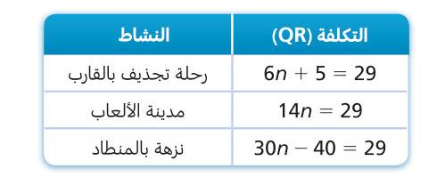

#### أولًا: اختر الإجابة الصحيحة (أسئلة محوّلة)

1. أيّ قيمة من القيم الآتية للمتغيّر n تمثّل حلًّا للمعادلة 14n = 35؟
   - أ) 2
   - ب) 3
   - ج) 3.5
   - د) لا توجد قيمة منها تمثّل حلًّا
2. أيّ قيمة من القيم الآتية للمتغيّر h تمثّل حلًّا للمعادلة 24 ÷ h = 6؟
   - أ) 1
   - ب) 3
   - ج) 8
   - د) 4
3. حصلت مها على بطاقة هدايا بقيمة QR 21.00 وأنفقت منها QR 9.00. إذا كان x هو المبلغ الذي تريد إنفاقه ليُستعمل كامل قيمة البطاقة، فأيّ معادلة تمثّل هذا الموقف؟
   - أ) 21 = x + 9
   - ب) 21 = x − 9
   - ج) x = 21 + 9
   - د) 9 = x + 21
4. حصلت مها على بطاقة هدايا بقيمة QR 21.00 وأنفقت منها QR 9.00. استعمل المعادلة 21 = x + 9 لإيجاد المبلغ x الذي يجب أن تنفقه لتستعمل كامل قيمة البطاقة.
   - أ) QR 30.00
   - ب) QR 12.00
   - ج) QR 11.00
   - د) QR 13.00
5. كيف تعرف أنّ عددًا معطًى يجعل معادلةً ما صحيحةً؟
   - أ) أضرب العدد في المتغيّر ولا أحسب الطرف الآخر
   - ب) أجمع العدد إلى طرفَي المعادلة فقط
   - ج) أعوّض العدد مكان المتغيّر وأتحقّق من تساوي طرفَي المعادلة
   - د) أقارن العدد بأوّل رقمٍ في المعادلة
6. متى تكون المعادلة صحيحةً؟
   - أ) عندما تحتوي على متغيّرٍ فقط
   - ب) عندما يكون الطرف الأيسر أكبر من الأيمن
   - ج) عندما يكون للطرفين القيمة نفسها
   - د) عندما تحتوي على عمليّة جمعٍ فقط
7. هل b = 6 حلٌّ للمعادلة 8b = 48؟
   - أ) لا، لأنّ 8 × 6 = 54
   - ب) نعم، لأنّ 8 + 6 = 48
   - ج) لا، لأنّ 8 × 6 = 42
   - د) نعم، لأنّ 8 × 6 = 48
8. هل b = 6 حلٌّ للمعادلة 11 − b = 6؟
   - أ) نعم، لأنّ 11 − 6 = 6
   - ب) نعم، لأنّ 11 − 6 = 5
   - ج) لا، لأنّ 11 − 6 = 4
   - د) لا، لأنّ 11 − 6 = 5
9. هل b = 6 حلٌّ للمعادلة b + 3 = 9؟
   - أ) نعم، لأنّ 6 + 3 = 9
   - ب) لا، لأنّ 6 + 3 = 8
   - ج) لا، لأنّ 6 + 3 = 10
   - د) نعم، لأنّ 6 + 3 = 8
10. هل b = 6 حلٌّ للمعادلة 54 ÷ b = 9؟
   - أ) نعم، لأنّ 54 ÷ 6 = 8
   - ب) لا، لأنّ 54 ÷ 6 = 9
   - ج) لا، لأنّ 54 ÷ 6 = 8
   - د) نعم، لأنّ 54 ÷ 6 = 9
11. أيّ المعادلات الآتية يكون b = 6 حلًّا لها؟
   - أ) 11 − b = 6
   - ب) b + 3 = 8
   - ج) 8b = 56
   - د) 54 ÷ b = 9
12. يقول وليد إنّ حلّ المعادلة 7n = 45 هو n = 5. هل وليدٌ على صوابٍ؟
   - أ) لا، لأنّ 7 × 5 = 35 وليس 45
   - ب) نعم، لأنّ 7 × 5 = 45
   - ج) نعم، لأنّ 7 + 5 = 12
   - د) لا، لأنّ 7 × 5 = 40 وليس 45
13. يحتوي ميزانٌ ذو كفّتين على 3 مكعّباتٍ في إحدى كفّتيه و 11 مكعّبًا في الكفّة الأخرى. كم مكعّبًا يجب إضافته إلى الكفّة الأولى لتتوازن الكفّتان؟ (استعمل المعادلة 3 + c = 11)
   - أ) 7
   - ب) 8
   - ج) 9
   - د) 10

### الدرس 5-2: تطبيق خواص المساواة

#### رابعًا: أجب عن الأسئلة الآتية (مسائل وتفكير)

1. يمكنك استعمال خواصّ المساواة لكتابة معادلاتٍ متكافئةٍ. أيّ خاصّيّةٍ استعملت: 5m + 4 = 19 ثمّ 5m + 4 − 3 = 19 − 3؟
2. اذكر خاصّيّة المساواة المستعملة: 3t = 20 ثمّ 3t ÷ 2 = 20 ÷ 2
3. اذكر خاصّيّة المساواة المستعملة: n/6 = 9 ثمّ (n/6) × 5 = 9 × 5
4. اذكر خاصّيّة المساواة المستعملة: 5b − 6 = 14 ثمّ (5b − 6) + 2 = 14 + 2
5. كيف يمكنك استعمال خواصّ المساواة لكتابة معادلاتٍ متكافئةٍ؟
6. يبيّن ميزانٌ ذو كفّتين المعادلة 12 = 7 + 5، إذا أنقصنا 4 وحداتٍ من إحدى الكفّتين، ما الذي يجب عمله بالكفّة الأخرى لإبقاء الميزان متوازنًا؟
7. أجب بـ "نعم" أو "لا". إذا كان 23 + 37 = 60، فهل 23 + 37 + 9 = 60 + 9 صحيحةً؟
8. إذا كان 16 + 1 = 17، فهل المعادلة (16 + 1) − 1 = 17 − 2 صحيحةً؟
9. إذا كان r + 9 = 42، فهل المعادلة r + 9 − 9 = 42 + 9 صحيحةٌ؟ لماذا؟
10. إذا كان 6s = 24، فهل المعادلة 6s ÷ 6 = 24 ÷ 6 صحيحةٌ؟ لماذا؟
11. كان هذا الميزان متوازنًا. أوجد العدد الذي يجب إضافته إلى الكفّة العليا ليتوازن الميزان من جديدٍ، ثمّ أكمل المعادلة لتصبح صحيحةً: 12 + ؟ = 2 + 7 + 3 + 16
   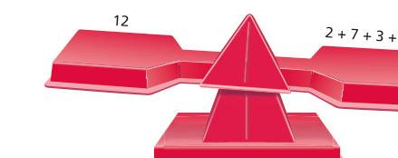
12. توازن هذا الميزان عند وضع 3 مكعّباتٍ خضراء في إحدى كفّتيه ووضع المكعّب x الأزرق في الكفّة الأخرى. أوجد العدد الذي يجب الضرب فيه لجعل الميزان متوازنًا، ثمّ أكمل المعادلة لتصبح صحيحةً: 15 = ؟ · x
   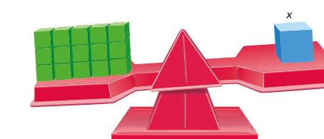
13. كتبت المعادلة 8x = 24، وغيّر صديقك هذه المعادلة كما يأتي: 8x = 24 ÷ 4. كيف يمكن جعل معادلة صديقك مكافئةً للمعادلة التي كتبتها؟
14. توازن ميزانٌ حين يوضع المكعّب x الأزرق و 20 مكعّبًا أخضر في كفّته اليسرى و 40 مكعّبًا أخضر في كفّته اليمنى. اصطدم أحد الطلّاب بالميزان وأسقط بعض المكعّبات منه بحيث بقي المكعّب x الأزرق و 3 مكعّباتٍ خضراء في الكفّة اليسرى. ما عدد المكعّبات التي يجب إنقاصها من اليمنى لكي يتوازن الميزان من جديدٍ؟
15. إذا ضربنا أحد طرفي المعادلة 66 = 23 + 43 في العدد 3، ما الذي يجب عمله في الطرف الآخر من المعادلة لإبقاء الطرفين متساويين؟
16. إذا أضفنا العدد 9 إلى أحد طرفي المعادلة 8 = x + 5 وأضفنا (4 + 5) إلى الطرف الآخر، فهل تبقى المعادلة صحيحةً؟
17. طبّق خاصّيّة الضرب للمساواة لكتابة معادلةٍ مكافئةٍ للمعادلة 7n = 28.
18. يقول عليٌّ إنّه إذا قسم أحد طرفي المعادلة 6m = 9 على 2 وقسم الطرف الآخر على 3، فإنّ المعادلة تبقى صحيحةً لأنّ النتيجة هي 3m = 3. هل هو على صوابٍ؟

#### أولًا: اختر الإجابة الصحيحة (أسئلة محوّلة)

1. كيف تكتب معادلاتٍ متكافئةً باستعمال خواصّ المساواة؟
   - أ) بإجراء العمليّة نفسها وبالعدد نفسه على طرفَي المعادلة
   - ب) بإجراء عمليّةٍ على الطرف الأيسر فقط
   - ج) بتغيير إشارة الطرف الأيمن فقط
   - د) بتبديل مكان المتغيّر مع أيّ عددٍ
2. إذا كان 23 + 37 = 60، فهل المعادلة 23 + 37 + 9 = 60 + 9 صحيحةٌ؟
   - أ) نعم، لأنّ 9 أُضيف إلى الطرفين
   - ب) لا، لأنّ 9 أُضيف إلى الطرفين
   - ج) لا، لأنّ 9 أُضيف إلى طرفٍ واحدٍ فقط
   - د) نعم، لأنّ 9 طُرح من الطرفين
3. إذا كان 16 + 1 = 17، فهل المعادلة (16 + 1) − 1 = 17 − 2 صحيحةٌ؟
   - أ) نعم، لأنّ العمليّة أُجريت على الطرفين
   - ب) نعم، لأنّ 17 − 2 = 15
   - ج) لا، لأنّ العدد المطروح من الطرفين غير متساوٍ (1 و 2)
   - د) لا، لأنّ الطرف الأيسر يساوي 17
4. إذا كان r + 9 = 42، فهل المعادلة r + 9 − 9 = 42 + 9 صحيحةٌ؟
   - أ) نعم، لأنّ العدد 9 نفسه استُعمل في الطرفين
   - ب) لا، لأنّ 42 + 9 = 52
   - ج) نعم، لأنّ r + 9 − 9 = r
   - د) لا، لأنّ 9 طُرح من الطرف الأيسر وأُضيف إلى الطرف الأيمن
5. إذا كان 6s = 24، فهل المعادلة 6s ÷ 6 = 24 ÷ 6 صحيحةٌ؟
   - أ) نعم، لأنّ الطرفين قُسما على العدد 6 نفسه
   - ب) لا، لأنّ 24 ÷ 6 = 3
   - ج) لا، لأنّ القسمة لا تُجرى على المعادلات
   - د) نعم، لأنّ الطرفين ضُربا في 6
6. كتبتَ المعادلة 8x = 24، وغيّر صديقك المعادلة إلى 8x = 24 ÷ 4. كيف يمكن جعل معادلة صديقك مكافئةً لمعادلتك؟
   - أ) بقسمة الطرف الأيسر 8x على 4 أيضًا
   - ب) بضرب الطرف الأيسر في 4
   - ج) بطرح 4 من الطرف الأيسر
   - د) بجمع 4 إلى الطرف الأيسر
7. ميزان متوازن في إحدى كفّتيه 12 وفي الأخرى 2 + 7 + 3 + 16. ما العدد الذي يجب إضافته إلى الكفّة الأولى ليتوازن الميزان من جديد؟ أي أكمل: 12 + ؟ = 2 + 7 + 3 + 16
   - أ) 16
   - ب) 12
   - ج) 28
   - د) 4
8. ميزان متوازن عندما تعادل 3 مكعّبات خضراء المكعّب الأزرق x. بأيّ عدد نضرب طرفي المعادلة 3 = x لنحصل على 15 = ؟ · x؟
   - أ) 5
   - ب) 3
   - ج) 12
   - د) 15
9. في الانتقال من المعادلة x + 5 = 12 إلى x + 5 − 5 = 12 − 5، أيّ خاصّيّة من خواصّ المساواة استُعملت؟
   - أ) خاصّيّة الطرح للمساواة
   - ب) خاصّيّة الجمع للمساواة
   - ج) خاصّيّة الضرب للمساواة
   - د) خاصّيّة القسمة للمساواة
10. في الانتقال من المعادلة 4y = 20 إلى 4y ÷ 4 = 20 ÷ 4، أيّ خاصّيّة من خواصّ المساواة استُعملت؟
   - أ) خاصّيّة الطرح للمساواة
   - ب) خاصّيّة القسمة للمساواة
   - ج) خاصّيّة الجمع للمساواة
   - د) خاصّيّة الضرب للمساواة

### الدرس 5-3: كتابة وحل معادلات الجمع والطرح

#### رابعًا: أجب عن الأسئلة الآتية (مسائل وتفكير)

1. كيف يمكنك كتابة وحلّ معادلة جمعٍ أو طرحٍ؟
2. حلّ المعادلة: 24 + m = 49
3. حلّ المعادلة: 12 = y − 11
4. حلّ المعادلة: 22 = 13 + a
5. حلّ المعادلة: t − 40 = 3
6. حلّ المعادلة: d + 11 = 15
7. حلّ المعادلة: 32 = s − 19
8. حلّ المعادلة: y − 12 = 89
9. حلّ المعادلة: 80 + r = 160
10. حلّ المعادلة: 60 = x − 16
11. حلّ المعادلة: 20 = y + 12
12. حلّ المعادلة: x + 2 = 19
13. حلّ المعادلة: z − 313 = 176
14. اشرح كيف تستعمل العلاقة العكسيّة بين الجمع والطرح لحلّ المعادلة n + 7 = 25.
15. لدى هندٍ t من الكتب. اشترت 8 كتبٍ أخرى فأصبح لديها 24 كتابًا. اكتب معادلةً وحلّها لإيجاد عدد الكتب التي كانت لدى هندٍ في البداية.
16. انخفضت درجة الحرارة في الخارج بمقدار 20°F منذ وقت تناولت ريمُ إفطارها حتّى وقت تناولها العشاء. عندما تناولت ريمُ العشاء كانت درجة الحرارة 35°F، اكتب معادلةً وحلّها لإيجاد درجة الحرارة t في الخارج أثناء تناول ريمُ الإفطار.
17. لديك عددٌ من بطاقات الألعاب. أعطيت 21 بطاقةً لأحد أصدقائك فبقيت لديك 9 بطاقاتٍ. كم بطاقةً كانت لديك؟ اكتب وحلّ معادلةً لإيجاد عدد البطاقات t التي كانت لديك في البداية.
18. أضافت جميلة 26 جهة اتّصالٍ جديدةً إلى قائمة هاتفها. لديها الآن 100 جهة اتّصالٍ. افترض أنّ c يمثّل عدد جهات الاتّصال التي كانت في قائمة هاتف جميلة قبل أن تقوم بتحديثها. اكتب معادلةً وحلّها لإيجاد قيمة c.
19. اشترى راشدٌ قلمًا وممحاةً بمبلغ QR 7. ثمن الممحاة QR 1.75. حلّ المعادلة 7 = s + 1.75 لإيجاد قيمة s التي تمثّل ثمن القلم الذي اشتراه راشدٌ.

#### أولًا: اختر الإجابة الصحيحة (أسئلة محوّلة)

1. كيف تحلّ معادلة جمعٍ مثل n + 7 = 25؟
   - أ) أجمع 7 إلى الطرفين
   - ب) أقسم الطرفين على 7
   - ج) أضرب الطرفين في 7
   - د) أطرح 7 من الطرفين
2. أيّ علاقةٍ عكسيّةٍ تستعملها لحلّ المعادلة n + 7 = 25؟
   - أ) الطرح لأنّه عكس الجمع
   - ب) الضرب لأنّه عكس القسمة
   - ج) الجمع لأنّه عكس الطرح
   - د) القسمة لأنّها عكس الجمع
3. ما قيمة n التي تحلّ المعادلة n + 7 = 25؟
   - أ) 32
   - ب) 17
   - ج) 18
   - د) 19

### الدرس 5-4: كتابة وحل معادلات الضرب والقسمة

#### رابعًا: أجب عن الأسئلة الآتية (مسائل وتفكير)

1. كيف يمكنك كتابة وحلّ معادلة ضربٍ أو قسمةٍ؟
2. ما خاصّيّة المساواة التي ستستعملها لحلّ المعادلة 8n = 16؟
3. ما خاصّيّة المساواة التي ستستعملها لحلّ المعادلة a ÷ 9 = 2؟
4. اشرح طريقة حلّ المعادلة: 18m = 36
5. اشرح طريقة حلّ المعادلة: t ÷ 3 = 10
6. اشرح طريقة حلّ المعادلة: 12 = 2y
7. اشرح طريقة حلّ المعادلة: 22 = a ÷ 5
8. وضّح كيفيّة إيجاد قيمة المتغيّر في المعادلة: 8y = 56
9. وضّح كيفيّة إيجاد قيمة المتغيّر في المعادلة: t ÷ 15 = 3
10. وضّح كيفيّة إيجاد قيمة المتغيّر في المعادلة: u ÷ 8 = 12
11. وضّح كيفيّة إيجاد قيمة المتغيّر في المعادلة: 31y = 310
12. حلّ المعادلة: d ÷ 2 = 108
13. حلّ المعادلة: 7 200 = 800s
14. حلّ المعادلة: x ÷ 3 = 294
15. حلّ المعادلة: 99 = 3x
16. يوجد 30 طالبًا في نادي المسرح، وهم يتنقّلون معًا في 5 سيّاراتٍ، تتّسع كلّ سيّارةٍ منها لنفس العدد من الطلّاب ليمثّلوا مسرحيّةً. افترض أنّ s يساوي عدد الطلّاب في كلّ سيّارةٍ. اكتب وحلّ معادلة ضربٍ لإيجاد عدد الطلّاب في كلّ سيّارةٍ.
17. حلّ المعادلة: 23d = 2 392
18. حلّ المعادلة: 74f = 6 179
19. حلّ المعادلة: y ÷ 11 = 987
20. حلّ المعادلة: r ÷ 187 = 9
21. اكتب معادلة قسمةٍ ومعادلة ضربٍ لتمثيل المسألة. طبعت مها 1 125 كلمةً في 15 دقيقةً. افترض أنّ w يمثّل عدد الكلمات المطبوعة في الدقيقة. إذا طبعت مها نفس العدد من الكلمات في الدقيقة، فكم كلمةً طبعت مها في الدقيقة؟
22. جنى سالمٌ في 12 أسبوعًا QR 4 500 من عمله في أحد المتاجر، وهو يجني نفس المبلغ كلّ أسبوعٍ. افترض أنّ m يمثّل المبلغ الذي يجنيه سالمٌ في الأسبوع. كم يجني سالمٌ في الأسبوع؟
23. لدى خالدٍ 3 330 عود أسنانٍ، ويريد استعمالها جميعها لصنع شكلٍ مكوّنٍ من 18 صفًّا متساويًا. استعمل لوحة الأجزاء لكتابة معادلة قسمةٍ. ثمّ حلّ المعادلة لإيجاد عدد عيدان الأسنان التي يجب أن يستعملها خالدٌ في كلّ صفٍّ. افترض أنّ t يمثّل عيدان الأسنان في كلّ صفٍّ.
24. ذهبت فاطمة في رحلةٍ بالطائرة. قطعت طائرتها نفس العدد من الكيلومترات في كلّ ساعةٍ. افترض أنّ m يمثّل عدد الكيلومترات التي قطعتها الطائرة في كلّ ساعةٍ. اكتب معادلةً لتمثيل طريقة يمكنك استعمالها لإيجاد عدد الكيلومترات التي قطعتها طائرة فاطمة في كلّ ساعةٍ. (مدّة الرحلة 12 ساعةً ومسافتها 2 184 كيلومترًا)

#### أولًا: اختر الإجابة الصحيحة (أسئلة محوّلة)

1. ما خاصّيّة المساواة التي ستستعملها لحلّ المعادلة 8n = 16؟
   - أ) خاصّيّة المساواة للجمع
   - ب) خاصّيّة المساواة للقسمة
   - ج) خاصّيّة المساواة للطرح
   - د) خاصّيّة المساواة للضرب
2. ما خاصّيّة المساواة التي ستستعملها لحلّ المعادلة a ÷ 9 = 2؟
   - أ) خاصّيّة المساواة للطرح
   - ب) خاصّيّة المساواة للقسمة
   - ج) خاصّيّة المساواة للجمع
   - د) خاصّيّة المساواة للضرب
3. ما حلّ المعادلة 18m = 36؟
   - أ) m = 18
   - ب) m = 54
   - ج) m = 2
   - د) m = 3
4. ما حلّ المعادلة t ÷ 3 = 10؟
   - أ) t = 3
   - ب) t = 13
   - ج) t = 7
   - د) t = 30
5. ما حلّ المعادلة 12 = 2y؟
   - أ) y = 24
   - ب) y = 10
   - ج) y = 14
   - د) y = 6
6. ما حلّ المعادلة 22 = a ÷ 5؟
   - أ) a = 4.4
   - ب) a = 17
   - ج) a = 27
   - د) a = 110
7. ما الخطوة التي تستعملها لإيجاد قيمة y في المعادلة 8y = 56؟
   - أ) ضرب الطرفين في 8
   - ب) جمع 8 إلى الطرفين
   - ج) طرح 8 من الطرفين
   - د) قسمة الطرفين على 8
8. ما الخطوة التي تستعملها لإيجاد قيمة t في المعادلة t ÷ 15 = 3؟
   - أ) قسمة الطرفين على 15
   - ب) ضرب الطرفين في 15
   - ج) طرح 15 من الطرفين
   - د) جمع 15 إلى الطرفين
9. ما قيمة u في المعادلة u ÷ 8 = 12؟
   - أ) 4
   - ب) 20
   - ج) 1.5
   - د) 96
10. ما قيمة y في المعادلة 31y = 310؟
   - أ) 10
   - ب) 279
   - ج) 341
   - د) 9 610
11. لدى خالدٍ 3 330 عود أسنانٍ يريد استعمالها جميعها لصنع شكلٍ مكوّنٍ من 18 صفًّا متساويًا. إذا كان t عدد عيدان الأسنان في كلّ صفٍّ، فأيّ معادلة تمثّل هذا الموقف؟
   - أ) 18 + t = 3 330
   - ب) 18t = 3 330
   - ج) t − 18 = 3 330
   - د) t ÷ 3 330 = 18
12. لدى خالدٍ 3 330 عود أسنانٍ يريد استعمالها جميعها لصنع شكلٍ مكوّنٍ من 18 صفًّا متساويًا. كم عود أسنانٍ يجب أن يستعمل في كلّ صفٍّ؟
   - أ) 175
   - ب) 195
   - ج) 185
   - د) 205

### الدرس 5-5: كتابة وحل معادلات تتضمن أعدادًا نسبية

#### رابعًا: أجب عن الأسئلة الآتية (مسائل وتفكير)

1. ألقت هندٌ فكرةً: كيف يمكنك كتابة وحلّ معادلاتٍ تتضمّن أعدادًا نسبيّةً؟ حلّ المعادلة m + 5.43 = 9.28.
2. حلّ المعادلة: y − 6.2 = 2.9
3. حلّ المعادلة: x ÷ 2.5 = 40
4. أنفقت هندٌ QR 12.50 لشراء دفترٍ وفرجارٍ. إذا كان ثمن الدفتر QR 6.35، اكتب معادلةً وحلّها لإيجاد ثمن الفرجار، c.
5. حلّ المعادلة: t − 2/3 = 25 3/4
6. حلّ المعادلة: f/2 = 5/8
7. حلّ المعادلة: 13.27 = t − 24.45
8. حلّ المعادلة: r ÷ 5.5 = 18.2
9. حلّ المعادلة: 7/10 = x − 3/5
10. حلّ المعادلة: 1.8x = 40.14
11. حلّ المعادلة: 17.3 + v = 22.32
12. حلّ المعادلة: 9 = 3/8 y
13. حلّ المعادلة: 1 3/4 + z = 2 2/3
14. حلّ المعادلة: w − 3.2 = 5.6
15. حلّ المعادلة: 9.6 = 1.6y
16. حلّ المعادلة: 48.55 + k = 61.77
17. حلّ المعادلة: m ÷ 3.54 = 1.5
18. حلّ المعادلة: 7 1/9 = 2 4/5 + m
19. حلّ المعادلة: a + 3 1/4 = 5 2/9
20. حلّ المعادلة: 1/8 · y = 4
21. حلّ المعادلة: k − 6 3/8 = 4 6/7
22. لماذا تعدّ العلاقات العكسيّة مهمّةً لحلّ المعادلات؟
23. يقول جاسمٌ إنّه حلّ المعادلة x − 3.5 = 7.2 بإضافة 3.5 إلى الطرف الأيسر من المعادلة. اشرح ما إذا كان ما فعله جاسمٌ صحيحًا.
24. ما أوجه الشبه بين حلّ معادلةٍ تتضمّن كسورًا اعتياديّةً وحلّ معادلةٍ تتضمّن أعدادًا كليّةً؟ وما أوجه الاختلاف؟
25. اشترى منصورٌ له ولعائلته 4 تذاكر لزيارة الحديقة المائيّة. إذا كانت التكلفة الكلّيّة لهذه التذاكر QR 210، اكتب معادلةً وحلّها لإيجاد سعر التذكرة الواحدة.
26. أطول قفزةٍ سجّلها فريقٌ في إحدى المدارس الثانويّة كانت 21 قدمًا و 2 1/4 إنش. أطول قفزةٍ سجّلها سامرٌ هذا العام كانت 20 قدمًا و 9 1/2 إنش. إذا كان قياس القفزات الطويلة يُسجّل مقرّبًا إلى أقرب ربع إنش، بكم إنش يجب أن تكون قفزة سامرٍ أطول ليتمكّن من كسر الرقم القياسيّ لهذه المدرسة الثانويّة؟ (القدم يساوي 12 إنش)
28. هل حلّ b × 5/6 = 25 أكبر أم أصغر من 25؟ كيف يمكنك معرفة ذلك من دون حلّ المعادلة؟
29. ما عرض مستطيلٍ طوله 3/7 قدمٍ ومساحته 2 قدمٍ مربّعةٍ؟ اكتب معادلةً لتوضيح حلّك.
30. تملأ هندٌ بركة السباحة الموضّحة لأخيها الصغير. تستطيع هندٌ أن تحمل 1 7/8 جالونًا من الماء في المرّة الواحدة. اكتب معادلةً وحلّها لإيجاد عدد المرّات التي تحتاجها هندٌ لملء البركة. (سعة البركة 10 1/2 جالونات)
31. بعدما امتلأت بركة السباحة، قفز أخو هندٍ وصديقه فيها فانسكب المقدار g من جالونات الماء خارج البركة، وبقي فيها 7 7/8 جالونات من الماء. اكتب معادلةً وحلّها لإيجاد مقدار الماء الذي تناثر خارج بركة السباحة.
32. من دون إجراء عمليّاتٍ حسابيّةٍ، حدّد المعادلة التي إجابتها هي الأكبر قيمةً. 5/8 m = 2 3/4 أو 5/9 m = 2 3/4

#### أولًا: اختر الإجابة الصحيحة (أسئلة محوّلة)

1. أطول قفزةٍ لفريق مدرسة 21 ft و 2 1/4 in، وأطول قفزة لسامر 20 ft و 9 1/2 in (القدم 12 إنشًا). ما الفرق بين الرقمين؟
   - أ) 4 1/4 in
   - ب) 5 in
   - ج) 4 3/4 in
   - د) 11 3/4 in

### الدرس 5-6: فهم وكتابة المتباينات

#### أولًا: اختر الإجابة الصحيحة

1. الوزن الأقصى، w، الذي يمكن لمصعدٍ أن يحمله يساوي 2 200 باوند. أيّ من المتباينات أدناه تمثّل الموقف؟
   - أ) w ≥ 2 200
   - ب) w > 2 200
   - ج) w ≤ 2 200
   - د) w < 2 200

#### رابعًا: أجب عن الأسئلة الآتية (مسائل وتفكير)

2. اكتب متباينةً لتمثيل كلّ موقفٍ. عدد الأشخاص، p، الذين تتّسع لهم حافلةٌ صغيرةٌ هو 12 شخصًا على الأكثر.
3. عدد أيّام سطوع الشمس، d، لا يساوي 28.
4. مسافة السباق، r، أكبر من 6.2 كيلومتر.
5. سعر السوار، v، أقلّ من 85.25 ريالًا.
6. عدد الأشخاص، p، الذين يمكن لمطعمٍ استيعابهم في نفس الوقت لا يزيد عن 171 شخصًا.
7. الزمن، t، الذي سجّله عدّاد موقف سيّاراتٍ للمدّة المتبقّية لوقوف إحدى السيّارات هو 25 دقيقةً على الأقلّ.
8. قيمة الفاتورة، b، أقلّ من 45 ريالًا.
9. صديقان يفصل بين منزليهما b تقاطعٍ، لكن لا يفصل بين منزليهما 7 1/2 تقاطعٍ.
10. يجب ألّا تكون سرعة الشاحنة، s، أقلّ من 34 كيلومترًا في الساعة.
11. عدد مباريات كرة السلّة، x، التي حضرها نادرٌ في العام الماضي أكثر من 5 مباريات.
12. عدد الطلّاب، s، الذين يستعملون الحافلة للذهاب إلى المدرسة يمكن أن يصل إلى 30 شخصًا كحدٍّ أقصى. اكتب متباينةً تمثّل هذا الموقف.
13. سيفٌ أطول من عيسى. إذا كان m يمثّل طول سيفٍ و g يمثّل طول عيسى، اكتب متباينةً توضّح العلاقة بين طوليهما.
14. باعت علياء 15 لفافةً من ورق تغليف الهدايا. اكتب متباينةً لتمثيل المبلغ، d، الذي جمعته علياء. (QR 8.00 لكلّ لفافةٍ)
15. شهدت إحدى المدن هطول أكبر كمّيّةٍ من الثلج في يومٍ واحدٍ في تاريخها. اكتب متباينةً تمثّل نسبة هطول الثلج أكبر من هذا الرقم القياسيّ. (الرقم القياسيّ 19.7 إنش من الثلج)
16. تستوعب خزانة الكتب الأولى في مكتبةٍ، عددًا من الكتب، a، أقلّ بكتابٍ واحدٍ من العدد الموجود في خزانة الكتب الثانية التي تستوعب 2 492 كتابًا. اكتب متباينةً لتمثّل عدد الكتب التي يمكن أن تستوعبها الخزانة الأولى.
17. طائرةٌ لا يمكنها أن تحمل أكثر من 134 راكبًا في إحدى الرحلات. اكتب متباينةً لتمثيل عدد الركّاب، p، الذين لن يسمح لهم بركوب الطائرة في هذه الرحلة.
18. يجني خليفة أموالًا إضافيّةً بالعمل مع والده يومين في الأسبوع أثناء عطلة نهاية الأسبوع، وهو يدّخر المال الذي يكسبه لشراء لعبة جديدةٍ تكلفتها 140 ريالًا. يقول منصورٌ إنّ خليفة يحتاج إلى جني أكثر من 6.00 ريالات في الساعة ليدّخر المبلغ الكافي لشراء اللعبة. حلّ منصور موضّحٌ أدناه: الأسبوع 1: 16 ساعةً، الأسبوع 2: 7 ساعاتٍ، المجموع 23 ساعةً؛ 140 ÷ 23 ≥ 6.00. استعمل متباينةً لتبيّن الخطأ في حلّ منصورٍ.
19. الرقم القياسيّ المسجّل لأكبر عددٍ من لفائف ورق التغليف التي تمّ بيعها في أحد المتاجر هو 593؛ افترض أنّ w يمثّل عدد لفائف التغليف التي تمّ بيعها. اكتب متباينةً تمثّل القيم التي يمكن أن تحطّم الرقم القياسيّ الذي سجّله المتجر.
20. لركوب عربة أفغوانيةٍ، يجب ألّا يكون طول الراكب أقلّ من 106 سنتمتر. لتمثيل هذا الموقف، كتب حمدان: h ≥ 106، وكتب جاسمٌ: h > 106. أيّهما على صوابٍ؟

#### أولًا: اختر الإجابة الصحيحة (أسئلة محوّلة)

1. لا يمكن لطائرةٍ أن تحمل أكثر من 134 راكبًا. أيّ متباينةٍ تمثّل عدد الركّاب p المسموح بهم؟
   - أ) p > 134
   - ب) p ≥ 134
   - ج) p < 134 فقط
   - د) p ≤ 134
2. باعت علياء 15 لفافةً من ورق تغليف الهدايا، وسعر اللفافة الواحدة QR 8.00. كم ريالًا جمعت علياء؟
   - أ) QR 23
   - ب) QR 80
   - ج) QR 120
   - د) QR 150
3. لا يزيد عدد الطلّاب s في الحافلة على 40 طالبًا. أيّ متباينة تمثّل الموقف؟
   - أ) s ≤ 40
   - ب) s ≥ 40
   - ج) s < 40
   - د) s > 40
4. يجب أن يكون عمر المشارك a أكبر من 12 سنة. أيّ متباينة تمثّل الموقف؟
   - أ) a > 12
   - ب) a < 12
   - ج) a ≥ 12
   - د) a ≤ 12

### الدرس 5-7: حل المتباينات

#### رابعًا: أجب عن الأسئلة الآتية (مسائل وتفكير)

5. اذكر ثلاثة حلولٍ ممكنةٍ لكلّ من المتباينات التالية: x > 10.5
6. اذكر ثلاثة حلولٍ ممكنةٍ لكلّ من المتباينات التالية: r < 19
7. اذكر ثلاثة حلولٍ ممكنةٍ لكلّ من المتباينات التالية: y ≥ 200
8. اذكر ثلاثة حلولٍ ممكنةٍ لكلّ من المتباينات التالية: m ≤ 82
9. اذكر ثلاثة حلولٍ ممكنةٍ لكلّ من المتباينات التالية: x ≥ 12
10. اذكر ثلاثة حلولٍ ممكنةٍ لكلّ من المتباينات التالية: q ≤ 3.5
11. اذكر ثلاثة حلولٍ ممكنةٍ لكلّ من المتباينات التالية: v > 35
12. اذكر ثلاثة حلولٍ ممكنةٍ لكلّ من المتباينات التالية: m < 2.5
13. تصف المتباينة w ≤ 1 500 الحمولة القصوى بالكيلوجرام، w، لمصعدٍ مخصّصٍ لنقل البضائع. هل يمكن استعمال المصعد لنقل حمولةٍ تزن 1 505 كيلوجراماتٍ أو 1 600 كيلوجرامٍ؟
14. مثّل على خطّ الأعداد نفسه المتباينتين x < 2 و x > 2. ما القيمة التي ليست حلًّا لكلتا المتباينتين، إن وجدت؟
15. منذ بدء تسجيل درجات الحرارة في إحدى المناطق الصحراويّة، كانت أعلى درجة حرارةٍ تمّ تسجيلها 134°F، أمّا أدناها فكانت 15°F، اكتب متباينتين تمثّلان درجات الحرارة بالفهرنهايت، في تلك المنطقة منذ بدء تسجيل درجات الحرارة فيها.
17. يجب أن تكون درجة حرارة البيوت البلاستيكيّة المخصّصة للزراعة 65°F أو أعلى. اكتب متباينةً تمثّل درجات الحرارة المسموح بها في البيوت البلاستيكيّة.
18. الحمولة القصوى لطائرةٍ صغيرةٍ هي 400 كيلوجرامٍ. ليكن w حمولة هذه الطائرة. اكتب متباينةً تمثّل الوزن المسموح به على متن الطائرة.
19. فكّر عبد المجيد في عدد كلّيٍّ أكبر من 21، ما الأعداد التي تجعل المتباينة n > 21 صحيحةً، إن وجدت، إذا كان: n = 0, 1, 2, 3, 4, ...؟
20. بدأت هندٌ بتمثيل المتباينة y < 3.7 على خطّ الأعداد. أكمل ترقيم خطّ الأعداد ثمّ مثّل المتباينة. (خطّ الأعداد من 3.0 إلى 4.0)
21. بدأ إبراهيمُ بتمثيل المتباينة x ≤ 25 على خطّ الأعداد. أكمل ترقيم خطّ الأعداد ثمّ مثّل المتباينة. (خطّ الأعداد من 20 إلى 30)

#### أولًا: اختر الإجابة الصحيحة (أسئلة محوّلة)

1. أيّ الأعداد الآتية حلٌّ للمتباينة x > 10.5؟
   - أ) 10
   - ب) 10.5
   - ج) 11
   - د) 9.5
2. أيّ الأعداد الآتية حلٌّ للمتباينة r < 19؟
   - أ) 20
   - ب) 19
   - ج) 18
   - د) 21
3. أيّ الأعداد الآتية حلٌّ للمتباينة y ≥ 200؟
   - أ) 199
   - ب) 190
   - ج) 150
   - د) 200
4. أيّ الأعداد الآتية حلٌّ للمتباينة m ≤ 82؟
   - أ) 83
   - ب) 85
   - ج) 82
   - د) 90
5. أيّ الأعداد الآتية حلٌّ للمتباينة x ≥ 12؟
   - أ) 12
   - ب) 11
   - ج) 9
   - د) 10
6. أيّ الأعداد الآتية حلٌّ للمتباينة q ≤ 3.5؟
   - أ) 3.5
   - ب) 3.6
   - ج) 4
   - د) 4.5
7. أيّ الأعداد الآتية حلٌّ للمتباينة v > 35؟
   - أ) 35
   - ب) 34
   - ج) 30
   - د) 36
8. أيّ الأعداد الآتية حلٌّ للمتباينة m < 2.5؟
   - أ) 2
   - ب) 3
   - ج) 2.5
   - د) 2.6
9. أيّ الأعداد الآتية حلٌّ للمتباينة x > 12.5؟
   - أ) 10
   - ب) 12
   - ج) 12.5
   - د) 13
10. أيّ الأعداد الآتية حلٌّ للمتباينة x ≤ 7؟
   - أ) 7.5
   - ب) 8
   - ج) 7
   - د) 9
11. أيّ الأعداد الآتية حلٌّ للمتباينة x < −2؟
   - أ) 0
   - ب) −2
   - ج) −3
   - د) −1
12. أيّ الأعداد الآتية حلٌّ للمتباينة x ≥ 4.5؟
   - أ) 4.4
   - ب) 4
   - ج) 5
   - د) 3
13. أيّ الأعداد الآتية حلٌّ للمتباينة x > 0.8؟
   - أ) 0.9
   - ب) 0.8
   - ج) 0.5
   - د) 0.3
14. أيّ الأعداد الآتية حلٌّ للمتباينة x ≤ −1؟
   - أ) 0
   - ب) −1
   - ج) −0.5
   - د) 2

### الدرس 5-8: فهم المتغيرات التابعة والمستقلة

#### رابعًا: أجب عن الأسئلة الآتية (مسائل وتفكير)

1. حدّد المتغيّر المستقلّ والمتغيّر التابع: عدد صفحات كتابٍ، p، ووزن هذا الكتاب، w.
2. حدّد المتغيّر المستقلّ والمتغيّر التابع: عدد الوجبات، h، المبيعة في أحد المطاعم، وعدد الريالات، r، التي جناها هذا المطعم.
3. حدّد المتغيّر المستقلّ والمتغيّر التابع: عدد كيلوجرامات الدقيق، p، التي تشتريها، وعدد الأرغفة، b، التي تريد خبزها.
4. حدّد المتغيّر المستقلّ والمتغيّر التابع: درجة حرارة الماء، t، وعدد الدقائق، m، التي بقي خلالها الماء في الثلّاجة.
5. اكتب موقفًا من تأليفك. حدّد المتغيّر المستقلّ والمتغيّر التابع في هذا الموقف.
6. سمّ متغيّرين مستقلّين على الأقلّ يمكن أن يؤذيا إلى تغيّر سعر سلّةٍ من التفّاح.
7. أنفقت c ريالاتٍ لشراء العدد p من نفس نوع البنطال. يقول أحد أصدقائك إنّ المتغيّر المستقلّ يمكن أن يكون c أو p لأنّ c يتزايد بتزايد p و p يتزايد بتزايد c. هل صديقك على صوابٍ؟
8. توجد علاقةٌ بين عدد ثمار البرتقال في كيسٍ وسعر كيس البرتقال. حدّد المتغيّر المستقلّ في هذه العلاقة.
9. يمثّل المتغيّر التابع g نموّ شتلةٍ. ما المتغيّرات التي يمكنها أن تمثّل المتغيّر المستقلّ في هذا الموقف؟
10. يعرض الجدول المسافات التي قطعتها عائلةٌ في كلّ يومٍ من أيّام العطلة: اليوم 1: 480 km، 2: 260 km، 3: 40 km، 4: 150 km، 5: 100 km، 6: 320 km. ما المتغيّر المستقلّ الذي قد يكون له أثرٌ في المسافة التي قطعتها العائلة كلّ يومٍ؟
11. سمّ متغيّرين مستقلّين على الأقلّ يمكن أن يؤثّرا في مقدار المال الذي تنفقه العائلة على شراء الوجبات خلال العطلة.
12. يتأثّر سعر صحن السلطة في مطعمٍ بعدّة عواملٍ. سمّ متغيّرين مستقلّين على الأقلّ يمكن أن يؤثّرا في سعر صحن السلطة.
13. قاد حامدٌ سيّارته من المدينة A إلى المدينة B، سمّ متغيّرين مستقلّين على الأقلّ يمكن أن يؤثّرا في عدد الأيّام التي استغرقها هذه الرحلة.
14. توجد علاقةٌ بين عدد الإجابات الخطأ في أحد اختبارات الرياضيّات والدرجة التي ينالها الطالب في هذا الاختبار. ما المتغيّر التابع في هذه العلاقة؟
15. تهتمّ نوالُ بكمّيّة الماء الذي تستهلكه في غسل ملابسها. أنشئ جدولًا لتعرض عدد جالونات الماء الذي تستهلكه غسّالاتٌ مختلفةٌ في دورة غسيلٍ كاملةٍ (غسّالة قديمة الطراز 40، غسّالة حديثة الطراز 27، غسّالة عالية الكفاءة 14 جالونًا). الجزء A: سمّ متغيّرين مستقلّين يمكن أن يؤثّرا في كمّيّة الماء التي تستهلكها نوال في غسل الملابس.
16. الجزء B: حدّد المتغيّر التابع والمتغيّر المستقلّ في الجملة التالية: سجّلت نوال التكلفة الكلّيّة، c، للماء المستهلك وعدد جالونات الماء، g، الذي تستهلكه.
17. اكتب موقفًا يكون فيه الزمن، t، متغيّرًا مستقلًّا. ثمّ اكتب موقفًا يكون فيه الزمن، t، متغيّرًا تابعًا.

#### أولًا: اختر الإجابة الصحيحة (أسئلة محوّلة)

1. توجد علاقةٌ بين عدد ثمار البرتقال في كيسٍ وسعر كيس البرتقال. ما المتغيّر المستقلّ في هذه العلاقة؟
   - أ) سعر الكيس
   - ب) وزن الكيس الفارغ
   - ج) لون الكيس
   - د) عدد ثمار البرتقال في الكيس
2. توجد علاقةٌ بين عدد الإجابات الخطأ في أحد اختبارات الرياضيّات والدرجة التي ينالها الطالب في هذا الاختبار. ما المتغيّر التابع في هذه العلاقة؟
   - أ) عدد الإجابات الخطأ
   - ب) الدرجة التي ينالها الطالب
   - ج) عدد الأسئلة الكلّيّ
   - د) زمن الاختبار
3. أنفقت سارة c ريالاتٍ لشراء العدد p من نفس نوع البنطال. أيّ العبارات الآتية صحيحة؟
   - أ) المتغيّر المستقلّ هو p لأنّ المبلغ c يعتمد على عدد البناطيل p
   - ب) المتغيّر المستقلّ هو c لأنّ c يتزايد بتزايد p
   - ج) كلا المتغيّرين مستقلّ في الوقت نفسه
   - د) كلا المتغيّرين تابع في الوقت نفسه
4. يمثّل المتغيّر التابع g نموّ شتلةٍ. أيّ مما يأتي يمكن أن يمثّل المتغيّر المستقلّ في هذا الموقف؟
   - أ) طول الشتلة بعد شهرٍ
   - ب) وزن الشتلة بعد النموّ
   - ج) كمّيّة الماء التي تُسقى بها الشتلة
   - د) عدد الأوراق بعد النموّ
5. قطعت عائلةٌ مسافاتٍ مختلفةً في أيّام العطلة: 480 km، 260 km، 40 km، 150 km، 100 km، 320 km. أيّ مما يأتي قد يكون متغيّرًا مستقلًّا يؤثّر في المسافة التي قطعتها العائلة كلّ يومٍ؟
   - أ) عدد ساعات القيادة في اليوم
   - ب) المسافة المقطوعة في اليوم نفسه
   - ج) المبلغ الذي أنفقته العائلة على الوقود
   - د) المسافة الكلّيّة في العطلة كلّها
6. أيّ مما يأتي لا يصلح أن يكون متغيّرًا مستقلًّا يؤثّر في سعر سلّةٍ من التفّاح؟
   - أ) سعر السلّة
   - ب) نوع التفّاح
   - ج) موسم قطف التفّاح
   - د) عدد حبّات التفّاح في السلّة
7. أيّ مما يأتي لا يصلح أن يكون متغيّرًا مستقلًّا يؤثّر في مقدار المال الذي تنفقه العائلة على الوجبات خلال العطلة؟
   - أ) عدد أفراد العائلة
   - ب) عدد أيّام العطلة
   - ج) نوع المطاعم التي تتناول العائلة وجباتها فيها
   - د) المبلغ الذي أنفقته العائلة على الوجبات
8. يتأثّر سعر صحن السلطة في مطعمٍ بعدّة عواملٍ. أيّ مما يأتي لا يصلح أن يكون متغيّرًا مستقلًّا في هذا الموقف؟
   - أ) مكوّنات الصحن
   - ب) سعر الصحن
   - ج) موقع المطعم
   - د) حجم الصحن
9. قاد حامدٌ سيّارته من المدينة A إلى المدينة B. أيّ مما يأتي متغيّرٌ مستقلٌّ يؤثّر في عدد الأيّام التي استغرقتها الرحلة؟
   - أ) عدد الأيّام التي استغرقتها الرحلة
   - ب) عدد ساعات القيادة في اليوم
   - ج) لون السيّارة
   - د) عدد أحرف اسم المدينة B
10. تهتمّ نوالُ بكمّيّة الماء التي تستهلكها في غسل ملابسها (غسّالة قديمة الطراز: 40 جالونًا، غسّالة حديثة الطراز: 27 جالونًا، غسّالة عالية الكفاءة: 14 جالونًا). أيّ مما يأتي متغيّرٌ مستقلٌّ يؤثّر في كمّيّة الماء؟
   - أ) عدد الجالونات المستهلكة
   - ب) نوع الغسّالة
   - ج) لون الغسّالة
   - د) التكلفة الكلّيّة للماء
11. سجّلت نوال التكلفة الكلّيّة c للماء المستهلك وعدد الجالونات g التي تستهلكها. ما المتغيّر المستقلّ وما المتغيّر التابع؟
   - أ) المستقلّ g والتابع c
   - ب) المستقلّ c والتابع g
   - ج) كلاهما مستقلّ
   - د) كلاهما تابع
12. حدّد المتغيّر المستقلّ والمتغيّر التابع: عدد ساعات المذاكرة h ودرجة الاختبار g.
   - أ) المستقلّ h والتابع g
   - ب) المستقلّ g والتابع h
   - ج) كلاهما مستقلّ
   - د) كلاهما تابع
13. حدّد المتغيّر المستقلّ والمتغيّر التابع: عدد الكيلومترات المقطوعة d وكمّية الوقود المستهلك f.
   - أ) المستقلّ d والتابع f
   - ب) المستقلّ f والتابع d
   - ج) كلاهما مستقلّ
   - د) كلاهما تابع
14. حدّد المتغيّر المستقلّ والمتغيّر التابع: عدد قطع الحلوى n وثمنها الكلّيّ c.
   - أ) المستقلّ n والتابع c
   - ب) المستقلّ c والتابع n
   - ج) كلاهما مستقلّ
   - د) كلاهما تابع
15. حدّد المتغيّر المستقلّ والمتغيّر التابع: عدد الأسابيع w ومبلغ المدّخرات s.
   - أ) المستقلّ w والتابع s
   - ب) المستقلّ s والتابع w
   - ج) كلاهما مستقلّ
   - د) كلاهما تابع
16. حدّد المتغيّر المستقلّ والمتغيّر التابع: طول جانب المربّع a ومحيطه p.
   - أ) المستقلّ a والتابع p
   - ب) المستقلّ p والتابع a
   - ج) كلاهما مستقلّ
   - د) كلاهما تابع

### الدرس 5-9: استعمال الأنماط لكتابة وحل المعادلات

#### رابعًا: أجب عن الأسئلة الآتية (مسائل وتفكير)

1. اكتب قاعدةً ومعادلةً تمثّل النمط في كلّ جدولٍ: x = 1, 2, 3, 4, 5 و y = 33, 34, 35, 36, 37.
2. اكتب قاعدةً ومعادلةً تمثّل النمط: m = 0, 1, 2, 3, 4 و n = 0, 3, 6, 9, 12.
3. اكتب معادلةً تمثّل أفضل وصفٍ للنمط في الجدول: w = 2, 4, 6, 8, 10 و z = 0, 2, 4, 6, 8.
4. اكتب معادلةً تمثّل أفضل وصفٍ للنمط في الجدول: x = 0, 1/2, 1, 1 1/2, 2, 2 1/2 و y = 0, 2, 4, 6, 8, 10.
5. استعمل المعادلة لإكمال الجدول. t = 5d + 5، حيث d = 0, 1, 2, 3, 4. ما قيم t؟
6. استعمل المعادلة لإكمال الجدول: y = 1/2 x − 1، حيث x = 2, 4, 6, 8, 10. ما قيم y؟
7. استعمل المعادلة لإكمال الجدول: y = 2x + 1، حيث x = 0, 1, 2, 3. ما قيم y؟
8. استعمل المعادلة لإكمال الجدول: b = a/2 − 2، حيث a = 17, 14, 11, 8, 5. ما قيم b؟
9. اكتب قاعدةً ومعادلةً تمثّل النمط في كلّ جدولٍ، ثمّ أكمل الجدول: g = 32, 37, 42, 47, 52 و k = 17, 22, 27, ؟, ؟.
10. اكتب قاعدةً ومعادلةً تمثّل النمط، ثمّ أكمل الجدول: x = 0, 9, 18, 27, 36 و y = 0, 1, 2, ؟, ؟.
11. احتفالًا بالذكرى الـ 125 لتأسيسها، أنتجت إحدى الشركات 125 دبًّا باهظ الثمن، حيث صنعت هذه الدبّة بخيوطٍ من الذهب وثبّتت قطعٍ من الألماس في مواضع عينيها. يبيّن الجدول التكلفة التقريبيّة لأعدادٍ مختلفةٍ من هذه الدبّة (العدد 4: QR 188 000، العدد 7: QR 329 000، العدد 11: QR 517 000). اكتب معادلةً يمكن استعمالها لإيجاد التكلفة، c، لعدد، n، من الدبّة.
12. حضرت ليلى إلى مهرجان الربيع، حيث يُدفع رسم دخولٍ ورسم مقابل ركوب كلّ لعبةٍ. أوجد النمط في الجدول لإيجاد التكلفة التي ستدفعها ليلى عند ركوبها اللعبة 5 مرّاتٍ و 8 مرّاتٍ، ثمّ اكتب معادلةً تمثّل النمط. (عدد مرّات ركوب اللعبة r: 3، 4، 5، 6، 8 والتكلفة c: QR 15.50، QR 18.00، ؟، QR 23.00، ؟)
13. أوجد التكلفة، c، لركوب اللعبة 12 مرّةً. (c = 8 + 2.50r)
14. يعرض الجدول أدناه التكلفة الكلّيّة، c، لعدد تذاكر السينما المشتراة، t. اكتب معادلةً يمكن استعمالها لإيجاد التكلفة، c، لخمس تذاكر. (عدد التذاكر 3، 5، 7، 9 والتكلفة QR 26.25، ؟، QR 61.25، QR 78.75)
15. كتبت مريمُ المعادلة h = d + 22 لتمثيل العلاقة الموضّحة في الجدول المجاور (h = 3, 5, 7, 9 و d = 33, 55, 77, 99). هل المعادلة صحيحةٌ؟

#### أولًا: اختر الإجابة الصحيحة (أسئلة محوّلة)

1. ما المعادلة التي تمثّل النمط في الجدول؟ x = 1, 2, 3, 4, 5 و y = 33, 34, 35, 36, 37
   - أ) y = x + 33
   - ب) y = 33x
   - ج) y = x − 32
   - د) y = x + 32
2. ما المعادلة التي تمثّل النمط في الجدول؟ m = 0, 1, 2, 3, 4 و n = 0, 3, 6, 9, 12
   - أ) n = m + 3
   - ب) n = 3m
   - ج) n = m ÷ 3
   - د) n = 3 − m
3. استعمل المعادلة t = 5d + 5 لإكمال الجدول عندما d = 0, 1, 2, 3, 4. ما قيم t؟
   - أ) 0, 5, 10, 15, 20
   - ب) 5, 6, 7, 8, 9
   - ج) 5, 10, 15, 20, 25
   - د) 10, 15, 20, 25, 30
4. ما المعادلة التي تمثّل النمط في الجدول؟ g = 32, 37, 42, 47, 52 و k = 17, 22, 27, ؟, ؟
   - أ) k = g − 15
   - ب) k = g + 15
   - ج) k = g ÷ 15
   - د) k = 15g
5. في الجدول g = 32, 37, 42, 47, 52 و k = 17, 22, 27, ؟, ؟ حيث k = g − 15. ما القيمتان الناقصتان لـ k؟
   - أ) 30 و 35
   - ب) 47 و 52
   - ج) 32 و 37
   - د) 31 و 36
6. ما المعادلة التي تمثّل النمط في الجدول؟ x = 0, 9, 18, 27, 36 و y = 0, 1, 2, ؟, ؟
   - أ) y = 9x
   - ب) y = x + 9
   - ج) y = x ÷ 9
   - د) y = x − 9
7. في الجدول x = 0, 9, 18, 27, 36 و y = 0, 1, 2, ؟, ؟ حيث y = x ÷ 9. ما القيمتان الناقصتان لـ y؟
   - أ) 3 و 4
   - ب) 27 و 36
   - ج) 4 و 5
   - د) 9 و 18
8. تدفع ليلى في مهرجان الربيع رسم دخولٍ ورسمًا مقابل كلّ ركوب لعبةٍ. تكلفة 3 مرّات QR 15.50، و 4 مرّات QR 18.00، و 6 مرّات QR 23.00. كم تدفع ليلى عند ركوبها اللعبة 5 مرّاتٍ؟
   - أ) QR 21.00
   - ب) QR 20.00
   - ج) QR 20.50
   - د) QR 19.50
9. تدفع ليلى في مهرجان الربيع رسم دخولٍ ورسمًا مقابل كلّ ركوب لعبةٍ. تكلفة 3 مرّات QR 15.50، و 4 مرّات QR 18.00، و 6 مرّات QR 23.00. ما المعادلة التي تمثّل التكلفة c لعدد المرّات r؟
   - أ) c = 2.5r + 8
   - ب) c = 8r + 2.5
   - ج) c = 2.5r
   - د) c = r + 12.5
10. يعرض الجدول تكلفة تذاكر السينما: 3 تذاكر QR 26.25، و 7 تذاكر QR 61.25، و 9 تذاكر QR 78.75. ما المعادلة التي تمثّل التكلفة c لعدد التذاكر t؟
   - أ) c = t + 23.25
   - ب) c = 8.75 + t
   - ج) c = 26.25t
   - د) c = 8.75t
11. يعرض الجدول تكلفة تذاكر السينما: 3 تذاكر QR 26.25، و 7 تذاكر QR 61.25، و 9 تذاكر QR 78.75. كم تكلفة 5 تذاكر؟
   - أ) QR 45.00
   - ب) QR 41.25
   - ج) QR 43.75
   - د) QR 52.50
12. كتبت مريمُ المعادلة h = d + 22 لتمثيل العلاقة في الجدول: h = 3, 5, 7, 9 و d = 33, 55, 77, 99. هل المعادلة صحيحةٌ؟
   - أ) نعم، لأنّ 33 − 3 = 30
   - ب) نعم، لأنّ 55 + 22 = 77
   - ج) لا، لأنّ h تساوي 11 مثل d
   - د) لا، لأنّ d تساوي 11 مثل h وليس h + 22
13. اكتب معادلة تصف النمط في الجدول: x = 1, 2, 3, 4, 5 و y = 7, 8, 9, 10, 11.
   - أ) y = x + 7
   - ب) y = x + 6
   - ج) y = 7x
   - د) y = x − 6

### الدرس 5-10: الربط بين الجداول والتمثيلات البيانية والمعادلات

#### رابعًا: أجب عن الأسئلة الآتية (مسائل وتفكير)

1. مستطيلٌ طوله أكبر من عرضه بمقدار 1/2 إنش. ليكن w العرض وليكن ℓ الطول. المعادلة ℓ = w + 1/2 تمثّل بيانيًّا. أكمل الجدول للعرض w = 1, 2, 3.
2. السعر في فترة التخفيضات أقلّ من السعر الأصليّ بمقدار QR 5. ليكن r السعر الأصليّ وليكن s السعر في فترة التخفيضات. المعادلة s = r − 5 تمثّل بيانيًّا. أكمل الجدول للسعر الأصليّ r = 10, 20, 30.
3. النقطتان (2 , 4) و (4 , 8) معيّنتان في المستوى الإحداثيّ باستعمال المعادلة y = a · x. كيف يمكنك استعمال هذه الإحداثيّات لإيجاد قيمة a؟
4. أوجد ثلاث نقاطٍ أخرى يمرّ بها التمثيل البيانيّ للمعادلة الواردة من دون استعمال جدولٍ أو تمثيلٍ بيانيٍّ.
5. تخطّط عائلة سلطان قضاء عطلة نهاية الأسبوع في إحدى المدن الساحليّة، وتنوي استئجار سيّارةٍ لهذا الغرض. ليكن m عدد الكيلومترات التي ستقطعها العائلة، وليكن c تكلفة استئجار السيّارة. اكتب معادلةً توضّح تكلفة استئجار السيّارة ثمّ مثّلها بيانيًّا. (عرض نهاية الأسبوع: QR 40 + QR 0.10 لكلّ كيلومترٍ)
6. اكتب معادلةً، أكمل الجدول ومثّل المعادلة بيانيًّا لحلّ المسألة. قطّةٌ صغيرةٌ وزنها 1 باوند. يزداد وزن القطّة الصغيرة بمقدار 1/2 باوند كلّ أسبوعٍ. كم سيصبح وزن القطّة بعد 4 أسابيع؟
7. تعطّلت آلة عرض الأفلام أثناء عرض فيلمٍ صباحيٍّ، فأعاد مدير صالة السينما ثمن التذاكر إلى كلّ الحاضرين. افترض أنّ n يمثّل عدد الأشخاص الذين كانوا يشاهدون الفيلم وأنّ r يمثّل المبلغ الكلّيّ للمبلغ المعاد. اكتب معادلةً لتمثيل المبلغ المعاد. (أسعار تذاكر السينما: العروض الصباحيّة QR 5.00)
8. كتب رامز المعادلتين y = x + 2 و y = 2x. الجزء A: أيّ المعادلتين تعبّر عن التمثيل البيانيّ المجاور؟ (الخطّ يمرّ بالنقطتين (1 , 2) و (3 , 6))
9. الجزء B: صف العلاقة بين المتغيّرات في التمثيل البيانيّ والمعادلة. (y = 2x)
10. اكتب معادلةً جبريّةً تطابق القيم الموضّحة في الجدول المجاور: x = 1, 2, 3, 4 و y = 8, 11, 14, 17.

#### أولًا: اختر الإجابة الصحيحة (أسئلة محوّلة)

1. مستطيلٌ طوله أكبر من عرضه بمقدار 1/2 إنش، والمعادلة ℓ = w + 1/2. ما قيم الطول ℓ عندما w = 1, 2, 3؟
   - أ) 1/2, 1, 1 1/2
   - ب) 1 1/2, 2 1/2, 3 1/2
   - ج) 2, 4, 6
   - د) 1/2, 1/2, 1/2
2. السعر في فترة التخفيضات أقلّ من السعر الأصليّ بمقدار QR 5، والمعادلة s = r − 5. ما قيم s عندما r = 10, 20, 30؟
   - أ) 15, 25, 35
   - ب) 50, 100, 150
   - ج) 2, 4, 6
   - د) 5, 15, 25
3. النقطتان (2 , 4) و (4 , 8) معيّنتان في المستوى الإحداثيّ باستعمال المعادلة y = a · x. ما قيمة a؟
   - أ) 1
   - ب) 2
   - ج) 4
   - د) 8
4. عرض نهاية الأسبوع لتأجير سيّارةٍ: QR 40 ثابتةً مع QR 0.10 لكلّ كيلومترٍ. إذا كان m عدد الكيلومترات وc التكلفة، فما المعادلة التي توضّح التكلفة؟
   - أ) c = 40m + 0.10
   - ب) c = 40.10m
   - ج) c = 0.10m + 40
   - د) c = m + 40.10
5. عرض نهاية الأسبوع لتأجير سيّارةٍ: QR 40 ثابتةً مع QR 0.10 لكلّ كيلومترٍ. كم تبلغ التكلفة إذا قطعت العائلة 250 كيلومترًا؟
   - أ) QR 65
   - ب) QR 25
   - ج) QR 290
   - د) QR 140
6. قطّةٌ صغيرةٌ وزنها 1 باوند، ويزداد وزنها بمقدار 1/2 باوند كلّ أسبوعٍ. كم سيصبح وزنها بعد 4 أسابيع؟
   - أ) 2 باوند
   - ب) 3 باوند
   - ج) 2 1/2 باوند
   - د) 3 1/2 باوند
7. قطّةٌ صغيرةٌ وزنها 1 باوند، ويزداد وزنها بمقدار 1/2 باوند كلّ أسبوعٍ. إذا كان w الوزن بعد t أسبوعٍ، فما المعادلة التي تمثّل ذلك؟
   - أ) w = 1 · 1/2 t
   - ب) w = 1/2 + t
   - ج) w = 1 + 1/2 t
   - د) w = t − 1/2
8. كتب رامز المعادلتين y = x + 2 و y = 2x. أيّ المعادلتين تعبّر عن خطٍّ مستقيمٍ يمرّ بالنقطتين (1 , 2) و (3 , 6)؟
   - أ) y = x + 2
   - ب) y = 2x
   - ج) كلتاهما
   - د) ولا واحدةٌ منهما
9. في التمثيل البيانيّ للمعادلة y = 2x، ما العلاقة بين قيمة y وقيمة x؟
   - أ) y أكبر من x بمقدار 2
   - ب) y نصف قيمة x
   - ج) y تساوي x
   - د) y تساوي ضعف قيمة x
10. ما قيم المتغيّر التابع في المعادلة s = r − 5 عندما r = 10، 20، 30؟
   - أ) 10، 30، 50
   - ب) 6، 16، 26
   - ج) 5، 15، 25
   - د) 10، 20، 30
11. ما قيم المتغيّر التابع في المعادلة p = c + 3 عندما c = 2، 4، 6؟
   - أ) 10، 14، 18
   - ب) 6، 8، 10
   - ج) 5، 7، 9
   - د) 2، 4، 6
12. ما قيم المتغيّر التابع في المعادلة t = 2m عندما m = 1، 3، 5؟
   - أ) 3، 7، 11
   - ب) 2، 6، 10
   - ج) 4، 12، 20
   - د) 1، 3، 5
13. ما قيم المتغيّر التابع في المعادلة y = x/2 عندما x = 4، 8، 12؟
   - أ) 3، 5، 7
   - ب) 2، 4، 6
   - ج) 4، 8، 12
   - د) 0، 0، 0
14. ما قيم المتغيّر التابع في المعادلة v = 3w + 1 عندما w = 1، 2، 3؟
   - أ) 5، 8، 11
   - ب) 4، 7، 10
   - ج) 8، 14، 20
   - د) 1، 2، 3
15. ما قيم المتغيّر التابع في المعادلة q = 10 − k عندما k = 1، 4، 7؟
   - أ) 10، 7، 4
   - ب) 9، 6، 3
   - ج) 18، 12، 6
   - د) 1، 4، 7
16. ما قيم المتغيّر التابع في المعادلة z = 4a عندما a = 2، 3، 5؟
   - أ) 16، 24، 40
   - ب) 9، 13، 21
   - ج) 8، 12، 20
   - د) 2، 3، 5
17. ما قيم المتغيّر التابع في المعادلة u = d − 1.5 عندما d = 3، 5، 7؟
   - أ) 3، 7، 11
   - ب) 2.5، 4.5، 6.5
   - ج) 1.5، 3.5، 5.5
   - د) 3، 5، 7
18. ما قيم المتغيّر التابع في المعادلة b = 6 + n عندما n = 0، 5، 10؟
   - أ) 0، 5، 10
   - ب) 7، 12، 17
   - ج) 12، 22، 32
   - د) 6، 11، 16

## الوحدة 6: فهم واستعمال النسبة والمعدل

### الدرس 6-1: فهم النسب

#### رابعًا: أجب عن الأسئلة الآتية (مسائل وتفكير)

1. استعمل البيانات في الجدول لكتابة نسبةٍ لكلّ مقارنةٍ بثلاث طرائق مختلفةٍ. المتبرّعون بالدم (الفصيلة والعدد): A+ 45، B+ 20، AB+ 6، O+ 90، A− 21، B− 0، AB− 4، O− 9؛ المجموع 195. عدد متبرّعي +O إلى عدد متبرّعي +A.
2. عدد متبرّعي +AB إلى عدد متبرّعي −AB. (A+ 45، B+ 20، AB+ 6، O+ 90، A− 21، B− 0، AB− 4، O− 9)
3. عدد متبرّعي +B إلى العدد الكلّيّ للمتبرّعين. (المجموع 195)
4. عدد متبرّعي −O إلى عدد متبرّعي −A. (A− 21، O− 9)
5. عدد متبرّعي +A و +B إلى عدد متبرّعي +AB. (A+ 45، B+ 20، AB+ 6)
6. عدد متبرّعي −A و −B إلى عدد متبرّعي −AB. (A− 21، B− 0، AB− 4)
7. ما المقارنة التي تمثّلها النسبة 90:9؟ (O+ 90، O− 9)
8. ما المقارنة التي تمثّلها النسبة 20:21؟ (B+ 20، A− 21)
9. مقابل كلّ تفّاحةٍ يضعها سالمٌ في الصندوق، يضع 3 خوخاتٍ و 5 برتقالاتٍ. فإذا وضع سالمٌ 3 تفّاحاتٍ في صندوقٍ، فما عدد ثمار الخوخ والبرتقال التي سيضعها في ذلك الصندوق؟ ارسم مخطّط شريطةٍ لحلّ المسألة.
10. اكتب نسبةً تقارن عدد المربّعات الزرقاء إلى العدد الكلّيّ للمربّعات الموجودة في السجّادة المجاورة. (18 مربّعًا أزرق من أصل 24 مربّعًا)
11. تضمّ عائلة خلود 14 فتاةً و 16 صبيًّا. كيف تصف النسبة 14:30 عائلة خلود؟
12. استطلع حمدٌ آراء زملائه الطلّاب عن أنواع السيّارات المفضّلة لديهم وسجّل النتائج في الجدول (الفاخرة 10، العائليّة 4، الدفع الرباعيّ 12، الرياضيّة 15، المكشوفة 8، الصغيرة 4). استعمل البيانات لكتابة نسبةٍ لكلّ مقارنةٍ بثلاث طرائق مختلفةٍ: الطلّاب الذين يفضّلون السيّارات العائليّة إلى الطلّاب الذين يفضّلون سيّارات الدفع الرباعيّ.
13. الطلّاب الذين يفضّلون السيّارات الرياضيّة إلى العدد الكلّيّ للطلّاب الذين استطلع حمدٌ آراءهم. (الفاخرة 10، العائليّة 4، الدفع الرباعيّ 12، الرياضيّة 15، المكشوفة 8، الصغيرة 4)
14. استعمل صالحٌ المكعّبات لنمذجة الموقف التالي: تبيع وكالةٌ للسيّارات 7 سيّاراتٍ مقابل كلّ 4 شاحناتٍ صغيرةٍ تبيعها. كيف يستطيع صالحٌ استعمال نموذجه لإيجاد عدد الشاحنات الصغيرة التي تبيعها الوكالة في حال باعت 35 سيّارةً؟
15. يلتحق 8 طلّابٍ بدورة اللغة الإسبانيّة مقابل كلّ 5 طلّابٍ يلتحقون بدورة اللغة الفرنسيّة، وذلك من مجموع الطلّاب الذين التحقوا بدوراتٍ للغات الأجنبيّة. هذا ممثّلٌ في مخطّط الأشرطة. وضّح كيف يساعدك استعمال هذا المخطّط في إيجاد عدد الطلّاب الذين التحقوا بدورة اللغة الفرنسيّة، إذا كان عدد الذين التحقوا بدورة اللغة الإسبانيّة 72 طالبًا.
16. كانت نسبة عدد القطط الكبيرة إلى عدد القطط الصغيرة في أحد المنتزهات يوم الاثنين 3:2؛ كان في المنتزه ذلك اليوم 12 قطّةً صغيرةً. كان في المنتزه يوم الثلاثاء 15 قطّةً كبيرةً. ما الفرق بين عدد القطط الكبيرة في المنتزه يومي الاثنين والثلاثاء؟
17. بدأ فارسٌ ملء بركة السباحة الساعة 9:30 صباحًا. عند الساعة 11:30 صباحًا، كان قد ملأ 1 800 لترٍ؛ في أيّ وقتٍ ستمتلئ بركة السباحة بالكامل؟ (سعة البركة 4 500 لترٍ)

#### أولًا: اختر الإجابة الصحيحة (أسئلة محوّلة)

1. المتبرّعون بالدم: فصيلة +O عددهم 90، وفصيلة +A عددهم 45. أيّ نسبةٍ تمثّل عدد متبرّعي +O إلى عدد متبرّعي +A؟
   - أ) 45 : 90
   - ب) 90 : 45
   - ج) 90 : 195
   - د) 45 : 195
2. المتبرّعون بالدم: فصيلة +AB عددهم 6، وفصيلة −AB عددهم 4. أيّ نسبةٍ تمثّل عدد متبرّعي +AB إلى عدد متبرّعي −AB؟
   - أ) 4 : 6
   - ب) 6 : 10
   - ج) 6 : 4
   - د) 10 : 4
3. المتبرّعون بالدم: فصيلة +B عددهم 20، والعدد الكلّيّ للمتبرّعين 195. أيّ نسبةٍ تمثّل عدد متبرّعي +B إلى العدد الكلّيّ للمتبرّعين؟
   - أ) 195 : 20
   - ب) 20 : 175
   - ج) 20 : 195
   - د) 175 : 195
4. المتبرّعون بالدم: فصيلة −O عددهم 9، وفصيلة −A عددهم 21. أيّ نسبةٍ تمثّل عدد متبرّعي −O إلى عدد متبرّعي −A؟
   - أ) 21 : 9
   - ب) 21 : 195
   - ج) 9 : 195
   - د) 9 : 21
5. المتبرّعون بالدم: +A عددهم 45، و +B عددهم 20، و +AB عددهم 6. أيّ نسبةٍ تمثّل عدد متبرّعي +A و +B معًا إلى عدد متبرّعي +AB؟
   - أ) 45 : 6
   - ب) 65 : 6
   - ج) 20 : 6
   - د) 6 : 65
6. المتبرّعون بالدم: −A عددهم 21، و −B عددهم 0، و −AB عددهم 4. أيّ نسبةٍ تمثّل عدد متبرّعي −A و −B معًا إلى عدد متبرّعي −AB؟
   - أ) 4 : 21
   - ب) 21 : 0
   - ج) 25 : 4
   - د) 21 : 4
7. المتبرّعون بالدم: +O عددهم 90، و −O عددهم 9. ما المقارنة التي تمثّلها النسبة 90 : 9؟
   - أ) عدد متبرّعي −O إلى عدد متبرّعي +O
   - ب) عدد متبرّعي +A إلى عدد متبرّعي −A
   - ج) عدد متبرّعي +O إلى العدد الكلّيّ للمتبرّعين
   - د) عدد متبرّعي +O إلى عدد متبرّعي −O
8. المتبرّعون بالدم: +B عددهم 20، و −A عددهم 21. ما المقارنة التي تمثّلها النسبة 20 : 21؟
   - أ) عدد متبرّعي −A إلى عدد متبرّعي +B
   - ب) عدد متبرّعي +B إلى العدد الكلّيّ
   - ج) عدد متبرّعي +B إلى عدد متبرّعي +A
   - د) عدد متبرّعي +B إلى عدد متبرّعي −A
9. مقابل كلّ تفّاحةٍ يضعها سالمٌ في الصندوق يضع 3 خوخاتٍ و 5 برتقالاتٍ. إذا وضع 3 تفّاحاتٍ في صندوقٍ، فكم خوخةً وكم برتقالةً يضع في الصندوق؟
   - أ) 6 خوخات و 8 برتقالات
   - ب) 15 خوخة و 9 برتقالات
   - ج) 3 خوخات و 5 برتقالات
   - د) 9 خوخات و 15 برتقالة
10. في سجّادةٍ 18 مربّعًا أزرق من أصل 24 مربّعًا. أيّ نسبةٍ تقارن عدد المربّعات الزرقاء إلى العدد الكلّيّ للمربّعات؟
   - أ) 24 : 18
   - ب) 18 : 24
   - ج) 18 : 6
   - د) 6 : 24
11. استطلع حمدٌ آراء زملائه: يفضّل 4 طلّابٍ السيّارات العائليّة و 12 طالبًا سيّارات الدفع الرباعيّ. أيّ نسبةٍ تقارن الطلّاب الذين يفضّلون العائليّة إلى الذين يفضّلون الدفع الرباعيّ؟
   - أ) 12 : 4
   - ب) 4 : 16
   - ج) 4 : 12
   - د) 12 : 16
12. استطلع حمدٌ آراء زملائه: فاخرة 10، عائليّة 4، دفع رباعيّ 12، رياضيّة 15، مكشوفة 8، صغيرة 4. أيّ نسبةٍ تقارن الطلّاب الذين يفضّلون الرياضيّة إلى العدد الكلّيّ للطلّاب؟
   - أ) 15 : 38
   - ب) 53 : 15
   - ج) 15 : 53
   - د) 15 : 10
13. تبيع وكالةٌ للسيّارات 7 سيّاراتٍ مقابل كلّ 4 شاحناتٍ صغيرةٍ. إذا باعت 35 سيّارةً، فكم شاحنةً صغيرةً تبيع؟
   - أ) 28
   - ب) 5
   - ج) 15
   - د) 20
14. يلتحق 8 طلّابٍ بدورة اللغة الإسبانيّة مقابل كلّ 5 طلّابٍ بدورة اللغة الفرنسيّة. إذا التحق 72 طالبًا بالإسبانيّة، فكم طالبًا التحق بالفرنسيّة؟
   - أ) 9
   - ب) 40
   - ج) 77
   - د) 45
15. في صفّ 12 ولدًا و 15 بنتًا. ما نسبة عدد الأولاد إلى عدد البنات؟
   - أ) 12 : 15
   - ب) 15 : 12
   - ج) 12 : 27
   - د) 27 : 15
16. في سلّة 8 تفّاحات و 5 برتقالات. ما نسبة عدد التفّاحات إلى عدد الفاكهة كلّها؟
   - أ) 8 : 13
   - ب) 8 : 5
   - ج) 5 : 13
   - د) 13 : 8
17. في حديقة 6 أشجار نخيل و 9 أشجار زيتون. ما نسبة عدد أشجار الزيتون إلى عدد أشجار النخيل؟
   - أ) 9 : 15
   - ب) 6 : 9
   - ج) 9 : 6
   - د) 6 : 15

### الدرس 6-2: تكوين نسب متكافئة

#### أولًا: اختر الإجابة الصحيحة

1. أيّ النسب التالية مكافئةٌ للنسبة 18:8؟
   - أ) 9:4
   - ب) 6:3
   - ج) 48:24
   - د) 16:6
2. أيّ النسب التالية مكافئةٌ للنسبة 3:5؟
   - أ) 5 إلى 7
   - ب) 2:4
   - ج) 9:15
   - د) 5:3

#### رابعًا: أجب عن الأسئلة الآتية (مسائل وتفكير)

3. اكتب ثلاث نسبٍ مكافئةً لكلّ نسبةٍ معطاةٍ: 6/7
4. اكتب ثلاث نسبٍ مكافئةً للنسبة المعطاة: 9/5
5. اكتب ثلاث نسبٍ مكافئةً للنسبة المعطاة: 8:14
6. اكتب ثلاث نسبٍ مكافئةً للنسبة المعطاة: 7:9
7. المصطلحات: ماذا يمثّل المصطلح "الحدّ" في النسبة؟ ماذا يمثّل المصطلح "الحدّ" في المقدار الجبريّ؟
8. تريد خولة أن تصنع خبزًا محمّصًا. كم أونصةً من الحليب يجب أن تستعمل خولة مع 10 بيضاتٍ؟ تحتاج الوصفة إلى 5 أونصاتٍ من الحليب لكلّ بيضتين. (الحليب بالأونصة: 5، ؟، ؟، ؟، ؟ والبيض: 2، 4، 6، 8، 10)
9. لاحظ معلّم كمّيّات الماء والعصير التي استهلكها الطلّاب خلال رحلةٍ مدرسيّةٍ. وجد أنّه لثلاثةٍ من الصفوف الدراسيّة كانت نسب الكمّيّات المستهلكة من الماء إلى الكمّيّات المستهلكة من العصير متكافئةً. أكمل الجدول. (الصفّ الخامس: ماء 6 لترات وعصير 7؛ الصفّ السادس: ماء 24 وعصير ؟؛ الصفّ السابع: ماء 18 وعصير ؟)
10. قارن عاملٌ في موقف سيّاراتٍ بين عدد سيّارات الدفع الرباعيّ والعدد الكلّيّ للسيّارات في الموقف في ثلاثة أيّامٍ. إذا كانت النسب للأيّام الثلاثة المذكورة في الجدول متكافئةً، أكمل الجدول. (الجمعة: العدد الكلّيّ 9 والدفع الرباعيّ 4؛ السبت: 63 و ؟؛ الأحد: 32 و ؟)
11. وزّع منيرٌ على أصدقائه حبّات السكّاكر. تحوي علبة السكّاكر على النسبة الموضّحة (32 حبّة سكّرٍ خضراء اللون و 56 حبّة سكّرٍ ورديّة اللون) وأعطى أحد أصدقائه 7 حبّات سكّرٍ ورديّةٍ، فما عدد حبّات السكّاكر الخضراء التي يجب عليه توزيعها أيضًا إذا كان منيرٌ يريد الحفاظ على نفس النسبة؟
12. يمكن إيجاد النسب المتكافئة من خلال توسعة أزواج الصفوف أو الأعمدة في جدول الضرب. اكتب ثلاث نسبٍ مكافئةٍ للنسبة 2/5 مستعملًا جدول الضرب.
13. إذا كان 8 كيلومتر ≈ 5 أميال، ما عدد الأميال الذي يعادل 50 كيلومترًا؟ (مقياس مسافة السير: 5.00 ميل = 8.04 كيلومتر)
14. تدّخر ثلاث أخواتٍ المال لقضاء عطلةٍ مميّزةٍ. نسبة مدّخرات سلوى إلى مدّخرات ليلى هي 7:3، ونسبة مدّخرات ليلى إلى مدّخرات فاطمة هي 3:4؛ ومجموع ما ادّخرته الأخوات الثلاث من المال يساوي QR 56. كم ادّخرت كلّ فتاةٍ؟ أكمل الجدول. وضّح كيف يمكن استعمال الجدول لحلّ المسألة.

#### أولًا: اختر الإجابة الصحيحة (أسئلة محوّلة)

1. أيّ نسبةٍ مكافئةٍ للنسبة 6/7؟
   - أ) 12/7
   - ب) 6/14
   - ج) 18/7
   - د) 12/14
2. أيّ نسبةٍ مكافئةٍ للنسبة 9/5؟
   - أ) 18/5
   - ب) 9/10
   - ج) 27/10
   - د) 18/10
3. أيّ نسبةٍ مكافئةٍ للنسبة 8 : 14؟
   - أ) 16 : 14
   - ب) 8 : 7
   - ج) 4 : 7
   - د) 4 : 14
4. أيّ نسبةٍ مكافئةٍ للنسبة 7 : 9؟
   - أ) 14 : 9
   - ب) 7 : 18
   - ج) 21 : 18
   - د) 14 : 18
5. أيّ نسبةٍ مكافئةٍ للنسبة 2/5؟
   - أ) 4/5
   - ب) 2/10
   - ج) 4/10
   - د) 6/10
6. نسبة الماء إلى العصير التي استهلكها الصفّ الخامس 6 : 7. إذا استهلك الصفّ السادس 24 لترًا من الماء بنسبةٍ مكافئةٍ، فكم لترًا من العصير استهلك؟
   - أ) 28
   - ب) 25
   - ج) 30
   - د) 31
7. نسبة الماء إلى العصير التي استهلكها الصفّ الخامس 6 : 7. إذا استهلك الصفّ السابع 18 لترًا من الماء بنسبةٍ مكافئةٍ، فكم لترًا من العصير استهلك؟
   - أ) 21
   - ب) 11
   - ج) 24
   - د) 25
8. في موقف سيّاراتٍ كان العدد الكلّيّ للسيّارات يوم الجمعة 9 منها 4 سيّاراتِ دفعٍ رباعيٍّ. إذا كانت النسب متكافئةً وكان العدد الكلّيّ يوم السبت 63 سيّارةً، فكم سيّارةَ دفعٍ رباعيٍّ كان فيها؟
   - أ) 28
   - ب) 27
   - ج) 58
   - د) 36
9. نسبة مدّخرات سلوى إلى مدّخرات ليلى هي 7 : 3، ونسبة مدّخرات ليلى إلى مدّخرات فاطمة هي 3 : 4، ومجموع ما ادّخرته الأخوات الثلاث QR 56. كم ادّخرت سلوى؟
   - أ) QR 12
   - ب) QR 16
   - ج) QR 24
   - د) QR 28
10. نسبة مدّخرات سلوى إلى مدّخرات ليلى هي 7 : 3، ونسبة مدّخرات ليلى إلى مدّخرات فاطمة هي 3 : 4، ومجموع ما ادّخرته الأخوات الثلاث QR 56. كم ادّخرت فاطمة؟
   - أ) QR 16
   - ب) QR 12
   - ج) QR 14
   - د) QR 20
11. أيّ النسب الآتية مكافئة للنسبة 3 : 5؟
   - أ) 12 : 25
   - ب) 12 : 9
   - ج) 7 : 9
   - د) 12 : 20
12. أيّ النسب الآتية مكافئة للنسبة 2 : 7؟
   - أ) 12 : 49
   - ب) 12 : 13
   - ج) 8 : 13
   - د) 12 : 42
13. أيّ النسب الآتية مكافئة للنسبة 4 : 9؟
   - أ) 20 : 45
   - ب) 20 : 14
   - ج) 9 : 14
   - د) 20 : 54
14. أيّ النسب الآتية مكافئة للنسبة 5 : 6؟
   - أ) 8 : 9
   - ب) 15 : 9
   - ج) 15 : 18
   - د) 15 : 24
15. أيّ النسب الآتية مكافئة للنسبة 8 : 3؟
   - أ) 16 : 5
   - ب) 16 : 6
   - ج) 10 : 5
   - د) 16 : 9

### الدرس 6-3: مقارنة النسب

#### رابعًا: أجب عن الأسئلة الآتية (مسائل وتفكير)

1. تخصّص المحطّة الإذاعيّة الأولى دقيقتين من الأخبار مقابل كلّ 20 دقيقةً من البرامج. أكمل النسب المبيّنة في الجدول: عدد دقائق البرامج 20، ؟، 40، ؟، 60 وعدد دقائق الأخبار 2، 3، ؟، 5، ؟.
2. ما نسبة دقائق البرامج إلى دقائق الأخبار؟ (المحطّة الإذاعيّة الأولى: 2 دقيقة أخبار مقابل كلّ 20 دقيقة برامج)
3. تبثّ المحطّة الإذاعيّة الثانية 4 دقائق من الأخبار مقابل كلّ 25 دقيقةً من البرامج. أيّ المحطّتين تبثّ أخبارًا أكثر كلّ ساعةٍ؟
4. أيّ المحطّتين يتوجّب عليها البقاء على الهواء مدّةً أطول لبثّ 4 دقائق من الأخبار؟ (الأولى: 2 دقيقة أخبار لكلّ 20 دقيقة برامج، الثانية: 4 دقائق أخبار لكلّ 25 دقيقة برامج)
6. نسبة صلصة الصويا إلى عصير الليمون في صلصةٍ منزليّة الصنع هي 7:6؛ ونسبة صلصة الصويا إلى عصير الليمون في صلصةٍ تمّ شراؤها من متجرٍ هي 11:9؛ ما الصلصة التي نسبة صلصة الصويا فيها إلى عصير الليمون أكبر؟
7. تتكوّن باقة أزهارٍ من 3 زهور توليبٍ مقابل كلّ 5 زهور قرنفلٍ، وتتكوّن باقةٌ أخرى من 4 زهور قرنفلٍ مقابل كلّ 5 زهور أقحوانٍ. إذا كان في كلّ باقةٍ 20 زهرة قرنفلٍ، أيّ من الباقتين عدد زهورها أكبر؟
8. تشتري سلمى الجوارب في علبٍ تحتوي كلّ منها على 9 أزواجٍ من الجوارب البيضاء مقابل كلّ 3 أزواجٍ من الجوارب الزرقاء، وتشتري ليلى الجوارب في علبٍ نسبة الجوارب فيها هي 2 من أزواج الجوارب الزرقاء مقابل كلّ 4 أزواجٍ بيضاء. إذا اشترت كلّ فتاةٍ 6 أزواجٍ من الجوارب الزرقاء، فكم زوجًا من الجوارب البيضاء تكون قد اشترت كلّ منهما؟ أكمل جدولي النسب.
9. يستطيع سليمٌ قيادة درّاجته النارية مسافة 320 ميلًا بـ 10 جالوناتٍ من الوقود. ويستطيع بسامٌ قيادة دراجته النارية مسافة 280 ميلًا بـ 8 جالوناتٍ من الوقود. من منهما يستطيع القيادة مسافةً أطول بـ 40 جالونًا من الوقود؟ استعمل جدول النسب لتبرير حلّك.

#### أولًا: اختر الإجابة الصحيحة (أسئلة محوّلة)

1. تبثّ محطّةٌ إذاعيّةٌ دقيقتين من الأخبار مقابل كلّ 20 دقيقةً من البرامج. كم دقيقةً من الأخبار تبثّها مقابل 40 دقيقةً من البرامج؟
   - أ) 3
   - ب) 6
   - ج) 5
   - د) 4
2. تبثّ محطّةٌ إذاعيّةٌ دقيقتين من الأخبار مقابل كلّ 20 دقيقةً من البرامج. كم دقيقةً من البرامج تبثّها مقابل 5 دقائق من الأخبار؟
   - أ) 25
   - ب) 40
   - ج) 60
   - د) 50
3. تبثّ المحطّة الأولى دقيقتين من الأخبار مقابل كلّ 20 دقيقةً من البرامج، وتبثّ المحطّة الثانية 4 دقائق من الأخبار مقابل كلّ 25 دقيقةً من البرامج. أيّ المحطّتين تبثّ أخبارًا أكثر في الساعة؟
   - أ) المحطّة الثانية
   - ب) المحطّة الأولى
   - ج) المحطّتان متساويتان
   - د) لا يمكن المقارنة
4. تبثّ المحطّة الأولى دقيقتين من الأخبار مقابل كلّ 20 دقيقةً من البرامج، وتبثّ المحطّة الثانية 4 دقائق من الأخبار مقابل كلّ 25 دقيقةً من البرامج. أيّ المحطّتين يتوجّب عليها البقاء على الهواء مدّةً أطول لبثّ 4 دقائق من الأخبار؟
   - أ) المحطّة الأولى
   - ب) المحطّة الثانية
   - ج) المحطّتان متساويتان
   - د) لا يمكن تحديد ذلك
5. تشتري سلمى الجوارب في علبٍ فيها 9 أزواجٍ بيضاء مقابل كلّ 3 أزواجٍ زرقاء. إذا اشترت 6 أزواجٍ زرقاء، فكم زوجًا أبيض اشترت؟
   - أ) 12
   - ب) 15
   - ج) 18
   - د) 27
6. تشتري ليلى الجوارب في علبٍ فيها 2 من الأزواج الزرقاء مقابل كلّ 4 أزواجٍ بيضاء. إذا اشترت 6 أزواجٍ زرقاء، فكم زوجًا أبيض اشترت؟
   - أ) 12
   - ب) 10
   - ج) 8
   - د) 24
7. يستطيع سليمٌ قيادة دراجته مسافة 320 ميلًا بـ 10 جالوناتٍ، ويستطيع بسامٌ قيادة دراجته مسافة 280 ميلًا بـ 8 جالوناتٍ. من منهما يقطع مسافةً أطول بـ 40 جالونًا من الوقود؟
   - أ) سليمٌ
   - ب) بسامٌ
   - ج) يقطعان المسافة نفسها
   - د) لا يمكن المعرفة
8. يقطع سليم 320 ميلًا بـ 10 جالونات من الوقود، ويقطع بسّام 450 ميلًا بـ 15 جالونًا. من منهما أفضل في استهلاك الوقود (أكثر أميالًا لكلّ جالون)؟
   - أ) بسّام (30 ميلًا لكلّ جالون)
   - ب) سليم (32 ميلًا لكلّ جالون)
   - ج) متساويان
   - د) لا يمكن المقارنة
9. يقطع هادي 240 ميلًا بـ 8 جالونات من الوقود، ويقطع نوّاف 180 ميلًا بـ 5 جالونات. من منهما أفضل في استهلاك الوقود (أكثر أميالًا لكلّ جالون)؟
   - أ) هادي (30 ميلًا لكلّ جالون)
   - ب) نوّاف (36 ميلًا لكلّ جالون)
   - ج) متساويان
   - د) لا يمكن المقارنة
10. يقطع عادل 300 ميلًا بـ 12 جالونًا من الوقود، ويقطع فهد 200 ميلًا بـ 10 جالونات. من منهما أفضل في استهلاك الوقود (أكثر أميالًا لكلّ جالون)؟
   - أ) عادل (25 ميلًا لكلّ جالون)
   - ب) فهد (20 ميلًا لكلّ جالون)
   - ج) متساويان
   - د) لا يمكن المقارنة
11. يقطع منير 420 ميلًا بـ 14 جالونًا من الوقود، ويقطع سلمان 350 ميلًا بـ 10 جالونات. من منهما أفضل في استهلاك الوقود (أكثر أميالًا لكلّ جالون)؟
   - أ) منير (30 ميلًا لكلّ جالون)
   - ب) سلمان (35 ميلًا لكلّ جالون)
   - ج) متساويان
   - د) لا يمكن المقارنة
12. يقطع ماجد 360 ميلًا بـ 9 جالونات من الوقود، ويقطع رائد 500 ميلًا بـ 10 جالونات. من منهما أفضل في استهلاك الوقود (أكثر أميالًا لكلّ جالون)؟
   - أ) ماجد (40 ميلًا لكلّ جالون)
   - ب) رائد (50 ميلًا لكلّ جالون)
   - ج) متساويان
   - د) لا يمكن المقارنة
13. يقطع داود 270 ميلًا بـ 9 جالونات من الوقود، ويقطع رامي 400 ميلًا بـ 16 جالونًا. من منهما أفضل في استهلاك الوقود (أكثر أميالًا لكلّ جالون)؟
   - أ) رامي (25 ميلًا لكلّ جالون)
   - ب) داود (30 ميلًا لكلّ جالون)
   - ج) متساويان
   - د) لا يمكن المقارنة
14. يقطع خالد 150 ميلًا بـ 6 جالونات من الوقود، ويقطع جابر 220 ميلًا بـ 8 جالونات. من منهما أفضل في استهلاك الوقود (أكثر أميالًا لكلّ جالون)؟
   - أ) متساويان
   - ب) خالد (25 ميلًا لكلّ جالون)
   - ج) جابر (27.5 ميلًا لكلّ جالون)
   - د) لا يمكن المقارنة
15. يقطع وائل 480 ميلًا بـ 12 جالونًا من الوقود، ويقطع سعد 330 ميلًا بـ 10 جالونات. من منهما أفضل في استهلاك الوقود (أكثر أميالًا لكلّ جالون)؟
   - أ) متساويان
   - ب) سعد (33 ميلًا لكلّ جالون)
   - ج) وائل (40 ميلًا لكلّ جالون)
   - د) لا يمكن المقارنة
16. يقطع ياسر 200 ميلًا بـ 8 جالونات من الوقود، ويقطع وليد 270 ميلًا بـ 9 جالونات. من منهما أفضل في استهلاك الوقود (أكثر أميالًا لكلّ جالون)؟
   - أ) وليد (30 ميلًا لكلّ جالون)
   - ب) ياسر (25 ميلًا لكلّ جالون)
   - ج) متساويان
   - د) لا يمكن المقارنة
17. يقطع هشام 350 ميلًا بـ 10 جالونات من الوقود، ويقطع أمين 500 ميلًا بـ 20 جالونًا. من منهما أفضل في استهلاك الوقود (أكثر أميالًا لكلّ جالون)؟
   - أ) أمين (25 ميلًا لكلّ جالون)
   - ب) هشام (35 ميلًا لكلّ جالون)
   - ج) متساويان
   - د) لا يمكن المقارنة

### الدرس 6-4: تمثيل النسب بيانيًا

#### رابعًا: أجب عن الأسئلة الآتية (مسائل وتفكير)

1. أكمل الجدول ومثّل أزواج القيم بيانيًّا. الجدول 6: القيم 2، 3 و 4، 6 و ؟، ؟ (النسبة 2:4).
2. تجري طالبةٌ لمدّة دقيقتين مقابل كلّ 10 دقائق تمشيها. أكمل الجدول ومثّل أزواج القيم بيانيًّا. (الجري 2، 4، 6 دقائق والمشي 10، 20، ؟ دقيقة)
3. كم دقيقةً تمشي الطالبة إذا جرت 7 دقائق؟ (تجري دقيقتين مقابل كلّ 10 دقائق مشيٍ)
4. نشرت إحدى المجلّات المتخصّصة تقريرًا عن عدد الأميال التي تقطعها 3 أنواعٍ من السيّارات باستهلاك كمّيّاتٍ مختلفةٍ من الوقود. ما السيّارة التي تسير المسافة الأطول مستهلكةً جالونًا واحدًا من الوقود؟ السيّارة A: 25 ميلًا لكلّ جالونٍ؛ السيّارة B تقطع 140 ميلًا لكلّ 5 جالونات؛ السيّارة C تقطع 81 ميلًا لكلّ 3 جالونات.
5. في إحدى وصفات الخبز تُستعمل 4 أكوابٍ من الدقيق الأبيض لكلّ 5 أكوابٍ من الدقيق الأسمر. أكمل الجدول لعرض أكواب الدقيق الأسمر اللازمة مقابل كلّ 16 كوبًا من الدقيق الأبيض، ثمّ مثّل أزواج القيم بيانيًّا. (الدقيق الأبيض 4، 8، 12، 16 كوبًا والدقيق الأسمر؟)
6. يعرض التمثيل البيانيّ العلاقة بين عدد أكواب السكّر وعدد أكواب الدقيق اللازمة لصنع قالبٍ من الحلوى. أيّ نقطةٍ على التمثيل البيانيّ تمثّل عدد أكواب السكّر اللازمة للاستعمال مع 8 أكواب من الدقيق؟ (يمرّ الخطّ بالنقطتين (8 , 2) و (14 , 3.5))
7. كريم مدينٌ لأخيه بمبلغ QR 20 مقابل لعبةٍ جديدةٍ اشتراها، وهو يردّ المال لأخيه بمقدار QR 5 كلّ يومين. أكمل جدول النسب والتمثيل البيانيّ لإيجاد المدّة التي يحتاجها كريمٌ لسداد دينه. (الأيّام 0، 2، 4، 6، 8 والمبلغ المستحقّ QR 20، ؟، ؟، ؟، QR 0)
8. يستطيع سالمٌ قراءة 5 صفحاتٍ في 15 دقيقةً. ويستطيع عامرٌ قراءة 15 صفحةً في ساعةٍ واحدةٍ. اشرح كيف يمكنك استعمال الجداول أو التمثيلات البيانيّة لإيجاد كم يحتاج عامرٌ من الزمن أكثر من سالمٍ لقراءة كتابٍ من 300 صفحةً.

#### أولًا: اختر الإجابة الصحيحة (أسئلة محوّلة)

1. تجري طالبةٌ لمدّة دقيقتين مقابل كلّ 10 دقائق تمشيها. إذا جرت 6 دقائق، فكم دقيقةً تمشي؟
   - أ) 20
   - ب) 30
   - ج) 12
   - د) 60
2. في إحدى وصفات الخبز تُستعمل 4 أكوابٍ من الدقيق الأبيض لكلّ 5 أكوابٍ من الدقيق الأسمر. كم كوبًا من الدقيق الأسمر يلزم مقابل 16 كوبًا من الدقيق الأبيض؟
   - أ) 15
   - ب) 20
   - ج) 25
   - د) 12
3. كريمٌ مدينٌ لأخيه بمبلغ QR 20، وهو يردّ QR 5 كلّ يومين. كم يومًا يحتاج كريمٌ لسداد دينه كلّه؟
   - أ) 4 أيّام
   - ب) 6 أيّام
   - ج) 10 أيّام
   - د) 8 أيّام
4. كريمٌ مدينٌ لأخيه بمبلغ QR 20، وهو يردّ QR 5 كلّ يومين. كم يبقى عليه من الدين بعد 4 أيّامٍ؟
   - أ) QR 10
   - ب) QR 5
   - ج) QR 15
   - د) QR 0
5. يستطيع سالمٌ قراءة 5 صفحاتٍ في 15 دقيقةً، ويستطيع عامرٌ قراءة 15 صفحةً في ساعةٍ واحدةٍ. كم دقيقةً يحتاج عامرٌ أكثر من سالمٍ لقراءة كتابٍ من 300 صفحةً؟
   - أ) 60 دقيقةً
   - ب) 120 دقيقةً
   - ج) 900 دقيقةً
   - د) 300 دقيقةً
6. تجري طالبة دقيقتين مقابل كلّ 10 دقائق تمشيها. كم دقيقة تجري إذا مشت 30 دقيقة بالنسبة نفسها؟
   - أ) 12
   - ب) 8
   - ج) 6
   - د) 20
7. تجري طالبة 3 دقائق مقابل كلّ 12 دقيقة تمشيها. كم دقيقة تجري إذا مشت 48 دقيقة بالنسبة نفسها؟
   - أ) 24
   - ب) 15
   - ج) 12
   - د) 36
8. تجري طالبة 4 دقائق مقابل كلّ 5 دقائق تمشيها. كم دقيقة تجري إذا مشت 20 دقيقة بالنسبة نفسها؟
   - أ) 15
   - ب) 20
   - ج) 32
   - د) 16
9. تجري طالبة 5 دقائق مقابل كلّ 8 دقائق تمشيها. كم دقيقة تجري إذا مشت 40 دقيقة بالنسبة نفسها؟
   - أ) 25
   - ب) 30
   - ج) 50
   - د) 32
10. تجري طالبة 6 دقائق مقابل كلّ 9 دقائق تمشيها. كم دقيقة تجري إذا مشت 27 دقيقة بالنسبة نفسها؟
   - أ) 23
   - ب) 24
   - ج) 36
   - د) 18
11. تجري طالبة دقيقتين مقابل كلّ 7 دقائق تمشيها. كم دقيقة تجري إذا مشت 21 دقيقة بالنسبة نفسها؟
   - أ) 14
   - ب) 8
   - ج) 12
   - د) 6
12. تجري طالبة 3 دقائق مقابل كلّ 4 دقائق تمشيها. كم دقيقة تجري إذا مشت 16 دقيقة بالنسبة نفسها؟
   - أ) 12
   - ب) 15
   - ج) 24
   - د) 17
13. تجري طالبة 4 دقائق مقابل كلّ 10 دقائق تمشيها. كم دقيقة تجري إذا مشت 25 دقيقة بالنسبة نفسها؟
   - أ) 15
   - ب) 14
   - ج) 20
   - د) 10
14. تجري طالبة 5 دقائق مقابل كلّ 6 دقائق تمشيها. كم دقيقة تجري إذا مشت 18 دقيقة بالنسبة نفسها؟
   - أ) 20
   - ب) 15
   - ج) 30
   - د) 12
15. تجري طالبة دقيقتين مقابل كلّ 9 دقائق تمشيها. كم دقيقة تجري إذا مشت 36 دقيقة بالنسبة نفسها؟
   - أ) 8
   - ب) 10
   - ج) 16
   - د) 27
16. تجري طالبة 3 دقائق مقابل كلّ 5 دقائق تمشيها. كم دقيقة تجري إذا مشت 25 دقيقة بالنسبة نفسها؟
   - أ) 15
   - ب) 18
   - ج) 30
   - د) 20
17. تجري طالبة 4 دقائق مقابل كلّ 3 دقائق تمشيها. كم دقيقة تجري إذا مشت 15 دقيقة بالنسبة نفسها؟
   - أ) 24
   - ب) 20
   - ج) 40
   - د) 12

### الدرس 6-5: فهم المعدلات ومعدلات الوحدة

#### أولًا: اختر الإجابة الصحيحة

1. يخلط طبّاخٌ 4 كيلوجرامات من الأرزّ مع 5 لترات من الماء المغلي. أيّ العبارات التالية صحيحةٌ؟
   - أ) 0.8 كيلوجرام أرزّ لكلّ 1 لتر ماء هو معدّل وحدةٍ للخليط
   - ب) 1.25 لتر ماء لكلّ 1 كيلوجرام أرزّ هو معدّل وحدةٍ للخليط
   - ج) باستعمال نفس المعدّل، يجب أن يخلط الطبّاخ 10 كيلوجرامات من الأرزّ مع 12.5 لترًا من الماء
   - د) باستعمال نفس المعدّل، يجب أن يخلط الطبّاخ 12.5 كيلوجرامًا من الأرزّ مع 10 لترات من الماء

#### رابعًا: أجب عن الأسئلة الآتية (مسائل وتفكير)

2. اكتب العبارة في صورة معدّلٍ: رأى طارق البدر 9 مرّاتٍ في 252 يومًا.
3. قطع سميرٌ 8 دوراتٍ حول الملعب ركضًا في 38 دقيقةً. اكتب العبارة في صورة معدّلٍ.
4. أوجد قيمة x: السمك 16 و 48 والأحواض 2 و x.
5. أوجد قيمة x على خطّ الأعداد المزدوج: الأميال 0، x، 184 والساعات 0، 4، 8، 12، 16.
6. أوجد معدّل الوحدة: 320 km لكلّ 16 L
7. أوجد معدّل الوحدة: 75 cm لكلّ 5 h
8. أكمل الجدول: الصفحات 9، ؟، ؟، ؟ والدقائق 18، 1، 10، 15 (المعدّل: 0.5 صفحة في الدقيقة).
9. أكمل الجدول: الفاصوليا 186، ؟، ؟، ؟ والأكياس 3، 1، 7، 11.
10. أكمل الجدول: الأونصات ؟، 24.6، ؟، 123 والأكياس 1، 2، 5، 10 (المعدّل: 12.3 أونصة في الكيس).
11. أكمل الجدول: الأميال 25، ؟، 125، 300 والجالونات ؟، 3، 5، 12 (المعدّل: 25 ميلًا في الجالون).
12. من الغداء الأسرع؟ (حمد: 20 دورة في 32 دقيقة، طارق: 16 دورة في 25 دقيقة، ناصر: 17 دورة في 27.2 دقيقة)
14. يركض فيلٌ باتّجاه جسمٍ يبعد عنه 0.35 كيلومترًا. ما الزمن الذي يحتاجه الفيل ليصل إلى هذا الجسم؟ (يمكن أن يركض الفيل بسرعة 0.7 كيلومتر لكلّ 1 دقيقة)
15. تملأ الآلة 6 صناديق بيضٍ في دقيقةٍ واحدةٍ. إذا استمرّ هذا المعدّل، كم دقيقةً تستغرق الآلة لملء 420 صندوقًا؟
16. ما وجه الشبه بين النسبتين 192 دورة / 8 ساعات و 24 دورة / 1 ساعة؟ وما وجه الاختلاف بينهما؟

#### أولًا: اختر الإجابة الصحيحة (أسئلة محوّلة)

1. يخلط طبّاخ 4 kg من الأرزّ مع 5 L من الماء. كم لترًا من الماء يلزم مع 10 kg من الأرزّ بالمعدّل نفسه؟
   - أ) 9 L
   - ب) 8 L
   - ج) 12.5 L
   - د) 20 L
2. المعدّل 0.5 صفحةٍ في الدقيقة. كم صفحةً تُقرأ في 10 دقائق؟
   - أ) 0.5
   - ب) 5
   - ج) 10
   - د) 50
3. المعدّل 0.5 صفحةٍ في الدقيقة. كم صفحةً تُقرأ في 15 دقيقةً؟
   - أ) 30
   - ب) 15
   - ج) 7.5
   - د) 75
4. يحتوي 3 أكياسٍ على 186 حبّة فاصوليا بالتساوي. كم حبّةً في الكيس الواحد؟
   - أ) 58
   - ب) 558
   - ج) 66
   - د) 62
5. يحتوي 3 أكياسٍ على 186 حبّة فاصوليا بالتساوي. كم حبّةً في 7 أكياسٍ؟
   - أ) 372
   - ب) 434
   - ج) 442
   - د) 558
6. في الكيس الواحد 12.3 أونصةً. كم أونصةً في 5 أكياسٍ؟
   - أ) 61.5
   - ب) 24.6
   - ج) 17.3
   - د) 123
7. تقطع سيّارةٌ 25 ميلًا بجالونٍ واحدٍ من الوقود. كم ميلًا تقطع بـ 3 جالوناتٍ؟
   - أ) 28
   - ب) 50
   - ج) 75
   - د) 100
8. النسبتان 192 دورةً في 8 ساعاتٍ و 24 دورةً في ساعةٍ واحدةٍ، أيّ العبارات الآتية صحيحة؟
   - أ) النسبتان غير متكافئتين
   - ب) النسبتان متكافئتان، والثانية هي معدّل الوحدة
   - ج) النسبتان متكافئتان، والأولى هي معدّل الوحدة
   - د) النسبتان تصفان سرعتين مختلفتين
9. قطعت سيّارة 180 km في 4 ساعات بسرعة ثابتة. ما معدّل الوحدة (كم في الساعة)؟
   - أ) 720
   - ب) 45
   - ج) 0.022
   - د) 50
10. قطعت سيّارة 350 km في 5 ساعات بسرعة ثابتة. ما معدّل الوحدة (كم في الساعة)؟
   - أ) 75
   - ب) 1750
   - ج) 0.014
   - د) 70
11. قطعت سيّارة 264 km في 6 ساعات بسرعة ثابتة. ما معدّل الوحدة (كم في الساعة)؟
   - أ) 44
   - ب) 1584
   - ج) 0.023
   - د) 49
12. قطعت سيّارة 420 km في 7 ساعات بسرعة ثابتة. ما معدّل الوحدة (كم في الساعة)؟
   - أ) 2940
   - ب) 60
   - ج) 0.017
   - د) 65

### الدرس 6-6: مقارنة معدلات الوحدة

#### رابعًا: أجب عن الأسئلة الآتية (مسائل وتفكير)

1. أوجد معدّل الوحدة: 9 أقلام بسعر QR 3.60.
2. أوجد معدّل الوحدة: 15 جرام من الذرة المعلّبة بسعر QR 2.25.
3. قارن بين المعدّلات لإيجاد القيمة الأفضل: 3 كيلوجرامات من الفحم بسعر QR 7.95 أم 5 كيلوجرامات من الفحم بسعر QR 12.50؟
4. قارن بين المعدّلات لإيجاد القيمة الأفضل: 50 مغلّفًا بسعر QR 2.49 أم 90 مغلّفًا بسعر QR 5.50؟
5. قارن بين المعدّلات لإيجاد القيمة الأفضل: 35 نقطةً في 20 دقيقةً أم 49 نقطةً في 35 دقيقةً؟
6. قارن بين المعدّلات لإيجاد القيمة الأفضل: 12 دورةً في 8 دقائق أم 16 دورةً في 10 دقائق؟
7. قارن بين المعدّلات لإيجاد القيمة الأفضل: 45 هدفًا في 36 مباراةً أم 96 هدفًا في 80 مباراةً؟
8. قارن بين المعدّلات لإيجاد القيمة الأفضل: 480 ملصقًا في 6 أوراقٍ أم 120 ملصقًا في ورقتين؟
9. قارن بين المعدّلات أيّهما أكبر: 4 فطائر بيتزا كبيرةٍ بسعر QR 27 أم 5 فطائر بيتزا كبيرةٍ بسعر QR 32؟
10. قارن بين المعدّلات لإيجاد القيمة الأفضل: QR 30 مقابل 100 نشرةٍ إعلانيّةٍ أم QR 65 مقابل 250 نشرةً إعلانيّةً؟
11. قارن بين المعدّلات لإيجاد القيمة الأفضل: 36 صورةً بسعر QR 8 أم 24 صورةً بسعر QR 5؟
12. تبادلت سلوى وليلى 270 رسالةً نصّيّةً في 45 دقيقةً، حيث تبادلتا العدد نفسه من الرسائل النصّيّة في كلّ دقيقةٍ. بإمكان الفتاتين إرسال 90 رسالةً نصّيّةً أخرى قبل أن تُفرض رسوم إضافيّةٌ عليهما. بهذا المعدّل، لكم دقيقةً أخرى يمكن للفتاتين تبادل الرسائل النصّيّة قبل أن تُفرض رسومٌ إضافيّةٌ عليهما؟
13. أيّ قارورة حليبٍ قد تشتري؟ (قارورة سعتها 1 جالون بسعر QR 7.99، وقارورة سعتها 1/2 جالون بسعر QR 4.59)
14. يبيع متجرٌ للمواد الغذائيّة المعلّبات الغذائيّة في صناديق. لدى المتسوّقين أربعة خيارات: 12 علبةً مقابل QR 10.56؛ 16 علبةً مقابل QR 13.60؛ 20 علبةً مقابل QR 17.20؛ 24 علبةً مقابل QR 21.36. أكمل الجدول لإيجاد سعر الوحدة لكلّ خيارٍ، وحدّد القيمة الأفضل.
15. قاد كلٌّ من سامحٍ وأحمد درّاجتيهما في ماراثون دراجاتٍ هوائيّةٍ. قطع سامحٌ 15 ميلًا في 55 دقيقةً، وقطع أحمد 22 ميلًا في 77 دقيقةً. أوجد معدّل الوحدة لسرعة كلّ منهما. من منهما أسرع؟

#### أولًا: اختر الإجابة الصحيحة (أسئلة محوّلة)

1. أيّ العرضين سعر فطيرة البيتزا الواحدة فيه أقلّ: 4 فطائر بسعر QR 27 أم 5 فطائر بسعر QR 32؟
   - أ) 4 فطائر بسعر QR 27
   - ب) سعر الفطيرة متساوٍ في العرضين
   - ج) 5 فطائر بسعر QR 32
   - د) لا يمكن المقارنة
2. يبيع متجرٌ علب المعلّبات في صناديق: 12 علبةً بـ QR 10.56، و 16 علبةً بـ QR 13.60، و 20 علبةً بـ QR 17.20، و 24 علبةً بـ QR 21.36. أيّ الخيارات هو الأفضل قيمةً (أقلّ سعرًا للعلبة)؟
   - أ) 12 علبةً بـ QR 10.56
   - ب) 20 علبةً بـ QR 17.20
   - ج) 16 علبةً بـ QR 13.60
   - د) 24 علبةً بـ QR 21.36
3. يبيع متجرٌ 20 علبةً من المعلّبات بـ QR 17.20. كم سعر العلبة الواحدة؟
   - أ) QR 0.82
   - ب) QR 0.88
   - ج) QR 0.86
   - د) QR 1.16
4. عبوّة فيها 6 قطع بـ QR 15، وعبوّة أخرى فيها 10 قطع بـ QR 22. أيّهما أقلّ سعرًا للقطعة الواحدة؟
   - أ) السعران متساويان
   - ب) العبوّة الأولى (QR 2.5 للقطعة)
   - ج) العبوّة الثانية (QR 2.2 للقطعة)
   - د) لا يمكن المقارنة
5. عبوّة فيها 4 قطع بـ QR 9.6، وعبوّة أخرى فيها 12 قطعة بـ QR 26.4. أيّهما أقلّ سعرًا للقطعة الواحدة؟
   - أ) العبوّة الثانية (QR 2.2 للقطعة)
   - ب) العبوّة الأولى (QR 2.4 للقطعة)
   - ج) السعران متساويان
   - د) لا يمكن المقارنة
6. عبوّة فيها 8 قطع بـ QR 20، وعبوّة أخرى فيها 5 قطع بـ QR 11.5. أيّهما أقلّ سعرًا للقطعة الواحدة؟
   - أ) العبوّة الأولى (QR 2.5 للقطعة)
   - ب) العبوّة الثانية (QR 2.3 للقطعة)
   - ج) السعران متساويان
   - د) لا يمكن المقارنة
7. عبوّة فيها 3 قطع بـ QR 7.5، وعبوّة أخرى فيها 9 قطع بـ QR 20.7. أيّهما أقلّ سعرًا للقطعة الواحدة؟
   - أ) السعران متساويان
   - ب) العبوّة الأولى (QR 2.5 للقطعة)
   - ج) العبوّة الثانية (QR 2.3 للقطعة)
   - د) لا يمكن المقارنة

### الدرس 6-7: حل مسائل تتضمن معدل الوحدة

#### رابعًا: أجب عن الأسئلة الآتية (مسائل وتفكير)

1. يقطع درّاجٌ بمعدّلٍ ثابتٍ 24 ميلًا في الساعة. ما الزمن الذي يقطع فيه الدرّاج مسافة 156 ميلًا؟
2. كلفة اتّصالٍ هاتفيٍّ مدّته 8 دقائق QR 1.20. ما تكلفة اتّصالٍ هاتفيٍّ مدّته 17 دقيقةً؟
3. أنهى حصان السباق في المضمار A في زمنٍ مقداره دقيقتان بالضبط. بهذا المعدّل الثابت، ما الزمن الذي قد يستغرقه الحصان لإنهاء السباق في المضمار B؟ (المضمار A: 1 1/4 كيلومتر، المضمار B: 1 1/2 كيلومتر)
4. تسافر عائلة هاشمٍ من المدينة A إلى المدينة B بالسيّارة. قطعت العائلة في 5 أيّامٍ مسافة 2 045 ميلًا. بهذا المعدّل، ما الزمن اللازم لتصل العائلة من المدينة A إلى المدينة B؟ (المسافة بين المدينتين 3 272 ميلًا)
5. كيف يمكنك استعمال المعدّل لحلّ المسألة؟ (2 045 ميلًا في 5 أيّامٍ، والمسافة 3 272 ميلًا)
6. وضّح كيف تستعمل الأعداد والوحدات والرموز بدقّةٍ لحلّ المسألة. (2 045 ميلًا في 5 أيّامٍ، 3 272 ميلًا بين المدينتين)
7. كتب فراسٌ المعادلة 3 008 = 470 · h، حيث h عدد الساعات التي تقطع فيها إحدى الطائرات مسافة 3 008 ميلًا بسرعةٍ ثابتةٍ مقدارها 470 ميلًا في الساعة. أوجد قيمة h.
8. اشترى مزارعٌ 7 ألواحٍ من الزجاج لإصلاح بعض الأضرار التي لحقت بأحد البيوت الزجاجيّة في مزرعته. تكلفة الألواح السبعة QR 150.50. انكسر لوحان آخران أثناء إصلاح الضرر. ما تكلفة لوحي الزجاج المكسورين؟
9. ركب جابرٌ في القطار لزيارة عمّته. يتحرّك القطار بسرعةٍ ثابتةٍ 60 ميلًا بالساعة. أكمل الجدول ثمّ اكتب معادلةً لإيجاد المسافة الكلّيّة d التي قطعها القطار في t ساعاتٍ. (الزمن 1، 2، 3، 4 ساعاتٍ والمسافة 60، ؟، ؟، ؟ ميلًا)
10. اشترى حامدٌ سلكًا طوله 70 مترًا بسعر QR 18.20. تبيّن لاحقًا أنّه يحتاج إلى 30 مترًا إضافيًّا من السلك. إذا كان سعر الوحدة هو نفسه، كم سيدفع حامدٌ ثمنًا للأمتار الإضافيّة؟
11. افترض أنّ إحدى السلاحف سبحت بسرعةٍ ثابتةٍ مسافة 7.5 كيلومترات في 3 ساعاتٍ. الجزء A: كم عدد الكيلومترات التي تسبحها السلحفاة في الساعة؟
12. الجزء B: بهذا المعدّل، ما الزمن الذي تستغرقه السلحفاة لتسبح مسافة 10 كيلومتراتٍ؟ (7.5 كيلومترات في 3 ساعات)
13. ركضت منى بسرعةٍ ثابتةٍ مقدارها 3.8 مترًا في الثانية لمدّة 1/2 ساعةٍ. ثمّ مشت بسرعةٍ ثابتةٍ مقدارها 1.5 مترًا في الثانية لمدّة 1/2 ساعةٍ. ما المسافة التي قطعتها منى ركضًا ومشيًا في 60 دقيقةً؟

#### أولًا: اختر الإجابة الصحيحة (أسئلة محوّلة)

1. قطعت عائلةٌ 2 045 ميلًا في 5 أيّامٍ. ما معدّل الوحدة (عدد الأميال في اليوم الواحد)؟
   - أ) 309 ميلًا
   - ب) 10 225 ميلًا
   - ج) 509 أميالٍ
   - د) 409 أميالٍ
2. قطعت عائلةٌ 2 045 ميلًا في 5 أيّامٍ. وبالمعدّل نفسه، كم يومًا تحتاج لقطع 3 272 ميلًا بين مدينتين؟
   - أ) 6 أيّام
   - ب) 8 أيّام
   - ج) 7 أيّام
   - د) 9 أيّام
3. يتحرّك قطارٌ بسرعةٍ ثابتةٍ 60 ميلًا في الساعة. ما المعادلة التي تعطي المسافة الكلّيّة d بعد t ساعاتٍ؟
   - أ) d = 60t
   - ب) d = t + 60
   - ج) d = t ÷ 60
   - د) d = 60 − t
4. يتحرّك قطارٌ بسرعةٍ ثابتةٍ 60 ميلًا في الساعة. كم ميلًا يقطع بعد 3 ساعاتٍ؟
   - أ) 63
   - ب) 120
   - ج) 180
   - د) 240
5. سبحت سلحفاةٌ بسرعةٍ ثابتةٍ مسافة 7.5 كيلومترات في 3 ساعاتٍ. كم كيلومترًا تسبح في الساعة؟
   - أ) 2 km
   - ب) 2.5 km
   - ج) 3.5 km
   - د) 22.5 km
6. سبحت سلحفاةٌ بسرعةٍ ثابتةٍ مسافة 7.5 كيلومترات في 3 ساعاتٍ. بهذا المعدّل، كم ساعةً تحتاج لتسبح 10 كيلومتراتٍ؟
   - أ) 3 ساعاتٍ
   - ب) 5 ساعاتٍ
   - ج) 4 ساعاتٍ
   - د) 25 ساعةً
7. ثمن 12 قلمًا QR 18. كم يكون ثمن 20 قلمًا بالسعر نفسه؟
   - أ) QR 30
   - ب) QR 38
   - ج) QR 60
   - د) QR 13.333
8. ثمن 8 أقلام QR 14. كم يكون ثمن 12 قلمًا بالسعر نفسه؟
   - أ) QR 6.857
   - ب) QR 26
   - ج) QR 42
   - د) QR 21
9. ثمن 5 أقلام QR 7.5. كم يكون ثمن 9 قلمًا بالسعر نفسه؟
   - أ) QR 16.5
   - ب) QR 13.5
   - ج) QR 27
   - د) QR 6
10. ثمن 15 قلمًا QR 24. كم يكون ثمن 25 قلمًا بالسعر نفسه؟
   - أ) QR 40
   - ب) QR 49
   - ج) QR 80
   - د) QR 15.625
11. ثمن 6 أقلام QR 9. كم يكون ثمن 11 قلمًا بالسعر نفسه؟
   - أ) QR 7.333
   - ب) QR 20
   - ج) QR 33
   - د) QR 16.5
12. ثمن 9 أقلام QR 13.5. كم يكون ثمن 14 قلمًا بالسعر نفسه؟
   - أ) QR 21
   - ب) QR 27.5
   - ج) QR 42
   - د) QR 9.333

### الدرس 6-8: التبرير المنطقي للنسب: تحويل الوحدات الإنجليزية

#### رابعًا: أجب عن الأسئلة الآتية (مسائل وتفكير)

1. أكمل كلّ تحويلٍ: 5 pt = ؟ c
2. 2 1/2 gal = ؟ qt
3. 2 640 yd = ؟ mi
4. حوّل 16 ياردةً إلى أقدامٍ. استعمل معدّل التحويل: 1 ياردة = 3 أقدام.
5. حوّل 10 باينتٍ إلى كوارتاتٍ. استعمل معدّل التحويل: 1 كوارت = 2 باينت.
6. حوّل 12 أونصةً إلى باوندات. استعمل معدّل التحويل: 1 باوند = 16 أونصة.
7. يريد جارانٌ في منطقةٍ ريفيّةٍ معرفة المسافة بين منزليهما بالأميال. ما عامل التحويل الذي يجب أن يستعمله الجاران لتحويل المسافة إلى أميالٍ؟ (المسافة بين المنزلين 4 224 قدمًا)
8. اكتشف حارس المدرسة تسرّبًا في أنبوب مياهٍ. وجد الحارس أنّ 1 920 أونصةً سائلةً من المياه قد تسرّبت. كم جالونًا من المياه قد تسرّب؟ (1 جالون = 128 أونصة سائلة)
9. أكملت الطالبتان جميلة وأحلام جملة التحويل: 12 قدمًا و 8 إنشات = ؟ إنش. قالت جميلة إنّ 12 قدمًا و 8 إنشات = 152 إنشًا. قالت أحلام إنّ 12 قدمًا و 8 إنشات = 9 إنشات. أيّ من الطالبتين إجابتها خطأ؟
10. يجب أن يكون عمق الحفرة لتثبيت عمود لوحة إعلاناتٍ 6 أقدامٍ. العمق الحالي هو 1 قدمٍ و 8 إنشات. ما المسافة الإضافيّة المطلوب حفرها للوصول إلى العمق المطلوب؟ استعمل عامل التحويل: 12 إنش = 1 قدم.
11. قاس محمودٌ 3 أكوابٍ من الماء. هل هذا الماء يكفي ليحضر محمودٌ مقدارين من معجون الطين الأخضر لمشروع الصفّ؟ (وصفة معجون اللعب الأخضر: 1 باينت ماء، 1/2 كوب نشا ذرة، صبغة خضراء اللون)
12. الكوب الواحد يساوي 16 ملعقةً كبيرةً. إلى كم ملعقةً كبيرةً من نشاء الذرة يحتاج محمودٌ لتحضر 15 مقدارًا من معجون الطين الأخضر؟ (كلّ مقدار يحتاج 1/2 كوب نشا ذرة)
13. عند الإقلاع، قد يبلغ وزن مكوك فضاءٍ محمّلٍ بالكامل وخزانه ممتلئٍ بالوقود 4.5 مليون باوندٍ تقريبًا. كيف تعبّر عن هذا الوزن بالطنّ؟ (الطنّ = 2 000 باوند)
14. اختر كلّ التحويلات الصحيحة. (أ) 18 ft = 6 yd  (ب) 18 yd = 6 ft  (ج) 0.5 mi = 10 560 ft  (د) 0.5 mi = 2 640 ft
15. يخطّط رامي للركض مسافة 3 أميالٍ في اليوم للتحضير لسباق ركض دوليٍّ. طول الدورة الواحدة حول المدرسة يساوي 440 ياردةً. إذا ركض رامي 10 دوراتٍ كلّ يومٍ، هل سيكون قد حقّق مسافة الـ 3 أميالٍ كحدٍّ أدنى؟
16. تقاسمت خديجة كوارتًا واحدًا من المثلّجات مع 7 أفرادٍ من عائلتها. إذا كانت قد تقاسمت كوارتًا معهم بالتساوي، على كم كوبٍ من المثلّجات يكون قد حصل كلّ فردٍ من أفراد العائلة؟

#### أولًا: اختر الإجابة الصحيحة (أسئلة محوّلة)

1. أكملت جميلة وأحلام جملة التحويل: 12 قدمًا و 8 إنشات = ؟ إنش. قالت جميلة إنّ الناتج 152 إنشًا، وقالت أحلام إنّ الناتج 9 إنشات. أيّ الطالبتين إجابتها خطأ؟
   - أ) جميلة فقط
   - ب) الطالبتان معًا
   - ج) أحلام فقط
   - د) لا أحد، فالإجابتان صحيحتان
2. أيّ التحويلات الآتية صحيح؟
   - أ) 0.5 mi = 10 560 ft
   - ب) 18 yd = 6 ft
   - ج) 18 ft = 6 yd
   - د) 0.5 mi = 1 760 ft
3. 1 قدمًا = 12 إنشًا. كم إنشًا في 5 قدمًا؟
   - أ) 120
   - ب) 17
   - ج) 0.42
   - د) 60
4. 1 ياردة = 3 قدمًا. كم قدمًا في 4 ياردة؟
   - أ) 24
   - ب) 7
   - ج) 1.33
   - د) 12
5. 1 باوند = 16 أونصة. كم أونصة في 6 باوند؟
   - أ) 22
   - ب) 96
   - ج) 0.38
   - د) 192
6. 1 جالون = 4 كوارت. كم كوارت في 3 جالون؟
   - أ) 7
   - ب) 12
   - ج) 0.75
   - د) 24

### الدرس 6-9: التبرير المنطقي للنسب: تحويل الوحدات المترية

#### أولًا: اختر الإجابة الصحيحة

1. ما كتلة كرة القدم نفسها بالكيلوجرام؟ (كتلة كرة قدمٍ مقدارها 425 جرام)
   - أ) 0.425 kg
   - ب) 4.25 kg
   - ج) 42.5 kg
   - د) 425 kg
2. ما سعة إبريق عصير الليمون بالملّلترات؟ (5.5 لترٍ)
   - أ) 55 mL
   - ب) 550 mL
   - ج) 5 500 mL
   - د) 55 000 mL

#### رابعًا: أجب عن الأسئلة الآتية (مسائل وتفكير)

3. أكمل كلّ تحويلٍ باستعمال معدّلٍ مكافئٍ: 4 m = ؟ cm
4. 800 mL = ؟ L
5. أكمل كلّ تحويلٍ باستعمال التحليل البعديّ: 200 cL = ؟ L
6. 2.5 kg = ؟ g
7. أكمل كلّ تحويلٍ: 80 cm = ؟ m
8. 2.1 g = ؟ mg
9. استعمل الجدول الذي يوضّح كمّيّة السوائل التي تشربها فاطمة كلّ يومٍ (العصير 250 mL، الحليب 400 mL، الماء 1 500 mL). كم لترًا من الماء تشرب فاطمة كلّ يومٍ؟
10. ما الكمّيّة الإجماليّة للسوائل التي تشربها فاطمة كلّ يومٍ باللترات؟ (العصير 250 mL، الحليب 400 mL، الماء 1 500 mL)
11. يشرب راشدٌ 1.8 لترٍ من الماء كلّ يومٍ. بكم يزيد عدد ملّلترات الماء التي يشربها راشدٌ كلّ يومٍ عن الكمّيّة التي تشربها فاطمة؟ (تشرب فاطمة 1 500 mL ماء كلّ يوم)
12. يوجد 10 ملّمتراتٍ في 1 سنتمتر، فما طول عظمة الديناصور المبيّنة في الصورة المجاورة بالملّمترات تقريبًا؟ (طول العظمة 22 سنتمترًا تقريبًا)
13. تقول خولة إنّ 1 كيلوجرام يكافئ 1 000 000 ملّيجرام. هل هي على صوابٍ؟
14. مشى فارسٌ 14 300 متر في الصباح. وبعد الغداء تابع المشي إلى أن قطع مسافةً كلّيّةً مقدارها 31.5 كيلومتر. اكتب معادلةً يمكن استعمالها لإيجاد المسافة التي قطعها فارسٌ بعد الغداء.
15. لدى طارقٍ مجموعة عملاتٍ معدنيّةٍ مكوّنةٍ من 35 قطعةً من فئة الربع ريال، ويريد إرسالها إلى ابن عمّه. ما الوزن الكلّيّ، بالكيلوجرام، لأرباع الريال في مجموعة عملات طارقٍ المعدنيّة؟ (وزن الربع ريال 3.5 جرام)
16. لدى خالدٍ علبةٌ من الأقلام تحتوي على 25 قلمًا. إذا كان طول القلم الواحد 18 سنتمترًا، فما مجموع أطوال الأقلام بالأمتار؟

#### أولًا: اختر الإجابة الصحيحة (أسئلة محوّلة)

1. يوجد 10 ملّيمتراتٍ في 1 سنتمتر. ما طول عظمةٍ طولها 22 سنتمترًا بالملّيمترات؟
   - أ) 2.2 mm
   - ب) 22 mm
   - ج) 220 mm
   - د) 2 200 mm
2. مشى فارسٌ 14 300 مترٍ في الصباح، ثمّ تابع المشي بعد الغداء إلى أن قطع مسافةً كلّيّةً مقدارها 31.5 كيلومتر. كم كيلومترًا مشى بعد الغداء؟
   - أ) 16.8 km
   - ب) 17.2 km
   - ج) 45.8 km
   - د) 17.2 m
3. حوّل 3.5 متر إلى سنتمتر.
   - أ) 35 سنتمتر
   - ب) 3500 سنتمتر
   - ج) 350 سنتمتر
   - د) 103.5 سنتمتر
4. حوّل 450 سنتمتر إلى متر.
   - أ) 45 متر
   - ب) 4.5 متر
   - ج) 0.45 متر
   - د) 450.01 متر
5. حوّل 2.4 كيلومتر إلى متر.
   - أ) 240 متر
   - ب) 24000 متر
   - ج) 2400 متر
   - د) 1002.4 متر
6. حوّل 7500 مللتر إلى لتر.
   - أ) 0.75 لتر
   - ب) 75 لتر
   - ج) 7.5 لتر
   - د) 7500.001 لتر

### الدرس 6-10: الربط بين النظام المتري والنظام الإنجليزي

#### أولًا: اختر الإجابة الصحيحة

1. حدّ السرعة المقرّر 65 ميلًا في الساعة؛ أيّ القياسات التالية أسرع من 65 ميلًا في الساعة؟
   - أ) 65 كيلومتر في الساعة
   - ب) 97.5 كيلومتر في الساعة
   - ج) 104 كيلومتر في الساعة
   - د) 105.7 كيلومتر في الساعة
2. يجب على المتنافسين في الوثب الطويل أن يقفزوا مسافة 15 قدمًا للتأهّل. أيّ القياسات التالية أصغر من 15 قدمًا؟
   - أ) 6.5 m
   - ب) 5.0 m
   - ج) 4.5 m
   - د) 4.9 m

#### رابعًا: أجب عن الأسئلة الآتية (مسائل وتفكير)

3. أوجد القياس المكافئ. قرّب الإجابة إلى أقرب جزءٍ من عشرةٍ: 9 qt ≈ ؟ L (1 qt ≈ 0.95 L)
4. 2 gal ≈ ؟ L
5. 2 in ≈ ؟ cm
6. 5 km ≈ ؟ mi
7. 10 L ≈ ؟ qt
8. 50 lb ≈ ؟ kg
9. 10 oz ≈ ؟ g
10. يستعمل طاهٍ في أحد المطاعم 12 باوند من الزبدة كلّ يومٍ. كم جرامًا من الزبدة يستعمل الطاهي كلّ يومٍ؟ استعمل معاملات التحويل: 28.35 g / 1 oz و 16 oz / 1 lb.
11. تريد سلمى أن تعرف ما إذا كان من المناسب وضع خزانة الأدراج الجديدة بجوار سريرها. يبلغ عرض خزانة الأدراج التي تنوي شراءها 73 سنتمتر؛ فإذا كان عرض غرفتها 86 إنش، وعرض السرير 76 إنش؛ فهل هناك مساحةٌ كافيةٌ لوضع خزانة الأدراج؟
12. دينالي هو أعلى جبلٍ في الولايات المتّحدة الأميركيّة. ما ارتفاعه بالأمتار؟ قرّب الإجابة إلى أقرب عددٍ كلّيٍّ. (يبلغ ارتفاع جبل دينالي 20 320 قدمًا تقريبًا)
13. تريد فاتن تحويل 1 قدمٍ إلى سنتمتراتٍ. استعمل ما تعرفه عن الوحدات الإنجليزيّة لتوضيح كيف يمكنها القيام بذلك.
14. يسع خزّان الوقود في سيّارة بلالٍ 19 جالونًا من الوقود كحدٍّ أقصى. إلى كم لترٍ من الوقود تقريبًا يحتاج بلالٌ ليملأ خزّان سيّارته؟
15. يشترط أحد المهرجانات أن يكون طول الشخص 138 سنتمترًا على الأقلّ ليركب الأفغوانيّة. طول حاتم 4 أقدامٍ و 7 إنشات؛ هل يمكنه ركوب الأفغوانيّة؟

#### أولًا: اختر الإجابة الصحيحة (أسئلة محوّلة)

1. حدّ السرعة المقرّر 65 ميلًا في الساعة. أيّ القياسات الآتية أسرع من 65 ميلًا في الساعة؟ (علمًا أنّ 1 ميلًا ≈ 1.609 كيلومترًا)
   - أ) 105.7 كيلومتر في الساعة
   - ب) 97.5 كيلومتر في الساعة
   - ج) 104 كيلومتر في الساعة
   - د) 65 كيلومتر في الساعة
2. تريد فاتن تحويل 1 قدمٍ إلى سنتمتراتٍ. علمًا أنّ 1 إنش = 2.54 سنتمتر، كم سنتمترًا تساوي 1 قدمٍ؟
   - أ) 2.54 cm
   - ب) 12 cm
   - ج) 3.048 cm
   - د) 30.48 cm
3. إذا كان 1 إنش ≈ 2.54 سنتمتر، فكم سنتمتر تقريبًا في 5 إنش؟
   - أ) 1.97
   - ب) 12.7
   - ج) 127
   - د) 7.54
4. إذا كان 1 كيلوجرام ≈ 2.2 باوند، فكم باوند تقريبًا في 10 كيلوجرام؟
   - أ) 220
   - ب) 4.55
   - ج) 22
   - د) 12.2
5. إذا كان 1 ميل ≈ 1.61 كيلومتر، فكم كيلومتر تقريبًا في 20 ميل؟
   - أ) 32.2
   - ب) 12.42
   - ج) 322
   - د) 21.61
6. إذا كان 1 لتر ≈ 1.06 كوارت، فكم كوارت تقريبًا في 4 لتر؟
   - أ) 3.77
   - ب) 4.24
   - ج) 42.4
   - د) 5.06
7. إذا كان 1 أونصة ≈ 28.35 جرام، فكم جرام تقريبًا في 8 أونصة؟
   - أ) 226.8
   - ب) 0.28
   - ج) 2268
   - د) 36.35

## الوحدة 7: فهم واستعمال النسبة المئوية

### الدرس 7-1: فهم النسبة المئوية

#### أولًا: اختر الإجابة الصحيحة

1. أيّ الأشكال التالية يمثّل 20% من الكلّ؟
   - أ) دائرة مقسّمة إلى 10 أجزاء ظلّل منها جزءان
   - ب) شبكة من 100 مربّع ظلّل منها مربّع واحد
   - ج) شبكة من 100 مربّع ظلّل منها 50 مربّعًا
   - د) شبكة من 100 مربّع ظلّل منها 20 مربّعًا

#### رابعًا: أجب عن الأسئلة الآتية (مسائل وتفكير)

4. استعمل القطعة المستقيمة AB التي طولها 3 سنتمتراتٍ. إذا كانت AB تمثّل 50%، فما طول القطعة المستقيمة التي تمثّل 100%؟
5. إذا كانت AB تمثّل 300%، فما طول القطعة المستقيمة التي تمثّل 100%؟ (طول AB 3 سنتمتراتٍ)
6. سجّل لاعب كرة سلّةٍ 63 من أصل 100 محاولةٍ من الرميات الحرّة. ما النسبة المئويّة للرميات الحرّة التي سجّلها اللاعب؟
7. احتفظ هاشمٌ بنشرة الأحوال الجويّة لشهر سبتمبر. كان عدد الأيّام المشمسة 4 أيّامٍ من كلّ 5 أيّام. ما النسبة المئويّة للأيّام التي لم تكن مشمسةً؟
8. استعمل القطعة المستقيمة التي تبدأ من 0% وتنتهي عند 100% (0 سم عند 0% و 6 سم عند 100% والنقاط A, B, C, D, E عند 1, 2, 3, 4, 5 سم). ما النسبة المئويّة للقطعة المستقيمة التي طولها 6 سنتمترات؟
9. ما النسبة المئويّة للقطعة المستقيمة التي تمثّلها النقطة C؟ (النقطة C عند 3 سم من أصل 6 سم)
10. لدى صديقك مجموعةٌ من العملات المعدنيّة. إذا كان 45/50 من العملات المعدنيّة في مجموعة صديقك أرباعًا، فما النسبة المئويّة للأرباع في مجموعة صديقك من العملات المعدنيّة؟
11. في أحد السباقات، 19 عداءً من أصل 50 أنهوا السباق في أقلّ من 30 دقيقةً. ما النسبة المئويّة للعدائين الذين أنهوا السباق في أقلّ من 30 دقيقةً؟ اكتب كسرًا مكافئًا لإيجاد النسبة المئويّة.
12. حلّ سالمٌ 18 لغزًا من أصل 24 لغزًا في كتاب الألغاز. يقول سالمٌ إنّ بإمكانه استعمال كسرٍ مكافئٍ لإيجاد النسبة المئويّة للألغاز التي حلّها في الكتاب. كيف يمكنه القيام بذلك؟ وما النسبة المئويّة؟
13. يفضّل عشرون طالبًا في صفّ ناصرٍ، أو 80% من طلّاب الصفّ، رياضة كرة القدم. ما عدد الطلّاب في صفّ ناصرٍ؟
14. أظهر استبيانٌ شمل موظّفي إحدى الشركات أنّ 2/20 من الموظّفين يذهبون إلى العمل سيرًا على الأقدام و 1/20 بالدرّاجة و 13/20 بوسائل النقل العامّ و 4/20 بسيّاراتهم الخاصّة. ما النسبة المئويّة للموظّفين الذين يذهبون إلى العمل سيرًا على الأقدام أو بالدرّاجة؟
15. من الأحد إلى الخميس، يعمل راشدٌ يومين في مكتبةٍ ويومًا في مطعمٍ، وفي يومي الجمعة والسبت يعمل 50% من اليوم في محطّة للوقود. كم يومًا في الأسبوع يعمل راشدٌ؟ ما النسبة المئويّة لعدد الأيّام التي يعمل فيها راشدٌ من الأحد إلى الخميس؟

#### أولًا: اختر الإجابة الصحيحة (أسئلة محوّلة)

1. حلّ سالمٌ 18 لغزًا من أصل 24 لغزًا. ما النسبة المئويّة للألغاز التي حلّها؟
   - أ) 75%
   - ب) 24%
   - ج) 18%
   - د) 80%
2. يفضّل عشرون طالبًا في صفّ ناصرٍ، أو 80% من طلّاب الصفّ، رياضة كرة القدم. ما عدد الطلّاب في صفّ ناصرٍ؟
   - أ) 16
   - ب) 25
   - ج) 100
   - د) 80
3. يعمل راشدٌ من الأحد إلى الخميس يومين في مكتبةٍ ويومًا في مطعمٍ، وفي يومي الجمعة والسبت يعمل 50% من اليوم في محطّة وقودٍ. كم يومًا في الأسبوع يعمل راشدٌ؟
   - أ) 3 أيّام
   - ب) 4 أيّام
   - ج) 5 أيّام
   - د) 6 أيّام
4. يعمل راشدٌ من الأحد إلى الخميس يومين في مكتبةٍ ويومًا في مطعمٍ. ما النسبة المئويّة لعدد الأيّام التي يعمل فيها من الأحد إلى الخميس؟
   - أ) 30%
   - ب) 40%
   - ج) 80%
   - د) 60%
5. ما النسبة المئويّة التي تمثّلها 45 من 100؟
   - أ) 22.5%
   - ب) 4.5%
   - ج) 55%
   - د) 45%
6. ما النسبة المئويّة التي تمثّلها 7 من 10؟
   - أ) 70%
   - ب) 7%
   - ج) 80%
   - د) 35%
7. ما النسبة المئويّة التي تمثّلها 3 من 4؟
   - أ) 3%
   - ب) 75%
   - ج) 7.5%
   - د) 85%
8. ما النسبة المئويّة التي تمثّلها 19 من 20؟
   - أ) 95%
   - ب) 19%
   - ج) 9.5%
   - د) 105%
9. ما النسبة المئويّة التي تمثّلها 1 من 5؟
   - أ) 20%
   - ب) 1%
   - ج) 2%
   - د) 30%
10. ما النسبة المئويّة التي تمثّلها 13 من 50؟
   - أ) 26%
   - ب) 13%
   - ج) 2.6%
   - د) 36%

### الدرس 7-2: العلاقة بين الكسور الاعتيادية والكسور العشرية والنسب المئوية

#### أولًا: اختر الإجابة الصحيحة

1. صل كلّ كسرٍ اعتياديٍّ أو كسرٍ عشريٍّ أو نسبةٍ مئويّةٍ بالكسر الاعتياديّ أو الكسر العشريّ أو النسبة المئويّة المكافئة. ما النسبة المئويّة المكافئة للكسر 12/25؟
   - أ) 48%
   - ب) 75%
   - ج) 22%
   - د) 12%
2. ما الكسر العشريّ المكافئ للنسبة المئويّة 6%؟
   - أ) 0.6
   - ب) 0.06
   - ج) 0.006
   - د) 6.0

#### رابعًا: أجب عن الأسئلة الآتية (مسائل وتفكير)

3. اكتب كلًّا مما يلي في الصورتين الأخريين المكافئتين: كسر اعتياديّ أو كسر عشريّ أو نسبة مئويّة: 0.25
4. اكتب كلًّا مما يلي في الصورتين الأخريين المكافئتين: كسر اعتياديّ أو كسر عشريّ أو نسبة مئويّة: 2/2
5. اكتب كلًّا مما يلي في الصورتين الأخريين المكافئتين: كسر اعتياديّ أو كسر عشريّ أو نسبة مئويّة: 7%
6. اكتب كلًّا مما يلي في الصورتين الأخريين المكافئتين: كسر اعتياديّ أو كسر عشريّ أو نسبة مئويّة: 38%
7. اكتب كلًّا مما يلي في الصورتين الأخريين المكافئتين: كسر اعتياديّ أو كسر عشريّ أو نسبة مئويّة: 7/8
8. اكتب كلًّا مما يلي في الصورتين الأخريين المكافئتين: كسر اعتياديّ أو كسر عشريّ أو نسبة مئويّة: 0.04
9. ما خصائص الكسور الاعتياديّة المكافئة للنسبة 100%؟
10. تبلغ تكلفة بناء مكتبةٍ جديدةٍ 0.85 من تكلفة ترميم المكتبة القديمة. ما التكلفة في صورة نسبةٍ مئويّةٍ؟
11. حلّت هند 23 مسألةً من أصل 25 بشكلٍ صحيحٍ في اختبار الرياضيّات. ما النسبة المئويّة للمسائل التي حلّتها هند بشكلٍ صحيحٍ؟
12. كيف يمكنك كتابة 4/8 في صورة نسبةٍ مئويّةٍ من دون إجراء عمليّة القسمة؟
13. استعمل التمثيل الدائريّ للغازات الموجودة في الغلاف الجوّيّ للأرض: النيتروجين 78%، الأكسجين 21%، الغازات الأخرى 1%. ما الكسر الاعتياديّ الذي يمثّل نسبة النيتروجين في الغلاف الجوّيّ للأرض؟
14. ما مقدار الأكسجين في الغلاف الجوّيّ للأرض؟ اكتب الجزء في صورة كسرٍ عشريٍّ. (21%)
15. ما النسبة المئويّة للغازات في الغلاف الجوّيّ للأرض الممثّلة بالتمثيل الدائريّ كاملًا؟
16. ما الكسر الاعتياديّ الذي يمثّل الغازات الأخرى في الغلاف الجوّيّ للأرض غير النيتروجين والأكسجين؟ (1%)
17. أجرى متجرٌ للألبسة خصمًا نسبته 25% على أسعار القمصان القطنيّة لديه. هل هذا الخصم أكبر أم أصغر من خصمٍ مقداره 1/5 السعر الأصليّ؟
18. ارتفع معدّل تسجيل الطلّاب في إحدى المدارس هذا العام بنسبة 3%، يقول جاسمٌ إنّ هذه الزيادة، تكتب في صورة كسرٍ عشريٍّ مقداره 0.3؛ هل هو على صوابٍ؟
19. يقول تسعةٌ من كلّ 20 شخصًا يخرجون من صالة سينما إنّهم سيصحبون أصدقاءهم لحضور الفيلم. ما النسبة المئويّة للأشخاص الذين سيصحبون أصدقاءهم بحضور الفيلم؟
20. اشترت خولة مجموعةً من ملصقات النجوم. من كلّ 10 نجومٍ توجد 4 نجومٍ ذهبيّةٍ. إذا ضمّت المجموعة 60 نجمةً، فما الكسر الاعتياديّ الذي يمثّل عدد النجوم الذهبيّة في المجموعة؟ وما النسبة المئويّة التي تمثّل عدد النجوم الذهبيّة في المجموعة؟

#### أولًا: اختر الإجابة الصحيحة (أسئلة محوّلة)

1. ما النسبة المئويّة المكافئة للكسر 12/25؟
   - أ) 48%
   - ب) 22%
   - ج) 75%
   - د) 12%
2. ما النسبة المئويّة المكافئة للكسر العشريّ 0.25؟
   - أ) 2.5%
   - ب) 25%
   - ج) 0.25%
   - د) 250%
3. ما النسبة المئويّة المكافئة للكسر 2/2؟
   - أ) 200%
   - ب) 50%
   - ج) 22%
   - د) 100%
4. ما الكسر العشريّ المكافئ للنسبة المئويّة 7%؟
   - أ) 0.7
   - ب) 0.07
   - ج) 7.0
   - د) 0.007
5. ما الكسر الاعتياديّ بأبسط صورةٍ المكافئ للنسبة المئويّة 38%؟
   - أ) 38/10
   - ب) 19/25
   - ج) 3.8/10
   - د) 19/50
6. ما الكسر العشريّ المكافئ للكسر 7/8؟
   - أ) 0.78
   - ب) 0.78125
   - ج) 0.875
   - د) 8.7
7. ما النسبة المئويّة المكافئة للكسر العشريّ 0.04؟
   - أ) 0.4%
   - ب) 40%
   - ج) 4%
   - د) 0.04%
8. أيّ الكسور الآتية يكافئ النسبة المئويّة 100%؟
   - أ) 1/100
   - ب) 100/100
   - ج) 1/10
   - د) 10/100
9. ما النسبة المئويّة المكافئة للكسر 4/8 من دون إجراء القسمة؟
   - أ) 40%
   - ب) 4%
   - ج) 50%
   - د) 80%
10. من كلّ 10 نجومٍ في مجموعة خولة 4 نجومٍ ذهبيّةٍ. إذا ضمّت المجموعة 60 نجمةً، فما الكسر الاعتياديّ بأبسط صورةٍ الذي يمثّل عدد النجوم الذهبيّة؟
   - أ) 4/10
   - ب) 24/60
   - ج) 2/5
   - د) 3/5
11. من كلّ 10 نجومٍ في مجموعة خولة 4 نجومٍ ذهبيّةٍ. ما النسبة المئويّة التي تمثّل عدد النجوم الذهبيّة في المجموعة؟
   - أ) 4%
   - ب) 40%
   - ج) 24%
   - د) 60%

### الدرس 7-3: تمثيل النسب المئوية الأكبر من 100 أو الأصغر من 1

#### رابعًا: أجب عن الأسئلة الآتية (مسائل وتفكير)

1. اكتب النسبة المئويّة في صورة كسرٍ اعتياديٍّ أو كسرٍ عشريٍّ: 3/5 %
2. اكتب النسبة المئويّة في صورة كسرٍ اعتياديٍّ أو كسرٍ عشريٍّ: 3/4 %
3. اكتب النسبة المئويّة في صورة كسرٍ اعتياديٍّ أو كسرٍ عشريٍّ: 0.1%
4. اكتب النسبة المئويّة في صورة كسرٍ اعتياديٍّ أو كسرٍ عشريٍّ: 0.4%
5. اكتب النسبة المئويّة في صورة كسرٍ اعتياديٍّ أو كسرٍ عشريٍّ: 322%
6. اكتب النسبة المئويّة في صورة كسرٍ اعتياديٍّ أو كسرٍ عشريٍّ: 210%
7. كيف تعبّر عن طول السفينة مقارنةً بارتفاع نصب تذكاريٍّ في صورة كسرٍ اعتياديٍّ وكسرٍ عشريٍّ؟ (طول السفينة يساوي تقريبًا 200% من ارتفاع نصبٍ تذكاريٍّ)
8. سبح 7/10 % تقريبًا من ركّاب سفينة سياحيّةٍ في بركة السباحة الموجودة على ظهر السفينة في اليوم الأوّل من الرحلة البحريّة. كيف تكتب هذا العدد في صورة كسرٍ اعتياديٍّ وكسرٍ عشريٍّ؟
9. يمكن أن تتجاوز السرعة التي يسجّلها أسرع قاربٍ نسبة 710% إلى سرعة السفينة. كيف تكتب هذا العدد في صورة كسرٍ اعتياديٍّ وكسرٍ عشريٍّ؟
10. نسبة وزن النصب التذكاريّ إلى وزن السفينة تساوي 105%. اكتب هذه النسبة المئويّة في صورة كسرٍ اعتياديٍّ وكسرٍ عشريٍّ.
11. حقّق الطلّاب هدفًا لهم بتمثّل في جمع عددٍ معيّنٍ من المعلّبات في إطار حملة جمع الغذاء المعلّب. إذا حقّق الطلّاب 120% من هدفهم، اكتب النسبة 120% في صورة كسرٍ اعتياديٍّ وكسرٍ عشريٍّ.
12. في إحدى دور السينما بلغت مبيعات الفشار بعد ظهر يوم السبت نسبة 108% من مبيعاته بعد عرض الفيلم الساعة 8:00 مساءً. كتب بلالٌ النسبة 108% في صورة 10.8، هل هو على صوابٍ؟
13. تجاوز عدد الطلّاب الذين سجّلوا في دورة اللغة الإسبانيّة عدد الطلّاب الذين سجّلوا في دورة اللغة اللاتينيّة بنسبة 350%، كيف تثبت كتابة النسبة 350% في صورة كسرٍ عشريٍّ أنّ عدد الطلّاب الذين سجّلوا في دورة الإسبانيّة يزيد عن ثلاثة أمثال عدد الطلّاب الذين سجّلوا في دورة اللغة اللاتينيّة؟
14. أعطت إدارة أحد الفنادق تذاكر مجانيّةً للذهاب في رحلةٍ سياحيّةٍ إلى 0.4% من المقيمين في الفندق. يقول حمدٌ إنّ التذاكر أعطيت إلى 4/10 من الأشخاص المقيمين في الفندق. ما الخطأ الذي وقع فيه حمدٌ عندما حسب 0.4% في صورة كسرٍ اعتياديٍّ؟ ما الكسر الاعتياديّ الصحيح؟
15. انخفض معدّل البطالة في إحدى الدول بنسبة 1/10 % في شهرٍ واحدٍ. اكتب نسبة 1/10 % في صورة كسرٍ اعتياديٍّ وكسرٍ عشريٍّ.
16. يبلغ وزن نمرٍ صغيرٍ 20 باوندًا ويصل وزنه عند البلوغ نسبة 315% من وزنه الحاليّ. اكتب النسبة 315% في صورة كسرٍ اعتياديٍّ وكسرٍ عشريٍّ.
17. تظهر نتائج استطلاعٍ أنّ 0.32% من الأشخاص المشاركين في الاستطلاع لم يرسلوا رسالةً نصّيّةً أبدًا. اكتب النسبة 0.32% في صورة كسرٍ اعتياديٍّ وكسرٍ عشريٍّ.
18. تمّ تكبير حجم بعوضةٍ في صورة كتاب العلوم بنسبة 635% من حجمها الحقيقيّ. إذا كان الطول الحقيقيّ للبعوضة 16 mm، فما طولها في الصورة؟

#### أولًا: اختر الإجابة الصحيحة (أسئلة محوّلة)

1. ما الكسر العشريّ المكافئ للنسبة المئويّة 350%؟
   - أ) 0.35
   - ب) 35
   - ج) 3.5
   - د) 0.035
2. ما الكسر الاعتياديّ الذي يمثّل النسبة المئويّة 0.4%؟
   - أ) 4/10
   - ب) 4/100
   - ج) 4/1 000
   - د) 4/10 000
3. ما العدد العشريّ الذي يساوي 175%؟
   - أ) 1.75
   - ب) 17.5
   - ج) 0.175
   - د) 175
4. ما العدد العشريّ الذي يساوي 0.4%؟
   - أ) 0.04
   - ب) 0.4
   - ج) 0.004
   - د) 4

### الدرس 7-4: التقدير لإيجاد النسبة المئوية

#### رابعًا: أجب عن الأسئلة الآتية (مسائل وتفكير)

1. قدّر النسبة المئويّة لكلّ عددٍ: 74% من 63
2. أوجد 8% من 576
3. أوجد 34% من 55
4. أوجد 27% من 284
5. أوجد 65% من 89
6. أوجد 4% من 802
7. استعمل نتائج الاستطلاع الموضّحة على اليسار. كم طالبًا تقريبًا من طلّاب المدرسة الثانويّة يخطّط للحصول على وظيفةٍ في الصيف؟ (يخطّط 53% من أصل 94 طالبًا استطلعت آراؤهم)
8. سئل طلّابٌ في استطلاعٍ آخر ما إذا كانوا يخطّطون لحضور المعسكر الصيفيّ. من بين 56 طالبًا في الاستطلاع، قال 44% نعم. استعمل التقريب والأعداد المتناغمة لتقدير عدد الطلّاب الذين يخطّطون لحضور المعسكر الصيفيّ.
9. يعيش 320 مليون مواطنٍ تقريبًا في بلدٍ ما. إذا كان 38% منهم يعيشون في الجنوب، فقدّر عدد الذين يعيشون في أماكن أخرى من هذا البلد.
10. صنع كلٌّ من حسنٍ وجاسمٍ 60 مغناطيسًا لمعرض أشغالٍ يدويّةٍ. وباع حسنٌ 55% من المغناطيسات. ويقول جاسمٌ إنّهما باعا حوالي 30 مغناطيسًا تقريبًا. هل يمكن أن يكون كلاهما على صوابٍ؟ (باع حسنٌ 55% من 60 ، وباع جاسمٌ 36 مغناطيسًا تقريبًا)
11. لدى سميرٍ 180 عملةً معدنيّةً في مجموعته. 67% منها تقريبًا من فئة ربع ريالٍ. كم تقريبًا المبلغ الذي مع سميرٍ في صورة عملات من فئة ربع ريالٍ؟
12. من بين 9 799 صافرةً صنعتها شركةٌ ما، رفض شحن البعض إلى المتاجر لأنّها لم تستوف معايير مراقبة الجودة الخاصّة بالشركة. قم بتقدير عدد الصافرات التي لم تستوف المعايير. (رفض 19% من الصافرات)
13. هناك 8 249 شخصًا مسجّلًا للتصويت في انتخابات المجلس البلديّ في عام 2019. كم شخصًا تقريبًا صوّت في الانتخابات؟ (بلغت نسبة الناخبين 74%)
14. حصلت نورة على 78% في اختبارٍ من 120 سؤالًا. ما الكسر المرجعيّ الذي ستستعمله لتقدير عدد الأسئلة التي قامت نورة بحلّها بشكلٍ صحيحٍ؟
15. ادّخر ناصرٌ 41% من المبلغ الذي يحتاجه لشراء لوح تزلّجٍ. كم ادّخر ناصرٌ من المال تقريبًا؟ (ثمن لوح التزلّج QR 73)
16. كان هناك 240 متسوّقًا في متجرٍ للإلكترونيّات في يوم الافتتاح. أتاحت العروض الخاصّة في ذلك اليوم للحصول على طقم سماعات أذنٍ مجانيٍّ لنسبة 24% من المتسوّقين ولنسبة 20% من المتسوّقين الحصول على تخفيضٍ بقيمة QR 10 على عمليّات الشراء الأولى لهم. كم عدد المتسوّقين تقريبًا الذين حصلوا على طقم سماعات أذنٍ مجانيٍّ؟ استعمل كسرًا مكافئًا للتقدير.
17. كم عدد المتسوّقين الذين حصلوا على تخفيض قيمته QR 10 على عمليّات الشراء الأولى لهم؟ استعمل كسرًا مكافئًا واستعمل التقريب للتقدير. (20% من 240 متسوّقًا)
18. قضت العنود 25% من عدد x من الساعات في وظيفة الدوام الجزئيّ الخاصّة بها. ما قيمة x إذا كانت 25% من x تساوي 30 ساعةً تقريبًا؟ اشرح طريقة تقديرك ووضّح خاصّيّة المساواة التي استعملتها العنود لإيجاد قيمة x.

#### أولًا: اختر الإجابة الصحيحة (أسئلة محوّلة)

1. قدّر 74% من 63 بتقريب 74% إلى 75% والعدد 63 إلى 64.
   - أ) 32
   - ب) 50
   - ج) 18
   - د) 48
2. صنع كلٌّ من حسنٍ وجاسمٍ 60 مغناطيسًا. باع حسنٌ 55% من مغناطيساته، وباع جاسمٌ 36 مغناطيسًا. إذا قال جاسمٌ إنّهما باعا حوالي 30 مغناطيسًا تقريبًا، فهل يمكن أن يكون كلاهما على صوابٍ؟
   - أ) نعم، لأنّ 55% تساوي 36 تمامًا
   - ب) لا، لأنّ 55% من 60 تساوي 10 بالضبط
   - ج) نعم، لأنّ 55% قريبةٌ من 50% ونصف 60 هو 30 تقريبًا
   - د) لا، لأنّ 30 أكبر من 60
3. قضت العنود 25% من عدد x من الساعات في وظيفة الدوام الجزئيّ. إذا كانت 25% من x تساوي 30 ساعةً، فما قيمة x؟
   - أ) 7.5
   - ب) 55
   - ج) 120
   - د) 750
4. قدّر 49% من 82 بتقريب 49% إلى 50% والعدد 82 إلى 80.
   - أ) 41
   - ب) 40
   - ج) 49
   - د) 4
5. قدّر 26% من 120 بتقريب 26% إلى 25%.
   - أ) 60
   - ب) 26
   - ج) 3
   - د) 30

### الدرس 7-5: إيجاد النسبة المئوية من عدد

#### أولًا: اختر الإجابة الصحيحة

1. لدى فاطمة حوض أسماكٍ ممتلئٍ بالماء بنسبة 95%، والحوض يستوعب 1 120 لترًا من الماء. أيّ ممّا يلي يمثّل عدد لترات الماء اللازمة لملء حوض الأسماك كاملًا؟
   - أ) 1 120 L
   - ب) 1 010 L
   - ج) 101 L
   - د) 56 L
2. يريد الطلّاب جمع 900 علبةٍ في إطار حملة لجمع الأغذية المعلّبة، وقد حقّقوا حتّى الآن 82% من هدفهم. ما عدد العلب الإضافيّة التي يجب على الطلّاب جمعها لتحقيق هدفهم؟
   - أ) 162 علبة
   - ب) 180 علبة
   - ج) 720 علبة
   - د) 738 علبة

#### رابعًا: أجب عن الأسئلة الآتية (مسائل وتفكير)

3. أوجد كلّ جزءٍ أو نسبةٍ مئويّةٍ. ما قيمة 5% من 210؟
4. ما قيمة 8.2% من 500؟
5. ما النسبة المئويّة التي تمثّل 5.6 من 32؟
6. ما قيمة 35% من 10؟
7. ما النسبة المئويّة التي تمثّل 33 من 75؟
8. ما قيمة 2.25% من 24؟
9. لدى محمدٍ مبلغ QR 400 000 وقد توافرت فيه شروط إخراج الزكاة. ما مقدار زكاة ذلك المبلغ إذا علمت أنّ نسبة زكاة المال 2.5% من المبلغ؟
10. تبرّع متجر الكترونيّاتٍ بنسبة مئويّةٍ من كلّ عمليّة بيعٍ إلى جمعيّةٍ خيريّةٍ. بلغ إجماليّ المبيعات QR 7 150 وتبرّع المتجر بمبلغ QR 429. ما النسبة المئويّة التي تبرّع بها المتجر إلى الجمعيّة الخيريّة؟
11. توجد في موقف للسيّارات 180 سيّارةً. ألوان السيّارات مبيّنةٌ في التمثيل البيانيّ الدائريّ (السيّارات الزرقاء 45%، السيّارات الخضراء والسوداء 25%، السيّارات الحمراء 30%). ما عدد السيّارات الزرقاء؟
12. ما عدد السيّارات الحمراء؟ (موقف يضمّ 180 سيّارةً، الحمراء 30%)
13. توجد في موقف السيّارات 27 سيّارةً خضراء أكثر من السيّارات السوداء. ما النسبة المئويّة للسيّارات الخضراء في موقف السيّارات؟ وما النسبة المئويّة للسيّارات السوداء؟ (180 سيّارةً، الخضراء والسوداء 25%)
14. تحتوي حصالة النقود المجاورة على أوراقٍ نقديّةٍ من كلّ من الفئات QR 1 و QR 5 و QR 10 و QR 50. يزيد عدد الأوراق النقديّة من فئة QR 5 عن تلك التي من فئة QR 1 بمقدار 4 أوراقٍ. ما المبلغ الموجود في الحصالة؟ (من أصل 50 ورقةً نقديّةً، 10% هي من فئة QR 1 و 42% هي من فئة QR 10)
15. كيف يمكنك استعمال خطّ الأعداد المزدوج لإيجاد النسبة المئويّة التي تمثّل 270 من 450؟
16. يعرض مجمّع صالات سينما نفس الفيلم في ثلاث صالاتٍ. في الصالة A، امتلأ 112 مقعدًا من أصل 160. وفي الصالة B امتلأ 84 مقعدًا وبقي 56 مقعدًا شاغرًا، وفي الصالة C بقي 63 مقعدًا شاغرًا من أصل 180 مقعدًا. أيّ صالة النسبة المئويّة للمقاعد الممتلئة فيها أكبر؟
17. جمع بلالٌ علبًا مصنوعةً من الألمنيوم لإعادة تدويرها. العدد الكلّيّ للعلب التي جمعها 150 علبةً. كم علبةً من العلب التي جمعها بلالٌ ليست علبة مياهٍ غازيّةٍ؟ (58% من العلب التي جمعها بلالٌ علب مياهٍ غازيّةٍ)
18. لدى عبدالله ألبومٌ يتسع لـ 600 بطاقةٍ بريديّةٍ. كلّ صفحةٍ من صفحات الألبوم تتسع لـ 6 بطاقاتٍ. إذا كانت نسبة 45% من صفحات الألبوم فارغةً، فما عدد الصفحات التي تحتوي على بطاقاتٍ بريديّةٍ؟

#### أولًا: اختر الإجابة الصحيحة (أسئلة محوّلة)

1. في موقف السيّارات 180 سيّارةً، منها 25% سيّاراتٌ خضراء وسوداء، وعدد السيّارات الخضراء أكثر من السوداء بمقدار 27. ما النسبة المئويّة للسيّارات الخضراء في الموقف؟
   - أ) 20%
   - ب) 5%
   - ج) 15%
   - د) 25%
2. في موقف السيّارات 180 سيّارةً، منها 25% سيّاراتٌ خضراء وسوداء، وعدد السيّارات الخضراء أكثر من السوداء بمقدار 27. ما النسبة المئويّة للسيّارات السوداء في الموقف؟
   - أ) 5%
   - ب) 20%
   - ج) 10%
   - د) 25%
3. في حصالةٍ 50 ورقةً نقديّةً من الفئات QR 1 و QR 5 و QR 10 و QR 50. 10% منها من فئة QR 1، و 42% من فئة QR 10، وعدد أوراق فئة QR 5 يزيد على عدد أوراق فئة QR 1 بمقدار 4 أوراقٍ. ما المبلغ الموجود في الحصالة؟
   - أ) QR 960
   - ب) QR 1 010
   - ج) QR 1 060
   - د) QR 310
4. ما النسبة المئويّة التي يمثّلها العدد 270 من العدد 450؟
   - أ) 27%
   - ب) 45%
   - ج) 270%
   - د) 60%
5. ما 35% من 80؟
   - أ) 2.8
   - ب) 35
   - ج) 280
   - د) 28

### الدرس 7-6: إيجاد الكل بمعلومية الجزء والنسبة المئوية

#### رابعًا: أجب عن الأسئلة الآتية (مسائل وتفكير)

1. أوجد الكلّ. ما العدد الذي 35% منه يساوي 91؟
2. ما العدد الذي 125% منه يساوي 45؟
3. ما العدد الذي 87.5% منه يساوي 49؟
4. ما العدد الذي 700% منه يساوي 1 540؟
5. ما العدد الذي 0.7% منه يساوي 35؟
6. ما العدد الذي 56% منه يساوي 14؟
7. تناول خالدٌ طبق سلطةٍ ثمنه QR 4.50 وشطيرةً بسعر QR 6.25 وكوبًا من العصير في مطعمه المفضّل. وبلغت الضريبة على الوجبة كلّها QR 0.54. ما سعر كوب العصير؟ (ضريبة المبيعات 3.5%، ضريبة الدخل 5%، ضريبة الوجبة 4.5%)
8. دفعت العنود ضريبة مبيعاتٍ مقدارها QR 1.40 عندما اشترت معطفًا. ما سعر المعطف من دون الضريبة؟ (ضريبة المبيعات 3.5%)
9. دفعت مريمُ QR 46 ضريبة دخلٍ على المبلغ الذي تقاضته بصفتها مشرفةً على مخيّمٍ صيفيٍّ. ما المبلغ الذي تقاضته مريمُ؟ (ضريبة الدخل 5%)
10. يريد مطعمٌ دراسة مبيعاته من أطباق السلطة. يوضّح التمثيل البيانيّ الدائريّ مبيعات أطباق السلطة في الأيّام القليلة الماضية (سلطة خضراء 20%، سلطة مايونيز 56%، سلطة حارّة 24%). إذا كانت 5 من أطباق السلطة المبيعة هي من نوع السلطة الخضراء، فما العدد الكلّيّ لأطباق السلطة التي باعها المطعم؟
11. حلّت دانةُ 60% من مسائل الرياضيّات المحدّدة كواجب منزليٍّ. تبقّت 4 مسائل لتنهي واجبها المنزليّ. ما عدد مسائل الرياضيّات المحدّدة كواجب منزليٍّ؟
12. أعطت غادة مصفّفة شعرها QR 4.20 بدل خدمةٍ، وهذا يمثّل 15% من تكلفة تسريحة الشعر. اكتب معادلةً لإيجاد تكلفة التسريحة، h، ثمّ أوجد التكلفة.
13. حلّ كلّ جملةٍ من الجمل العدديّة وصف النمط: ما العدد الذي 80% منه يساوي 80؟
14. ما العدد الذي 60% منه يساوي 60؟
15. ما العدد الذي 127% منه يساوي 127؟
16. اختار تسعة عشر طالبًا الفروسيّة رياضتهم المفضّلة. اشرح كيفيّة استعمال التمثيل البيانيّ الدائريّ لإيجاد إجماليّ عدد الطلّاب الذين شملهم الاستطلاع. (الكرة الطائرة 42%، الفروسيّة 38%، السباحة 20%)
17. يستعمل الناس الماء في الطهي والتنظيف والشرب كلّ يومٍ. ويقدّر أنّ نسبة 16.8% من الماء المستعمل كلّ يومٍ تُستهلك في التنظيف. إذا كانت إحدى الأسر تستهلك 67.2 لترًا من الماء كلّ يومٍ في التنظيف، فما إجماليّ عدد اللترات التي تستهلكها كلّ يومٍ في كافّة الاستعمالات؟
18. تخصّص خديجة ميزانيّةً يوميّةً محدّدةً للبقالة والوقود والخدمات. أنفقت 20% من ميزانيّتها على البقالة، إذا كانت خديجة قد أنفقت QR 42.00 على البقالة، فكم تبلغ ميزانيّتها اليوميّة؟
19. وصل 105 أشخاصٍ فقط إلى مسرحٍ قبل ساعةٍ من بدء عرض إحدى المسرحيات، وفقًا لمبيعات التذاكر، 95% من الأشخاص لم يصلوا بعد. ما عدد التذاكر التي بيعت للمسرحيّة؟

#### أولًا: اختر الإجابة الصحيحة (أسئلة محوّلة)

1. تناول خالدٌ طبق سلطةٍ ثمنه QR 4.50 وشطيرةً بسعر QR 6.25 وكوب عصيرٍ. وبلغت ضريبة الوجبة كلّها QR 0.54 بنسبة 4.5%. ما سعر كوب العصير؟
   - أ) QR 0.54
   - ب) QR 2.25
   - ج) QR 1.25
   - د) QR 12.00
2. اختار تسعة عشر طالبًا الفروسيّة رياضتهم المفضّلة، وهم يمثّلون 38% من الطلّاب الذين شملهم الاستطلاع. كم طالبًا شملهم الاستطلاع؟
   - أ) 19
   - ب) 38
   - ج) 50
   - د) 72
3. إذا كان 30% من عدد يساوي 24، فما العدد؟
   - أ) 54
   - ب) 7.2
   - ج) 720
   - د) 80

## الوحدة 8: حل مسائل المساحة، والمساحة السطحية، والحجم

### الدرس 8-1: إيجاد مساحة متوازي الأضلاع والمعيّن

#### رابعًا: أجب عن الأسئلة الآتية (مسائل وتفكير)

1. أوجد مساحة متوازي الأضلاع أو المعيّن. A = b · h. (القاعدة 2 yd والارتفاع 6 yd)
   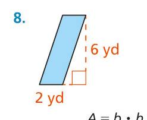
2. أوجد مساحة متوازي الأضلاع. (القاعدة 6 m والارتفاع 4 m)
   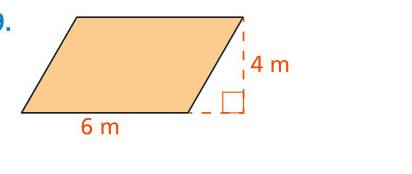
3. أوجد مساحة المعيّن. (القاعدة 10 1/2 in والارتفاع 10 in)
   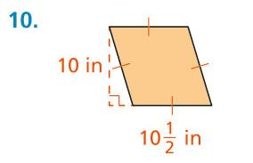
4. أوجد مساحة متوازي الأضلاع. (القاعدة 9 yd والارتفاع 2 1/3 yd)
   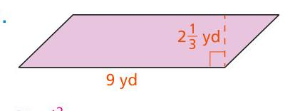
5. مساحة متوازي الأضلاع المجاور 132 cm². أوجد ارتفاعه. (القاعدة 11 cm)
   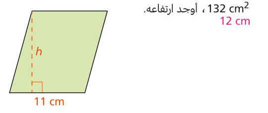
6. مساحة المعيّن المجاور 52 m². أوجد طول قاعدته. (الارتفاع 6.5 m)
   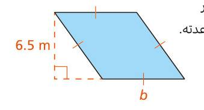
7. صنع سالمٌ وبلالٌ نافذتين من الزجاج الملوّن على شكل متوازي أضلاعٍ وبنفس المساحة. ارتفاع نافذة سالمٍ 9 إنشات وطول قاعدتها 10 إنشات؛ وارتفاع نافذة بلالٍ 6 إنشات؛ أوجد طول قاعدة نافذة بلالٍ.
   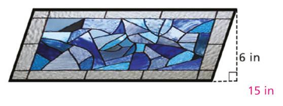
8. مستطيلٌ طوله 8 m وعرضه 4.5 m، ومتوازي أضلاعٍ مساحته ضعف مساحة المستطيل. أوجد ارتفاع متوازي الأضلاع إذا كان طول قاعدته 6 m.
9. صنعت منالُ نموذجًا من الورق لكلبٍ باستعمال فنّ الأوريجامي. ما مساحة متوازي الأضلاع الأصفر؟ (القاعدة b = 4 cm والارتفاع h = 2.36 cm)
   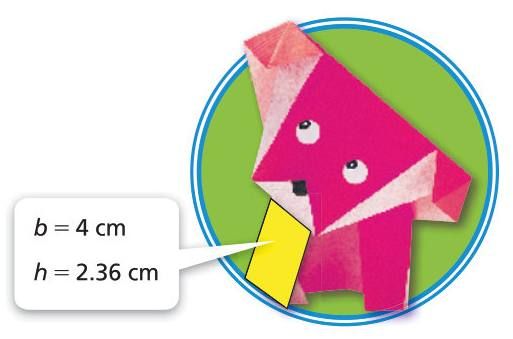
10. أحد أنواع ورق الأوريجامي يكون بقياس 15 cm في 15 cm؛ وقد استعملت منالُ ورقتين من هذا النوع لصنع نموذج الكلب. ما المساحة الكلّيّة لورقتي الأوريجامي اللتين استعملتهما منالُ لصنع نموذج الكلب؟
11. مستطيلٌ ومتوازي أضلاعٍ لهما نفس طول القاعدة ونفس الارتفاع. ما العلاقة بين مساحتيهما؟ اذكر مثالًا لتبرير إجابتك.
12. رسم حمدٌ معيّنًا طول قاعدته 12 in وارتفاعه 10 in؛ ورسم جاسمٌ معيّنًا طول قاعدته وارتفاعه ضعف طول قاعدة وارتفاع المعيّن الذي رسمه حمدٌ. قارن مساحتي المعيّنين.
13. مساحة موقف السيّارة الموضّح تساوي 209 ft²؛ هل يمكن لشاحنةٍ مستطيلة الشكل أبعادها 13.5 ft في 8.5 ft أن تقف في هذا الموقف؟ (الارتفاع 19 ft)
   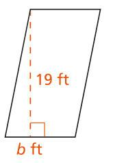
14. الملعب الداخليّ المحيط بمنطقة الرميّ في ملعب البيسبول على شكلٍ معيّنٍ. يستعمل غطاءٌ للملعب الداخليّ أبعاده 85 قدمًا في 100 قدمٍ لحمايته في الطقس الماطر. هل سيحمي هذا الغطاء الملعب الداخليّ بالكامل؟ (طول ضلع المعيّن 90 ft)
   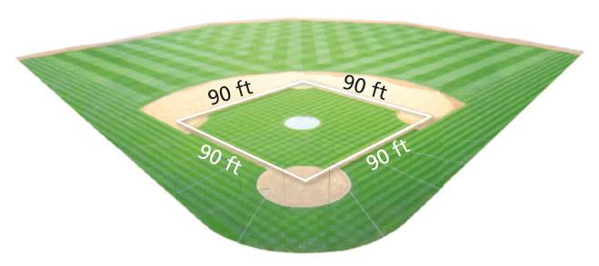

#### أولًا: اختر الإجابة الصحيحة (أسئلة محوّلة)

1. مستطيلٌ ومتوازي أضلاعٍ لهما نفس طول القاعدة ونفس الارتفاع. ما العلاقة بين مساحتيهما؟
   - أ) مساحة المستطيل ضعف مساحة متوازي الأضلاع
   - ب) مساحة متوازي الأضلاع ضعف مساحة المستطيل
   - ج) مساحتاهما متساويتان
   - د) لا توجد علاقةٌ بين مساحتيهما
2. موقف سيّارات على شكل متوازي أضلاع ارتفاعه 19 ft وقاعدته b ft، ومساحته 209 ft². ما قيمة b؟
   - أ) 228 ft
   - ب) 190 ft
   - ج) 11 ft
   - د) 5.5 ft
3. أوجد مساحة متوازي أضلاع قاعدته 8 cm وارتفاعه 5 cm.
   - أ) 13 cm²
   - ب) 40 cm²
   - ج) 20 cm²
   - د) 80 cm²
4. أوجد مساحة متوازي أضلاع قاعدته 12 cm وارتفاعه 7 cm.
   - أ) 84 cm²
   - ب) 19 cm²
   - ج) 42 cm²
   - د) 168 cm²
5. أوجد مساحة متوازي أضلاع قاعدته 9 cm وارتفاعه 6.5 cm.
   - أ) 29.25 cm²
   - ب) 15.5 cm²
   - ج) 58.5 cm²
   - د) 117 cm²
6. أوجد مساحة متوازي أضلاع قاعدته 15 cm وارتفاعه 4 cm.
   - أ) 19 cm²
   - ب) 60 cm²
   - ج) 30 cm²
   - د) 120 cm²
7. أوجد مساحة معيّن طولا قطريه 10 cm و 8 cm.
   - أ) 80 cm²
   - ب) 40 cm²
   - ج) 18 cm²
   - د) 20 cm²
8. أوجد مساحة معيّن طولا قطريه 14 cm و 6 cm.
   - أ) 42 cm²
   - ب) 84 cm²
   - ج) 20 cm²
   - د) 21 cm²
9. أوجد مساحة معيّن طولا قطريه 9 cm و 12 cm.
   - أ) 27 cm²
   - ب) 108 cm²
   - ج) 21 cm²
   - د) 54 cm²

### الدرس 8-2: حل مسائل مساحة المثلث

#### رابعًا: أجب عن الأسئلة الآتية (مسائل وتفكير)

1. أوجد مساحة كلّ مثلّثٍ. A = 1/2 bh (القاعدة 6 yd والارتفاع 4 yd)
   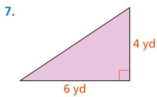
2. أوجد مساحة كلّ مثلّثٍ. A = 1/2 bh (القاعدة 6 m والارتفاع 5 m)
   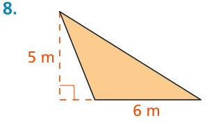
3. أوجد مساحة كلّ مثلّثٍ. A = 1/2 bh (القاعدة 14 cm والارتفاع 31 cm)
   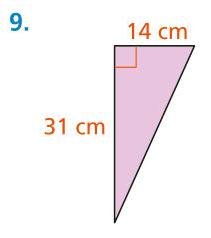
4. أوجد مساحة كلّ مثلّثٍ. A = 1/2 bh (القاعدة 15 in والارتفاع 12 in)
   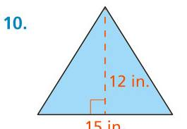
5. أوجد مساحة كلّ مثلّثٍ. A = 1/2 bh (القاعدة 12 cm والارتفاع 9 cm)
   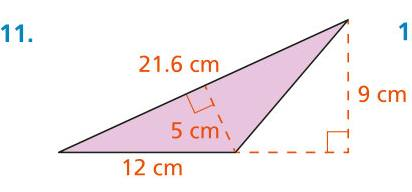
6. أوجد مساحة كلّ مثلّثٍ. A = 1/2 bh (القاعدة 8 m والارتفاع 6 m)
   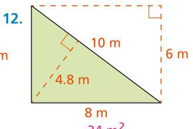
7. مثلّثٌ رؤوسه هي A(0 , 0) و B(3 , 8) و C(9 , 0)؛ أوجد مساحة هذا المثلّث.
8. مثلّثٌ طول قاعدته 2 ft وارتفاعه 15 in. أوجد مساحته بالإنشات المربّعة. (1 ft = 12 in)
9. رسمت هالة △ABC، ارتفاعه 6 cm وطول قاعدته 6 cm، ورسمت △RST، ارتفاعه 4 cm وطول قاعدته 8 cm؛ أيّ المثلّثين مساحته هي الأكبر؟ استعمل صيغة مساحة المثلّث لتبرير إجابتك.
10. أبعاد مركب ناصرٍ الشراعيّ موضّحةٌ في الشكل المجاور. أوجد مساحة الشراع. (الارتفاع 15 ft والقاعدة 9 ft)
   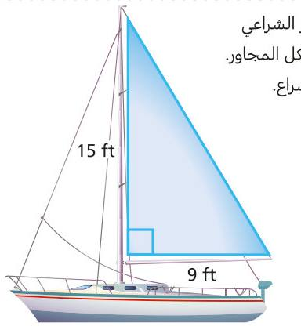
11. ما مساحة المثلّث الأصفر في الشكل بالمليمترات المربّعة؟ (القاعدة b = 3 cm والارتفاع h = 1.76 cm)
   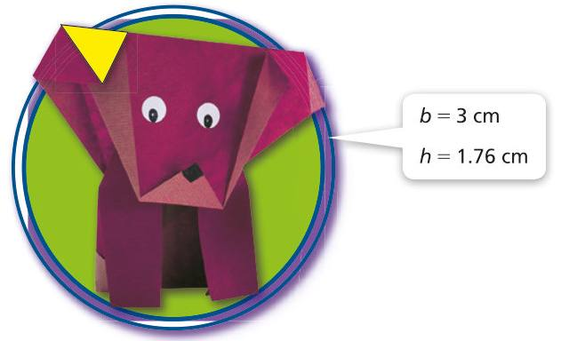
12. أنف الكلب الورقيّ عبارةٌ عن مثلّثٍ قائم الزاوية أطوال أضلاعه 3.6 cm و 3 cm و 2 cm، ما مساحة هذا المثلّث؟
13. يزرع مباركٌ حديقةً على شكل مثلّثٍ قائم الزاوية، ويريد زرع 4 نباتاتٍ في كلّ متر مربّعٍ من المساحة. ما عدد النباتات التي يمكن لمبارك زراعتها في الحديقة؟ (أضلاع المثلّث 7 m و 24 m و 25 m)
   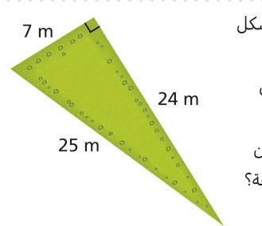
14. في المثلّث المجاور، استعمل كلّ قاعدةٍ من القواعد الثلاث مع الارتفاع العموديّ عليها لإيجاد مساحة المثلّث. هل ستكون المساحة هي نفسها في العمليّات الحسابيّة الثلاث؟ (القواعد 15 cm و 16 cm و 18 cm)
   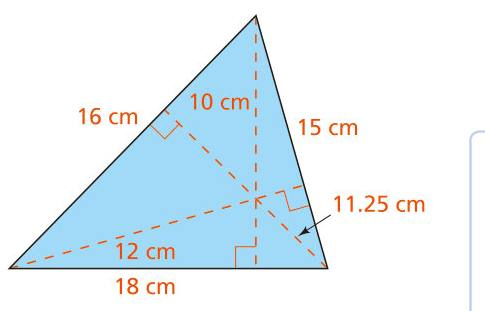
15. إذا عرفت مساحة مثلّثٍ وارتفاعه، فكيف يمكنك إيجاد طول القاعدة؟

#### أولًا: اختر الإجابة الصحيحة (أسئلة محوّلة)

1. إذا عرفتَ مساحة مثلّثٍ وارتفاعه، فكيف تجد طول قاعدته؟
   - أ) أقسم المساحة على الارتفاع ثمّ أقسم الناتج على 2
   - ب) أطرح الارتفاع من المساحة
   - ج) أضرب المساحة في الارتفاع ثمّ في 2
   - د) أضرب المساحة في 2 ثمّ أقسم الناتج على الارتفاع
2. أوجد مساحة مثلّث قاعدته 10 m وارتفاعه 6 m.
   - أ) 15 m²
   - ب) 60 m²
   - ج) 16 m²
   - د) 30 m²
3. أوجد مساحة مثلّث قاعدته 7 m وارتفاعه 8 m.
   - أ) 15 m²
   - ب) 56 m²
   - ج) 28 m²
   - د) 14 m²
4. أوجد مساحة مثلّث قاعدته 12 m وارتفاعه 5 m.
   - أ) 60 m²
   - ب) 30 m²
   - ج) 17 m²
   - د) 15 m²
5. أوجد مساحة مثلّث قاعدته 9 m وارتفاعه 9 m.
   - أ) 81 m²
   - ب) 40.5 m²
   - ج) 18 m²
   - د) 20.25 m²
6. أوجد مساحة مثلّث قاعدته 15 m وارتفاعه 4 m.
   - أ) 15 m²
   - ب) 60 m²
   - ج) 19 m²
   - د) 30 m²

### الدرس 8-3: إيجاد مساحة شبه المنحرف والطائرة الورقية

#### رابعًا: أجب عن الأسئلة الآتية (مسائل وتفكير)

1. ليكن مستطيلٌ طوله 9 cm وعرضه 8 cm، ومثلّثٌ قاعدته 6 cm وارتفاعه 8 cm. أوجد مساحة شبه المنحرف أو الطائرة الورقيّة. (شبه المنحرف: القاعدتان 21 cm و 9 cm والارتفاع 8 cm، وضلعاه 6 cm)
   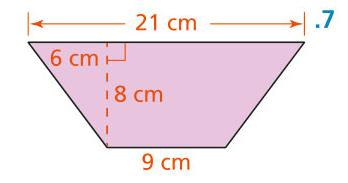
2. أوجد مساحة شبه المنحرف. (القاعدتان 9 in و 5 in والارتفاع 6 in)
   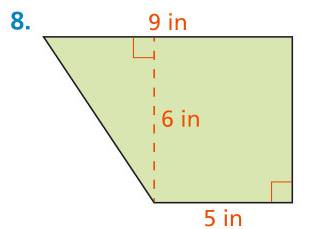
3. أوجد مساحة الطائرة الورقيّة. (القطر الأفقيّ 4.5 cm + 6.5 cm والقطر الرأسيّ 3 cm + 3 cm)
   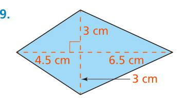
4. أوجد مساحة الطائرة الورقيّة. (القطر الأفقيّ 8 yd + 8 yd والقطر الرأسيّ 8 yd + 6 yd)
   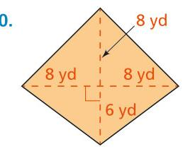
5. الحائط الجانبيّ لأحد المباني موضّحٌ أدناه. أوجد مساحة الحائط. (القاعدتان 28 ft و 40 ft والارتفاع 30 ft)
   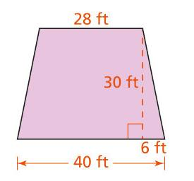
6. النافذة المجاورة لها شكل طائرةٍ ورقيّةٍ. أوجد عدد الأمتار المربّعة من الزجاج التي استعملت لصنع النافذة. (القطران 70 cm و 70 cm، والارتفاعان 30 cm و 40 cm)
   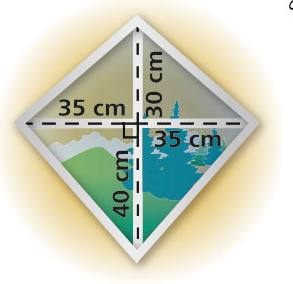
7. مساحة الطائرة الورقيّة أدناه تساوي 30 m²؛ أوجد قيمة x. (القطر الأفقيّ 4 m + 6 m، ونصف القطر الرأسيّ x m في كلّ جهةٍ)
   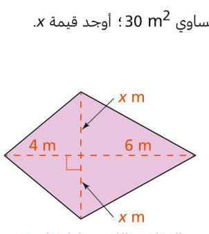
8. رسم مالكٌ شكلين متطابقين كلّ منهما شبه منحرفٍ ودمجهما لتكوين متوازي أضلاعٍ. استعمل مساحة متوازي الأضلاع لإيجاد مساحة شبه منحرفٍ واحدٍ. (القاعدتان 3 ft و 6 ft والارتفاع 4 ft)
   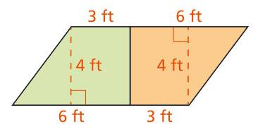
9. يصنع نجّارٌ طاولةً ضخمةً على شكل شبه منحرفٍ، ويحتاج إلى حساب مساحة سطحها. طول الضلع الطويل لسطح الطاولة يساوي ضعف عرضها. اكتب الأعداد في الصناديق لتوضيح الأبعاد المجهولة.
   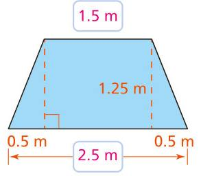
10. ما مساحة سطح الطاولة؟ (شبه منحرفٌ: القاعدتان 1.5 m و 2.5 m والارتفاع 1.25 m)
   
11. يريد أحد الحرفيين صنع آلةٍ متناظرةٍ للآلة الموضّحة في الصورة المجاورة، ويريد معرفة مساحة وجهها الأماميّ. كيف يمكنه استعمال القياسات المعطاة لإيجاد هذه المساحة؟ أوجد مساحة الوجه الأماميّ للآلة بطريقتك الخاصّة. (216 mm و 326 mm و 77 mm)
   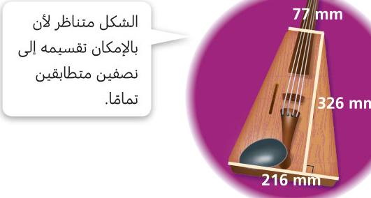

#### أولًا: اختر الإجابة الصحيحة (أسئلة محوّلة)

1. سطح طاولة على شكل شبه منحرف: قاعدته العليا 1.5 m وقاعدته السفلى 2.5 m وارتفاعه 1.25 m. ما مساحة سطحه؟
   - أ) 5 m²
   - ب) 2.5 m²
   - ج) 3.75 m²
   - د) 4.69 m²
2. وجه آلة موسيقيّة على شكل شبه منحرف: قاعدتاه المتوازيتان 77 mm و 216 mm وارتفاعه 326 mm. ما مساحة هذا الوجه؟
   - أ) 95 518 mm²
   - ب) 47 759 mm²
   - ج) 16 632 mm²
   - د) 70 416 mm²
3. أوجد مساحة شبه منحرف قاعدتاه 6 cm و 10 cm وارتفاعه 4 cm.
   - أ) 240 cm²
   - ب) 64 cm²
   - ج) 32 cm²
   - د) 12 cm²
4. أوجد مساحة شبه منحرف قاعدتاه 8 cm و 12 cm وارتفاعه 5 cm.
   - أ) 100 cm²
   - ب) 50 cm²
   - ج) 480 cm²
   - د) 15 cm²
5. أوجد مساحة شبه منحرف قاعدتاه 5 cm و 9 cm وارتفاعه 6 cm.
   - أ) 84 cm²
   - ب) 42 cm²
   - ج) 270 cm²
   - د) 13 cm²
6. أوجد مساحة شبه منحرف قاعدتاه 7 cm و 11 cm وارتفاعه 8 cm.
   - أ) 616 cm²
   - ب) 144 cm²
   - ج) 72 cm²
   - د) 17 cm²
7. أوجد مساحة شبه منحرف قاعدتاه 10 cm و 14 cm وارتفاعه 3 cm.
   - أ) 36 cm²
   - ب) 72 cm²
   - ج) 420 cm²
   - د) 15 cm²
8. أوجد مساحة طائرة ورقيّة طولا قطريها 8 cm و 6 cm.
   - أ) 14 cm²
   - ب) 48 cm²
   - ج) 24 cm²
   - د) 12 cm²
9. أوجد مساحة طائرة ورقيّة طولا قطريها 10 cm و 7 cm.
   - أ) 17.5 cm²
   - ب) 70 cm²
   - ج) 17 cm²
   - د) 35 cm²
10. أوجد مساحة طائرة ورقيّة طولا قطريها 12 cm و 5 cm.
   - أ) 15 cm²
   - ب) 60 cm²
   - ج) 17 cm²
   - د) 30 cm²
11. أوجد مساحة طائرة ورقيّة طولا قطريها 9 cm و 8 cm.
   - أ) 36 cm²
   - ب) 72 cm²
   - ج) 17 cm²
   - د) 18 cm²

### الدرس 8-4: إيجاد مساحات المضلعات

#### أولًا: اختر الإجابة الصحيحة

1. أيّ من المقادير التالية يمكن استعماله لإيجاد مساحة المضلّع المجاور؟
   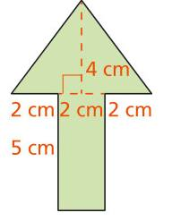
   - أ) (2 × 5) + (6 × 4)
   - ب) (5 × 2) + 2 · 1/2 (3 × 4)
   - ج) (6 × 5) − (3 × 4)
   - د) (6 × 9) − (3 × 4)
2. ما مساحة المضلّع المجاور؟
   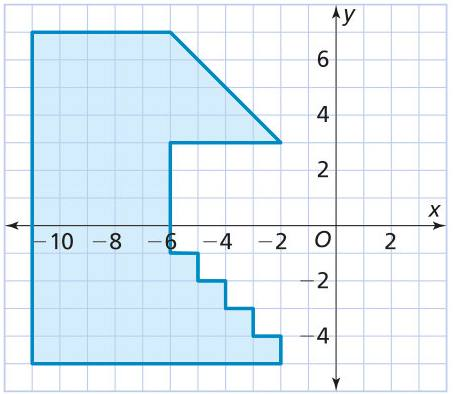
   - أ) 86 وحدةً مربّعةً
   - ب) 78 وحدةً مربّعةً
   - ج) 70 وحدةً مربّعةً
   - د) 68 وحدةً مربّعةً

#### رابعًا: أجب عن الأسئلة الآتية (مسائل وتفكير)

3. أوجد مساحة المضلّع أو المنطقة المظلّلة. (مضلّعٌ مركّبٌ عرضه 26 ft وارتفاعه 15 ft وبه فجوةٌ 5 ft)
   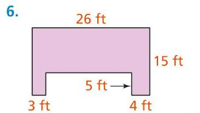
4. أوجد مساحة المضلّع. (مستطيلٌ 16 cm في 10 cm مع نتوءين 2 cm)
   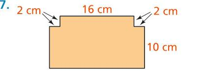
5. أوجد مساحة المنطقة المظلّلة. (مستطيلٌ 8 m في 4 m بداخله مربّعان طول ضلع كلّ منهما 2 m)
   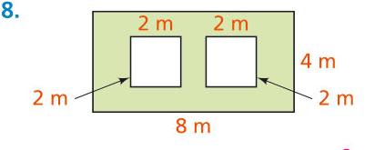
6. أوجد مساحة المضلّع. (مضلّعٌ مركّبٌ بالأبعاد 4 cm و 8 cm و 3 cm)
   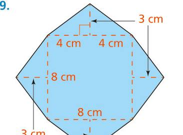
7. أوجد مساحة المضلّع بالوحدات المربّعة.
   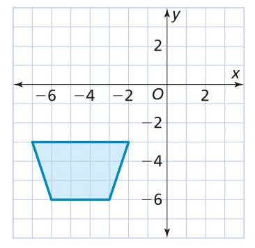
8. أوجد مساحة المضلّع المرسوم على المستوى الإحداثيّ بالوحدات المربّعة.
   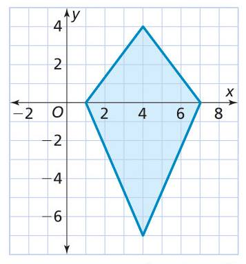
9. يصمّم حمدٌ غرفةً للتمارين الرياضيّة. كم قدمًا مربّعةً من المطّاط يحتاج لتغطية الأرضيّة؟ ثمّ كم ياردةً مربّعةً يجب أن يشتري حمدٌ؟ (1 yd² = 9 ft²؛ الغرفة على شكل حرف L أبعادها 15 ft و 14 ft و 9 ft و 8 ft)
   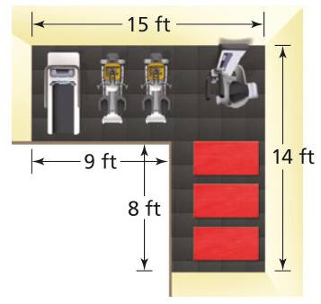
10. رسم سالمٌ المخطّط المجاور لإطار صورةٍ يريد صنعه. كلّ مربّعٍ يمثّل 1 سنتمترٍ مربّعٍ، أوجد مساحة الإطار.
   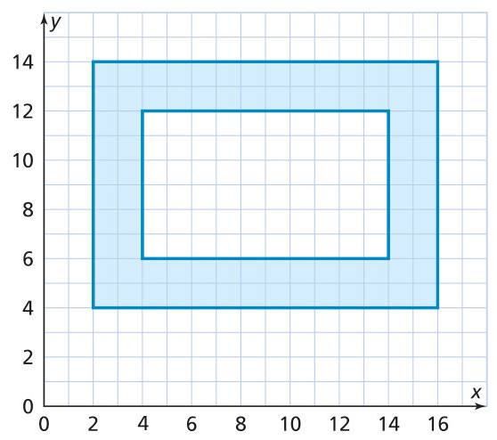
11. كيف يمكنك إيجاد مساحة الإطار من دون تجزئته إلى أشكالٍ هندسيّةٍ أصغر؟
12. لدى أحلام ثلاث بطاقاتٍ مستطيلة الشكل أبعاد كلٍّ منها 4 إنشات في 5 إنشات. كيف يمكنها ترتيب البطاقات، من دون أن تتداخل، لتكوين أكبر مضلّعٍ ممكنٍ بأصغر محيطٍ ممكنٍ؟ ما وجه المقارنة بين مساحة المضلّع والمساحة الكلّيّة للبطاقات الثلاث؟

#### أولًا: اختر الإجابة الصحيحة (أسئلة محوّلة)

1. كيف يمكنك إيجاد مساحة إطارٍ مستطيلٍ من دون تجزئته إلى أشكالٍ أصغر؟
   - أ) أجمع مساحتَي المستطيل الخارجيّ والمستطيل الداخليّ
   - ب) أضرب مساحتَي المستطيلين
   - ج) أطرح مساحة المستطيل الداخليّ من مساحة المستطيل الخارجيّ
   - د) أقسم مساحة المستطيل الخارجيّ على الداخليّ
2. لدى أحلام ثلاث بطاقاتٍ مستطيلة الشكل أبعاد كلٍّ منها 4 إنشات في 5 إنشات. ما المساحة الكلّيّة للبطاقات الثلاث؟
   - أ) 12 in²
   - ب) 20 in²
   - ج) 60 in²
   - د) 90 in²
3. مضلّع يتكوّن من مربّع طول ضلعه 8 cm وأربعة مثلّثات متطابقة ملتصقة بأضلاعه الأربعة، قاعدة كلّ مثلّث 8 cm وارتفاعه 3 cm. ما مساحة المضلّع؟
   - أ) 88 cm²
   - ب) 112 cm²
   - ج) 64 cm²
   - د) 76 cm²
4. في المستوى الإحداثيّ شبه منحرف رؤوسه (−7, −3) و (−2, −3) و (−3, −6) و (−6, −6). ما مساحته بالوحدات المربّعة؟
   - أ) 12
   - ب) 24
   - ج) 15
   - د) 8
5. مضلّع يتكوّن من مستطيل بعداه 10 cm و 6 cm ومثلّث قاعدته 4 cm وارتفاعه 3 cm ملتصق بأحد أضلاعه. ما مساحة المضلّع؟
   - أ) 6 cm²
   - ب) 60 cm²
   - ج) 72 cm²
   - د) 66 cm²
6. مضلّع يتكوّن من مستطيل بعداه 12 cm و 5 cm ومثلّث قاعدته 6 cm وارتفاعه 4 cm ملتصق بأحد أضلاعه. ما مساحة المضلّع؟
   - أ) 12 cm²
   - ب) 60 cm²
   - ج) 84 cm²
   - د) 72 cm²
7. مضلّع يتكوّن من مستطيل بعداه 8 cm و 7 cm ومثلّث قاعدته 3 cm وارتفاعه 2 cm ملتصق بأحد أضلاعه. ما مساحة المضلّع؟
   - أ) 59 cm²
   - ب) 56 cm²
   - ج) 62 cm²
   - د) 3 cm²
8. مضلّع يتكوّن من مستطيل بعداه 9 cm و 4 cm ومثلّث قاعدته 5 cm وارتفاعه 3 cm ملتصق بأحد أضلاعه. ما مساحة المضلّع؟
   - أ) 36 cm²
   - ب) 43.5 cm²
   - ج) 51 cm²
   - د) 7.5 cm²
9. مضلّع يتكوّن من مستطيل بعداه 14 cm و 6 cm ومثلّث قاعدته 8 cm وارتفاعه 5 cm ملتصق بأحد أضلاعه. ما مساحة المضلّع؟
   - أ) 104 cm²
   - ب) 84 cm²
   - ج) 124 cm²
   - د) 20 cm²
10. مضلّع يتكوّن من مستطيل بعداه 11 cm و 5 cm ومثلّث قاعدته 4 cm وارتفاعه 4 cm ملتصق بأحد أضلاعه. ما مساحة المضلّع؟
   - أ) 71 cm²
   - ب) 55 cm²
   - ج) 63 cm²
   - د) 8 cm²
11. مضلّع يتكوّن من مستطيل بعداه 16 cm و 3 cm ومثلّث قاعدته 6 cm وارتفاعه 2 cm ملتصق بأحد أضلاعه. ما مساحة المضلّع؟
   - أ) 48 cm²
   - ب) 54 cm²
   - ج) 60 cm²
   - د) 6 cm²
12. مضلّع يتكوّن من مستطيل بعداه 7 cm و 7 cm ومثلّث قاعدته 4 cm وارتفاعه 3 cm ملتصق بأحد أضلاعه. ما مساحة المضلّع؟
   - أ) 49 cm²
   - ب) 55 cm²
   - ج) 61 cm²
   - د) 6 cm²
13. مضلّع يتكوّن من مستطيل بعداه 13 cm و 4 cm ومثلّث قاعدته 5 cm وارتفاعه 4 cm ملتصق بأحد أضلاعه. ما مساحة المضلّع؟
   - أ) 10 cm²
   - ب) 52 cm²
   - ج) 72 cm²
   - د) 62 cm²

### الدرس 8-5: تمثيل المجسمات باستعمال الشبكات

#### رابعًا: أجب عن الأسئلة الآتية (مسائل وتفكير)

1. صنّف المجسّمات.
   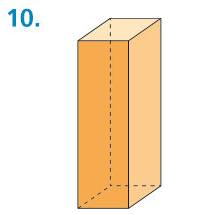
2. صنّف المجسّم.
   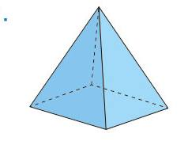
3. حدّد نوع المجسّم من شبكته.
   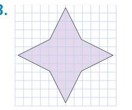
4. حدّد نوع المجسّم من شبكته.
   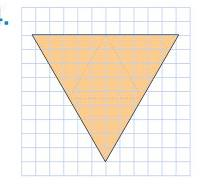
5. يريد خالدٌ أن يرسم شبكة منشورٍ مستطيلٍ. كم مستطيلًا يجب أن تتضمّن رسمه؟
6. تريد هالةُ أن ترسم شبكة هرمٍ رباعيٍّ. كم مثلّثًا يجب أن يتضمّن رسمها؟
7. طوت مريمُ الشبكة أدناه فكوّنت نموذجًا لمجسّمٍ. ما عدد الأحرف والأوجه والرؤوس في هذا النموذج؟
   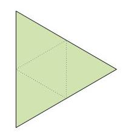
8. يقول عبدالله إنّ الشبكة أدناه يمكن طيّها لتكوين منشورٍ مستطيلٍ. هل هو على صوابٍ؟
   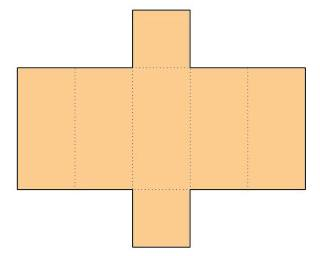
9. اكتشف عالم الرياضيّات السويسريّ ليونارد أويلر وعالم الرياضيّات الفرنسيّ رينيه ديكارت نمطًا في كلّ من أعداد أحرف ورؤوس وأوجه متعدّد الأوجه. أكمل الجدول (هرمٌ ثلاثيٌّ: الأوجه 4، الرؤوس 4، الأحرف 6؛ هرمٌ رباعيٌّ: 5 و 5 و 8؛ منشورٌ ثلاثيٌّ: 5 و 6 و 9؛ منشورٌ مستطيلٌ: 6 و 8 و 12)، ثمّ صف أحد الأنماط الواردة فيه.
12. كم وجهًا للطرد البريديّ؟ (الطرد البريديّ على شكل منشورٍ ثلاثيٍّ)
13. عندما اشترى سميرٌ الطرد البريديّ كان مفروكًا وله هيئة شبكةٍ. ما المضلّعات التي قد يكون لاحظها سميرٌ في الطرد البريديّ المفرود؟
14. ارسم شبكة هرمٍ رباعيٍّ، طول قاعدته وحدتان وارتفاع كلّ من أوجهه المثلّثيّة 5 وحداتٍ.
15. اكتب معادلةً تربط بين عدد الأحرف، E، وعدد الأوجه، F، وعدد الرؤوس، V.

#### أولًا: اختر الإجابة الصحيحة (أسئلة محوّلة)

1. اكتشف أويلر وديكارت نمطًا بين عدد الأوجه F وعدد الرؤوس V وعدد الأحرف E في المجسّمات (هرمٌ ثلاثيٌّ: F = 4 و V = 4 و E = 6؛ منشورٌ مستطيلٌ: F = 6 و V = 8 و E = 12). أيّ علاقةٍ تصحّ في المجسّمات كلّها؟
   - أ) F + V + E = 2
   - ب) F + V − E = 2
   - ج) F − V − E = 2
   - د) F × V = E
2. مجسّم له قاعدتان مستطيلتان متوازيتان ومتطابقتان وأربعة أوجه جانبيّة مستطيلة. ما اسمه؟
   - أ) هرم رباعي
   - ب) منشور مستطيل
   - ج) منشور ثلاثي
   - د) هرم ثلاثي
3. مجسّم له قاعدة مربّعة وأربعة أوجه جانبيّة مثلّثة تلتقي كلّها في رأس واحد. ما اسمه؟
   - أ) منشور رباعي
   - ب) هرم رباعي قاعدته مربّعة
   - ج) هرم ثلاثي
   - د) منشور ثلاثي
4. شبكة تتكوّن من مربّع واحد في الوسط وأربعة مثلّثات متطابقة ملتصقة بأضلاعه الأربعة. أيّ مجسّم نحصل عليه عند طيّها؟
   - أ) هرم ثلاثي
   - ب) منشور مستطيل
   - ج) هرم رباعي قاعدته مربّعة
   - د) منشور ثلاثي
5. شبكة على شكل مثلّث كبير مقسّم إلى 4 مثلّثات متطابقة صغيرة: مثلّث في الوسط وثلاثة مثلّثات حوله. أيّ مجسّم نحصل عليه عند طيّها؟
   - أ) منشور مستطيل
   - ب) هرم رباعي
   - ج) هرم ثلاثي
   - د) منشور ثلاثي
6. يقول عبدالله إنّ شبكة تتكوّن من صفّ من 5 مستطيلات متجاورة، ومربّع فوق المستطيل الثالث ومربّع تحته، يمكن طيّها لتكوين منشور مستطيل. هل هو على صواب؟
   - أ) نعم، لأنّ فيها مستطيلات ومربّعين
   - ب) لا، لأنّ فيها 5 أوجه جانبية والمنشور المستطيل له 4 فقط
   - ج) نعم، لأنّ عدد أوجهها زوجي
   - د) لا، لأنّ شبكة المنشور المستطيل لا تحتوي على مربّعات
7. كم وجهًا للمكعّب؟
   - أ) 7
   - ب) 6
   - ج) 5
   - د) 12
8. كم وجهًا للمنشور الثلاثيّ؟
   - أ) 5
   - ب) 6
   - ج) 4
   - د) 9
9. كم وجهًا للهرم الرباعيّ؟
   - أ) 5
   - ب) 6
   - ج) 4
   - د) 8
10. كم وجهًا للهرم الثلاثيّ؟
   - أ) 5
   - ب) 4
   - ج) 3
   - د) 6
11. كم وجهًا للمنشور المستطيل؟
   - أ) 6
   - ب) 7
   - ج) 5
   - د) 12
12. كم حرفًا للهرم الرباعيّ؟
   - أ) 5
   - ب) 8
   - ج) 12
   - د) 6
13. كم رأسًا للمنشور الثلاثيّ؟
   - أ) 5
   - ب) 6
   - ج) 9
   - د) 3
14. كم حرفًا للمكعّب؟
   - أ) 6
   - ب) 12
   - ج) 8
   - د) 24
15. أيّ شبكة تُطوى لتكوين هرم قاعدته مربّعة؟
   - أ) مربّع واحد وأربعة مثلّثات حوله
   - ب) ستّة مربّعات
   - ج) مثلّثان وثلاثة مستطيلات
   - د) خمسة مستطيلات

### الدرس 8-6: إيجاد المساحة السطحية للمنشور

#### رابعًا: أجب عن الأسئلة الآتية (مسائل وتفكير)

1. أوجد المساحة السطحيّة لكلّ منشورٍ. (مكعّبٌ طول حرفه 8 cm)
   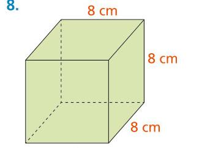
2. أوجد المساحة السطحيّة للمنشور الثلاثيّ. (4 cm و 3 cm و 5 cm و 6 cm)
   
3. أوجد المساحة السطحيّة للمنشور. (10 cm و 5 cm و 15 cm)
   
4. أوجد المساحة السطحيّة للمنشور المستطيل. (7 m و 2.5 m و 2 m)
   
5. أوجد المساحة السطحيّة للمنشور الثلاثيّ. (8 cm و 6 cm و 7.2 cm)
   
6. أوجد المساحة السطحيّة للمكعّب. (طول حرفه 12 m)
   
7. يقول صالحٌ إنّ المساحة السطحيّة للمكعّب أدناه أقلّ من 1 000 cm². هل هو على صوابٍ؟ (طول حرف المكعّب 10 cm)
   
8. تريد سلمى تغليف ورق على شكل المنشور الثلاثيّ الموضّح أدناه. كم إنشًا مربّعًا من ورق التغليف تحتاج لتغطية المنشور بالكامل؟
   
9. لدى منى قطعتان من الصلصال على شكل المنشور المستطيل أدناه. وصلت منى القطعتين لتكوين منشورٍ مستطيلٍ طوله 12 إنشًا. ما المساحة السطحيّة للمنشور المستطيل الذي حصلت عليه منى؟ (أبعاد كلّ قطعةٍ 6 in و 2 in و 2 in)
   
10. منشورٌ مستطيلٌ طوله 12 cm وعرضه 6 cm وارتفاعه 4 cm. أوجد مساحته السطحيّة باستعمال الصيغة SA = 2(ℓw) + 2(wh) + 2(ℓh).
11. يريد عمرٌ بناء بيتٍ للطيور. اشترى قطعة خشبٍ أبعادها 24 إنش في 48 إنش. هل قطعة الخشب التي اشتراها عمر تكفي لبناء بيت الطيور بالأبعاد الموضّحة؟ (5 in و 5 in و 8 in)
   
12. قرّر عمر طلاء بيت الطيور. لدى عمر علبةٌ من الطلاء تكفي لطلاء سطحٍ مساحته 32.5 ft². كيف يمكنك توضيح أنّ لدى عمر ما يكفي من الطلاء من دون إجراء عمليّةٍ حسابيّةٍ؟ (1 ft² = 144 in²، المساحة السطحيّة للبيت 210 in²)
13. استعمل الصيغة SA = 2ℓw + 2ℓh + 2wh لإيجاد مساحة سطح منشورٍ مستطيلٍ طوله ℓ يساوي 2.3 إنش وعرضه w يساوي 1.1 إنش وارتفاعه h يساوي 3 إنش.
14. مكعّب مساحته السطحيّة 486 cm²؛ هل يمكن أن يكون طول كلّ حرفٍ من أحرفه 11 cm؟
15. ما المساحة السطحيّة لمنشورٍ مستطيلٍ ارتفاعه 2 متر وطوله 4.2 متر وعرضه 2.5 متر؟
16. ما المساحة السطحيّة لمكعّبٍ طول كلّ حرفٍ من أحرفه 6.75 سنتمتر؟
17. تريد لبنى تغليف صندوق شحنٍ على شكل منشورٍ مستطيلٍ. طول الصندوق 28 إنش، وله قاعدةٌ مربّعةٌ كلّ ضلعٍ من أضلاعها 2 إنش. ما أقلّ مساحةٍ ممكنةٍ من الورق ستستعملها لبنى؟
18. تريد مريمُ تغطية صندوقٍ على شكل منشورٍ مستطيلٍ بقماشٍ قطنيٍّ. أبعاد الصندوق 18 إنش في 12 إنش في 10 إنش. لدى مريم قطعة قماشٍ مساحتها 1 ياردةٌ مربّعةٌ. هل يمكنها تغطية الصندوق بالكامل باستعمال قطعة القماش هذه؟ (1 yd² = 1 296 in²)

#### أولًا: اختر الإجابة الصحيحة (أسئلة محوّلة)

1. طلاء بيت الطيور: لدى عمر علبةٌ تكفي لطلاء سطحٍ مساحته 32.5 ft²، والمساحة السطحيّة للبيت 210 in². هل يكفي الطلاء؟ (1 ft² = 144 in²)
   - أ) نعم، لأنّ 210 in² تساوي 32.5 ft² تمامًا
   - ب) لا، لأنّ 210 أكبر من 32.5
   - ج) نعم، لأنّ 32.5 ft² أكبر بكثيرٍ من 210 in² (32.5 × 144 = 4 680 in²)
   - د) لا، لأنّ 1 ft² = 12 in² فقط
2. منشور مستطيل أبعاده 10 cm و 5 cm و 15 cm. ما مساحته السطحيّة؟
   - أ) 550 cm²
   - ب) 750 cm²
   - ج) 275 cm²
   - د) 250 cm²
3. أوجد المساحة السطحيّة لمنشور مستطيل أبعاده 6 cm و 4 cm و 3 cm.
   - أ) 54 cm²
   - ب) 72 cm²
   - ج) 108 cm²
   - د) 120 cm²
4. أوجد المساحة السطحيّة لمنشور مستطيل أبعاده 8 cm و 5 cm و 2 cm.
   - أ) 132 cm²
   - ب) 80 cm²
   - ج) 66 cm²
   - د) 144 cm²

### الدرس 8-7: إيجاد المساحة السطحية للهرم

#### أولًا: اختر الإجابة الصحيحة

1. أيّ شبكةٍ تمثّل الهرم ذا المساحة السطحيّة الأكبر؟
   
   - أ) الشبكة A
   - ب) الشبكة B
   - ج) الشبكة C
   - د) الشبكة D

#### رابعًا: أجب عن الأسئلة الآتية (مسائل وتفكير)

2. أوجد المساحة السطحيّة للهرم. أوجه كلّ هرمٍ ثلاثيٍّ هي مثلّثاتٌ متطابقة الأضلاع. (هرمٌ رباعيٌّ قاعدته مربّعةٌ طول ضلعها 7 in وارتفاع كلّ وجهٍ مثلّثيٍّ 10 in)
   
3. أوجد المساحة السطحيّة للهرم الثلاثيّ. (ارتفاع كلّ وجهٍ 5.2 cm وطول قاعدة الوجه 6 cm)
   
4. أكمل الشبكة أدناه لإيجاد المساحة السطحيّة للهرم الثلاثيّ. أوجه الهرم هي مثلّثاتٌ متطابقة الأضلاع. (ارتفاع الوجه 15.6 mm وقاعدته 18 mm)
   
5. يصمّم سميرٌ قطعةً فنّيّةً لأحد الفنادق على شكل هرمٍ رباعيٍّ، ويريد أن يغطّي الهرم بألواحٍ زجاجيّةٍ. كم قدمًا مربّعةً من الألواح الزجاجيّة يحتاج سميرٌ لتغطية كلّ الهرم؟ (القاعدة 5 ft في 5 ft وارتفاع الوجه 4 ft)
   
6. يقول كريمٌ إنّ المساحة السطحيّة للهرم الثلاثيّ أدناه، الذي وجوهه مثلّثاتٌ متطابقة الأضلاع، تساوي 173 cm². هل توافقه على ذلك؟ (طول ضلع المثلّث 20 cm وارتفاع الوجه 17.3 cm)
   
7. رسم ناصرٌ هرمًا رباعيًّا وشبكته لتمثيل بيتٍ خشبيٍّ يريد أن يصنعه لقطّته. أكمل الشبكة بإيجاد القياسات المجهولة. (ارتفاع الوجه 5 ft والقاعدة 3 ft)
   
8. استعمل الشبكة لإيجاد كمّيّة الخشب اللازمة لبناء بيت القطّة. (قاعدة مربّعة 3 ft وأربعة أوجهٍ مثلّثيّةٍ ارتفاع كلٍّ منها 5 ft)
9. المساحة السطحيّة للهرم الرباعيّ أدناه هي 644 ft². هل يمكن لقيمة x أن تكون 20؟ (القاعدة 14 ft في 14 ft وارتفاع الوجه x ft)
   
10. أيّ من الهرمين أدناه مساحته السطحيّة أكبر في رأيك؟ هرمٌ رباعيٌّ: القاعدة 10 cm في 10 cm وارتفاع الوجه المثلّثيّ 8.66 cm. هرمٌ ثلاثيٌّ: كلّ الأوجه مثلّثاتٌ متطابقة الأضلاع، طول القاعدة 10 cm وارتفاع الوجه 8.66 cm.
11. قد تكون قاعدة الهرم أيّ مضلّعٍ. ما عدد أوجه الهرم الذي قاعدته مضلّعٌ خماسيٌّ؟ صف أشكال هذه الأوجه.
12. المصطلحات: ما المصطلح المستعمل لوصف النقطة التي تتقاطع عندها ثلاثة أحرفٍ أو أكثر لمجسّمٍ هندسيٍّ؟

#### أولًا: اختر الإجابة الصحيحة (أسئلة محوّلة)

1. هرمٌ رباعيٌّ قاعدته 10 cm في 10 cm وارتفاع وجهه المثلّثيّ 8.66 cm، وهرمٌ ثلاثيٌّ كلّ أوجهه مثلّثاتٌ متطابقة الأضلاع طول قاعدتها 10 cm وارتفاع وجهها 8.66 cm. أيّ الهرمين مساحته السطحيّة أكبر؟
   - أ) الهرم الثلاثيّ
   - ب) الهرم الرباعيّ
   - ج) مساحتاهما متساويتان
   - د) لا يمكن المقارنة
2. قاعدة هرمٍ مضلّعٌ خماسيٌّ. كم وجهًا للهرم (القاعدة والأوجه الجانبيّة معًا)؟
   - أ) 5
   - ب) 7
   - ج) 6
   - د) 10
3. هرم رباعي قاعدته مربّعة طول ضلعها 3 ft، وارتفاع كلّ وجه جانبيّ مثلّثي 5 ft. ما مساحته السطحيّة؟
   - أ) 24 ft²
   - ب) 39 ft²
   - ج) 30 ft²
   - د) 69 ft²
4. أوجد المساحة السطحيّة لهرم رباعيّ قاعدته مربّعة طول ضلعها 4 cm، وارتفاع كلّ وجه جانبيّ مثلّثيّ 6 cm.
   - أ) 16 cm²
   - ب) 64 cm²
   - ج) 96 cm²
   - د) 112 cm²
5. أوجد المساحة السطحيّة لهرم رباعيّ قاعدته مربّعة طول ضلعها 6 cm، وارتفاع كلّ وجه جانبيّ مثلّثيّ 5 cm.
   - أ) 36 cm²
   - ب) 96 cm²
   - ج) 120 cm²
   - د) 156 cm²
6. أوجد المساحة السطحيّة لهرم رباعيّ قاعدته مربّعة طول ضلعها 5 cm، وارتفاع كلّ وجه جانبيّ مثلّثيّ 8 cm.
   - أ) 185 cm²
   - ب) 25 cm²
   - ج) 160 cm²
   - د) 105 cm²
7. أوجد المساحة السطحيّة لهرم رباعيّ قاعدته مربّعة طول ضلعها 8 cm، وارتفاع كلّ وجه جانبيّ مثلّثيّ 7 cm.
   - أ) 288 cm²
   - ب) 64 cm²
   - ج) 224 cm²
   - د) 176 cm²
8. أوجد المساحة السطحيّة لهرم رباعيّ قاعدته مربّعة طول ضلعها 3 cm، وارتفاع كلّ وجه جانبيّ مثلّثيّ 4 cm.
   - أ) 57 cm²
   - ب) 9 cm²
   - ج) 48 cm²
   - د) 33 cm²
9. أوجد المساحة السطحيّة لهرم رباعيّ قاعدته مربّعة طول ضلعها 10 cm، وارتفاع كلّ وجه جانبيّ مثلّثيّ 9 cm.
   - أ) 460 cm²
   - ب) 100 cm²
   - ج) 360 cm²
   - د) 280 cm²
10. أوجد المساحة السطحيّة لهرم رباعيّ قاعدته مربّعة طول ضلعها 7 cm، وارتفاع كلّ وجه جانبيّ مثلّثيّ 6 cm.
   - أ) 49 cm²
   - ب) 133 cm²
   - ج) 168 cm²
   - د) 217 cm²
11. أوجد المساحة السطحيّة لهرم رباعيّ قاعدته مربّعة طول ضلعها 9 cm، وارتفاع كلّ وجه جانبيّ مثلّثيّ 5 cm.
   - أ) 180 cm²
   - ب) 81 cm²
   - ج) 171 cm²
   - د) 261 cm²
12. أوجد المساحة السطحيّة لهرم رباعيّ قاعدته مربّعة طول ضلعها 2 cm، وارتفاع كلّ وجه جانبيّ مثلّثيّ 3 cm.
   - أ) 4 cm²
   - ب) 16 cm²
   - ج) 24 cm²
   - د) 28 cm²

### الدرس 8-8: إيجاد الحجم باستعمال أطوال أحرف على صورة كسور

#### رابعًا: أجب عن الأسئلة الآتية (مسائل وتفكير)

1. أوجد حجم المنشور المستطيل. (الطول 6.5 m والعرض 4 m والارتفاع 1.2 m)
   
2. أوجد حجم المنشور المستطيل. (الأبعاد 2 cm و 1 2/3 cm و 5 1/3 cm)
   
3. أوجد حجم المكعّب. (طول الحرف 3 1/3 cm)
   
4. أوجد حجم المنشور المستطيل. (الأبعاد 0.7 m و 0.9 m و 2.4 m)
   
5. الصندوق الشفّاف أدناه له شكل منشورٍ مستطيلٍ، وهو ممتلئٌ بالرمل. أوجد حجم الصندوق. (الأبعاد 8 1/4 in و 4 1/2 in و 6 1/2 in)
   
6. يبلغ طول قاعدة منشورٍ مستطيلٍ 1 1/2 m وعرضه 2 1/2 m وارتفاعه 1 1/2 m. إذا استعملت مكعّباتٍ طول كلّ منها 1/2 m لإيجاد الحجم، فما عدد المكعّبات التي تمثّل كلًّا من ارتفاع شبه المكعّب وطوله وعرضه؟ وما حجم المنشور؟
7. علبة هدايا على شكل مكعّبٍ طول كلّ حرفٍ من أحرفه 10.5 cm، أوجد حجم علبة الهدايا.
8. خزانةٌ مدرسيّةٌ طول قاعدتها 18 in وعرضها 1 ft وارتفاع الخزانة 2 1/2 ft. أوجد الحجم بالأقدام المكعّبة. (1 in = 1/12 ft)
   
9. لدى ممدوحٍ صندوقان أبعادهما موضّحةٌ في الجدول المجاور. يريد ممدوحٌ استعمال الصندوق الأكبر حجمًا لإرسال هديّةٍ إلى صديقه. أيّ الصندوقين يجب على ممدوحٍ استعماله؟ (الصندوق A: الطول 7 1/2 cm والعرض 2 cm والارتفاع 11 1/2 cm؛ الصندوق B: الطول 9 cm والعرض 2 1/4 cm والارتفاع 8 1/2 cm)
10. وجد ممدوحٌ صندوقًا ثالثًا، الصندوق C، طوله 8 سنتمترات، وعرضه 2 3/4 سنتمترًا، وارتفاعه 10 1/2 سنتمترًا. إذا كان يريد استعمال الصندوق الأكبر حجمًا، هل يجب أن يستعمل الصندوق C؟
11. علبةٌ حجمها 84 in³؛ فإذا كان عرضها 2 2/3 in وارتفاعها 4 2/3 in، فما طولها؟
12. أوجد حجم المنشور المجاور. (الأبعاد 4 cm و 1 3/4 cm و 2 1/2 cm)
   
13. صندوقٌ يغطّي مساحة قدرها 8 3/4 in² عند وضعه على قاعدته. إذا علمت أنّ حجم الصندوق 74 3/8 in³، فهل يمكنك إيجاد مساحته السطحيّة؟
14. سبيكةٌ ذهبيّةٌ على شكل منشورٍ مستطيلٍ. الأبعاد القياسيّة لسبيكة الذهب هي 7 in × 3 5/8 in × 1 3/4 in تقريبًا. إذا كان سعر أونصةٍ واحدةٍ من الذهب 313، فما قيمة سبيكةٍ واحدةٍ من الذهب؟ استعمل الصيغة w ≈ 11.15n، حيث w يمثّل الوزن بالأونصة (oz) و n يمثّل الحجم بالإنش المكعّب (in³) لإيجاد الوزن بالأونصة. وضّح كيف توصّلت إلى الإجابة.

#### أولًا: اختر الإجابة الصحيحة (أسئلة محوّلة)

1. منشورٌ مستطيلٌ طول قاعدته 1 1/2 m وعرضه 2 1/2 m وارتفاعه 1 1/2 m. إذا استعملتَ مكعّباتٍ طول حرف كلٍّ منها 1/2 m، فكم مكعّبًا يملأ المنشور؟
   - أ) 9
   - ب) 15
   - ج) 75
   - د) 45
2. منشورٌ مستطيلٌ طول قاعدته 1 1/2 m وعرضه 2 1/2 m وارتفاعه 1 1/2 m. ما حجمه؟
   - أ) 4 1/8 m³
   - ب) 5 1/2 m³
   - ج) 5 5/8 m³
   - د) 45 m³
3. لدى ممدوحٍ صندوقان: الصندوق A طوله 7 1/2 cm وعرضه 2 cm وارتفاعه 11 1/2 cm، والصندوق B طوله 9 cm وعرضه 2 1/4 cm وارتفاعه 8 1/2 cm. أيّ الصندوقين حجمه أكبر؟
   - أ) الصندوق A
   - ب) الصندوق B
   - ج) حجماهما متساويان
   - د) لا يمكن المقارنة
4. الصندوق C طوله 8 سنتمتراتٍ وعرضه 2 3/4 سنتمترًا وارتفاعه 10 1/2 سنتمترًا. ما حجمه؟
   - أ) 220 cm³
   - ب) 172.5 cm³
   - ج) 231 cm³
   - د) 241.5 cm³
5. الأبعاد القياسيّة لسبيكة ذهبٍ على شكل منشورٍ مستطيلٍ هي 7 in × 3 5/8 in × 1 3/4 in. ما حجمها تقريبًا؟
   - أ) 12.4 in³
   - ب) 4.4 in³
   - ج) 444 in³
   - د) 44.4 in³
6. حجم سبيكة ذهبٍ ≈ 44.4 in³، والصيغة w ≈ 11.15n حيث w الوزن بالأونصة وn الحجم بالإنش المكعّب. ما وزن السبيكة تقريبًا؟
   - أ) حوالي 4 oz
   - ب) حوالي 50 oz
   - ج) حوالي 495 oz
   - د) حوالي 4 950 oz
7. أوجد حجم منشور مستطيل أبعاده 1/2 in و 1 1/2 in و 4 in.
   - أ) 1 3/5 in³
   - ب) 3 in³
   - ج) 4 in³
   - د) 6 in³
8. أوجد حجم منشور مستطيل أبعاده 2/3 in و 3/4 in و 6 in.
   - أ) 1 3/8 in³
   - ب) 3 in³
   - ج) 4 in³
   - د) 6 in³
9. أوجد حجم منشور مستطيل أبعاده 1/4 in و 2 1/2 in و 8 in.
   - أ) 6 in³
   - ب) 2 in³
   - ج) 5 in³
   - د) 10 in³
10. أوجد حجم منشور مستطيل أبعاده 1 1/2 in و 2/3 in و 3 in.
   - أ) 3 in³
   - ب) 1 1/3 in³
   - ج) 4 in³
   - د) 6 in³
11. أوجد حجم منشور مستطيل أبعاده 1 1/4 in و 4/5 in و 10 in.
   - أ) 11 in³
   - ب) 1 9/10 in³
   - ج) 10 in³
   - د) 20 in³
