# بنك أسئلة العلوم — المستوى الخامس — الفصل الدراسي الأول

- كل الدروس منقولة من كتاب الطالب (العلوم – الصف الخامس – الفصل الأول): أسئلة "أتحقق مما تعلمت" و"ماذا أعرف" والأنشطة، بنصّها كما في الكتاب. الصور والأشكال مقتطعة كصور (مجلد images).
- الفراغ يُكتب ____.
- الأسئلة بدون إجابات نموذجية.

## الفهرس

- الوحدة 1: السلاسل الغذائية
  - الدرس 1.1: على ماذا تتغذى الكائنات الحية؟
  - الدرس 1.2: ما السلاسل الغذائية؟
  - الدرس 1.3: كيف أستطيع أن أبني سلاسل غذائية؟
  - الدرس 1.4: كيف أستطيع أن أبني سلاسل غذائية أكثر تعقيدًا؟
  - الدرس 1.5: كيف تكون الأسنان والمناقير متخصصة؟
  - الدرس 1.6: كيف ترتبط خصائص الحيوانات بغذائها؟
  - الدرس 1.7: ما آكلات الرمم والمحللات؟
  - الدرس 1.8: ماذا أعرف عن السلاسل الغذائية؟
- الوحدة 2: الدوائر الكهربائية
  - الدرس 2.1: ما الدوائر الكهربائية؟
  - الدرس 2.2: كيف أبني الدوائر الكهربائية؟
  - الدرس 2.3: كيف أستطيع أن أرسم مخططات الدوائر الكهربائية؟
  - الدرس 2.4: كيف أستطيع أن أستخدم مخطط دائرة كهربائية لأبنيها؟
  - الدرس 2.5: ماذا أعرف عن الدوائر الكهربائية؟
- الوحدة 3: التيار الكهربائي
  - الدرس 3.1: كيف يسري التيار الكهربائي في الدائرة الكهربائية؟
  - الدرس 3.2: ماذا يحدث عندما أضيف مصابيح أو خلايا كهربائية على التوالي إلى دائرة كهربائية؟
  - الدرس 3.3: ما المواد التي تعد موصلات كهربائية جيدة أو رديئة؟
  - الدرس 3.4: ماذا أعرف عن التيار الكهربائي؟

---

## الوحدة 1: السلاسل الغذائية

### الدرس 1.1: على ماذا تتغذى الكائنات الحية؟

#### أولًا: اختر الإجابة الصحيحة

1. ما المصطلح الذي يشير إلى الحيوان الذي يتغذى على النباتات فقط؟
   - أ) آكل اللحوم
   - ب) آكل العشب
   - ج) قارت
   - د) مفترس
2. أيّ جملة من الجمل الآتية تصف القارت؟
   - أ) حيوان يتغذى على النباتات ولحوم الحيوانات الأخرى معًا.
   - ب) حيوان يتغذى فقط على النباتات.
   - ج) حيوان يتغذى فقط على الأعشاب.
   - د) حيوان يتغذى فقط على لحوم الحيوانات الأخرى.
3. أيّ حيوان يعدّ من الحيوانات آكلة اللحوم؟
   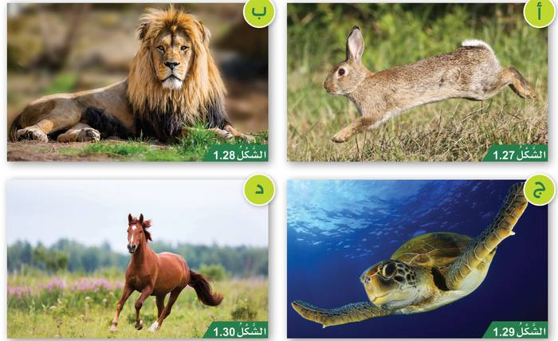
   - أ) الحيوان أ
   - ب) الحيوان ب
   - ج) الحيوان ج
   - د) الحيوان د

#### أولًا: اختر الإجابة الصحيحة (أسئلة محوّلة)

1. ما اسم الحيوان الذي يتغذى على النباتات ولحوم الحيوانات الأخرى معًا؟
   - أ) آكل عشب
   - ب) آكل لحوم
   - ج) منتج
   - د) قارت
2. أيّ الحيوانات الآتية من آكلات العشب؟
   - أ) الأسد
   - ب) الصقر
   - ج) الذئب
   - د) الجمل
3. أيّ الحيوانات الآتية من آكلات اللحوم؟
   - أ) الأرنب
   - ب) الأسد
   - ج) الحصان
   - د) البقرة
4. يأكل الدبّ الأسماك والتوت. كيف يُصنَّف الدبّ؟
   - أ) آكل عشب
   - ب) آكل لحوم فقط
   - ج) قارت
   - د) منتج
5. على ماذا تتغذى الحيوانات آكلة اللحوم؟
   - أ) على النباتات فقط
   - ب) على لحوم الحيوانات الأخرى
   - ج) على ضوء الشمس
   - د) على التربة
6. أيّ الحيوانات الآتية يُصنَّف قارتًا؟
   - أ) الغزال
   - ب) الأسد
   - ج) الأرنب
   - د) الدجاجة
7. ما اسم الحيوان الذي يتغذى على الحيوانات الأخرى فقط؟
   - أ) آكل لحوم
   - ب) قارت
   - ج) آكل عشب
   - د) منتج
8. أيّ العبارات الآتية صحيحة؟
   - أ) آكل العشب لا يحتاج إلى غذاءٍ
   - ب) آكل العشب يتغذى على اللحوم فقط
   - ج) آكل العشب يتغذى على النباتات واللحوم
   - د) آكل العشب يتغذى على النباتات فقط
9. لماذا تحتاج الكائنات الحيّة إلى الغذاء؟
   - أ) لتحصل على الطاقة
   - ب) لتصبح أثقل فقط
   - ج) لتغيّر لونها
   - د) لتجنّب الماء
10. أيّ الكائنات الآتية يصنع غذاءه بنفسه؟
   - أ) الأرنب
   - ب) الثعلب
   - ج) العشب
   - د) الصقر
11. تأكل القطّة الفئران. كيف تُصنَّف القطّة؟
   - أ) آكلة لحوم
   - ب) آكلة عشب
   - ج) قارتة
   - د) منتجة
12. يأكل الخروف العشب فقط. كيف يُصنَّف الخروف؟
   - أ) آكل لحوم
   - ب) آكل عشب
   - ج) قارت
   - د) مفترس
13. يتناول الإنسان الخضراوات واللحوم. كيف يُصنَّف الإنسان؟
   - أ) آكل عشب
   - ب) آكل لحوم
   - ج) قارت
   - د) منتج
14. أيّ المجموعات الآتية تضمّ آكلات عشب فقط؟
   - أ) الصقر والأفعى والتمساح
   - ب) الأسد والنمر والذئب
   - ج) الدبّ والدجاجة والإنسان
   - د) الأرنب والبقرة والجمل
15. أيّ العبارات الآتية خاطئة؟
   - أ) الأسد يتغذى على لحوم الحيوانات
   - ب) الأسد يتغذى على الأعشاب
   - ج) الأسد من آكلات اللحوم
   - د) الأسد يصطاد فريسته
16. أيّ المجموعات الآتية تضمّ آكلات لحوم فقط؟
   - أ) البقرة والخروف والنمر
   - ب) الأرنب والأسد والجمل
   - ج) الأسد والنمر والصقر
   - د) الدبّ والجمل والصقر
17. ماذا نسمّي الحيوان الذي يتغذّى على النباتات فقط؟
   - أ) محلّل
   - ب) آكل لحوم
   - ج) آكل كلّ شيء
   - د) آكل أعشاب

### الدرس 1.2: ما السلاسل الغذائية؟

#### أولًا: اختر الإجابة الصحيحة

1. ماذا تبيّن السلسلة الغذائية؟
   - أ) جميع ما يتغذى عليه الحيوان.
   - ب) جميع الحيوانات الموجودة في الموطن.
   - ج) العلاقات الغذائية بين الكائنات الحية.
   - د) عدد النباتات التي يتغذى عليها الحيوان.
2. ألاحظ السلاسل الغذائية. أيّ منها صحيح؟
   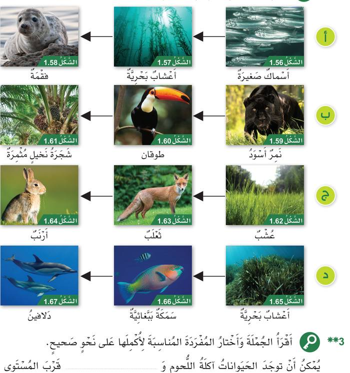
   - أ) السلسلة أ
   - ب) السلسلة ب
   - ج) السلسلة ج
   - د) السلسلة د
3. اقرأ الجملة واختر المفردة المناسبة لأكملها على نحو صحيح. يمكن أن توجد الحيوانات آكلة اللحوم و ____ قرب المستوى الأخير من السلاسل الغذائية.
   - أ) القوارت
   - ب) الحيوانات آكلة العشب
   - ج) النباتات
   - د) الطيور

#### رابعًا: أجب عن الأسئلة الآتية (مسائل وتفكير)

4. ما نوع الكائن الحي الذي تبدأ به جميع السلاسل الغذائية؟
5. ما نوع الكائن الحي الذي تنتهي به جميع السلاسل الغذائية؟

#### أولًا: اختر الإجابة الصحيحة (أسئلة محوّلة)

1. ما المصدر الأوّل للطاقة في معظم السلاسل الغذائية؟
   - أ) الماء
   - ب) التربة
   - ج) الشمس
   - د) الرياح
2. ماذا يمثّل السهم في السلسلة الغذائية؟
   - أ) اتجاه هبوب الرياح
   - ب) اتجاه سير الحيوان
   - ج) اتجاه انتقال الطاقة من الكائن الذي يُؤكل إلى الكائن الذي يأكله
   - د) عدد الحيوانات في الموطن
3. في السلسلة الغذائية: عشب ← جرادة ← ضفدع ← ثعبان، أيّ كائنٍ هو المنتج؟
   - أ) الجرادة
   - ب) الضفدع
   - ج) العشب
   - د) الثعبان
4. في السلسلة الغذائية: عشب ← جرادة ← ضفدع ← ثعبان، أيّ كائنٍ يأكل الضفدع؟
   - أ) الجرادة
   - ب) العشب
   - ج) الثعبان
   - د) لا أحد
5. أيّ السلاسل الغذائية الآتية مكتوبةٌ بالاتجاه الصحيح للأسهم؟
   - أ) عشب ← أرنب ← ثعلب
   - ب) ثعلب ← أرنب ← عشب
   - ج) أرنب ← عشب ← ثعلب
   - د) عشب ← ثعلب ← أرنب
6. في السلسلة الغذائية: عشب ← أرنب ← صقر، أيّ كائنٍ هو آكل العشب؟
   - أ) العشب
   - ب) الصقر
   - ج) الأرنب
   - د) لا يوجد
7. أيّ الكائنات الآتية يكون في بداية السلسلة الغذائية؟
   - أ) الثعلب
   - ب) الصقر
   - ج) الأفعى
   - د) النبات
8. كم كائنًا حيًّا في السلسلة الغذائية: نبات ← خروف ← ذئب؟
   - أ) 1
   - ب) 3
   - ج) 2
   - د) 4
9. في السلسلة الغذائية: عشب ← أرنب ← صقر، ما الكائن الذي يمثّل الفريسة للصقر؟
   - أ) الأرنب
   - ب) العشب
   - ج) الصقر نفسه
   - د) الشمس
10. أيّ كائنٍ حيٍّ يحصل على الطاقة من الشمس مباشرةً؟
   - أ) الأرنب
   - ب) الثعلب
   - ج) النبات
   - د) الصقر
11. ماذا يحدث للأرانب إذا اختفى العشب من السلسلة الغذائية: عشب ← أرنب ← ثعلب؟
   - أ) تزداد أعدادها
   - ب) تتحوّل إلى آكلة لحوم
   - ج) لا يتأثّر بها شيء
   - د) تتأثّر وتقلّ لأنّ غذاءها اختفى
12. أيّ العبارات الآتية صحيحة؟
   - أ) لا بداية للسلسلة الغذائية
   - ب) تبدأ السلسلة الغذائية بآكل لحوم
   - ج) تبدأ السلسلة الغذائية بحيوان ميّت
   - د) تبدأ السلسلة الغذائية بمنتج
13. أيّ كائنٍ يمكن أن يكون في نهاية سلسلة غذائية؟
   - أ) العشب
   - ب) شجرة
   - ج) الأسد
   - د) أيّ نبات
14. ما الغرض من رسم السلسلة الغذائية؟
   - أ) لإظهار أعمار الحيوانات
   - ب) لإظهار من يأكل من في موطنٍ ما
   - ج) لإظهار ألوان الحيوانات
   - د) لإظهار سرعة الحيوانات
15. في السلسلة الغذائية: عشب ← أرنب ← ثعلب، ما دور الأرنب فيها؟
   - أ) منتج يصنع غذاءه بنفسه
   - ب) مستهلك يتغذّى على المنتج (العشب)
   - ج) محلّل يفتّت الكائنات الميتة
   - د) مفترس يأكل الثعلب

### الدرس 1.3: كيف أستطيع أن أبني سلاسل غذائية؟

#### أولًا: اختر الإجابة الصحيحة

1. ما المفترسات؟
   - أ) حيوانات يتم اصطيادها من حيوانات أخرى.
   - ب) أحد أنواع النبات.
   - ج) حيوانات تصطاد الحيوانات الأخرى.
   - د) حيوانات تتغذى فقط على النباتات.
2. ألاحظ الحصان. أيّ مجموعة تصف دوره في العلاقات الغذائية؟
   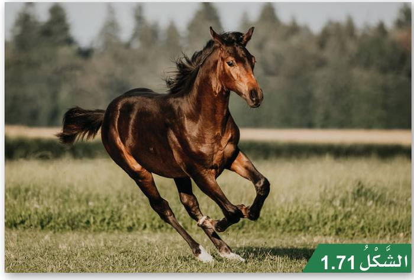
   - أ) منتج
   - ب) فريسة
   - ج) مفترس
   - د) آكل لحوم
3. أيّ جملة من الجمل الآتية خاطئة؟
   - أ) يمكن للمنتجات أن تكون من النباتات أو الحيوانات.
   - ب) تصنع المنتجات غذاءها بنفسها.
   - ج) توجد المنتجات في المستوى الأول من السلسلة الغذائية.
   - د) يتم التغذي على المنتجات من الحيوانات آكلة العشب والقوارت.

#### أولًا: اختر الإجابة الصحيحة (أسئلة محوّلة)

1. ما المنتجات في السلسلة الغذائية؟
   - أ) حيوانات تصطاد غيرها
   - ب) كائنات حيّة تصنع غذاءها بنفسها
   - ج) حيوانات تأكل الحيوانات الميتة
   - د) كائنات تحلّل الأحياء الميتة
2. ما المفترس؟
   - أ) حيوان يُصطاد
   - ب) حيوان لا يأكل
   - ج) نبات يصنع غذاءه
   - د) حيوان يصطاد حيوانات أخرى ويأكلها
3. ما الفريسة؟
   - أ) حيوان يصطاده حيوان آخر ويأكله
   - ب) حيوان يصطاد الحيوانات
   - ج) نبات
   - د) كائن يصنع الغذاء
4. في المستوى الأوّل من السلسلة الغذائية توجد دائمًا:
   - أ) المنتجات
   - ب) الفرائس
   - ج) المفترسات
   - د) آكلات اللحوم
5. في السلسلة الغذائية: نبات ← جرادة ← عصفور، أيّ كائنٍ مفترس؟
   - أ) النبات
   - ب) العصفور
   - ج) الجرادة
   - د) لا يوجد مفترس
6. في السلسلة الغذائية: نبات ← جرادة ← عصفور، أيّ كائنٍ هو فريسة العصفور؟
   - أ) النبات فقط
   - ب) الجرادة
   - ج) العصفور
   - د) النبات والعصفور
7. أيّ العبارات الآتية خاطئة؟
   - أ) المنتجات تصنع غذاءها بنفسها
   - ب) المنتجات تأكل الحيوانات الصغيرة
   - ج) المنتجات توجد في بداية السلسلة
   - د) النباتات من المنتجات
8. أيّ هذه الكائنات منتج؟
   - أ) الأرنب
   - ب) الثعلب
   - ج) النخلة
   - د) الصقر
9. يأكل الثعلب الأرنب. أيّ العبارات الآتية صحيحة؟
   - أ) الثعلب فريسة والأرنب مفترس
   - ب) الثعلب مفترس والأرنب فريسة
   - ج) كلاهما منتج
   - د) كلاهما فريسة
10. أيّ سلسلةٍ غذائيةٍ صحيحةٌ؟
   - أ) حبوب ← فأر ← ثعبان ← نسر
   - ب) نسر ← ثعبان ← فأر ← حبوب
   - ج) فأر ← حبوب ← ثعبان ← نسر
   - د) حبوب ← ثعبان ← فأر ← نسر
11. ما الذي تحتاج إليه النباتات لتصنع غذاءها؟
   - أ) ضوء الشمس والماء
   - ب) الظلام فقط
   - ج) اللحوم
   - د) الحجارة
12. في السلسلة: عشب ← جرادة ← ضفدع ← ثعبان، أيّ كائنٍ يكون مفترسًا وفريسةً في الوقت نفسه؟
   - أ) العشب
   - ب) الجرادة
   - ج) الثعبان
   - د) الضفدع
13. أيّ العبارات الآتية صحيحة عن الأرنب والثعلب؟
   - أ) الأرنب فريسةٌ للثعلب
   - ب) الأرنب مفترسٌ للثعلب
   - ج) الأرنب منتج
   - د) الأرنب محلّل
14. لماذا تُسمّى النباتات منتجاتٍ؟
   - أ) لأنّها تنتج الحيوانات
   - ب) لأنّها تنتج غذاءها بنفسها
   - ج) لأنّها تنتج الحجارة
   - د) لأنّها تنتج المفترسات
15. أيّ كائنٍ يكون في المستوى الثاني من السلسلة: عشب ← أرنب ← ثعلب؟
   - أ) العشب
   - ب) الشمس
   - ج) الثعلب
   - د) الأرنب
16. أيّ العبارات الآتية صحيحة عن الحيوانات المفترسة؟
   - أ) لا تحتاج إلى غذاء
   - ب) تصنع غذاءها بنفسها
   - ج) تأكل الصخور
   - د) تصطاد الحيوانات الأخرى
17. في السلسلة: عشب ← أرنب ← ثعلب ← نسر، كم مستوًى فيها؟
   - أ) 2
   - ب) 3
   - ج) 5
   - د) 4

### الدرس 1.4: كيف أستطيع أن أبني سلاسل غذائية أكثر تعقيدًا؟

#### أولًا: اختر الإجابة الصحيحة

1. ما الوصف الصحيح للكائن الحي في السلسلة الغذائية؟
   - أ) يتواجد في أكثر من سلسلة غذائية واحدة.
   - ب) يتواجد في سلسلة غذائية واحدة فقط.
   - ج) يكون منتجًا ومفترسًا.
   - د) يتواجد في السلسلة الغذائية نفسها أكثر من مرة.
2. كم مستوى يمكن أن تتضمّن السلسلة الغذائية؟
   - أ) ما يصل إلى ثلاثة مستويات.
   - ب) بين ثلاثة وسبعة مستويات.
   - ج) ما يصل إلى تسعة مستويات.
   - د) بين ثلاثة وخمسة مستويات.
3. أيّ السلاسل الغذائية الآتية صحيحة؟
   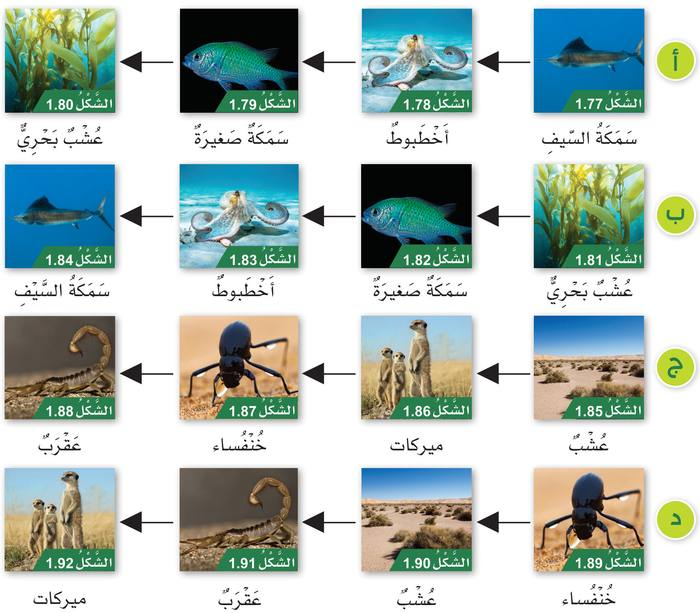
   - أ) السلسلة أ
   - ب) السلسلة ب
   - ج) السلسلة ج
   - د) السلسلة د
4. ألاحظ السلسلة الغذائية. ما العلاقة الغذائية لدى الثعبان؟
   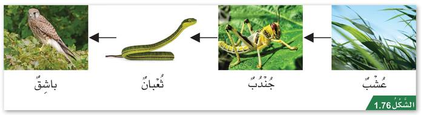
   - أ) إنه مفترس فقط.
   - ب) إنه فريسة فقط.
   - ج) إنه مفترس وفريسة.
   - د) إنه منتج ومفترس.

#### أولًا: اختر الإجابة الصحيحة (أسئلة محوّلة)

1. لماذا يمكن أن يظهر الكائن الحيّ نفسه في أكثر من سلسلةٍ غذائية؟
   - أ) لأنّه يعيش في موطنٍ واحدٍ فقط
   - ب) لأنّه لا يأكل شيئًا
   - ج) لأنّه يأكل أنواعًا مختلفة ويأكله أكثر من نوعٍ
   - د) لأنّه منتج فقط
2. ما الشبكة الغذائية؟
   - أ) شبكة صيد الأسماك
   - ب) سلسلة غذائية من كائنين فقط
   - ج) سلاسل غذائية متداخلة في موطنٍ واحد
   - د) موطن للنباتات فقط
3. في موطنٍ يأكل فيه الثعلب الأرانب والفئران، أيّ العبارات صحيحة؟
   - أ) الثعلب لا يأكل شيئًا
   - ب) الثعلب في سلسلةٍ واحدةٍ فقط
   - ج) الثعلب منتج
   - د) الثعلب في سلسلتين غذائيتين على الأقلّ
4. إذا قلّت أعداد الأرانب في موطنٍ، فماذا يحدث غالبًا للثعالب التي تأكلها؟
   - أ) لا يتغيّر شيء
   - ب) تزداد أعدادها فورًا
   - ج) تقلّ أعدادها أو تبحث عن غذاءٍ آخر
   - د) تتحوّل إلى نباتات
5. أيّ كائنٍ يوجد دائمًا في بداية كلّ سلسلةٍ في الشبكة الغذائية؟
   - أ) آكل الرمم
   - ب) المفترس
   - ج) الفريسة
   - د) المنتج
6. في السلسلة: عشب ← جرادة ← ضفدع ← ثعبان ← نسر، كم مستوًى فيها؟
   - أ) 3
   - ب) 4
   - ج) 5
   - د) 6
7. في الشبكة التي تتضمّن السلسلة: عشب ← جرادة ← ضفدع ← ثعبان، أيّ كائنٍ يصطاد حيوانًا ويصطاده حيوانٌ آخر؟
   - أ) العشب
   - ب) الثعبان
   - ج) الضفدع
   - د) لا يوجد
8. لماذا لا تكفي سلسلةٌ غذائيةٌ واحدةٌ لوصف الغذاء في موطنٍ كامل؟
   - أ) لأنّ الحيوانات لا تأكل
   - ب) لأنّ الموطن لا يحتوي على نباتات
   - ج) لأنّ السلاسل لا تُرسم
   - د) لأنّ الكائنات في الموطن تأكل أنواعًا متعدّدة
9. ما أقلّ عدد من الكائنات الحيّة في السلسلة الغذائية؟
   - أ) كائن واحد
   - ب) كائنان على الأقلّ
   - ج) خمسة كائنات
   - د) لا يوجد حدّ
10. في الشبكة الغذائية: يأكل الصقر الأرنب والفأر، ويأكل الأرنب والفأر العشب. كم سلسلة فيها؟
   - أ) واحدة
   - ب) اثنتان
   - ج) ثلاث
   - د) أربع
11. أيّ الكائنات الآتية لا يصلح أن يكون في بداية سلسلةٍ غذائية؟
   - أ) الشجرة
   - ب) العشب
   - ج) الثعبان
   - د) النخلة
12. إذا اختفى الجراد من موطنٍ، فأيّ الكائنات تتأثّر أوّلًا في السلسلة: عشب ← جرادة ← ضفدع؟
   - أ) الضفدع
   - ب) العشب فقط
   - ج) الشمس
   - د) لا يتأثّر أحد
13. أيّ العبارات الآتية صحيحة عن الأسهم في الشبكة الغذائية؟
   - أ) الأسهم لا معنى لها
   - ب) الأسهم تتّجه من الآكل إلى المأكول
   - ج) كلّ سهمٍ يتّجه من الكائن المأكول إلى الآكل
   - د) الأسهم تتّجه إلى الشمس فقط
14. أيّ الكائنات الآتية يمكن أن يكون في أكثر من سلسلةٍ غذائيةٍ في الموطن نفسه؟
   - أ) حيوان لا يأكله أحد ولا يأكل أحدًا
   - ب) نبات يعيش وحده
   - ج) الفأر الذي تأكله الأفعى والبومة
   - د) حجر
15. ما الكائن في أعلى السلسلة الغذائية عادةً؟
   - أ) المفترس الأكبر
   - ب) آكل العشب
   - ج) المنتج
   - د) النبات الصغير
16. في السلسلة: عشب ← أرنب ← ثعلب، أيّ كائنٍ يتغذى عليه الثعلب مباشرةً؟
   - أ) الأرنب
   - ب) العشب
   - ج) الشمس
   - د) لا شيء

### الدرس 1.5: كيف تكون الأسنان والمناقير متخصصة؟

#### أولًا: اختر الإجابة الصحيحة

1. ما أنواع الحيوانات التي لديها غالبًا قواطع عريضة ومسطحة؟
   - أ) الحيوانات آكلة اللحوم والحيوانات آكلة العشب.
   - ب) القوارت والمنتجات.
   - ج) الحيوانات آكلة العشب والقوارت.
   - د) المنتجات والحيوانات آكلة اللحوم.
2. أيّ من الحيوانات الآتية قد تمتلك أنيابًا حادة؟
   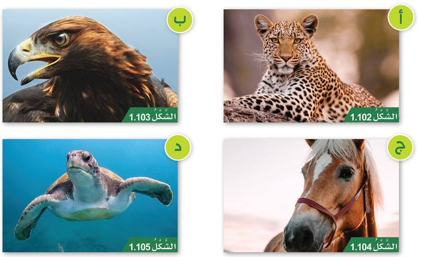
   - أ) الحيوان أ
   - ب) الحيوان ب
   - ج) الحيوان ج
   - د) الحيوان د
3. أيّ جملة من الجمل الآتية تصف مناقير بعض القوارت؟
   - أ) إنها عريضة ومسطحة ولها طرف مستدير.
   - ب) إنها عريضة ومسطحة ولها طرف مدبب.
   - ج) إنها طويلة ورفيعة ولها طرف مستدير.
   - د) إنها طويلة وحادة.

#### أولًا: اختر الإجابة الصحيحة (أسئلة محوّلة)

1. ما وظيفة القواطع العريضة والمسطّحة؟
   - أ) قطع النباتات
   - ب) تمزيق اللحم
   - ج) الرؤية
   - د) السباحة
2. ما وظيفة الأنياب الحادّة؟
   - أ) طحن العشب
   - ب) شرب الماء
   - ج) تمزيق اللحم
   - د) التنفّس
3. ما وظيفة الأضراس العريضة؟
   - أ) الرؤية في الليل
   - ب) اصطياد الفريسة
   - ج) طحن الطعام النباتي
   - د) حماية الجلد
4. أيّ الحيوانات الآتية لها أسنانٌ مسطّحةٌ وعريضةٌ؟
   - أ) الأسد
   - ب) البقرة
   - ج) النمر
   - د) الذئب
5. أيّ الحيوانات الآتية لها أنيابٌ حادّةٌ؟
   - أ) الأرنب
   - ب) النمر
   - ج) الجمل
   - د) الحصان
6. لماذا تمتلك آكلات اللحوم أسنانًا حادّةً؟
   - أ) لتمزّق اللحم
   - ب) لتقطع العشب
   - ج) لتطحن الحبوب فقط
   - د) لتصدر الصوت
7. لماذا تمتلك آكلات العشب أضراسًا عريضةً؟
   - أ) لتحفر الأرض
   - ب) لتصطاد الفرائس
   - ج) لتخيف الحيوانات
   - د) لتطحن النباتات
8. طائرٌ منقاره طويلٌ ورفيعٌ. على ماذا يتغذى غالبًا؟
   - أ) على رحيق الأزهار أو الحشرات الصغيرة
   - ب) على الحيوانات الكبيرة
   - ج) على الصخور
   - د) على الأخشاب
9. طائرٌ منقاره قصيرٌ وقويٌّ ومعقوف. على ماذا يتغذى غالبًا؟
   - أ) على الماء فقط
   - ب) على رحيق الأزهار
   - ج) على اللحوم
   - د) على الأوراق
10. أيّ الطيور الآتية له منقارٌ معقوفٌ حادّ؟
   - أ) البطّة
   - ب) الصقر
   - ج) الهدهد
   - د) الحمامة
11. ما الذي تساعدنا أسنان الحيوان على معرفته؟
   - أ) مكان نومه
   - ب) عمره بالضبط
   - ج) لونه
   - د) نوع غذائه
12. أيّ الأسنان الآتية تنفع في تمزيق اللحم؟
   - أ) القواطع المسطّحة
   - ب) الأنياب
   - ج) الأضراس العريضة المسطّحة
   - د) لا شيء
13. لماذا تمتلك القوارت أنواعًا متعدّدةً من الأسنان؟
   - أ) لأنّها لا تأكل
   - ب) لأنّها تأكل النباتات فقط
   - ج) لأنّها تأكل النباتات واللحوم معًا
   - د) لأنّها تصنع غذاءها
14. أيّ العبارات الآتية صحيحة؟
   - أ) الأسنان لا علاقة لها بالغذاء
   - ب) جميع الحيوانات لها أسنان متشابهة
   - ج) المناقير كلها متشابهة
   - د) أسنان الحيوان وأنواع مناقير الطيور تتناسب مع غذائها
15. أيّ الحيوانات الآتية تحتاج إلى أسنانٍ قاطعةٍ لقطع الأوراق؟
   - أ) الغزال
   - ب) الأسد
   - ج) النمر
   - د) الصقر
16. طائرٌ منقاره عريضٌ ومسطّحٌ. أيّ الطيور الآتية يشبهه؟
   - أ) البطّة
   - ب) الصقر
   - ج) النسر
   - د) الهدهد
17. طائرٌ له منقار قصير وقويّ ومخروطيّ الشكل. ما الغذاء الأرجح لهذا الطائر؟
   - أ) الحشرات الدقيقة تحت اللحاء
   - ب) الرحيق
   - ج) الأسماك
   - د) البذور الصلبة

### الدرس 1.6: كيف ترتبط خصائص الحيوانات بغذائها؟

#### أولًا: اختر الإجابة الصحيحة

1. ما الخصائص الجسمية التي تمتلكها العديد من الحيوانات آكلة العشب؟
   - أ) مخالب وأسنان حادة.
   - ب) عينان تقعان في مقدمة الرأس.
   - ج) لا تمتلك عينين.
   - د) عينان تقعان على جانبي الرأس.
2. كيف تصنَّف الطيور ذات المناقير والمخالب الحادة؟
   - أ) حيوانات آكلة اللحوم أو قوارت.
   - ب) حيوانات آكلة العشب أو حيوانات آكلة اللحوم.
   - ج) قوارت أو حيوانات آكلة العشب.
   - د) حيوانات آكلة العشب.
3. أنظر إلى عيني كل طائر. أيّ الطيور الآتية من المرجح أن تكون من الحيوانات آكلة اللحوم؟
   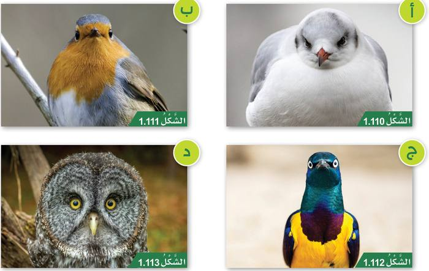
   - أ) الطائر أ
   - ب) الطائر ب
   - ج) الطائر ج
   - د) الطائر د

#### رابعًا: أجب عن الأسئلة الآتية (مسائل وتفكير)

4. أنظر إلى القط. أقدّم طريقتين يمكن من خلالهما أن أحدّد أنه من الحيوانات آكلة اللحوم.
   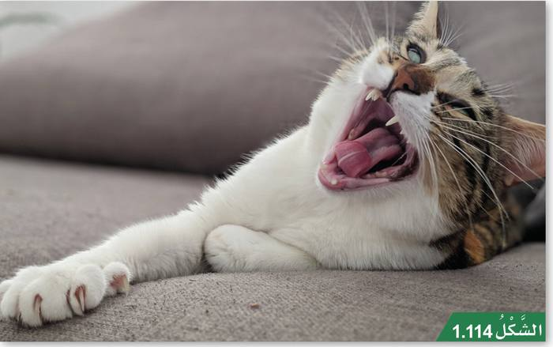

#### أولًا: اختر الإجابة الصحيحة (أسئلة محوّلة)

1. أين تقع عينا معظم الحيوانات المفترسة؟
   - أ) على جانبي الرأس
   - ب) في مقدّمة الرأس
   - ج) في الذيل
   - د) على الظهر
2. أين تقع عينا معظم آكلات العشب؟
   - أ) في مقدّمة الرأس
   - ب) على جانبي الرأس
   - ج) على الظهر
   - د) في الأذنين
3. لماذا تقع عينا الأرنب على جانبي رأسه؟
   - أ) ليرى مساحةً واسعةً ويكتشف الأعداء
   - ب) ليصطاد الفرائس
   - ج) لأنّه لا يحتاج إلى النظر
   - د) ليرى الأشياء القريبة فقط
4. لماذا تقع عينا الأسد في مقدّمة رأسه؟
   - أ) ليخفي عينيه
   - ب) ليرى الخلف فقط
   - ج) ليقدّر المسافة إلى فريسته
   - د) ليرى في الظلام فقط
5. أيّ الخصائص الآتية تمتلكها آكلات اللحوم غالبًا؟
   - أ) لا مخالب ولا أسنان
   - ب) أسنان مسطّحة فقط
   - ج) مخالب وأسنان حادّة
   - د) عيون على الجانبين فقط
6. ما فائدة المخالب الحادّة للصقر؟
   - أ) إمساك الفريسة
   - ب) حفر الأنفاق
   - ج) السباحة
   - د) طحن الحبوب
7. أيّ الحيوانات الآتية يمتلك حوافر لا مخالب؟
   - أ) الصقر
   - ب) الأسد
   - ج) الحصان
   - د) النمر
8. كيف يمكنك أن تعرف أنّ حيوانًا من آكلات العشب؟
   - أ) له منقار معقوف
   - ب) له أنياب حادّة وعيناه أماميتان
   - ج) له مخالب حادّة فقط
   - د) أسنانه مسطّحة وعيناه على جانبي رأسه
9. كيف تعرف أنّ حيوانًا من آكلات اللحوم؟
   - أ) ليس له أسنان
   - ب) أسنانه مسطّحة وعيناه جانبيتان
   - ج) أنيابه حادّة وعيناه أماميتان
   - د) يعيش في الماء فقط
10. ما فائدة سرعة الجري لدى الغزال؟
   - أ) الهرب من المفترسات
   - ب) اصطياد الفرائس
   - ج) طحن الغذاء
   - د) صنع الغذاء
11. ما فائدة الألوان المموّهة لبعض الحيوانات؟
   - أ) الطيران
   - ب) جذب الأعداء
   - ج) تغيير الغذاء
   - د) الاختباء من الأعداء أو الفرائس
12. طائرٌ له منقارٌ معقوفٌ ومخالب حادّة. كيف يُصنَّف غالبًا؟
   - أ) محلّل
   - ب) آكل عشب
   - ج) منتج
   - د) آكل لحوم
13. أيّ الحيوانات الآتية يمتلك عينين أماميتين؟
   - أ) الغزال
   - ب) الأرنب
   - ج) النمر
   - د) الحصان
14. أيّ الحيوانات الآتية يمتلك عينين على جانبي الرأس؟
   - أ) الذئب
   - ب) الأسد
   - ج) البقرة
   - د) النسر
15. ما أهمّ ما يحتاج إليه المفترس ليصطاد؟
   - أ) جلد سميك فقط
   - ب) أسنان مسطّحة فقط
   - ج) حواس قوية وأسنان أو مخالب حادّة
   - د) ألوان زاهية فقط
16. لماذا يُعدّ لون الجمل مناسبًا لبيئته؟
   - أ) يجعله أثقل
   - ب) يشبه لون الرمال فيساعده على التخفّي
   - ج) يجعله أسرع
   - د) يمنعه من الأكل
17. في صورة قطّ يتثاءب تظهر أسنانه الحادّة المدبّبة ومخالبه المعقوفة. ما الدليل الذي يبيّن أنّه من آكلات اللحوم؟
   - أ) زعانف وخياشيم
   - ب) أسنان عريضة مسطّحة وحوافر
   - ج) منقار طويل ورفيع
   - د) أسنان حادّة مدبّبة ومخالب معقوفة

### الدرس 1.7: ما آكلات الرمم والمحللات؟

#### أولًا: اختر الإجابة الصحيحة

1. ما آكل الرمم؟
   - أ) حيوان يتغذى على النباتات.
   - ب) حيوان يتغذى على النباتات والحيوانات الأخرى.
   - ج) كائن حي يتغذى على الكائنات الحية الأخرى.
   - د) حيوان يتغذى على الحيوانات الميتة.
2. أختار الصورة التي تظهر آكل رمم.
   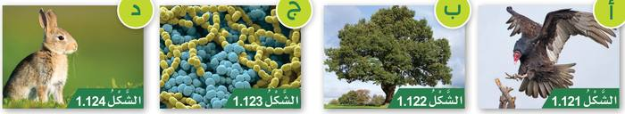
   - أ) الصورة أ
   - ب) الصورة ب
   - ج) الصورة ج
   - د) الصورة د
3. أيّ الجمل الآتية تتضمن أفضل وصف للمحللات؟
   - أ) المحللات كائنات حية تقوم بتحليل أجزاء النباتات والحيوانات الميتة.
   - ب) المحللات كائنات حية تقوم بتحليل أجزاء النباتات الميتة فقط.
   - ج) المحللات كائنات حية تقوم بتحليل أجزاء الحيوانات الميتة فقط.
   - د) المحللات كائنات حية تقوم بإنتاج غذائها بنفسها.
4. أختار الصورة التي لا تظهر محللًا.
   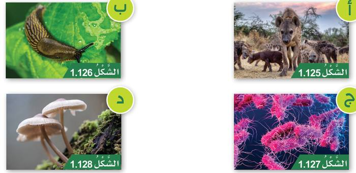
   - أ) الصورة أ
   - ب) الصورة ب
   - ج) الصورة ج
   - د) الصورة د

#### رابعًا: أجب عن الأسئلة الآتية (مسائل وتفكير)

5. أذكر سببًا واحدًا يبيّن أهمية المحللات بالنسبة إلى مواطنها.
6. أفسّر ما قد يحدث للمواطن في حال عدم وجود آكلات الرمم.

#### أولًا: اختر الإجابة الصحيحة (أسئلة محوّلة)

1. ما الحيوانات التي تتغذى على بقايا الحيوانات الميتة؟
   - أ) آكلات العشب
   - ب) المنتجات
   - ج) آكلات الرمم
   - د) المفترسات فقط
2. أيّ الحيوانات الآتية من آكلات الرمم؟
   - أ) الأرنب
   - ب) النسر
   - ج) الجمل
   - د) الحصان
3. ما المحلّلات؟
   - أ) نباتات تصنع غذاءها
   - ب) كائنات حيّة تحلّل بقايا الكائنات الميتة
   - ج) حيوانات تصطاد غيرها
   - د) حيوانات آكلة عشب
4. أيّ الكائنات الآتية من المحلّلات؟
   - أ) الأرنب
   - ب) الأسد
   - ج) الفطريات
   - د) العشب
5. ماذا تعيد المحلّلات إلى التربة؟
   - أ) الضوء
   - ب) الماء فقط
   - ج) المواد المغذّية
   - د) الحرارة
6. ماذا يحدث للنباتات إذا لم توجد محلّلات في التربة؟
   - أ) لا يتغيّر شيء
   - ب) تنمو أسرع
   - ج) تقلّ المواد المغذّية فتضعف
   - د) تصبح حيوانات
7. ما الفرق بين آكلات الرمم والمحلّلات؟
   - أ) آكلات الرمم تصنع غذاءها
   - ب) لا فرق بينهما
   - ج) المحلّلات تصطاد الأحياء
   - د) آكلات الرمم حيوانات تأكل الميتة، والمحلّلات تحلّلها وتحوّلها إلى مواد مغذّية
8. أيّ الآتي يمثّل آكلات الرمم؟
   - أ) الأبقار والأغنام
   - ب) الأرانب والغزلان
   - ج) النخيل والعشب
   - د) النسور والضباع
9. ما الذي تتخلّص منه آكلات الرمم في الموطن؟
   - أ) الحيوانات الميتة
   - ب) النباتات الحيّة
   - ج) الماء
   - د) الصخور
10. أيّ العبارات الآتية خاطئة؟
   - أ) المحلّلات تحلّل الكائنات الميتة
   - ب) المحلّلات تصنع غذاءها بالشمس
   - ج) المحلّلات تعيد المغذّيات للتربة
   - د) الفطريات من المحلّلات
11. أيّ الكائنات الآتية يمكن أن تتحلّل بواسطتها ورقة نباتٍ ميتة؟
   - أ) الأسماك
   - ب) الأسود
   - ج) النسور فقط
   - د) الفطريات والبكتيريا
12. ما الذي قد يحدث في الموطن لو لم توجد آكلات الرمم؟
   - أ) تختفي الشمس
   - ب) تزداد المنتجات فقط
   - ج) تتراكم الحيوانات الميتة
   - د) لا يحدث شيء
13. أيّ العبارات الآتية صحيحة؟
   - أ) آكلات الرمم هي المنتجات
   - ب) آكلات الرمم لا تأكل أبدًا
   - ج) آكلات الرمم من النباتات
   - د) بعض آكلات الرمم تصطاد أيضًا
14. ما علاقة المحلّلات بمستويات السلسلة الغذائية؟
   - أ) تتغذى على بقايا الكائنات الميتة في أيّ مستوى
   - ب) في المستوى الأوّل دائمًا
   - ج) لا تظهر أبدًا
   - د) تأكل الشمس
15. لماذا تُعدّ المحلّلات مهمّةً للنباتات؟
   - أ) لأنّها تمنع المطر
   - ب) لأنّها تأكل النباتات
   - ج) لأنّها تزوّد التربة بالمغذّيات
   - د) لأنّها تصنع الضوء
16. أيّ الحيوانات الآتية يُعدّ من آكلات الرمم؟
   - أ) النسر الذي يتغذّى على جثث الحيوانات الميتة
   - ب) الغزال
   - ج) الأرنب
   - د) الجمل

### الدرس 1.8: ماذا أعرف عن السلاسل الغذائية؟

#### أولًا: اختر الإجابة الصحيحة

1. ما الحيوان آكل العشب؟
   - أ) حيوان يتغذى على النباتات والحيوانات الميتة.
   - ب) حيوان يتغذى على النباتات فقط.
   - ج) حيوان يتغذى على الحيوانات الأخرى فقط.
   - د) كائن حي ينتج الطاقة التي يحتاج إليها بنفسه.
2. أيّ الصور الآتية تظهر مثالًا على محلل؟
   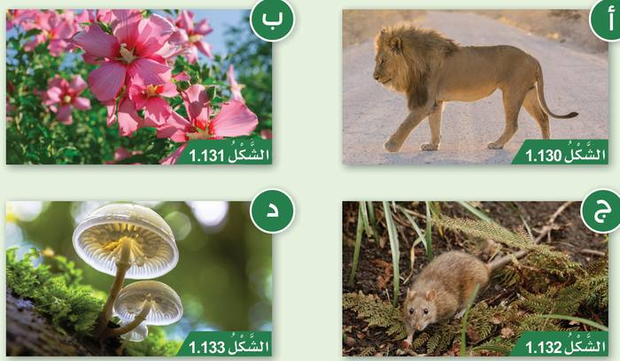
   - أ) الصورة أ
   - ب) الصورة ب
   - ج) الصورة ج
   - د) الصورة د
3. ما الذي تبينه السلسلة الغذائية؟
   - أ) نوع غذاء الفرائس.
   - ب) العلاقات الغذائية بين بعض الكائنات الحية في موطن محدد.
   - ج) جميع الكائنات الحية الموجودة في موطن محدد.
   - د) العلاقات الغذائية بين جميع الكائنات الحية في موطن محدد.
4. لماذا تعد المحللات مهمة في السلاسل الغذائية؟
   - أ) إنها تعيد المواد الغذائية المستخرجة من النباتات والحيوانات الميتة إلى التربة.
   - ب) إنها تنتج الطاقة التي تحتاج إليها باستخدام ضوء الشمس.
   - ج) إنها تمنع النباتات الجديدة من النمو.
   - د) إنها تصطاد الحيوانات الأصغر حجمًا.

#### رابعًا: أجب عن الأسئلة الآتية (مسائل وتفكير)

5. أعطي مثالًا على آكلات اللحوم.
6. كيف تحصل المنتجات على الطاقة التي تحتاج إليها؟
7. أحدّد المفترس والفريسة والمنتج في السلسلة الغذائية الآتية.
   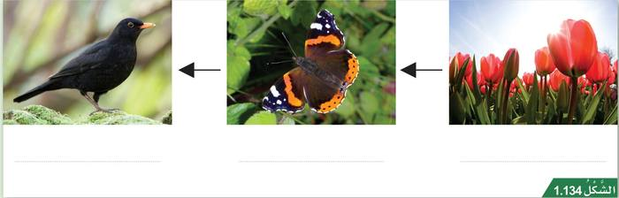
8. لماذا تقع عيون العديد من الحيوانات المفترسة في مقدمة رأسها؟
9. أحدّد إن كانت العبارة صحيحة أم خاطئة: تتغذى آكلات الرمم على النباتات الميتة.
10. أحدّد إن كانت العبارة صحيحة أم خاطئة: آكلات الرمم مهمة لأنها تتخلص من الحيوانات الميتة في المواطن.
11. أحدّد إن كانت العبارة صحيحة أم خاطئة: بعض آكلات الرمم تصطاد الحيوانات الأخرى أيضًا لتتغذى عليها.
12. ألاحظ الخروف. أدوّن خاصية جسمية للفرائس. أفسّر سبب امتلاك بعض الفرائس هذه الخاصية في التوصيف.
   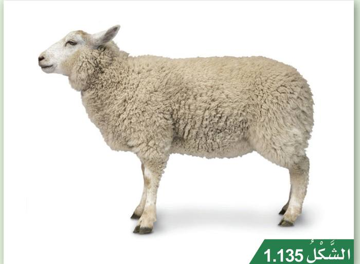
13. هل يعد الإنسان من آكلات العشب أم من آكلات اللحوم أم من القوارت؟
14. ألاحظ الطائرين. أوضح أيهما يعد حيوانًا مفترسًا، وأفسر كيف أعرف ذلك.
   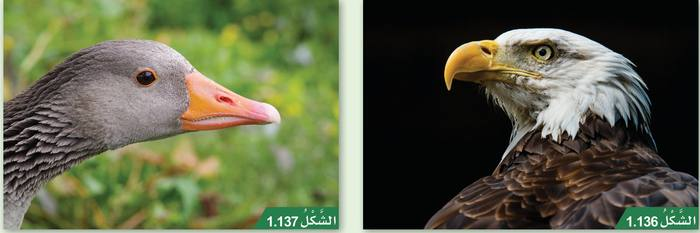

#### أولًا: اختر الإجابة الصحيحة (أسئلة محوّلة)

1. أيّ الحيوانات الآتية من آكلات اللحوم؟
   - أ) الحصان
   - ب) الأسد
   - ج) الجمل
   - د) الأرنب
2. كيف تحصل المنتجات على الطاقة؟
   - أ) من ضوء الشمس
   - ب) من أكل الحيوانات
   - ج) من التربة فقط
   - د) من الرياح
3. في السلسلة: عشب ← جرادة ← عصفور ← صقر، أيّ كائنٍ هو المفترس الأعلى؟
   - أ) العشب
   - ب) الجرادة
   - ج) الصقر
   - د) العصفور
4. في السلسلة: عشب ← جرادة ← عصفور ← صقر، أيّ كائنٍ منتج؟
   - أ) الجرادة
   - ب) العشب
   - ج) العصفور
   - د) الصقر
5. أيّ العبارات الآتية خاطئة؟
   - أ) آكلات اللحوم تتغذى على الحيوانات
   - ب) آكلات العشب تتغذى على الحيوانات
   - ج) المحلّلات تحلّل الكائنات الميتة
   - د) المنتجات تصنع غذاءها
6. أيّ الأزواج الآتية يمثّل مفترسًا وفريسةً؟
   - أ) الصقر والأرنب
   - ب) الأرنب والعشب
   - ج) العشب والشمس
   - د) الفطر والتربة
7. لماذا تقع عينا الحيوان المفترس في مقدّمة رأسه؟
   - أ) لترى الخلف
   - ب) لتقدير المسافة إلى الفريسة
   - ج) لتبتعد عن الضوء
   - د) لتحمي الرأس
8. أيّ العبارات الآتية صحيحة؟
   - أ) آكلات الرمم تأكل الشمس
   - ب) آكلات الرمم هي المنتجات
   - ج) آكلات الرمم تصنع غذاءها
   - د) آكلات الرمم تتغذى على الحيوانات الميتة
9. ما مثالٌ على آكلات العشب؟
   - أ) النمر
   - ب) الأسد
   - ج) الغزال
   - د) الذئب
10. ما الفرق بين المنتج وآكل العشب؟
   - أ) آكل العشب يصنع غذاءه
   - ب) لا فرق بينهما
   - ج) المنتج يأكل الحيوانات
   - د) المنتج يصنع غذاءه وآكل العشب يأكل النباتات
11. ما أهمّية الشمس للسلاسل الغذائية؟
   - أ) مصدر الطاقة الأوّل للنباتات
   - ب) تأكل الحيوانات
   - ج) تحلّل الميتة
   - د) لا أهمّية لها
12. أيّ الكائنات الآتية من المحلّلات؟
   - أ) الأسد
   - ب) الأرنب
   - ج) البكتيريا
   - د) الصقر
13. ما معنى السهم في السلسلة الغذائية؟
   - أ) عدد الحيوانات
   - ب) اتجاه الجري
   - ج) اتجاه الشمس
   - د) ينتقل الغذاء والطاقة في اتجاه السهم

## الوحدة 2: الدوائر الكهربائية

### الدرس 2.1: ما الدوائر الكهربائية؟

#### أولًا: اختر الإجابة الصحيحة

1. أيّ المكونات الآتية يمكن استخدامه لتوصيل الدائرة الكهربائية أو قطعها؟
   - أ) مقاومة كهربائية.
   - ب) بطارية.
   - ج) مفتاح كهربائي.
   - د) محرّك كهربائي.
2. ما الذي سألاحظه عند إغلاق المفتاح الكهربائي في الدائرة الكهربائية المبيّنة في الشكل 2.14؟
   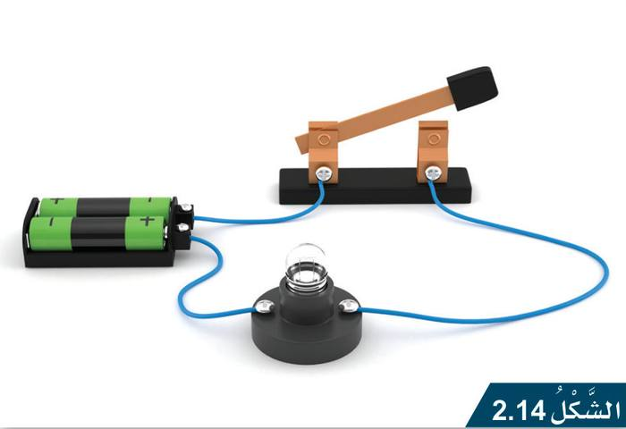
   - أ) لم يلاحظ أيّ تغيير.
   - ب) حركة وضوء.
   - ج) ضوء وحرارة.
   - د) حرارة وصوت.
3. أختار مجموعة مكونات الدائرة الكهربائية التي يمكن استخدامها لبناء دائرة كهربائية مغلقة من دون الحاجة إلى إضافة أيّ مكونات أخرى.
   - أ) بطارية، مفتاح كهربائي، محرك كهربائي، مصباح كهربائي
   - ب) أسلاك توصيل، مفتاح كهربائي، مقاومة كهربائية، مصباح كهربائي
   - ج) مفتاح كهربائي، مقاومة كهربائية، بطارية، مصباح كهربائي
   - د) بطارية، محرك كهربائي، مفتاح كهربائي، أسلاك توصيل

#### رابعًا: أجب عن الأسئلة الآتية (مسائل وتفكير)

4. أختار الأجهزة التي تعمل بواسطة المحرك الكهربائي. (دلة القهوة، غسالة، مروحة، مثقاب كهربائي، سيارة إسعاف، مكواة)
   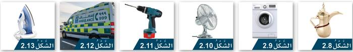

#### أولًا: اختر الإجابة الصحيحة (أسئلة محوّلة)

1. ما الدائرة الكهربائية المغلقة؟
   - أ) بطّاريةٌ فقط من دون مكوّنات
   - ب) مسار فيه فجوةٌ يتوقّف عندها التيار
   - ج) مصباحٌ فقط من دون أسلاك
   - د) مسار كاملٌ يسري فيه التيار الكهربائي
2. لماذا لا يضيء المصباح في دائرةٍ كهربائيّةٍ مفتوحة؟
   - أ) لأنّ المفتاح مغلق
   - ب) لأنّ الأسلاك مصنوعةٌ من الفضّة
   - ج) لأنّ الخلية مشحونةٌ
   - د) لأنّ المسار غير مكتملٍ فلا يسري التيار
3. ما وظيفة الخلية أو البطّارية في الدائرة الكهربائيّة؟
   - أ) تقطع الدائرة
   - ب) تزوّد الدائرة بالطاقة الكهربائيّة
   - ج) تصدر الضوء
   - د) تصدر الصوت
4. ما وظيفة المفتاح الكهربائيّ؟
   - أ) وصل الدائرة وقطعها
   - ب) إنتاج الطاقة
   - ج) إنتاج الضوء
   - د) إنتاج الصوت
5. ما وظيفة أسلاك التوصيل؟
   - أ) تخزين الطاقة
   - ب) إنتاج الحركة
   - ج) إنتاج الضوء
   - د) توصيل مكوّنات الدائرة ليسري فيها التيار
6. أيّ مكوّنٍ كهربائيٍّ ينتج الضوء؟
   - أ) المصباح الكهربائيّ
   - ب) الجرس الكهربائيّ
   - ج) المحرّك الكهربائيّ
   - د) المفتاح الكهربائيّ
7. أيّ مكوّنٍ كهربائيٍّ ينتج صوتًا؟
   - أ) المصباح الكهربائيّ
   - ب) الجرس الكهربائيّ
   - ج) المحرّك الكهربائيّ
   - د) المقاومة الكهربائيّة
8. أيّ جهازٍ من الأجهزة الآتية يعمل بمحرّكٍ كهربائيّ؟
   - أ) الجرس
   - ب) المصباح
   - ج) المروحة
   - د) السلك
9. أيّ مكوّنٍ كهربائيٍّ ينتج الحرارة؟
   - أ) المقاومة الكهربائيّة
   - ب) الجرس الكهربائيّ
   - ج) المفتاح الكهربائيّ
   - د) الخلية الكهربائيّة
10. ماذا يحدث عند فتح المفتاح الكهربائيّ في دائرةٍ مغلقة؟
   - أ) يزداد التيار
   - ب) يتوقّف سريان التيار
   - ج) تتحوّل الخلية إلى مصباح
   - د) لا يتغيّر شيء
11. ماذا يحدث عند إغلاق المفتاح الكهربائيّ في دائرةٍ مكتملةٍ تحتوي على خليةٍ ومصباح؟
   - أ) يسري التيار ويضيء المصباح
   - ب) ينطفئ المصباح
   - ج) تحترق الخلية
   - د) يتوقّف التيار
12. ما أقلّ مجموعةٍ من المكوّنات تكفي لإضاءة مصباحٍ؟
   - أ) جرسان فقط
   - ب) مفتاحان فقط
   - ج) مقاومتان فقط
   - د) خلية وأسلاك ومصباح في مسارٍ مغلق
13. أيّ العبارات الآتية خاطئة؟
   - أ) يسري التيار في الدائرة المغلقة
   - ب) يسري التيار الكهربائيّ في الدائرة المفتوحة
   - ج) المفتاح يقطع الدائرة عند فتحه
   - د) المصباح يضيء عند سريان التيار
14. ما الذي يحدث إذا انفصل سلكٌ في دائرةٍ كانت مغلقة؟
   - أ) يضيء المصباح أكثر
   - ب) يزداد التيار
   - ج) تصبح مفتوحةً ويتوقّف التيار
   - د) لا يتغيّر شيء
15. لماذا نستعمل الدوائر الكهربائيّة؟
   - أ) لتبريد الهواء فقط
   - ب) لإنتاج الماء
   - ج) لتحويل الطاقة الكهربائيّة إلى ضوء أو حركة أو صوت أو حرارة
   - د) لتغيير لون الأسلاك
16. ما الذي يجب أن يتوفّر ليعمل أيّ جهازٍ كهربائيّ؟
   - أ) أسلاك طويلة جدًّا
   - ب) مفتاحان على الأقلّ
   - ج) عدّة مصابيح
   - د) مصدر طاقة ومسار مغلق
17. أيّ الأجهزة الآتية يعمل بواسطة محرّك كهربائي؟
   - أ) دلّة القهوة التقليدية
   - ب) المكواة الكهربائية
   - ج) المروحة الكهربائية
   - د) مصباح الإنارة

### الدرس 2.2: كيف أبني الدوائر الكهربائية؟

#### أولًا: اختر الإجابة الصحيحة

1. لمَ المصابيح ضمن هذه الدائرة الكهربائية غير مضاءة؟
   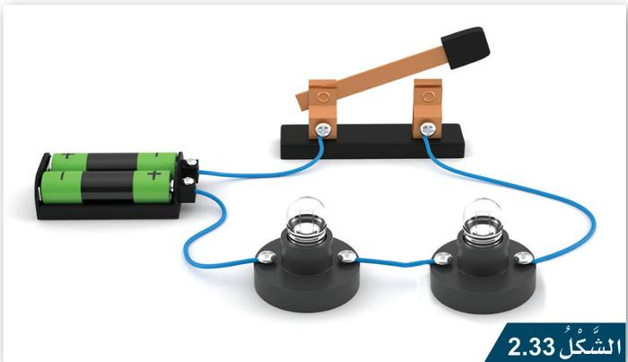
   - أ) لا توجد خلية كهربائية أو بطارية.
   - ب) المفتاح الكهربائي مفتوح.
   - ج) المفتاح الكهربائي مغلق.
   - د) المصابيح غير متصلة بأسلاك.
2. لماذا تعدّ هذه الدائرة الكهربائية دائرة متصلة على التوالي؟
   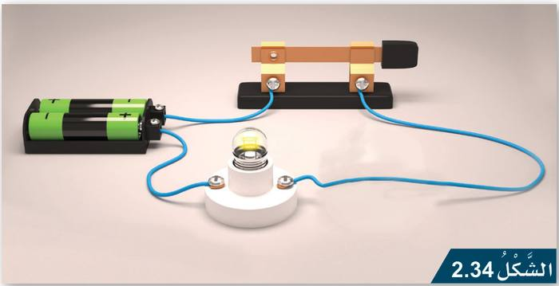
   - أ) تتضمن مصباحًا كهربائيًا واحدًا.
   - ب) لا يوجد انفصال ضمن الدائرة الكهربائية.
   - ج) المفتاح الكهربائي مغلق.
   - د) تتضمن مسارًا واحدًا.
3. أيّ دائرة من الدوائر الكهربائية الآتية متصلة على التوالي؟
   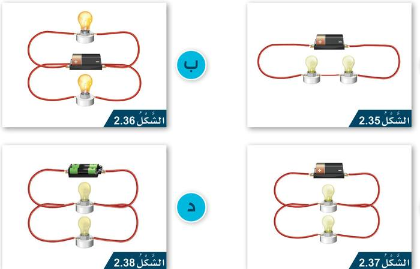
   - أ) الدائرة أ
   - ب) الدائرة ب
   - ج) الدائرة ج
   - د) الدائرة د

#### رابعًا: أجب عن الأسئلة الآتية (مسائل وتفكير)

4. أحدّد المصابيح التي يتحكم فيها المفتاح الكهربائي وأفسّر السبب.
   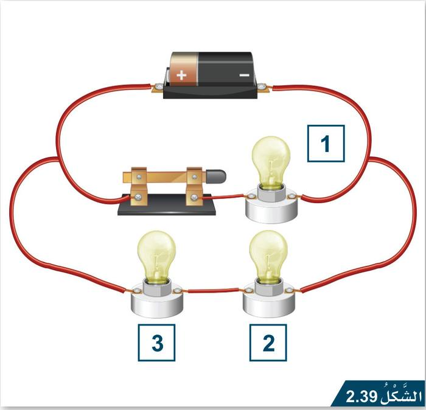

#### أولًا: اختر الإجابة الصحيحة (أسئلة محوّلة)

1. كم مسارًا يسلكه التيار في الدائرة المتصلة على التوالي؟
   - أ) مساران
   - ب) مسارٌ واحد
   - ج) ثلاثة مسارات
   - د) لا يسلك أيّ مسار
2. ما الدائرة المتصلة على التوالي؟
   - أ) دائرة بلا أسلاك
   - ب) دائرة فيها مسارات كثيرة
   - ج) دائرة مكوّناتها موصولةٌ واحدًا بعد الآخر في مسارٍ واحد
   - د) دائرة بلا مصدر طاقة
3. إذا احترق أحد المصباحين في دائرةٍ متصلةٍ على التوالي، فماذا يحدث للمصباح الآخر؟
   - أ) يتحوّل إلى جرس
   - ب) يضيء أكثر
   - ج) لا يتأثّر
   - د) ينطفئ
4. ماذا يحدث لجميع المصابيح عند فتح المفتاح في دائرة توالٍ فيها ثلاثة مصابيح؟
   - أ) تنطفئ كلّها
   - ب) ينطفئ مصباح واحدٌ فقط
   - ج) تضيء كلّها أكثر
   - د) يبقى مصباحان مضيئين
5. كم مفتاحًا يلزم للتحكّم في مصباحين معًا في دائرة توالٍ؟
   - أ) مفتاح واحد
   - ب) مفتاحان
   - ج) ثلاثة مفاتيح
   - د) لا يلزم أيّ مفتاح
6. خلية ومفتاح مغلق وسلك مفصول عن أحد طرفيه ومصباح. لماذا لا يضيء المصباح؟
   - أ) الدائرة مفتوحة بسبب السلك المفصول
   - ب) لأنّ المفتاح مغلق
   - ج) لأنّ الخلية موجودة
   - د) لأنّ المصباح جديد
7. ما أول ما تفحصه عند عدم إضاءة المصباح في دائرة كهربائيّة؟
   - أ) لون الأسلاك
   - ب) هل الدائرة مغلقة والأسلاك متّصلة جيّدًا
   - ج) حجم المفتاح
   - د) اسم الشركة المصنّعة
8. كيف تبني دائرةً متّصلةً على التوالي؟
   - أ) أصل المكوّنات واحدًا بعد الآخر في حلقةٍ واحدة
   - ب) أصل كلّ مكوّن بالخلية بسلكٍ منفصل
   - ج) أترك فجوةً في المسار
   - د) أستعمل مصباحًا واحدًا بلا خلية
9. ما الذي يجب أن تحتويه كلّ دائرةٍ كهربائيّةٍ لتعمل؟
   - أ) مفتاحان
   - ب) مصباحان على الأقلّ
   - ج) جرس ومحرّك
   - د) مصدر طاقة ومسار مغلق
10. ماذا نسمّي الدائرة التي فيها فجوةٌ أو انقطاع؟
   - أ) دائرة متصلة
   - ب) دائرة مغلقة
   - ج) دائرة مكتملة
   - د) دائرة مفتوحة
11. أيّ العبارات الآتية صحيحةٌ عن دائرة التوالي؟
   - أ) يمرّ التيار في مسارين
   - ب) يمرّ التيار عبر مكوّنٍ واحدٍ فقط
   - ج) لا يمرّ التيار أبدًا
   - د) يمرّ التيار عبر كلّ المكوّنات بالتتابع
12. لماذا قد لا يضيء مصباحٌ في دائرةٍ فيها بطّاريةٌ مفرغةٌ؟
   - أ) لأنّ البطّارية لا تزوّد الدائرة بالطاقة
   - ب) لأنّ المصباح كبير
   - ج) لأنّ المفتاح مغلق
   - د) لأنّ الأسلاك طويلة
13. كم خليةً كهربائيّةً تلزم على الأقلّ لتضيء مصباحًا في دائرةٍ بسيطة؟
   - أ) خليةٌ واحدة
   - ب) خليتان
   - ج) ثلاث خلايا
   - د) لا يلزم خلايا
14. أيّ المكوّنات الآتية لا يلزم وجودها لإضاءة مصباحٍ في دائرةٍ بسيطة؟
   - أ) أسلاك التوصيل
   - ب) الخلية الكهربائيّة
   - ج) المصباح
   - د) الجرس الكهربائيّ
15. في الدائرة المغلقة المتصلة على التوالي، أين يسري التيار؟
   - أ) في الهواء فقط
   - ب) في نصف المسار فقط
   - ج) خارج الأسلاك
   - د) في المسار الواحد كلّه
16. ما الذي يدلّ على أنّ الدائرة مغلقة؟
   - أ) يعمل المصباح أو الجهاز الموجود فيها
   - ب) ينطفئ المصباح
   - ج) تسخن الأسلاك دائمًا
   - د) يصدر المفتاح صوتًا
17. أيّ المكوّنات يمكن أن يُضاف على التوالي إلى دائرةٍ ليتحكّم في الدائرة كلّها؟
   - أ) الحجر
   - ب) الشمس
   - ج) السحابة
   - د) المفتاح الكهربائيّ

### الدرس 2.3: كيف أستطيع أن أرسم مخططات الدوائر الكهربائية؟

#### أولًا: اختر الإجابة الصحيحة

1. ماذا يمثل الرمز المبيّن في الشكل 2.46؟
   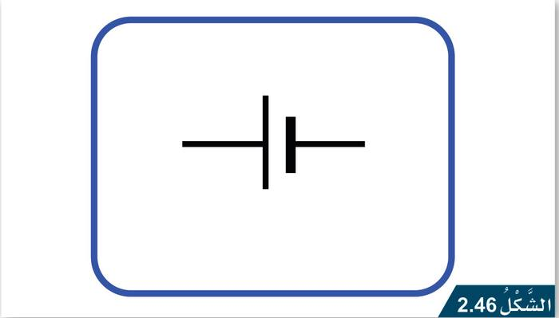
   - أ) خلية كهربائية
   - ب) بطارية
   - ج) مفتاح كهربائي مفتوح
   - د) مفتاح كهربائي مغلق
2. ماذا يمثل الرمز المبيّن في الشكل 2.47؟
   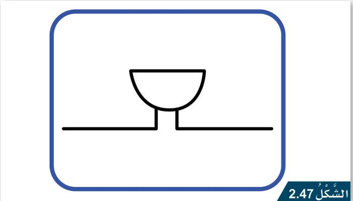
   - أ) مصباح كهربائي
   - ب) جرس كهربائي
   - ج) سلك توصيل
   - د) محرك كهربائي
3. ما أفضل وصف للدائرة الكهربائية المبيّنة في الشكل 2.48؟
   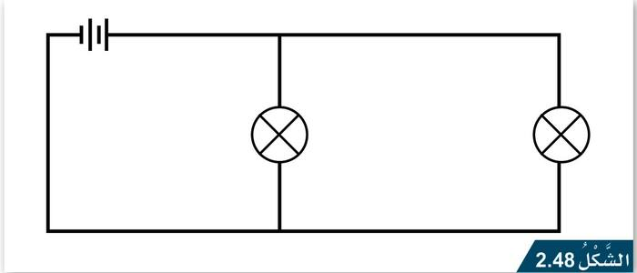
   - أ) دائرة كهربائية متصلة على التوالي تحتوي على بطارية ومصباحين كهربائيين.
   - ب) دائرة كهربائية متصلة على التوازي تحتوي على بطارية ومصباحين كهربائيين.
   - ج) دائرة كهربائية متصلة على التوازي تحتوي على خلية كهربائية ومحركين كهربائيين.
   - د) دائرة كهربائية متصلة على التوازي تحتوي على خلية كهربائية ومصباحين كهربائيين.

#### رابعًا: أجب عن الأسئلة الآتية (مسائل وتفكير)

4. أصل بخط بين كل مكوّن واسمه الصحيح. (سلك توصيل، محرك كهربائي، مقاومة كهربائية)
   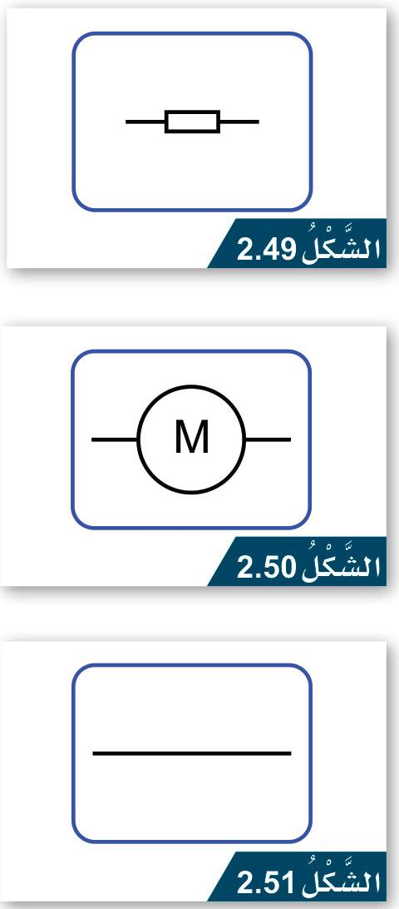

#### أولًا: اختر الإجابة الصحيحة (أسئلة محوّلة)

1. ما المكوّن الذي يمثّله الرمز: دائرةٌ بداخلها علامة (×)؟
   - أ) مقاومة كهربائيّة
   - ب) محرّك كهربائيّ
   - ج) جرس كهربائيّ
   - د) مصباح كهربائيّ
2. ما المكوّن الذي يمثّله الرمز: دائرةٌ بداخلها الحرف M؟
   - أ) مصباح كهربائيّ
   - ب) محرّك كهربائيّ
   - ج) خلية كهربائيّة
   - د) مفتاح كهربائيّ
3. ما المكوّن الذي يمثّله الرمز: مستطيلٌ صغير؟
   - أ) مصباح كهربائيّ
   - ب) خلية كهربائيّة
   - ج) مقاومة كهربائيّة
   - د) سلك توصيل
4. ما المكوّن الذي يمثّله الرمز: خطّان متوازيان أحدهما طويلٌ والآخر قصير؟
   - أ) مصباح كهربائيّ
   - ب) خلية كهربائيّة
   - ج) مفتاح كهربائيّ
   - د) جرس كهربائيّ
5. ما المكوّن الذي يمثّله الرمز: عدّة أزواجٍ من الخطوط المتوازية الطويلة والقصيرة؟
   - أ) مفتاح
   - ب) مصباح
   - ج) بطّارية
   - د) مقاومة
6. ماذا يمثّل الخطّ المستقيم الذي يصل بين رموز المكوّنات في المخطط؟
   - أ) خلية
   - ب) مفتاحًا مفتوحًا
   - ج) سلك توصيل
   - د) مصباحًا
7. ماذا يمثّل رمز فجوةٍ في الخطّ مع شرطةٍ مائلة؟
   - أ) مصباحًا
   - ب) مفتاحًا كهربائيًّا مغلقًا
   - ج) مفتاحًا كهربائيًّا مفتوحًا
   - د) محرّكًا
8. كيف يظهر المفتاح المغلق في مخطّط الدائرة؟
   - أ) الخطّ متّصلٌ من دون فجوة
   - ب) فجوةٌ في الخطّ
   - ج) دائرة بداخلها (×)
   - د) مستطيل صغير
9. لماذا نرسم مخطّطات الدوائر الكهربائيّة؟
   - أ) لنمثّل الدائرة برموزٍ بسيطةٍ يفهمها الجميع
   - ب) لنلوّن الأسلاك
   - ج) لنزيد شدّة التيار
   - د) لنصنع البطّاريات
10. ماذا يوضّح مخطّط الدائرة الكهربائيّة؟
   - أ) وزن البطّارية
   - ب) ألوان الأسلاك
   - ج) حجم الغرفة
   - د) المكوّنات وكيفيّة اتّصالها
11. في مخطّط دائرةٍ مغلقةٍ فيها خليةٌ ومصباحٌ ومفتاحٌ مغلق، هل يضيء المصباح؟
   - أ) نعم، لأنّ الدائرة مكتملة
   - ب) لا، لأنّ المفتاح مغلق
   - ج) لا، لأنّ الخلية موجودة
   - د) لا يمكن أن يضيء
12. في مخطّط دائرةٍ فيها خليةٌ ومصباحٌ ومفتاحٌ مفتوح، هل يضيء المصباح؟
   - أ) لا، لأنّ الدائرة مفتوحة
   - ب) نعم، دائمًا
   - ج) نعم، لأنّ فيها خلية
   - د) يضيء نصف إضاءةٍ
13. بطّاريةٌ رمزها ثلاثة أزواجٍ من الخطوط. كم خليةً فيها؟
   - أ) ست خلايا
   - ب) خليّتان
   - ج) خلية واحدة
   - د) ثلاث خلايا
14. ما وظيفة المحرّك الكهربائيّ الذي رمزه دائرةٌ بداخلها M؟
   - أ) إنتاج الصوت
   - ب) إنتاج الضوء
   - ج) إنتاج الحركة
   - د) إنتاج الحرارة فقط
15. لماذا يستعمل العلماء الرموز نفسها في المخطّطات؟
   - أ) ليفهم الجميع المخطّط نفسه
   - ب) ليجعلوا الدائرة أسرع
   - ج) ليزيدوا الطاقة
   - د) لأنّ الرموز تغيّر التيار
16. أيّ المكوّنات الآتية رمزه مستطيل صغير ويسخن عند مرور التيار؟
   - أ) المصباح
   - ب) الخلية
   - ج) المقاومة الكهربائيّة
   - د) الجرس
17. كيف يُفضّل رسم الأسلاك في مخطّط الدائرة؟
   - أ) نقاطًا متفرّقة
   - ب) خطوطًا متعرّجةً وملوّنة
   - ج) دوائر كبيرة
   - د) خطوطًا مستقيمةً بزوايا قائمة

### الدرس 2.4: كيف أستطيع أن أستخدم مخطط دائرة كهربائية لأبنيها؟

#### أولًا: اختر الإجابة الصحيحة

1. ما المكونات التي أحتاج إليها لأبني الدائرة الكهربائية الآتية؟
   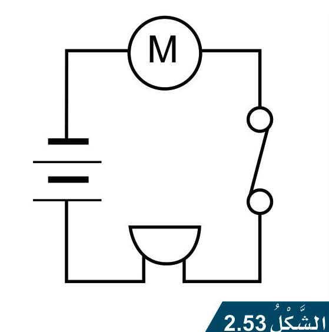
   - أ) خليتان كهربائيتان ومفتاح كهربائي ومصباح كهربائي ومحرك كهربائي وأسلاك
   - ب) خليتان كهربائيتان ومفتاح كهربائي ومحرك كهربائي وجرس كهربائي وأسلاك
   - ج) خلية كهربائية ومصباح كهربائي ومحرك كهربائي وجرس كهربائي وأسلاك
   - د) خليتان كهربائيتان ومحرك كهربائي وجرس كهربائي ومفتاح كهربائي
2. ما الذي يلزم لجعل هذه الدائرة الكهربائية تعمل؟
   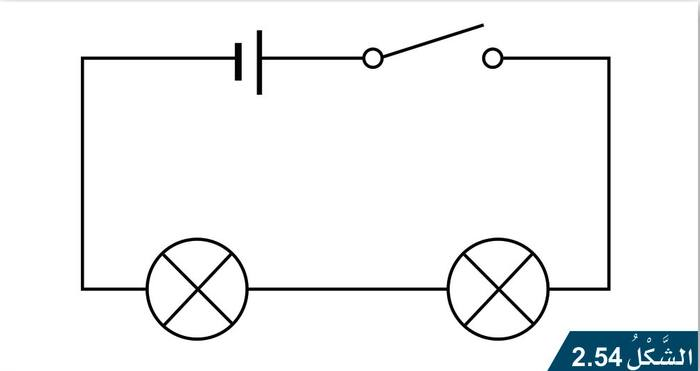
   - أ) إزالة مصباح كهربائي واحد
   - ب) إضافة بطارية
   - ج) إضافة مفتاح كهربائي
   - د) إغلاق المفتاح الكهربائي
3. ما التغييرات اللازمة لجعل هذه الدائرة الكهربائية تعمل بشكل صحيح؟
   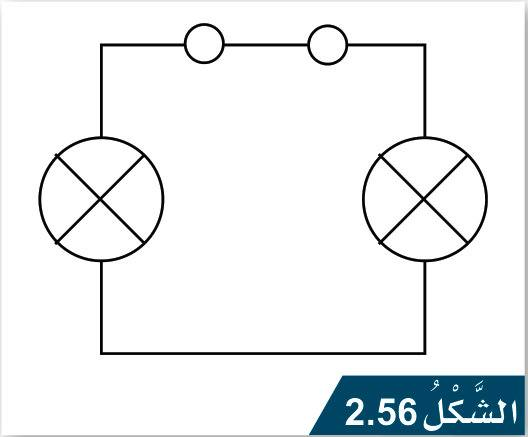
   - أ) إزالة أحد المصباحين الكهربائيين
   - ب) إضافة جرس كهربائي
   - ج) إضافة خلية كهربائية
   - د) إغلاق المفتاح الكهربائي
4. أيّ المكونات الآتية سوف تعمل بشكل صحيح في هذه الدائرة الكهربائية؟
   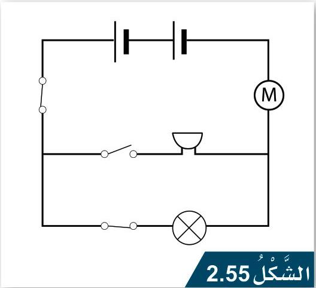
   - أ) المصباح الكهربائي والمحرك الكهربائي
   - ب) المحرك الكهربائي والجرس الكهربائي
   - ج) المصباح الكهربائي والجرس الكهربائي
   - د) جميع المكونات ستعمل

#### رابعًا: أجب عن الأسئلة الآتية (مسائل وتفكير)

5. أحدّد إن كان المصباح في الدائرة الكهربائية سيضيء، وأذكر أسباب ذلك.
   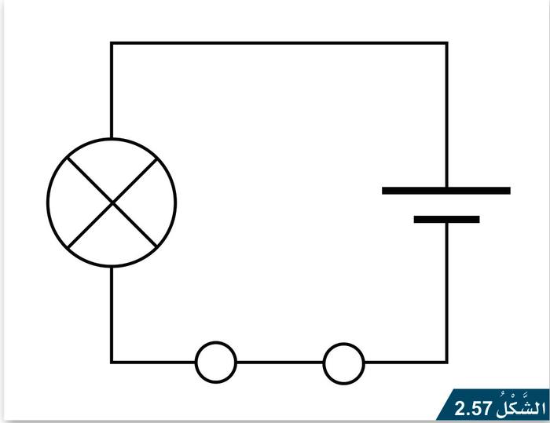

#### أولًا: اختر الإجابة الصحيحة (أسئلة محوّلة)

1. مخطّط دائرةٍ فيه خليةٌ ومفتاحٌ ومصباحٌ وجرسٌ على التوالي. كم مكوّنًا (من دون الأسلاك) يلزمك لبنائها؟
   - أ) خمسة مكوّنات
   - ب) ثلاثة مكوّنات
   - ج) أربعة مكوّنات
   - د) مكوّنان
2. مخطّط دائرةٍ فيه خليتان ومصباح. كم خليةً تحتاج إلى توصيلها؟
   - أ) ثلاث خلايا
   - ب) خلية واحدة
   - ج) خليتين
   - د) لا شيء
3. بنيتَ دائرةً من مخطّط ولا يضيء المصباح، والمفتاح مفتوح. ماذا تفعل؟
   - أ) أقطع السلك
   - ب) أزيل الخلية
   - ج) أفتح المفتاح أكثر
   - د) أغلق المفتاح
4. المفتاح مغلقٌ والأسلاك سليمةٌ والخلية جديدة ولكنّ المصباح لا يضيء. ما أقرب احتمالٍ للعطل؟
   - أ) المصباح تالف
   - ب) الخلية موجودة
   - ج) المفتاح مغلق
   - د) الأسلاك سليمة
5. كيف تتأكّد أنّ الدائرة التي بنيتها مطابقةٌ للمخطّط؟
   - أ) أقارن المكوّنات والتوصيلات بالمخطّط
   - ب) أعدّ الأسلاك فقط
   - ج) أنظر إلى لون المفتاح
   - د) أنتظر مدّةً طويلة
6. ما أوّل خطوةٍ لبناء دائرةٍ من مخطّط؟
   - أ) أجمع المكوّنات المذكورة في المخطّط
   - ب) أرسم المخطّط من جديد
   - ج) أفتح كلّ المفاتيح وأرميها
   - د) أستعمل مكوّناتٍ مختلفة
7. مخطّطٌ فيه محرّك ومصباح على التوالي. بعد البناء أضاء المصباح ولم يدر المحرّك. ما أقرب احتمالٍ؟
   - أ) المحرّك تالف أو غير موصول جيّدًا
   - ب) المصباح تالف
   - ج) الخلية فارغة تمامًا
   - د) المفتاح مفتوح
8. كيف تتحكّم في مصباحين معًا بمفتاحٍ واحد؟
   - أ) أستعمل ثلاثة مفاتيح
   - ب) أضعه خارج الدائرة
   - ج) أضع المفتاح على التوالي معهما في المسار نفسه
   - د) أنزع الخلية
9. أين تضع المفتاح الكهربائيّ في الدائرة؟
   - أ) على الطاولة فقط
   - ب) بعيدًا عن الدائرة
   - ج) في المسار نفسه الذي يسري فيه التيار
   - د) داخل الخلية
10. أيّ الأمور الآتية يُعدّ خطأً عند بناء الدائرة؟
   - أ) مقارنة البناء بالمخطّط
   - ب) وصل الأسلاك جيّدًا
   - ج) ترك طرف سلكٍ غير متّصلٍ بأيّ مكوّن
   - د) إغلاق المفتاح عند الاختبار
11. مخطّط دائرةٍ فيه ثلاثة مصابيح. كم مصباحًا تحتاج؟
   - أ) اثنين
   - ب) ثلاثة
   - ج) واحدًا
   - د) أربعة
12. استبدلتَ مصباحًا تالفًا بمصباحٍ سليمٍ في دائرةٍ مغلقةٍ باقي مكوّناتها سليمة. ماذا يحدث؟
   - أ) لا يضيء
   - ب) يضيء المصباح الجديد
   - ج) يحترق المفتاح
   - د) تتوقّف الخلية
13. لماذا نبدأ ببناء الدائرة والمفتاح مفتوح؟
   - أ) لأنّ المفتاح مكسور
   - ب) حتى لا يسري التيار أثناء التوصيل
   - ج) لتزيد الطاقة
   - د) لتضيء المصباح مبكّرًا
14. ماذا يعني أن تكون الدائرة مطابقةً للمخطّط؟
   - أ) نفس حجم الطاولة
   - ب) نفس لون الأسلاك فقط
   - ج) نفس المكوّنات ونفس ترتيب التوصيل
   - د) نفس عدد الخلايا فقط
15. كيف تختبر دائرةً بُنيت من مخطّط؟
   - أ) أقطع الأسلاك
   - ب) أفصل الخلية
   - ج) أغلق المفتاح وألاحظ هل يعمل المكوّن
   - د) أترك المفتاح مفتوحًا
16. ماذا تفعل إذا لم يعمل المكوّن بعد إغلاق المفتاح؟
   - أ) أفحص التوصيلات والمكوّنات
   - ب) أتجاهل المشكلة
   - ج) أضيف سلكًا قصيرًا بين طرفي الخلية
   - د) أشعل النار
17. ما الغرض من مقارنة الدائرة بالمخطّط بعد بنائها؟
   - أ) إتلاف الخلية
   - ب) تغيير المخطّط
   - ج) زيادة عدد المكوّنات
   - د) اكتشاف الأخطاء في التوصيل
18. مخطّطٌ فيه خليةٌ وجرسٌ ومفتاحٌ مغلق. ماذا نتوقّع أن نسمع؟
   - أ) صوت الجرس
   - ب) لا شيء
   - ج) صوت المحرّك
   - د) نرى مصباحًا مضاءً
19. أيّ المكوّنات الآتية ليس ضروريًّا في المخطّط لإضاءة مصباح؟
   - أ) الخلية
   - ب) المحرّك
   - ج) المصباح
   - د) الأسلاك
20. ما الذي تفعله إذا كان المخطّط يتطلّب خليتين وعندك خليةٌ واحدةٌ فقط؟
   - أ) أحذف المفتاح
   - ب) أبني الدائرة بخليةٍ واحدة وأسمّيها مطابقة
   - ج) أستعمل مصباحين
   - د) أحصل على خليةٍ ثانيةٍ لأطابق المخطّط

### الدرس 2.5: ماذا أعرف عن الدوائر الكهربائية؟

#### أولًا: اختر الإجابة الصحيحة

1. أيّ من المكونات الكهربائية الآتية ينتج حركة؟
   - أ) جرس كهربائي
   - ب) بطارية
   - ج) مقاومة كهربائية
   - د) محرك كهربائي
2. أيّ من المكونات الكهربائية الآتية يصدر صوتًا؟
   - أ) جرس كهربائي
   - ب) بطارية
   - ج) مقاومة كهربائية
   - د) محرك كهربائي
3. أيّ من المكونات الكهربائية الآتية يمثله الرمز المبيّن في الشكل 2.61؟
   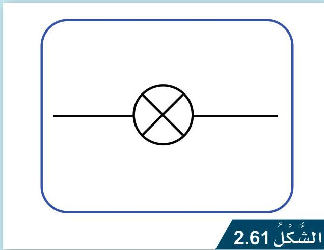
   - أ) خلية كهربائية.
   - ب) مصباح كهربائي.
   - ج) محرك كهربائي.
   - د) مقاومة كهربائية.
4. أيّ من الشروط الآتية ينبغي أن تتحقق حتى تعمل الدائرة الكهربائية؟
   - أ) أن تكون مغلقة وفيها مصباح كهربائي.
   - ب) أن تكون مغلقة وفيها خلية كهربائية.
   - ج) أن تكون مغلقة وفيها مفتاح كهربائي.
   - د) أن تكون مغلقة وفيها جرس كهربائي.

#### أولًا: اختر الإجابة الصحيحة (أسئلة محوّلة)

1. ما شروط عمل الدائرة الكهربائيّة؟
   - أ) مصباحان فقط
   - ب) مفتاحان على الأقلّ
   - ج) مصدر طاقة ومسار مغلق وأسلاك توصيل
   - د) جرس ومحرّك معًا
2. أيّ مكوّنٍ كهربائيٍّ يقطع التيار عند فتحه؟
   - أ) الخلية
   - ب) المصباح
   - ج) المفتاح
   - د) الجرس
3. أيّ مكوّنٍ كهربائيٍّ يُنتج الضوء؟
   - أ) المصباح
   - ب) المحرّك
   - ج) المقاومة
   - د) المفتاح
4. أيّ مكوّنٍ كهربائيٍّ يسخن عند مرور التيار فيه؟
   - أ) المحرّك
   - ب) الجرس
   - ج) المقاومة
   - د) المفتاح
5. ما الذي يمثّله الرمز: دائرةٌ بداخلها الحرف M؟
   - أ) المصباح
   - ب) الجرس
   - ج) المحرّك
   - د) الخلية
6. دائرةٌ فيها خليّةٌ ومصباحٌ ومفتاحٌ مفتوح. كيف نجعل المصباح يضيء؟
   - أ) نقطع السلك
   - ب) نزيل المصباح
   - ج) نفتح المفتاح أكثر
   - د) نغلق المفتاح
7. كيف تعرف أنّ دائرةً مفتوحةً؟
   - أ) لا يعمل المصباح أو الجهاز فيها
   - ب) يضيء المصباح بشدّة
   - ج) يسخن السلك
   - د) يرنّ الجرس
8. أيّ المجموعات الآتية تكفي لتشغيل جرسٍ كهربائيّ؟
   - أ) أسلاك فقط
   - ب) مصباح ومفتاح فقط
   - ج) خليّتان فقط
   - د) خلية وجرس وأسلاك في مسارٍ مغلق
9. أيّ العبارات الآتية صحيحة؟
   - أ) المصباح يزوّد الدائرة بالطاقة
   - ب) المفتاح يعطي الدائرة الطاقة
   - ج) السلك يصدر الضوء
   - د) الخلية تعطي الدائرة الطاقة
10. ماذا نسمّي المسار الكامل الذي يسري فيه التيار؟
   - أ) دائرة كهربائيّة مغلقة
   - ب) دائرة مفتوحة
   - ج) مفتاحًا كهربائيًّا
   - د) موصلًا عازلًا
11. ما الجهاز الذي يعمل في دائرته الجرس؟
   - أ) مصباح الشارع
   - ب) مروحة السقف
   - ج) مكواة
   - د) جرس الباب
12. أيّ المكوّنات الآتية يحوّل الطاقة الكهربائيّة إلى حركة؟
   - أ) الجرس
   - ب) المصباح
   - ج) المحرّك
   - د) السلك
13. لماذا يتوقّف المصباح عن الإضاءة عندما نفتح المفتاح؟
   - أ) لأنّ الخلية تتحوّل إلى سلك
   - ب) لأنّ الدائرة تصبح مفتوحةً ويتوقّف التيار
   - ج) لأنّ المصباح ينفد
   - د) لأنّ المفتاح يزيد الطاقة
14. أيّ مجموعةٍ من المكوّنات تكوّن دائرةً مغلقةً تعمل؟
   - أ) خلية وأسلاك فقط
   - ب) خلية ومفتاح مفتوح ومصباح
   - ج) مصباح ومفتاح فقط
   - د) خلية ومفتاح مغلق ومصباح وأسلاك
15. ما الذي يحدث لو أزيلت الخلية من دائرةٍ مغلقة؟
   - أ) يعمل المفتاح وحده
   - ب) يعمل المصباح أكثر
   - ج) لا يعمل المصباح لعدم وجود مصدر طاقة
   - د) لا يتغيّر شيء
16. أيّ المكوّنات الآتية يصدر صوتًا عند مرور التيار؟
   - أ) الجرس
   - ب) المصباح
   - ج) المقاومة
   - د) المفتاح

## الوحدة 3: التيار الكهربائي

### الدرس 3.1: كيف يسري التيار الكهربائي في الدائرة الكهربائية؟

#### أولًا: اختر الإجابة الصحيحة

1. ما وحدة قياس شدة التيار الكهربائي؟
   - أ) فولت
   - ب) نيوتن
   - ج) أمبير
   - د) كيلوجرام
2. أيّة حالة من الحالات الآتية تزيد شدة التيار الكهربائي؟
   - أ) إضافة خلايا كهربائية في الدائرة الكهربائية بالاتجاه نفسه.
   - ب) إضافة خلايا كهربائية في الدائرة الكهربائية باتجاه معاكس.
   - ج) إضافة مصابيح كهربائية في الدائرة الكهربائية.
   - د) إضافة مفتاح كهربائي في الدائرة الكهربائية.

#### رابعًا: أجب عن الأسئلة الآتية (مسائل وتفكير)

3. يحتوي مخطط الدائرة الكهربائية في الشكل 3.6 على ثلاثة أخطاء. أكمل المخطط بحيث يضيء المصباح الكهربائي في هذه الدائرة الكهربائية ويصبح بالإمكان قياس شدة التيار الكهربائي.
   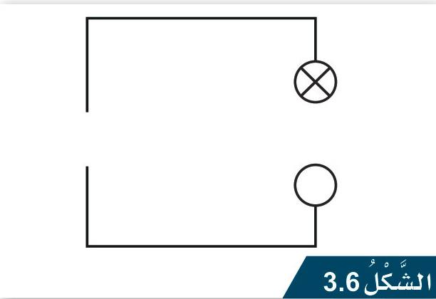
4. هل سيسري التيار الكهربائي في الدائرة الكهربائية في الشكل 3.7؟
   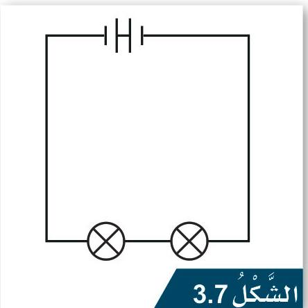
5. أرسم اتجاه التيار الكهربائي على الدائرة الكهربائية المبيّنة في الشكل 3.8.
   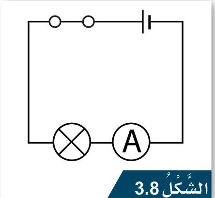
6. تم بناء دائرة كهربائية متصلة على التوالي فيها خلية كهربائية واحدة. القراءة على الأميتر تساوي 3A. أتوقع كم ستساوي القراءة على الأميتر إذا تمت إضافة خلية كهربائية ثانية مماثلة للخلية الأولى وفي اتجاهها نفسه.

#### أولًا: اختر الإجابة الصحيحة (أسئلة محوّلة)

1. بأيّ جهازٍ نقيس شدّة التيار الكهربائيّ؟
   - أ) الأميتر
   - ب) المسطرة
   - ج) الميزان
   - د) الترمومتر
2. بحسب ما تعلّمتَ، ما وحدة قياس شدّة التيار الكهربائيّ؟
   - أ) النيوتن
   - ب) الأمبير
   - ج) الكيلوجرام
   - د) الدرجة المئويّة
3. ما الرمز الذي يُستعمل للأمبير؟
   - أ) N
   - ب) A
   - ج) kg
   - د) m
4. في أيّ اتجاهٍ يُعتبر أنّ التيار يسري خارج الخلية في الدائرة؟
   - أ) لا اتّجاه له
   - ب) من القطب السالب نحو القطب الموجب فقط
   - ج) من القطب الموجب نحو القطب السالب عبر الدائرة
   - د) من المصباح إلى المفتاح فقط
5. ماذا نضيف إلى دائرةٍ لنزيد شدّة التيار فيها؟
   - أ) مصابيح كهربائيّة على التوالي
   - ب) خلايا كهربائيّة على التوالي
   - ج) مفاتيح كهربائيّة
   - د) أسلاكًا أطول
6. ماذا يحدث لشدّة التيار عند إضافة مصابيح على التوالي إلى الدائرة؟
   - أ) تزداد شدّة التيار
   - ب) تقلّ شدّة التيار
   - ج) تبقى كما هي دائمًا
   - د) يصبح التيار صفرًا مباشرة
7. دائرةٌ متّصلةٌ على التوالي فيها خليّةٌ واحدةٌ، وقراءة الأميتر 3 A. ما قراءة الأميتر إذا وُضع في مكانٍ آخر من الدائرة نفسها؟
   - أ) 3 A
   - ب) 1 A
   - ج) 6 A
   - د) 0 A
8. هل يسري التيار الكهربائيّ في دائرةٍ فيها خليّةٌ ومصباحٌ ومفتاحٌ مفتوح؟
   - أ) يسري في المصباح فقط
   - ب) نعم
   - ج) نعم بشدّةٍ كبيرة
   - د) لا
9. أيّ الجمل الآتية صحيحة عن الأميتر؟
   - أ) يقيس درجة الحرارة
   - ب) يقيس الوزن
   - ج) يقيس الطول
   - د) يوصل على التوالي في الدائرة ويقيس شدّة التيار
10. إذا كانت قراءة الأميتر 2 A فهذا يعني أنّ شدّة التيار تساوي:
   - أ) اثنين نيوتن
   - ب) اثنين أمبير
   - ج) اثنين متر
   - د) اثنين كيلوجرام
11. ما الذي يدفع التيار الكهربائيّ في الدائرة؟
   - أ) المفتاح
   - ب) الخلية أو البطّارية
   - ج) المصباح
   - د) السلك فقط
12. زيادة عدد الخلايا الموصولة على التوالي في دائرةٍ تجعل المصباح:
   - أ) لا يتغيّر
   - ب) أقلّ إضاءة
   - ج) منطفئًا دائمًا
   - د) أشدّ إضاءة
13. ماذا تصبح قراءة الأميتر في دائرةٍ كان فيها تيارٌ ثمّ فُتح المفتاح؟
   - أ) سالبة دائمًا
   - ب) أكبر
   - ج) كما كانت
   - د) صفرًا
14. أيّ العبارات الآتية خاطئة؟
   - أ) التيار يقاس بالأمبير
   - ب) التيار في دائرة التوالي يختلف من مكانٍ إلى آخر
   - ج) التيار يسري في الدائرة المغلقة
   - د) الخلية تدفع التيار
15. ماذا تعني قراءة الأميتر 0 A؟
   - أ) الدائرة تعمل جيّدًا
   - ب) التيار أكبر ما يمكن
   - ج) لا يسري تيارٌ في الدائرة
   - د) الخلية جديدة
16. دائرة كهربائية فيها خلية كهربائية واحدة ومصباحان موصولة كلّها بأسلاك متّصلة دون أيّ فجوة. هل يسري التيار الكهربائي فيها؟
   - أ) لا، لأنّ فيها خلية واحدة فقط
   - ب) لا، لأنّ فيها مصباحين
   - ج) نعم، لأنّ الدائرة مغلقة
   - د) نعم، لكنّ المصباحين لا يضيئان أبدًا
17. عند إغلاق المفتاح في دائرة كهربائية بسيطة، ما اتجاه التيار الكهربائي الاصطلاحي؟
   - أ) من الطرف السالب للخلية إلى طرفها الموجب
   - ب) من الطرف الموجب للخلية عبر الأسلاك والمصباح إلى طرفها السالب
   - ج) يتغيّر اتجاهه باستمرار
   - د) ليس له اتجاه معيّن

### الدرس 3.2: ماذا يحدث عندما أضيف مصابيح أو خلايا كهربائية على التوالي إلى دائرة كهربائية؟

#### أولًا: اختر الإجابة الصحيحة

1. أيّ عامل من العوامل الآتية سيزيد من شدة إضاءة المصابيح الكهربائية؟
   - أ) زيادة عدد المصابيح الكهربائية
   - ب) تقليل عدد المصابيح الكهربائية
   - ج) إضافة جهاز الأميتر
   - د) تقليل عدد الخلايا الكهربائية
2. أيّة حالة من الحالات الآتية تزيد شدة التيار الكهربائي؟
   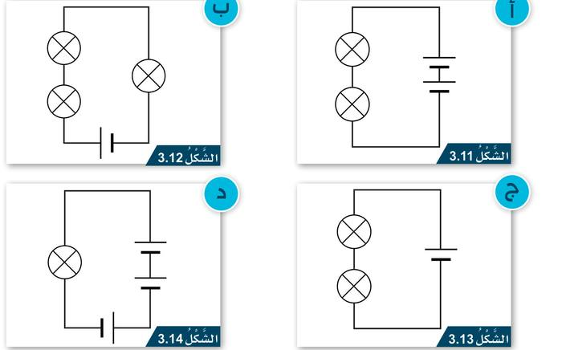
   - أ) الدائرة أ
   - ب) الدائرة ب
   - ج) الدائرة ج
   - د) الدائرة د

#### رابعًا: أجب عن الأسئلة الآتية (مسائل وتفكير)

3. أصف تأثير إضافة المزيد من الخلايا الكهربائية إلى الدائرة الكهربائية في شدة إضاءة المصباح الكهربائي.
4. أصف تأثير إضافة المزيد من المصابيح الكهربائية إلى الدائرة الكهربائية في شدة إضاءة المصباح الكهربائي.
5. ألاحظ الشكل 3.15. كم مصباحًا كهربائيًا ينبغي لي إضافته إلى الدائرة الكهربائية (أ) لتصبح شدة إضاءة المصابيح الكهربائية فيها مماثلة لشدة إضاءة المصابيح في الدائرة الكهربائية (ب) على أن تكون جميع المصابيح متماثلة؟
   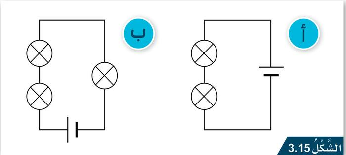
6. تتكون إحدى الدوائر الكهربائية من خليتين كهربائيتين ومصباحين كهربائيين. أعدّد طريقتين يمكن من خلالهما زيادة شدة إضاءة المصباحين الكهربائيين.

#### أولًا: اختر الإجابة الصحيحة (أسئلة محوّلة)

1. ماذا يحدث لإضاءة المصباح عند إضافة خليةٍ على التوالي؟
   - أ) تزداد شدّة الإضاءة
   - ب) تقلّ شدّة الإضاءة
   - ج) ينطفئ المصباح
   - د) لا يتغيّر شيء
2. ماذا يحدث لإضاءة كلّ مصباحٍ عند إضافة مصباحٍ على التوالي؟
   - أ) تقلّ شدّة الإضاءة
   - ب) تزداد شدّة الإضاءة
   - ج) تبقى كما هي
   - د) ينطفئ المصباحان
3. كيف تجعل مصباحًا في دائرة توالٍ أشدّ إضاءة؟
   - أ) بفتح المفتاح
   - ب) بزيادة عدد المصابيح
   - ج) بإضافة سلكٍ طويل
   - د) بزيادة عدد الخلايا
4. كيف تجعل مصباحين في دائرة توالٍ أخفت إضاءةً؟
   - أ) بإغلاق المفتاح فقط
   - ب) بإضافة خليةٍ
   - ج) بإضافة مصباحٍ ثالثٍ على التوالي
   - د) بإزالة مصباح
5. دائرةٌ فيها خليّتان ومصباحان. أيّ تغييرٍ يزيد شدّة الإضاءة؟
   - أ) إضافة سلكٍ
   - ب) إضافة مصباحٍ ثالث
   - ج) إضافة مفتاحٍ ثانٍ
   - د) إضافة خليةٍ ثالثة
6. دائرةٌ فيها خليّتان ومصباحان. أيّ تغييرٍ يقلّل شدّة الإضاءة؟
   - أ) إضافة مصباحٍ ثالث
   - ب) إضافة خليةٍ ثالثة
   - ج) إزالة أحد المصباحين
   - د) إزالة المفتاح
7. أيّ طريقتين تزيدان شدّة إضاءة مصباحين في دائرة؟
   - أ) إغلاق المفتاح فقط
   - ب) زيادة عدد المصابيح وإزالة خلية
   - ج) إضافة مفاتيح وأسلاك
   - د) زيادة عدد الخلايا وإزالة مصباح
8. ماذا يحدث لشدّة التيار عند إضافة خلايا على التوالي؟
   - أ) تقلّ
   - ب) تزداد
   - ج) تنعدم
   - د) لا تتغيّر
9. ماذا يحدث لشدّة التيار عند إضافة مصابيح على التوالي؟
   - أ) تزداد
   - ب) تقلّ
   - ج) تبقى ثابتة دائمًا
   - د) تنعدم فورًا
10. أيّ دائرةٍ تضيء مصباحها بأشدّ إضاءة؟
   - أ) خليّتان ومصباح واحد
   - ب) خلية واحدة ومصباحان
   - ج) خلية واحدة وثلاثة مصابيح
   - د) خلية واحدة ومصباح واحد
11. أيّ دائرةٍ تضيء مصباحها بأخفت إضاءة؟
   - أ) خلية واحدة وثلاثة مصابيح
   - ب) خليّتان ومصباح واحد
   - ج) ثلاث خلايا ومصباح واحد
   - د) خليّتان ومصباحان
12. إذا كانت دائرةٌ فيها خليّةٌ ومصباحان، فكيف تجعل الإضاءة مماثلةً لدائرةٍ فيها خليّةٌ ومصباحٌ واحد؟
   - أ) أضيف مصباحًا
   - ب) أزيل مصباحًا
   - ج) أضيف مفتاحًا
   - د) أنزع الخلية
13. ما تأثير إضافة المزيد من الخلايا على التوالي في الأميتر؟
   - أ) تقلّ قراءته
   - ب) تزداد قراءته
   - ج) تبقى صفرًا
   - د) تتوقّف الدائرة
14. ما تأثير إضافة المزيد من المصابيح على التوالي في قراءة الأميتر؟
   - أ) تقلّ قراءته
   - ب) تزداد قراءته
   - ج) تصبح ثابتة دائمًا
   - د) تضاعف
15. أيّ العبارات الآتية صحيحة؟
   - أ) المصابيح تضيء بالشدّة نفسها دائمًا مهما أضفنا خلايا
   - ب) المصابيح الأكثر تضيء بشدّة أكبر
   - ج) عدد المصابيح لا يؤثّر في الإضاءة
   - د) المصابيح الأكثر في دائرة التوالي تضيء بشدّة أقلّ
16. دائرةٌ فيها خليّةٌ ومصباحان إضاءتهما ضعيفة. أيّ إجراءٍ يحسّن الإضاءة؟
   - أ) إضافة مفتاحٍ مفتوح
   - ب) إضافة مصباحٍ
   - ج) إضافة خليةٍ ثانيةٍ
   - د) إضافة سلكٍ فقط
17. لماذا تزداد إضاءة المصباح عند وضع بطّاريةٍ بدل الخلية الواحدة؟
   - أ) لأنّ البطّارية سلك
   - ب) لأنّ البطّارية مصباح
   - ج) لأنّ البطّارية مجموعة خلايا تعطي طاقةً أكبر
   - د) لأنّ البطّارية تقطع الدائرة
18. الدائرة (أ) فيها خلية واحدة ومصباحان على التوالي، والدائرة (ب) فيها خلية واحدة مماثلة وثلاثة مصابيح على التوالي. كم مصباحًا يجب إضافته إلى الدائرة (أ) لتصبح شدّة إضاءة مصابيحها مماثلة للدائرة (ب)، علمًا بأنّ المصابيح جميعها متماثلة؟
   - أ) لا يلزم إضافة شيء
   - ب) مصباحان
   - ج) ثلاثة مصابيح
   - د) مصباح واحد

### الدرس 3.3: ما المواد التي تعد موصلات كهربائية جيدة أو رديئة؟

#### أولًا: اختر الإجابة الصحيحة

1. أيّ مادة من المواد الآتية موصلة كهربائية جيدة؟
   - أ) بلاستيك
   - ب) مطاط
   - ج) فضة
   - د) ورق
2. أيّ مادة من المواد الآتية عازلة كهربائية جيدة؟
   - أ) الماء
   - ب) المطاط
   - ج) الفضة
   - د) الكربون
3. أيّ من الفلزات الآتية الأكثر استخدامًا في صنع أسلاك التوصيل؟
   - أ) الفضة
   - ب) الألمنيوم
   - ج) النحاس
   - د) الذهب

#### رابعًا: أجب عن الأسئلة الآتية (مسائل وتفكير)

4. أذكر مثالين على مادتين عازلتين للكهرباء واستخدامهما. أذكر مثالين على مادتين موصلتين للكهرباء واستخدامهما.
5. لماذا من المهم أن تكون يداي جافتين عند استخدام الأدوات الكهربائية؟
6. أصف كيف يمكنني أن أختبر المادة لأكتشف إن كانت موصلة أو عازلة كهربائية.
7. ألاحظ صورة عامل الكهرباء. ما الذي يرتديه في يديه؟ بحسب رأيي، ما المادة المستخدمة في صنعه؟
   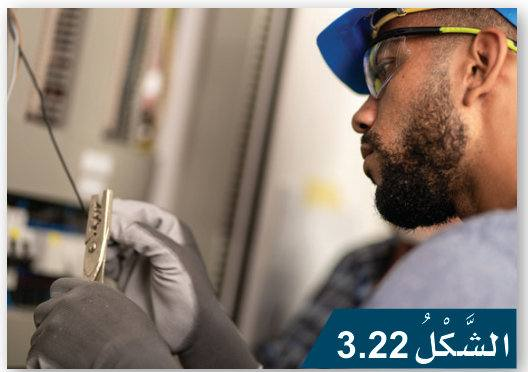

#### أولًا: اختر الإجابة الصحيحة (أسئلة محوّلة)

1. ما الموصل الكهربائيّ؟
   - أ) مادة تصنع الصوت
   - ب) مادة لا تسمح بمرور التيار
   - ج) مادة تصنع الضوء
   - د) مادة تسمح بمرور التيار الكهربائيّ خلالها
2. ما العازل الكهربائيّ؟
   - أ) مكوّن ينتج الضوء
   - ب) مادة تسمح بمرور التيار بسهولة
   - ج) مصدر للطاقة
   - د) مادة لا تسمح بمرور التيار الكهربائيّ بسهولة
3. أيّ المواد الآتية موصلةٌ جيّدة للكهرباء؟
   - أ) الخشب
   - ب) النحاس
   - ج) البلاستيك
   - د) الزجاج
4. أيّ المواد الآتية عازلة للكهرباء؟
   - أ) النحاس
   - ب) الحديد
   - ج) البلاستيك
   - د) الألمنيوم
5. من بين الخيارات الآتية، أيّ المواد الآتية عازلةٌ للكهرباء؟
   - أ) الخشب
   - ب) الفضّة
   - ج) الذهب
   - د) الحديد
6. أيّ المواد الآتية موصلةٌ للكهرباء؟
   - أ) المطّاط
   - ب) الزجاج
   - ج) الحديد
   - د) الورق
7. ما نوع المواد التي تُصنع منها معظم الموصلات الكهربائيّة؟
   - أ) البلاستيك
   - ب) الأخشاب
   - ج) الفلزّات
   - د) المطّاط
8. لماذا تُغطّى أسلاك الكهرباء بالبلاستيك؟
   - أ) لأنّه يزيد التيار
   - ب) لأنّه موصل جيّد
   - ج) لأنّه عازل يحمينا من الصعق
   - د) لأنّه يغيّر لون الضوء
9. لماذا يُصنع قلب أسلاك التوصيل من النحاس؟
   - أ) لأنّ النحاس لا يلمع
   - ب) لأنّ النحاس عازل
   - ج) لأنّ النحاس خفيف جدًّا فقط
   - د) لأنّ النحاس موصلٌ جيّدٌ للكهرباء
10. لماذا يجب أن نبتعد عن الأجهزة الكهربائيّة ويدانا مبلّلتان؟
   - أ) لأنّ اليدين تصبحان ثقيلتين
   - ب) لأنّ الماء عازل
   - ج) لأنّ الماء يُطفئ الجهاز
   - د) لأنّ الماء يوصل الكهرباء فقد نتعرّض للصعق
11. كيف نختبر هل مادةٌ موصلةٌ أم عازلة؟
   - أ) نزنها
   - ب) نضعها في دائرةٍ كهربائيّةٍ ونرى هل يضيء المصباح
   - ج) نقيس طولها
   - د) نلوّنها
12. وُضعت مادةٌ في دائرةٍ فيها مصباحٌ فلم يضئ المصباح. ماذا نستنتج؟
   - أ) المادة فلزّ بالتأكيد
   - ب) المادة موصلة
   - ج) المادة عازلة
   - د) المادة تنتج الطاقة
13. أيّ المواد الآتية يمكن أن تُصنع منها يد مفتاح الكهرباء لتحمي المستخدم؟
   - أ) البلاستيك
   - ب) النحاس
   - ج) الحديد
   - د) الألمنيوم
14. ما الذي يرتديه عامل الكهرباء في يديه لحمايته؟
   - أ) قفّازات معدنيّة
   - ب) قفّازات مطّاطيّة
   - ج) لا شيء
   - د) ساعة معدنيّة
15. أيّ المواد الآتية أفضل موصل؟
   - أ) البلاستيك
   - ب) الورق
   - ج) المطّاط
   - د) الفضّة
16. أيّ العبارات الآتية صحيحة؟
   - أ) البلاستيك موصل جيّد
   - ب) الفلزّات عوازل
   - ج) الخشب موصل جيّد
   - د) الفلزّات موصلات جيّدة للكهرباء
17. يرتدي عامل كهرباء قفّازين في يديه وهو يعمل بالأسلاك. ما المادة التي يُرجَّح أن يكون القفّازان مصنوعين منها؟
   - أ) حديد لأنّه صلب
   - ب) نحاس لأنّه موصل جيّد للكهرباء
   - ج) ألومنيوم لأنّه خفيف الوزن
   - د) مطّاط أو بلاستيك لأنّه عازل لا يوصل الكهرباء

### الدرس 3.4: ماذا أعرف عن التيار الكهربائي؟

#### أولًا: اختر الإجابة الصحيحة

1. أيّ مما يأتي ليس موصلًا كهربائيًا؟
   - أ) مطاط
   - ب) نحاس
   - ج) ماء
   - د) حديد
2. أيّ خلية كهربائية تمت تسمية أقطابها على نحو صحيح؟
   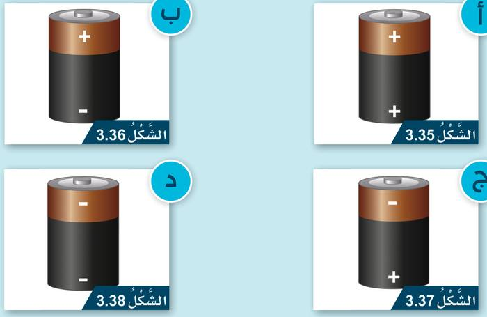
   - أ) الخلية أ
   - ب) الخلية ب
   - ج) الخلية ج
   - د) الخلية د
3. أيّ مجموعة من الخلايا الكهربائية المبيّنة في المخططات الآتية ستجعل إضاءة المصباح الكهربائي أشد؟
   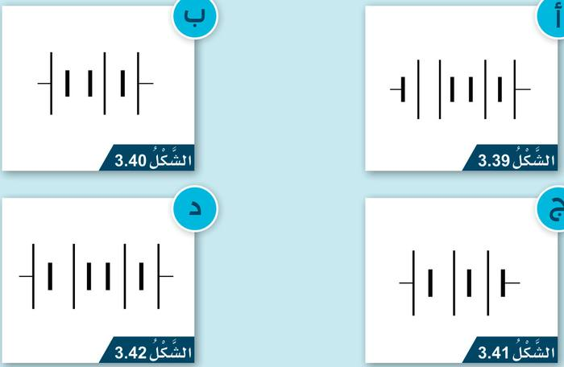
   - أ) المخطط أ
   - ب) المخطط ب
   - ج) المخطط ج
   - د) المخطط د
4. أيّ ثنائي من المكونات الآتية سيزيدان من شدة إضاءة المصباح الكهربائي إذا تم توصيلهما عند النقطتين X و Y في الدائرة الكهربائية الواردة في الشكل 3.43؟
   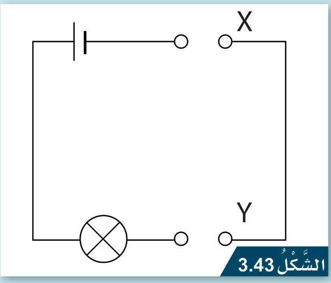
   - أ) خلية كهربائية بحيث يكون قطبها الموجب إلى جهة اليسار، ومصباح كهربائي
   - ب) خلية كهربائية بحيث يكون قطبها الموجب إلى جهة اليسار، وسلك توصيل
   - ج) خلية كهربائية بحيث يكون قطبها الموجب إلى جهة اليمين، ومصباح كهربائي
   - د) خلية كهربائية بحيث يكون قطبها الموجب إلى جهة اليمين، وسلك توصيل

#### رابعًا: أجب عن الأسئلة الآتية (مسائل وتفكير)

5. أعرّف الموصل الكهربائي.
6. ما نوع المادة التي تستخدم في صنع معظم الموصلات الكهربائية الجيدة؟
7. ماذا تسمى المادة غير الموصلة للكهرباء؟
8. تتضمن دائرة كهربائية خليتين كهربائيتين ومصباحين كهربائيين. أذكر ما قد يحدث لشدة إضاءة المصباحين الكهربائيين إذا تم فصل إحدى الخليتين الكهربائيتين.
9. ما المادتان المستخدمتان في صنع أسلاك التوصيل المبيّنة في الشكل 3.44؟ أفسّر سبب استخدام هاتين المادتين.
   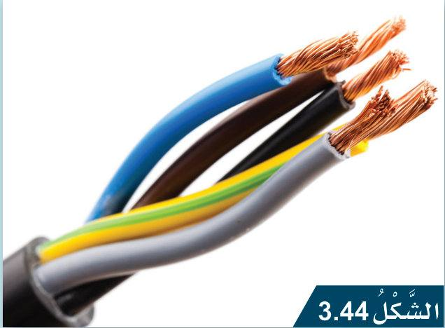

#### أولًا: اختر الإجابة الصحيحة (أسئلة محوّلة)

1. أيّ المواد الآتية ليس موصلًا كهربائيًّا؟
   - أ) النحاس
   - ب) الخشب
   - ج) الحديد
   - د) الألمنيوم
2. ما القطب الذي يرمز إليه الخطّ الأطول في رمز الخلية الكهربائيّة؟
   - أ) القطب الموجب
   - ب) القطب السالب
   - ج) المصباح
   - د) المفتاح
3. ما القطب الذي يرمز إليه الخطّ الأقصر في رمز الخلية؟
   - أ) القطب السالب
   - ب) القطب الموجب
   - ج) المقاومة
   - د) المحرّك
4. أيّ مجموعةٍ من الخلايا على التوالي تجعل إضاءة المصباح أشدّ؟
   - أ) ثلاث خلايا
   - ب) خليّتان
   - ج) خلية واحدة
   - د) لا خلايا
5. ما الموصل الكهربائيّ؟
   - أ) مفتاح
   - ب) مادة لا تسمح بمرور التيار
   - ج) مصباح
   - د) مادة تسمح بمرور التيار
6. ما نوع المواد التي تُستخدم في صنع معظم الموصلات الكهربائيّة الجيّدة؟
   - أ) الأخشاب
   - ب) اللدائن
   - ج) الفلزّات
   - د) المطّاط
7. ماذا تُسمّى المادة التي لا توصل الكهرباء؟
   - أ) مصدر
   - ب) موصل
   - ج) عازل
   - د) مفتاح
8. دائرةٌ فيها خليّتان ومصباحان. ماذا يحدث لإضاءة المصباحين إذا أُزيلت إحدى الخليّتين؟
   - أ) ينطفئان فورًا دائمًا
   - ب) تزداد شدّتها
   - ج) لا تتغيّر
   - د) تقلّ شدّتها
9. لماذا يصنع سلك التوصيل من النحاس ويُغلَّف بالبلاستيك؟
   - أ) النحاس موصل والبلاستيك عازل يحمي المستخدم
   - ب) النحاس عازل والبلاستيك موصل
   - ج) كلاهما موصل
   - د) كلاهما عازل
10. أيّ المواد الآتية موصلٌ جيّد للكهرباء؟
   - أ) المطّاط
   - ب) الورق
   - ج) الألمنيوم
   - د) الصوف
11. كم خطًّا يظهر في رمز الخلية الكهربائيّة الواحدة؟
   - أ) خطّ واحد
   - ب) خطّان
   - ج) ثلاثة خطوط
   - د) أربعة خطوط
12. أيّ العبارات الآتية خاطئة؟
   - أ) النحاس موصل جيّد
   - ب) البلاستيك موصل جيّد للكهرباء
   - ج) المطّاط عازل
   - د) الخشب عازل
13. تضمّ دائرةٌ ثلاث خلايا ومصباحًا واحدًا. ماذا يحدث للإضاءة إذا أُزيلت خليّتان؟
   - أ) تقلّ الإضاءة
   - ب) تزداد الإضاءة
   - ج) تبقى كما هي
   - د) تنطفئ ولا تعود
14. أيّ مادّةٍ تُستعمل لصنع أسلاك التوصيل بدلًا من الفضّة لأنّها أرخص وجيّدة التوصيل؟
   - أ) النحاس
   - ب) الورق
   - ج) الزجاج
   - د) المطّاط
15. أيّ المواد الآتية تُستعمل لعزل مقبض المفكّ الكهربائيّ؟
   - أ) البلاستيك
   - ب) النحاس
   - ج) الحديد
   - د) الذهب
16. في سلك كهربائي يظهر من الداخل سلك نحاسيّ لامع يغلّفه من الخارج غلاف ملوّن. ما المادتان المستعملتان وما سبب استعمالهما؟
   - أ) كلتا المادتين موصلة لتزيد التيار
   - ب) النحاس عازل داخل السلك، والبلاستيك موصل في الخارج
   - ج) النحاس موصل جيّد داخل السلك، والبلاستيك عازل في الخارج لحماية من يلمسه
   - د) كلتا المادتين عازلة كي لا يمرّ التيار
