# بنك أسئلة العلوم — المستوى الخامس — الفصل الدراسي الثاني

- كل الدروس منقولة من كتاب الطالب (العلوم – الصف الخامس – الفصل الثاني): أسئلة "أتحقق مما تعلمت" والأنشطة، بنصّها كما في الكتاب. الصور والأشكال مقتطعة كصور (مجلد images).
- الفراغ يُكتب ____.
- الأسئلة بدون إجابات نموذجية.

## الفهرس

- الوحدة 4: دورة حياة الإنسان
  - الدرس 4.1: ما دورة حياة الإنسان؟
  - الدرس 4.2: ما التغيرات الأساسية التي نبلغها خلال دورة حياة الإنسان؟
  - الدرس 4.3: كيف يمكنني أن أفسر ما أعرفه عن دورة حياة الإنسان؟
- الوحدة 5: الاحتكاك ومقاومة الهواء والماء
  - الدرس 5.1: ما تأثيرات قوة الاحتكاك؟
  - الدرس 5.2: كيف يمكنني أن أستقصي الاحتكاك؟
  - الدرس 5.3: ما مقاومة الهواء؟
  - الدرس 5.4: كيف يؤثر شكل الجسم في كيفية تحركه في الهواء؟
  - الدرس 5.5: ما مقاومة الماء؟
  - الدرس 5.6: كيف يؤثر شكل الجسم في كيفية تحركه في الماء؟
  - الدرس 5.7: كيف تؤثر أشكال الحيوانات في كيفية تحركها في الهواء والماء مقارنة بالأجسام التي يصنعها الإنسان؟
  - الدرس 5.8: ماذا أعرف عن الاحتكاك ومقاومة الهواء ومقاومة الماء؟
- الوحدة 6: الخصائص الفيزيائية وحالات الماء الثلاث
  - الدرس 6.1: ما التغيرات المختلفة لحالات المادة؟
  - الدرس 6.2: كيف أستقصي انصهار الجليد؟
  - الدرس 6.3: كيف أستقصي تجمد الماء؟
  - الدرس 6.4: ما الذي أستطيع أن ألاحظه حول الغليان والتبخر والتكاثف؟
  - الدرس 6.5: كيف تتغير حالة الماء عند درجات الحرارة المختلفة؟
  - الدرس 6.6: كيف أستقصي التبخر؟
  - الدرس 6.7: ما مراحل دورة الماء؟
  - الدرس 6.8: لماذا نحتاج إلى تخزين الماء العذب؟
  - الدرس 6.9: لماذا يجب علينا أن نحافظ على الماء؟
- الوحدة 7: الغذاء المتوازن
  - الدرس 7.1: ما المجموعات الغذائية الرئيسة؟
  - الدرس 7.2: لماذا تعد المجموعات الغذائية مهمة؟
  - الدرس 7.3: كيف أعد نظامًا غذائيًا متوازنًا؟
  - الدرس 7.4: أي الأغذية يجب تناولها بكميات محدودة؟
  - الدرس 7.5: ماذا يمكن أن يحدث إذا تناولت غذاءً غير صحي؟

---

## الوحدة 4: دورة حياة الإنسان

### الدرس 4.1: ما دورة حياة الإنسان؟

#### أولًا: اختر الإجابة الصحيحة

1. أيّ العبارات الآتية صحيحة؟
   - أ) تحدث للإنسان تغيرات خلال مروره في دورة حياته.
   - ب) لا تحدث للإنسان تغيرات خلال مروره في دورة حياته.
   - ج) دورة حياة الإنسان مشابهة لدورة حياة النبات.
   - د) لا يمر الإنسان في دورة حياة.
2. أيّ العبارات الآتية خاطئة؟
   - أ) تساعدنا التغيرات التي تحدث للإنسان خلال دورة حياته على تحديد المرحلة التي يمر فيها الآن.
   - ب) جميع الأشخاص يمرّون في مراحل دورة حياة الإنسان، ولكن العمر المحدد الذي تبدأ عنده التغيرات يختلف من شخص إلى آخر.
   - ج) ترتبط كل مرحلة من مراحل دورة حياة الإنسان بمجموعة محددة من التغيرات.
   - د) جميع الأشخاص يمرون في مراحل دورة حياة الإنسان في الوقت نفسه.

#### رابعًا: أجب عن الأسئلة الآتية (مسائل وتفكير)

3. أذكر ثلاث خصائص من خصائص مرحلة الطفولة.
4. أذكر وجهي اختلاف بين طفل رضيع وبالغ.

#### أولًا: اختر الإجابة الصحيحة (أسئلة محوّلة)

1. ما المقصود بدورة حياة الإنسان؟
   - أ) عدد أيام السنة
   - ب) المراحل التي يمرّ بها الإنسان من ولادته حتى كبره
   - ج) أنواع الأطعمة التي يتناولها
   - د) مكان سكن الإنسان
2. ما المرحلة الأولى في حياة الإنسان بعد الولادة؟
   - أ) مرحلة الشيخوخة
   - ب) مرحلة المراهقة
   - ج) مرحلة الكبار
   - د) مرحلة الرضيع
3. على ماذا يعتمد الرضيع في غذائه ورعايته؟
   - أ) على الحيوانات
   - ب) على نفسه تمامًا
   - ج) على إخوته الرضّع
   - د) على الكبار
4. أيّ المراحل الآتية تأتي بعد مرحلة الطفولة؟
   - أ) المراهقة
   - ب) الرضاعة
   - ج) الطفولة المبكرة
   - د) الميلاد
5. أيّ العبارات الآتية عن الرضيع صحيحة؟
   - أ) يعيش وحده
   - ب) يستطيع قيادة السيارة
   - ج) يعمل في وظيفة
   - د) لا يستطيع المشي ولا الكلام وحده
6. أيّ العبارات الآتية خاطئة؟
   - أ) ينمو الإنسان في أثناء الطفولة
   - ب) يبقى الإنسان بالحجم نفسه طوال حياته
   - ج) يتغيّر الإنسان مع تقدّمه في العمر
   - د) لكلّ مرحلة خصائصها
7. في أيّ مرحلة يبدأ الطفل غالبًا بتعلّم الكلام والمشي؟
   - أ) الشيخوخة
   - ب) الطفولة المبكرة
   - ج) الرشد
   - د) التقاعد
8. أيّ المراحل الآتية يمرّ فيها الإنسان بالبلوغ؟
   - أ) الرضاعة
   - ب) المراهقة
   - ج) الشيخوخة
   - د) الولادة
9. أيّ المراحل الآتية يحتاج فيها الإنسان إلى أكبر قدرٍ من الرعاية؟
   - أ) الرشد
   - ب) الرضاعة
   - ج) منتصف العمر
   - د) المراهقة
10. أيّ مما يأتي مرحلة من مراحل دورة حياة الإنسان؟
   - أ) الانصهار
   - ب) التبخّر
   - ج) المراهقة
   - د) التكاثف
11. ما الذي يتغيّر في جسم الإنسان مع تقدّمه في العمر؟
   - أ) الطول والوزن والمهارات
   - ب) عدد أصابع اليدين
   - ج) لون العينين فقط
   - د) اسم الإنسان
12. هل يمرّ جميع الناس بمراحل دورة الحياة نفسها؟
   - أ) لا، فقط الرجال
   - ب) لا، كلّ شخصٍ يمرّ بمراحل مختلفة تمامًا
   - ج) نعم، بالتسلسل نفسه
   - د) لا، فقط الأطفال
13. في أيّ مرحلةٍ يلتحق الطفل غالبًا بالمدرسة؟
   - أ) الرضاعة
   - ب) الطفولة
   - ج) الشيخوخة
   - د) الرشد
14. لماذا يحتاج الرضيع إلى الحليب؟
   - أ) لأنّه يعلّمه الكلام
   - ب) لأنّه يغيّر لون جلده
   - ج) لأنّه يزوّده بالغذاء اللازم للنموّ
   - د) لأنّه يجعله أكبر فورًا
15. أيّ العبارات الآتية تصف مرحلة الشيخوخة؟
   - أ) مرحلة تعلّم المشي
   - ب) مرحلة الولادة
   - ج) مرحلةٌ متأخرةٌ تتباطأ فيها الحركة غالبًا
   - د) مرحلة الرضاعة
16. ما الفرق بين الرضيع والبالغ؟
   - أ) لا فرق بينهما
   - ب) الرضيع أطول من البالغ
   - ج) الرضيع يعمل والبالغ لا يعمل
   - د) الرضيع يعتمد على غيره والبالغ يعتمد على نفسه
17. أيّ المراحل الآتية تأتي أوّلًا في دورة حياة الإنسان؟
   - أ) المراهقة
   - ب) الرضاعة
   - ج) الرشد
   - د) الشيخوخة
18. ما المرحلة التي تلي مرحلة الطفولة في دورة حياة الإنسان؟
   - أ) الرضاعة
   - ب) المراهقة
   - ج) الشيخوخة
   - د) الولادة

### الدرس 4.2: ما التغيرات الأساسية التي نبلغها خلال دورة حياة الإنسان؟

#### أولًا: اختر الإجابة الصحيحة

1. أيّ العبارات الآتية صحيحة؟
   - أ) تنطبق التغيرات الأساسية على دورة حياة الإنسان فقط.
   - ب) لا تحدث للإنسان تغيرات أساسية.
   - ج) التغيرات الأساسية إحدى طرائق تحديد الأحداث أو التغيرات المهمة.
   - د) تحدث للإنسان تغيرات أساسية في مرحلتي الطفولة المبكرة والطفولة فقط.
2. أيّ من الآتي تغير أساسي قانوني؟
   - أ) ازدياد الطول.
   - ب) القدرة على القيادة.
   - ج) الحاجة إلى مساعدة كي نمشي.
   - د) تعلم القراءة.
3. أيّ العبارات الآتية خاطئة؟
   - أ) تحدث للإنسان تغيرات أساسية قانونية فقط.
   - ب) تحدث للإنسان تغيرات أساسية طبيعية وقانونية.
   - ج) تحدث للإنسان عادة تغيرات أساسية طبيعية في أعمار متشابهة.
   - د) إن المرحلة الأساسية الأخيرة في الحياة هي الشيخوخة.

#### رابعًا: أجب عن الأسئلة الآتية (مسائل وتفكير)

4. لماذا تحدث العديد من التغيرات الأساسية الطبيعية في مرحلتي الطفولة المبكرة والطفولة؟
5. لماذا تحدث العديد من التغيرات الأساسية القانونية في عمر 18 سنة؟
6. هل العمل تغير أساسي طبيعي أو قانوني؟

#### أولًا: اختر الإجابة الصحيحة (أسئلة محوّلة)

1. أيّ التغيّرات الآتية يُعدّ تغيّرًا طبيعيًّا؟
   - أ) الالتحاق بالمدرسة إلزاميًّا
   - ب) الحصول على رخصة القيادة
   - ج) التصويت في الانتخابات
   - د) زيادة طول الجسم
2. أيّ التغيّرات الآتية يُعدّ تغيّرًا قانونيًّا؟
   - أ) زيادة الوزن
   - ب) ظهور الأسنان الدائمة
   - ج) تغيّر الصوت
   - د) الحصول على رخصة القيادة
3. أيّ التغيّرات الآتية طبيعيّ؟
   - أ) ظهور الأسنان الدائمة
   - ب) التصويت
   - ج) العمل بدوامٍ كامل
   - د) التقاعد القانونيّ
4. هل العمل بدوامٍ كاملٍ تغيّر أساسيّ طبيعيّ أم قانونيّ؟
   - أ) قانونيّ
   - ب) طبيعيّ
   - ج) لا هذا ولا ذاك
   - د) كلاهما معًا
5. ما التغيّر الأساسيّ القانونيّ؟
   - أ) تغيّرٌ تحدّده القوانين عند عمرٍ معيّن
   - ب) تغيّرٌ يحدث في الجسم وحده
   - ج) تغيّرٌ في الطقس
   - د) تغيّرٌ في لون الشعر
6. ما التغيّر الأساسيّ الطبيعيّ؟
   - أ) تغيّرٌ تحدّده المحاكم
   - ب) تغيّرٌ يحدث في الجسم مع التقدّم في العمر
   - ج) تغيّرٌ تقرّره المدرسة
   - د) تغيّرٌ تحدّده الشركات
7. أيّ التغيّرات الآتية قانونيّ؟
   - أ) المشي لأوّل مرّة
   - ب) البلوغ
   - ج) التصويت في الانتخابات
   - د) نموّ الشعر
8. أيّ العبارات الآتية خاطئة؟
   - أ) التغيّرات الطبيعية تحدث في الجسم
   - ب) التغيّرات الطبيعية تحدّدها القوانين
   - ج) التغيّرات القانونية تحدّدها القوانين
   - د) البلوغ تغيّر طبيعيّ
9. أيّ التغيّرات الآتية يحدث للأطفال طبيعيًّا؟
   - أ) ظهور الأسنان اللبنية
   - ب) التقاعد
   - ج) الحصول على رخصة قيادة
   - د) الترشّح للانتخابات
10. أيّ التغيّرات الآتية يحدث لدى المراهقين طبيعيًّا؟
   - أ) التصويت
   - ب) الحصول على التقاعد
   - ج) تغيّر الصوت والنموّ السريع
   - د) العمل القانونيّ
11. هل تعلّم الكلام تغيّر أساسيّ طبيعيّ أم قانونيّ؟
   - أ) لا هذا ولا ذاك
   - ب) قانونيّ
   - ج) طبيعيّ
   - د) كلاهما معًا
12. أيّ التغيّرات الآتية يحدث عند عمر 18 سنة في كثير من الدول؟
   - أ) اكتساب الحقوق القانونية للبالغ
   - ب) ظهور الأسنان اللبنية
   - ج) تعلّم المشي
   - د) الرضاعة
13. لماذا تحدث تغيّرات طبيعية كثيرة في الطفولة المبكرة؟
   - أ) لأنّ الجسم ينمو ويتعلّم مهاراتٍ جديدةً بسرعة
   - ب) لأنّ القوانين تتغيّر
   - ج) لأنّ الطفل يعمل
   - د) لأنّ الطفل يصوّت
14. هل التقاعد عن العمل عند سنٍّ معيّنةٍ تغيّر قانونيّ أم طبيعيّ؟
   - أ) طبيعيّ
   - ب) قانونيّ
   - ج) لا هذا ولا ذاك
   - د) كلاهما معًا
15. أيّ التغيّرات الآتية يحدث لكبار السنّ طبيعيًّا؟
   - أ) التصويت لأوّل مرّة
   - ب) الحصول على رخصة قيادة لأوّل مرّة
   - ج) التسجيل في المدرسة
   - د) ابيضاض الشعر
16. أيّ التغيّرات الآتية يختلف تحديد سنّه من دولةٍ إلى أخرى؟
   - أ) نموّ الطول
   - ب) البلوغ الطبيعيّ
   - ج) نموّ الأسنان
   - د) التغيّر القانونيّ
17. ما التغيّر الذي يحدث لمعظم الناس عند الانتقال من الطفولة إلى المراهقة؟
   - أ) ظهور الأسنان اللبنية الأولى
   - ب) نموّ سريع في الطول وتغيّرات في الجسم
   - ج) تعلّم المشي لأوّل مرّة
   - د) توقّف النموّ تمامًا

### الدرس 4.3: كيف يمكنني أن أفسر ما أعرفه عن دورة حياة الإنسان؟

#### أولًا: اختر الإجابة الصحيحة

1. أيّ العبارات الآتية صحيحة؟
   - أ) يبلغ الإنسان مرحلة الشيخوخة قبل مرحلة الرشد.
   - ب) يبلغ الإنسان مرحلة الرشد قبل مرحلة الطفولة.
   - ج) يبلغ الإنسان مرحلة الطفولة قبل مرحلة الرشد.
   - د) يبلغ الإنسان مرحلة الطفولة قبل مرحلة الطفولة المبكرة.
2. أيّ العبارات الآتية حول التغيرات الأساسية من دورة حياة الإنسان صحيحة؟
   - أ) كطفل رضيع، يمكن للإنسان أن يمشي ويتكلم.
   - ب) كطفل، يتعلم الإنسان أن يتكلم ويركض.
   - ج) كبالغ، يحتاج الإنسان إلى والديه كي يطعماه.
   - د) كبالغ، لا يسمح قانونيًا للإنسان بأن يقود السيارة.
3. أيّ عبارة عن استخدامات معرفتنا بدورة حياة الإنسان صحيحة؟
   - أ) يمكننا استخدام ما نعرفه عن دورة حياة الإنسان لنقدّر عمر الشخص.
   - ب) لا يمكننا استخدام ما نعرفه عن دورة حياة الإنسان لنقدّر عمر الشخص.
   - ج) يمكننا استخدام ما نعرفه عن دورة حياة الإنسان لنحدد إن كان الشخص ذكرًا أو أنثى.
   - د) يمكننا استخدام ما نعرفه عن دورة حياة الإنسان لمعرفة نوع مهنة الشخص.
4. أيّ من التغيرات الأساسية الآتية طبيعية؟
   - أ) تعلم القيادة.
   - ب) الزواج.
   - ج) تعلم المشي.
   - د) إتمام الدراسة.
5. أيّ عبارة عن التغيرات الأساسية من دورة حياة الإنسان صحيحة؟
   - أ) يمكن لمعظم المسنين التحرك بالسهولة التي يتحرك بها البالغون.
   - ب) يمكن لجميع البالغين قيادة السيارات.
   - ج) يسمح لجميع الأطفال بقيادة السيارات.
   - د) يولد جميع الأطفال الرضع غير قادرين على المشي أو النطق.

#### رابعًا: أجب عن الأسئلة الآتية (مسائل وتفكير)

6. ألاحظ الشخص المبيّن في الشكل 4.13. ما مرحلة دورة حياة الإنسان التي يمر فيها؟
   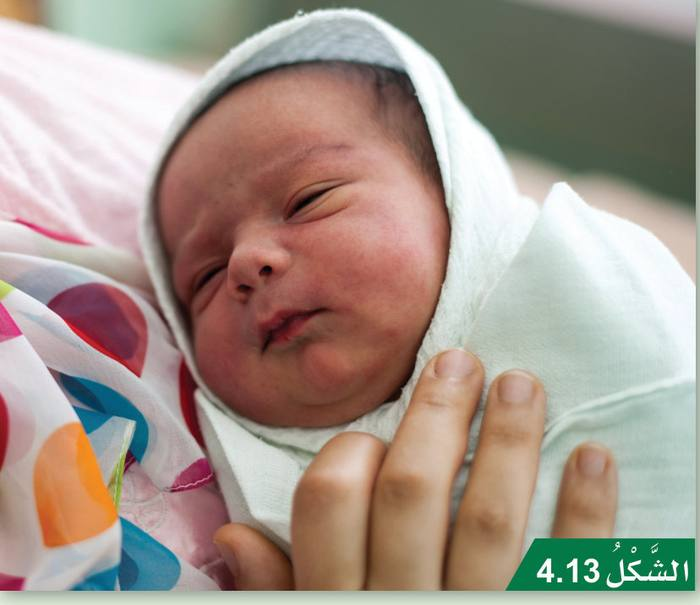
7. أيّ مرحلة من مراحل دورة حياة الإنسان تمتد لأطول فترة؟ متى تبدأ هذه المرحلة ومتى تنتهي؟
8. أدوّن نوعين مختلفين من النماذج لدورة حياة الإنسان وأعطي مثالًا واحدًا على كيفية استخدام كل نموذج منهما.
10. أيّ مرحلة من مراحل دورة حياة الإنسان تمتاز باكتساب الحقوق القانونية؟ لماذا أعتقد ذلك؟ أكتب جملة أو جملتين قصيرتين لأفسّر إجابتي.
11. بحسب رأيي، هل تم تعديل التغيرات الأساسية الطبيعية والقانونية مع مرور الأجيال؟ لماذا أعتقد ذلك؟

#### أولًا: اختر الإجابة الصحيحة (أسئلة محوّلة)

1. أيّ مراحل حياة الإنسان تمتدّ لأطول فترة؟
   - أ) مرحلة الطفولة المبكرة
   - ب) مرحلة الرضاعة
   - ج) مرحلة الرشد
   - د) مرحلة المراهقة
2. أيّ نموذجٍ يعرض مراحل الحياة بالترتيب على خطٍّ؟
   - أ) الخطّ الزمنيّ
   - ب) الجدول الدوريّ
   - ج) خريطة الطقس
   - د) مخطّط الدائرة الكهربائيّة
3. ماذا يبيّن النموذج الدائريّ لدورة الحياة؟
   - أ) أنّ الحياة تتكرّر مع كلّ جيلٍ جديد
   - ب) أنّ الإنسان لا يتغيّر
   - ج) أنّ المراحل لا ترتيب لها
   - د) أنّ الإنسان لا يكبر
4. ما فائدة معرفتنا بدورة حياة الإنسان؟
   - أ) معرفة أحوال الطقس
   - ب) تخطيط الرعاية والتعليم والخدمات المناسبة لكلّ مرحلة
   - ج) صنع الغذاء
   - د) قياس المسافات
5. أيّ مراحل الحياة تُكتسب فيها الحقوق القانونية للبالغ؟
   - أ) الطفولة المبكرة
   - ب) الرضاعة
   - ج) الرشد
   - د) الطفولة
6. لماذا تُصمّم المدارس والملاعب للأطفال بطريقةٍ خاصّة؟
   - أ) لا سبب
   - ب) لتكون أغلى
   - ج) لتكون أصعب
   - د) لتناسب احتياجاتهم في هذه المرحلة
7. أيّ مثالٍ يبيّن استعمال معرفتنا بدورة الحياة؟
   - أ) تغيير لون السماء
   - ب) تقديم غذاءٍ مناسبٍ لعمر الرضيع
   - ج) قياس درجة الحرارة
   - د) رسم خريطة
8. شخصٌ يمشي ببطءٍ مستعينًا بعصا، في أيّ مرحلةٍ هو غالبًا؟
   - أ) الطفولة
   - ب) الرضاعة
   - ج) الشيخوخة
   - د) المراهقة
9. طفلٌ تتساقط أسنانه اللبنية ويذهب إلى المدرسة، في أيّ مرحلةٍ هو؟
   - أ) الشيخوخة
   - ب) الطفولة
   - ج) الرضاعة
   - د) الرشد
10. أيّ التغيّرات الآتية طبيعيّة؟
   - أ) التصويت
   - ب) الحصول على رخصة
   - ج) نموّ الشعر وزيادة الطول
   - د) الحصول على وظيفة
11. هل تختلف القوانين التي تحدّد التغيّرات القانونيّة من مجتمعٍ إلى آخر؟
   - أ) نعم، لكنّها لا تتغيّر أبدًا
   - ب) لا، هي نفسها في كلّ العالم دائمًا
   - ج) لا، لا توجد قوانين
   - د) نعم، قد تختلف
12. ما فائدة النماذج في دراسة دورة الحياة؟
   - أ) لا فائدة لها
   - ب) تغيّر مراحل الحياة
   - ج) تجعل الإنسان أطول
   - د) تساعدنا على فهم المراحل وترتيبها
13. لماذا نرسم دورة الحياة على شكل دائرة؟
   - أ) لأنّ الجيل الجديد يبدأ دورةً جديدة
   - ب) لأنّ الحياة دائمة بلا نهاية للفرد
   - ج) لأنّ الدائرة جميلة فقط
   - د) لأنّ الإنسان لا يتغيّر
14. في أيّ مرحلة من دورة حياة الإنسان يعتمد الشخص كليًّا على الآخرين في غذائه وحمايته؟
   - أ) مرحلة المراهقة
   - ب) مرحلة الرضيع
   - ج) مرحلة الرشد
   - د) مرحلة الطفولة المتأخرة

## الوحدة 5: الاحتكاك ومقاومة الهواء والماء

### الدرس 5.1: ما تأثيرات قوة الاحتكاك؟

#### أولًا: اختر الإجابة الصحيحة

1. ما الاحتكاك؟
   - أ) قوة تجذب الأجسام.
   - ب) قوة تزيد سرعة حركة الأجسام.
   - ج) قوة تبطئ سرعة حركة الأجسام.
   - د) قوة تسبب تنافر الأجسام.
2. أيّ أداة تستخدم لقياس مقدار القوة؟
   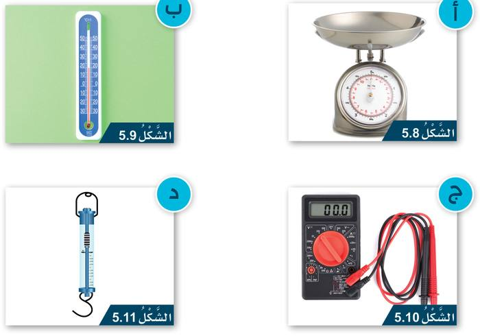
   - أ) الأداة أ
   - ب) الأداة ب
   - ج) الأداة ج
   - د) الأداة د
3. ما وحدة قياس القوة؟
   - أ) درجة
   - ب) دقيقة
   - ج) نيوتن
   - د) كيلوجرام

#### رابعًا: أجب عن الأسئلة الآتية (مسائل وتفكير)

4. أقرأ المقياس المدرّج المبيّن وأذكر مقدار القوة الذي يسجّله المؤشر.
   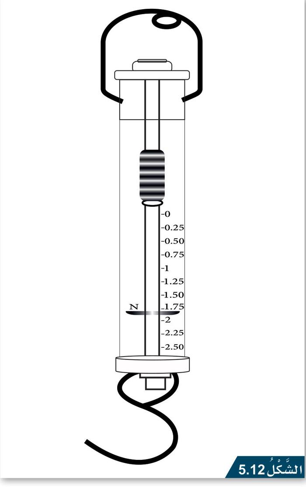

#### أولًا: اختر الإجابة الصحيحة (أسئلة محوّلة)

1. ما اسم الأداة التي تُستعمل لقياس القوة؟
   - أ) الترمومتر
   - ب) الميزان الزنبركيّ
   - ج) المسطرة
   - د) الساعة
2. ما رمز وحدة قياس القوة؟
   - أ) m
   - ب) kg
   - ج) N
   - د) s
3. متى تظهر قوة الاحتكاك؟
   - أ) عند سقوط المطر فقط
   - ب) عند عدم وجود حركة أبدًا
   - ج) في الفراغ فقط
   - د) عند تلامس سطحين يتحرّك أحدهما على الآخر
4. أيّ الأسطح الآتية ينتج احتكاكًا أكبر؟
   - أ) الزجاج المبلّل
   - ب) السطح الأملس
   - ج) الجليد
   - د) السطح الخشن
5. أيّ الأسطح الآتية ينتج احتكاكًا أقلّ؟
   - أ) الجليد الأملس
   - ب) السجاد الخشن
   - ج) الرمل
   - د) ورق الصنفرة
6. ما تأثير الاحتكاك في جسمٍ متحرّك؟
   - أ) يسرّعه دائمًا
   - ب) يبطئه
   - ج) يغيّر لونه
   - د) يجعله أخفّ
7. لماذا تشعر بالدفء عند فرك كفّيك معًا؟
   - أ) لأنّ الاحتكاك ينتج حرارة
   - ب) لأنّ الهواء بارد
   - ج) لأنّ الدم يتجمّد
   - د) لأنّ الكفّين مبلّلتان
8. ما فائدة النقوش على نعل الحذاء؟
   - أ) تزيد الاحتكاك فتمنع الانزلاق
   - ب) تقلّل الاحتكاك
   - ج) تغيّر اللون
   - د) تجعل الحذاء أثقل
9. لماذا نضع الزيت على أجزاء الآلات المتحرّكة؟
   - أ) لتزيد سرعتها دائمًا
   - ب) لزيادة الاحتكاك
   - ج) لتغيير لونها
   - د) لتقليل الاحتكاك
10. ما اتّجاه قوّة الاحتكاك بالنسبة إلى اتّجاه حركة الجسم؟
   - أ) في اتّجاه الحركة
   - ب) عكس اتّجاه الحركة
   - ج) عموديّ دائمًا
   - د) لا اتّجاه لها
11. أيّ العبارات الآتية خاطئة؟
   - أ) الاحتكاك يبطئ الأجسام
   - ب) الاحتكاك يجعل الجسم يستمرّ في الحركة من دون توقّف
   - ج) الاحتكاك ينتج حرارة
   - د) الاحتكاك قوّة
12. أيّ نشاطٍ يعتمد على الاحتكاك؟
   - أ) سقوط الثلج
   - ب) طيران الطائرة الورقية
   - ج) إيقاف السيارة بالفرامل
   - د) تدفئة الشمس
13. إذا سجّل الميزان الزنبركيّ 5 N فماذا يعني ذلك؟
   - أ) الطول خمسة أمتار
   - ب) الكتلة خمسة كيلوجرامات
   - ج) القوّة تساوي خمسة نيوتن
   - د) الحرارة خمس درجات
14. ماذا يحدث لو لم يوجد احتكاك بين نعل الحذاء والأرض؟
   - أ) نمشي بسرعةٍ أكبر دائمًا
   - ب) ننزلق ولا نستطيع المشي بثبات
   - ج) لا يتغيّر شيء
   - د) نطير
15. إلى أيّ نوعٍ من القوى يُصنّف الاحتكاك؟
   - أ) قوّة تجذب الأجسام عن بعد
   - ب) قوّة تعاكس الحركة بين سطحين متلامسين
   - ج) قوّة تجعل الأجسام تطفو
   - د) قوّة تضيء المصباح
16. أيّ السطوح الآتية يُنتج أكبر قوّة احتكاك مع نعل الحذاء؟
   - أ) سطح أملس مبلّل بالماء
   - ب) سطح خشن
   - ج) سطح من الجليد
   - د) سطح مصقول ومدهون بالزيت

### الدرس 5.2: كيف يمكنني أن أستقصي الاحتكاك؟

#### أولًا: اختر الإجابة الصحيحة

1. ما المتغير التابع في الاستقصاء لاكتشاف مقدار القوة اللازمة لسحب جسم على سطح معين؟
   - أ) نوع السطح
   - ب) نوع الجسم
   - ج) كتلة الجسم
   - د) مقدار القوة التي يتم قياسها
2. في استقصاء الاحتكاك، متى يحدث القياس الأكثر دقة؟
   - أ) عند توصيل الميزان النابض بالجسم.
   - ب) بينما يبدأ الميزان النابض بتحريك الجسم.
   - ج) عندما يصل الجسم إلى طرف السطح الذي يتم اختباره.
   - د) عند فصل الميزان النابض عن الجسم.
3. القوة اللازمة لتحريك جسم معين على أرضية مفروشة بالسجاد تساوي 20 N. ما القوة التي أتوقع تسجيلها عند تحريك الجسم نفسه على الجليد؟
   - أ) 20 N أو أقل
   - ب) من 21 N و 30 N
   - ج) من 31 N و 40 N
   - د) أكثر من 40 N

#### رابعًا: أجب عن الأسئلة الآتية (مسائل وتفكير)

5. أختار أحد هذه الأسطح وأفسّر لماذا سينشأ عليه مقدار كبير من الاحتكاك.

#### أولًا: اختر الإجابة الصحيحة (أسئلة محوّلة)

1. في استقصاءٍ نغيّر فيه نوع السطح، ما المتغيّر المستقلّ؟
   - أ) نوع السطح
   - ب) القوّة المقيسة
   - ج) زمن السحب
   - د) لون الجسم
2. في استقصاء الاحتكاك، ما المتغيّر التابع؟
   - أ) القوّة اللازمة لسحب الجسم
   - ب) نوع السطح
   - ج) الجسم المسحوب
   - د) طول الخيط
3. أيّ المتغيّرات الآتية يجب أن يبقى ثابتًا في استقصاء الاحتكاك؟
   - أ) القراءة
   - ب) نوع السطح
   - ج) الجسم المسحوب
   - د) النتيجة
4. لماذا نكرّر القياس أكثر من مرّة؟
   - أ) لنغيّر السطح
   - ب) لنجعل القوّة أكبر
   - ج) لنزيد موثوقيّة النتائج ونكشف الأخطاء
   - د) لنقصّر زمن التجربة
5. أيّ السطحين يحتاج إلى قوّةٍ أكبر لسحب الجسم عليه؟
   - أ) الزجاج الأملس
   - ب) السجّاد الخشن
   - ج) الجليد
   - د) البلاط المصقول
6. كيف نسحب الجسم بالميزان الزنبركيّ للحصول على قياسٍ دقيق؟
   - أ) بحركاتٍ سريعةٍ متقطّعة
   - ب) بشدّةٍ ومن الأعلى
   - ج) بالتوازي مع السطح وبحركةٍ بطيئةٍ ثابتة
   - د) بإمالة الميزان نحو الأرض
7. القوّة اللازمة لتحريك جسمٍ على السجّاد 20 N. ماذا نتوقّع على بلاطٍ أملس؟
   - أ) أكبر من 20 N
   - ب) أقلّ من 20 N
   - ج) 20 N بالضبط
   - د) صفر نيوتن
8. أيّ الأدوات تُستعمل لقياس القوّة اللازمة للسحب؟
   - أ) المسطرة
   - ب) الترمومتر
   - ج) الميزان الزنبركيّ
   - د) ميزان الحرارة
9. أخذ طالبٌ ثلاث قراءاتٍ للقوّة: 5 N و 5.2 N و 4.8 N. كيف يحصل على قيمةٍ تمثّلها؟
   - أ) يحسب المتوسّط
   - ب) يختار أكبر قراءة
   - ج) يختار أصغر قراءة
   - د) يجمعها فقط
10. ما معنى الاختبار العادل؟
   - أ) تغيير كلّ شيءٍ معًا
   - ب) تغيير متغيّرٍ واحدٍ فقط وإبقاء الباقي ثابتًا
   - ج) عدم قياس شيء
   - د) تجربة واحدة بلا تكرار
11. أيّ التغييرات الآتية يجعل الاستقصاء غير عادل؟
   - أ) سحب الجسم المسافة نفسها
   - ب) تغيير نوع السطح فقط
   - ج) استعمال الميزان نفسه
   - د) تغيير الجسم ونوع السطح معًا
12. ما وحدة قياس القوّة المسجّلة على الميزان الزنبركيّ؟
   - أ) اللتر
   - ب) الكيلوجرام
   - ج) المتر
   - د) النيوتن
13. ما الذي نقيسه بالميزان الزنبركيّ في هذا الاستقصاء؟
   - أ) طول الخيط
   - ب) كتلة السطح
   - ج) درجة حرارة الغرفة
   - د) القوّة اللازمة لسحب الجسم
14. قراءات: ورق أملس 2 N، سجّاد 8 N. أيّ السطحين احتكاكه أكبر؟
   - أ) الورق الأملس
   - ب) السجّاد
   - ج) متساويان
   - د) لا يمكن المعرفة
15. جسمان متماثلان على سطحين: الزجاج والرمل. أيّهما يحتاج قوّةً أكبر لسحبه؟
   - أ) الجسم على الرمل
   - ب) الجسم على الزجاج
   - ج) كلاهما يحتاج القوّة نفسها
   - د) لا يتحرّك أيّ منهما
16. أيّ وسيلةٍ تساعد على عرض نتائج الاستقصاء بوضوح؟
   - أ) رسم صورة فقط
   - ب) قصّة قصيرة
   - ج) جدول أو رسم بيانيّ
   - د) حذف القراءات
17. لماذا نسحب الجسم بالسرعة نفسها في كلّ مرّة؟
   - أ) لا سبب
   - ب) لنزيد الاحتكاك فقط
   - ج) لنختصر الوقت
   - د) ليكون الاختبار عادلًا

### الدرس 5.3: ما مقاومة الهواء؟

#### أولًا: اختر الإجابة الصحيحة

1. لماذا يمكن وصف قوة الاحتكاك في الهواء كمقاومة؟
   - أ) يجعل الهواء الأجسام تتحرك
   - ب) يدفع الهواء الأجسام إلى الأمام
   - ج) يدفع الهواء الأجسام عكس اتجاه الحركة
   - د) يسحب الهواء الأجسام إلى الخلف
2. تم اختبار أربع مظلات هبوط. أيّ مساحة سطح لمظلة الهبوط ستستغرق زمنًا أطول لتهبط على الأرض؟
   - أ) 10 m²
   - ب) 12 m²
   - ج) 14 m²
   - د) 16 m²
3. أيّ نوع من الدراجات يمكن راكب الدراجة مع دراجته من إنشاء أقل مقدار من مقاومة الهواء؟
   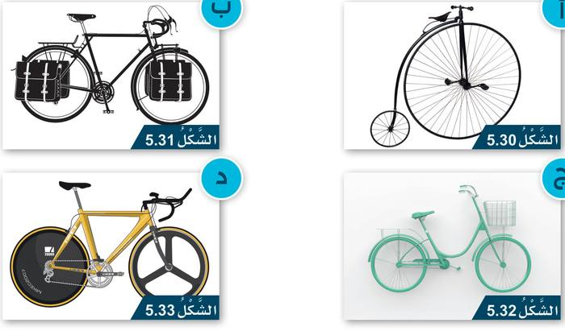
   - أ) الدراجة أ
   - ب) الدراجة ب
   - ج) الدراجة ج
   - د) الدراجة د

#### رابعًا: أجب عن الأسئلة الآتية (مسائل وتفكير)

4. عند ملاحظة تأثير مقاومة الهواء في جسم متحرك، لماذا من المهم تكرار القياسات؟
5. أرسم دائرة حول الاختبار ذي البيانات غير الموثوقة في الجدول الآتي: مساحة سطح شراع السيارة والزمن الذي تستغرقه السيارة لتصل إلى أسفل المنحدر (بالثواني)، الاختبار 1 / 2 / 3: (6×6 cm: 4.8، 8.4، 4.9) (8×8 cm: 6.2، 5.9، 6.1) (12×12 cm: 9.5، 9.9، 9.3).
   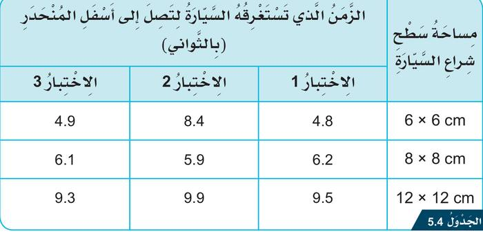
6. أفسّر سبب اعتبار القياس الذي اخترته غير موثوق.

#### أولًا: اختر الإجابة الصحيحة (أسئلة محوّلة)

1. ما مقاومة الهواء؟
   - أ) قوّة الطفو
   - ب) قوّة تجذب الأجسام نحو الأرض
   - ج) قوّة المغناطيس
   - د) قوّة احتكاك الهواء مع الجسم المتحرّك فيه
2. ما اتّجاه مقاومة الهواء بالنسبة إلى حركة الجسم؟
   - أ) في اتّجاه الحركة
   - ب) عكس اتّجاه الحركة
   - ج) للأعلى فقط
   - د) لا اتّجاه لها
3. ماذا تفعل مقاومة الهواء بجسمٍ يتحرّك فيه؟
   - أ) تبطئه
   - ب) تسرّعه دائمًا
   - ج) تحوّله إلى سائل
   - د) لا تؤثّر فيه
4. كيف يهبط جسمٌ معلّقٌ بمظلّةٍ كبيرة المساحة مقارنةً بمظلّةٍ صغيرة؟
   - أ) أسرع
   - ب) أبطأ
   - ج) بالسرعة نفسها
   - د) لا يهبط
5. لماذا يستعمل المظلّيّون المظلّات؟
   - أ) لإنقاص مقاومة الهواء
   - ب) لزيادة مقاومة الهواء وإبطاء الهبوط
   - ج) ليسقطوا أسرع
   - د) لتغيير لون السماء
6. أيّ وضعٍ على الدرّاجة يقلّل مقاومة الهواء؟
   - أ) الجلوس بظهرٍ مستقيم
   - ب) الانحناء إلى الأمام
   - ج) فتح الذراعين
   - د) وضع شراعٍ كبير
7. أيّ الورقتين تسقط أسرع: ورقةٌ مفرودةٌ أم مكوّرة؟
   - أ) المفرودة
   - ب) المكوّرة
   - ج) تسقطان معًا دائمًا
   - د) لا تسقطان
8. في تجربةٍ نغيّر فيها مساحة سطح مظلّةٍ، ما المتغيّر المستقلّ؟
   - أ) زمن الهبوط
   - ب) مساحة سطح المظلّة
   - ج) ارتفاع الإسقاط
   - د) وزن الغرفة
9. في تجربةٍ نغيّر فيها مساحة سطح مظلّةٍ ونقيس زمن هبوطها، ما المتغيّر التابع؟
   - أ) مساحة المظلّة
   - ب) الزمن الذي تستغرقه المظلّة في الهبوط
   - ج) لون المظلّة
   - د) نوع الورق
10. لماذا من المهمّ تكرار قياس زمن الهبوط؟
   - أ) لنجعل المظلّة أكبر
   - ب) لنتأكّد من دقّة النتائج ونكتشف الأخطاء
   - ج) لنزيد مقاومة الهواء
   - د) لا فائدة منه
11. أيّ الأسطح يقاوم الهواء أكثر؟
   - أ) السطح الأصغر مساحةً
   - ب) السطح الأكبر مساحةً
   - ج) لا أثر للمساحة
   - د) السطح الأملس دائمًا
12. أزمنة هبوطٍ مسجّلة: 3.1 s و 3.0 s و 3.2 s و 8.9 s. أيّ القياسات غير موثوق؟
   - أ) 8.9 s
   - ب) 3.0 s
   - ج) 3.1 s
   - د) 3.2 s
13. كيف يُصمَّم شكل سيّارات السباق لتقليل مقاومة الهواء؟
   - أ) مسطّح وعريض الواجهة
   - ب) أملس وانسيابيّ
   - ج) مربّع الشكل
   - د) بشراعٍ كبير
14. متى تكون مقاومة الهواء مفيدةً؟
   - أ) عند رمي الصاروخ
   - ب) عند سباق الدرّاجات
   - ج) عند قيادة سيّارة السباق
   - د) عند هبوط المظلّي
15. ماذا نضيف إلى سيّارةٍ تجريبيّةٍ لنزيد مقاومة الهواء عليها؟
   - أ) شمعًا
   - ب) عجلاتٍ أصغر
   - ج) زيتًا
   - د) شراعًا كبيرًا
16. أيّ القوى تبطئ الطائرة الورقيّة في الهواء؟
   - أ) قوّة المغناطيس
   - ب) مقاومة الهواء
   - ج) القوّة الكهربائيّة
   - د) قوّة الطفو في الماء
17. لماذا يميل الدرّاجون في السباقات إلى الأمام؟
   - أ) لزيادة مقاومة الهواء
   - ب) لتقليل مقاومة الهواء
   - ج) ليرتاحوا فقط
   - د) ليظهروا أطول

### الدرس 5.4: كيف يؤثر شكل الجسم في كيفية تحركه في الهواء؟

#### أولًا: اختر الإجابة الصحيحة

1. ما القوة المعاكسة لمقاومة الهواء التي تؤثر في الطائرة؟
   - أ) قوة الرفع
   - ب) الوزن
   - ج) قوة الدفع
   - د) مقاومة المائع
2. ما المفردة العلمية التي تصف الطائرة التي يمكن أن تتحرك في الهواء بسهولة؟
   - أ) استعراضية
   - ب) مدرّج
   - ج) هوائية
   - د) ديناميكية في الهواء
3. ما الشكل الأكثر انسيابية؟
   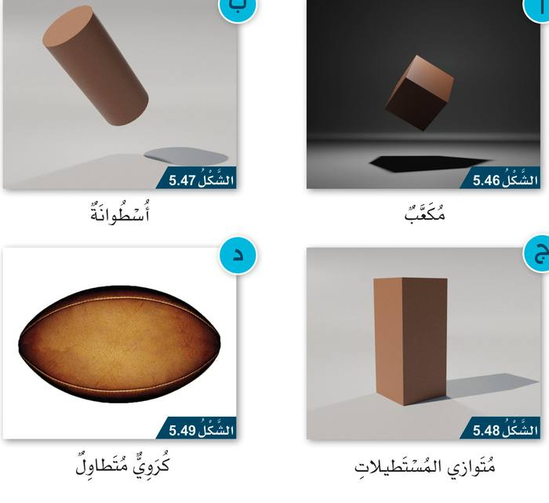
   - أ) مكعّب
   - ب) أسطوانة
   - ج) متوازي المستطيلات
   - د) كروي متطاول

#### رابعًا: أجب عن الأسئلة الآتية (مسائل وتفكير)

4. أشرح كيف يساعد شكل جناح الطائرة على التحليق في الهواء.

#### أولًا: اختر الإجابة الصحيحة (أسئلة محوّلة)

1. ما المصطلح العلميّ لوصف الشكل الذي يتحرّك في الهواء بسهولة؟
   - أ) مسطّح
   - ب) مربّع
   - ج) انسيابيّ
   - د) مقعّر
2. أيّ الأشكال الآتية الأكثر انسيابيّةً؟
   - أ) المكعّب
   - ب) شكل الدمعة ذو المقدّمة المدبّبة
   - ج) القرص المسطّح
   - د) الصندوق
3. لماذا تكون مقدّمة الطائرة مدبّبة؟
   - أ) لتبطئ الطائرة
   - ب) لتزيد مقاومة الهواء
   - ج) لتبدو أجمل فقط
   - د) لتقلّل مقاومة الهواء
4. ما القوّة التي تعاكس مقاومة الهواء وتدفع الطائرة إلى الأمام؟
   - أ) قوّة الطفو
   - ب) قوّة الاحتكاك
   - ج) قوّة المغناطيس
   - د) قوّة الدفع
5. هل الجسم عريض الواجهة المسطّحة شكلٌ انسيابيّ؟
   - أ) نعم، لأنّه عريض
   - ب) نعم، دائمًا
   - ج) لا، لأنّه يواجه هواءً كثيرًا
   - د) لا يمكن المعرفة
6. ما فائدة الشكل الانسيابيّ؟
   - أ) يجعل الجسم أثقل
   - ب) يزيد مقاومة الهواء
   - ج) يقلّل مقاومة الهواء فيتحرّك الجسم أسرع
   - د) يوقف الجسم
7. أيّ الطيور تطير بسرعةٍ كبيرةٍ لأنّ جسمها انسيابيّ؟
   - أ) الببّغاء الصغير
   - ب) الدجاجة
   - ج) البطّة المنتفخة
   - د) الصقر
8. أيّ المركبات الآتية الأكثر انسيابيّةً؟
   - أ) سيّارة السباق
   - ب) صندوق متحرّك
   - ج) شاحنة بجسمٍ مسطّح الواجهة
   - د) عربة بمقدّمةٍ مربّعة
9. لماذا ينحني راكب الدرّاجة إلى الأمام؟
   - أ) ليبرّد جسمه فقط
   - ب) ليزيد مساحة جسمه
   - ج) ليبطئ
   - د) ليقلّل مساحة جسمه المواجهة للهواء
10. أيّ الأشكال يزيد مقاومة الهواء؟
   - أ) الشكل الأملس الدقيق
   - ب) الشكل المدبّب
   - ج) الشكل الانسيابيّ
   - د) السطح العريض المسطّح
11. أيّ جزءٍ من الطائرة يساعدها على التحليق في الهواء؟
   - أ) الجناح
   - ب) العجلة
   - ج) المقعد
   - د) الباب
12. لماذا تُصنع الصواريخ بمقدّمةٍ مدبّبةٍ؟
   - أ) لتزيد المقاومة
   - ب) لتبطئ
   - ج) لتخترق الهواء بسهولة
   - د) لتبدو أكبر
13. أيّ العبارات الآتية خاطئة؟
   - أ) الأجسام الانسيابيّة تتحرّك بسهولة
   - ب) الأجسام الانسيابيّة تواجه مقاومة هواءٍ أكبر
   - ج) الأجنحة تساعد على التحليق
   - د) المقدّمة المدبّبة تقلّل المقاومة
14. لماذا لا تُصنع الطائرات على شكل مكعّب؟
   - أ) لأنّ المكعّب أملس جدًّا
   - ب) لأنّ المكعّب خفيف
   - ج) لأنّ المكعّب مدبّب
   - د) لأنّ المكعّب يواجه مقاومة هواء كبيرة
15. ما اسم قوّة الهواء التي تعاكس حركة الجسم فيه؟
   - أ) قوّة المغناطيس
   - ب) مقاومة الهواء
   - ج) قوّة الطفو
   - د) قوّة الجاذبيّة فقط
16. أيّ الأجسام الآتية يسقط أبطأ في الهواء؟
   - أ) مسمار
   - ب) كرةٌ معدنيّة صغيرة
   - ج) حجرٌ أملس
   - د) ورقةٌ مفرودة
17. أيّ شكل يقلّل مقاومة الهواء لجسم يتحرّك فيه؟
   - أ) شكل له نتوءات كثيرة
   - ب) شكل عريض مسطّح
   - ج) شكل له مساحة كبيرة مواجهة للهواء
   - د) شكل انسيابي مدبّب

### الدرس 5.5: ما مقاومة الماء؟

#### أولًا: اختر الإجابة الصحيحة

1. كيف تؤثر قوة مقاومة الماء في الأجسام؟
   - أ) تجعل الأجسام تبدأ بالتحرك.
   - ب) تدفع الأجسام إلى الأمام.
   - ج) تدفع الأجسام إلى الخلف، عكس اتجاه الحركة.
   - د) تسحب الأجسام إلى الخلف.
2. لمَ مقدمة هذا القارب مدبّبة؟
   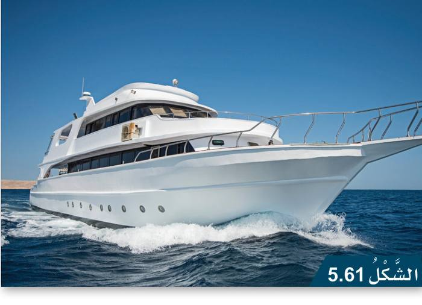
   - أ) لزيادة مقاومة الماء
   - ب) لتقليل أثر الشكل الانسيابي
   - ج) لزيادة مقاومة الهواء
   - د) لتقليل مقاومة الماء
3. أيّ من أشكال معجون اللعب سيسقط الأسرع في الماء؟
   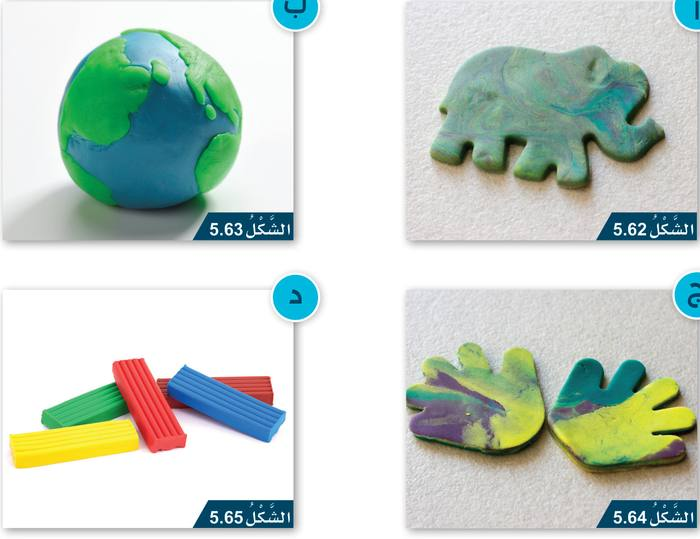
   - أ) الشكل أ
   - ب) الشكل ب
   - ج) الشكل ج
   - د) الشكل د

#### رابعًا: أجب عن الأسئلة الآتية (مسائل وتفكير)

4. أحدّد لماذا تؤثر مقاومة الماء في سرعة سقوط الأجسام خلال الماء.

#### أولًا: اختر الإجابة الصحيحة (أسئلة محوّلة)

1. ما مقاومة الماء؟
   - أ) قوّة المغناطيس
   - ب) قوّة جذب الأرض
   - ج) قوّة احتكاك الماء مع جسمٍ يتحرّك فيه
   - د) قوّة الرياح
2. كيف تؤثّر مقاومة الماء في الأجسام المتحرّكة فيه؟
   - أ) تجعلها أخفّ
   - ب) تسرّعها دائمًا
   - ج) تبطئها
   - د) لا تؤثّر فيها
3. لماذا تكون مقدّمة القارب مدبّبةً؟
   - أ) لتزيد مقاومة الماء
   - ب) لتقلّل مقاومة الماء
   - ج) لتبطئ القارب
   - د) لتبدو أكبر
4. أيّ الأشكال يسقط أسرع في الماء؟
   - أ) الصندوق العريض
   - ب) القرص العريض المسطّح
   - ج) الشكل المدبّب الانسيابيّ
   - د) الغطاء المفرود
5. أيّ الأشكال يسقط أبطأ في الماء؟
   - أ) الشكل المدبّب
   - ب) القرص العريض المسطّح
   - ج) السهم
   - د) الكرة الصغيرة الملساء
6. ما اتّجاه مقاومة الماء بالنسبة إلى حركة الجسم؟
   - أ) عكس اتّجاه الحركة
   - ب) في اتّجاه الحركة
   - ج) للأسفل دائمًا
   - د) لا اتّجاه لها
7. أيّ المقاومتين أكبر عادةً لجسمٍ متحرّكٍ بالسرعة نفسها؟
   - أ) متساويتان
   - ب) مقاومة الهواء
   - ج) مقاومة الماء
   - د) لا مقاومة في الماء
8. لماذا يصعب المشي بسرعةٍ في الماء العميق؟
   - أ) لأنّ الماء ساخن دائمًا
   - ب) لأنّ مقاومة الماء كبيرة
   - ج) لأنّ الماء عازل
   - د) لأنّ الماء خفيف جدًّا
9. أيّ الكائنات الآتية يتحرّك في الماء بسهولة بسبب شكله الانسيابيّ؟
   - أ) الدلفين
   - ب) السلطعون الكبير المسطّح
   - ج) كرة مطّاطية عريضة
   - د) الصخرة
10. ما الذي يقلّل مقاومة الماء؟
   - أ) زيادة مساحة الواجهة
   - ب) الشكل المسطّح العريض
   - ج) السطح الخشن جدًّا
   - د) الشكل الانسيابيّ
11. كيف يكون شكل الغوّاصة غالبًا؟
   - أ) مسطّح
   - ب) مربّع
   - ج) انسيابيّ
   - د) مكعّب
12. أيّ العبارات الآتية خاطئة؟
   - أ) مقاومة الماء تبطئ الجسم
   - ب) مقاومة الماء تزيد سرعة الجسم
   - ج) الأشكال المدبّبة تتحرّك أسرع في الماء
   - د) الماء يقاوم حركة السبّاح
13. أيّ وسائل النقل الآتية تتأثّر بمقاومة الماء؟
   - أ) السيّارة على اليابسة
   - ب) الطائرة فقط
   - ج) القارب
   - د) الدراجة على الطريق
14. كرةٌ وقرصٌ مسطّحٌ من المعجون سقطا في الماء. أيّهما يسقط أسرع؟
   - أ) يسقطان معًا
   - ب) القرص المسطّح
   - ج) الكرة
   - د) لا يسقط أيّ منهما
15. لماذا قد يرتدي السبّاحون قبّعاتٍ ناعمةً؟
   - أ) لتقليل مقاومة الماء
   - ب) لزيادة مقاومة الماء
   - ج) للتدفئة فقط
   - د) للزينة
16. في تجربة سقوط أشكال المعجون في الماء، ما المتغيّر التابع؟
   - أ) لون المعجون
   - ب) شكل المعجون
   - ج) كمّية المعجون
   - د) زمن السقوط
17. كيف تؤثّر مساحة السطح الكبيرة في سقوط جسمٍ في الماء؟
   - أ) تزيد المقاومة وتبطئ السقوط
   - ب) تقلّل المقاومة
   - ج) تسرّع السقوط
   - د) لا تؤثّر
18. لماذا تؤثّر مقاومة الماء في سرعة سقوط الأجسام في الماء؟
   - أ) لأنّ الماء يحتكّ بالجسم ويقاوم حركته
   - ب) لأنّ الماء يسحب الجسم للأعلى فقط
   - ج) لأنّ الماء بارد
   - د) لأنّ الماء شفّاف

### الدرس 5.6: كيف يؤثر شكل الجسم في كيفية تحركه في الماء؟

#### أولًا: اختر الإجابة الصحيحة

1. ما المصطلح العلمي للشكل الذي يتحرك بسهولة عبر الماء؟
   - أ) عوام
   - ب) غير منتظم
   - ج) انسيابي
   - د) عازل للماء
2. أيّ من الأشكال الآتية يعد شائعًا بين الكائنات البحرية لتسبح بسرعة؟
   - أ) عريض
   - ب) رفيع
   - ج) دائري
   - د) متعدد الزوايا
3. أيّ جزء من الجسم تستخدم الحيوانات البحرية لتسبح عبر الماء؟
   - أ) الزعانف
   - ب) القدمان
   - ج) الساقان
   - د) الجناحان

#### رابعًا: أجب عن الأسئلة الآتية (مسائل وتفكير)

4. في استقصاء لملاحظة كيفية تحرك أجسام مختلفة ثلاثية الأبعاد، أذكر سبب أهمية استخدام مروحة بالحجم نفسه في كل مرة.

#### أولًا: اختر الإجابة الصحيحة (أسئلة محوّلة)

1. ما المصطلح العلميّ لوصف الشكل الذي يتحرّك في الماء بسهولة؟
   - أ) مسطّح
   - ب) انسيابيّ
   - ج) مربّع
   - د) عريض
2. أيّ الأشكال شائعٌ بين الكائنات البحريّة التي تسبح بسرعة؟
   - أ) الشكل الانسيابيّ
   - ب) الشكل المربّع
   - ج) الشكل المسطّح العريض
   - د) الشكل المكعّب
3. أيّ جزءٍ من جسم السمكة تستعمله للسباحة؟
   - أ) الفم فقط
   - ب) العينان
   - ج) الزعانف والذيل
   - د) القشور فقط
4. لماذا نستعمل مروحةً بالحجم نفسه في كلّ مرّة عند اختبار أشكالٍ مختلفة؟
   - أ) ليكون الاختبار عادلًا
   - ب) لنزيد السرعة
   - ج) لنغيّر الشكل
   - د) لنقلّل القياسات
5. أيّ الحيوانات البحريّة سريعة بفضل شكلها الانسيابيّ؟
   - أ) الإسفنج
   - ب) نجم البحر
   - ج) قنديل البحر الصغير
   - د) الدلفين
6. أيّ الأجسام الآتية يتحرّك أبطأ في الماء؟
   - أ) السهم
   - ب) الشكل الانسيابيّ
   - ج) المكعّب
   - د) الدلفين
7. لماذا تكون أجسام الأسماك ملساء؟
   - أ) لتزيد الاحتكاك
   - ب) لتقلّل الاحتكاك مع الماء
   - ج) لتبدو خشنة
   - د) لتصبح أثقل
8. ما فائدة زعانف الغوص؟
   - أ) زيادة مقاومة الماء ليصعب الحركة
   - ب) دفع مقدارٍ أكبر من الماء إلى الخلف فيتحرّك الغوّاص
   - ج) التدفئة
   - د) الزينة
9. في اختبارٍ لأشكالٍ مختلفةٍ في الماء، ما المتغيّر المستقلّ؟
   - أ) درجة حرارة الغرفة
   - ب) زمن الحركة
   - ج) المسافة المقطوعة
   - د) شكل الجسم
10. في اختبارٍ لحركة أشكالٍ مختلفةٍ في الماء، ما المتغيّر التابع؟
   - أ) الحجم
   - ب) الشكل
   - ج) زمن أو مسافة حركة الجسم
   - د) نوع الماء
11. لماذا تُصمَّم الغوّاصات بشكلٍ انسيابيّ؟
   - أ) لتبطئ
   - ب) لتتحرّك بسهولةٍ أكبر في الماء
   - ج) لتزيد المقاومة
   - د) لتبدو كبيرة
12. أيّ الأجسام الآتية أقلّ انسيابيّةً؟
   - أ) سمكة رشيقة
   - ب) صندوقٌ مربّع
   - ج) دلفين
   - د) زورق سريع
13. ما الذي يدفع الماء إلى الخلف ليتحرّك الحيوان البحريّ إلى الأمام؟
   - أ) الأسنان
   - ب) العينان
   - ج) الذيل والزعانف
   - د) الصدفة
14. كيف يكون شكل القارب السريع؟
   - أ) كرويّ
   - ب) مقدّمة مربّعة
   - ج) مسطّح عريض
   - د) مقدّمة مدبّبة وجسم انسيابيّ
15. لماذا نكرّر قياس زمن حركة الجسم في الماء؟
   - أ) لنزيد مقاومة الماء
   - ب) لنغيّر الجسم
   - ج) لنزيد دقّة النتائج
   - د) لأنّه ممتع فقط
16. أيّ العبارات الآتية صحيحة؟
   - أ) مقاومة الماء تسرّع الأجسام
   - ب) الشكل المسطّح يقلّل مقاومة الماء
   - ج) الأشكال المربّعة أسرع في الماء
   - د) الشكل الانسيابيّ يقلّل مقاومة الماء
17. لماذا يكون لمعظم الأسماك السريعة جسم انسيابي؟
   - أ) ليمنعها من تغيير اتجاهها
   - ب) ليزيد مقاومة الماء
   - ج) ليجعلها أثقل وزنًا
   - د) ليقلّل مقاومة الماء فتسبح بسرعة

### الدرس 5.7: كيف تؤثر أشكال الحيوانات في كيفية تحركها في الهواء والماء مقارنة بالأجسام التي يصنعها الإنسان؟

#### أولًا: اختر الإجابة الصحيحة

1. ما الخاصية المشتركة بين الحيوانات سريعة الحركة والسفن والطائرات؟
   - أ) ذيل قوي
   - ب) جزء أمامي عريض
   - ج) ظهر زعنفي
   - د) جزء أمامي دقيق
2. لماذا يمكن لبعض الحيوانات والسفن والطائرات التنقل في سرعات عالية؟
   - أ) مصممة بشكل انسيابي لتقليل المقاومة.
   - ب) مصممة بشكل انسيابي لزيادة المقاومة.
   - ج) مصممة بشكل انسيابي لتبقي المقاومة ثابتة.
   - د) غير مصممة بشكل انسيابي.
3. أيّ الحيوانات الآتية هو الأسرع؟
   - أ) البطريق
   - ب) الحوت القاتل
   - ج) اليعسوب
   - د) الصقر

#### رابعًا: أجب عن الأسئلة الآتية (مسائل وتفكير)

4. أفسّر لماذا يساعد السطح الأملس الحيوانات والأجسام على التحرك بسرعة أكبر.
5. ألاحظ صورة الصاروخ في الشكل 5.89. أسمّي وأدوّن على الصورة خاصيتين لتصميم الصاروخ تمنحانه شكلًا انسيابيًا.
   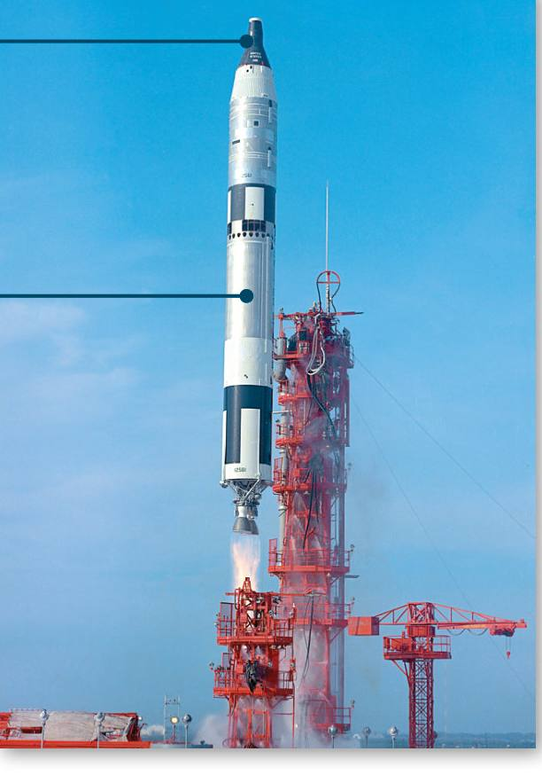

#### أولًا: اختر الإجابة الصحيحة (أسئلة محوّلة)

1. ما الخاصية المشتركة بين الحيوانات سريعة الحركة والسفن والطائرات؟
   - أ) الألوان الزاهية
   - ب) الأشكال الانسيابيّة
   - ج) الأحجام الصغيرة
   - د) الأصوات العالية
2. لماذا تتنقّل بعض الحيوانات والسفن والطائرات بسرعاتٍ عالية؟
   - أ) لأنّ أشكالها الانسيابيّة تقلّل المقاومة
   - ب) لأنّها ثقيلة جدًّا
   - ج) لأنّها ملوّنة
   - د) لأنّها كبيرة فقط
3. أيّ الحيوانات الآتية هو الأسرع على اليابسة؟
   - أ) الفيل
   - ب) السلحفاة
   - ج) الفهد
   - د) القطّة المنزلية
4. أيّ الطيور الآتية يُعدّ من أسرع الطيور عند الانقضاض؟
   - أ) الدجاجة
   - ب) الشاهين
   - ج) البطّة
   - د) الببّغاء
5. كيف يساعد السطح الأملس على الحركة بسرعة أكبر؟
   - أ) يزيد الاحتكاك
   - ب) يقلّل الاحتكاك والمقاومة
   - ج) يزيد الوزن
   - د) يغيّر اللون
6. أيّ خاصيّتين تجعلان الصاروخ انسيابيًّا؟
   - أ) أنبوب عريض وخشن
   - ب) مقدّمة مسطّحة وسطح خشن
   - ج) جسم مربّع وأجنحة كبيرة
   - د) مقدّمة مدبّبة وسطح أملس
7. أيّ المخلوقات يشبه شكل الطائرة في كونه انسيابيًّا؟
   - أ) الأرنب
   - ب) الصقر
   - ج) الفيل
   - د) البقرة
8. ما الخاصيّة المشتركة بين الدلفين والغوّاصة؟
   - أ) الفراء
   - ب) القدرة على الطيران
   - ج) الأرجل
   - د) الشكل الانسيابيّ
9. أيّ الأجسام الآتية ليس انسيابيًّا؟
   - أ) طائرة نفّاثة
   - ب) صندوق مربّع
   - ج) دلفين
   - د) صقر
10. ما فائدة الريش الأملس للطيور؟
   - أ) يمنع الطيران
   - ب) يزيد مقاومة الهواء
   - ج) يبطئ الطائر
   - د) يقلّل مقاومة الهواء
11. لماذا يقلّد المهندسون أشكال الحيوانات عند تصميم الآلات؟
   - أ) لتزيد الآلات وزنًا
   - ب) لتحسين الحركة وتقليل المقاومة
   - ج) لتصبح الآلات أبطأ
   - د) لتكون ملوّنة
12. أيّ المخلوقات يتحرّك بسرعةٍ كبيرةٍ في الماء بفضل شكله الانسيابيّ؟
   - أ) الدلفين
   - ب) نجم البحر
   - ج) الإسفنج
   - د) المحار
13. لماذا تكون مقدّمة القطار السريع مدبّبةً؟
   - أ) لتقلّل مقاومة الهواء
   - ب) لتزيد المقاومة
   - ج) لتبطئ القطار
   - د) للزينة
14. أيّ العبارات الآتية صحيحة؟
   - أ) الاحتكاك يزيد السرعة
   - ب) الأجسام الخشنة أسرع دائمًا
   - ج) الأجسام المربّعة أسرع
   - د) الأجسام الملساء تتحرّك بسرعةٍ أكبر عادةً
15. أيّ زوجين يشتركان في الشكل الانسيابيّ؟
   - أ) الصندوق والمكعّب
   - ب) الطائرة والصقر
   - ج) الصخرة والكرة
   - د) الكرسيّ والطاولة
16. ما الذي يميّز شكل الحوت والغوّاصة؟
   - أ) انسيابيّ يسهّل الحركة في الماء
   - ب) مربّع
   - ج) مسطّح
   - د) كرويّ خشن
17. السفن ذات المقدّمة المدبّبة تتحرّك بسهولةٍ أكبر لأنّ:
   - أ) مقاومة الماء عليها أكبر
   - ب) مقاومة الماء عليها أقلّ
   - ج) وزنها أقلّ فقط
   - د) ألوانها أفتح

### الدرس 5.8: ماذا أعرف عن الاحتكاك ومقاومة الهواء ومقاومة الماء؟

#### أولًا: اختر الإجابة الصحيحة

1. أيّ من العبارات الآتية تصف تأثير الاحتكاك؟
   - أ) تزيد من سرعة الأجسام المتحركة.
   - ب) تزيد من فعالية حركة الجسم.
   - ج) تدفع الأجسام إلى الأسفل.
   - د) تعيق حركة الأجسام.
2. أيّ من مواد التشحيم الآتية تضاف بشكل شائع إلى الماكينات لتقليل تأثيرات الاحتكاك؟
   - أ) زيت
   - ب) وقود الديزل
   - ج) بنزين
   - د) جازولين
3. في أيّ من الحالات الآتية تكون مقاومة الهواء مفيدة؟
   - أ) صاروخ يتجه إلى الأعلى.
   - ب) مظلة هبوط تتجه إلى الأسفل.
   - ج) غطاس يتجه إلى الأسفل.
   - د) غواصة تتجه إلى الأعلى.
4. لماذا يمكن للكائنات البحرية ذات الغطاء الجلدي الأملس أن تتحرك بسهولة أكثر من الكائنات البحرية ذات الغطاء الجلدي الخشن؟
   - أ) لأنها لا تتأثر بمقاومة الماء.
   - ب) لزيادة تأثير مقاومة الماء عليها.
   - ج) لتقليل تأثير مقاومة الماء عليها.
   - د) لأنها ممَوَّهة بشكل جيد.

#### رابعًا: أجب عن الأسئلة الآتية (مسائل وتفكير)

5. ألاحظ صورًا لأسطح مختلفة الملمس. أتوقع السطح الذي سينشأ عليه أكبر مقدار من الاحتكاك، وأفسّر سبب توقعي. (بلاط خرساني، طريق حصاة، بلاط أرضية سيراميك، رصيف من الطوب)
   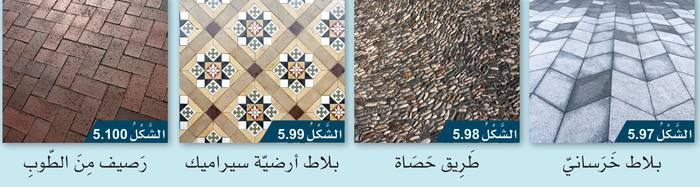

#### أولًا: اختر الإجابة الصحيحة (أسئلة محوّلة)

1. أيّ مواد التشحيم الآتية تُضاف عادةً إلى الآلات لتقليل الاحتكاك؟
   - أ) الحصى
   - ب) الرمل
   - ج) الماء المالح
   - د) الزيت
2. في أيّ الحالات الآتية تكون مقاومة الهواء مفيدةً؟
   - أ) انطلاق الصاروخ
   - ب) سباق الدرّاجات
   - ج) هبوط المظلّيّ
   - د) سيّارة السباق
3. لماذا تتحرّك الكائنات البحريّة ذات الجلد الأملس بسهولةٍ أكبر؟
   - أ) لأنّ الاحتكاك أكبر
   - ب) لأنّ الاحتكاك بالماء أقلّ
   - ج) لأنّها أثقل
   - د) لأنّها ملوّنة
4. أيّ السطحين ينشأ عليه احتكاكٌ أكبر؟
   - أ) جليد
   - ب) بلاط أملس
   - ج) سجّاد خشن
   - د) زجاج
5. ما الاحتكاك؟
   - أ) قوّة تضيء المصباح
   - ب) قوّة تجذب الأجسام عن بعد
   - ج) قوّة ترفع الأجسام
   - د) قوّة تقاوم الحركة بين سطحين متلامسين
6. بأيّ وحدةٍ تُقاس القوّة؟
   - أ) النيوتن
   - ب) الأمبير
   - ج) المتر
   - د) الدرجة المئويّة
7. أيّ شكلٍ يقلّل مقاومة الهواء ومقاومة الماء معًا؟
   - أ) الشكل الخشن
   - ب) الشكل المسطّح
   - ج) الشكل المربّع
   - د) الشكل الانسيابيّ
8. ماذا ينتج عن الاحتكاك غالبًا عند فرك الأسطح؟
   - أ) صوت موسيقيّ
   - ب) برودة
   - ج) ضوء أخضر
   - د) حرارة
9. أيّ الاستعمالات الآتية يعتمد على الاحتكاك؟
   - أ) تزليق السلسلة
   - ب) فرامل الدرّاجة
   - ج) تبريد المحرّك بالماء
   - د) تلميع الأرض
10. ما الضرر الذي قد يسبّبه الاحتكاك في الآلات؟
   - أ) زيادة طولها
   - ب) زيادة لمعانها
   - ج) تآكل الأجزاء المتحرّكة
   - د) تغيير لونها دائمًا
11. ماذا يحدث لمقاومة الهواء عند استعمال مظلّةٍ أكبر؟
   - أ) تنعدم
   - ب) تقلّ
   - ج) تزداد
   - د) لا تتغيّر
12. أيّ العبارات الآتية تصف مقاومة الماء؟
   - أ) قوّة لا تؤثّر في شيء
   - ب) قوّة تجعل الأجسام تسقط أسرع
   - ج) قوّة تضيء الأجسام
   - د) قوّة تبطئ حركة الأجسام في الماء
13. لماذا نضع الزيت على مفصّلات الباب؟
   - أ) لتغيير لونه
   - ب) لتقليل الاحتكاك
   - ج) لزيادة وزنه
   - د) لتصدر صوتًا
14. أيّ المقاومتين لها تأثير أكبر في جسمٍ سريع: الهواء أم الماء؟
   - أ) لا فرق
   - ب) الهواء
   - ج) الماء
   - د) لا مقاومة في أيّ منهما
15. أيّ الحالات الآتية يجب فيها زيادة الاحتكاك؟
   - أ) نعل حذاء الرياضة
   - ب) محور العجلة
   - ج) مفصّلة الباب
   - د) أجزاء الآلة المتحرّكة
16. أيّ العبارات الآتية خاطئة؟
   - أ) الاحتكاك يقاوم الحركة
   - ب) الاحتكاك يسرّع الأجسام دائمًا
   - ج) الأسطح الملساء احتكاكها قليل
   - د) الزيت يقلّل الاحتكاك

## الوحدة 6: الخصائص الفيزيائية وحالات الماء الثلاث

### الدرس 6.1: ما التغيرات المختلفة لحالات المادة؟

#### أولًا: اختر الإجابة الصحيحة

1. ما حالات المادة الثلاث؟
   - أ) بخار، وجليد، وماء
   - ب) صلبة، وسائلة، وغازية
   - ج) التبخر، والتكاثف، والتجمد
   - د) الانصهار، والغليان، والتسخين
2. أيّ من الصور الآتية تظهر حالة التجمد؟
   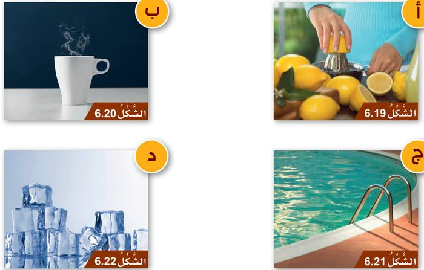
   - أ) الصورة أ
   - ب) الصورة ب
   - ج) الصورة ج
   - د) الصورة د
3. أيّ من هذه المواد يمكن أن تكون صلبة، وسائلة، وغازية؟
   - أ) الخشب
   - ب) الهواء
   - ج) الماء
   - د) الفلز

#### رابعًا: أجب عن الأسئلة الآتية (مسائل وتفكير)

4. أضع إشارة (✓) أمام الجملة الصحيحة: تحدث عملية التبخر عندما يتحول الغاز إلى سائل.
5. أضع إشارة (✓) أمام الجملة الصحيحة: تحدث عملية التبخر عندما يتحول السائل إلى غاز.
6. أضع إشارة (✓) أمام الجملة الصحيحة: تحدث عملية التبخر عندما ترتفع درجة حرارة المادة السائلة.
7. أضع إشارة (✓) أمام الجملة الصحيحة: تحدث عملية التبخر عندما تنخفض درجة حرارة المادة السائلة.

#### أولًا: اختر الإجابة الصحيحة (أسئلة محوّلة)

1. ما حالات المادة الثلاث؟
   - أ) ساكنة ومتحركة ومهتزة
   - ب) حارة وباردة ودافئة
   - ج) خفيفة وثقيلة ومتوسطة
   - د) صلبة وسائلة وغازية
2. ماذا تسمّى عملية تحوّل السائل إلى غاز؟
   - أ) التكاثف
   - ب) التجمّد
   - ج) الانصهار
   - د) التبخّر
3. ماذا تسمّى عملية تحوّل الغاز إلى سائل؟
   - أ) الانصهار
   - ب) التبخّر
   - ج) التكاثف
   - د) التجمّد
4. ماذا تسمّى عملية تحوّل السائل إلى صلب؟
   - أ) الانصهار
   - ب) التجمّد
   - ج) التبخّر
   - د) التكاثف
5. ماذا تسمّى عملية تحوّل الصلب إلى سائل؟
   - أ) الانصهار
   - ب) التجمّد
   - ج) التكاثف
   - د) التبخّر
6. أيّ المواد الآتية صلبة؟
   - أ) قطعة الخشب
   - ب) الماء
   - ج) الهواء
   - د) بخار الماء
7. أيّ المواد الآتية سائلة؟
   - أ) الهواء
   - ب) الحجر
   - ج) الحديد
   - د) عصير البرتقال
8. أيّ المواد الآتية غازيّة؟
   - أ) الخشب
   - ب) الماء
   - ج) الهواء
   - د) الزيت
9. أيّ الحالات تأخذ شكل الإناء الذي توضع فيه وتملأ جزءًا منه فقط؟
   - أ) الغازية
   - ب) الصلبة
   - ج) السائلة
   - د) لا شيء
10. أيّ الحالات تتمدّد لتملأ الإناء كلّه؟
   - أ) الغازية
   - ب) الصلبة
   - ج) السائلة
   - د) لا شيء
11. أيّ الحالات لها شكلٌ ثابتٌ؟
   - أ) الصلبة
   - ب) السائلة
   - ج) الغازية
   - د) السائلة والغازية
12. أيّ الجمل الآتية صحيحة؟
   - أ) يحدث التبخّر عندما يتحوّل الصلب إلى سائل
   - ب) يحدث التبخّر عندما يتحوّل الغاز إلى سائل
   - ج) يحدث التبخّر عندما يتحوّل السائل إلى غاز
   - د) يحدث التبخّر عندما يتحوّل السائل إلى صلب
13. ماذا يحدث للماء السائل عند وضعه في المجمّد؟
   - أ) ينصهر
   - ب) يتبخّر فورًا
   - ج) يتجمّد ويصبح جليدًا
   - د) يتحوّل إلى غاز
14. ماذا يحدث لمكعّب الجليد عند وضعه في مكانٍ دافئ؟
   - أ) لا يتغيّر
   - ب) يتجمّد أكثر
   - ج) يتحوّل إلى غاز فورًا
   - د) ينصهر ويصبح ماءً
15. ما الذي يسبّب التبخّر السريع للماء؟
   - أ) ارتفاع درجة الحرارة
   - ب) انخفاض درجة الحرارة
   - ج) إطفاء الضوء
   - د) وضع غطاء
16. أيّ المواد يمكن أن تكون صلبةً أو سائلةً أو غازيّةً بحسب درجة الحرارة؟
   - أ) الحديد العاديّ
   - ب) الخشب
   - ج) الحجر
   - د) الماء
17. أيّ العبارات الآتية خاطئة؟
   - أ) التبخّر تحوّل السائل إلى غاز
   - ب) يحدث التبخّر عند انخفاض درجة حرارة السائل كثيرًا حتى يتجمّد
   - ج) الجليد ماء صلب
   - د) بخار الماء غاز

### الدرس 6.2: كيف أستقصي انصهار الجليد؟

#### أولًا: اختر الإجابة الصحيحة

1. ما الانصهار؟
   - أ) تغير في حالة المادة من الحالة الصلبة إلى الغازية
   - ب) تغير في حالة المادة من الحالة السائلة إلى الغازية
   - ج) تغير في حالة المادة من الحالة الصلبة إلى السائلة
   - د) تغير في حالة المادة من الحالة السائلة إلى الصلبة
2. أيّ مما يأتي مثال على الانصهار؟
   - أ) تحول الماء إلى جليد
   - ب) تحول الجليد إلى ماء
   - ج) تحول الماء إلى بخار
   - د) تحول الجليد إلى بخار
3. أيّ من الجمل الآتية تصف الاختبار العادل؟
   - أ) اختبار يتغير فيه عامل واحد، أما العوامل الأخرى فتبقى ثابتة كما هي.
   - ب) اختبار يتغير فيه عاملان اثنان.
   - ج) اختبار يكون فيه عامل واحد فقط ثابتًا لا يتغير.
   - د) اختبار يجرى في أماكن كثيرة.

#### رابعًا: أجب عن الأسئلة الآتية (مسائل وتفكير)

4. أكتب جملة أشرح فيها ما توضحه تجربة انصهار الجليد التي أجريتها.

#### أولًا: اختر الإجابة الصحيحة (أسئلة محوّلة)

1. ما الانصهار؟
   - أ) تحوّل المادة الصلبة إلى سائلة بالتسخين
   - ب) تحوّل السائل إلى غاز
   - ج) تحوّل الغاز إلى سائل
   - د) تحوّل السائل إلى صلب
2. أيّ الأمثلة الآتية يمثّل الانصهار؟
   - أ) تبخّر الماء من قدر
   - ب) تجمّد الماء في المجمّد
   - ج) ذوبان مكعّب الجليد في كأس
   - د) تشكّل ندى على كأس بارد
3. أيّ الجمل الآتية تصف الاختبار العادل لانصهار الجليد؟
   - أ) تجربة واحدة بلا قياس
   - ب) تغيير كلّ المتغيّرات معًا
   - ج) تغيير متغيّر واحدٍ فقط مع إبقاء الباقي ثابتًا
   - د) استعمال كمّيّات مختلفة من الجليد دائمًا
4. في اختبار انصهار الجليد بدرجات حرارةٍ مختلفة، ما المتغيّر المستقلّ؟
   - أ) كمّية الماء الناتجة
   - ب) زمن الانصهار
   - ج) درجة حرارة المكان
   - د) لون الكأس
5. في اختبارٍ لدرجات حرارةٍ مختلفة يُقاس فيه زمن انصهار الجليد، ما المتغيّر التابع؟
   - أ) الزمن الذي يستغرقه الجليد ليذوب
   - ب) درجة الحرارة
   - ج) كتلة الجليد الأوّلية
   - د) الكأس المستعملة
6. أيّ المتغيّرات يجب أن يبقى ثابتًا في اختبار انصهار الجليد؟
   - أ) درجة الحرارة المختبَرة
   - ب) كتلة قطعة الجليد
   - ج) الزمن المقيس
   - د) نتيجة التجربة
7. أين ينصهر الجليد أسرع؟
   - أ) في ثلّاجة باردة جدًّا
   - ب) في المجمّد
   - ج) في غرفة دافئة
   - د) في صندوق مثلّج
8. ما الأداة المناسبة لقياس زمن انصهار الجليد؟
   - أ) ميزان زنبركيّ
   - ب) مسطرة
   - ج) ساعة إيقاف
   - د) أميتر
9. ما الأداة المناسبة لقياس درجة الحرارة؟
   - أ) الترمومتر
   - ب) الأميتر
   - ج) المسطرة
   - د) الميزان
10. كم درجة الحرارة التي ينصهر عندها الجليد؟
   - أ) 0 °C
   - ب) 10 °C
   - ج) 50 °C
   - د) 100 °C
11. ماذا نستنتج إذا انصهر الجليد في الغرفة أسرع منه في الثلّاجة؟
   - أ) الحرارة الأعلى تبطئ الانصهار
   - ب) الحرارة الأعلى تُسرّع الانصهار
   - ج) الحرارة لا تؤثّر
   - د) الجليد لا ينصهر
12. لماذا نكرّر تجربة انصهار الجليد؟
   - أ) لنزيد موثوقيّة النتائج
   - ب) لنجعل الجليد أكبر
   - ج) لنغيّر الماء
   - د) لنقلّل القياسات
13. ماذا يحدث لكتلة الجليد بعد انصهاره كلّه؟
   - أ) تبقى كتلة الماء الناتج مساويةً لكتلة الجليد
   - ب) تصبح أكبر دائمًا
   - ج) تصبح صفرًا
   - د) تتضاعف
14. أيّ العبارات الآتية صحيحة؟
   - أ) الجليد ليس ماءً
   - ب) الجليد ماء في الحالة الغازية
   - ج) الجليد ماء في الحالة السائلة
   - د) الجليد ماء في الحالة الصلبة
15. أيّ المواد الآتية تنصهر عند التسخين؟
   - أ) الخشب
   - ب) الزجاج السميك
   - ج) الحجر
   - د) الشمع
16. ما الذي يتسبّب في انصهار الشوكولاتة في اليد؟
   - أ) الهواء البارد
   - ب) برودة اليد
   - ج) الظلام
   - د) حرارة اليد
17. ما علاقة درجة الحرارة بسرعة الانصهار؟
   - أ) كلّما ارتفعت الحرارة قلّت سرعة الانصهار
   - ب) كلّما ارتفعت الحرارة زادت سرعة الانصهار
   - ج) لا علاقة بينهما
   - د) الحرارة تمنع الانصهار

### الدرس 6.3: كيف أستقصي تجمد الماء؟

#### أولًا: اختر الإجابة الصحيحة

1. ما التجمد؟
   - أ) تغير في حالة المادة من الحالة الصلبة إلى السائلة
   - ب) تغير في حالة المادة من الحالة الصلبة إلى الغازية
   - ج) تغير في حالة المادة من الحالة السائلة إلى الصلبة
   - د) تغير في حالة المادة من الحالة السائلة إلى الغازية
2. أيّ مما يأتي مثال على التجمد؟
   - أ) قطعة مثلجات تتغير إلى سائل
   - ب) صناعة المثلجات من الحليب السائل
   - ج) تساقط الثلج
   - د) تسخين الماء في غلاية
3. أيّ من العوامل الآتية لا تؤثر في السرعة التي يتجمد عندها الماء؟
   - أ) درجة الحرارة الابتدائية للماء
   - ب) الوعاء الذي يوضع فيه الماء
   - ج) الصنبور الذي يأتي منه الماء
   - د) كمية الماء

#### رابعًا: أجب عن الأسئلة الآتية (مسائل وتفكير)

4. تجري مجموعة من الطلاب تجربة عن المدة التي يستغرقها الماء ليتجمد مع تغيير درجات حرارة الماء الابتدائية. وضعوا 100 mL من الماء الذي تبلغ درجة حرارته 70 °C في مجمد الثلاجة، وحددوا الوعاء عبر تدوين الرمز "أ". ووضعوا 100 mL من الماء الذي تبلغ درجة حرارته 10 °C في مجمد الثلاجة نفسه، وحددوا الوعاء عبر تدوين الرمز "ب". أيّ الوعاءين أتوقع أن يتجمد بسرعة أكبر؟ أفسّر السبب.
   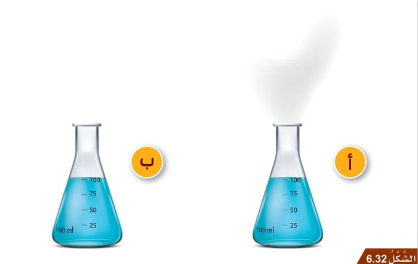

#### أولًا: اختر الإجابة الصحيحة (أسئلة محوّلة)

1. ما التجمّد؟
   - أ) تحوّل السائل إلى غاز
   - ب) تحوّل الصلب إلى سائل
   - ج) تحوّل السائل إلى صلب بالتبريد
   - د) تحوّل الغاز إلى سائل
2. أيّ الأمثلة الآتية يمثّل التجمّد؟
   - أ) تكوّن الغيوم
   - ب) ذوبان الثلج
   - ج) تبخّر الماء
   - د) تحوّل الماء إلى جليد في المجمّد
3. عند أيّ درجة حرارةٍ يتجمّد الماء النقيّ؟
   - أ) 50 °C
   - ب) 20 °C
   - ج) 0 °C
   - د) 100 °C
4. أيّ العوامل الآتية لا تؤثّر في سرعة تجمّد الماء؟
   - أ) لون الكأس
   - ب) درجة حرارة المجمّد
   - ج) كمّية الماء
   - د) درجة حرارة الماء الابتدائية
5. أيّ الماءين يتجمّد أسرع: ماءٌ حرارته الابتدائيّة 10 °C أم 40 °C؟
   - أ) يتجمّدان معًا بالسرعة نفسها
   - ب) الماء ذو الحرارة 40 °C
   - ج) الماء ذو الحرارة 10 °C
   - د) لا يتجمّد أيّ منهما
6. في اختبار تجمّد الماء بدرجات حرارةٍ ابتدائيّةٍ مختلفة، ما المتغيّر المستقلّ؟
   - أ) نوع الكأس
   - ب) زمن التجمّد
   - ج) درجة الحرارة الابتدائيّة للماء
   - د) حجم المجمّد
7. في اختبارٍ لتجمّد الماء بدرجات حرارةٍ ابتدائيّةٍ مختلفة، ما المتغيّر التابع؟
   - أ) كمّية الماء
   - ب) درجة الحرارة الابتدائيّة
   - ج) الزمن اللازم ليتجمّد الماء
   - د) نوع الماء
8. في اختبارٍ لتجمّد الماء بدرجات حرارةٍ ابتدائيّةٍ مختلفة، أيّ المتغيّرات الآتية يجب أن يبقى ثابتًا؟
   - أ) نتيجة التجربة
   - ب) درجة الحرارة الابتدائيّة
   - ج) زمن التجمّد
   - د) كمّية الماء في كلّ كأس
9. ماذا يحدث للماء عند تبريده إلى ما دون 0 °C؟
   - أ) يتبخّر
   - ب) يتجمّد
   - ج) يغلي
   - د) يتحوّل إلى غاز
10. أيّ الأدوات تُستعمل لقياس درجة حرارة الماء؟
   - أ) الميزان
   - ب) الترمومتر
   - ج) المسطرة
   - د) الأميتر
11. ما وحدة قياس درجة الحرارة؟
   - أ) الأمبير
   - ب) النيوتن
   - ج) الدرجة المئويّة
   - د) المتر
12. أيّ السوائل الآتية يتجمّد في المجمّد؟
   - أ) الهواء
   - ب) الماء
   - ج) الغاز
   - د) بخار الماء
13. لماذا نكرّر قياس زمن التجمّد؟
   - أ) لا فائدة
   - ب) لنقلّل الماء
   - ج) لنغيّر درجة الحرارة
   - د) لنزيد موثوقيّة النتائج
14. ما الذي يحدث لحجم الماء عند تجمّده؟
   - أ) ينقص كثيرًا
   - ب) يزداد قليلًا
   - ج) لا يتغيّر أبدًا
   - د) يتبخّر
15. أيّ العبارات الآتية صحيحة؟
   - أ) التجمّد عكس التبخّر
   - ب) التجمّد هو نفسه الانصهار
   - ج) التجمّد يحدث بالتسخين
   - د) التجمّد عكس الانصهار
16. أيّ مجمّدٍ يجمّد الماء أسرع؟
   - أ) لا فرق
   - ب) الأدفأ
   - ج) الأبرد
   - د) لا يجمّد
17. ماذا نسمّي الماء المتجمّد؟
   - أ) غيمة
   - ب) بخار
   - ج) ندى
   - د) جليد

### الدرس 6.4: ما الذي أستطيع أن ألاحظه حول الغليان والتبخر والتكاثف؟

#### أولًا: اختر الإجابة الصحيحة

1. متى تحدث عملية التكاثف؟
   - أ) عندما يبرد البخار
   - ب) عندما ينصهر الجليد
   - ج) عندما يغلي الماء
   - د) عندما يتجمد الماء
2. ما وحدة القياس المستخدمة لقياس درجات الحرارة؟
   - أ) المليمتر (mL)
   - ب) الدرجة المئوية (°C)
   - ج) سنتيمتر مكعب (cm³)
   - د) الجرام (g)
3. ماذا يحدث عند وضع غطاء زجاجي فوق قدر ماء ساخن؟
   - أ) يتكاثف الماء وينتج قطرات سائلة على الغطاء الزجاجي.
   - ب) يتبخر الماء وينتج جليدًا على الغطاء الزجاجي.
   - ج) يتبخر الماء ولا ينتج شيئًا على الغطاء الزجاجي.
   - د) يتكاثف الماء وينتج غازًا على الغطاء الزجاجي.
4. في إحدى التجارب، قيست درجة حرارة الماء مباشرة بعد كل مرحلة من المراحل الآتية: 1. البدء بتسخين الماء السائل الموجود عند درجة حرارة الغرفة. 2. غلي الماء ثم جمع البخار وتبريده بحيث يتكاثف جميعه. 3. الاستمرار بالتبريد حتى تصل درجة حرارة الماء في النهاية إلى درجة حرارة الغرفة. أيّ من الآتي هو التسلسل الصحيح لقيم درجات الحرارة؟
   - أ) °C 0، °C 100، °C 0
   - ب) °C 100، °C 20، °C 0
   - ج) °C 20، °C 100، °C 20
   - د) °C 100، °C 0، °C 20

#### رابعًا: أجب عن الأسئلة الآتية (مسائل وتفكير)

5. أضع إشارة (✓) أمام الجملة الصحيحة: يحدث التكاثف عند تبريد مادة سائلة وتحولها إلى مادة صلبة.
6. أضع إشارة (✓) أمام الجملة الصحيحة: يغلي الماء عند تسخينه إلى درجة حرارة مقدارها 100 °C ويتحول إلى بخار الماء.
7. أضع إشارة (✓) أمام الجملة الصحيحة: تحدث عملية التبخر عند تسخين مادة سائلة وتحولها إلى غاز.
8. تتحدث مجموعة من الطلاب عن التغيرات في حالة الماء، ويقول أحد الطلاب: "عندما تتغير حالة الماء، فإنها تتغير من صلبة إلى سائلة ثم إلى غازية دائمًا." هل أتفق معه؟ أشرح إجابتي.

#### أولًا: اختر الإجابة الصحيحة (أسئلة محوّلة)

1. متى تحدث عملية التكاثف؟
   - أ) عندما ينصهر الصلب
   - ب) عندما يسخن السائل ويتحوّل إلى غاز
   - ج) عندما يبرد السائل ويتجمّد
   - د) عندما يبرد الغاز ويتحوّل إلى سائل
2. ما وحدة قياس درجة الحرارة؟
   - أ) الأمبير A
   - ب) النيوتن N
   - ج) الدرجة المئويّة °C
   - د) الكيلوجرام kg
3. ماذا يحدث عند وضع غطاءٍ زجاجيٍّ فوق قدر ماءٍ ساخن؟
   - أ) يختفي الماء فورًا
   - ب) يتجمّد الماء
   - ج) ينصهر الغطاء
   - د) يتكاثف بخار الماء على الغطاء قطراتٍ
4. عند أيّ درجة حرارةٍ يغلي الماء؟
   - أ) 0 °C
   - ب) 100 °C
   - ج) 50 °C
   - د) 10 °C
5. أيّ الجمل الآتية صحيحة؟
   - أ) ينصهر الجليد عند 100 °C
   - ب) يتجمّد الماء عند 100 °C
   - ج) يغلي الماء عند 100 °C ويتحوّل إلى بخار
   - د) يتكاثف البخار عند تسخينه
6. أيّ الجمل الآتية عن التبخّر صحيحة؟
   - أ) يحدث التبخّر عند انصهار الصلب
   - ب) يحدث التبخّر عند تبريد غاز
   - ج) يحدث التبخّر عند تجمّد السائل
   - د) يحدث التبخّر عند تسخين سائل وتحوّله إلى غاز
7. ما الفرق بين الغليان والتبخّر؟
   - أ) الغليان يحدث عند درجةٍ محدّدة في كلّ السائل، والتبخّر يحدث من سطح السائل عند أيّ حرارة
   - ب) لا فرق بينهما
   - ج) الغليان يحدث دون تسخين
   - د) التبخّر يحدث فقط عند 100 °C
8. ما الذي يتكوّن على كأسٍ بارد في يومٍ حارّ؟
   - أ) غاز
   - ب) جليد دائمًا
   - ج) قطرات ماء من التكاثف
   - د) رمل
9. ما الذي تسبّبه حرارة الشمس لبِرَك الماء؟
   - أ) تجمّد الماء
   - ب) تبخّر الماء
   - ج) تكاثف الماء
   - د) انصهار الماء
10. ما الذي يتكوّن عند تكاثف بخار الماء في السماء؟
   - أ) الجليد الأرضيّ
   - ب) الغيوم
   - ج) الحجارة
   - د) الغاز الجافّ
11. ما الحالة التي يكون عليها بخار الماء؟
   - أ) غازيّة
   - ب) صلبة
   - ج) سائلة
   - د) لا حالة له
12. ماذا يحدث لدرجة حرارة الماء عند غليانه؟
   - أ) تبقى ثابتة عند 100 °C
   - ب) تستمرّ بالارتفاع دائمًا
   - ج) تنخفض
   - د) تصبح 0 °C
13. أيّ التغيّرات تحدث عندما يبرد بخار الماء؟
   - أ) الغليان
   - ب) الانصهار
   - ج) التبخّر
   - د) التكاثف
14. أيّ أدواتٍ تُستعمل لقياس درجة حرارة الماء الساخن؟
   - أ) ساعة الإيقاف فقط
   - ب) الميزان
   - ج) المسطرة
   - د) الترمومتر
15. أيّ العبارات الآتية خاطئة؟
   - أ) التكاثف تحوّل الغاز إلى سائل
   - ب) يحدث التكاثف عند تبريد مادة سائلة وتحوّلها إلى مادة صلبة
   - ج) التبخّر تحوّل السائل إلى غاز
   - د) الغليان يحدث عند 100 °C
16. لماذا يتجمّع الندى على النباتات صباحًا؟
   - أ) لأنّ بخار الماء يبرد ويتكاثف
   - ب) لأنّ الماء يتجمّد دائمًا
   - ج) لأنّ النبات يصنع الماء
   - د) لأنّ الشمس تنتج الماء

### الدرس 6.5: كيف تتغير حالة الماء عند درجات الحرارة المختلفة؟

#### أولًا: اختر الإجابة الصحيحة

1. ماذا يحدث للماء عند درجة حرارة 0 °C أو أقل منها؟
   - أ) يتغير من الحالة السائلة إلى الغازية.
   - ب) يتغير من الحالة السائلة إلى الصلبة.
   - ج) يتغير من الحالة الصلبة إلى السائلة.
   - د) يتغير من الحالة الغازية إلى السائلة.
2. ما درجة الحرارة التي يغلي عندها الماء؟
   - أ) 0 °C
   - ب) 20 °C
   - ج) 150 °C
   - د) 100 °C
3. أيّ من الصور الآتية تظهر ما يحدث للجليد الموجود في غرفة درجة حرارتها أعلى من 0 °C؟
   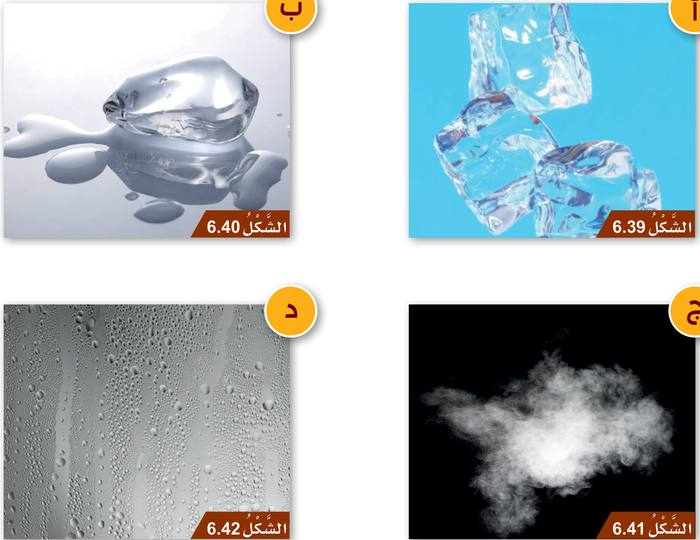
   - أ) الصورة أ
   - ب) الصورة ب
   - ج) الصورة ج
   - د) الصورة د

#### رابعًا: أجب عن الأسئلة الآتية (مسائل وتفكير)

4. ما الحالة التي يكون عليها الماء عند درجة حرارة الغرفة؟ أفسّر كيف أعرف ذلك.
5. يظهر الرسم البياني أدناه كيف تتغير درجة حرارة الماء مع مرور الزمن. أضيف العناوين "صلبة"، و"سائلة"، و"غازية" إلى الرسم البياني لإظهار حالة الماء عند درجات الحرارة المختلفة.
   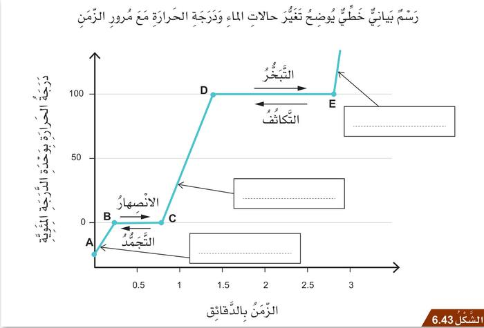

#### أولًا: اختر الإجابة الصحيحة (أسئلة محوّلة)

1. ما الحالة التي يكون عليها الماء عند درجة حرارة الغرفة؟
   - أ) صلبة
   - ب) سائلة
   - ج) غازيّة
   - د) بلازما
2. ما الحالة التي يكون عليها الماء عند 100 °C وما فوقها؟
   - أ) غازيّة (بخار)
   - ب) صلبة
   - ج) سائلة دائمًا
   - د) جليد
3. ما الحالة التي يكون عليها الماء عند -5 °C؟
   - أ) سائلة
   - ب) صلبة
   - ج) غازيّة
   - د) لا حالة له
4. ماذا يحدث لقطعة جليد في غرفةٍ حرارتها 25 °C؟
   - أ) تنصهر
   - ب) تتجمّد أكثر
   - ج) تتبخّر فورًا
   - د) لا تتغيّر
5. ماذا يحدث للماء في قدرٍ يُسخَّن إلى 100 °C؟
   - أ) يتجمّد
   - ب) يغلي ويتحوّل إلى بخار
   - ج) ينصهر
   - د) لا يتغيّر
6. أيّ درجات الحرارة الآتية يكون عندها الماء سائلًا؟
   - أ) -10 °C
   - ب) 50 °C
   - ج) 120 °C
   - د) -1 °C
7. أيّ درجات الحرارة الآتية يكون عندها الماء صلبًا؟
   - أ) -3 °C
   - ب) 5 °C
   - ج) 40 °C
   - د) 101 °C
8. أيّ درجات الحرارة الآتية يكون عندها الماء غازًا؟
   - أ) 110 °C
   - ب) 90 °C
   - ج) 20 °C
   - د) 0 °C
9. ما درجة تجمّد الماء؟
   - أ) -100 °C
   - ب) 100 °C
   - ج) 50 °C
   - د) 0 °C
10. ما درجة غليان الماء؟
   - أ) 0 °C
   - ب) 100 °C
   - ج) 20 °C
   - د) 50 °C
11. في رسمٍ بيانيٍّ لتسخين جليدٍ، تتوقّف الحرارة عن الارتفاع عند 0 °C لأنّ:
   - أ) الترمومتر معطّل
   - ب) الماء يتجمّد
   - ج) الجليد يتبخّر
   - د) الجليد ينصهر عند هذه الدرجة
12. أيّ التغيّرات يحدث عند تسخين الجليد من -10 °C حتى 120 °C؟
   - أ) ينصهر ثمّ يغلي ويتحوّل إلى بخار
   - ب) يتجمّد فقط
   - ج) يبقى جليدًا
   - د) يتحوّل إلى غاز مباشرةً دون سائل
13. ماذا يحدث لبخار الماء عند تبريده إلى أقلّ من 100 °C؟
   - أ) يتجمّد فورًا
   - ب) يتكاثف ويصبح ماءً
   - ج) يبقى بخارًا دائمًا
   - د) ينصهر
14. أيّ الأدوات تقيس درجة الحرارة؟
   - أ) الأميتر
   - ب) الترمومتر
   - ج) المسطرة
   - د) الميزان الزنبركيّ
15. أيّ العبارات الآتية صحيحة؟
   - أ) الماء لا يتغيّر مع الحرارة
   - ب) للماء حالة واحدة فقط
   - ج) الجليد والبخار ليسا ماءً
   - د) الماء مادّة واحدة تظهر بثلاث حالات بحسب الحرارة
16. درجة حرارة الغرفة 22 °C. أيّ الحالات الآتية تتوقّعها لقطرة ماءٍ على الطاولة؟
   - أ) جليديّة
   - ب) صلبة
   - ج) غازيّة فقط
   - د) سائلة
17. عند أيّ درجةٍ ينصهر الجليد؟
   - أ) 50 °C
   - ب) 0 °C
   - ج) 100 °C
   - د) -50 °C

### الدرس 6.6: كيف أستقصي التبخر؟

#### أولًا: اختر الإجابة الصحيحة

1. ما التبخر؟
   - أ) تغير حالة الماء من الحالة السائلة إلى الغازية عند تسخينه.
   - ب) تغير حالة الماء من الحالة السائلة إلى الغازية عند تبريده.
   - ج) تغير حالة الماء من الحالة الغازية إلى السائلة عند تسخينه.
   - د) تغير حالة الماء من الحالة الغازية إلى السائلة عند تبريده.
2. أيّ جملة من الجمل الآتية تصف بخار الماء؟
   - أ) بخار الماء هو السائل الذي ينتج عند تسخين الماء.
   - ب) بخار الماء هو السائل الذي ينتج عند تبريد الماء.
   - ج) بخار الماء هو الغاز الذي ينتج عند تبريد الماء.
   - د) بخار الماء هو الغاز الذي ينتج عند تسخين الماء.
3. أيّ من الصور الآتية تظهر عملية التبخر؟
   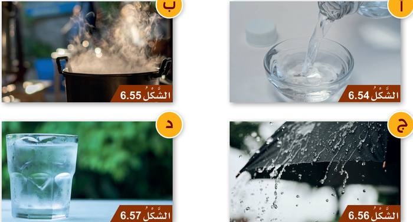
   - أ) الصورة أ
   - ب) الصورة ب
   - ج) الصورة ج
   - د) الصورة د
4. أيّ من الصور الآتية تظهر المتغير التابع في تجربة لاختبار معدلات التبخر؟
   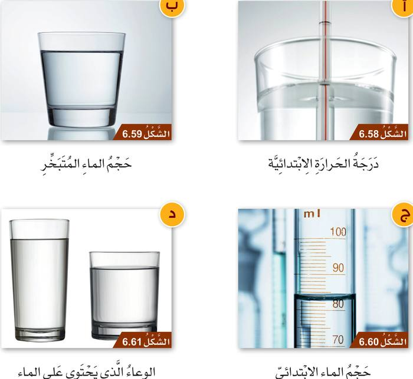
   - أ) درجة الحرارة الابتدائية
   - ب) حجم الماء المتبخر
   - ج) حجم الماء الابتدائي
   - د) الوعاء الذي يحتوي على الماء

#### أولًا: اختر الإجابة الصحيحة (أسئلة محوّلة)

1. ما التبخّر؟
   - أ) تحوّل الصلب إلى سائل
   - ب) تحوّل الغاز إلى سائل
   - ج) تحوّل السائل إلى صلب
   - د) تحوّل السائل إلى غاز
2. أيّ الجمل الآتية تصف بخار الماء؟
   - أ) جليد صغير
   - ب) سائل أزرق
   - ج) صلب شفّاف
   - د) غازٌ غير مرئيّ تقريبًا
3. أيّ العوامل الآتية تزيد سرعة تبخّر الماء؟
   - أ) إغلاق الإناء
   - ب) انخفاض درجة الحرارة
   - ج) ارتفاع درجة الحرارة
   - د) وضع غطاء
4. في اختبار تبخّر الماء في أمكنة مختلفة، ما المتغيّر المستقلّ؟
   - أ) كمّية الماء المتبقية
   - ب) المكان أو درجة الحرارة
   - ج) لون الإناء
   - د) اسم الماء
5. في اختبارٍ لتبخّر الماء في أمكنةٍ مختلفة، ما المتغيّر التابع؟
   - أ) الإناء
   - ب) المكان
   - ج) كمّية الماء التي تبخّرت
   - د) الزمن الذي نبدأ به
6. أيّ المتغيّرات يجب أن يبقى ثابتًا في اختبار التبخّر؟
   - أ) درجة الحرارة المختبَرة
   - ب) كمّية الماء الأوّليّة ونوع الإناء
   - ج) كمّية البخار
   - د) النتيجة
7. أيّ الأمكنة يتبخّر فيها الماء أسرع؟
   - أ) داخل ثلّاجة
   - ب) مكانٌ بارد ومظلم
   - ج) مكانٌ حارٌّ ومشمس
   - د) مكانٌ مغلق ورطب جدًّا
8. أيّ الأوعية يتبخّر منه الماء أسرع؟
   - أ) وعاء ضيّق مغلق
   - ب) وعاء واسع مفتوح
   - ج) وعاء عميق مغطّى
   - د) قارورة مغلقة
9. ماذا يحدث للغسيل المبلّل في الشمس؟
   - أ) يتحوّل إلى جليد
   - ب) يتجمّد
   - ج) يصبح أثقل
   - د) يجفّ لأنّ الماء يتبخّر
10. أيّ الأدوات تُستعمل لقياس كمّية الماء المتبقّية؟
   - أ) الأميتر
   - ب) المسطرة
   - ج) الترمومتر
   - د) المخبار المدرّج
11. لماذا نغطّي الأواني لحفظ السوائل؟
   - أ) لتلوينها
   - ب) لزيادة تبخّرها
   - ج) لتجميدها
   - د) لمنع تبخّرها
12. ماذا يحدث لمستوى الماء في وعاءٍ مكشوفٍ تُرك أيّامًا في الحرّ؟
   - أ) يرتفع
   - ب) ينخفض
   - ج) لا يتغيّر
   - د) يتجمّد
13. أيّ العبارات الآتية صحيحة؟
   - أ) التبخّر يحوّل الغاز إلى سائل
   - ب) التبخّر يحدث فقط عند الغليان
   - ج) التبخّر لا يحدث للماء
   - د) التبخّر يحدث من سطح السائل
14. لماذا نكرّر قياس التبخّر؟
   - أ) لنقلّل الماء
   - ب) لنزيد موثوقيّة النتائج
   - ج) لنغيّر الإناء
   - د) لنجمّد الماء
15. أيّ ما يلي يُسرّع التبخّر بوجود الرياح؟
   - أ) الرياح تبعد البخار عن السطح فيتبخّر المزيد
   - ب) الرياح تجمّد الماء
   - ج) الرياح تمنع التبخّر
   - د) الرياح تسخّن الماء فقط
16. أيّ المحاليل يتبخّر ماؤه فيبقى الملح؟
   - أ) بخار الماء
   - ب) ماء الصنبور في مجمّد
   - ج) جليد
   - د) ماء البحر عند تركه في الشمس

### الدرس 6.7: ما مراحل دورة الماء؟

#### أولًا: اختر الإجابة الصحيحة

1. ما الهطول؟
   - أ) الماء المتجمع في السحب.
   - ب) الماء المتساقط من السحب.
   - ج) الماء الموجود في الأنهار.
   - د) الماء المتجمد.
2. ما دورة الماء؟
   - أ) حركة الماء بين الفضاء وسطح الأرض.
   - ب) حركة الماء بين سطح الأرض والغلاف الجوي.
   - ج) حركة الماء بين الجليد والثلج.
   - د) حركة الغازات في الماء.
3. أيّ جزء من دورة الماء يتكون من بخار الماء؟
   - أ) الأنهار
   - ب) السحب
   - ج) المياه الجارية
   - د) الثلوج
4. أيّ من الصور الآتية تظهر مثالًا على الهطول؟
   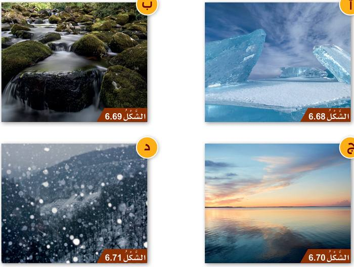
   - أ) الصورة أ
   - ب) الصورة ب
   - ج) الصورة ج
   - د) الصورة د

#### رابعًا: أجب عن الأسئلة الآتية (مسائل وتفكير)

5. أضع إشارة (✓) أمام الجملة الصحيحة: تنتج دورة الماء ماء جديدًا.
6. أضع إشارة (✓) أمام الجملة الصحيحة: تحدث دورة الماء بشكل مستمر.
7. أضع إشارة (✓) أمام الجملة الصحيحة: يمكن أن ينصهر الثلج والجليد، ويتحولا إلى مياه جارية للانضمام إلى دورة الماء مرة أخرى.
8. أضع إشارة (✓) أمام الجملة الصحيحة: يعد الماء المتبخر من البحر فقط جزءًا من دورة الماء.

#### أولًا: اختر الإجابة الصحيحة (أسئلة محوّلة)

1. ما الهطول؟
   - أ) تكوّن الندى فقط
   - ب) صعود بخار الماء
   - ج) تجمّد الماء
   - د) سقوط الماء من الغيوم على الأرض
2. ما دورة الماء؟
   - أ) جهاز لقياس الأمطار
   - ب) نوع من الجليد
   - ج) اسم لنهر
   - د) حركة الماء المستمرّة بين سطح الأرض والجوّ
3. أيّ جزء من دورة الماء يتكوّن من بخار الماء؟
   - أ) الغيوم الناتجة عن التكاثف أو الهواء الرطب
   - ب) المطر
   - ج) الأنهار
   - د) الجليد
4. أيّ مرحلةٍ تحوّل الماء السائل إلى بخار؟
   - أ) الهطول
   - ب) التكاثف
   - ج) التبخّر
   - د) التجمّع
5. أيّ مرحلةٍ تحوّل بخار الماء إلى قطرات تكوّن الغيوم؟
   - أ) الانصهار
   - ب) التبخّر
   - ج) الهطول
   - د) التكاثف
6. أيّ مثالٍ يمثّل الهطول؟
   - أ) الندى على الكأس
   - ب) المطر
   - ج) البخار من القدر
   - د) الجليد في المجمّد
7. أيّ الجمل الآتية صحيحة؟
   - أ) تحدث دورة الماء مرّة واحدة فقط
   - ب) تتوقّف دورة الماء في الشتاء
   - ج) تحدث دورة الماء باستمرار
   - د) لا تحدث دورة الماء أبدًا
8. أيّ الجمل الآتية خاطئة؟
   - أ) دورة الماء تعيد استعمال الماء نفسه
   - ب) تنتج دورة الماء ماءً جديدًا
   - ج) المطر جزء من دورة الماء
   - د) الغيوم جزء من دورة الماء
9. ما الذي يحرّك دورة الماء؟
   - أ) الكهرباء
   - ب) القمر فقط
   - ج) المغناطيس
   - د) حرارة الشمس
10. من أين يتبخّر الماء في دورة الماء؟
   - أ) البحار والأنهار والبحيرات وغيرها
   - ب) البحر فقط
   - ج) الصحراء فقط
   - د) الجبال فقط
11. ماذا يحدث لثلج الجبال عند ارتفاع الحرارة؟
   - أ) يختفي بلا أثر
   - ب) يتجمّد
   - ج) يتبخّر دائمًا
   - د) ينصهر ويجري ماءً
12. ما أشكال الهطول؟
   - أ) البحر والنهر
   - ب) الندى والضباب فقط
   - ج) المطر والثلج والبَرَد
   - د) الريح والغبار
13. أين يتجمّع ماء المطر بعد الهطول؟
   - أ) في الغيوم فقط
   - ب) في السماء فقط
   - ج) في الأنهار والبحار والتربة
   - د) لا يتجمّع
14. ما ترتيب مراحل دورة الماء؟
   - أ) تجمّد ثمّ انصهار فقط
   - ب) هطول ثمّ تكاثف ثمّ تبخّر دائمًا
   - ج) تكاثف ثمّ تبخّر فقط
   - د) تبخّر ثمّ تكاثف ثمّ هطول
15. أيّ الجمل الآتية عن مصدر بخار الماء صحيحة؟
   - أ) يتبخّر الماء من سطح البحار والأنهار وغيرها
   - ب) الماء المتبخّر من البحر فقط جزء من الدورة
   - ج) الماء لا يتبخّر من اليابسة
   - د) التبخّر لا يحدث في الصيف
16. لماذا تصبح الغيوم ثقيلةً فتمطر؟
   - أ) لأنّ الشمس تختفي
   - ب) لأنّ الغيوم تتجمّد دائمًا
   - ج) لأنّ قطرات الماء فيها تكبر وتثقل
   - د) لأنّ الغيوم تذوب في الهواء

### الدرس 6.8: لماذا نحتاج إلى تخزين الماء العذب؟

#### أولًا: اختر الإجابة الصحيحة

1. ما الماء العذب؟
   - أ) ماء نحصل عليه من البحر.
   - ب) ماء مالح.
   - ج) ماء يحتوي على نسبة ضئيلة من الأملاح.
   - د) ماء ملوث.
2. ما الخزّان؟
   - أ) طريقة طبيعية أو من صنع البشر لتخزين الماء.
   - ب) طريقة طبيعية لتخزين الماء.
   - ج) طريقة من صنع البشر لتخزين الماء.
   - د) نوع من أنواع الهطول.
3. أيّ من الصور الآتية تظهر أحد استخدامات الماء العذب؟
   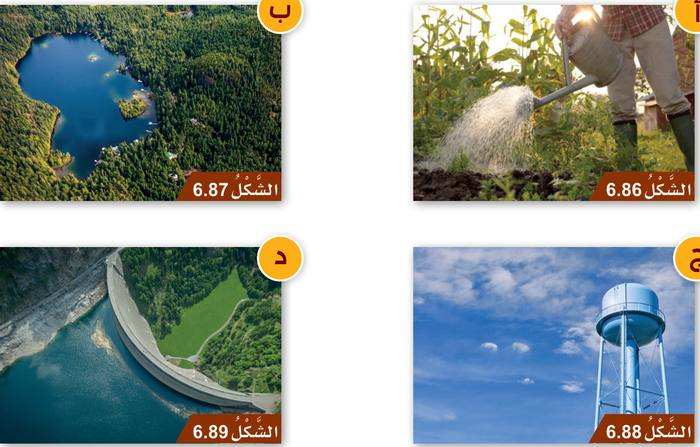
   - أ) الصورة أ
   - ب) الصورة ب
   - ج) الصورة ج
   - د) الصورة د

#### رابعًا: أجب عن الأسئلة الآتية (مسائل وتفكير)

4. أذكر مثالًا على أحد مصادر الماء العذب الموجود في دولة قطر.
5. أكتب جملة أقارن بها كمية الهطول في مدينة الدوحة بتلك الموجودة في مدن أخرى.
6. في رأيي، هل ستحتاج دولة قطر إلى كمية أكبر من الماء العذب في المستقبل أم إلى كمية أقل منه؟ أشرح إجابتي.

#### أولًا: اختر الإجابة الصحيحة (أسئلة محوّلة)

1. ما الماء العذب؟
   - أ) ماء ساخن
   - ب) ماء البحر
   - ج) ماء مالح جدًّا
   - د) ماء قليل الملوحة يصلح للشرب بعد المعالجة
2. ما الخزّان؟
   - أ) مكان لتخزين الماء
   - ب) مكان لتجميد الماء
   - ج) جهاز لقياس الحرارة
   - د) نوع من الغيوم
3. أيّ مصادر الماء الآتية عذب؟
   - أ) مياه الخليج
   - ب) البحار
   - ج) المحيطات
   - د) الأنهار والآبار الجوفيّة
4. أيّ طريقةٍ تُستعمل في قطر للحصول على ماءٍ عذبٍ من ماء البحر؟
   - أ) التجميد فقط
   - ب) التحلية
   - ج) التبخير من الصحراء
   - د) جمع الندى فقط
5. لماذا تحتاج قطر إلى تحلية ماء البحر؟
   - أ) لأنّ لديها أنهارًا كثيرة
   - ب) لأنّ أمطارها قليلة ومواردها العذبة محدودة
   - ج) لأنّ البحر عذب
   - د) لأنّ المطر يهطل يوميًّا
6. أيّ الاستعمالات الآتية للماء العذب؟
   - أ) الشرب والغسيل والزراعة
   - ب) الإضاءة فقط
   - ج) التدفئة فقط
   - د) قياس الحرارة
7. لماذا نخزّن الماء العذب في خزّانات؟
   - أ) لنتخلّص منه
   - ب) لنجمّده فقط
   - ج) لنغيّر لونه
   - د) لنستعمله عند الحاجة وفي أوقات قلّة المطر
8. أيّ المياه تُعدّ مصدرًا للماء العذب في قطر؟
   - أ) مياه المحيط
   - ب) مياه الخليج مباشرةً
   - ج) مياه البحر الأحمر
   - د) المياه الجوفيّة والمياه المحلاّة
9. هل تُعدّ كمّيّة الأمطار في الدوحة كبيرةً مقارنةً بمدنٍ رطبة؟
   - أ) لا، فهي قليلة
   - ب) نعم، أكبر بكثير
   - ج) هي نفسها دائمًا
   - د) لا يوجد مطر في أيّ مكان
10. ماذا يحدث لحاجة قطر إلى الماء مع زيادة عدد السكّان؟
   - أ) تقلّ
   - ب) تزداد
   - ج) لا تتغيّر
   - د) تنعدم
11. أيّ العبارات الآتية صحيحة؟
   - أ) لا يوجد ماء مالح
   - ب) معظم ماء الأرض عذب
   - ج) كلّ ماء الأرض عذب
   - د) معظم ماء الأرض مالح
12. ما الذي يمكن أن نفعله لنخزّن ماء المطر؟
   - أ) نتركه يسيل في الطرق
   - ب) نجمعه في خزّانات
   - ج) نجمّده في الصيف
   - د) نتركه يتبخّر
13. أيّ صورة تُعدّ استعمالًا للماء العذب؟
   - أ) إشعال النار
   - ب) ريّ المزروعات
   - ج) تجفيف الملابس بلا ماء
   - د) إطفاء الضوء
14. لماذا لا نشرب ماء البحر مباشرةً؟
   - أ) لأنّه شفّاف
   - ب) لأنّه بارد
   - ج) لأنّه عذب
   - د) لأنّه مالح ويضرّ بالجسم
15. أيّ العبارات الآتية خاطئة؟
   - أ) الماء العذب موردٌ محدود
   - ب) الماء العذب موردٌ لا ينتهي
   - ج) نحتاج إلى تخزينه
   - د) نحتاج إلى المحافظة عليه
16. ما الذي يتحكّم في كمّية الماء المخزّنة في الخزّان؟
   - أ) اسم الخزّان
   - ب) لون الخزّان
   - ج) شكل الخزّان فقط
   - د) حجم الخزّان ومقدار الماء الداخل والخارج
17. أين يتجمّع الماء الجوفيّ؟
   - أ) في الغيوم
   - ب) تحت سطح الأرض
   - ج) في الهواء
   - د) على قمم الجبال فقط

### الدرس 6.9: لماذا يجب علينا أن نحافظ على الماء؟

#### أولًا: اختر الإجابة الصحيحة

1. أيّ من الصور الآتية تظهر منطقة تأثرت بالجفاف؟
   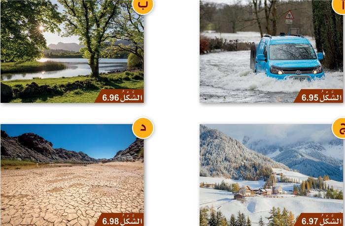
   - أ) الصورة أ
   - ب) الصورة ب
   - ج) الصورة ج
   - د) الصورة د
2. ما المقصود بالمحافظة على الماء؟
   - أ) استخدام أكبر كمية من الماء قدر الإمكان.
   - ب) عدم استخدام الماء.
   - ج) استخدام الماء الذي نحتاج إليه فقط.
   - د) التخلص من الماء.
3. يعد الماء العذب موردًا محدودًا يجب المحافظة عليه. ماذا يعني هذا؟
   - أ) يمكننا استخدام القدر الذي نريد منه ولن ينفد نهائيًا.
   - ب) يمكننا استخدام القدر الذي نريد منه على الرغم من احتمال نفاده.
   - ج) يجب علينا التحكم في مقدار ما نستخدمه منه، لأن من المحتمل أن ينفد.
   - د) لا يمكننا استخدامه لأننا استهلكناه بالفعل.

#### رابعًا: أجب عن الأسئلة الآتية (مسائل وتفكير)

4. كيف يمكن تسهيل حصول الناس على ماء عذب آمن؟ أدوّن طريقة واحدة.
5. أرسم دائرة حول المفردة الصحيحة لأكمل الجملة الآتية: تستهلك الدول ذات درجات الحرارة (المنخفضة / المرتفعة) ماءً أقل كل يوم مقارنة بالدول الأخرى.

#### أولًا: اختر الإجابة الصحيحة (أسئلة محوّلة)

1. ما المقصود بالمحافظة على الماء؟
   - أ) إغلاق الأنهار
   - ب) شرب الماء كلّه
   - ج) استعمال الماء بحكمة وعدم هدره
   - د) تجميد الماء
2. ماذا يعني أنّ الماء العذب موردٌ محدود؟
   - أ) كمّيّته قليلة وقد تنفد إن أسرفنا
   - ب) كمّيّته لا نهائيّة
   - ج) لا يمكن استعماله
   - د) يتجدّد فورًا دائمًا
3. أيّ المناطق تتأثّر بالجفاف؟
   - أ) مناطق قليلة الأمطار
   - ب) مناطق كثيرة الأنهار
   - ج) الغابات المطيرة
   - د) القطب بالجليد دائمًا
4. أيّ التصرّفات الآتية يحافظ على الماء؟
   - أ) الاستحمام الطويل جدًّا
   - ب) ترك الصنبور مفتوحًا
   - ج) غسل السيّارة كلّ يوم
   - د) إغلاق الصنبور أثناء تفريش الأسنان
5. أيّ التصرّفات الآتية يهدر الماء؟
   - أ) إغلاق الصنبور جيّدًا
   - ب) إصلاح تسرّب الأنابيب
   - ج) استعمال دلو للغسيل
   - د) ترك الصنبور يقطر
6. كيف نسهّل حصول الناس على ماءٍ عذبٍ آمن؟
   - أ) بإغلاق الخزّانات
   - ب) بتلويث الأنهار
   - ج) بتوفير الآبار وشبكات المياه ومحطّات التنقية
   - د) بهدر الماء
7. لماذا يستهلك الفرد في الدول الحارّة ماءً أكثر عادةً؟
   - أ) لأنّه يحتاج إلى شرب ماءٍ أكثر وريّ مزروعاتٍ أكثر
   - ب) لأنّ الماء يصبح أخفّ
   - ج) لأنّ الحرارة تصنع الماء
   - د) لأنّ الجليد يذوب فيها دائمًا
8. لماذا يجب علينا المحافظة على الماء؟
   - أ) لأنّ الماء رخيص جدًّا
   - ب) لأنّ الماء ممنوع
   - ج) لأنّ الماء العذب محدود وضروريّ للحياة
   - د) لأنّ الماء يختفي كلّ يوم
9. أيّ طريقةٍ توفّر الماء في الحديقة؟
   - أ) الريّ بالتنقيط
   - ب) الريّ بخرطوم مفتوح طويلًا
   - ج) الريّ وقت الظهيرة الحارّة
   - د) غسل الأرض بالماء
10. ماذا نفعل إذا لاحظنا تسرّبًا في أنبوب الماء؟
   - أ) نبلغ شخصًا بالغًا ليصلحه
   - ب) نتجاهله
   - ج) نفتحه أكثر
   - د) نشرب منه فقط
11. أيّ العبارات الآتية خاطئة؟
   - أ) هدر الماء يقلّل الماء المتاح
   - ب) لا يؤثّر هدر الماء في الآخرين
   - ج) المحافظة على الماء مسؤوليّة الجميع
   - د) الجفاف يسبّب نقص الماء
12. أيّ أنواع المياه يمكن إعادة استعمالها بعد معالجتها؟
   - أ) مياه الصرف المعالجة
   - ب) مياه البحر دون معالجة
   - ج) مياه المحيط مباشرةً
   - د) مياه الأمطار الحمضيّة فقط
13. أيّ الأجهزة تساعد على توفير الماء في الحمّام؟
   - أ) حوض بلا غطاء
   - ب) صنبور كبير جدًّا
   - ج) خرطوم دائم الفتح
   - د) صنبور بتدفّق قليل
14. ماذا يحدث للنباتات إذا حدث جفافٌ طويل؟
   - أ) تنمو أسرع
   - ب) تذبل وقد تموت
   - ج) تتحوّل إلى حيوانات
   - د) لا تتأثّر
15. أيّ ما يلي يوفّر الماء في المنزل؟
   - أ) غسّالة نصف فارغة كلّ مرّة
   - ب) غسّالة بحمولة كاملة
   - ج) ترك الصنبور مفتوحًا أثناء غسل الأطباق
   - د) سكب الماء على الأرض
16. من المسؤول عن المحافظة على الماء؟
   - أ) الكبار فقط
   - ب) الجميع
   - ج) الأطفال فقط
   - د) لا أحد
17. أيّ التصرّفات الآتية يساعد على توفير الماء في البيت؟
   - أ) ترك الصنبور مفتوحًا أثناء تفريش الأسنان
   - ب) إغلاق الصنبور أثناء تفريش الأسنان
   - ج) غسل السيارة بخرطوم مفتوح لوقت طويل
   - د) ترك الماء يجري في الحوض بلا حاجة

## الوحدة 7: الغذاء المتوازن

### الدرس 7.1: ما المجموعات الغذائية الرئيسة؟

#### أولًا: اختر الإجابة الصحيحة

1. أيّ الأغذية الآتية لا ينتمي إلى مجموعة منتجات الألبان؟
   - أ) الجبن
   - ب) الدجاج
   - ج) الزبدة
   - د) الزبادي
2. أيّ الأغذية الآتية لا ينتمي إلى مجموعة الخضروات؟
   - أ) البروكلي
   - ب) القرنبيط
   - ج) التونة
   - د) الخس
3. أيّ الأغذية الآتية "يصنع" باستخدام الحبوب؟
   - أ) الزبادي
   - ب) الخبز
   - ج) الفول
   - د) العدس

#### أولًا: اختر الإجابة الصحيحة (أسئلة محوّلة)

1. ما المجموعات الغذائية الرئيسة؟
   - أ) الحبوب والخضروات والفواكه والألبان واللحوم والبقوليات
   - ب) الحلويات فقط
   - ج) المشروبات الغازية
   - د) الوجبات السريعة فقط
2. أيّ الأغذية الآتية من مجموعة منتجات الألبان؟
   - أ) الجبن
   - ب) الأرز
   - ج) التفّاح
   - د) السمك
3. أيّ الأغذية الآتية من مجموعة الخضروات؟
   - أ) الجزر
   - ب) الحليب
   - ج) الخبز
   - د) الدجاج
4. أيّ الأغذية الآتية من مجموعة الفواكه؟
   - أ) الأرز
   - ب) البرتقال
   - ج) اللبن
   - د) البيض
5. أيّ الأغذية الآتية من مجموعة الحبوب؟
   - أ) الجبن
   - ب) التفّاح
   - ج) الخبز والأرز
   - د) اللحم
6. أيّ الأغذية الآتية من مجموعة البروتين؟
   - أ) الجزر
   - ب) الدجاج والسمك
   - ج) الخبز
   - د) التمر
7. أيّ الأغذية الآتية لا ينتمي إلى مجموعة منتجات الألبان؟
   - أ) الجبن
   - ب) الحليب
   - ج) البرتقال
   - د) اللبن
8. أيّ الأغذية الآتية لا ينتمي إلى مجموعة الخضروات؟
   - أ) السبانخ
   - ب) الخيار
   - ج) الطماطم
   - د) الموز
9. أيّ الأغذية الآتية يُصنع باستعمال الحبوب؟
   - أ) التفّاح
   - ب) الحليب
   - ج) الخبز
   - د) السمك
10. أيّ الأغذية الآتية من البقوليّات؟
   - أ) التفّاح
   - ب) الأرز
   - ج) الجبن
   - د) العدس
11. أيّ مجموعةٍ يمثّلها الحليب واللبن والجبن؟
   - أ) الحبوب
   - ب) الخضروات
   - ج) منتجات الألبان
   - د) الفواكه
12. أيّ المجموعات الغذائية يمثّلها الخبز والمعكرونة والأرز؟
   - أ) الألبان
   - ب) الحبوب
   - ج) الفواكه
   - د) الخضروات
13. أيّ مجموعةٍ يمثّلها التفّاح والموز والعنب؟
   - أ) الخضروات
   - ب) الفواكه
   - ج) الألبان
   - د) الحبوب
14. أيّ الأغذية الآتية مصدرٌ للبروتين؟
   - أ) البيض
   - ب) الخيار
   - ج) الأرز
   - د) التمر
15. أيّ الأغذية الآتية من مجموعة الخضروات الورقيّة؟
   - أ) الجبن
   - ب) اللحم
   - ج) الخبز
   - د) الخسّ
16. أيّ المجموعات الآتية تضمّ أغذيةً جميعها من الحبوب؟
   - أ) الخبز والأرز والشوفان
   - ب) الحليب والجبن واللبن
   - ج) التفّاح والموز والعنب
   - د) الدجاج والسمك واللحم
17. أيّ المجموعات الآتية تضمّ أغذيةً جميعها من الخضروات؟
   - أ) الجبن والحليب والزبدة
   - ب) الجزر والخيار والطماطم
   - ج) الخبز والأرز والمعكرونة
   - د) الموز والتفّاح والعنب

### الدرس 7.2: لماذا تعد المجموعات الغذائية مهمة؟

#### أولًا: اختر الإجابة الصحيحة

1. ما العناصر الغذائية التي تزوّد الجسم بالطاقة؟
   - أ) الكربوهيدرات
   - ب) البروتينات
   - ج) الفيتامينات
   - د) الأملاح المعدنية
2. ما العناصر الغذائية التي تساعد الجسم على النمو وإعادة بناء الأنسجة التالفة؟
   - أ) الكربوهيدرات
   - ب) البروتينات
   - ج) الفيتامينات
   - د) الأملاح المعدنية
3. أيّ المجموعات الغذائية الآتية تحتوي على الفيتامينات والأملاح المعدنية التي تحافظ على صحتنا؟
   - أ) الخضروات
   - ب) الحبوب
   - ج) الدهون
   - د) الكربوهيدرات
4. أيّ العناصر الغذائية الآتية تعد اللحوم الحمراء والأسماك والدواجن مصدرًا لها؟
   - أ) الكربوهيدرات
   - ب) البروتينات
   - ج) الفيتامينات
   - د) الأملاح المعدنية

#### رابعًا: أجب عن الأسئلة الآتية (مسائل وتفكير)

5. أسمّي العناصر الغذائية الموجودة في الشكل 7.20.
   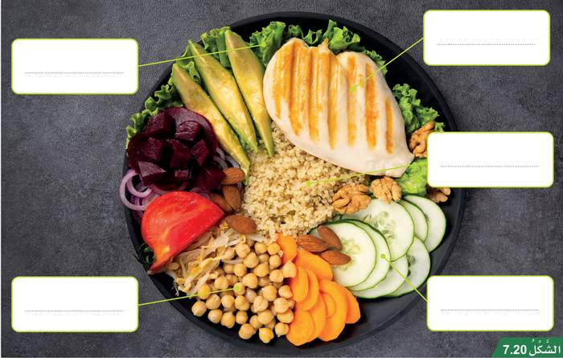
6. ماذا ينقص الطبق أعلاه ليصبح طبقًا متوازنًا؟
   

#### أولًا: اختر الإجابة الصحيحة (أسئلة محوّلة)

1. أيّ العناصر الغذائية تزوّد الجسم بالطاقة؟
   - أ) الماء فقط
   - ب) الفيتامينات فقط
   - ج) الكربوهيدرات والدهون
   - د) الألياف فقط
2. أيّ العناصر الغذائية تساعد الجسم على النموّ وإصلاح الأنسجة التالفة؟
   - أ) البروتينات
   - ب) السكّريّات فقط
   - ج) الدهون فقط
   - د) الماء فقط
3. أيّ المجموعات الغذائية تحتوي على الفيتامينات والأملاح المعدنيّة؟
   - أ) الزيوت فقط
   - ب) الحلويات
   - ج) الفواكه والخضروات
   - د) المشروبات الغازية
4. أيّ العناصر الغذائية تعدّ اللحوم الحمراء والأسماك والدواجن مصدرًا لها؟
   - أ) الفيتامين C فقط
   - ب) الألياف
   - ج) الكربوهيدرات
   - د) البروتينات
5. أيّ المجموعات الغذائية مصدرٌ جيّدٌ للكربوهيدرات؟
   - أ) الحبوب
   - ب) السمك
   - ج) اللحم
   - د) الزيوت
6. أيّ المجموعات الغذائية مصدرٌ جيّدٌ للكالسيوم لتقوية العظام؟
   - أ) الألبان
   - ب) الأرز
   - ج) الخضروات الورقيّة فقط
   - د) السكّر
7. ما فائدة الماء للجسم؟
   - أ) ينظّم الحرارة وينقل المواد في الجسم
   - ب) يمنح الطاقة فقط
   - ج) يبني العضلات فقط
   - د) لا فائدة له
8. ما فائدة الألياف الغذائية؟
   - أ) تساعد الجهاز الهضميّ
   - ب) تصنع العظام
   - ج) تعطي أكبر طاقة
   - د) تقتل الجراثيم
9. لماذا يجب أن نتناول مجموعاتٍ غذائيّةً مختلفة؟
   - أ) لتكلّف أكثر
   - ب) لأنّ كلّها متشابهة
   - ج) لأنّها تغيّر اللون
   - د) لأنّ كلّ مجموعةٍ تزوّد الجسم بعناصر مختلفة
10. طبقٌ فيه أرزٌ ودجاجٌ فقط. أيّ مجموعةٍ تنقصه ليصبح متوازنًا؟
   - أ) الخضروات والفواكه
   - ب) الحبوب
   - ج) البروتين
   - د) لا ينقصه شيء
11. أيّ العناصر الغذائية يخزّنها الجسم لتكون مصدرًا احتياطيًّا للطاقة؟
   - أ) الفيتامينات
   - ب) الماء
   - ج) الدهون
   - د) الأملاح
12. أيّ العناصر الغذائية تساعد على حماية الجسم من الأمراض؟
   - أ) الدهون المشبعة
   - ب) السكّر فقط
   - ج) الفيتامينات
   - د) الملح فقط
13. أيّ الأغذية الآتية يمدّ الجسم بالطاقة بسرعة؟
   - أ) الأرز والخبز
   - ب) الماء
   - ج) السمك فقط
   - د) الملح
14. أيّ مجموعةٍ غذائيّةٍ تُسمّى مجموعة البناء لأنّها تبني الجسم؟
   - أ) الدهون
   - ب) الحبوب
   - ج) البروتين
   - د) الملح
15. ماذا يحدث إن لم نتناول ما يكفي من الفيتامينات؟
   - أ) قد نمرض ويضعف الجسم
   - ب) نصبح أطول بسرعة
   - ج) لا يحدث شيء
   - د) نصبح أقوى
16. أيّ الأغذية الآتية مصدرٌ جيّدٌ للألياف؟
   - أ) السكّر
   - ب) الخضروات والحبوب الكاملة
   - ج) الزبدة
   - د) الماء

### الدرس 7.3: كيف أعد نظامًا غذائيًا متوازنًا؟

#### أولًا: اختر الإجابة الصحيحة

1. أيّ المجموعات الغذائية الآتية تشكل الكمية الأكبر من نظامنا الغذائي؟
   - أ) الفاكهة والخضروات
   - ب) الحبوب
   - ج) الأسماك واللحوم
   - د) الحليب ومنتجات الألبان
2. أيّ المجموعات الغذائية الآتية تشكل الكمية الأقل من نظامنا الغذائي؟
   - أ) الفاكهة والخضروات
   - ب) البقوليات
   - ج) الأسماك واللحوم
   - د) الحليب ومنتجات الألبان
3. ما الغذاء المختلف بين مجموعة الأغذية الآتية، ولماذا؟
   - أ) الأسماك
   - ب) الدجاج
   - ج) الفاكهة
   - د) اللحوم

#### رابعًا: أجب عن الأسئلة الآتية (مسائل وتفكير)

4. أسمّي المجموعة الغذائية التي ينتمي إليها كل مكون في الشكل 7.23 والعنصر الغذائي الذي تمدنا به. هل تعد هذه الوجبة متوازنة؟
   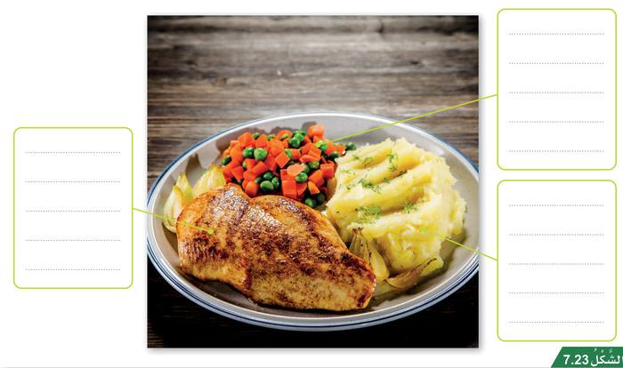
5. أختار من كتاب وصفات الطبخ وجبة غذائية واحدة متوازنة ووجبة غير متوازنة. أشرح كلًّا من الوجبتين.

#### أولًا: اختر الإجابة الصحيحة (أسئلة محوّلة)

1. أيّ المجموعات الغذائية تشكّل الكمّية الأكبر من نظامنا الغذائيّ المتوازن؟
   - أ) الخضروات والفواكه والحبوب
   - ب) الحلويات
   - ج) الدهون والزيوت
   - د) السكّر
2. أيّ المجموعات الغذائية تشكّل الكمّية الأقلّ من نظامنا الغذائيّ؟
   - أ) الدهون والسكّريّات
   - ب) الخضروات
   - ج) الحبوب
   - د) الفواكه
3. ما الوجبة المتوازنة؟
   - أ) وجبة من الخبز فقط
   - ب) وجبة من الحلويات فقط
   - ج) وجبة من اللحم فقط
   - د) وجبة فيها مجموعاتٌ غذائيّة مختلفة بكمّيّات مناسبة
4. أيّ الوجبات الآتية الأكثر توازنًا؟
   - أ) بطاطا مقلية فقط
   - ب) حلوى وعصير مُحلّى
   - ج) دجاج وأرز وسلطة وفاكهة
   - د) خبز فقط
5. ماذا ينقص وجبةً فيها خبز وجبن فقط لتصبح متوازنة؟
   - أ) لا ينقصها شيء
   - ب) الحبوب
   - ج) الألبان
   - د) الخضروات والفواكه
6. لماذا نحتاج إلى نظامٍ غذائيٍّ متوازن؟
   - أ) ليحصل الجسم على كلّ العناصر التي يحتاجها
   - ب) ليزداد الوزن بسرعة
   - ج) لنأكل الحلويات فقط
   - د) لنقلّل شرب الماء
7. أيّ الأغذية الآتية يجب أن نأكل منها بكمّيّةٍ قليلة؟
   - أ) الخضروات
   - ب) الحلويات والزيوت
   - ج) الفواكه
   - د) الحبوب الكاملة
8. كم حصّةً من الفواكه والخضروات يُنصَح بتناولها يوميًّا؟
   - أ) حصّة واحدة كلّ أسبوع
   - ب) عدّة حصص
   - ج) لا حاجة لها
   - د) حصّة كلّ شهر
9. أيّ المشروبات الآتية أفضل للصحّة؟
   - أ) العصائر المحلّاة جدًّا
   - ب) المشروبات الغازيّة
   - ج) الماء
   - د) مشروبات الطاقة
10. أيّ الوجبات الآتية غير متوازنة؟
   - أ) لبن وفواكه وشوفان
   - ب) سمك وأرز وخضروات
   - ج) فول وخبز وسلطة
   - د) رقائق بطاطا وعصير مُحلّى
11. ما فائدة تناول الفطور؟
   - أ) يجعل الجسم ثقيلًا
   - ب) يمدّ الجسم بالطاقة في بداية اليوم
   - ج) لا فائدة له
   - د) يسبّب الجوع
12. أيّ المجموعات يمثّلها الجزء الأكبر في طبق الغذاء الصحّيّ؟
   - أ) الزيوت
   - ب) الخضروات والفواكه
   - ج) الحلويات
   - د) الملح
13. أيّ الوجبات الآتية تحتوي على مصدر للبروتين؟
   - أ) سكّر وماء
   - ب) عصير فقط
   - ج) بيض وخبز وسلطة
   - د) خبز وزبدة فقط
14. ما الغذاء الأنسب كوجبةٍ خفيفةٍ صحّيّة؟
   - أ) شوكولاتة كبيرة
   - ب) كعكة بالكريمة
   - ج) رقائق بطاطا
   - د) ثمرة فاكهة
15. أيّ الوجبات الآتية متوازنة؟
   - أ) عدس وأرز وسلطة وفاكهة
   - ب) حلويات فقط
   - ج) بطاطا مقلية فقط
   - د) عصير غازيّ وخبز
16. لماذا يختلف النظام الغذائيّ المتوازن بين شخصٍ وآخر؟
   - أ) لا يختلف
   - ب) لأنّ المجموعات تتغيّر
   - ج) لأنّ الجميع يأكل الأكل نفسه
   - د) لاختلاف العمر والنشاط
17. أيّ المجموعات يجب ألّا نستغني عنها أبدًا؟
   - أ) الخضروات فقط
   - ب) جميع المجموعات الرئيسة
   - ج) الحلويات فقط
   - د) الحبوب فقط
18. وجبة في طبق واحد فيها صدر دجاج مشوي وبطاطا مهروسة وجزر وبازلاء. أيّ العبارات الآتية عن الوجبة صحيحة؟
   - أ) وجبة غير متوازنة لأنّها خالية من الخضار
   - ب) وجبة غير متوازنة لأنّها خالية من البروتين
   - ج) وجبة غير متوازنة لأنّها كلّها دهون
   - د) وجبة متوازنة: الدجاج يمدّنا بالبروتين، والبطاطا بالنشويات، والجزر والبازلاء بالفيتامينات والمعادن

### الدرس 7.4: أي الأغذية يجب تناولها بكميات محدودة؟

#### أولًا: اختر الإجابة الصحيحة

1. أيّ الأغذية الآتية يجب تناولها بكميات محدودة؟
   - أ) الفيتامينات
   - ب) السكريات
   - ج) البروتينات
   - د) الأملاح المعدنية
2. أيّ العناصر الغذائية الآتية تحتوي على أكبر كمية من السكر؟
   - أ) الخبز
   - ب) الدجاج
   - ج) رقائق البطاطا
   - د) الشوكولا
3. أيّ العناصر أدناه موجودة بكمية عالية في رقائق البطاطا؟
   - أ) السكر والملح
   - ب) الملح والدهون
   - ج) السكر والدهون
   - د) الملح

#### رابعًا: أجب عن الأسئلة الآتية (مسائل وتفكير)

4. لماذا يعد ضروريًا التحكم في حجم الحصة الغذائية؟
5. أيّ الأغذية تزودنا بالفيتامينات والمعادن لكنها أيضًا تحتوي على نسبة من السكر؟

#### أولًا: اختر الإجابة الصحيحة (أسئلة محوّلة)

1. أيّ الأغذية الآتية يجب تناولها بكمّيّات محدودة؟
   - أ) الحلويات والمقرمشات
   - ب) الخضروات
   - ج) الفواكه
   - د) الحبوب الكاملة
2. أيّ الأغذية الآتية تحتوي على أكبر كمّية من السكّر؟
   - أ) الحليب غير المحلّى
   - ب) الماء
   - ج) المشروبات الغازيّة
   - د) الخيار
3. أيّ المواد موجودة بكمّية عالية في رقائق البطاطا؟
   - أ) الملح والدهون
   - ب) الفيتامين C
   - ج) الكالسيوم
   - د) الألياف
4. لماذا يُعدّ ضروريًّا التحكّم في حجم الحصّة الغذائيّة؟
   - أ) لأنّ الإفراط في أيّ طعام قد يضرّ الصحّة
   - ب) لأنّ الطعام ينفد
   - ج) لأنّ الحصص الكبيرة أرخص
   - د) لا ضرورة
5. أيّ الأغذية تزوّدنا بالفيتامينات والمعادن لكنّها تحتوي أيضًا على سكّر؟
   - أ) الخضروات الورقيّة
   - ب) الفواكه
   - ج) الماء
   - د) الزيت
6. أيّ المشروبات الآتية يجب تناولها بقدرٍ محدود؟
   - أ) العصائر المحلّاة
   - ب) الماء
   - ج) اللبن قليل الدسم
   - د) الشاي بلا سكّر
7. أيّ الوجبات الخفيفة أفضل صحّيًّا؟
   - أ) حلوى جيلاتينية
   - ب) رقائق بطاطا
   - ج) شوكولاتة
   - د) حبّات جزر
8. أيّ المواد في الأغذية المصنّعة يجب أن نقلّل منها؟
   - أ) الألياف
   - ب) الفيتامينات
   - ج) الملح والسكّر والدهون المشبعة
   - د) الماء
9. كيف نعرف كمّية السكّر في المنتج؟
   - أ) بتذوّقه فقط
   - ب) بقراءة بطاقة المعلومات الغذائيّة
   - ج) بقياس وزنه
   - د) بشمّ رائحته
10. أيّ الأغذية الآتية يحتوي على سكّر مضاف بكثرة؟
   - أ) العدس
   - ب) الخبز الأسمر
   - ج) الحلوى الجيلاتينيّة
   - د) السلطة
11. أيّ العبارات الآتية صحيحة؟
   - أ) الحلويات تعطي كلّ العناصر
   - ب) يجب تناول الحلويات كلّ وجبة
   - ج) الحلويات ضروريّة كالخضروات
   - د) يمكن تناول الحلويات أحيانًا وبكمّيّة صغيرة
12. أيّ المجموعات الغذائيّة تحتاج إلى حصّة صغيرة جدًّا؟
   - أ) الدهون والزيوت والسكّريّات
   - ب) الخضروات
   - ج) الفواكه
   - د) الألبان
13. لماذا نتجنّب إضافة الكثير من الملح للطعام؟
   - أ) لأنّه مكلّف
   - ب) لأنّه يغيّر اللون
   - ج) لأنّه يضرّ القلب وضغط الدم
   - د) لأنّه مرّ
14. أيّ المواد الآتية تحتوي على دهون مشبعة كثيرة؟
   - أ) الخضروات
   - ب) الأطعمة المقلية
   - ج) الفواكه
   - د) الماء
15. ما الأفضل بدل الشراب الغازيّ؟
   - أ) مشروب طاقة
   - ب) شراب غازي آخر
   - ج) عصير محلّى
   - د) الماء
16. أيّ الأغذية الآتية يُنصح بتناولها بكميّات قليلة؟
   - أ) الخضراوات الطازجة
   - ب) الحلويات والمشروبات الغازية
   - ج) الفواكه الطازجة
   - د) الماء

### الدرس 7.5: ماذا يمكن أن يحدث إذا تناولت غذاءً غير صحي؟

#### أولًا: اختر الإجابة الصحيحة

1. ما أعراض الإفراط في تناول السكر؟
   - أ) تسوس الأسنان
   - ب) الخرف
   - ج) أمراض الكلى
   - د) السكتة الدماغية
2. ما الذي يسبب أمراض الكلى؟
   - أ) تناول السكر بكميات كبيرة
   - ب) تناول الملح بكميات كبيرة
   - ج) عدم تناول الملح بكميات كافية
   - د) تناول الدهون بكميات كبيرة
3. ما المشكلة الصحية التي يسببها اتباع نظام غذائي غني بالدهون والسكر؟
   - أ) زيادة في الوزن
   - ب) ارتفاع ضغط الدم
   - ج) الخرف
   - د) أمراض الكلى

#### رابعًا: أجب عن الأسئلة الآتية (مسائل وتفكير)

4. ما نوع الدهن الضار بالصحة الذي يجب تجنبه؟
5. ما الخطر الصحي لارتفاع ضغط الدم؟
6. ما إحدى الطرائق التي تساعد على تقليل كميات السكر والملح في نظامي الغذائي؟
7. ينبغي للأطفال الذين تتراوح أعمارهم بين 7 و10 سنوات أن لا يتناولوا أكثر من 5 g من الملح يوميًا. أتفحص البطاقات الغذائية لجميع الأغذية التي أتناولها يوميًا لمدة أسبوع. أدوّن كمية الملح الموجودة في نظامي الغذائي اليومي. هل أحتاج إلى تقليل كمية الملح في نظامي الغذائي؟

#### أولًا: اختر الإجابة الصحيحة (أسئلة محوّلة)

1. ما أعراض الإفراط في تناول السكّر؟
   - أ) تحسين النظر
   - ب) تقوية العظام فقط
   - ج) زيادة الطول
   - د) زيادة الوزن وتسوّس الأسنان
2. ما المشكلة الصحّيّة التي يسبّبها نظامٌ غذائيٌّ غنيٌّ بالدهون والسكّر؟
   - أ) كسر العظام
   - ب) فقر الدمّ بسبب نقص الحديد فقط
   - ج) قصر النظر
   - د) السمنة
3. ما الخطر الصحّيّ لارتفاع ضغط الدم؟
   - أ) أمراض القلب والسكتة الدماغيّة
   - ب) تسوّس الأسنان فقط
   - ج) الزكام فقط
   - د) نقص الطول
4. ما الذي يرفع ضغط الدم عند الإفراط فيه؟
   - أ) الفواكه
   - ب) الماء
   - ج) الخضروات
   - د) الملح
5. ما نوع الدهن الضارّ الذي يجب تجنّبه؟
   - أ) الدهون المشبعة
   - ب) الدهون الطبيعيّة في السمك
   - ج) الألياف
   - د) الفيتامينات
6. ما إحدى الطرائق التي تساعد على تقليل السكّر والملح في غذائي؟
   - أ) تناول المقرمشات
   - ب) شرب مزيدٍ من المشروبات المحلّاة
   - ج) إضافة ملحٍ أكثر
   - د) قراءة بطاقات المعلومات الغذائيّة واختيار الأقلّ
7. أيّ المشكلات يسبّبها تناول السكّر كثيرًا وعدم تنظيف الأسنان؟
   - أ) ضعف السمع
   - ب) كسر العظام
   - ج) تسوّس الأسنان
   - د) قصر القامة
8. أيّ العادات الآتية تحمي من الأمراض؟
   - أ) السهر وأكل الحلوى
   - ب) تناول الخضروات والفواكه والنشاط البدنيّ
   - ج) تناول الوجبات السريعة يوميًّا
   - د) شرب المشروبات الغازيّة
9. أيّ الأغذية الآتية قد يسبّب مشاكل في القلب إن أكثرنا منه؟
   - أ) الخضروات المسلوقة
   - ب) السلطة
   - ج) الفاكهة
   - د) الأطعمة الدسمة والمقلية
10. كم غرامًا من الملح ينبغي ألّا يتجاوزه الطفل عمره بين 7 و10 سنوات يوميًّا؟
   - أ) 50 غرامًا
   - ب) 5 غرامات
   - ج) 100 غرام
   - د) 500 غرام
11. ما الذي يمكن أن يسبّبه نقص الغذاء الصحّيّ المتوازن؟
   - أ) لا شيء
   - ب) زيادة الطول بسرعة
   - ج) قوّة بلا نهاية
   - د) ضعف الجسم وقلّة النموّ
12. أيّ الخيارات الآتية يساعد على تقليل السكّر؟
   - أ) تناول الحلوى بعد كلّ وجبة
   - ب) شرب الماء بدل المشروبات المحلّاة
   - ج) إضافة سكّر للعصير
   - د) تناول الشوكولاتة دائمًا
13. ما الذي تساعدنا بطاقات المعلومات الغذائيّة على معرفته؟
   - أ) لون المنتج
   - ب) كمّية السكّر والملح والدهون في المنتج
   - ج) اسم صانعه فقط
   - د) سعر الشحن
14. أيّ المشكلات يمكن أن يسبّبها الإفراط في الملح على المدى الطويل؟
   - أ) تحسّن الأسنان
   - ب) طول القامة
   - ج) قوّة النظر
   - د) ارتفاع ضغط الدم ومشاكل الكلى
15. ماذا قد يحدث لمن يتناول كثيرًا من الأغذية الدسمة والسكرية باستمرار؟
   - أ) نقص الوزن الشديد
   - ب) زيادة قوّة العظام فقط
   - ج) زيادة الوزن والسمنة
   - د) شفاء الأمراض
