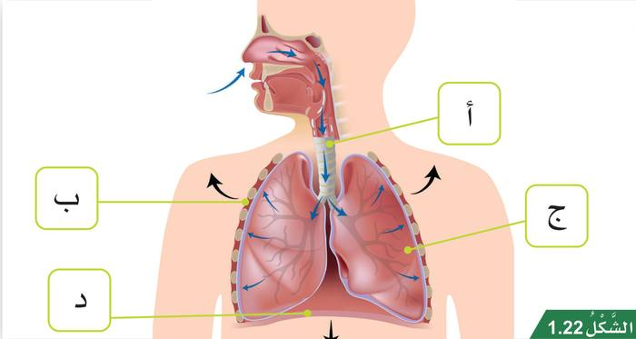
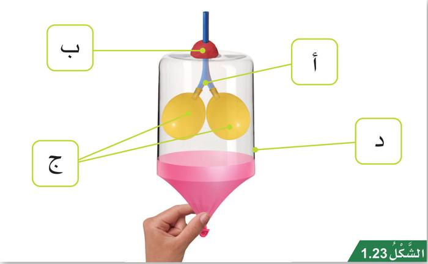
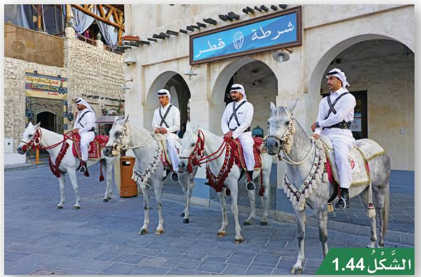
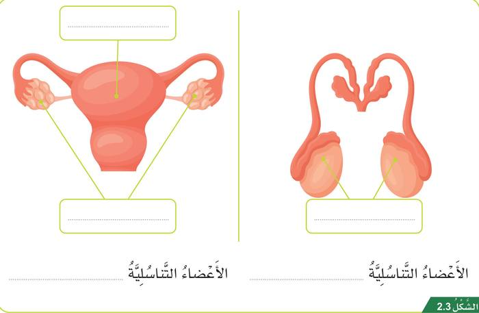
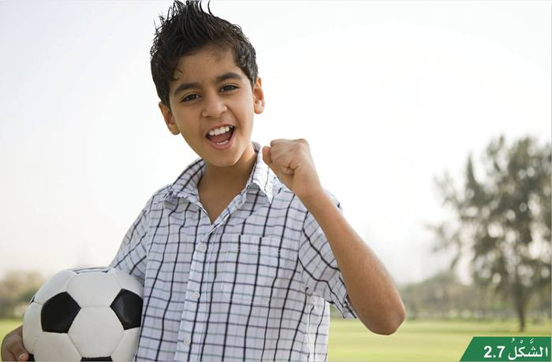
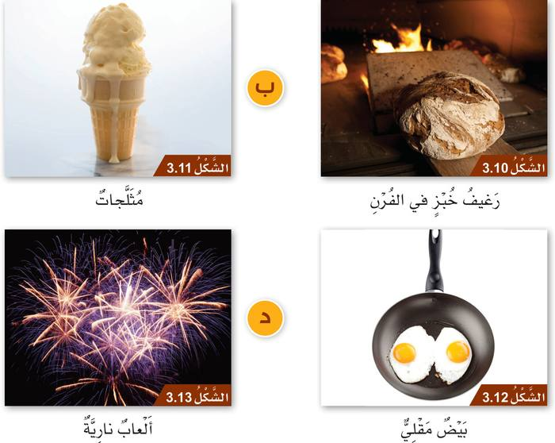
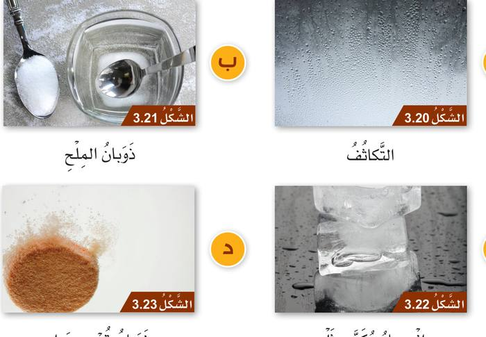
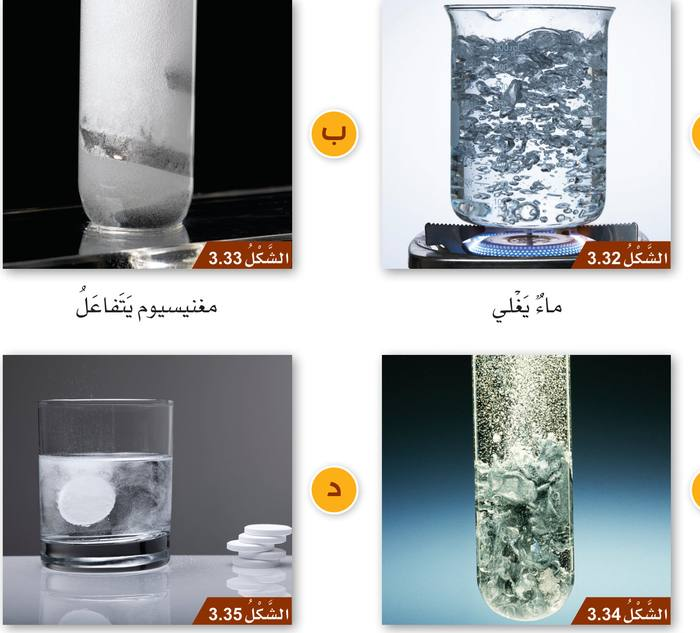
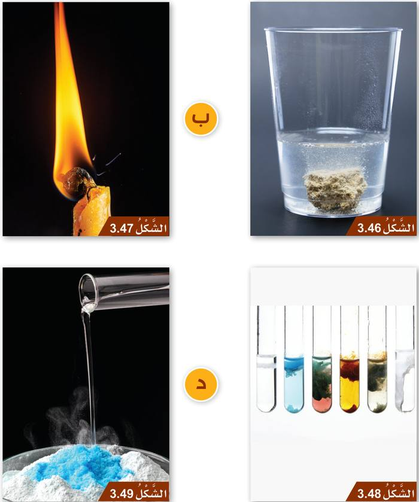
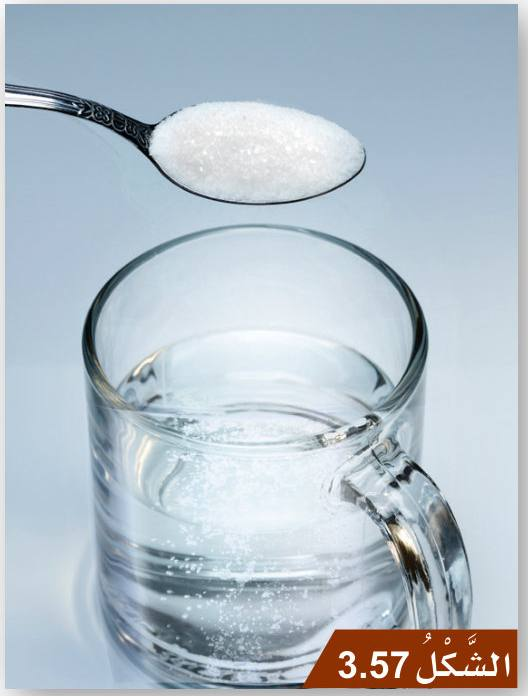

# بنك أسئلة العلوم — المستوى السادس — الفصل الدراسي الأول

- كل الدروس منقولة من كتاب الطالب (العلوم – الصف السادس – الفصل الأول): أسئلة "أتحقق مما تعلمت" والأنشطة، بنصّها كما في الكتاب. الصور والأشكال مقتطعة كصور (مجلد images).
- الفراغ يُكتب ____.
- الأسئلة بدون إجابات نموذجية.

## الفهرس

- الوحدة 1: أجهزة جسم الإنسان
  - الدرس 1.1: ما الجهاز الدوري؟
  - الدرس 1.2: ما وظيفة الدم؟
  - الدرس 1.3: ما الجهاز التنفسي؟
  - الدرس 1.4: ما الجهاز الهضمي؟
  - الدرس 1.5: ما وظائف الأسنان واللعاب والمريء في عملية الهضم؟
  - الدرس 1.6: كيف يمكننا بناء نموذج للجهاز الهضمي؟
  - الدرس 1.7: ما وظيفة الكليتين؟
  - الدرس 1.8: كيف تعمل أعضاء الحس والدماغ معًا؟
- الوحدة 2: النمو والتطور في جسم الإنسان
  - الدرس 2.1: ما الأعضاء التناسلية لدى الإنسان؟
  - الدرس 2.2: ما التغيرات التي تحدث في الجسم في أثناء البلوغ؟
  - الدرس 2.3: ماذا أعرف عن نمو الإنسان وتطوره؟
- الوحدة 3: التغيرات الفيزيائية والكيميائية
  - الدرس 3.1: ما التغيرات الفيزيائية؟
  - الدرس 3.2: ما التغيرات الكيميائية؟
  - الدرس 3.3: كيف يؤثر التسخين في المواد المختلفة؟
  - الدرس 3.4: ما الفرق بين التسخين والاحتراق؟
  - الدرس 3.5: كيف نستقصي أي المواد قابلة للذوبان وأيها غير قابلة للذوبان؟
  - الدرس 3.6: مم يتكون المحلول؟
  - الدرس 3.7: كيف يمكن استخدام التبخر والتكاثف؟
  - الدرس 3.8: كيف تحدث عملية الترشيح وكيف تستخدم؟
  - الدرس 3.9: ماذا أعرف عن التغيرات الفيزيائية والكيميائية؟

---

## الوحدة 1: أجهزة جسم الإنسان

### الدرس 1.1: ما الجهاز الدوري؟

#### أولًا: اختر الإجابة الصحيحة

1. ما وظيفة الجهاز الدوري؟
   - أ) التنفس.
   - ب) المحافظة على صحة القلب وقوته.
   - ج) نقل المواد الغذائية المذابة والأكسجين إلى جميع أجزاء الجسم.
   - د) إطلاق الطاقة.
2. كيف يدخل الدم القلب؟
   - أ) من الشريان.
   - ب) من الوريد.
   - ج) من الشعيرات الدموية.
   - د) من الحجرة السفلية.
3. إذا كان القلب يضخ 4 لترات من الدم في الدقيقة، فما مقدار الدم الذي يضخه في ساعة واحدة؟
   - أ) 40 L
   - ب) 120 L
   - ج) 180 L
   - د) 240 L

#### رابعًا: أجب عن الأسئلة الآتية (مسائل وتفكير)

5. أنظر إلى المخطط البسيط لتدفق الدم في الجسم (الشكل 1.9). أسمّي القلب والرئتين على المخطط. أسمّي شريانًا ووريدًا. أضع × حيث يحصل الدم على الأكسجين.
   

#### أولًا: اختر الإجابة الصحيحة (أسئلة محوّلة)

1. ما وظيفة الجهاز الدوري؟
   - أ) هضم الطعام
   - ب) نقل الدم إلى جميع أجزاء الجسم
   - ج) تنفّس الهواء
   - د) التخلّص من الماء الزائد
2. ما العضو الذي يضخّ الدم في الجسم؟
   - أ) الرئتان
   - ب) القلب
   - ج) المعدة
   - د) الكلية
3. ما أنواع الأوعية الدمويّة الرئيسة؟
   - أ) المريء والقصبة والمثانة
   - ب) الشرايين والأوردة والشعيرات الدمويّة
   - ج) القلب والرئتان والكبد
   - د) العظام والعضلات والجلد
4. ما الأوعية الدمويّة التي تحمل الدم بعيدًا عن القلب؟
   - أ) الشعيرات الدمويّة فقط
   - ب) الأوردة
   - ج) الشرايين
   - د) القصبة الهوائيّة
5. ما الأوعية الدمويّة التي تعيد الدم إلى القلب؟
   - أ) المريء
   - ب) الشرايين
   - ج) القصبة الهوائيّة
   - د) الأوردة
6. كيف يدخل الدم إلى القلب؟
   - أ) عبر المريء
   - ب) عبر الشرايين فقط
   - ج) عبر القصبة الهوائيّة
   - د) عبر الأوردة
7. ما أصغر الأوعية الدمويّة وأدقّها؟
   - أ) الأبهر
   - ب) الشرايين
   - ج) الأوردة
   - د) الشعيرات الدمويّة
8. إذا كان القلب يضخّ 4 لترات من الدم في الدقيقة، فكم لترًا يضخّ في ساعةٍ واحدة؟
   - أ) 240 L
   - ب) 64 L
   - ج) 24 L
   - د) 400 L
9. ما عدد حجرات القلب البشريّ؟
   - أ) أربع حجرات
   - ب) حجرتان
   - ج) ثلاث حجرات
   - د) ست حجرات
10. ماذا يحمل الدم إلى خلايا الجسم؟
   - أ) الغازات الضارّة
   - ب) الضوء والحرارة فقط
   - ج) الملح فقط
   - د) الأكسجين والمواد الغذائيّة
11. ماذا يحمل الدم بعيدًا عن الخلايا؟
   - أ) الأكسجين فقط
   - ب) ثاني أكسيد الكربون والفضلات
   - ج) الغذاء فقط
   - د) الضوء
12. إلى أيّ عضوٍ يذهب الدم ليحمل الأكسجين؟
   - أ) الكليتين
   - ب) المعدة
   - ج) الرئتين
   - د) الدماغ فقط
13. ما النبض؟
   - أ) إحساسٌ بتدفّق الدم في الشرايين مع كلّ ضخّةٍ من القلب
   - ب) صوت الرئتين
   - ج) حركة الأمعاء
   - د) حرارة الجسم
14. ماذا يحدث لمعدّل نبض القلب عند الجري؟
   - أ) يقلّ
   - ب) يزداد
   - ج) يتوقّف
   - د) لا يتغيّر
15. أيّ الأعضاء الآتية جزءٌ من الجهاز الدوري؟
   - أ) القصبة والرئتان
   - ب) المعدة والمريء
   - ج) القلب والأوعية الدمويّة
   - د) الكليتان والمثانة
16. لماذا يحتاج الجسم إلى الجهاز الدوري؟
   - أ) ليسمع الأصوات
   - ب) ليهضم الطعام
   - ج) ليصل الأكسجين والغذاء إلى كلّ الخلايا
   - د) ليرى الأشياء
17. أيّ العبارات الآتية صحيحة؟
   - أ) القلب يفرز البول
   - ب) القلب جزء من الجهاز الهضميّ
   - ج) القلب يخزّن الطعام
   - د) القلب عضلةٌ تضخّ الدم

### الدرس 1.2: ما وظيفة الدم؟

#### أولًا: اختر الإجابة الصحيحة

1. أيّ من مكونات الدم الآتية يحمل الأكسجين؟
   - أ) الصفائح الدموية
   - ب) خلايا الدم الحمراء
   - ج) خلايا الدم البيضاء
   - د) البلازما
2. أيّ من مكونات الدم الآتية يحمل المواد الغذائية الذائبة؟
   - أ) الصفائح الدموية
   - ب) خلايا الدم الحمراء
   - ج) خلايا الدم البيضاء
   - د) البلازما
3. أيّ من ميزات الأوردة الآتية غير صحيحة؟
   - أ) تنقل الدم إلى القلب.
   - ب) واسعة من الداخل.
   - ج) لديها جدران سميكة.
   - د) لديها صمامات.

#### رابعًا: أجب عن الأسئلة الآتية (مسائل وتفكير)

4. أنظر إلى الشكل 1.15. أكتب أسماء مكونات الدم في المكان المناسب. (عينة الدم)
   

#### أولًا: اختر الإجابة الصحيحة (أسئلة محوّلة)

1. أيّ مكوّنات الدم تحمل الأكسجين؟
   - أ) الصفائح الدمويّة
   - ب) خلايا الدم البيضاء
   - ج) خلايا الدم الحمراء
   - د) البلازما فقط
2. أيّ مكوّنات الدم تحمل المواد الغذائيّة الذائبة؟
   - أ) البلازما
   - ب) خلايا الدم الحمراء
   - ج) الصفائح الدمويّة
   - د) خلايا الدم البيضاء
3. ما وظيفة خلايا الدم البيضاء؟
   - أ) محاربة الجراثيم
   - ب) حمل الأكسجين
   - ج) تخثّر الدم
   - د) نقل الغذاء
4. ما وظيفة الصفائح الدمويّة؟
   - أ) المساعدة على تخثّر الدم عند الجرح
   - ب) حمل الأكسجين
   - ج) محاربة الجراثيم
   - د) هضم الطعام
5. ما السائل الأصفر الذي يشكّل الجزء الأكبر من الدم؟
   - أ) الهيموجلوبين
   - ب) الصفائح
   - ج) البلازما
   - د) اللعاب
6. أيّ مكوّنات الدم تعطي الدم لونه الأحمر؟
   - أ) البلازما
   - ب) خلايا الدم البيضاء
   - ج) خلايا الدم الحمراء
   - د) الصفائح الدمويّة
7. أيّ العبارات الآتية عن الأوردة غير صحيحة؟
   - أ) تحمل الدم غالبًا منخفض الأكسجين
   - ب) فيها صمّامات
   - ج) تعيد الدم إلى القلب
   - د) جدرانها أسمك من جدران الشرايين
8. لماذا للشرايين جدران سميكة؟
   - أ) لتصدر صوتًا
   - ب) لتخزّن الغذاء
   - ج) لتهضم الطعام
   - د) لتتحمّل ضغط الدم العالي
9. ما فائدة الصمّامات في الأوردة؟
   - أ) منع رجوع الدم إلى الخلف
   - ب) زيادة سرعة الدم
   - ج) تصفية البول
   - د) هضم الغذاء
10. أيّ مكوّنٍ من الدم يساعد على حماية الجسم من الأمراض؟
   - أ) خلايا الدم الحمراء
   - ب) خلايا الدم البيضاء
   - ج) الصفائح
   - د) البلازما فقط
11. ماذا يحدث إذا جُرح الجلد وسال الدم؟
   - أ) تختفي الخلايا الحمراء
   - ب) يتوقّف القلب
   - ج) يتحوّل الدم إلى ماء
   - د) تتجمّع الصفائح فيتخثّر الدم
12. ما الذي تحمله الشرايين غالبًا؟
   - أ) دمًا غنيًّا بالأكسجين
   - ب) دمًا خاليًا من الماء
   - ج) الطعام فقط
   - د) الهواء فقط
13. من أين يحصل الدم على المواد الغذائيّة؟
   - أ) من الأمعاء الدقيقة
   - ب) من الرئتين
   - ج) من الكليتين
   - د) من الجلد
14. ما الذي يحدث لثاني أكسيد الكربون في الدم؟
   - أ) يخرج مع الدمع
   - ب) يُخزَّن في القلب
   - ج) يتحوّل إلى غذاء
   - د) ينقله الدم إلى الرئتين ليُخرَج بالزفير
15. أيّ المكوّنات الآتية من مكوّنات الدم؟
   - أ) القصبة الهوائيّة
   - ب) المريء
   - ج) الصفائح الدمويّة
   - د) الحويصلات الهوائيّة
16. أيّ العبارات الآتية صحيحة؟
   - أ) الدم لا يحمل شيئًا
   - ب) الدم غاز
   - ج) الدم صلب
   - د) الدم نسيجٌ سائل يتكوّن من البلازما وخلايا
17. تُرك أنبوب فيه عيّنة دم حتّى انفصلت مكوّناته، فظهرت فوقها طبقة سائلة صفراء اللون. ما اسم هذه الطبقة السائلة؟
   - أ) كريات الدم البيضاء
   - ب) كريات الدم الحمراء
   - ج) البلازما
   - د) الصفائح الدموية

### الدرس 1.3: ما الجهاز التنفسي؟

#### أولًا: اختر الإجابة الصحيحة

1. أيّ عضو من الجهاز التنفسي في الشكل 1.22 يمرّر الهواء إلى الرئتين؟
   
   - أ) أ
   - ب) ب
   - ج) ج
   - د) د
2. أيّ جزء من نموذج الرئة في الشكل 1.23 يمثل القفص الصدري؟
   
   - أ) الأنبوب Y
   - ب) معجون
   - ج) بالونان
   - د) علبة بلاستيكية مفتوحة
3. أيّ أجزاء الجهاز التنفسي في الشكل 1.24 يجعل مساحة الصدر أكبر لسحب الهواء إلى الرئتين؟
   
   - أ) أ
   - ب) ب
   - ج) ج
   - د) د
4. يبلغ متوسط كمية الهواء التي يدخلها الجسم في نفس واحد 500 cm³ (0.5 L). يأخذ الطالب 12 نفسًا في دقيقة واحدة. ما مقدار الهواء الذي يتنفسه الطالب خلال 10 دقائق؟
   - أ) 60,000 cm³
   - ب) 600 L
   - ج) 600 cm³
   - د) 6,000 cm³

#### رابعًا: أجب عن الأسئلة الآتية (مسائل وتفكير)

5. أنظر إلى الشكل 1.25. أحدّد على الشكل القصبة الهوائية والرئتين. أرسم خطوطًا لإظهار موضع القفص الصدري والحجاب الحاجز وأسمّي الخطوط. أضع × على الرسم التخطيطي لإظهار موضع القلب.
   

#### أولًا: اختر الإجابة الصحيحة (أسئلة محوّلة)

1. أيّ أعضاء الجهاز التنفّسي يمرّر الهواء إلى الرئتين؟
   - أ) القصبة الهوائيّة
   - ب) المريء
   - ج) المعدة
   - د) الكبد
2. ما وظيفة الجهاز التنفّسي؟
   - أ) تصفية الدم
   - ب) هضم الطعام
   - ج) ضخّ الدم
   - د) إدخال الأكسجين وإخراج ثاني أكسيد الكربون
3. أين يتمّ تبادل الغازات بين الهواء والدم؟
   - أ) في الحويصلات الهوائيّة داخل الرئتين
   - ب) في المعدة
   - ج) في الفم
   - د) في الكليتين
4. أيّ العضلات تساعد على سحب الهواء إلى الرئتين وتجعل مساحة الصدر أكبر؟
   - أ) عضلة القلب
   - ب) عضلة اللسان
   - ج) الحجاب الحاجز
   - د) عضلات الأمعاء
5. ما الذي يحمي الرئتين والقلب؟
   - أ) القفص الصدريّ
   - ب) الجلد فقط
   - ج) اللسان
   - د) المعدة
6. يبلغ متوسّط الهواء الداخل في النَّفَس الواحد 0.5 L، ويأخذ طالبٌ 12 نفَسًا في الدقيقة. كم لترًا يدخل في الدقيقة؟
   - أ) 6 L
   - ب) 5 L
   - ج) 12 L
   - د) 0.6 L
7. ما الغاز الذي نحتاج إليه من الهواء؟
   - أ) الأكسجين
   - ب) ثاني أكسيد الكربون
   - ج) النيتروجين فقط
   - د) الهيدروجين
8. ما الغاز الذي يخرج من الجسم مع الزفير بكمّية أكبر من الشهيق؟
   - أ) ثاني أكسيد الكربون
   - ب) الأكسجين
   - ج) الهيليوم
   - د) الأرجون
9. ماذا يحدث للقفص الصدريّ عند الشهيق؟
   - أ) يتوقّف
   - ب) يضيق
   - ج) يتّسع
   - د) يتحوّل إلى عضلة
10. ماذا يحدث للحجاب الحاجز عند الشهيق؟
   - أ) يختفي
   - ب) يرتفع
   - ج) ينخفض
   - د) لا يتحرّك
11. ما مسار الهواء بعد دخوله الأنف؟
   - أ) المريء ثمّ المعدة
   - ب) القصبة الهوائيّة ثمّ الشعبتان ثمّ الرئتان
   - ج) المثانة ثمّ الكلى
   - د) القلب ثمّ الكبد
12. ما فائدة الشعيرات الدقيقة والمخاط في الأنف؟
   - أ) تصفية الهواء من الغبار والجراثيم
   - ب) هضم الطعام
   - ج) إنتاج الدم
   - د) إصدار الصوت فقط
13. لماذا تحتاج الخلايا إلى الأكسجين؟
   - أ) لتغيّر لونها
   - ب) لتصبح أكبر فقط
   - ج) لتصنع الدم
   - د) لتحرّر الطاقة من الغذاء
14. ماذا يحدث لمعدّل التنفّس عند الجري؟
   - أ) يزداد
   - ب) يقلّ
   - ج) يتوقّف
   - د) لا يتغيّر
15. أيّ الأعضاء الآتية جزء من الجهاز التنفّسيّ؟
   - أ) المعدة
   - ب) الرئتان
   - ج) الكليتان
   - د) القلب
16. ما العضو الذي ينقل الهواء من الفم والأنف إلى الرئتين؟
   - أ) المريء
   - ب) القصبة الهوائية
   - ج) الشريان الأورطي
   - د) المعدة

### الدرس 1.4: ما الجهاز الهضمي؟

#### أولًا: اختر الإجابة الصحيحة

1. أيّ عضو يربط الفم بالمعدة؟
   - أ) الأمعاء الدقيقة
   - ب) الأمعاء الغليظة
   - ج) المريء
   - د) فتحة الشرج
2. ما العضو الموجود بين الأمعاء الغليظة والمعدة؟
   - أ) الأمعاء الدقيقة
   - ب) الأمعاء الغليظة
   - ج) المريء
   - د) فتحة الشرج
3. ما وظيفة الأمعاء الغليظة؟
   - أ) هضم الطعام.
   - ب) التخلص من الطعام الذي لم يتم هضمه.
   - ج) امتصاص الماء من الطعام الذي لم يتم هضمه.
   - د) تصل بين المعدة والأمعاء الدقيقة.

#### رابعًا: أجب عن الأسئلة الآتية (مسائل وتفكير)

4. ما وظيفة الجهاز الهضمي؟
5. أسمّي أعضاء الجهاز الهضمي في الشكل 1.28.
   
6. ابتداءً من الفم، أصف كيف يمر الطعام عبر الجهاز الهضمي.

#### أولًا: اختر الإجابة الصحيحة (أسئلة محوّلة)

1. ما وظيفة الجهاز الهضميّ؟
   - أ) تصفية البول
   - ب) نقل الدم
   - ج) تبادل الغازات
   - د) تفتيت الطعام وامتصاص المواد الغذائيّة
2. أيّ عضوٍ يربط الفم بالمعدة؟
   - أ) القصبة الهوائيّة
   - ب) المريء
   - ج) الأمعاء الغليظة
   - د) الكبد
3. ما العضو الذي يقع بين المعدة والأمعاء الغليظة؟
   - أ) المريء
   - ب) الأمعاء الدقيقة
   - ج) الكلية
   - د) الرئة
4. ما وظيفة الأمعاء الغليظة؟
   - أ) إنتاج اللعاب
   - ب) هضم البروتين فقط
   - ج) ضخّ الدم
   - د) امتصاص الماء من الطعام غير المهضوم
5. أين يتمّ امتصاص معظم المواد الغذائيّة المهضومة؟
   - أ) الأمعاء الغليظة
   - ب) المعدة
   - ج) المريء
   - د) الأمعاء الدقيقة
6. ما الذي يحدث للطعام في المعدة؟
   - أ) يُخلَط بالعصارات الهاضمة ويُهضَم جزئيًّا
   - ب) يُمتصّ كلّه
   - ج) يتحوّل إلى دم فورًا
   - د) يخرج مباشرةً
7. من أين يخرج الفضلات الصلبة من الجهاز الهضميّ؟
   - أ) من الأنف
   - ب) من الفم
   - ج) من المثانة
   - د) من فتحة الشرج
8. أيّ الأعضاء الآتية جزء من الجهاز الهضميّ؟
   - أ) الكليتان والمثانة
   - ب) القلب والرئتان
   - ج) المعدة والأمعاء
   - د) الدماغ والأعصاب
9. أيّ الأعضاء يفرز العصارة الصفراء التي تساعد على هضم الدهون؟
   - أ) الرئة
   - ب) المثانة
   - ج) الكبد
   - د) الكلية
10. ما الترتيب الصحيح لمرور الطعام ابتداءً من الفم؟
   - أ) الفم ثمّ الكبد ثمّ الرئة
   - ب) الفم ثمّ المعدة ثمّ المريء
   - ج) الفم ثمّ الأمعاء الغليظة ثمّ المعدة
   - د) الفم ثمّ المريء ثمّ المعدة ثمّ الأمعاء الدقيقة ثمّ الأمعاء الغليظة
11. أيّ العضلات تدفع الطعام في الجهاز الهضميّ؟
   - أ) عضلات الذراع
   - ب) عضلات جدران القناة الهضميّة
   - ج) عضلة القلب فقط
   - د) عضلات الأذن
12. ما الغذاء المهضوم؟
   - أ) ماءٌ فقط
   - ب) غذاءٌ لم يُمضغ
   - ج) غذاءٌ فاسد
   - د) غذاءٌ فُتِّتَ إلى جزيئاتٍ صغيرةٍ يمتصّها الدم
13. أيّ عضوٍ يخزّن الطعام مؤقّتًا ويهضمه جزئيًّا؟
   - أ) المريء
   - ب) المعدة
   - ج) فتحة الشرج
   - د) القصبة
14. ماذا يحدث للطعام غير المهضوم في النهاية؟
   - أ) يُحمَل في الدم
   - ب) يتحوّل إلى عظام
   - ج) يُخزَّن في الرئتين
   - د) يخرج من الجسم فضلاتٍ صلبة
15. ما الجزء الذي يبدأ منه الهضم؟
   - أ) المثانة
   - ب) الأمعاء الغليظة
   - ج) فتحة الشرج
   - د) الفم
16. أيّ العبارات الآتية خاطئة؟
   - أ) الأمعاء الدقيقة طويلة وملتفّة
   - ب) الأمعاء الدقيقة أقصر من الأمعاء الغليظة بكثير
   - ج) الأمعاء الدقيقة تمتصّ الغذاء
   - د) الأمعاء الغليظة تمتصّ الماء
17. في أيّ عضو من أعضاء الجهاز الهضمي يُمتصّ معظم الغذاء المهضوم إلى الدم؟
   - أ) المريء
   - ب) الفم
   - ج) الأمعاء الدقيقة
   - د) المعدة

### الدرس 1.5: ما وظائف الأسنان واللعاب والمريء في عملية الهضم؟

#### أولًا: اختر الإجابة الصحيحة

1. ماذا تفعل الأسنان بالطعام في الفم؟
   - أ) تقطّعه وتطحنه.
   - ب) تطحنه.
   - ج) تكسّره.
   - د) تجعله يجف.
2. كيف يتحرك الطعام في المريء؟
   - أ) يسقط.
   - ب) تتقبض العضلات (تضغط) أمام الطعام.
   - ج) تتقبض العضلات حول الطعام.
   - د) تتقبض العضلات خلف الطعام مباشرة.
3. ماذا تفعل القواطع بالطعام؟
   - أ) قطع الطعام.
   - ب) تمزيق الطعام.
   - ج) سحق الطعام.
   - د) طحن الطعام.
4. ما نوع هذه السن؟
   
   - أ) قاطع
   - ب) ناب
   - ج) ضاحك
   - د) طاحن

#### رابعًا: أجب عن الأسئلة الآتية (مسائل وتفكير)

5. أشرح وظيفة اللعاب في الفم.
6. تأكل عائشة تفاحة. أشرح ما يحدث في فم عائشة للسماح لها بابتلاع قطعة التفاح.

#### أولًا: اختر الإجابة الصحيحة (أسئلة محوّلة)

1. ماذا تفعل الأسنان بالطعام في الفم؟
   - أ) تحوّله إلى ماء
   - ب) تهضمه كلّه
   - ج) تمتصّه
   - د) تقطّعه وتطحنه إلى قطعٍ صغيرة
2. كيف يتحرّك الطعام في المريء؟
   - أ) بالرياح
   - ب) بالجاذبيّة فقط
   - ج) بالسباحة
   - د) بانقباض العضلات التي تدفعه نحو المعدة
3. ماذا تفعل القواطع بالطعام؟
   - أ) تمزّقه فقط
   - ب) تطحنه
   - ج) تقطعه
   - د) تبتلعه
4. ماذا تفعل الأنياب بالطعام؟
   - أ) تمزّقه
   - ب) تطحنه
   - ج) تذيبه
   - د) تبتلعه
5. ماذا تفعل الأضراس بالطعام؟
   - أ) تقطعه فقط
   - ب) تطحنه
   - ج) تمزّقه فقط
   - د) تمتصّه
6. ما اسم الأسنان الأماميّة ذات الحافة القاطعة التي نقطع بها الطعام؟
   - أ) القواطع
   - ب) الأنياب
   - ج) الأضراس
   - د) ضرس العقل
7. ما وظيفة اللعاب في الفم؟
   - أ) إنتاج العظام
   - ب) نقل الأكسجين
   - ج) تصفية الدم
   - د) ترطيب الطعام وبدء هضمه
8. أيّ المواد في اللعاب تبدأ بهضم النشا؟
   - أ) الصفائح
   - ب) الدم
   - ج) الحليب
   - د) الإنزيمات
9. لماذا يسهل بلع الطعام المضغوط الممزوج باللعاب؟
   - أ) لأنّه يصبح أثقل
   - ب) لأنّه يتجمّد
   - ج) لأنّه يصبح ليّنًا ورطبًا
   - د) لأنّه يتبخّر
10. ما عدد أنواع الأسنان الرئيسة عند الإنسان؟
   - أ) أربعة (قواطع وأنياب وضواحك وأضراس)
   - ب) اثنان
   - ج) ستة
   - د) واحد
11. ما الذي يمنع الطعام من دخول القصبة الهوائيّة عند البلع؟
   - أ) الأسنان
   - ب) اللسان فقط
   - ج) لسان المزمار
   - د) اللعاب
12. أيّ الأسنان تكون أكثر عددًا في الخلف وتساعد على الطحن؟
   - أ) القواطع
   - ب) الأضراس
   - ج) الأنياب
   - د) لا شيء
13. تأكل عائشة تفاحة. ما الذي يحدث في فمها قبل البلع؟
   - أ) تقطّعها الأسنان ويرطّبها اللعاب
   - ب) تُهضَم كلّها
   - ج) تتجمّد
   - د) تتحوّل إلى دم
14. ما الاسم الذي يُطلق على حركة العضلات التي تدفع الطعام في المريء؟
   - أ) الحركة الدوديّة
   - ب) الدوران
   - ج) الاهتزاز
   - د) الرنين
15. لماذا يجب مضغ الطعام جيّدًا؟
   - أ) لأنّ القطع الصغيرة تُهضَم أسهل
   - ب) لأنّ المضغ يزيد الطعام
   - ج) لأنّ المضغ يوقف الهضم
   - د) لأنّ المضغ يحوّله دمًا
16. أيّ الأعضاء يمرّ فيها الطعام بعد الفم مباشرةً؟
   - أ) المريء
   - ب) المعدة
   - ج) الأمعاء الغليظة
   - د) المثانة

### الدرس 1.6: كيف يمكننا بناء نموذج للجهاز الهضمي؟

#### أولًا: اختر الإجابة الصحيحة

1. ما دور المواد البروتينية الهاضمة؟
   - أ) مساعدتنا على النمو.
   - ب) المحافظة على صحتنا.
   - ج) امتصاص الماء.
   - د) استخراج المواد الغذائية من الأطعمة.
2. ما العضو الذي يتم من خلاله امتصاص المواد الغذائية المهضومة لينقلها الدم إلى جميع خلايا الجسم؟
   - أ) الفم
   - ب) المعدة
   - ج) الأمعاء الدقيقة
   - د) الأمعاء الغليظة
3. ما العضو من الجهاز الهضمي الذي يتم تمثيله بواسطة البالون الطويل؟
   - أ) الفم
   - ب) المريء
   - ج) المعدة
   - د) الأمعاء الغليظة

#### رابعًا: أجب عن الأسئلة الآتية (مسائل وتفكير)

4. أشرح ما يحدث للمواد الغذائية عندما تغادر الجهاز الهضمي.
5. أوضّح لماذا تعد المواد البروتينية الهاضمة مهمة في الجهاز الهضمي.
6. لمَ يعد الجهاز الهضمي مهمًّا؟

#### أولًا: اختر الإجابة الصحيحة (أسئلة محوّلة)

1. ما دور المواد البروتينيّة الهاضمة (الإنزيمات) في الجهاز الهضميّ؟
   - أ) مضغ الطعام
   - ب) نقل الأكسجين
   - ج) تصفية الدم
   - د) تفتيت الطعام إلى جزيئات صغيرة
2. أيّ عضو يمتصّ المواد الغذائيّة المهضومة لينقلها الدم إلى خلايا الجسم؟
   - أ) المريء
   - ب) الأمعاء الدقيقة
   - ج) المعدة
   - د) القصبة الهوائيّة
3. في نموذجٍ للجهاز الهضميّ، ما العضو الذي يمثّله البالون الطويل الملتفّ؟
   - أ) المريء
   - ب) المعدة
   - ج) الأمعاء الدقيقة
   - د) الكبد
4. في نموذجٍ للجهاز الهضميّ، ما العضو الذي يمثّله الكيس البلاستيكيّ؟
   - أ) المعدة
   - ب) الكلية
   - ج) الرئة
   - د) القلب
5. ماذا يحدث للمواد الغذائيّة بعد مغادرتها الأمعاء الدقيقة؟
   - أ) تخرج كلّها من الجسم
   - ب) يمتصّها الدم وينقلها إلى الخلايا
   - ج) تُخزَّن في الرئتين
   - د) تتحوّل إلى هواء
6. لماذا يُعدّ الجهاز الهضميّ مهمًّا؟
   - أ) لأنّه ينقل الدم
   - ب) لأنّه يحوّل الطعام إلى مواد تستفيد منها الخلايا
   - ج) لأنّه يتحكّم في الجسم
   - د) لأنّه يسمع الأصوات
7. ما الجزيئات الصغيرة التي ينتجها هضم النشا؟
   - أ) السكّريّات البسيطة
   - ب) الأكسجين
   - ج) الماء المالح
   - د) الدهون فقط
8. أيّ المواد الغذائيّة تفتّتها الإنزيمات إلى أحماضٍ أمينيّة؟
   - أ) الماء
   - ب) الدهون
   - ج) البروتينات
   - د) الفيتامينات
9. لماذا تكون جدران الأمعاء الدقيقة مطويّةً وكثيرة الطيّات؟
   - أ) لتخزّن الهواء
   - ب) لتبدو أجمل
   - ج) لتزيد مساحة امتصاص الغذاء
   - د) لتمنع الهضم
10. في نموذج الهضم، ما الذي تمثّله قطعة القماش أو الغربال؟
   - أ) جدار الأمعاء الذي يسمح بمرور الجزيئات الصغيرة
   - ب) المعدة
   - ج) القلب
   - د) الأنف
11. ما العضو الذي يمتصّ الماء من الفضلات في النهاية؟
   - أ) الأمعاء الغليظة
   - ب) المعدة
   - ج) المريء
   - د) الفم
12. ماذا يحدث للغذاء غير القابل للهضم مثل الألياف؟
   - أ) يتحوّل دمًا
   - ب) يمرّ عبر الأمعاء ويخرج من الجسم
   - ج) يُخزَّن في الرئتين
   - د) يتحوّل إلى عظام
13. ما فائدة العصارة المعويّة؟
   - أ) تحمي الرئتين
   - ب) تنقل الأكسجين
   - ج) تحتوي على إنزيمات تهضم الطعام
   - د) تضخّ الدم
14. أيّ العبارات الآتية صحيحة عن النماذج؟
   - أ) النموذج يساعدنا على فهم شيء يصعب رؤيته مباشرةً
   - ب) النموذج يطابق الحقيقة تمامًا دائمًا
   - ج) النموذج لا يفيد
   - د) النموذج هو العضو الحقيقيّ
15. ما الدور الذي تؤدّيه المعدة في الهضم؟
   - أ) تمزج الطعام بالعصارات وتهضم البروتين
   - ب) تمتصّ الماء فقط
   - ج) تمضغ الطعام
   - د) تصفّي الدم
16. أيّ المواد الغذائيّة لا تحتاج إلى هضم قبل امتصاصها؟
   - أ) البروتينات
   - ب) النشا
   - ج) الماء والفيتامينات والأملاح
   - د) الدهون
17. في نموذج للجهاز الهضمي استُعمل كيس بلاستيكي لحفظ الطعام والسوائل وتحريكها معًا. ما العضو الذي يمثّله الكيس؟
   - أ) الفم
   - ب) المعدة
   - ج) المريء
   - د) الأمعاء الغليظة
18. ما فائدة بناء نموذج لعضو أو جهاز في الجسم؟
   - أ) يساعدنا على فهم كيف يعمل هذا الجهاز
   - ب) يجعل العضو الحقيقي أكبر
   - ج) يغني عن الحاجة إلى العضو
   - د) يغيّر طريقة عمل العضو الحقيقي

### الدرس 1.7: ما وظيفة الكليتين؟

#### أولًا: اختر الإجابة الصحيحة

1. ما وظيفة الجهاز البولي؟
   - أ) إبقاء خلايا الدم في الدم.
   - ب) إزالة الماء الزائد وبعض الفضلات الذائبة فيه.
   - ج) إزالة الفضلات الناتجة من الهضم.
   - د) حفظ الماء في الجسم.
2. ما وظيفة المثانة؟
   - أ) تخزين البول.
   - ب) تنقية البول.
   - ج) تخزين جزيئات الطعام القابلة للذوبان.
   - د) نقل البول إلى الكلية.
3. تقدّر كمية البول التي يتم إطلاقها في وقت واحد بنحو 0.25 L. يفرز الطفل البول 7 مرات في اليوم. أحسب إجمالي كمية البول التي تم إطلاقها في يوم واحد باللتر (L).
   - أ) 0.175
   - ب) 1.75
   - ج) 17.5
   - د) 175

#### رابعًا: أجب عن الأسئلة الآتية (مسائل وتفكير)

4. أسمّي أجزاء الجهاز البولي في الشكل 1.40.
   
5. أشرح دور الكلى في المحافظة على صحة الجسم.
6. أشرح كيف يزيل جهازي البولي الماء الزائد والفضلات الذائبة فيه.
7. أقترح ما يمكن أن يحدث إذا لم يكن لدى الإنسان مثانة في جسمه.

#### أولًا: اختر الإجابة الصحيحة (أسئلة محوّلة)

1. ما وظيفة الجهاز البوليّ؟
   - أ) هضم الطعام
   - ب) إزالة الفضلات والماء الزائد من الدم
   - ج) نقل الأكسجين
   - د) التحكّم في الجسم
2. ما وظيفة المثانة؟
   - أ) تخزين البول
   - ب) تنقية الدم
   - ج) هضم الطعام
   - د) ضخّ الدم
3. ما العضو الذي ينقّي الدم وينتج البول؟
   - أ) الكلية
   - ب) الرئة
   - ج) المعدة
   - د) القلب
4. كم كليةً لدى الإنسان عادةً؟
   - أ) ثلاث
   - ب) واحدة
   - ج) اثنتان
   - د) أربع
5. ما الأنبوب الذي ينقل البول من الكلية إلى المثانة؟
   - أ) الحالب
   - ب) المريء
   - ج) القصبة
   - د) الشريان
6. ما الأنبوب الذي يخرج منه البول من المثانة إلى خارج الجسم؟
   - أ) الحالب
   - ب) الإحليل
   - ج) المريء
   - د) الشعبة
7. تقدّر كمّية البول في المرّة الواحدة بنحو 0.25 L، ويفرز طفلٌ البول 7 مرّاتٍ في اليوم. كم لترًا في اليوم؟
   - أ) 2.5 L
   - ب) 1.5 L
   - ج) 1.75 L
   - د) 0.35 L
8. ما الذي يحدث لو لم تعمل الكليتان؟
   - أ) يعمل القلب بسرعة أكبر دائمًا
   - ب) تتراكم الفضلات والماء الزائد في الدم
   - ج) يتحسّن الهضم
   - د) يزداد الأكسجين
9. ما السائل الناتج عن عمل الكليتين؟
   - أ) الدم
   - ب) العرق فقط
   - ج) اللعاب
   - د) البول
10. أيّ المواد توجد في البول؟
   - أ) نشا
   - ب) أكسجين فقط
   - ج) ماء وفضلات ذائبة
   - د) بروتين نقيّ
11. أيّ أجزاء الجهاز البوليّ تنقّي الدم؟
   - أ) الإحليل
   - ب) المثانة
   - ج) الكليتان
   - د) الحالبان
12. لماذا يجب شرب الماء بكمّيّةٍ كافية؟
   - أ) لتجمّد الدم
   - ب) لتساعد الكليتين على إزالة الفضلات
   - ج) لتغيّر لون البول فقط
   - د) لتتوقّف الكليتان
13. ما الذي تفرزه الغدد في الجلد لإخراج بعض الفضلات والماء؟
   - أ) العرق
   - ب) البول
   - ج) اللعاب
   - د) الدم
14. أيّ العبارات الآتية خاطئة؟
   - أ) الكليتان تنقّيان الدم
   - ب) الكليتان تخزّنان البول
   - ج) المثانة تخزّن البول
   - د) الحالب ينقل البول
15. ما العضو الذي يتحكّم الإنسان في إفراغه عادةً؟
   - أ) القلب
   - ب) الكلية
   - ج) المثانة
   - د) الرئة
16. ماذا يحدث للماء الزائد في الجسم؟
   - أ) يصبح هواءً
   - ب) يُخزَّن في القلب
   - ج) يتحوّل إلى عظام
   - د) تُخرجه الكليتان مع البول
17. ما العضو الذي ينقل البول من الكليتين إلى المثانة؟
   - أ) القصبة الهوائية
   - ب) الإحليل
   - ج) المريء
   - د) الحالب

### الدرس 1.8: كيف تعمل أعضاء الحس والدماغ معًا؟

#### أولًا: اختر الإجابة الصحيحة

1. ما عضو الحس الذي نستخدمه للشعور واللمس؟
   - أ) الجلد
   - ب) العينان
   - ج) الأذنان
   - د) الأنف
2. ما الحواس التي يستخدمها الجنود في الشكل 1.44 وتساعدهم على إدراك حركة الأشخاص؟
   
   - أ) البصر والسمع
   - ب) البصر واللمس
   - ج) السمع والبصر واللمس
   - د) البصر والسمع والشم
3. ما القائمة التي تتضمن جميع الأعضاء الحسية التي تعمل معًا لتسمح لنا بأن نستمتع بوجبة غذاء؟
   - أ) العينان واللسان
   - ب) العينان والأنف واللسان
   - ج) الأنف واللسان والجلد
   - د) اللسان والأنف

#### رابعًا: أجب عن الأسئلة الآتية (مسائل وتفكير)

4. أسمّي العضو الذي يعد مركز التحكم في الجسم. أشرح سبب تسميته مركز التحكم في الجسم.
5. لماذا يتم إرسال الرسائل الواردة من الأعضاء الحسية إلى الدماغ مباشرة؟
6. أشرح ما يحدث عندما تكتشف الأعضاء الحسية تغييرًا في محيطها.

#### أولًا: اختر الإجابة الصحيحة (أسئلة محوّلة)

1. ما عضو الحسّ الذي نستخدمه للشعور واللمس؟
   - أ) الجلد
   - ب) العين
   - ج) الأذن
   - د) اللسان
2. ما عضو الحسّ الذي نستخدمه للرؤية؟
   - أ) الأنف
   - ب) الأذن
   - ج) العين
   - د) الجلد
3. ما عضو الحسّ الذي نستخدمه للسمع؟
   - أ) العين
   - ب) الأذن
   - ج) الأنف
   - د) اللسان
4. ما عضو الحسّ الذي نستخدمه للشمّ؟
   - أ) الجلد
   - ب) اللسان
   - ج) الأذن
   - د) الأنف
5. ما عضو الحسّ الذي نستخدمه للتذوّق؟
   - أ) الأذن
   - ب) الأنف
   - ج) العين
   - د) اللسان
6. ما العضو الذي يُعدّ مركز التحكّم في الجسم؟
   - أ) المعدة
   - ب) القلب
   - ج) الرئة
   - د) الدماغ
7. ما الذي ينقل الرسائل بين أعضاء الحسّ والدماغ؟
   - أ) الأعصاب
   - ب) الأوعية الدمويّة
   - ج) الأمعاء
   - د) العظام
8. لماذا تُرسَل المعلومات من أعضاء الحسّ إلى الدماغ؟
   - أ) ليفسّرها ويقرّر ماذا يفعل الجسم
   - ب) ليخزّنها في المعدة
   - ج) لتصبح دمًا
   - د) لتخرج مع البول
9. أيّ الحواس تساعدنا على الاستمتاع بوجبة طعام؟
   - أ) البصر فقط
   - ب) السمع فقط
   - ج) اللمس فقط
   - د) التذوّق والشمّ والبصر واللمس
10. أضع يدي على سطحٍ ساخن فأسحبها بسرعة. ما الذي أرسل الرسالة إلى الدماغ؟
   - أ) الجلد عبر الأعصاب
   - ب) اللسان
   - ج) الأنف
   - د) العين فقط
11. ما الذي يحميه القفص العظميّ في الرأس (الجمجمة)؟
   - أ) القلب
   - ب) الدماغ
   - ج) الرئتان
   - د) المعدة
12. أيّ الحواس تستعملها لتعرف أنّ شيئًا ما حلو المذاق؟
   - أ) السمع
   - ب) التذوّق
   - ج) اللمس
   - د) البصر
13. سمعتَ صوت جرسٍ يرنّ. ما الذي يستقبل الصوت أوّلًا؟
   - أ) العين
   - ب) الأذن
   - ج) الجلد
   - د) اللسان
14. أيّ العبارات الآتية صحيحة؟
   - أ) الجلد ينقل الصوت فقط
   - ب) الدماغ يرسل الطعام إلى المعدة
   - ج) الأعصاب تنقل الدم
   - د) أعضاء الحسّ تكتشف التغيّرات في المحيط وترسل رسائل إلى الدماغ
15. ما العضو الحسّيّ الذي يكتشف الضوء؟
   - أ) اللسان
   - ب) الأذن
   - ج) الأنف
   - د) العين
16. ما العضو الحسّيّ الذي يكتشف الروائح في الهواء؟
   - أ) الجلد
   - ب) الأذن
   - ج) الأنف
   - د) اللسان
17. لماذا يُعدّ الدماغ مهمًّا في ردّ فعل الجسم؟
   - أ) لأنّه يتلقّى المعلومات ويقرّر الاستجابة
   - ب) لأنّه يهضم الطعام
   - ج) لأنّه ينقّي الدم
   - د) لأنّه يضخّ الدم

## الوحدة 2: النمو والتطور في جسم الإنسان

### الدرس 2.1: ما الأعضاء التناسلية لدى الإنسان؟

#### أولًا: اختر الإجابة الصحيحة

1. ما العبارة الصحيحة؟
   - أ) لدى الذكور مبيضان ينتجان البويضات.
   - ب) لدى الذكور مبيضان ينتجان الحيوانات المنوية.
   - ج) لدى الذكور خصيتان تنتجان البويضات.
   - د) لدى الذكور خصيتان تنتجان الحيوانات المنوية.
2. أيّ الجمل الآتية صحيحة؟
   - أ) تنتج الأنثى البويضات، وهي خلايا تستطيع أن تتحرك من تلقاء نفسها.
   - ب) تنتج الأنثى البويضات، وهي خلايا لا تستطيع أن تتحرك من تلقاء نفسها.
   - ج) تنتج الأنثى الحيوانات المنوية، وهي خلايا تستطيع أن تتحرك من تلقاء نفسها.
   - د) تنتج الأنثى الحيوانات المنوية، وهي خلايا لا تستطيع أن تتحرك من تلقاء نفسها.

#### رابعًا: أجب عن الأسئلة الآتية (مسائل وتفكير)

3. أدرس الشكل 2.3، ثم أكتب أسماء الأجزاء المشار إليها في الشكل الآتي. (الأعضاء التناسلية الأنثوية والأعضاء التناسلية الذكرية)
   
4. أحدّد البويضة والحيوان المنوي في الشكل 2.4.
   

#### أولًا: اختر الإجابة الصحيحة (أسئلة محوّلة)

1. ما الغرض من الجهاز التناسليّ؟
   - أ) إنتاج الأطفال لاستمرار النوع
   - ب) هضم الطعام
   - ج) نقل الدم
   - د) تنقية الهواء
2. ما الخليّة التناسليّة الأنثويّة؟
   - أ) الخليّة العصبيّة
   - ب) الحيوان المنويّ
   - ج) كرة الدم الحمراء
   - د) البويضة
3. ما الخليّة التناسليّة الذكريّة؟
   - أ) خليّة الدم البيضاء
   - ب) البويضة
   - ج) الخليّة العصبيّة
   - د) الحيوان المنويّ
4. أين تُنتَج الحيوانات المنويّة؟
   - أ) في المبيضين
   - ب) في الخصيتين
   - ج) في الرحم
   - د) في الكليتين
5. أين تُنتَج البويضات؟
   - أ) في الرئتين
   - ب) في الخصيتين
   - ج) في المعدة
   - د) في المبيضين
6. أين ينمو الجنين قبل الولادة؟
   - أ) في المعدة
   - ب) في الرحم
   - ج) في الرئة
   - د) في المثانة
7. ما الإخصاب؟
   - أ) انقسام الخليّة العصبيّة
   - ب) اتّحاد الحيوان المنويّ بالبويضة
   - ج) هضم الطعام
   - د) تبادل الغازات
8. أيّ الخليّتين أكبر حجمًا؟
   - أ) لا إحداهما
   - ب) الحيوان المنويّ
   - ج) كلتاهما متساويتان
   - د) البويضة
9. أيّ الخليّتين تستطيع التحرّك بنفسها بفضل ذيلها؟
   - أ) لا إحداهما
   - ب) البويضة
   - ج) كلتاهما
   - د) الحيوان المنويّ
10. أيّ العبارات الآتية صحيحة؟
   - أ) المبيضان ينتجان الحيوانات المنويّة
   - ب) الرحم جزء من الجهاز الهضميّ
   - ج) الخصيتان تنتجان البويضات
   - د) البويضة والحيوان المنويّ خليّتان تناسليّتان
11. أيّ أعضاء الجهاز التناسليّ الأنثويّ؟
   - أ) القلب والرئتان
   - ب) الخصيتان والقضيب
   - ج) المعدة والأمعاء
   - د) المبيضان والرحم
12. أيّ أعضاء الجهاز التناسليّ الذكريّ؟
   - أ) المبيضان
   - ب) الخصيتان
   - ج) الرحم
   - د) قناة البيض
13. ما الذي تنتجه كلّ خليّةٍ تناسليّةٍ بعد الإخصاب؟
   - أ) بويضة مخصَّبة تنمو لتصبح جنينًا
   - ب) دمًا جديدًا
   - ج) عظامًا فقط
   - د) طعامًا
14. لماذا يختلف الجهاز التناسليّ الذكريّ عن الأنثويّ؟
   - أ) لأنّ الإناث تنتج حيوانات منويّة
   - ب) لأنّهما متطابقان تمامًا
   - ج) لأنّ الذكور لا يتكاثرون
   - د) لأنّ لكلٍّ منهما دورًا مختلفًا في التكاثر
15. أيّ العبارات الآتية خاطئة؟
   - أ) البويضات تُنتَج في المبيضين
   - ب) الحيوانات المنويّة تُنتَج في المبيضين
   - ج) الرحم مكان نموّ الجنين
   - د) الإخصاب يحدث بين خليّتين تناسليّتين
16. كم خليّةً تناسليّةً يلزم لحدوث الإخصاب؟
   - أ) ثلاث خلايا
   - ب) خليّة واحدة فقط
   - ج) خليّتان: بويضة وحيوان منويّ
   - د) أربع خلايا
17. من أيّ جهازٍ تنتمي الخصيتان والمبيضان؟
   - أ) الجهاز الهضميّ
   - ب) الجهاز التناسليّ
   - ج) الجهاز البوليّ
   - د) الجهاز التنفّسيّ
18. ما الاسم العامّ للخليّتين: البويضة والحيوان المنويّ؟
   - أ) خلايا الجلد
   - ب) خلايا الدم
   - ج) الخلايا التناسليّة (الأمشاج)
   - د) خلايا العضلات

### الدرس 2.2: ما التغيرات التي تحدث في الجسم في أثناء البلوغ؟

#### أولًا: اختر الإجابة الصحيحة

1. أيّ من العمليات الآتية هي عملية البلوغ؟
   - أ) تحول الجسم من شخص بالغ إلى طفل.
   - ب) تحول الجسم من طفل إلى بالغ.
   - ج) تغير الجسم من بالغ إلى مسن.
   - د) توقف الجسم عن إنتاج البويضات أو الحيوانات المنوية.
2. ما العبارة الصحيحة حول البلوغ؟
   - أ) لا يحدث البلوغ للجميع.
   - ب) يحدث البلوغ للجميع.
   - ج) يمكنك اختيار وقت البلوغ.
   - د) يستغرق البلوغ نحو 4 أشهر.
3. أيّ إجابة صحيحة؟
   - أ) يحدث البلوغ عند الذكور دون الإناث.
   - ب) يحدث البلوغ عند الإناث دون الذكور.
   - ج) يؤثر البلوغ في الإناث والذكور بالطريقة نفسها.
   - د) يؤثر البلوغ في الإناث والذكور، لكن بعض التغيرات تختلف بالنسبة إلى الإناث والذكور.

#### رابعًا: أجب عن الأسئلة الآتية (مسائل وتفكير)

4. أنظر إلى صورة الفتى في الشكل 2.7. ينمو هذا الفتى ويتطور. أكتب ثلاثة تغيرات قد تحدث لهذا الفتى وهو يمر بمرحلة البلوغ.
   

#### أولًا: اختر الإجابة الصحيحة (أسئلة محوّلة)

1. ما البلوغ؟
   - أ) مرحلة الشيخوخة
   - ب) مرحلة الرضاعة
   - ج) مرحلة تتغيّر فيها أجسام الأطفال ليصبحوا قادرين على الإنجاب
   - د) مرحلة النوم
2. أيّ التغيّرات الآتية يحدث عند الفتيان في أثناء البلوغ؟
   - أ) نموّ الأسنان اللبنيّة
   - ب) ظهور الحيض
   - ج) خشونة الصوت ونموّ شعر الوجه
   - د) توقّف النموّ
3. أيّ التغيّرات الآتية يحدث عند الفتيات في أثناء البلوغ؟
   - أ) خشونة الصوت وشعر اللحية
   - ب) بدء الدورة الشهريّة ونموّ الثديين
   - ج) تساقط الأسنان الدائمة
   - د) زيادة أحجام الخصيتين
4. أيّ التغيّرات الآتية يحدث عند الجنسين؟
   - أ) ظهور الدورة الشهريّة عند الفتيان
   - ب) نموّ الذقن عند الفتيات فقط
   - ج) النموّ السريع في الطول ونموّ الشعر في مناطق جديدة
   - د) توقّف الإفراز العرقيّ
5. ما المواد الكيميائيّة التي تتحكّم في تغيّرات البلوغ؟
   - أ) الأحماض الهاضمة
   - ب) الفيتامينات فقط
   - ج) الهرمونات
   - د) الأملاح فقط
6. لماذا يختلف وقت بدء البلوغ من شخصٍ لآخر؟
   - أ) لأنّ البلوغ يحدث لشخص واحد فقط
   - ب) لأنّ الأجسام تنمو بمعدّلاتٍ مختلفة
   - ج) لأنّ البلوغ لا يحدث
   - د) لأنّ الجميع يبدأ في اللحظة نفسها
7. أيّ العبارات الآتية صحيحة حول البلوغ؟
   - أ) يمرّ به جميع الناس
   - ب) يحدث للفتيان فقط
   - ج) يحدث بعد الشيخوخة
   - د) يحدث للرضّع
8. أيّ المراحل تحدث فيها عمليّة البلوغ؟
   - أ) الشيخوخة
   - ب) الرضاعة
   - ج) المراهقة
   - د) الطفولة المبكرة
9. ما تأثير الهرمونات في الصوت عند الفتيان؟
   - أ) يختفي
   - ب) يصبح أرفع دائمًا
   - ج) يصبح أعمق
   - د) لا يتغيّر
10. ما المقصود بالنموّ السريع في الطول في أثناء البلوغ؟
   - أ) تغيّر لون الجلد
   - ب) توقّف الطول
   - ج) نقص الطول
   - د) زيادة كبيرة في الطول خلال فترة قصيرة
11. أيّ التغيّرات الآتية يُعدّ تغيّرًا جسميًّا في أثناء البلوغ؟
   - أ) تعلّم الكلام
   - ب) ظهور الأسنان اللبنيّة
   - ج) تعلّم المشي
   - د) نموّ الشعر تحت الإبط
12. ما الفرق بين الرضيع والمراهق؟
   - أ) لا فرق
   - ب) الرضيع أطول
   - ج) الرضيع يتكلّم بجمل طويلة
   - د) المراهق جسمه قادر على الإنجاب بعد البلوغ
13. أيّ العبارات الآتية خاطئة؟
   - أ) يتغيّر الصوت
   - ب) لا يحدث أيّ تغيّر في الجسم في أثناء البلوغ
   - ج) ينمو الشعر
   - د) يزداد الطول
14. لماذا يمكن أن يشعر المراهقون بتغيّرات في مزاجهم؟
   - أ) بسبب نقص الأكسجين
   - ب) بسبب التغيّرات الهرمونيّة
   - ج) بسبب تغيّر لون الجلد
   - د) بسبب الهضم
15. ما النظافة الشخصيّة المناسبة في أثناء البلوغ؟
   - أ) عدم تغيير الملابس
   - ب) تجنّب الاستحمام
   - ج) الاستحمام المنتظم لأنّ التعرّق يزداد
   - د) إهمال الأسنان
16. أيّ الأعضاء تبدأ بإنتاج الخلايا التناسليّة عند البلوغ؟
   - أ) الكليتان
   - ب) المعدة والأمعاء
   - ج) الخصيتان والمبيضان
   - د) الرئتان
17. أيّ التغيّرات الآتية تحدث لكلّ من الفتيان والفتيات في أثناء البلوغ؟
   - أ) زيادة سريعة في الطول
   - ب) فقدان الأسنان الدائمة
   - ج) توقّف نموّ العظام
   - د) نقصان عدد أعضاء الجسم

### الدرس 2.3: ماذا أعرف عن نمو الإنسان وتطوره؟

#### أولًا: اختر الإجابة الصحيحة

1. أختار العبارة الصحيحة.
   - أ) ينتج الذكور الحيوانات المنوية، وتنتج الإناث البويضات.
   - ب) تنتج الإناث الحيوانات المنوية، وينتج الذكور البويضات.
   - ج) ينتج كل من الذكور والإناث الحيوانات المنوية والبويضات.
   - د) تنتج الإناث البويضات والحيوانات المنوية، بينما ينتج الذكور الحيوانات المنوية فقط.
2. أين تنتج الحيوانات المنوية؟
   - أ) الخصيتان
   - ب) المبيضان
   - ج) الرحم
   - د) القناة المنوية
3. ما المفردة العلمية التي تصف الإنسان الذي تمّ عملية البلوغ؟
   - أ) شخص
   - ب) رجل
   - ج) امرأة
   - د) بالغ
4. ما العمر الذي ينتهي عنده سن البلوغ عادة؟
   - أ) 12
   - ب) 14
   - ج) 16
   - د) 18

#### رابعًا: أجب عن الأسئلة الآتية (مسائل وتفكير)

5. أكتب ثلاثة تغيرات تحدث للإنسان خلال البلوغ.
6. ما تعريف "الخاصية الجسمية الثانوية"؟
7. أكتب اسم الأجزاء المشار إليها في الشكل 2.9. (الجهاز التناسلي الأنثوي)
   
8. ما خاصية الحيوان المنوي التي تبين أن باستطاعته أن يتحرك من تلقاء نفسه؟
9. أقترح اختلافين بين البويضة والحيوانات المنوية.
10. لماذا يستغرق البلوغ عادة سنوات عديدة؟
11. أذكر خاصيتين جسميتين ثانويتين للإناث واثنتين للذكور.
12. أكتب سببين لاختلاف خصائص الأعضاء التناسلية الذكرية عن الأعضاء التناسلية الأنثوية.

#### أولًا: اختر الإجابة الصحيحة (أسئلة محوّلة)

1. أين تُنتَج الحيوانات المنويّة؟
   - أ) المبيضان
   - ب) الخصيتان
   - ج) الرحم
   - د) الكليتان
2. ما المفردة العلميّة التي تصف الإنسان الذي أتمّ عمليّة البلوغ؟
   - أ) بالغ
   - ب) رضيع
   - ج) طفل
   - د) جنين
3. ما تعريف الخاصّيّة الجسميّة الثانويّة؟
   - أ) تغيّر جسميّ يظهر عند البلوغ ولا يرتبط مباشرةً بإنتاج الخلايا التناسليّة
   - ب) عضوٌ ينتج الخلايا التناسليّة
   - ج) مرض يصيب الجسم
   - د) نوع من الغذاء
4. أيّ التغيّرات الآتية خاصّيّةٌ جسميّةٌ ثانويّةٌ عند الذكور؟
   - أ) بدء الدورة الشهريّة
   - ب) نموّ الثديين
   - ج) نموّ شعر الوجه
   - د) اتّساع الرحم
5. أيّ التغيّرات الآتية خاصّيّةٌ جسميّةٌ ثانويّةٌ عند الإناث؟
   - أ) نموّ الثديين
   - ب) نموّ اللحية
   - ج) خشونة الصوت الشديدة
   - د) نموّ الخصيتين
6. ما الخاصّيّة التي تبيّن أنّ الحيوان المنويّ يستطيع الحركة من تلقاء نفسه؟
   - أ) الرأس
   - ب) الذيل
   - ج) الحجم الكبير
   - د) اللون
7. ما الفرق بين البويضة والحيوان المنويّ؟
   - أ) الحيوان المنويّ أكبر
   - ب) كلاهما متشابهان
   - ج) البويضة تسبح بذيل
   - د) البويضة أكبر ولا تتحرّك بنفسها، والحيوان المنويّ أصغر ويتحرّك
8. لماذا يستغرق البلوغ عادةً سنواتٍ عديدة؟
   - أ) لأنّ تغيّرات الجسم تحدث تدريجيًّا
   - ب) لأنّه يحدث في يوم واحد
   - ج) لأنّه لا يحدث
   - د) لأنّه سريع جدًّا
9. ما الذي يتحكّم في تغيّرات البلوغ؟
   - أ) الأغذية فقط
   - ب) الهرمونات
   - ج) الأحذية
   - د) الهواء
10. أيّ العبارات الآتية صحيحة؟
   - أ) الخلايا التناسليّة تنتج الدم
   - ب) للإنسان خليّة تناسليّة واحدة فقط
   - ج) الخلايا التناسليّة موجودة في المعدة
   - د) لدى الإنسان نوعان من الخلايا التناسليّة
11. أيّ المراحل الآتية تأتي مباشرةً بعد الطفولة؟
   - أ) المراهقة (البلوغ)
   - ب) الشيخوخة
   - ج) الرضاعة
   - د) الولادة
12. أيّ العبارات الآتية خاطئة؟
   - أ) ينمو الإنسان مدّةً طويلة بعد الولادة
   - ب) ينتهي النموّ كلّه عند الولادة
   - ج) يتغيّر الجسم في البلوغ
   - د) تتحكّم الهرمونات في التغيّر
13. أيّ الأعضاء تنتج الهرمونات الجنسيّة؟
   - أ) الرئتان
   - ب) المعدة
   - ج) الخصيتان والمبيضان
   - د) الكليتان
14. ما الذي يحدث لبويضةٍ بعد إخصابها؟
   - أ) تُفرَز مع البول
   - ب) تتحوّل إلى حيوان منويّ
   - ج) تُهضَم
   - د) تنمو وتصبح جنينًا
15. ما الذي يميّز البالغ عن الطفل؟
   - أ) القدرة على التنفّس
   - ب) القدرة على الإنجاب بعد البلوغ
   - ج) القدرة على الأكل
   - د) القدرة على النوم
16. أيّ هذه الخصائص تميّز البويضة؟
   - أ) كبيرة الحجم نسبيًّا ولا ذيل لها
   - ب) صغيرة جدًّا ولها ذيل
   - ج) تُنتَج في الخصيتين
   - د) تسبح بسرعة

## الوحدة 3: التغيرات الفيزيائية والكيميائية

### الدرس 3.1: ما التغيرات الفيزيائية؟

#### أولًا: اختر الإجابة الصحيحة

1. ما الصورة التي تظهر تغيرًا فيزيائيًا؟
   
   - أ) رغيف خبز في الفرن
   - ب) مثلجات
   - ج) بيض مقلي
   - د) ألعاب نارية
2. أيّ العبارات الآتية تصف التغيرات الفيزيائية بشكل صحيح؟
   - أ) التغيرات الفيزيائية تكون غالبًا قابلة للانعكاس ولا تنتج مادة جديدة.
   - ب) التغيرات الفيزيائية تكون غالبًا غير قابلة للانعكاس ولا تنتج مادة جديدة.
   - ج) التغيرات الفيزيائية تكون غالبًا قابلة للانعكاس وتنتج مادة جديدة.
   - د) التغيرات الفيزيائية تكون غالبًا غير قابلة للانعكاس وتنتج مادة جديدة.

#### رابعًا: أجب عن الأسئلة الآتية (مسائل وتفكير)

3. أشرح، من حيث حركة الجسيمات، كيف تتجمد المادة السائلة إلى مادة صلبة.
4. أشرح، من حيث حركة الجسيمات، كيف تتكثف المادة الغازية إلى مادة سائلة.
5. يلاحظ الطالب تغيرًا فيزيائيًا في المختبر ويسجل القياسات الآتية: أكتب درجة الحرارة الابتدائية للمادة، وأكتب درجة الحرارة النهائية للمادة.
   

#### أولًا: اختر الإجابة الصحيحة (أسئلة محوّلة)

1. ما التغيّر الفيزيائيّ؟
   - أ) تغيّر تتكوّن فيه مادة جديدة
   - ب) تغيّر في شكل المادة أو حالتها من دون تكوّن مادة جديدة
   - ج) تغيّر لا يمكن عكسه أبدًا
   - د) تغيّر يحدث في الحياة فقط
2. أيّ التغيّرات الآتية فيزيائيّ؟
   - أ) انصهار مكعّب الجليد
   - ب) احتراق الورق
   - ج) صدأ المسمار
   - د) خَبز كعكة
3. بحسب ما تعلّمتَ، أيّ التغيّرات الآتية فيزيائيّ؟
   - أ) احتراق الخشب
   - ب) قصّ الورق
   - ج) طبخ البيضة
   - د) صدأ الحديد
4. أيّ العبارات الآتية تصف التغيّرات الفيزيائيّة بشكلٍ صحيح؟
   - أ) يمكن عكسها غالبًا
   - ب) تنتج دائمًا مادّة جديدة
   - ج) لا يمكن عكسها أبدًا
   - د) تحدث بالنار فقط
5. ماذا يحدث لجسيمات الماء عند تجمّده؟
   - أ) تتحوّل إلى جسيمات جديدة
   - ب) تتحرّك أسرع
   - ج) تختفي
   - د) تتباطأ حركتها وتتقارب
6. ماذا يحدث لجسيمات بخار الماء عند تكاثفه؟
   - أ) تتحلّل
   - ب) تتحرّك أسرع
   - ج) تتحوّل إلى مادّةٍ أخرى
   - د) تتباطأ وتقترب من بعضها
7. كيف تتحرّك جسيمات المادّة الصلبة؟
   - أ) تتحرّك بحرّيّة بعيدًا
   - ب) تهتزّ في أماكنها
   - ج) لا شيء فيها يتحرّك أبدًا
   - د) تتحرّك أسرع من الغاز
8. كيف تتحرّك جسيمات الغاز؟
   - أ) مثبّتة في أماكنها
   - ب) بحرّيّة وبسرعة وبعيدةً عن بعضها
   - ج) متلاصقة جدًّا
   - د) لا تتحرّك
9. ماذا يحدث لجسيمات المادّة عند تسخينها؟
   - أ) تتوقّف
   - ب) تتحرّك أبطأ
   - ج) تتحرّك أسرع
   - د) تختفي
10. أيّ التغيّرات الآتية يظهر فيه تغيّر فيزيائيّ؟
   - أ) تحوّل الحليب إلى لبن بالتخمّر
   - ب) ذوبان السكّر في الماء
   - ج) احتراق الشمعة بالكامل
   - د) صدأ الدرّاجة
11. أيّ التغيّرات الآتية تغيّر فيزيائيّ في حالة المادّة؟
   - أ) صدأ الحديد
   - ب) تفحّم الخشب
   - ج) تحلّل الورق في الحرق
   - د) تبخّر الماء
12. ما الذي يتبقّى عندما ينصهر الشمع ثمّ يتجمّد؟
   - أ) غاز
   - ب) مادّةٌ جديدة
   - ج) رماد
   - د) الشمع نفسه
13. أيّ عمليّات الآتية فيزيائيّة؟
   - أ) التحلّل
   - ب) الاحتراق والصدأ
   - ج) الخبز والقلي
   - د) الانصهار والتجمّد والتبخّر والتكاثف
14. ماذا يحدث لجسيمات الماء السائل عند غليانه؟
   - أ) تتحرّك أسرع وتتباعد وتصبح غازًا
   - ب) تتوقّف
   - ج) تتجمّد
   - د) تتحوّل إلى ملح
15. أيّ المواد الآتية يتغيّر شكلها بالثني من دون مادّةٍ جديدة؟
   - أ) سلك نحاسيّ
   - ب) ورقة تحترق
   - ج) مسمار يصدأ
   - د) كعكة تخبز
16. ما الذي يتغيّر في التغيّر الفيزيائيّ؟
   - أ) الألوان فقط دائمًا
   - ب) نوع المادّة تمامًا
   - ج) كتلة الذرّات
   - د) الشكل أو الحجم أو الحالة
17. أيّ العبارات الآتية خاطئة؟
   - أ) التغيّر الفيزيائيّ يمكن عكسه غالبًا
   - ب) التغيّر الفيزيائيّ ينتج مادّةً جديدة دائمًا
   - ج) الانصهار تغيّر فيزيائيّ
   - د) التجمّد تغيّر فيزيائيّ
18. أيّ مما يأتي مثال على تغيّر فيزيائي؟
   - أ) صدأ الحديد
   - ب) احتراق الخشب
   - ج) انصهار الجليد
   - د) تعفّن الفاكهة

### الدرس 3.2: ما التغيرات الكيميائية؟

#### أولًا: اختر الإجابة الصحيحة

1. ما الصورة التي تظهر تغيرًا كيميائيًا؟
   
   - أ) التكاثف
   - ب) ذوبان الملح
   - ج) انصهار مكعب ثلج
   - د) ذوبان قرص دواء
2. أيّ مما يأتي ينتج دائمًا من تغير كيميائي؟
   - أ) فوران
   - ب) رائحة جديدة
   - ج) مادة جديدة
   - د) تغير في اللون
3. أيّ من هذه التغيرات هو تغير فيزيائي؟
   - أ) خبز كعكة الحلوى
   - ب) إعداد فقاعات الصابون
   - ج) احتراق الخشب
   - د) طبخ بيضة

#### رابعًا: أجب عن الأسئلة الآتية (مسائل وتفكير)

4. أخطط وزميلي لصنع قالب جبس لجسم صغير. أكتب ثلاثة إجراءات أمان سأتخذها للمحافظة على سلامتي.
5. يضع طالب مسمارًا حديديًا في الخل ويسجل الملاحظات الآتية: "وضعت المسمار في الخل وقمت بقياس تغير درجة الحرارة. كانت هناك فقاعات على المسمار ارتفعت إلى السطح كما كانت هناك بعض المسحوق الأحمر الذي خرج من المسمار واستقر في قاع أنبوب الاختبار." أستخدم الشكلين 3.24 و3.25 لأحدد درجة الحرارة الابتدائية ودرجة الحرارة النهائية.
   

#### أولًا: اختر الإجابة الصحيحة (أسئلة محوّلة)

1. ما التغيّر الكيميائيّ؟
   - أ) تغيّر يُعكس دائمًا بسهولة
   - ب) تغيّر في الشكل فقط
   - ج) تغيّر في الحجم فقط
   - د) تغيّر تتكوّن فيه مادّة جديدة
2. أيّ مما يأتي ينتج دائمًا من تغيّرٍ كيميائيّ؟
   - أ) مادّة جديدة
   - ب) فوران
   - ج) تغيّر في اللون
   - د) رائحة جديدة
3. أيّ التغيّرات الآتية كيميائيّ؟
   - أ) احتراق الخشب
   - ب) انصهار الجليد
   - ج) قصّ الورق
   - د) تبخّر الماء
4. بحسب ما تعلّمتَ، أيّ التغيّرات الآتية كيميائيّ؟
   - أ) طيّ الورقة
   - ب) ذوبان السكّر
   - ج) تجمّد الماء
   - د) صدأ المسمار الحديديّ
5. من بين الخيارات الآتية، أيّ التغيّرات الآتية كيميائيّ؟
   - أ) تكاثف البخار
   - ب) تقطيع الخضروات
   - ج) ذوبان الملح
   - د) خَبز الكعكة
6. أيّ من علامات التغيّر الكيميائيّ تظهر عند وضع قرص فوّار في الماء؟
   - أ) انصهار القرص
   - ب) انطلاق فقاعات غازٍ
   - ج) تجمّد الماء
   - د) تبخّر الماء
7. أيّ التغيّرات الآتية فيزيائيّ؟
   - أ) ذوبان السكّر في الماء
   - ب) احتراق الورق
   - ج) طبخ البيضة
   - د) صدأ الحديد
8. أيّ العلامات الآتية قد تدلّ على تغيّرٍ كيميائيّ؟
   - أ) الانصهار
   - ب) تغيّر الشكل فقط
   - ج) تغيّر الحجم فقط
   - د) ظهور ضوءٍ وحرارة وغاز
9. هل يمكن عادةً عكس التغيّر الكيميائيّ بسهولة؟
   - أ) نعم، دائمًا
   - ب) لا، يصعب عكسه
   - ج) نعم، بالتجميد
   - د) نعم، بالتسخين دائمًا
10. وُضع مسمارٌ حديديٌّ في الخلّ فتغيّر لونه وظهر عليه طلاءٌ جديد. ماذا نستنتج؟
   - أ) حدث تغيّر كيميائيّ
   - ب) حدث تغيّر فيزيائيّ فقط
   - ج) لم يحدث شيء
   - د) ذاب المسمار كلّه
11. أيّ إجراءات السلامة مناسبة عند صنع قالب جبس؟
   - أ) تذوّق الجبس
   - ب) ارتداء النظّارات والقفّازات وتهوية المكان
   - ج) تقريب الوجه من المسحوق
   - د) الأكل في أثناء العمل
12. أيّ المواد الناتجة من احتراق الشمعة؟
   - أ) ثاني أكسيد الكربون وبخار الماء
   - ب) شمع جديد فقط
   - ج) أكسجين فقط
   - د) حديد
13. أيّ مما يأتي مثالٌ على تغيّرٍ كيميائيّ في المطبخ؟
   - أ) قلي البيضة
   - ب) تقطيع الخبز
   - ج) صبّ الماء في الكأس
   - د) تجميد العصير
14. أيّ عبارةٍ تصف التغيّر الكيميائيّ بشكلٍ صحيح؟
   - أ) هو انصهار فقط
   - ب) لا تتغيّر فيه المادّة
   - ج) تتفاعل فيه مواد لتكوين موادّ جديدة
   - د) يحدث دائمًا بالتبريد
15. أيّ التغيّرات الآتية ليس كيميائيًّا؟
   - أ) صدأ الحديد
   - ب) احتراق الورق
   - ج) تمدّد قطعة معدن بالتسخين
   - د) تعفّن الفاكهة
16. ما الذي يدلّ على تغيّرٍ كيميائيّ في ورقة تحترق؟
   - أ) تغيّر الحجم فقط
   - ب) اختفاء الورقة بالقصّ
   - ج) تكوّن رمادٍ ودخان
   - د) الانصهار
17. أيّ مما يأتي علامة على حدوث تغيّر كيميائي؟
   - أ) تغيّر حجم المادة فقط
   - ب) تغيّر شكل المادة فقط
   - ج) تكوّن مادة جديدة لها خواص مختلفة
   - د) ذوبان السكر في الماء

### الدرس 3.3: كيف يؤثر التسخين في المواد المختلفة؟

#### أولًا: اختر الإجابة الصحيحة

1. ما الصورة التي تظهر حدوث تغير فيزيائي؟
   
   - أ) ماء يغلي
   - ب) مغنيسيوم يتفاعل
   - ج) زنك يتفاعل في أنبوب الاختبار
   - د) قرص فوار في الماء
2. أيّ من الآتي لا يمكن حدوثه عند تسخين مادة؟
   - أ) اشتعال
   - ب) انصهار
   - ج) غليان
   - د) تجمد

#### رابعًا: أجب عن الأسئلة الآتية (مسائل وتفكير)

3. أحدّد إن كانت التغيرات الآتية تغيرات كيميائية أو فيزيائية: ورقة تحترق.
4. أحدّد إن كانت التغيرات الآتية تغيرات كيميائية أو فيزيائية: تسخين الزنك حتى يتحول إلى سائل.
5. أحدّد إن كانت التغيرات الآتية تغيرات كيميائية أو فيزيائية: قص الورق.
6. أحدّد إن كانت التغيرات الآتية تغيرات كيميائية أو فيزيائية: تسخين النحاس حتى تتكون مادة صلبة سوداء على سطحه.

#### أولًا: اختر الإجابة الصحيحة (أسئلة محوّلة)

1. أيّ التغيّرات الآتية تغيّر فيزيائيّ ناتج عن التسخين؟
   - أ) احتراق الورق
   - ب) انصهار الشمع
   - ج) تحوّل النحاس إلى مادّة سوداء
   - د) تفحّم الخشب
2. أيّ من الآتي لا يمكن حدوثه عند تسخين مادّة؟
   - أ) الاحتراق
   - ب) الانصهار
   - ج) التبخّر
   - د) تحوّل المادّة إلى ذرّاتٍ جديدة تمامًا من عنصر آخر
3. ورقة تحترق. هل هذا تغيّر كيميائيّ أم فيزيائيّ؟
   - أ) كيميائيّ
   - ب) فيزيائيّ
   - ج) لا هذا ولا ذاك
   - د) كلاهما
4. تسخين الزنك حتى يتحوّل إلى سائل. هل هذا تغيّر كيميائيّ أم فيزيائيّ؟
   - أ) كيميائيّ
   - ب) فيزيائيّ
   - ج) لا هذا ولا ذاك
   - د) كلاهما
5. قصّ الورق. هل هو تغيّر كيميائيّ أم فيزيائيّ؟
   - أ) لا هذا ولا ذاك
   - ب) كيميائيّ
   - ج) فيزيائيّ
   - د) كلاهما
6. تسخين النحاس حتى تتكوّن مادّة صلبة سوداء. هل هو تغيّر كيميائيّ أم فيزيائيّ؟
   - أ) فيزيائيّ
   - ب) كيميائيّ
   - ج) لا هذا ولا ذاك
   - د) كلاهما
7. أيّ المواد تنصهر عند التسخين دون أن تتكوّن مادّة جديدة؟
   - أ) القماش
   - ب) الورق
   - ج) الخشب
   - د) الشمع
8. أيّ المواد الآتية يحترق عند تسخينه بشدّة؟
   - أ) الحجر
   - ب) الزجاج
   - ج) الورق
   - د) الملح
9. ماذا يحدث عند تسخين قطعة جليد؟
   - أ) تتحوّل إلى مادة سوداء
   - ب) تحترق
   - ج) تنصهر ثمّ تتحوّل إلى ماء سائل
   - د) تتفحّم
10. أيّ المعادن ينصهر عند التسخين العالي ثمّ يتجمّد عند التبريد؟
   - أ) الورق
   - ب) الرصاص
   - ج) الخشب
   - د) القطن
11. ما الذي يحدث لسكّر الطعام عند تسخينه بشدّة؟
   - أ) يتجمّد
   - ب) يتفحّم ويتحوّل إلى مادّة جديدة سوداء
   - ج) يتحوّل إلى جليد
   - د) لا يتغيّر أبدًا
12. بحسب ما تعلّمتَ، أيّ التغيّرات الآتية تغيّر فيزيائيّ ناتج عن التسخين؟
   - أ) تفحّم السكّر
   - ب) احتراق الخشب
   - ج) تمدّد سلكٍ معدنيّ
   - د) صدأ الحديد
13. كيف نعرف أنّ تسخين مادّةٍ سبّب تغيّرًا كيميائيًّا؟
   - أ) يتغيّر شكلها فقط
   - ب) تتكوّن مادّة جديدة بخصائص مختلفة
   - ج) تبرد
   - د) تصبح أخفّ فقط
14. ما الذي يحدث لزبدة عند تسخينها ثمّ تبريدها؟
   - أ) تنصهر ثمّ تتجمّد من جديد
   - ب) تحترق دائمًا
   - ج) تتحوّل إلى فحم
   - د) تتبخّر كلّها
15. أيّ التغيّرات الآتية يتبعه عادةً رائحة جديدة قويّة؟
   - أ) انصهار الجليد
   - ب) احتراق الورق
   - ج) قصّ الورق
   - د) تجمّد الماء
16. أيّ المواد الآتية لا يحترق عادةً عند تسخينه في اللهب؟
   - أ) القماش القطنيّ
   - ب) الخشب
   - ج) الورق
   - د) الحجر
17. أيّ النتائج الآتية تدلّ على أنّ التغيّر فيزيائيّ؟
   - أ) يمكن إعادة المادّة إلى حالتها الأولى بالتبريد
   - ب) تكوّنت مادّة جديدة
   - ج) ظهر دخان
   - د) تغيّرت المادّة إلى رماد
18. أيّ المواد الآتية تتحوّل إلى فحم عند تسخينها بقوّة بلا أكسجين كافٍ؟
   - أ) الجليد
   - ب) الخشب
   - ج) الملح
   - د) الماء

### الدرس 3.4: ما الفرق بين التسخين والاحتراق؟

#### أولًا: اختر الإجابة الصحيحة

1. ما الوصف الصحيح للعلاقة بين التسخين والاحتراق؟
   - أ) التسخين لا يؤدي إلى الاحتراق أبدًا.
   - ب) الاحتراق لا يتضمن التسخين أبدًا.
   - ج) الاحتراق يتضمن دائمًا التسخين.
   - د) التسخين يؤدي إلى الاحتراق دائمًا.
2. ما الصورة التي تظهر عملية احتراق؟
   
   - أ) الصورة أ
   - ب) الصورة ب
   - ج) الصورة ج
   - د) الصورة د
3. ما المكوّن الذي لا يعد شرطًا أساسيًا لإشعال حريق؟
   - أ) الحرارة
   - ب) الوقود
   - ج) الضوء
   - د) الأكسجين

#### رابعًا: أجب عن الأسئلة الآتية (مسائل وتفكير)

4. يجب تخزين الوقود والمواد القابلة للاشتعال بطريقة آمنة لمنع نشوب حريق. أعرّف الوقود.
5. يجب تخزين الوقود والمواد القابلة للاشتعال بطريقة آمنة لمنع نشوب حريق. أذكر المقصود بـ "قابلة للاشتعال".
6. يجب تخزين الوقود والمواد القابلة للاشتعال بطريقة آمنة لمنع نشوب حريق. أذكر كيف يتم تخزين المواد القابلة للاشتعال.
7. أشرح كيف يمكن إشعال حريق من خلال فرك عودين معًا، على سبيل المثال، عند وجود شخص في جزيرة صحراوية. (أفكر في مثلث النار)

#### أولًا: اختر الإجابة الصحيحة (أسئلة محوّلة)

1. ما الوصف الصحيح للعلاقة بين التسخين والاحتراق؟
   - أ) هما الشيء نفسه دائمًا
   - ب) الاحتراق تغيّر كيميائيّ يحتاج إلى حرارة، أمّا التسخين فقد يسبّب تغيّرًا فيزيائيًّا فقط
   - ج) الاحتراق يحدث دون وقود
   - د) التسخين ينتج دائمًا لهبًا
2. ما الاحتراق؟
   - أ) تفاعل مادّة مع الأكسجين ينتج حرارةً وضوءًا
   - ب) انصهار مادّة
   - ج) تبخّر مادّة
   - د) تجمّد مادّة
3. ما الوقود؟
   - أ) مادّة تُطفئ الحريق
   - ب) مادّة تحترق لتعطي طاقةً
   - ج) مادّة لا تحترق
   - د) ماء بارد
4. أيّ المواد الآتية وقود؟
   - أ) الحجر
   - ب) الماء
   - ج) الخشب والبنزين
   - د) الرمل
5. ما معنى أنّ المادّة قابلة للاشتعال؟
   - أ) تذوب في الماء
   - ب) لا تحترق أبدًا
   - ج) يمكن أن تشتعل بسهولة
   - د) تتجمّد بسرعة
6. ما عناصر مثلّث النار؟
   - أ) الماء والتراب والهواء
   - ب) الوقود والأكسجين والحرارة
   - ج) الضوء والصوت والحرارة
   - د) الجليد والضغط والملح
7. أيّ المكوّنات الآتية ليس شرطًا أساسيًّا لإشعال حريق؟
   - أ) الوقود
   - ب) الماء
   - ج) الأكسجين
   - د) الحرارة
8. كيف نطفئ حريقًا بإزالة أحد أضلاع مثلّث النار؟
   - أ) بإضافة وقودٍ إليه
   - ب) بحرمانه من الأكسجين بغطائه
   - ج) بزيادة الحرارة
   - د) بنفخ الأكسجين عليه
9. كيف يجب تخزين الوقود والموادّ القابلة للاشتعال؟
   - أ) قرب النار
   - ب) في أماكن باردة وجيّدة التهوية بعيدًا عن مصادر اللهب
   - ج) في الشمس الحارّة
   - د) في المطبخ قرب الموقد
10. أيّ الصور تُظهر عمليّة احتراق؟
   - أ) شمعة مشتعلة
   - ب) مكعّب جليد يذوب
   - ج) ماء يغلي
   - د) ورقة تُقصّ
11. ماذا ينتج عن احتراق الوقود؟
   - أ) ماء بارد فقط
   - ب) جليد
   - ج) حرارة وضوء وغازات
   - د) لا شيء
12. لماذا تنطفئ الشمعة عند وضع كأسٍ مقلوبةٍ فوقها؟
   - أ) لأنّ الحرارة تزداد
   - ب) لأنّ الشمع يتجمّد
   - ج) لأنّ الأكسجين ينفد
   - د) لأنّ الضوء يختفي
13. أيّ المواد الآتية تُستعمل لإطفاء حريقٍ صغير بإبعاد الأكسجين؟
   - أ) الخشب
   - ب) الوقود
   - ج) الورق
   - د) بطّانيّة الإطفاء
14. أيّ المواد الآتية ليست قابلة للاشتعال؟
   - أ) الخشب
   - ب) الحجر
   - ج) البنزين
   - د) الورق
15. أيّ العبارات الآتية خاطئة؟
   - أ) يحتاج الحريق إلى وقود
   - ب) لا يحتاج الحريق إلى أكسجين
   - ج) يحتاج الحريق إلى حرارة
   - د) يحتاج الحريق إلى أكسجين
16. كيف يمكن إشعال حريق بفرك عودين من الخشب معًا؟
   - أ) البرودة تشعل الخشب
   - ب) الاحتكاك ينتج حرارةً كافية لإشعال الخشب الجافّ
   - ج) الماء يشعله
   - د) الضوء يشعله
17. أيّ مما يأتي صحيح عن الاحتراق؟
   - أ) يحدث في الفراغ دون هواء
   - ب) لا يحتاج إلى أكسجين
   - ج) لا تتكوّن فيه مواد جديدة
   - د) يحتاج إلى وقود وأكسجين ويُنتج مواد جديدة

### الدرس 3.5: كيف نستقصي أي المواد قابلة للذوبان وأيها غير قابلة للذوبان؟

#### أولًا: اختر الإجابة الصحيحة

1. أيّ المواد الآتية هي مادة قابلة للذوبان في الماء؟
   - أ) برادة الحديد
   - ب) رقائق الألومنيوم
   - ج) السكر الأبيض
   - د) زيت الطهي
2. أيّ المواد الآتية هي مادة غير قابلة للذوبان في الماء؟
   - أ) رمل
   - ب) مسحوق العصير الجاف
   - ج) الملح
   - د) السكر
3. أنظر إلى الشكل 3.57 الذي يوضح إذابة السكر في الماء. أيّ من الخطوات الآتية لا تساعد على إذابة السكر بسرعة أكبر؟
   
   - أ) تحريك المزيج
   - ب) إضافة المزيد من الماء
   - ج) تسخين المزيج
   - د) إضافة المزيد من السكر
4. أيّ مخلوط من المخاليط الآتية يحتوي على مادة غير قابلة للذوبان؟
   
   - أ) المخلوط أ
   - ب) المخلوط ب
   - ج) المخلوط ج
   - د) المخلوط د
5. أيّ من الخيارات الآتية ليس متغيرًا ثابتًا في استقصاء لمقارنة قابلية ذوبان المواد المختلفة في الماء؟
   - أ) حجم الماء
   - ب) كتلة المادة التي تذوب
   - ج) عدد مرات تحريك الخليط
   - د) درجة حرارة الماء

#### رابعًا: أجب عن الأسئلة الآتية (مسائل وتفكير)

6. أقرأ وصف الطالب لاستقصاء كتلة السكر التي يمكن إذابتها في الماء مقارنة بكتلة ملح الطعام التي يمكن إذابتها في الحجم نفسه من الماء: "ملأت كأسًا زجاجية بالماء الساخن حتى علامة 100 mL. بعد ذلك وضعت كأس الماء على الميزان وذلك لقياس كتلته. لقد استخدمت ملعقة لإضافة السكر إلى الكأس، مع التحريك في كل مرة حتى تذوب كل المواد الصلبة. عندما توقف ذوبان المزيد من المواد الصلبة، قمت بتدوين كتلة الكأس الزجاجية والمحلول. ثم كررت الخطوات نفسها باستخدام ملح الطعام." أسمّي المتغير المستقل. أسمّي المتغير التابع. أسمّي متغيرًا ثابتًا. أقترح تحسينًا للاستقصاء يمكن للطالب إجراؤه.
7. أنظر إلى البيانات من تجربة الطالب في الجدول 3.17 ثم أقرأ استنتاجه. (كتلة الكأس الزجاجية في البداية: السكر 152 جرام، ملح الطعام 152 جرام؛ كتلة الكأس الزجاجية في النهاية: السكر 402 جرام، ملح الطعام 198 جرام)

#### أولًا: اختر الإجابة الصحيحة (أسئلة محوّلة)

1. أيّ المواد الآتية قابلة للذوبان في الماء؟
   - أ) الطباشير
   - ب) الرمل
   - ج) السكّر
   - د) الزيت
2. أيّ المواد الآتية غير قابلة للذوبان في الماء؟
   - أ) الملح
   - ب) الرمل
   - ج) السكّر
   - د) ملح الليمون
3. أيّ الخطوات الآتية لا تساعد على إذابة السكّر في الماء بسرعة أكبر؟
   - أ) تسخين الماء
   - ب) التحريك
   - ج) تبريد الماء كثيرًا
   - د) طحن السكّر
4. أيّ المخاليط الآتية يحتوي على مادة غير قابلة للذوبان؟
   - أ) الشاي المحلّى والماء
   - ب) الملح والماء
   - ج) السكّر والماء
   - د) الرمل والماء
5. في استقصاءٍ لمقارنة قابليّة ذوبان موادّ مختلفة، أيّ الخيارات ليس متغيّرًا ثابتًا؟
   - أ) نوع المادّة المذابة
   - ب) كمّية الماء
   - ج) درجة حرارة الماء
   - د) عدد مرّات التحريك
6. في استقصاءٍ لقابليّة الذوبان ما المتغيّر المستقلّ إذا قارنّا السكّر والملح؟
   - أ) نوع الكأس
   - ب) كمّية الماء
   - ج) نوع المادّة المذابة
   - د) درجة حرارة الغرفة
7. في استقصاءٍ لمقارنة قابليّة ذوبان السكّر والملح في الماء، ما المتغيّر التابع؟
   - أ) نوع الملعقة
   - ب) نوع الكأس
   - ج) كمّية الماء
   - د) كتلة المادّة التي تذوب
8. ماذا نسمّي المادّة التي تذوب في الماء؟
   - أ) وقود
   - ب) مادّة غير قابلة للذوبان
   - ج) مادّة معلّقة فقط
   - د) مادّة قابلة للذوبان
9. بحسب ما تعلّمتَ، أيّ المواد الآتية قابلة للذوبان في الماء؟
   - أ) دقيق القمح
   - ب) الطباشير
   - ج) ملح الطعام
   - د) الحصى
10. ما الذي يحدث عند إذابة الملح في الماء؟
   - أ) يترسّب الملح كلّه فورًا
   - ب) يتحوّل الماء إلى جليد
   - ج) يختفي الملح ويصبح الماء مالحًا
   - د) يتحوّل الماء إلى غاز
11. ما الذي يحدث لكتلة الماء والسكّر معًا بعد ذوبان السكّر؟
   - أ) تصبح صفرًا
   - ب) تنقص
   - ج) تتضاعف
   - د) تبقى مساوية لمجموع الكتلتين
12. أيّ المخاليط يمكن فصله بالترشيح؟
   - أ) السكّر والماء
   - ب) الملح والماء
   - ج) الرمل والماء
   - د) الشاي والسكّر
13. لماذا نستعمل كمّيّة الماء نفسها في كلّ مرّة؟
   - أ) لا سبب
   - ب) لنقلّل الذوبان
   - ج) لنغيّر اللون
   - د) ليكون الاستقصاء عادلًا
14. أيّ المواد الآتية تزداد ذوبانيّتها غالبًا بارتفاع درجة حرارة الماء؟
   - أ) الحصى
   - ب) الرمل
   - ج) الطباشير
   - د) السكّر
15. أيّ المخاليط الآتية يبقى فيه المسحوق عالقًا ولا يذوب؟
   - أ) الطباشير والماء
   - ب) السكّر والماء
   - ج) الملح والماء
   - د) الشاي المحلّى

### الدرس 3.6: مم يتكون المحلول؟

#### أولًا: اختر الإجابة الصحيحة

1. أيّ من الجمل الآتية صحيحة عن المذاب والمذيب والمحلول؟
   - أ) يذوب المحلول في مذيب لتشكيل مذاب.
   - ب) يذوب المحلول في مذاب لتشكيل مذيب.
   - ج) يذوب المذيب في المذاب لتشكيل محلول.
   - د) يذوب المذاب في مذيب لتشكيل محلول.
2. أيّ من المواد الآتية لا يمكن أن تكون المذيب؟
   - أ) الماء
   - ب) الأسيتون
   - ج) ملح الطعام
   - د) زيت الطهي

#### رابعًا: أجب عن الأسئلة الآتية (مسائل وتفكير)

3. أعرّف الآتي: المذاب، المذيب، المحلول.
4. أذكر مثالًا على مادة يمكن أن تذوب في الأسيتون.
5. أذكر مثالًا على مذيب قادر على إذابة ملح الطعام.
6. أنظر إلى الصورة وأقرأ المعلومات أدناه. (تنظيف فرش الطلاء) يرسم الطالب بعض الرسومات باستخدام طلاء الألوان الزيتية. يلاحظ أنه عندما يحاول تنظيف فرشاة الطلاء بالماء فإن بعض الطلاء فقط يتم تنظيفه لأنه غير قابل للذوبان في الماء. أقترح طريقة يمكن للطالب استخدامها لتنظيف المزيد من الطلاء على الفرشاة.
   

#### أولًا: اختر الإجابة الصحيحة (أسئلة محوّلة)

1. أيّ الجمل الآتية صحيحة عن المذاب والمذيب والمحلول؟
   - أ) المحلول هو المذاب فقط
   - ب) المذيب يذوب في المذاب
   - ج) المذاب يذوب في المذيب ويتكوّن المحلول
   - د) المذيب هو المحلول نفسه
2. ما المذاب؟
   - أ) المادّة التي تُذيب
   - ب) المادّة التي تذوب
   - ج) المخلوط الناتج
   - د) الوعاء
3. ما المذيب؟
   - أ) المادّة التي تُذيب غيرها
   - ب) المادّة التي تذوب
   - ج) الملح فقط
   - د) الوعاء
4. ما المحلول؟
   - أ) مخلوط المذاب والمذيب متجانس
   - ب) الماء فقط
   - ج) الملح فقط
   - د) حبيبات رمل في الماء
5. في محلول ماء مالح، ما المذاب وما المذيب؟
   - أ) المذاب الماء والمذيب الملح
   - ب) المذاب الملح والمذيب الماء
   - ج) كلاهما الماء
   - د) كلاهما الملح
6. أيّ المواد الآتية لا يمكن أن تكون مذيبًا؟
   - أ) الكحول
   - ب) الماء
   - ج) الأسيتون
   - د) الرمل
7. أيّ المواد الآتية يمكن أن تذوب في الأسيتون؟
   - أ) السكّر
   - ب) الملح
   - ج) طلاء الأظافر
   - د) الحجر
8. أيّ المذيبات تُذيب ملح الطعام؟
   - أ) البنزين
   - ب) الزيت
   - ج) الأسيتون
   - د) الماء
9. أيّ المواد الآتية مذيب شائع؟
   - أ) الماء
   - ب) الرمل
   - ج) الخشب
   - د) الحديد
10. عند إذابة السكّر في الشاي، ما المذاب؟
   - أ) الشاي
   - ب) السكّر
   - ج) الماء
   - د) الكأس
11. ما الذي يتغيّر عند إضافة مزيدٍ من المذيب إلى المحلول؟
   - أ) يختفي المذاب تمامًا
   - ب) يصبح أكثر تركيزًا
   - ج) يتجمّد
   - د) يصبح أكثر تخفيفًا
12. أيّ المحاليل الآتية يحتوي على مذابٍ غازيّ؟
   - أ) شاي محلّى
   - ب) ماء مالح
   - ج) المشروب الغازيّ
   - د) عصير مركّز
13. لماذا ننظّف فرش الطلاء الزيتيّ بمذيبٍ خاصّ؟
   - أ) لأنّ الفرش تتجمّد
   - ب) لأنّ الماء ممنوع
   - ج) لأنّ الطلاء الزيتيّ لا يذوب في الماء
   - د) لأنّ المذيب بارد
14. أيّ الخيارات الآتية مثالٌ على محلول؟
   - أ) ماء وسكّر ممزوجان جيّدًا
   - ب) رمل وماء
   - ج) زيت وماء بلا خلط
   - د) طباشير وماء
15. هل يمكن رؤية المذاب في المحلول بعد ذوبانه تمامًا؟
   - أ) نعم، كقطعة صلبة
   - ب) نعم، كحبيبات كبيرة
   - ج) لا، يصبح غير مرئيّ غالبًا
   - د) نعم، كجليد
16. أيّ المحاليل الآتية مذيبه ليس الماء؟
   - أ) سكّر في ماء
   - ب) ملح في ماء
   - ج) طلاء الأظافر في الأسيتون
   - د) شاي محلّى
17. أيّ العبارات الآتية خاطئة؟
   - أ) المذاب هو المادّة التي تذوب
   - ب) المذيب هو المادّة التي تذوب
   - ج) الماء مذيب شائع
   - د) المحلول يتكوّن من مذاب ومذيب
18. عند تنظيف فرش الطلاء المائي في وعاء ماء يتلوّن الماء بلون الطلاء. ما المذيب في المحلول المتكوّن؟
   - أ) الطلاء
   - ب) الماء
   - ج) الفرشاة
   - د) الوعاء الزجاجي

### الدرس 3.7: كيف يمكن استخدام التبخر والتكاثف؟

#### أولًا: اختر الإجابة الصحيحة

1. ما العملية التي تستخدم للحصول على المذيب من المحلول؟
   - أ) التبخر
   - ب) التكاثف
   - ج) التقطير
   - د) التجمد
2. أيّ الأدوات الآتية لا تستخدم في عملية التقطير؟
   
   - أ) الأداة أ
   - ب) الأداة ب
   - ج) الأداة ج
   - د) الأداة د
3. ما اسم العملية المستخدمة لفصل مكونات المحلول من خلال وضعه في وعاء مفتوح؟
   - أ) التبخر
   - ب) التكاثف
   - ج) التقطير
   - د) الغليان

#### رابعًا: أجب عن الأسئلة الآتية (مسائل وتفكير)

4. أشرح كيف تعمل عملية التقطير.
5. أقارن عملية التقطير بدورة الماء. أكتب اثنين من أوجه الشبه. أكتب اثنين من أوجه الاختلاف.
6. أقرأ المعلومات أدناه. يجري طالب تجربة ليثبت أن الكتلة لا تتغير عند فصل مكونات المحلول بواسطة التبخير. أخذ الطالب القياسات الموجودة في الجدول 3.19 ولكنه نسي أخذ القياسين الأوليين. (كأس زجاجية + محلول: 170 جرام، طبق تبخر فارغ: 82 جرام، طبق التبخر + محلول: 152 جرام، طبق التبخر + بلورات: 100 جرام)

#### أولًا: اختر الإجابة الصحيحة (أسئلة محوّلة)

1. ما العمليّة التي تُستخدم للحصول على المذيب من المحلول؟
   - أ) التقطير
   - ب) الترشيح
   - ج) التقطيع
   - د) التجميد
2. أيّ الأدوات الآتية لا تُستخدم في عمليّة التقطير؟
   - أ) الدورق
   - ب) المكثّف
   - ج) ورق الترشيح
   - د) المصدر الحراريّ
3. ما اسم العمليّة المستخدمة لفصل المذاب عن المحلول بتركه في وعاءٍ مفتوح حتى يتبخّر المذيب؟
   - أ) الترشيح
   - ب) التبخير
   - ج) التقطيع
   - د) التجميد
4. ماذا يتبقّى عند تبخير ماء مالح كلّه؟
   - أ) السكّر
   - ب) الماء
   - ج) الرمل
   - د) الملح
5. كيف نحصل على ماءٍ نقيّ من ماء البحر؟
   - أ) بالتقطيع
   - ب) بالترشيح فقط
   - ج) بالتقطير
   - د) بالطحن
6. ما الذي يحدث لبخار الماء في المكثّف؟
   - أ) يتجمّد دائمًا
   - ب) يبرد ويتكاثف إلى ماء سائل
   - ج) يحترق
   - د) يتحوّل إلى ملح
7. ما العمليّتان الأساسيّتان في التقطير؟
   - أ) الترشيح ثمّ التقطيع
   - ب) الانصهار ثمّ التجمّد
   - ج) التبخّر ثمّ التكاثف
   - د) الإذابة ثمّ الطحن
8. ما وجه الشبه بين التقطير ودورة الماء؟
   - أ) كلاهما يتضمّن تبخّرًا ثمّ تكاثفًا
   - ب) كلاهما يحدث دون حرارة
   - ج) كلاهما يحدث في المختبر فقط
   - د) كلاهما ينتج ملحًا
9. أيّ المحاليل يمكن فصل مذابه بالتبخير؟
   - أ) ماء وملح
   - ب) رمل وماء
   - ج) طباشير وماء
   - د) زيت وماء
10. من أين يُحصل على الملح في ملّاحات البحر؟
   - أ) من تقطير الهواء
   - ب) من ترشيح الرمل
   - ج) من تبخّر ماء البحر في الشمس
   - د) من تجميد الجليد
11. أيّ العبارات الآتية صحيحة عن كتلة المحلول عند تبخير الماء؟
   - أ) كتلة الماء تزداد
   - ب) كتلة الملح تتضاعف
   - ج) الكتلة تصبح صفرًا
   - د) كتلة الماء المتبخّر + كتلة الملح المتبقّي = كتلة المحلول الأصليّة
12. لماذا نحتاج إلى التسخين في التبخير والتقطير؟
   - أ) ليتجمّد المحلول
   - ب) ليتبخّر المذيب أسرع
   - ج) ليزداد المذاب
   - د) لنغيّر لون الماء
13. أيّ جزء في جهاز التقطير يُبرَّد بالماء؟
   - أ) الدورق الساخن
   - ب) المكثّف
   - ج) المصباح
   - د) الملعقة
14. ما السائل النقيّ الذي نحصل عليه من تقطير ماء مالح؟
   - أ) ماء مالح
   - ب) ماء نقيّ
   - ج) ملح صلب
   - د) طين
15. أيّ العمليّات الآتية أنسب لفصل الرمل عن الماء؟
   - أ) التجميد
   - ب) التقطير فقط
   - ج) التبخير فقط
   - د) الترشيح
16. ما الذي ينتقل من المحلول إلى وعاءٍ آخر في عمليّة التقطير؟
   - أ) الرمل
   - ب) الملح
   - ج) الماء
   - د) الزجاج
17. ما اسم العملية التي يتحوّل فيها بخار الماء إلى ماء سائل عند ملامسته سطحًا باردًا؟
   - أ) التجمّد
   - ب) التبخّر
   - ج) الانصهار
   - د) التكاثف

### الدرس 3.8: كيف تحدث عملية الترشيح وكيف تستخدم؟

#### أولًا: اختر الإجابة الصحيحة

1. ما المادة التي تعد رواسب عند استخدام الترشيح لفصل الرمل عن الماء؟
   - أ) ورق الترشيح
   - ب) الماء
   - ج) مخلوط الرمل والماء
   - د) الرمل
2. ما الجملة التي تصف بشكل صحيح عملية الترشيح؟
   - أ) فصل مادة قابلة للذوبان عن سائل.
   - ب) فصل مذيب غير قابل للذوبان عن المذاب.
   - ج) فصل المذاب عن المذيب.
   - د) فصل مادة صلبة غير قابلة للذوبان عن سائل.
3. ما العبارة الصحيحة حول الترشيح؟
   - أ) يزيل الترشيح الكائنات الحية الضارة فقط.
   - ب) لا يمكن أن يزيل الترشيح الكائنات الضارة.
   - ج) يزيل الترشيح دائمًا الكائنات الحية الضارة.
   - د) يزيل الترشيح أحيانًا الكائنات الحية الضارة.

#### رابعًا: أجب عن الأسئلة الآتية (مسائل وتفكير)

4. أيّ الصور الآتية تظهر عملية الترشيح؟ أحدّد كل الصور المناسبة.
   

#### أولًا: اختر الإجابة الصحيحة (أسئلة محوّلة)

1. ما المادّة التي تُعدّ رواسب عند استخدام الترشيح لفصل الرمل عن الماء؟
   - أ) الماء
   - ب) الرمل
   - ج) الهواء
   - د) الملح
2. ما الجملة التي تصف الترشيح بشكلٍ صحيح؟
   - أ) فصل الملح عن الماء بالتبخير
   - ب) فصل مادّة غير قابلة للذوبان عن سائل باستخدام مرشّح
   - ج) تحويل الغاز إلى سائل
   - د) إذابة المادّة في الماء
3. ما العبارة الصحيحة حول الترشيح؟
   - أ) يحوّل الماء إلى بخار
   - ب) يفصل الملح الذائب عن الماء
   - ج) لا يفصل المواد الذائبة
   - د) ينتج مادّة جديدة
4. ما السائل الذي يمرّ عبر ورق الترشيح؟
   - أ) الراشح
   - ب) الراسب
   - ج) المذاب الصلب
   - د) الرمل
5. ماذا يسمّى ما يبقى على ورق الترشيح؟
   - أ) الراشح
   - ب) الراسب
   - ج) المذيب
   - د) البخار
6. أيّ المخاليط الآتية يمكن فصله بالترشيح؟
   - أ) الملح والماء
   - ب) السكّر والماء
   - ج) الطين والماء
   - د) عصير الليمون المحلّى
7. لماذا يمرّ الماء عبر ورق الترشيح ولا يمرّ الرمل؟
   - أ) لأنّ الرمل أخفّ
   - ب) لأنّ ثقوب الورق أصغر من حبيبات الرمل
   - ج) لأنّ الماء صلب
   - د) لأنّ الورق مغلق
8. هل يفصل الترشيح الملح الذائب عن الماء؟
   - أ) نعم إذا كان الملح كثيرًا
   - ب) نعم دائمًا
   - ج) لا
   - د) نعم بالتسخين فقط
9. أيّ الأدوات تُستعمل في الترشيح؟
   - أ) مسطرة
   - ب) مكثّف
   - ج) ميزان زنبركيّ
   - د) قمع وورق ترشيح
10. أيّ الأمثلة الآتية يستعمل الترشيح في الحياة اليوميّة؟
   - أ) مروحة
   - ب) شمعة
   - ج) مفتاح
   - د) مصفاة الشاي
11. أيّ العمليّات تُستعمل لتنقية ماء الشرب من الحصى والأوساخ الكبيرة؟
   - أ) التقطيع
   - ب) التجميد
   - ج) الترشيح
   - د) الطهي
12. كيف نفصل ملحًا ورملًا ممزوجين معًا؟
   - أ) نقصّهما
   - ب) نصبّ عليهما الأسيتون
   - ج) نجمّدهما
   - د) نذيبهما في الماء ثمّ نرشّح ثمّ نبخّر الراشح
13. ماذا يحدث لكتلة الرمل والماء عند الترشيح؟
   - أ) الكتلة الكلّيّة محفوظة
   - ب) تنقص
   - ج) تتضاعف
   - د) تختفي
14. ما نوع التغيّر في عمليّة الترشيح؟
   - أ) كيميائيّ
   - ب) فيزيائيّ
   - ج) احتراق
   - د) صدأ
15. أيّ المخاليط يترك رواسب أكثر عند ترشيحه؟
   - أ) ماء نقيّ
   - ب) ماء مع ملح قليل
   - ج) ماء مع سكّر
   - د) ماء مع تراب كثير
16. ماذا يحدث لو كانت ثقوب ورق الترشيح كبيرة جدًّا؟
   - أ) يصبح الراشح ملحًا
   - ب) لا يمرّ الماء
   - ج) يتجمّد الماء
   - د) قد يمرّ بعض الرمل معه
17. أيّ الأوصاف الآتية يمثّل عملية الترشيح؟
   - أ) ترك محلول ملحيّ ليتبخّر فتتكوّن بلّورات
   - ب) تسخين سائل ثمّ تبريد بخاره في أنبوب لجمع السائل النقيّ
   - ج) صبّ خليط يحوي مادة صلبة على ورقة ترشيح في قمع لفصل المادة الصلبة عن السائل
   - د) خلط مادّتين سائلتين معًا

### الدرس 3.9: ماذا أعرف عن التغيرات الفيزيائية والكيميائية؟

#### رابعًا: أجب عن الأسئلة الآتية (مسائل وتفكير)

1. أيّ الصور الآتية تظهر تغيرًا كيميائيًا؟ أحدّد كل الصور المناسبة. (تفجّر فقاعة صابون، مزج الطلاء، سحق علبة، عصا مشعّة)
   
7. أصف مثلث النار. أذكر العناصر الثلاثة الأساسية لمثلث النار. أشرح كيف يجب تخزين البنزين بطريقة آمنة.
8. أصف ما يحدث عند احتراق الورق. أعد قائمة تبين لم يعد احتراق الورق تغيرًا كيميائيًا.
9. أحدّد إن كان فتح زجاجة المشروبات الغازية تغيرًا فيزيائيًا أو كيميائيًا.
10. أفكر في عينة من مادة ما (مكعب ثلج) وضعت في وعاء ويتم تسخينها ببطء. أصف التغيرات التي تحدث في المراحل الآتية من التجربة: تصل درجة حرارة مكعب الثلج إلى 0 °C ثم تتخطى درجة الحرارة هذه. تتزايد درجة حرارة العينة تدريجيًا لتصل إلى 100. °C تصل درجة حرارة العينة إلى 100 °C، ثم تتخطى درجة الحرارة هذه.

#### أولًا: اختر الإجابة الصحيحة (أسئلة محوّلة)

1. أيّ التغيّرات الآتية تغيّر كيميائيّ؟
   - أ) احتراق الورق
   - ب) تفجّر فقاعة صابون
   - ج) انصهار الجليد
   - د) قصّ الورق
2. ما عناصر مثلّث النار؟
   - أ) الماء والهواء والتراب
   - ب) الوقود والأكسجين والحرارة
   - ج) الضوء والصوت والحرارة
   - د) الملح والماء والرمل
3. كيف يجب تخزين البنزين بطريقةٍ آمنة؟
   - أ) في وعاء مفتوح
   - ب) قرب الموقد
   - ج) في الشمس
   - د) في عبوةٍ محكمة بعيدًا عن اللهب والحرارة
4. لماذا يُعدّ احتراق الورق تغيّرًا كيميائيًّا؟
   - أ) لأنّه يمكن عكسه
   - ب) لأنّه يغيّر الشكل فقط
   - ج) لأنّه ينتج مواد جديدة كالرماد والغازات
   - د) لأنّه يبرّد الورق
5. فتح زجاجة المشروبات الغازيّة، ما نوع التغيّر؟
   - أ) فيزيائيّ
   - ب) كيميائيّ
   - ج) احتراق
   - د) صدأ
6. مكعّب ثلجٍ يُسخَّن ببطء. ماذا يحدث له أوّلًا؟
   - أ) يتفحّم
   - ب) يتبخّر فورًا
   - ج) يحترق
   - د) ينصهر إلى ماء
7. ما الذي يحدث بعد أن ينصهر الجليد ويستمرّ التسخين حتى الغليان؟
   - أ) يحترق
   - ب) يتجمّد
   - ج) يتحوّل إلى جليد
   - د) يتحوّل الماء إلى بخار
8. أيّ التغيّرات الآتية فيزيائيّ؟
   - أ) ذوبان السكّر في الشاي
   - ب) احتراق الشمعة
   - ج) صدأ الحديد
   - د) تعفّن الطعام
9. أيّ التغيّرات الآتية كيميائيّ؟
   - أ) تعفّن الفاكهة
   - ب) طيّ الورقة
   - ج) تجمّد الماء
   - د) تبخّر الماء
10. ماذا يمكن أن نفعل لفصل مخلوط رمل وماء؟
   - أ) التقطير
   - ب) الترشيح
   - ج) التبخير
   - د) التجميد
11. ماذا يمكن أن نفعل للحصول على الملح من محلول ماء مالح؟
   - أ) الترشيح
   - ب) التبخير
   - ج) القصّ
   - د) الطحن
12. ماذا يمكن أن نفعل للحصول على الماء النقيّ من ماء مالح؟
   - أ) الترشيح
   - ب) التقطير
   - ج) القصّ
   - د) التجميد
13. ما المذاب والمذيب في محلول الشاي المحلّى؟
   - أ) السكّر مذاب والماء مذيب
   - ب) الماء مذاب والسكّر مذيب
   - ج) الشاي مذيب والكأس مذاب
   - د) لا مذاب فيه
14. أيّ علامة تدلّ على تغيّر كيميائيّ عند وضع قرص فوّار في الماء؟
   - أ) انصهار القرص
   - ب) ظهور فقاعات غاز
   - ج) تجمّد الماء
   - د) تبخّر الماء
15. أيّ المواد الآتية قابلة للذوبان في الماء؟
   - أ) الطباشير
   - ب) الرمل
   - ج) ملح الطعام
   - د) الخشب
16. ما الاسم الذي يُطلق على المادّة التي تبقى على ورق الترشيح؟
   - أ) المذيب
   - ب) الراشح
   - ج) الراسب
   - د) المحلول
17. أيّ التغيّرات الآتية يمكن عكسه عادةً؟
   - أ) احتراق الورق
   - ب) تجمّد الماء
   - ج) صدأ الحديد
   - د) طهي البيض
18. ما ناتج احتراق الوقود غالبًا؟
   - أ) ماء بارد
   - ب) جليد
   - ج) حرارة وضوء وغازات
   - د) ملح
19. أيّ التغيّرات الآتية يُعدّ تغيّرًا فيزيائيًّا لحالة المادّة؟
   - أ) تكاثف بخار الماء
   - ب) احتراق الخشب
   - ج) صدأ الحديد
   - د) تعفّن الطعام
20. أيّ المواد الآتية تُستعمل كوقودٍ؟
   - أ) الحجر
   - ب) الماء
   - ج) الرمل
   - د) الغاز الطبيعيّ
