# بنك أسئلة العلوم — المستوى السادس — الفصل الدراسي الأول

- كل الدروس منقولة من كتاب الطالب (العلوم – الصف السادس – الفصل الأول): أسئلة "أتحقق مما تعلمت" والأنشطة، بنصّها كما في الكتاب. الصور والأشكال مقتطعة كصور (مجلد images).
- الفراغ يُكتب ____.
- الأسئلة بدون إجابات نموذجية.

## الفهرس

- الوحدة 1: أجهزة جسم الإنسان
  - الدرس 1.1: ما الجهاز الدوري؟
  - الدرس 1.2: ما وظيفة الدم؟
  - الدرس 1.3: ما الجهاز التنفسي؟
  - الدرس 1.4: ما الجهاز الهضمي؟
  - الدرس 1.5: ما وظائف الأسنان واللعاب والمريء في عملية الهضم؟
  - الدرس 1.6: كيف يمكننا بناء نموذج للجهاز الهضمي؟
  - الدرس 1.7: ما وظيفة الكليتين؟
  - الدرس 1.8: كيف تعمل أعضاء الحس والدماغ معًا؟
- الوحدة 2: النمو والتطور في جسم الإنسان
  - الدرس 2.1: ما الأعضاء التناسلية لدى الإنسان؟
  - الدرس 2.2: ما التغيرات التي تحدث في الجسم في أثناء البلوغ؟
  - الدرس 2.3: ماذا أعرف عن نمو الإنسان وتطوره؟
- الوحدة 3: التغيرات الفيزيائية والكيميائية
  - الدرس 3.1: ما التغيرات الفيزيائية؟
  - الدرس 3.2: ما التغيرات الكيميائية؟
  - الدرس 3.3: كيف يؤثر التسخين في المواد المختلفة؟
  - الدرس 3.4: ما الفرق بين التسخين والاحتراق؟
  - الدرس 3.5: كيف نستقصي أي المواد قابلة للذوبان وأيها غير قابلة للذوبان؟
  - الدرس 3.6: مم يتكون المحلول؟
  - الدرس 3.7: كيف يمكن استخدام التبخر والتكاثف؟
  - الدرس 3.8: كيف تحدث عملية الترشيح وكيف تستخدم؟
  - الدرس 3.9: ماذا أعرف عن التغيرات الفيزيائية والكيميائية؟

---

## الوحدة 1: أجهزة جسم الإنسان

### الدرس 1.1: ما الجهاز الدوري؟

#### أولًا: اختر الإجابة الصحيحة

1. ما وظيفة الجهاز الدوري؟
   - أ) التنفس.
   - ب) المحافظة على صحة القلب وقوته.
   - ج) نقل المواد الغذائية المذابة والأكسجين إلى جميع أجزاء الجسم.
   - د) إطلاق الطاقة.
2. كيف يدخل الدم القلب؟
   - أ) من الشريان.
   - ب) من الوريد.
   - ج) من الشعيرات الدموية.
   - د) من الحجرة السفلية.
3. إذا كان القلب يضخ 4 لترات من الدم في الدقيقة، فما مقدار الدم الذي يضخه في ساعة واحدة؟
   - أ) 40 L
   - ب) 120 L
   - ج) 180 L
   - د) 240 L

#### رابعًا: أجب عن الأسئلة الآتية (مسائل وتفكير)

5. أنظر إلى المخطط البسيط لتدفق الدم في الجسم (الشكل 1.9). أسمّي القلب والرئتين على المخطط. أسمّي شريانًا ووريدًا. أضع × حيث يحصل الدم على الأكسجين.
   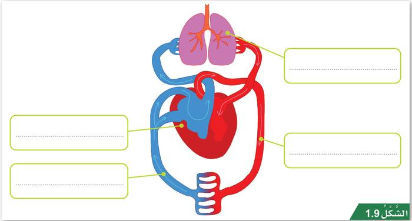

### الدرس 1.2: ما وظيفة الدم؟

#### أولًا: اختر الإجابة الصحيحة

1. أيّ من مكونات الدم الآتية يحمل الأكسجين؟
   - أ) الصفائح الدموية
   - ب) خلايا الدم الحمراء
   - ج) خلايا الدم البيضاء
   - د) البلازما
2. أيّ من مكونات الدم الآتية يحمل المواد الغذائية الذائبة؟
   - أ) الصفائح الدموية
   - ب) خلايا الدم الحمراء
   - ج) خلايا الدم البيضاء
   - د) البلازما
3. أيّ من ميزات الأوردة الآتية غير صحيحة؟
   - أ) تنقل الدم إلى القلب.
   - ب) واسعة من الداخل.
   - ج) لديها جدران سميكة.
   - د) لديها صمامات.

#### رابعًا: أجب عن الأسئلة الآتية (مسائل وتفكير)

4. أنظر إلى الشكل 1.15. أكتب أسماء مكونات الدم في المكان المناسب. (عينة الدم)
   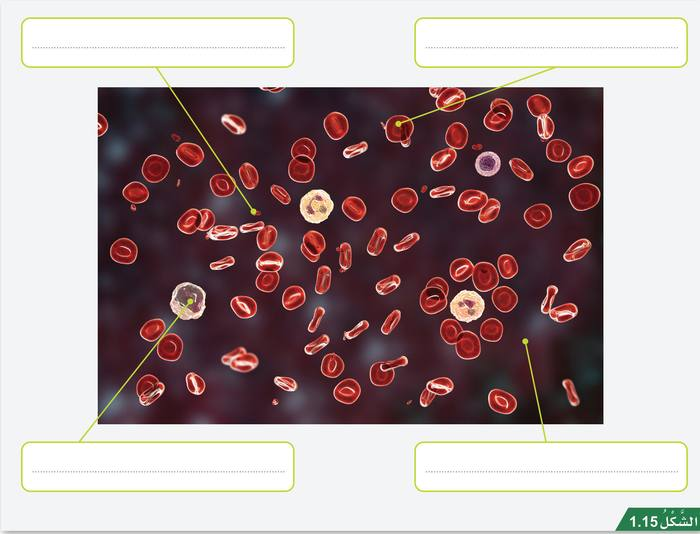

### الدرس 1.3: ما الجهاز التنفسي؟

#### أولًا: اختر الإجابة الصحيحة

1. أيّ عضو من الجهاز التنفسي في الشكل 1.22 يمرّر الهواء إلى الرئتين؟
   
   - أ) أ
   - ب) ب
   - ج) ج
   - د) د
2. أيّ جزء من نموذج الرئة في الشكل 1.23 يمثل القفص الصدري؟
   
   - أ) الأنبوب Y
   - ب) معجون
   - ج) بالونان
   - د) علبة بلاستيكية مفتوحة
3. أيّ أجزاء الجهاز التنفسي في الشكل 1.24 يجعل مساحة الصدر أكبر لسحب الهواء إلى الرئتين؟
   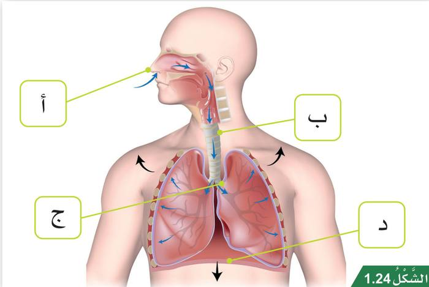
   - أ) أ
   - ب) ب
   - ج) ج
   - د) د
4. يبلغ متوسط كمية الهواء التي يدخلها الجسم في نفس واحد 500 cm³ (0.5 L). يأخذ الطالب 12 نفسًا في دقيقة واحدة. ما مقدار الهواء الذي يتنفسه الطالب خلال 10 دقائق؟
   - أ) 60,000 cm³
   - ب) 600 L
   - ج) 600 cm³
   - د) 6,000 cm³

#### رابعًا: أجب عن الأسئلة الآتية (مسائل وتفكير)

5. أنظر إلى الشكل 1.25. أحدّد على الشكل القصبة الهوائية والرئتين. أرسم خطوطًا لإظهار موضع القفص الصدري والحجاب الحاجز وأسمّي الخطوط. أضع × على الرسم التخطيطي لإظهار موضع القلب.
   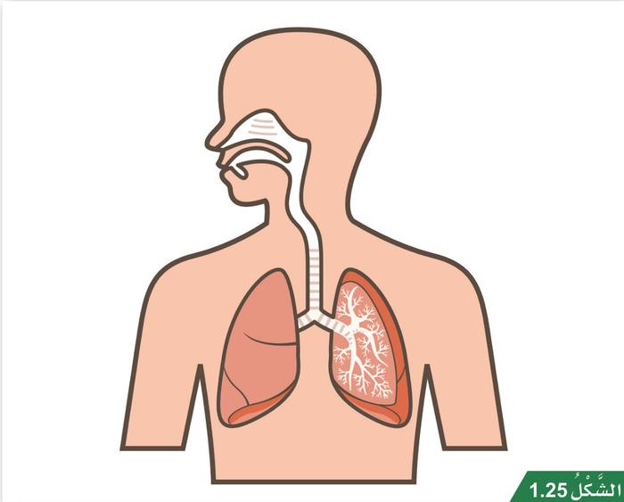

### الدرس 1.4: ما الجهاز الهضمي؟

#### أولًا: اختر الإجابة الصحيحة

1. أيّ عضو يربط الفم بالمعدة؟
   - أ) الأمعاء الدقيقة
   - ب) الأمعاء الغليظة
   - ج) المريء
   - د) فتحة الشرج
2. ما العضو الموجود بين الأمعاء الغليظة والمعدة؟
   - أ) الأمعاء الدقيقة
   - ب) الأمعاء الغليظة
   - ج) المريء
   - د) فتحة الشرج
3. ما وظيفة الأمعاء الغليظة؟
   - أ) هضم الطعام.
   - ب) التخلص من الطعام الذي لم يتم هضمه.
   - ج) امتصاص الماء من الطعام الذي لم يتم هضمه.
   - د) تصل بين المعدة والأمعاء الدقيقة.

#### رابعًا: أجب عن الأسئلة الآتية (مسائل وتفكير)

4. ما وظيفة الجهاز الهضمي؟
5. أسمّي أعضاء الجهاز الهضمي في الشكل 1.28.
   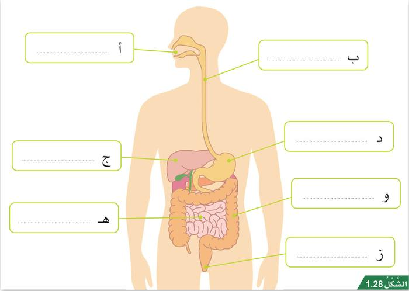
6. ابتداءً من الفم، أصف كيف يمر الطعام عبر الجهاز الهضمي.

### الدرس 1.5: ما وظائف الأسنان واللعاب والمريء في عملية الهضم؟

#### أولًا: اختر الإجابة الصحيحة

1. ماذا تفعل الأسنان بالطعام في الفم؟
   - أ) تقطّعه وتطحنه.
   - ب) تطحنه.
   - ج) تكسّره.
   - د) تجعله يجف.
2. كيف يتحرك الطعام في المريء؟
   - أ) يسقط.
   - ب) تتقبض العضلات (تضغط) أمام الطعام.
   - ج) تتقبض العضلات حول الطعام.
   - د) تتقبض العضلات خلف الطعام مباشرة.
3. ماذا تفعل القواطع بالطعام؟
   - أ) قطع الطعام.
   - ب) تمزيق الطعام.
   - ج) سحق الطعام.
   - د) طحن الطعام.
4. ما نوع هذه السن؟
   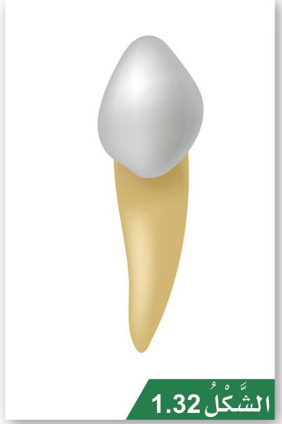
   - أ) قاطع
   - ب) ناب
   - ج) ضاحك
   - د) طاحن

#### رابعًا: أجب عن الأسئلة الآتية (مسائل وتفكير)

5. أشرح وظيفة اللعاب في الفم.
6. تأكل عائشة تفاحة. أشرح ما يحدث في فم عائشة للسماح لها بابتلاع قطعة التفاح.

### الدرس 1.6: كيف يمكننا بناء نموذج للجهاز الهضمي؟

#### أولًا: اختر الإجابة الصحيحة

1. ما دور المواد البروتينية الهاضمة؟
   - أ) مساعدتنا على النمو.
   - ب) المحافظة على صحتنا.
   - ج) امتصاص الماء.
   - د) استخراج المواد الغذائية من الأطعمة.
2. ما العضو الذي يتم من خلاله امتصاص المواد الغذائية المهضومة لينقلها الدم إلى جميع خلايا الجسم؟
   - أ) الفم
   - ب) المعدة
   - ج) الأمعاء الدقيقة
   - د) الأمعاء الغليظة
3. ما العضو من الجهاز الهضمي الذي يتم تمثيله بواسطة البالون الطويل؟
   - أ) الفم
   - ب) المريء
   - ج) المعدة
   - د) الأمعاء الغليظة

#### رابعًا: أجب عن الأسئلة الآتية (مسائل وتفكير)

4. أشرح ما يحدث للمواد الغذائية عندما تغادر الجهاز الهضمي.
5. أوضّح لماذا تعد المواد البروتينية الهاضمة مهمة في الجهاز الهضمي.
6. لمَ يعد الجهاز الهضمي مهمًّا؟

### الدرس 1.7: ما وظيفة الكليتين؟

#### أولًا: اختر الإجابة الصحيحة

1. ما وظيفة الجهاز البولي؟
   - أ) إبقاء خلايا الدم في الدم.
   - ب) إزالة الماء الزائد وبعض الفضلات الذائبة فيه.
   - ج) إزالة الفضلات الناتجة من الهضم.
   - د) حفظ الماء في الجسم.
2. ما وظيفة المثانة؟
   - أ) تخزين البول.
   - ب) تنقية البول.
   - ج) تخزين جزيئات الطعام القابلة للذوبان.
   - د) نقل البول إلى الكلية.
3. تقدّر كمية البول التي يتم إطلاقها في وقت واحد بنحو 0.25 L. يفرز الطفل البول 7 مرات في اليوم. أحسب إجمالي كمية البول التي تم إطلاقها في يوم واحد باللتر (L).
   - أ) 0.175
   - ب) 1.75
   - ج) 17.5
   - د) 175

#### رابعًا: أجب عن الأسئلة الآتية (مسائل وتفكير)

4. أسمّي أجزاء الجهاز البولي في الشكل 1.40.
   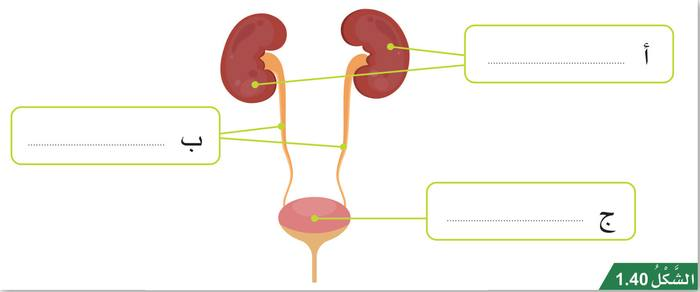
5. أشرح دور الكلى في المحافظة على صحة الجسم.
6. أشرح كيف يزيل جهازي البولي الماء الزائد والفضلات الذائبة فيه.
7. أقترح ما يمكن أن يحدث إذا لم يكن لدى الإنسان مثانة في جسمه.

### الدرس 1.8: كيف تعمل أعضاء الحس والدماغ معًا؟

#### أولًا: اختر الإجابة الصحيحة

1. ما عضو الحس الذي نستخدمه للشعور واللمس؟
   - أ) الجلد
   - ب) العينان
   - ج) الأذنان
   - د) الأنف
2. ما الحواس التي يستخدمها الجنود في الشكل 1.44 وتساعدهم على إدراك حركة الأشخاص؟
   
   - أ) البصر والسمع
   - ب) البصر واللمس
   - ج) السمع والبصر واللمس
   - د) البصر والسمع والشم
3. ما القائمة التي تتضمن جميع الأعضاء الحسية التي تعمل معًا لتسمح لنا بأن نستمتع بوجبة غذاء؟
   - أ) العينان واللسان
   - ب) العينان والأنف واللسان
   - ج) الأنف واللسان والجلد
   - د) اللسان والأنف

#### رابعًا: أجب عن الأسئلة الآتية (مسائل وتفكير)

4. أسمّي العضو الذي يعد مركز التحكم في الجسم. أشرح سبب تسميته مركز التحكم في الجسم.
5. لماذا يتم إرسال الرسائل الواردة من الأعضاء الحسية إلى الدماغ مباشرة؟
6. أشرح ما يحدث عندما تكتشف الأعضاء الحسية تغييرًا في محيطها.

## الوحدة 2: النمو والتطور في جسم الإنسان

### الدرس 2.1: ما الأعضاء التناسلية لدى الإنسان؟

#### أولًا: اختر الإجابة الصحيحة

1. ما العبارة الصحيحة؟
   - أ) لدى الذكور مبيضان ينتجان البويضات.
   - ب) لدى الذكور مبيضان ينتجان الحيوانات المنوية.
   - ج) لدى الذكور خصيتان تنتجان البويضات.
   - د) لدى الذكور خصيتان تنتجان الحيوانات المنوية.
2. أيّ الجمل الآتية صحيحة؟
   - أ) تنتج الأنثى البويضات، وهي خلايا تستطيع أن تتحرك من تلقاء نفسها.
   - ب) تنتج الأنثى البويضات، وهي خلايا لا تستطيع أن تتحرك من تلقاء نفسها.
   - ج) تنتج الأنثى الحيوانات المنوية، وهي خلايا تستطيع أن تتحرك من تلقاء نفسها.
   - د) تنتج الأنثى الحيوانات المنوية، وهي خلايا لا تستطيع أن تتحرك من تلقاء نفسها.

#### رابعًا: أجب عن الأسئلة الآتية (مسائل وتفكير)

3. أدرس الشكل 2.3، ثم أكتب أسماء الأجزاء المشار إليها في الشكل الآتي. (الأعضاء التناسلية الأنثوية والأعضاء التناسلية الذكرية)
   
4. أحدّد البويضة والحيوان المنوي في الشكل 2.4.
   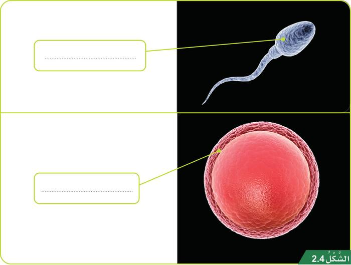

### الدرس 2.2: ما التغيرات التي تحدث في الجسم في أثناء البلوغ؟

#### أولًا: اختر الإجابة الصحيحة

1. أيّ من العمليات الآتية هي عملية البلوغ؟
   - أ) تحول الجسم من شخص بالغ إلى طفل.
   - ب) تحول الجسم من طفل إلى بالغ.
   - ج) تغير الجسم من بالغ إلى مسن.
   - د) توقف الجسم عن إنتاج البويضات أو الحيوانات المنوية.
2. ما العبارة الصحيحة حول البلوغ؟
   - أ) لا يحدث البلوغ للجميع.
   - ب) يحدث البلوغ للجميع.
   - ج) يمكنك اختيار وقت البلوغ.
   - د) يستغرق البلوغ نحو 4 أشهر.
3. أيّ إجابة صحيحة؟
   - أ) يحدث البلوغ عند الذكور دون الإناث.
   - ب) يحدث البلوغ عند الإناث دون الذكور.
   - ج) يؤثر البلوغ في الإناث والذكور بالطريقة نفسها.
   - د) يؤثر البلوغ في الإناث والذكور، لكن بعض التغيرات تختلف بالنسبة إلى الإناث والذكور.

#### رابعًا: أجب عن الأسئلة الآتية (مسائل وتفكير)

4. أنظر إلى صورة الفتى في الشكل 2.7. ينمو هذا الفتى ويتطور. أكتب ثلاثة تغيرات قد تحدث لهذا الفتى وهو يمر بمرحلة البلوغ.
   

### الدرس 2.3: ماذا أعرف عن نمو الإنسان وتطوره؟

#### أولًا: اختر الإجابة الصحيحة

1. أختار العبارة الصحيحة.
   - أ) ينتج الذكور الحيوانات المنوية، وتنتج الإناث البويضات.
   - ب) تنتج الإناث الحيوانات المنوية، وينتج الذكور البويضات.
   - ج) ينتج كل من الذكور والإناث الحيوانات المنوية والبويضات.
   - د) تنتج الإناث البويضات والحيوانات المنوية، بينما ينتج الذكور الحيوانات المنوية فقط.
2. أين تنتج الحيوانات المنوية؟
   - أ) الخصيتان
   - ب) المبيضان
   - ج) الرحم
   - د) القناة المنوية
3. ما المفردة العلمية التي تصف الإنسان الذي تمّ عملية البلوغ؟
   - أ) شخص
   - ب) رجل
   - ج) امرأة
   - د) بالغ
4. ما العمر الذي ينتهي عنده سن البلوغ عادة؟
   - أ) 12
   - ب) 14
   - ج) 16
   - د) 18

#### رابعًا: أجب عن الأسئلة الآتية (مسائل وتفكير)

5. أكتب ثلاثة تغيرات تحدث للإنسان خلال البلوغ.
6. ما تعريف "الخاصية الجسمية الثانوية"؟
7. أكتب اسم الأجزاء المشار إليها في الشكل 2.9. (الجهاز التناسلي الأنثوي)
   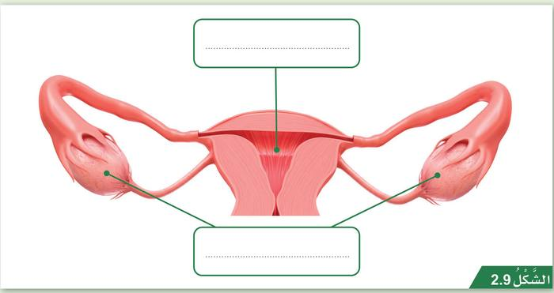
8. ما خاصية الحيوان المنوي التي تبين أن باستطاعته أن يتحرك من تلقاء نفسه؟
9. أقترح اختلافين بين البويضة والحيوانات المنوية.
10. لماذا يستغرق البلوغ عادة سنوات عديدة؟
11. أذكر خاصيتين جسميتين ثانويتين للإناث واثنتين للذكور.
12. أكتب سببين لاختلاف خصائص الأعضاء التناسلية الذكرية عن الأعضاء التناسلية الأنثوية.

## الوحدة 3: التغيرات الفيزيائية والكيميائية

### الدرس 3.1: ما التغيرات الفيزيائية؟

#### أولًا: اختر الإجابة الصحيحة

1. ما الصورة التي تظهر تغيرًا فيزيائيًا؟
   
   - أ) رغيف خبز في الفرن
   - ب) مثلجات
   - ج) بيض مقلي
   - د) ألعاب نارية
2. أيّ العبارات الآتية تصف التغيرات الفيزيائية بشكل صحيح؟
   - أ) التغيرات الفيزيائية تكون غالبًا قابلة للانعكاس ولا تنتج مادة جديدة.
   - ب) التغيرات الفيزيائية تكون غالبًا غير قابلة للانعكاس ولا تنتج مادة جديدة.
   - ج) التغيرات الفيزيائية تكون غالبًا قابلة للانعكاس وتنتج مادة جديدة.
   - د) التغيرات الفيزيائية تكون غالبًا غير قابلة للانعكاس وتنتج مادة جديدة.

#### رابعًا: أجب عن الأسئلة الآتية (مسائل وتفكير)

3. أشرح، من حيث حركة الجسيمات، كيف تتجمد المادة السائلة إلى مادة صلبة.
4. أشرح، من حيث حركة الجسيمات، كيف تتكثف المادة الغازية إلى مادة سائلة.
5. يلاحظ الطالب تغيرًا فيزيائيًا في المختبر ويسجل القياسات الآتية: أكتب درجة الحرارة الابتدائية للمادة، وأكتب درجة الحرارة النهائية للمادة.
   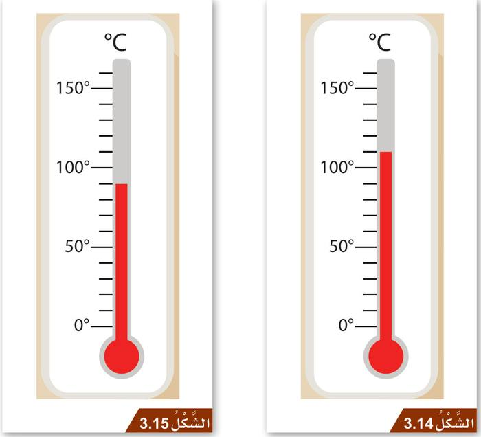

### الدرس 3.2: ما التغيرات الكيميائية؟

#### أولًا: اختر الإجابة الصحيحة

1. ما الصورة التي تظهر تغيرًا كيميائيًا؟
   
   - أ) التكاثف
   - ب) ذوبان الملح
   - ج) انصهار مكعب ثلج
   - د) ذوبان قرص دواء
2. أيّ مما يأتي ينتج دائمًا من تغير كيميائي؟
   - أ) فوران
   - ب) رائحة جديدة
   - ج) مادة جديدة
   - د) تغير في اللون
3. أيّ من هذه التغيرات هو تغير فيزيائي؟
   - أ) خبز كعكة الحلوى
   - ب) إعداد فقاعات الصابون
   - ج) احتراق الخشب
   - د) طبخ بيضة

#### رابعًا: أجب عن الأسئلة الآتية (مسائل وتفكير)

4. أخطط وزميلي لصنع قالب جبس لجسم صغير. أكتب ثلاثة إجراءات أمان سأتخذها للمحافظة على سلامتي.
5. يضع طالب مسمارًا حديديًا في الخل ويسجل الملاحظات الآتية: "وضعت المسمار في الخل وقمت بقياس تغير درجة الحرارة. كانت هناك فقاعات على المسمار ارتفعت إلى السطح كما كانت هناك بعض المسحوق الأحمر الذي خرج من المسمار واستقر في قاع أنبوب الاختبار." أستخدم الشكلين 3.24 و3.25 لأحدد درجة الحرارة الابتدائية ودرجة الحرارة النهائية.
   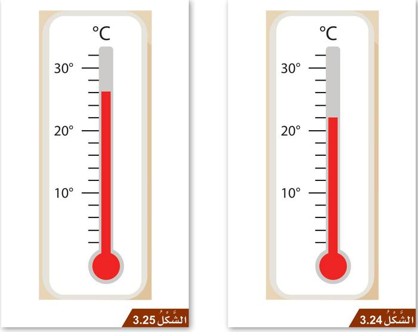

### الدرس 3.3: كيف يؤثر التسخين في المواد المختلفة؟

#### أولًا: اختر الإجابة الصحيحة

1. ما الصورة التي تظهر حدوث تغير فيزيائي؟
   
   - أ) ماء يغلي
   - ب) مغنيسيوم يتفاعل
   - ج) زنك يتفاعل في أنبوب الاختبار
   - د) قرص فوار في الماء
2. أيّ من الآتي لا يمكن حدوثه عند تسخين مادة؟
   - أ) اشتعال
   - ب) انصهار
   - ج) غليان
   - د) تجمد

#### رابعًا: أجب عن الأسئلة الآتية (مسائل وتفكير)

3. أحدّد إن كانت التغيرات الآتية تغيرات كيميائية أو فيزيائية: ورقة تحترق.
4. أحدّد إن كانت التغيرات الآتية تغيرات كيميائية أو فيزيائية: تسخين الزنك حتى يتحول إلى سائل.
5. أحدّد إن كانت التغيرات الآتية تغيرات كيميائية أو فيزيائية: قص الورق.
6. أحدّد إن كانت التغيرات الآتية تغيرات كيميائية أو فيزيائية: تسخين النحاس حتى تتكون مادة صلبة سوداء على سطحه.

### الدرس 3.4: ما الفرق بين التسخين والاحتراق؟

#### أولًا: اختر الإجابة الصحيحة

1. ما الوصف الصحيح للعلاقة بين التسخين والاحتراق؟
   - أ) التسخين لا يؤدي إلى الاحتراق أبدًا.
   - ب) الاحتراق لا يتضمن التسخين أبدًا.
   - ج) الاحتراق يتضمن دائمًا التسخين.
   - د) التسخين يؤدي إلى الاحتراق دائمًا.
2. ما الصورة التي تظهر عملية احتراق؟
   
   - أ) الصورة أ
   - ب) الصورة ب
   - ج) الصورة ج
   - د) الصورة د
3. ما المكوّن الذي لا يعد شرطًا أساسيًا لإشعال حريق؟
   - أ) الحرارة
   - ب) الوقود
   - ج) الضوء
   - د) الأكسجين

#### رابعًا: أجب عن الأسئلة الآتية (مسائل وتفكير)

4. يجب تخزين الوقود والمواد القابلة للاشتعال بطريقة آمنة لمنع نشوب حريق. أعرّف الوقود.
5. يجب تخزين الوقود والمواد القابلة للاشتعال بطريقة آمنة لمنع نشوب حريق. أذكر المقصود بـ "قابلة للاشتعال".
6. يجب تخزين الوقود والمواد القابلة للاشتعال بطريقة آمنة لمنع نشوب حريق. أذكر كيف يتم تخزين المواد القابلة للاشتعال.
7. أشرح كيف يمكن إشعال حريق من خلال فرك عودين معًا، على سبيل المثال، عند وجود شخص في جزيرة صحراوية. (أفكر في مثلث النار)

### الدرس 3.5: كيف نستقصي أي المواد قابلة للذوبان وأيها غير قابلة للذوبان؟

#### أولًا: اختر الإجابة الصحيحة

1. أيّ المواد الآتية هي مادة قابلة للذوبان في الماء؟
   - أ) برادة الحديد
   - ب) رقائق الألومنيوم
   - ج) السكر الأبيض
   - د) زيت الطهي
2. أيّ المواد الآتية هي مادة غير قابلة للذوبان في الماء؟
   - أ) رمل
   - ب) مسحوق العصير الجاف
   - ج) الملح
   - د) السكر
3. أنظر إلى الشكل 3.57 الذي يوضح إذابة السكر في الماء. أيّ من الخطوات الآتية لا تساعد على إذابة السكر بسرعة أكبر؟
   
   - أ) تحريك المزيج
   - ب) إضافة المزيد من الماء
   - ج) تسخين المزيج
   - د) إضافة المزيد من السكر
4. أيّ مخلوط من المخاليط الآتية يحتوي على مادة غير قابلة للذوبان؟
   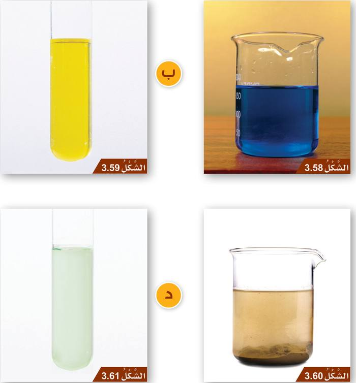
   - أ) المخلوط أ
   - ب) المخلوط ب
   - ج) المخلوط ج
   - د) المخلوط د
5. أيّ من الخيارات الآتية ليس متغيرًا ثابتًا في استقصاء لمقارنة قابلية ذوبان المواد المختلفة في الماء؟
   - أ) حجم الماء
   - ب) كتلة المادة التي تذوب
   - ج) عدد مرات تحريك الخليط
   - د) درجة حرارة الماء

#### رابعًا: أجب عن الأسئلة الآتية (مسائل وتفكير)

6. أقرأ وصف الطالب لاستقصاء كتلة السكر التي يمكن إذابتها في الماء مقارنة بكتلة ملح الطعام التي يمكن إذابتها في الحجم نفسه من الماء: "ملأت كأسًا زجاجية بالماء الساخن حتى علامة 100 mL. بعد ذلك وضعت كأس الماء على الميزان وذلك لقياس كتلته. لقد استخدمت ملعقة لإضافة السكر إلى الكأس، مع التحريك في كل مرة حتى تذوب كل المواد الصلبة. عندما توقف ذوبان المزيد من المواد الصلبة، قمت بتدوين كتلة الكأس الزجاجية والمحلول. ثم كررت الخطوات نفسها باستخدام ملح الطعام." أسمّي المتغير المستقل. أسمّي المتغير التابع. أسمّي متغيرًا ثابتًا. أقترح تحسينًا للاستقصاء يمكن للطالب إجراؤه.
7. أنظر إلى البيانات من تجربة الطالب في الجدول 3.17 ثم أقرأ استنتاجه. (كتلة الكأس الزجاجية في البداية: السكر 152 جرام، ملح الطعام 152 جرام؛ كتلة الكأس الزجاجية في النهاية: السكر 402 جرام، ملح الطعام 198 جرام)

### الدرس 3.6: مم يتكون المحلول؟

#### أولًا: اختر الإجابة الصحيحة

1. أيّ من الجمل الآتية صحيحة عن المذاب والمذيب والمحلول؟
   - أ) يذوب المحلول في مذيب لتشكيل مذاب.
   - ب) يذوب المحلول في مذاب لتشكيل مذيب.
   - ج) يذوب المذيب في المذاب لتشكيل محلول.
   - د) يذوب المذاب في مذيب لتشكيل محلول.
2. أيّ من المواد الآتية لا يمكن أن تكون المذيب؟
   - أ) الماء
   - ب) الأسيتون
   - ج) ملح الطعام
   - د) زيت الطهي

#### رابعًا: أجب عن الأسئلة الآتية (مسائل وتفكير)

3. أعرّف الآتي: المذاب، المذيب، المحلول.
4. أذكر مثالًا على مادة يمكن أن تذوب في الأسيتون.
5. أذكر مثالًا على مذيب قادر على إذابة ملح الطعام.
6. أنظر إلى الصورة وأقرأ المعلومات أدناه. (تنظيف فرش الطلاء) يرسم الطالب بعض الرسومات باستخدام طلاء الألوان الزيتية. يلاحظ أنه عندما يحاول تنظيف فرشاة الطلاء بالماء فإن بعض الطلاء فقط يتم تنظيفه لأنه غير قابل للذوبان في الماء. أقترح طريقة يمكن للطالب استخدامها لتنظيف المزيد من الطلاء على الفرشاة.
   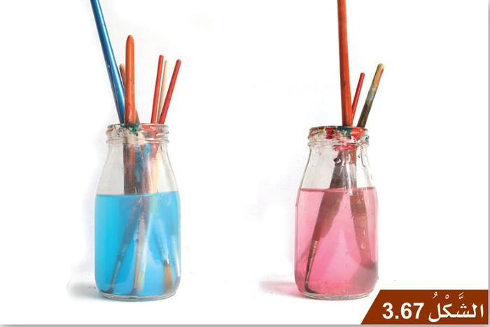

### الدرس 3.7: كيف يمكن استخدام التبخر والتكاثف؟

#### أولًا: اختر الإجابة الصحيحة

1. ما العملية التي تستخدم للحصول على المذيب من المحلول؟
   - أ) التبخر
   - ب) التكاثف
   - ج) التقطير
   - د) التجمد
2. أيّ الأدوات الآتية لا تستخدم في عملية التقطير؟
   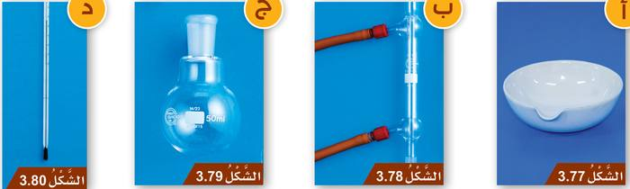
   - أ) الأداة أ
   - ب) الأداة ب
   - ج) الأداة ج
   - د) الأداة د
3. ما اسم العملية المستخدمة لفصل مكونات المحلول من خلال وضعه في وعاء مفتوح؟
   - أ) التبخر
   - ب) التكاثف
   - ج) التقطير
   - د) الغليان

#### رابعًا: أجب عن الأسئلة الآتية (مسائل وتفكير)

4. أشرح كيف تعمل عملية التقطير.
5. أقارن عملية التقطير بدورة الماء. أكتب اثنين من أوجه الشبه. أكتب اثنين من أوجه الاختلاف.
6. أقرأ المعلومات أدناه. يجري طالب تجربة ليثبت أن الكتلة لا تتغير عند فصل مكونات المحلول بواسطة التبخير. أخذ الطالب القياسات الموجودة في الجدول 3.19 ولكنه نسي أخذ القياسين الأوليين. (كأس زجاجية + محلول: 170 جرام، طبق تبخر فارغ: 82 جرام، طبق التبخر + محلول: 152 جرام، طبق التبخر + بلورات: 100 جرام)

### الدرس 3.8: كيف تحدث عملية الترشيح وكيف تستخدم؟

#### أولًا: اختر الإجابة الصحيحة

1. ما المادة التي تعد رواسب عند استخدام الترشيح لفصل الرمل عن الماء؟
   - أ) ورق الترشيح
   - ب) الماء
   - ج) مخلوط الرمل والماء
   - د) الرمل
2. ما الجملة التي تصف بشكل صحيح عملية الترشيح؟
   - أ) فصل مادة قابلة للذوبان عن سائل.
   - ب) فصل مذيب غير قابل للذوبان عن المذاب.
   - ج) فصل المذاب عن المذيب.
   - د) فصل مادة صلبة غير قابلة للذوبان عن سائل.
3. ما العبارة الصحيحة حول الترشيح؟
   - أ) يزيل الترشيح الكائنات الحية الضارة فقط.
   - ب) لا يمكن أن يزيل الترشيح الكائنات الضارة.
   - ج) يزيل الترشيح دائمًا الكائنات الحية الضارة.
   - د) يزيل الترشيح أحيانًا الكائنات الحية الضارة.

#### رابعًا: أجب عن الأسئلة الآتية (مسائل وتفكير)

4. أيّ الصور الآتية تظهر عملية الترشيح؟ أحدّد كل الصور المناسبة.
   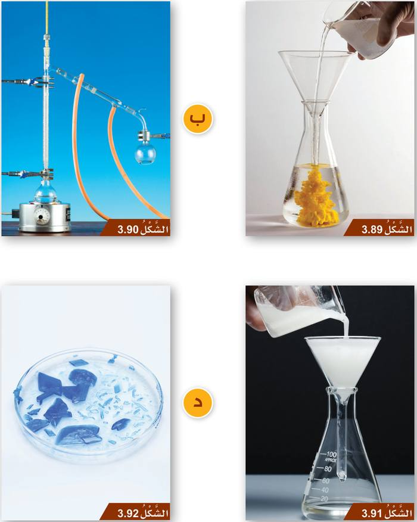

### الدرس 3.9: ماذا أعرف عن التغيرات الفيزيائية والكيميائية؟

#### رابعًا: أجب عن الأسئلة الآتية (مسائل وتفكير)

1. أيّ الصور الآتية تظهر تغيرًا كيميائيًا؟ أحدّد كل الصور المناسبة. (تفجّر فقاعة صابون، مزج الطلاء، سحق علبة، عصا مشعّة)
   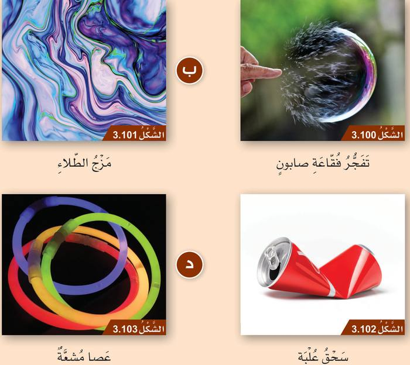
7. أصف مثلث النار. أذكر العناصر الثلاثة الأساسية لمثلث النار. أشرح كيف يجب تخزين البنزين بطريقة آمنة.
8. أصف ما يحدث عند احتراق الورق. أعد قائمة تبين لم يعد احتراق الورق تغيرًا كيميائيًا.
9. أحدّد إن كان فتح زجاجة المشروبات الغازية تغيرًا فيزيائيًا أو كيميائيًا.
10. أفكر في عينة من مادة ما (مكعب ثلج) وضعت في وعاء ويتم تسخينها ببطء. أصف التغيرات التي تحدث في المراحل الآتية من التجربة: تصل درجة حرارة مكعب الثلج إلى 0 °C ثم تتخطى درجة الحرارة هذه. تتزايد درجة حرارة العينة تدريجيًا لتصل إلى 100. °C تصل درجة حرارة العينة إلى 100 °C، ثم تتخطى درجة الحرارة هذه.
