# بنك أسئلة العلوم — المستوى السادس — الفصل الدراسي الثاني

- كل الدروس منقولة من كتاب الطالب (العلوم – الصف السادس – الفصل الثاني): أسئلة "أتحقق مما تعلمت" والأنشطة، بنصّها كما في الكتاب. الصور والأشكال مقتطعة كصور (مجلد images).
- الفراغ يُكتب ____.
- الأسئلة بدون إجابات نموذجية.

## الفهرس

- الوحدة 4: تأثيرات القوى
  - الدرس 4.1: ما قوى التلامس وقوى التأثير عن بعد؟
  - الدرس 4.2: ما تأثير قوة الجاذبية في الأجسام؟
  - الدرس 4.3: ما الفرق بين الكتلة والوزن؟
  - الدرس 4.4: كيف تختلف قوة الجاذبية باختلاف الكواكب؟
  - الدرس 4.5: كيف نستطيع تمثيل القوى المؤثرة في الأجسام الساكنة والمتحركة؟
  - الدرس 4.6: كيف يمكننا قياس السرعة والتسارع؟
- الوحدة 5: النمو والتطور في النباتات
  - الدرس 5.1: ما أجزاء الزهرة؟
  - الدرس 5.2: ما المراحل المختلفة في دورة حياة النباتات الزهرية؟
  - الدرس 5.3: كيف تساعد الرياح أو الحيوانات على التلقيح؟
  - الدرس 5.4: ما المدى الذي تصل إليه البذور بواسطة طرق الانتشار المختلفة؟
  - الدرس 5.5: كيف يساعد تركيب البذور على انتشارها؟
- الوحدة 6: النظام الشمسي
  - الدرس 6.1: ما النظام الشمسي؟
  - الدرس 6.2: ما الأقمار؟
  - الدرس 6.3: لماذا لا توجد حياة على الكواكب الأخرى؟
  - الدرس 6.4: كيف يحدث الليل والنهار؟
  - الدرس 6.5: لماذا تبدو لنا الشمس في حركة ظاهرية؟
  - الدرس 6.6: ما أطوار القمر؟
  - الدرس 6.7: كيف تتشكل الفصول الأربعة؟
- الوحدة 7: التصنيف
  - الدرس 7.1: النباتات اللازهرية
  - الدرس 7.2: ما الفرق بين الأشجار المتساقطة الأوراق والأشجار الدائمة الخضرة؟
  - الدرس 7.3: ما النباتات التي نزرعها من أجل الغذاء؟
  - الدرس 7.4: ما أوجه الشبه والاختلاف بين الحيوانات الفقارية المختلفة؟
  - الدرس 7.5: ما أوجه الشبه والاختلاف بين الحيوانات اللافقارية المختلفة؟
  - الدرس 7.6: كيف يمكن تصنيف الفقاريات واللافقاريات؟

---

## الوحدة 4: تأثيرات القوى

### الدرس 4.1: ما قوى التلامس وقوى التأثير عن بعد؟

#### أولًا: اختر الإجابة الصحيحة

1. تظهر الصورة رافعة تنزل البضائع من الباخرة. ما الجملة التي تصف القوة المؤثرة من الرافعة في الحاوية؟
   
   - أ) قوة تلامس نحو الأعلى.
   - ب) قوة تلامس نحو الأسفل.
   - ج) قوة تأثير عن بعد نحو الأعلى.
   - د) قوة تأثير عن بعد نحو الأسفل.
2. تظهر الصورة بالونين تم دلكهما بقطعة من الصوف، معلقين في السقف. ما الجملة التي تصف القوة بين البالونين؟
   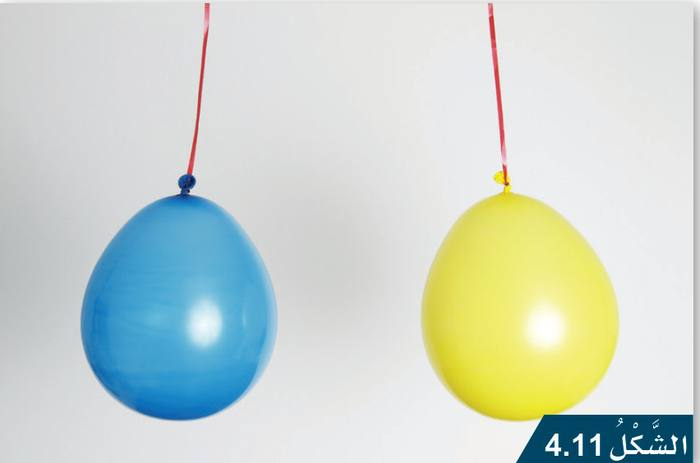
   - أ) قوة الكهرباء الساكنة وهي قوة تلامس، عندما تكون للبالونين شحنات متشابهة.
   - ب) قوة الكهرباء الساكنة وهي قوة تلامس، عندما تكون للبالونين شحنات متعاكسة.
   - ج) قوة الكهرباء الساكنة وهي قوة تأثير عن بعد، عندما تكون للبالونين شحنات متشابهة.
   - د) قوة الكهرباء الساكنة وهي قوة تأثير عن بعد، عندما تكون للبالونين شحنات متعاكسة.
3. تظهر الصورة قارورة تحتوي على سائل موضوعة على منحدر. قوة الاحتكاك وقوة الجاذبية من القوى المؤثرة في القارورة. أيّ صف من صفوف الجدول الآتي يصف نوع هاتين القوتين؟
   
   - أ) الاحتكاك: تلامس، الجاذبية: تلامس
   - ب) الاحتكاك: تأثير عن بعد، الجاذبية: تأثير عن بعد
   - ج) الاحتكاك: تلامس، الجاذبية: تأثير عن بعد
   - د) الاحتكاك: تأثير عن بعد، الجاذبية: تلامس
4. تظهر الصورة مغناطيسين. ما الذي يحدث عندما يتم تحريك المغناطيس A إلى اليمين؟
   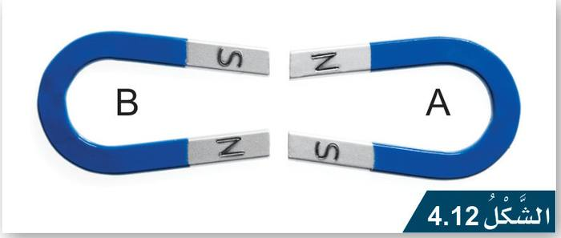
   - أ) يتحرك المغناطيس B إلى اليمين بواسطة قوى التلامس.
   - ب) يتحرك المغناطيس B إلى اليمين بواسطة قوى التأثير عن بعد.
   - ج) يتحرك المغناطيس B إلى اليسار بواسطة قوى التلامس.
   - د) يتحرك المغناطيس B إلى اليسار بواسطة قوى التأثير عن بعد.

#### رابعًا: أجب عن الأسئلة الآتية (مسائل وتفكير)

5. يوقف القارب محركاته قبل أن يرسو. توجد قوة تبطئ حركته. ما اسم هذه القوة؟
6. تظهر الصورة قافزًا بالحبال (رياضة قفزة البانجي). يربط القافز بحبل مطاطي ويقفز من فوق جسر مرتفع باتجاه أسفل الوادي. ما اسم القوة التي تسبب تحرك القافز إلى الأسفل وما نوعها؟
   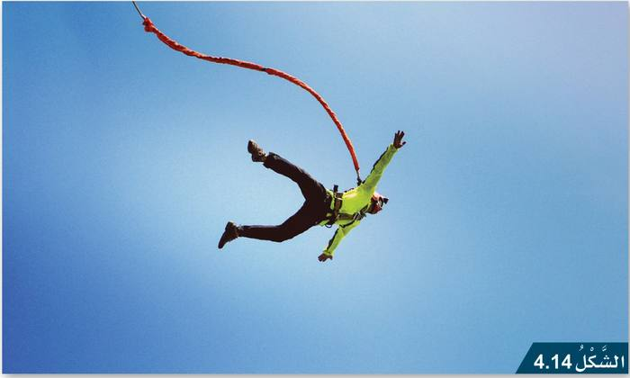
7. ما اسم القوة التي تسبب تحرك القافز إلى الأعلى مجددًا وما نوعها؟ (قافز بالحبال)
   
8. هل القوة الواردة في الجزء "أ" قوة تلامس أم قوة تأثير عن بعد؟ أشرح إجابتي.

#### أولًا: اختر الإجابة الصحيحة (أسئلة محوّلة)

1. ما قوّة التلامس؟
   - أ) قوّة تظهر في الفراغ فقط
   - ب) قوّة تؤثّر عن بُعد دون تلامس
   - ج) قوّة لا تؤثّر في الأجسام
   - د) قوّة تؤثّر عندما يتلامس جسمان
2. ما قوّة التأثير عن بُعد؟
   - أ) قوّة الاحتكاك
   - ب) قوّة تظهر عند اللمس فقط
   - ج) قوّة تؤثّر في جسمٍ دون أن تلمسه
   - د) قوّة الدفع باليد
3. أيّ القوى الآتية قوّة تلامس؟
   - أ) القوّة المغناطيسيّة
   - ب) الجاذبيّة
   - ج) الاحتكاك
   - د) الكهرباء الساكنة
4. أيّ القوى الآتية قوّة تأثير عن بُعد؟
   - أ) مقاومة الهواء
   - ب) الاحتكاك
   - ج) الجاذبيّة
   - د) الدفع بالأيدي
5. بحسب ما تعلّمتَ، أيّ القوى الآتية قوّة تأثير عن بُعد؟
   - أ) الاحتكاك
   - ب) مقاومة الماء
   - ج) قوّة الشدّ في الحبل
   - د) القوّة المغناطيسيّة
6. يوقف قاربٌ محرّكاته قبل أن يرسو، وتوجد قوّة تبطئ حركته. ما اسم هذه القوّة؟
   - أ) مقاومة الماء
   - ب) الجاذبيّة المغناطيسيّة
   - ج) الكهرباء الساكنة
   - د) قوّة الدفع الصاروخيّ
7. يقفز قافزٌ بحبلٍ مطاطيّ. ما القوّة التي تسحبه إلى الأعلى بعد أن يمتدّ الحبل؟
   - أ) الاحتكاك فقط
   - ب) الجاذبيّة
   - ج) قوّة الشدّ (المرونة) في الحبل
   - د) القوّة المغناطيسيّة
8. قوّة الشدّ في الحبل المطّاطيّ من أيّ نوع؟
   - أ) قوّة تأثير عن بُعد
   - ب) قوّة تلامس
   - ج) قوّة مغناطيسيّة
   - د) قوّة كهربائيّة ساكنة
9. رافعةٌ تنزل بضائع من باخرة. ما نوع القوّة التي يؤثّر بها الحبل في الحاوية؟
   - أ) قوّة تلامس نحو الأعلى
   - ب) قوّة تأثير عن بُعد نحو الأسفل
   - ج) قوّة احتكاك فقط
   - د) قوّة مغناطيسيّة
10. بالونان دُلكا بالصوف وعُلّقا وهما يتنافران. ما نوع القوّة بينهما؟
   - أ) قوّة احتكاك، وهي قوّة تلامس
   - ب) قوّة كهربائيّة ساكنة، وهي قوّة تأثير عن بُعد
   - ج) قوّة جاذبيّة فقط
   - د) قوّة شدّ
11. يتنافر مغناطيسان عند تقريب قطبين متشابهين. هل القوّة بينهما تلامس أم تأثير عن بُعد؟
   - أ) احتكاك
   - ب) تلامس
   - ج) تأثير عن بُعد
   - د) شدّ
12. قارورةٌ على منحدر: قوّة الاحتكاك وقوّة الجاذبيّة. أيّ الصفوف يصفهما بشكلٍ صحيح؟
   - أ) الاحتكاك: تلامس، الجاذبيّة: تأثير عن بُعد
   - ب) الاحتكاك: تأثير عن بُعد، الجاذبيّة: تلامس
   - ج) كلاهما تلامس
   - د) كلاهما تأثير عن بُعد
13. أيّ القوى الآتية تعمل على الأجسام الساقطة نحو الأرض؟
   - أ) الكهرباء الساكنة فقط
   - ب) المغناطيسيّة دائمًا
   - ج) الجاذبيّة
   - د) مقاومة الماء
14. أيّ المواقف الآتية يمثّل قوّة تلامس؟
   - أ) سقوط تفّاحة
   - ب) دفع الباب
   - ج) جذب مغناطيس لمسمار بلا تلامس
   - د) تنافر بالونين بلا تلامس
15. أيّ المواقف الآتية يمثّل قوّة تأثير عن بُعد؟
   - أ) جذب مغناطيس لمسمار قبل أن يلمسه
   - ب) شدّ حبل
   - ج) دفع عربة
   - د) احتكاك الحذاء بالأرض
16. أيّ العبارات الآتية صحيحة؟
   - أ) الاحتكاك قوّة تأثير عن بُعد
   - ب) الجاذبيّة قوّة تلامس
   - ج) المغناطيسيّة قوّة تلامس
   - د) الجاذبيّة والمغناطيسيّة قوتا تأثير عن بُعد

### الدرس 4.2: ما تأثير قوة الجاذبية في الأجسام؟

#### أولًا: اختر الإجابة الصحيحة

1. لماذا يتم إبقاء بعض الأشياء خلال الاستقصاء كما هي من دون تغيير؟
   - أ) ليكون الاستقصاء آمنًا.
   - ب) ليكون الاستقصاء أسرع.
   - ج) ليكون الاستقصاء عادلًا.
   - د) ليكون الاستقصاء أكثر دقة.
2. تم إسقاط قطعة من الرصاص وبلورة زجاجية وورقة مسطحة إلى الأرض من على سطح مبنى عال. سقطت قطعة الرصاص على الأرض بعد مرور ثانيتين. أختار الجملة الصحيحة:
   - أ) سقطت البلورة الزجاجية على الأرض بعد مرور ثانيتين.
   - ب) سقطت الورقة المسطحة على الأرض بعد مرور ثانيتين.
   - ج) سقطت البلورة الزجاجية على الأرض قبل قطعة الرصاص.
   - د) سقطت الورقة المسطحة على الأرض قبل قطعة الرصاص.
3. قفز الأب مع ابنه من على لوحة قفز عالية في حوض السباحة. أيّ من الجمل الآتية تصف بشكل أفضل ما يحدث؟
   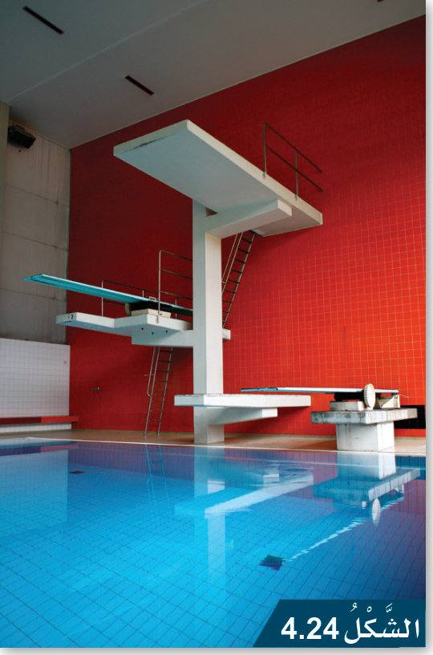
   - أ) يصل الأب إلى الماء أولًا لأنه أثقل.
   - ب) يصل الأب إلى الماء أولًا لأنه في تسارع أكبر.
   - ج) يصل الابن إلى الماء أولًا لأنه في تسارع أكبر.
   - د) يصل الأب وابنه كلاهما إلى الماء معًا لأنهما في تسارع متساو.

#### أولًا: اختر الإجابة الصحيحة (أسئلة محوّلة)

1. ما قوّة الجاذبيّة؟
   - أ) قوّة تبطئ الأجسام
   - ب) قوّة تدفع الأجسام للأعلى
   - ج) قوّة تجذب الأجسام نحو مركز الأرض
   - د) قوّة تغيّر لون الأجسام
2. في أيّ اتّجاه تؤثّر الجاذبيّة على جسمٍ قرب سطح الأرض؟
   - أ) نحو الأعلى
   - ب) نحو الأسفل
   - ج) نحو الأمام
   - د) لا اتّجاه لها
3. لماذا نبقي بعض الأشياء ثابتةً من دون تغيير خلال الاستقصاء؟
   - أ) لنغيّر النتائج
   - ب) لنجعل التجربة أطول
   - ج) ليكون الاختبار عادلًا
   - د) لا سبب
4. أُسقطت قطعة رصاص وورقة مسطّحة من الارتفاع نفسه في الهواء. أيّهما تسقط أسرع؟
   - أ) الورقة
   - ب) قطعة الرصاص
   - ج) تسقطان معًا دائمًا
   - د) لا تسقطان
5. لماذا تسقط الورقة المسطّحة ببطء مقارنةً بقطعة الرصاص؟
   - أ) لأنّها مغناطيسيّة
   - ب) لأنّ الجاذبيّة لا تؤثّر فيها
   - ج) لأنّها أثقل
   - د) لأنّ مقاومة الهواء عليها أكبر
6. ماذا يحدث لجسمين مختلفين في الكتلة يسقطان في الفراغ؟
   - أ) الأخفّ يسقط أسرع
   - ب) الأثقل يسقط أسرع كثيرًا
   - ج) يسقطان معًا بالتسارع نفسه
   - د) لا يسقطان
7. أيّ القوى تبطئ سقوط المظلّيّ؟
   - أ) القوّة المغناطيسيّة
   - ب) الجاذبيّة
   - ج) مقاومة الهواء
   - د) الكهرباء الساكنة
8. قفز أبٌ وابنه من لوح قفزٍ عالٍ في حوض سباحة. أيّ العبارات تصف سقوطهما؟
   - أ) الجاذبيّة تسحبهما نحو الماء
   - ب) الجاذبيّة تدفعهما للأعلى
   - ج) لا قوّة تؤثّر فيهما
   - د) المغناطيسيّة تسحبهما
9. من اكتشف قانون الجاذبيّة بعد ملاحظة سقوط تفّاحة؟
   - أ) ألبرت أينشتاين
   - ب) إسحاق نيوتن
   - ج) غاليليو
   - د) العالم المسلم ابن الهيثم
10. أيّ الأجسام الآتية تسقط أبطأ في الهواء بسبب مساحة سطحها؟
   - أ) ورقة مفرودة
   - ب) كرة معدنيّة صغيرة
   - ج) حجر
   - د) مفتاح معدنيّ
11. لماذا تعود الكرة المرميّة إلى الأعلى إلى الأرض؟
   - أ) بسبب الضوء
   - ب) بسبب الاحتكاك فقط
   - ج) بسبب الرياح فقط
   - د) بسبب الجاذبيّة
12. ما الذي يحافظ على بقاء الأشياء على الأرض ولا تطفو في الفضاء؟
   - أ) الجاذبيّة
   - ب) الاحتكاك
   - ج) المغناطيسيّة
   - د) الرياح
13. في تجربة إسقاط أجسامٍ من الارتفاع نفسه، ما المتغيّر التابع؟
   - أ) نوع الجسم
   - ب) ارتفاع الإسقاط
   - ج) زمن السقوط
   - د) مكان التجربة
14. أيّ العبارات الآتية صحيحة؟
   - أ) الجاذبيّة تؤثّر في الخفيفة فقط
   - ب) الجاذبيّة تؤثّر في الثقيلة فقط
   - ج) الجاذبيّة لا تؤثّر في الهواء
   - د) الجاذبيّة تؤثّر في جميع الأجسام
15. أيّ الأجسام تسقط أسرع في الهواء؟
   - أ) كرة حديديّة
   - ب) ريشة
   - ج) قطعة قماش خفيفة
   - د) ورقة مفرودة
16. أيّ القوى تجعل المظلّي يستمرّ في الهبوط للأسفل؟
   - أ) الدفع
   - ب) مقاومة الهواء
   - ج) الجاذبيّة
   - د) الاحتكاك فقط
17. ما الذي تسبّبه الجاذبيّة للأجسام عند إفلاتها؟
   - أ) تجعلها تطفو
   - ب) تجعلها تسقط نحو الأرض
   - ج) تجعلها تدور حول نفسها دائمًا
   - د) لا تؤثّر

### الدرس 4.3: ما الفرق بين الكتلة والوزن؟

#### أولًا: اختر الإجابة الصحيحة

1. يظهر الشكل 4.35 جهازًا علميًا يتم استخدامه. ما الجهاز الذي يتم استخدامه؟
   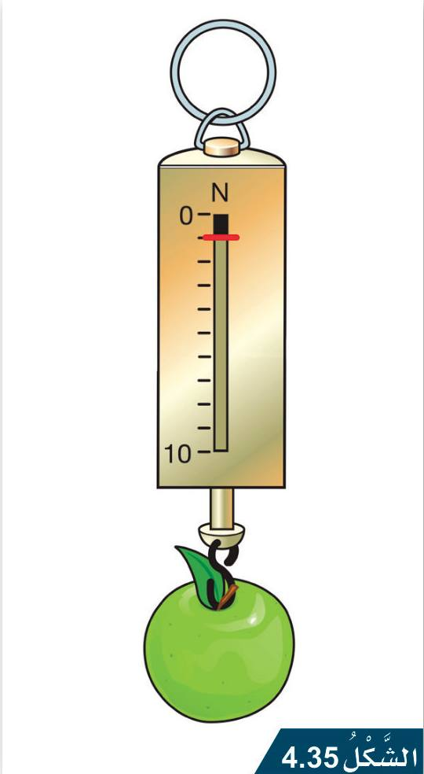
   - أ) مقياس كتلة لقياس الكتلة بوحدة نيوتن.
   - ب) مقياس كتلة لقياس الكتلة بوحدة الكيلوجرام.
   - ج) مقياس قوة لقياس الوزن بوحدة نيوتن.
   - د) مقياس قوة لقياس الوزن بوحدة الكيلوجرام.
2. كتلة أحد الطلاب تساوي 22 kg. كم يساوي وزنه؟
   - أ) 2.2 N
   - ب) 22 N
   - ج) 220 kg
   - د) 220 N
3. اشترت طالبة علبة عنب كتلتها 500 g. أيّ شكل من الأشكال الآتية يظهر وزن علبة العنب؟
   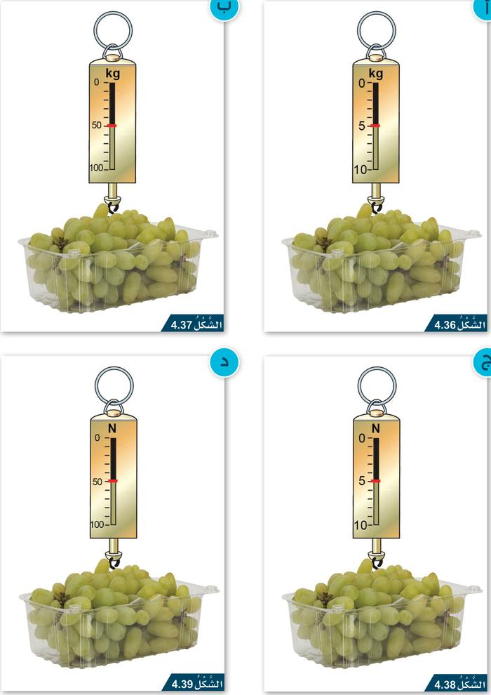
   - أ) الشكل 4.36
   - ب) الشكل 4.37
   - ج) الشكل 4.38
   - د) الشكل 4.39

#### أولًا: اختر الإجابة الصحيحة (أسئلة محوّلة)

1. ما الجهاز الذي يُستعمل لقياس الوزن (القوّة)؟
   - أ) الترمومتر
   - ب) الميزان ذو الكفّتين
   - ج) المسطرة
   - د) الميزان الزنبركيّ (النيوتنميتر)
2. بأيّ وحدةٍ يُقاس الوزن؟
   - أ) الكيلوجرام
   - ب) النيوتن
   - ج) اللتر
   - د) المتر
3. بأيّ وحدةٍ تُقاس الكتلة؟
   - أ) الكيلوجرام
   - ب) النيوتن
   - ج) الأمبير
   - د) الثانية
4. ما الفرق بين الكتلة والوزن؟
   - أ) الوزن مقدار المادّة والكتلة قوّة
   - ب) هما الشيء نفسه
   - ج) الكتلة مقدار المادّة والوزن قوّة الجاذبيّة المؤثّرة
   - د) لا علاقة بينهما
5. كتلة طالبٍ 22 kg. كم يساوي وزنه تقريبًا عند اعتماد أنّ كلّ 1 kg يزن 10 N؟
   - أ) 220 N
   - ب) 22 N
   - ج) 2.2 N
   - د) 2 200 N
6. أيّ الميزانين يقيس الكتلة؟
   - أ) الميزان ذو الكفّتين
   - ب) الميزان الزنبركيّ فقط
   - ج) الترمومتر
   - د) المسطرة
7. اشترت طالبةٌ علبة عنبٍ كتلتها 500 g. ما وزنها تقريبًا؟
   - أ) 50 N
   - ب) 5 N
   - ج) 0.5 N
   - د) 500 N
8. ماذا يحدث لكتلة جسمٍ إذا نُقل من الأرض إلى القمر؟
   - أ) تصبح صفرًا
   - ب) تزداد
   - ج) تقلّ كثيرًا
   - د) لا تتغيّر
9. ماذا يحدث لوزن جسمٍ إذا نُقل من الأرض إلى القمر؟
   - أ) لا يتغيّر
   - ب) يزداد
   - ج) يقلّ
   - د) يصبح أكبر دائمًا
10. أيّ العبارات الآتية صحيحة؟
   - أ) الكتلة تقاس بالنيوتن
   - ب) الوزن مقدار المادّة
   - ج) الكتلة قوّة
   - د) الوزن قوّة ويعتمد على الجاذبيّة
11. جسمٌ كتلته 5 kg. كم وزنه تقريبًا؟
   - أ) 5 N
   - ب) 50 N
   - ج) 0.5 N
   - د) 500 N
12. جسمٌ وزنه 80 N. ما كتلته تقريبًا؟
   - أ) 8 kg
   - ب) 80 kg
   - ج) 0.8 kg
   - د) 800 kg
13. أيّ القياسات الآتية تمثّل وزنًا؟
   - أ) 30 L
   - ب) 30 kg
   - ج) 30 g
   - د) 30 N
14. أيّ القياسات الآتية تمثّل كتلةً؟
   - أ) 12 kg
   - ب) 12 N
   - ج) 12 s
   - د) 12 m/s
15. لماذا يختلف وزن الإنسان على القمر عنه على الأرض؟
   - أ) لأنّ الهواء يختلف فقط
   - ب) لأنّ كتلته تتغيّر
   - ج) لأنّ جاذبيّة القمر أضعف
   - د) لأنّ الشمس بعيدة
16. أيّ الأدوات تقيس 'كمّية المادّة' في جسم؟
   - أ) الترمومتر
   - ب) الميزان الزنبركيّ
   - ج) الأميتر
   - د) الميزان ذو الكفّتين
17. ما الذي يتغيّر مع المكان: الكتلة أم الوزن؟
   - أ) الكتلة
   - ب) الوزن
   - ج) كلاهما
   - د) لا شيء
18. طالبٌ كتلته 40 kg. كم وزنه تقريبًا؟
   - أ) 400 N
   - ب) 40 N
   - ج) 4 N
   - د) 4 000 N

### الدرس 4.4: كيف تختلف قوة الجاذبية باختلاف الكواكب؟

#### أولًا: اختر الإجابة الصحيحة

1. على أيّ كوكبين من الكواكب الآتية تتساوى تقريبًا قوة الجاذبية؟
   - أ) الأرض والمريخ
   - ب) المشتري وزحل
   - ج) المريخ وعطارد
   - د) نبتون وأورانوس
2. على أيّ كوكب سيسقط الجسم بأعلى سرعة؟
   - أ) المريخ
   - ب) عطارد
   - ج) المشتري
   - د) نبتون
3. وزن رائد الفضاء يساوي 700 N على الأرض. أين سيساوي وزن هذا الرائد تقريبًا 1680 N؟
   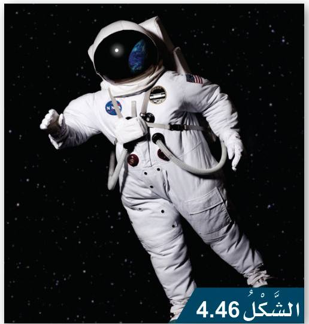
   - أ) المريخ
   - ب) عطارد
   - ج) المشتري
   - د) زحل
4. وزن رائد الفضاء يساوي 700 N على الأرض. أيّ شكل من الأشكال الآتية يبيّن وزنه على كوكب نبتون؟
   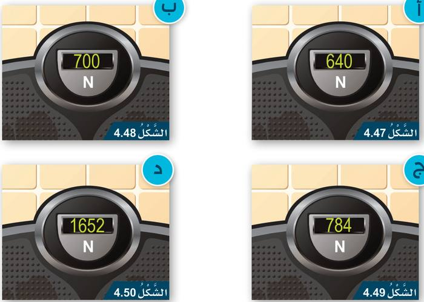
   - أ) الشكل 4.47 (640 N)
   - ب) الشكل 4.48 (700 N)
   - ج) الشكل 4.49 (784 N)
   - د) الشكل 4.50 (1652 N)

#### رابعًا: أجب عن الأسئلة الآتية (مسائل وتفكير)

5. النقاط الممثلة على المخطط تظهر وزن جسم كتلته 1 kg على الكواكب الستة الأكثر قربًا من الشمس. أرسم دائرة حول النقطة التي تمثل كوكب الأرض. ما الكوكب الذي يمثله الحرف (A)؟
   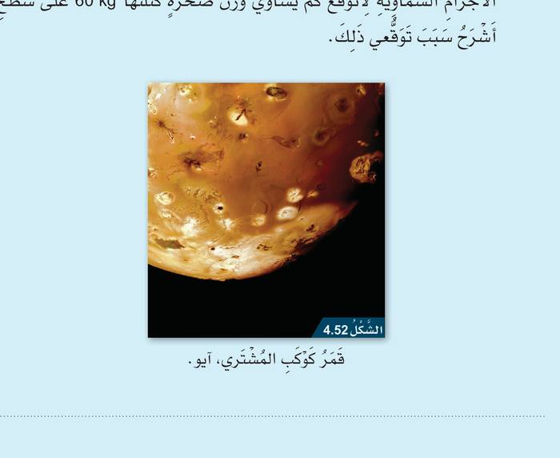

#### أولًا: اختر الإجابة الصحيحة (أسئلة محوّلة)

1. أيّ الكواكب الآتية جاذبيّته أكبر؟
   - أ) المشتري
   - ب) عطارد
   - ج) المريخ
   - د) الأرض
2. ما الذي تعتمد عليه قوّة الجاذبيّة على سطح كوكبٍ؟
   - أ) عدد أقماره فقط
   - ب) لونه
   - ج) كتلة الكوكب
   - د) بُعده عن النجوم البعيدة فقط
3. على أيّ كوكبٍ يسقط الجسم بأكبر سرعة؟
   - أ) عطارد
   - ب) المريخ
   - ج) المشتري
   - د) القمر
4. وزن رائد فضاءٍ 700 N على الأرض. على أيّ كوكبٍ يكون وزنه نحو 1 680 N؟
   - أ) عطارد
   - ب) المريخ
   - ج) المشتري
   - د) القمر
5. ماذا يحدث لكتلة رائد الفضاء عند انتقاله من الأرض إلى المريخ؟
   - أ) تقلّ
   - ب) تزداد
   - ج) لا تتغيّر
   - د) تصبح صفرًا
6. ماذا يحدث لوزن رائد الفضاء عند انتقاله من الأرض إلى المريخ؟
   - أ) يقلّ
   - ب) يزداد
   - ج) لا يتغيّر
   - د) يصبح صفرًا
7. أيّ الكواكب الآتية جاذبيّته أقلّ من جاذبيّة الأرض؟
   - أ) زحل
   - ب) المشتري
   - ج) عطارد
   - د) نبتون
8. أيّ الكواكب جاذبيّته تقارب جاذبيّة الأرض؟
   - أ) المريخ
   - ب) المشتري
   - ج) عطارد
   - د) الزهرة
9. جسمٌ كتلته 1 kg، أين يكون وزنه أكبر؟
   - أ) على القمر
   - ب) على المشتري
   - ج) على المريخ
   - د) على عطارد
10. جسمٌ كتلته 1 kg، أين يكون وزنه أقلّ بين الأماكن الآتية؟
   - أ) على الأرض
   - ب) على القمر
   - ج) على المشتري
   - د) على زحل
11. لماذا يستطيع روّاد الفضاء القفز عاليًا على القمر؟
   - أ) لأنّهم أخفّ كتلةً
   - ب) لأنّ كتلتهم تقلّ
   - ج) لأنّ الهواء يرفعهم
   - د) لأنّ جاذبيّة القمر أضعف
12. أيّ العبارات الآتية صحيحة؟
   - أ) الكتلة والوزن متساويان دائمًا
   - ب) وزن الجسم لا يتغيّر أبدًا
   - ج) كتلة الجسم تتغيّر من كوكب إلى آخر
   - د) وزن الجسم يتغيّر من كوكب إلى آخر
13. وزن جسمٍ على الأرض 100 N. على كوكبٍ جاذبيّته ضعف جاذبيّة الأرض، كم يكون وزنه؟
   - أ) 50 N
   - ب) 200 N
   - ج) 100 N
   - د) 10 N
14. وزن جسمٍ على الأرض 100 N. على كوكبٍ جاذبيّته نصف جاذبيّة الأرض، كم يكون وزنه؟
   - أ) 25 N
   - ب) 200 N
   - ج) 100 N
   - د) 50 N
15. أيّ العبارات الآتية عن جاذبيّة الكواكب صحيحة؟
   - أ) كلّما زادت كتلة الكوكب زادت جاذبيّته عادةً
   - ب) كلّما زادت كتلة الكوكب قلّت جاذبيّته
   - ج) الجاذبيّة واحدة على جميع الكواكب
   - د) الجاذبيّة تعتمد على لون الكوكب
16. ما الذي يتحكّم في قوّة الجاذبيّة على سطح كوكب؟
   - أ) كتلته وحجمه
   - ب) درجة حرارته فقط
   - ج) لونه
   - د) اسمه

### الدرس 4.5: كيف نستطيع تمثيل القوى المؤثرة في الأجسام الساكنة والمتحركة؟

#### أولًا: اختر الإجابة الصحيحة

1. يظهر الشكل 4.60 رافعة ترفع حملًا وزنه 10000 N. ما مقدار قوة الرفع في الحبل؟
   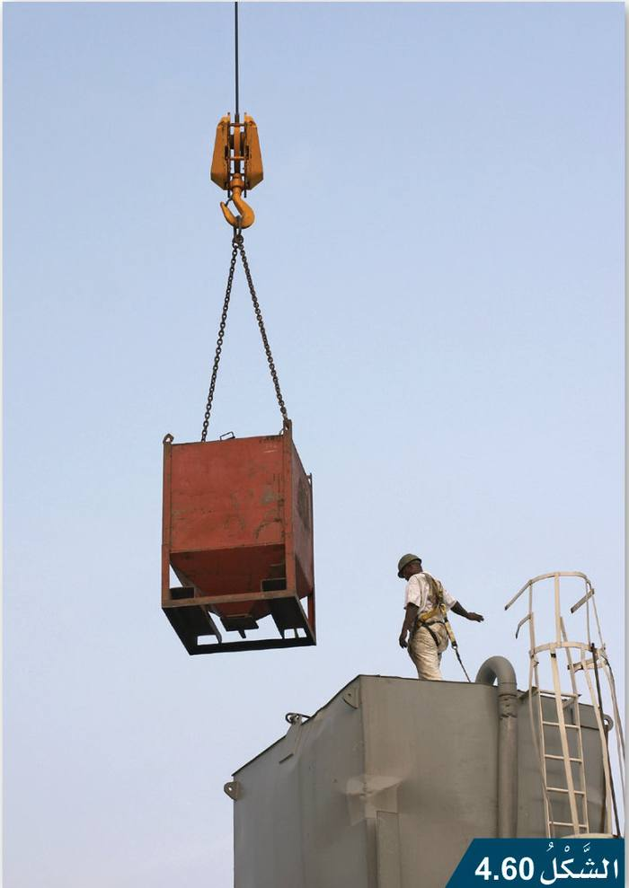
   - أ) 10000 N إلى الأسفل
   - ب) 10000 N إلى الأعلى
   - ج) 10000 kg إلى الأسفل
   - د) 10000 kg إلى الأعلى
2. تم إفلات عبوة بلاستيكية مفرغة من الماء تحت الماء. أيّ مخطط من المخططات الآتية يمثل اتجاه ومقدار القوى المؤثرة في العبوة البلاستيكية؟
   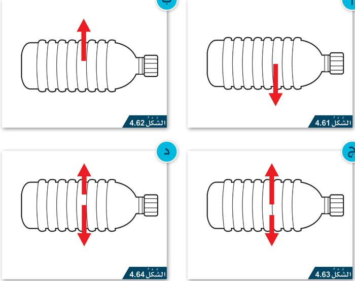
   - أ) الشكل 4.61
   - ب) الشكل 4.62
   - ج) الشكل 4.63
   - د) الشكل 4.64
3. يظهر الشكل 4.65 القوة المؤثرة في الجسم المبيّن. في أيّ اتجاه يتحرك هذا الجسم؟
   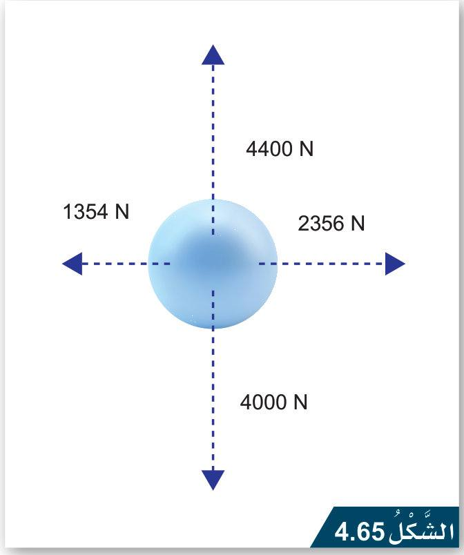
   - أ) إلى الأسفل وإلى اليسار.
   - ب) إلى الأسفل وإلى اليمين.
   - ج) إلى الأعلى وإلى اليسار.
   - د) إلى الأعلى وإلى اليمين.

#### أولًا: اختر الإجابة الصحيحة (أسئلة محوّلة)

1. ما القوّتان المتزنتان؟
   - أ) لا قوّة
   - ب) قوّتان بالاتّجاه نفسه
   - ج) قوّتان مختلفتان جدًّا
   - د) قوّتان متساويتان في المقدار ومتعاكستان في الاتّجاه
2. ماذا يحدث لجسمٍ ساكنٍ إذا كانت القوى المؤثّرة فيه متزنة؟
   - أ) يتحرّك بسرعة
   - ب) يبقى ساكنًا
   - ج) يتسارع
   - د) يدور
3. ماذا يحدث لجسمٍ إذا كانت القوى المؤثّرة فيه غير متزنة؟
   - أ) يتوقّف دائمًا
   - ب) يبقى كما هو دائمًا
   - ج) تتغيّر حركته
   - د) يصبح أثقل
4. رافعةٌ ترفع حملًا وزنه 10 000 N وهو ساكن. ما مقدار قوّة الرفع في الحبل؟
   - أ) 0 N
   - ب) 5 000 N
   - ج) 10 000 N
   - د) 20 000 N
5. كتابٌ ساكنٌ على طاولة. ما القوّة التي توازن وزنه؟
   - أ) الاحتكاك
   - ب) قوّة الدفع إلى الأعلى من الطاولة
   - ج) مقاومة الهواء
   - د) القوّة المغناطيسيّة
6. ما الذي يمثّله السهم في مخطّط القوى؟
   - أ) الكتلة
   - ب) درجة الحرارة
   - ج) الزمن
   - د) اتّجاه القوّة ومقدارها
7. كيف يرمز طول السهم في مخطّط القوى؟
   - أ) إلى المسافة
   - ب) إلى لون الجسم
   - ج) إلى سرعة الضوء
   - د) إلى مقدار القوّة
8. سيّارةٌ تسير بسرعةٍ ثابتة على طريقٍ مستقيم. ماذا نقول عن القوى المؤثّرة فيها؟
   - أ) غير متزنة دائمًا
   - ب) متزنة
   - ج) منعدمة
   - د) لا يمكن تحديدها
9. دُفع صندوقٌ بقوّة 50 N والاحتكاك 20 N عكس الحركة. ما القوّة المحصّلة؟
   - أ) 30 N في اتّجاه الدفع
   - ب) 70 N
   - ج) 20 N
   - د) 0 N
10. دُفع صندوقٌ بقوّة 20 N والاحتكاك 20 N عكس الحركة. ماذا يحدث له؟
   - أ) يتسارع
   - ب) يتحرّك بسرعةٍ ثابتة أو يبقى ساكنًا
   - ج) يتباطأ فورًا
   - د) يتوقّف دائمًا
11. عبوةٌ بلاستيكيّة فارغةٌ أُفلتت تحت الماء. ما القوّة التي تدفعها إلى الأعلى؟
   - أ) قوّة الطفو (الدفع إلى الأعلى)
   - ب) الاحتكاك
   - ج) الجاذبيّة فقط
   - د) الكهرباء الساكنة
12. ماذا يحدث لجسمٍ يتحرّك إذا أثّرت فيه قوّةٌ محصّلةٌ في اتّجاه حركته؟
   - أ) لا يتغيّر
   - ب) يتباطأ
   - ج) يتوقّف
   - د) يتسارع
13. ماذا يحدث لجسمٍ يتحرّك إذا أثّرت فيه قوّةٌ محصّلةٌ عكس اتّجاه حركته؟
   - أ) يتحرّك للأمام فقط
   - ب) يتسارع
   - ج) يبقى كما هو
   - د) يتباطأ
14. أيّ جسمٍ يتحرّك بسرعةٍ ثابتة؟
   - أ) قاربٌ تتساوى فيه قوّة الدفع ومقاومة الماء
   - ب) سيّارة تضغط بقوّة على المكابح
   - ج) صاروخ ينطلق
   - د) كرة تسقط دون هواء
15. ما القوّتان المؤثّرتان في كرةٍ ساكنة على الأرض؟
   - أ) المغناطيسيّة والكهربائيّة
   - ب) الاحتكاك والرياح
   - ج) الوزن والدفع إلى الأعلى
   - د) لا قوّة
16. أيّ العبارات الآتية صحيحة؟
   - أ) القوى المتزنة تدور الجسم
   - ب) القوى المتزنة تُسرّع الجسم
   - ج) القوى المتزنة تبطئ الجسم
   - د) القوى المتزنة لا تغيّر حركة الجسم
17. سهمان متساويان متعاكسان يؤثّران في جسم. ماذا نقول عن الجسم؟
   - أ) قوّته المحصّلة صفر
   - ب) قوّته المحصّلة كبيرة
   - ج) يتسارع
   - د) يتباطأ
18. أُفلتت عبوة بلاستيكية مفرغة من الماء تحت سطح الماء فارتفعت نحو السطح. كيف تكون القوّتان المؤثّرتان فيها (دفع الماء إلى الأعلى ووزنها إلى الأسفل)؟
   - أ) قوة دفع الماء إلى الأعلى أكبر من وزنها
   - ب) القوّتان متساويتان
   - ج) وزنها أكبر من قوة الدفع
   - د) لا توجد أيّ قوّة تؤثّر فيها

### الدرس 4.6: كيف يمكننا قياس السرعة والتسارع؟

#### أولًا: اختر الإجابة الصحيحة

1. قطع شخص مسافة 150 km من منطقة أبو سمرة إلى منطقة الخور في السيارة خلال ساعة ونصف من الزمن. كم تساوي الفترة الزمنية التي ستستغرقها ليقطع مسافة 75 km من الدوحة إلى منطقة زكريت في السيارة في حال قطع المسافتين بالسرعة نفسها؟
   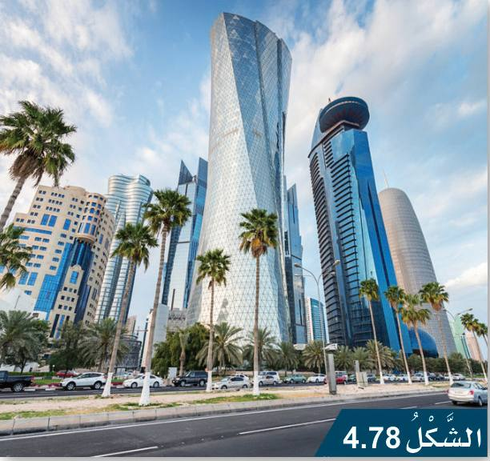
   - أ) 1/2 ساعة
   - ب) 3/4 ساعة
   - ج) ساعتان
   - د) ثلاث ساعات
2. ركض الطالب (أ) مسافة 100 m خلال فترة زمنية مقدارها 16 s. ركض الطالب (ب) مسافة 50 m خلال فترة زمنية مقدارها 6 s. ركض الطالب (ج) مسافة 25 m خلال فترة زمنية مقدارها 4 s. ركض الطالب (د) مسافة 200 m خلال فترة زمنية مقدارها 30 s. من الطالب الأسرع؟
   - أ) الطالب (أ)
   - ب) الطالب (ب)
   - ج) الطالب (ج)
   - د) الطالب (د)
3. يمكن للضبع المرقط أن يركض بسرعة 15 m/s. كم تساوي الفترة الزمنية التي سيستغرقها ليركض مسافة 300 m؟
   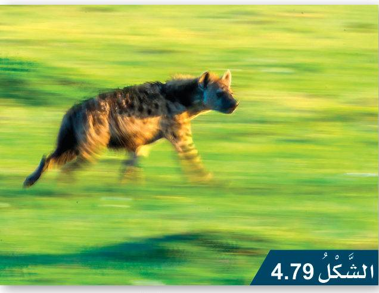
   - أ) 15 s
   - ب) 20 s
   - ج) 300 s
   - د) 450 s
4. يدور قمر صناعي حول الأرض بسرعة 11 300 km/h. كم تساوي المسافة التي يقطعها خلال اليوم الواحد؟
   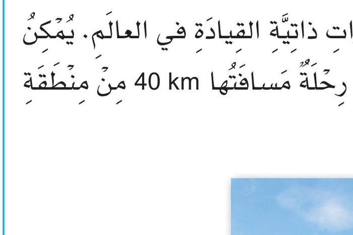
   - أ) 471 km
   - ب) 942 km
   - ج) 135 600 km
   - د) 271 200 km

#### رابعًا: أجب عن الأسئلة الآتية (مسائل وتفكير)

5. يتم الضغط على المكابح في كلتا سيارتي سباق الرالي. أشرح كيف يبين الشكل 4.82 أن السيارة تتباطأ بمقدار أكبر من السيارة المبينة في الشكل 4.81.
   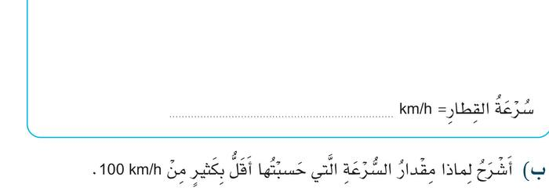

#### أولًا: اختر الإجابة الصحيحة (أسئلة محوّلة)

1. ما قانون السرعة؟
   - أ) السرعة = الزمن ÷ المسافة
   - ب) السرعة = المسافة × الزمن
   - ج) السرعة = المسافة ÷ الزمن
   - د) السرعة = الزمن − المسافة
2. قطع شخصٌ 150 km في ساعةٍ ونصف. ما سرعته المتوسّطة؟
   - أ) 75 km/h
   - ب) 150 km/h
   - ج) 225 km/h
   - د) 100 km/h
3. ركض طالبٌ 100 m في 16 s. ما سرعته؟
   - أ) 16 m/s
   - ب) 1.6 m/s
   - ج) 6.25 m/s
   - د) 10 m/s
4. يركض ضبعٌ بسرعة 15 m/s. كم ثانيةً يستغرق ليركض 150 m؟
   - أ) 0.1 s
   - ب) 2 250 s
   - ج) 10 s
   - د) 15 s
5. يدور قمرٌ صناعيٌّ بسرعة 11 300 km/h. كم يقطع في ساعتين؟
   - أ) 33 900 km
   - ب) 5 650 km
   - ج) 11 300 km
   - د) 22 600 km
6. ما التسارع؟
   - أ) المسافة المقطوعة
   - ب) مقدار تغيّر السرعة في وحدة الزمن
   - ج) الزمن المستغرق
   - د) الكتلة
7. سيّارةٌ زادت سرعتها من 0 إلى 20 m/s خلال 5 s. ما تسارعها؟
   - أ) 100 m/s²
   - ب) 4 m/s²
   - ج) 25 m/s²
   - د) 0.25 m/s²
8. سيّارةٌ تسير بسرعةٍ ثابتة. ما تسارعها؟
   - أ) صفر
   - ب) كبير
   - ج) سالب دائمًا
   - د) لا يمكن معرفته
9. ما وحدة قياس السرعة؟
   - أ) kg
   - ب) N
   - ج) m/s
   - د) L
10. قطع درّاجٌ 60 km في ساعتين. كم سرعته؟
   - أ) 62 km/h
   - ب) 120 km/h
   - ج) 30 km/h
   - د) 58 km/h
11. سرعةٌ 20 m/s. كم متر يُقطع في 10 ثوانٍ؟
   - أ) 0.5 m
   - ب) 2 m
   - ج) 30 m
   - د) 200 m
12. طالبٌ قطع 50 m في 10 s، وآخر قطع 100 m في 25 s. من الأسرع؟
   - أ) الثاني
   - ب) الأوّل (5 m/s مقابل 4 m/s)
   - ج) متساويان
   - د) لا يمكن المعرفة
13. أيّ الأجهزة تقيس الزمن اللازم لقطع مسافة؟
   - أ) ساعة الإيقاف
   - ب) الأميتر
   - ج) الميزان
   - د) الترمومتر
14. ماذا يحدث للسيّارة عند الضغط على المكابح؟
   - أ) تنقلب
   - ب) تتسارع
   - ج) تبقى بالسرعة نفسها
   - د) تتباطأ (تسارع سالب)
15. أيّ العبارات الآتية صحيحة؟
   - أ) السرعة لا تعتمد على المسافة
   - ب) السرعة تساوي الزمن مقسومًا على المسافة
   - ج) السرعة تساوي المسافة مضروبة في الزمن
   - د) السرعة تساوي المسافة مقسومة على الزمن
16. سيّارةٌ زادت سرعتها من 10 m/s إلى 30 m/s خلال 4 s. ما تسارعها؟
   - أ) 7.5 m/s²
   - ب) 20 m/s²
   - ج) 80 m/s²
   - د) 5 m/s²
17. قطارٌ يسير بسرعة 80 km/h. كم يقطع في 3 ساعات؟
   - أ) 77 km
   - ب) 83 km
   - ج) 27 km
   - د) 240 km

## الوحدة 5: النمو والتطور في النباتات

### الدرس 5.1: ما أجزاء الزهرة؟

#### أولًا: اختر الإجابة الصحيحة

1. ما أعضاء التكاثر في الأزهار؟
   - أ) العضو الذكري فقط.
   - ب) العضو الأنثوي فقط.
   - ج) العضوان الذكري والأنثوي.
   - د) لا توجد أعضاء ذكرية وأنثوية.
2. ما مجموعة الأجزاء الأنثوية في الزهرة؟
   - أ) البتلات
   - ب) الكربلة
   - ج) السداة
   - د) السبلة
3. ما الصورة التي تظهر العضو الذكري في الزهرة؟
   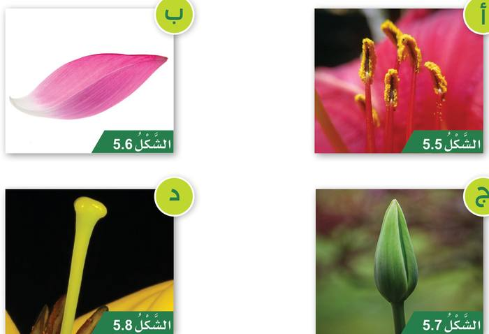
   - أ) الصورة أ
   - ب) الصورة ب
   - ج) الصورة ج
   - د) الصورة د
4. لمَ لبعض الأزهار بتلات ملونة؟
   - أ) لحماية الساق.
   - ب) لصنع بذور جديدة.
   - ج) لصنع حبوب اللقاح.
   - د) لجذب الملقحات.

#### رابعًا: أجب عن الأسئلة الآتية (مسائل وتفكير)

5. أملأ الفراغات بأسماء أجزاء الزهرة في المخطط.
   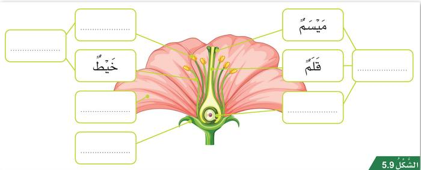

#### أولًا: اختر الإجابة الصحيحة (أسئلة محوّلة)

1. بحسب ما تعلّمتَ، ما أعضاء التكاثر في الأزهار؟
   - أ) السبلات فقط
   - ب) البتلات فقط
   - ج) العضو الذكريّ والعضو الأنثويّ
   - د) الجذور
2. من بين الخيارات الآتية، ما مجموعة الأجزاء الأنثويّة في الزهرة؟
   - أ) السبلة
   - ب) السداة
   - ج) البتلة
   - د) الكربلة (المدقّة)
3. ما مجموعة الأجزاء الذكريّة في الزهرة؟
   - أ) السداة
   - ب) الكربلة
   - ج) السبلة
   - د) المبيض
4. اختر الإجابة الصحيحة: لمَ لبعض الأزهار بتلاتٌ ملوّنة؟
   - أ) لتخزين الماء فقط
   - ب) لحماية الجذور
   - ج) لصنع الجذور
   - د) لجذب الملقِّحات
5. ما وظيفة السبلات؟
   - أ) إنتاج حبوب اللقاح
   - ب) حماية برعم الزهرة
   - ج) إنتاج البذور
   - د) امتصاص الماء
6. ما وظيفة المتك (جزء من السداة)؟
   - أ) امتصاص الماء
   - ب) إنتاج البويضات
   - ج) جذب الحشرات فقط
   - د) إنتاج حبوب اللقاح
7. ما وظيفة المبيض في الزهرة؟
   - أ) احتواء البويضات
   - ب) إنتاج حبوب اللقاح
   - ج) حماية البرعم
   - د) امتصاص الماء
8. إلى ماذا تتحوّل البويضات المخصَّبة؟
   - أ) بذور
   - ب) جذور
   - ج) أوراق
   - د) بتلات
9. إلى ماذا يتحوّل المبيض بعد الإخصاب غالبًا؟
   - أ) ورقة
   - ب) جذر
   - ج) ساق
   - د) ثمرة
10. ما وظيفة الميسم؟
   - أ) إنتاج البذور
   - ب) استقبال حبوب اللقاح
   - ج) حماية الجذر
   - د) جذب الضوء
11. أيّ أجزاء الزهرة تجذب الحشرات برائحتها ورحيقها؟
   - أ) البتلات
   - ب) الجذور
   - ج) السبلات فقط
   - د) الساق
12. أيّ الأجزاء الآتية من الجزء الذكريّ للزهرة؟
   - أ) البتلة والسبلة
   - ب) الميسم والمبيض
   - ج) المتك والخيط
   - د) الجذر والساق
13. أيّ الأجزاء الآتية من الجزء الأنثويّ للزهرة؟
   - أ) البتلة والسبلة
   - ب) المتك والخيط
   - ج) الميسم والقلم والمبيض
   - د) الجذر والساق
14. ما الاسم العلميّ لحبوب اللقاح؟
   - أ) بذور
   - ب) الأمشاج الذكريّة للنبات
   - ج) أوراق
   - د) ثمار
15. أيّ العبارات الآتية صحيحة؟
   - أ) ليس للزهرة أعضاء تكاثر
   - ب) للزهرة عضو أنثويّ فقط
   - ج) للزهرة عضو ذكريّ فقط
   - د) للزهرة أعضاء ذكريّة وأنثويّة
16. ما الذي يحدث لحبوب اللقاح عند وصولها إلى الميسم؟
   - أ) قد تؤدّي إلى الإخصاب
   - ب) تتحوّل إلى جذر
   - ج) تتبخّر
   - د) تتحوّل إلى ماء

### الدرس 5.2: ما المراحل المختلفة في دورة حياة النباتات الزهرية؟

#### أولًا: اختر الإجابة الصحيحة

1. ما المرحلة الأولى من دورة حياة النبات الزهري؟
   - أ) النمو
   - ب) التكاثر
   - ج) الإنبات
   - د) التطور
2. أيّ من هذه العبارات تصف عملية التلقيح؟
   - أ) يتم انتقال حبوب اللقاح من المتك في الزهرة إلى الميسم فيها بحيث يمكن أن تنمو بذور جديدة.
   - ب) تنمو حبوب اللقاح داخل الزهرة.
   - ج) تنتشر البذور بحيث تنمو نباتات جديدة.
   - د) تبدأ الجذور والساق والأوراق الأولى بالنمو.
3. أيّ صورة تظهر انتشار البذور بواسطة الهواء؟
   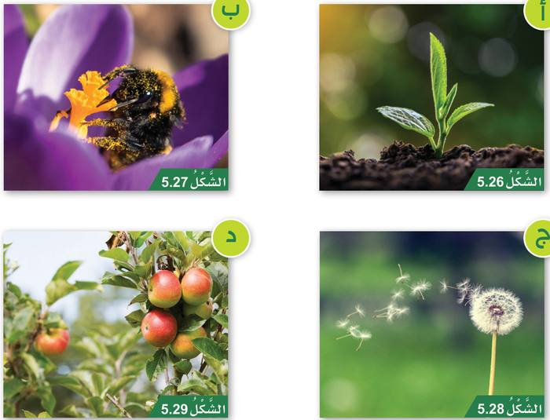
   - أ) الصورة أ
   - ب) الصورة ب
   - ج) الصورة ج
   - د) الصورة د

#### أولًا: اختر الإجابة الصحيحة (أسئلة محوّلة)

1. بحسب ما تعلّمتَ، ما المرحلة الأولى من دورة حياة النبات الزهريّ؟
   - أ) تكوّن الثمرة
   - ب) إنبات البذرة
   - ج) التلقيح
   - د) نموّ الأزهار
2. أيّ هذه العبارات تصف عمليّة التلقيح؟
   - أ) سقوط الثمرة
   - ب) انتقال الماء إلى الجذر
   - ج) انتقال حبوب اللقاح من المتك إلى الميسم
   - د) نموّ البذرة
3. ما الإنبات؟
   - أ) انتشار البذور
   - ب) تحوّل الزهرة إلى ثمرة
   - ج) بدء نموّ البذرة لتصبح نبتة
   - د) التلقيح
4. ما الذي تحتاج إليه البذرة لتنبت؟
   - أ) الضوء القويّ فقط
   - ب) الماء والدفء والهواء
   - ج) الملح فقط
   - د) السماد فقط
5. ما الترتيب الصحيح لمراحل دورة حياة النبات الزهريّ؟
   - أ) نموّ ثمّ بذور ثمّ إنبات
   - ب) بذور ثمّ إزهار ثمّ إنبات
   - ج) تلقيح ثمّ إنبات ثمّ بذور
   - د) إنبات ثمّ نموّ ثمّ إزهار ثمّ تلقيح ثمّ بذور
6. ما الإخصاب في النباتات؟
   - أ) سقوط البتلات
   - ب) انتقال اللقاح فقط
   - ج) نموّ الجذر
   - د) اتّحاد خليّة ذكريّة مع بويضة
7. ماذا ينتج عن الإخصاب؟
   - أ) حرارة
   - ب) ماء
   - ج) ضوء
   - د) بذور داخل ثمرة
8. ما الانتشار؟
   - أ) إنبات البذور
   - ب) جمع البذور
   - ج) هضم البذور
   - د) ابتعاد البذور عن النبتة الأمّ
9. لماذا ينبغي أن تبتعد البذور عن النبتة الأمّ؟
   - أ) لتتجنّب الماء
   - ب) لتصبح أخفّ
   - ج) لتغيّر لونها
   - د) لتجد مكانًا ومساحةً وضوءًا وماءً أكثر
10. أيّ البذور الآتية تنتشر بالهواء؟
   - أ) ثمرة الجوز الثقيلة
   - ب) بذور الهندباء الخفيفة المظلّيّة
   - ج) ثمار الشوك اللاصقة
   - د) ثمرة جوز الهند في الماء
11. أيّ المراحل تحدث قبل تكوّن البذور؟
   - أ) الانتشار
   - ب) التلقيح والإخصاب
   - ج) الإنبات
   - د) السقوط
12. أيّ العبارات الآتية خاطئة؟
   - أ) البذرة تحتاج إلى ماء لتنبت
   - ب) الإنبات يحدث بعد تكوّن الأزهار مباشرةً
   - ج) التلقيح يسبق الإخصاب
   - د) الانتشار يبعد البذور
13. ما الذي تصبح عليه البذرة بعد إنباتها؟
   - أ) جذع شجرة مباشرةً
   - ب) ثمرة
   - ج) زهرة
   - د) نبتة صغيرة (شتلة)
14. من أين يحصل الجنين النباتيّ على غذائه عند الإنبات؟
   - أ) من مخزون الغذاء في البذرة
   - ب) من القمر
   - ج) من الهواء فقط
   - د) من الحشرات
15. أيّ المراحل تتبع تكوّن البذور في دورة حياة النبات؟
   - أ) تكوّن البتلات
   - ب) التلقيح
   - ج) الإخصاب
   - د) انتشار البذور ثمّ إنباتها
16. أيّ المراحل في دورة حياة النبات تُجدّد الدورة؟
   - أ) موت الجذور
   - ب) سقوط الأوراق
   - ج) إنبات بذرة جديدة
   - د) غروب الشمس
17. ما اسم المرحلة التي تنمو فيها البذرة لتصبح نبتة صغيرة؟
   - أ) تكوّن الثمرة
   - ب) التلقيح
   - ج) الإنبات
   - د) انتشار البذور

### الدرس 5.3: كيف تساعد الرياح أو الحيوانات على التلقيح؟

#### أولًا: اختر الإجابة الصحيحة

1. لماذا تحتاج النباتات الزهرية إلى التلقيح؟
   - أ) لمساعدتها على النمو.
   - ب) لتتمكن من التكاثر.
   - ج) لمساعدة الحيوانات.
   - د) لتكون لديها جذور قوية.
2. أيّ مما يأتي ليست من خصائص الأزهار الملقحة بواسطة الرياح؟
   - أ) ليس لديها بتلات.
   - ب) تنتج الكثير من حبوب اللقاح.
   - ج) ذات ألوان زاهية.
   - د) السداة مكشوفة.
3. ما العبارة التي تصف عملية التلقيح بواسطة الحيوانات؟
   - أ) تأكل الحيوانات حبوب اللقاح من الأزهار وتلتقط الرحيق على أجسامها.
   - ب) تمتص الحيوانات حبوب اللقاح والرحيق من الأزهار.
   - ج) لا تمتص الحيوانات الرحيق أو حبوب اللقاح من الأزهار.
   - د) تمتص الحيوانات الرحيق من داخل الأزهار فتعلق حبوب اللقاح على أجسامها وتنقلها إلى زهرة أخرى.

#### رابعًا: أجب عن الأسئلة الآتية (مسائل وتفكير)

4. أذكر مثالين على الحيوانات الملقحات.
5. أضع علامة (✓) في المربع لإظهار ما إذا كانت العبارة تصف أزهارًا ملقحة بواسطة الرياح أو أزهارًا ملقحة بواسطة الحيوانات: يمكن أن تحتوي هذه الأزهار على ميسم ريشي للمساعدة على التقاط حبوب اللقاح. يمكن أن تكون هذه الأزهار كبيرة أو تنمو في مجموعات. يمكن أن تكون لهذه الأزهار روائح قوية.

#### أولًا: اختر الإجابة الصحيحة (أسئلة محوّلة)

1. من بين الخيارات الآتية، لماذا تحتاج النباتات الزهريّة إلى التلقيح؟
   - أ) لتنبت الجذور
   - ب) لتكوّن البذور والثمار
   - ج) لتمتصّ الماء
   - د) لتفقد الأوراق
2. أيّ مما يأتي ليس من خصائص الأزهار الملقَّحة بالرياح؟
   - أ) ميسم ريشيّ
   - ب) كمّيّة كبيرة من حبوب اللقاح
   - ج) بتلات كبيرة ملوّنة وعطرة
   - د) بتلات صغيرة غير لافتة
3. أيّ العبارات تصف التلقيح بواسطة الحيوانات؟
   - أ) لا يحدث تلقيح
   - ب) تنقل الرياح اللقاح فقط
   - ج) ينتقل اللقاح بالماء فقط
   - د) تنقل الحيوانات حبوب اللقاح من زهرة إلى أخرى
4. أيّ الحيوانات الآتية من الملقِّحات؟
   - أ) الذئاب
   - ب) الأسماك
   - ج) الإبل
   - د) النحل والفراشات
5. لماذا تجذب الأزهار الحشرات؟
   - أ) بالأشواك
   - ب) بالصوت العالي فقط
   - ج) بالحرارة فقط
   - د) بالألوان والرائحة والرحيق
6. ما الرحيق؟
   - أ) نوع من البذور
   - ب) حبوب اللقاح
   - ج) نوع من الجذور
   - د) سائلٌ حلو تنتجه الأزهار
7. أيّ الأزهار تنتج حبوب لقاحٍ خفيفة كثيرة؟
   - أ) الملقَّحة بالنحل
   - ب) الملقَّحة بالرياح
   - ج) الملقَّحة بالطيور فقط
   - د) الملقَّحة بالخفافيش فقط
8. لماذا يكون ميسم الأزهار الملقَّحة بالرياح ريشيًّا؟
   - أ) ليلتقط حبوب اللقاح من الهواء
   - ب) ليجذب النحل
   - ج) ليخزّن الماء
   - د) ليحمي البذور
9. ما الذي يلتصق بجسم النحلة عند زيارتها زهرة؟
   - أ) الجذور
   - ب) الماء
   - ج) الملح
   - د) حبوب اللقاح
10. أيّ الأزهار تحتاج إلى حشراتٍ لتلقيحها؟
   - أ) ذات البتلات الملوّنة والرائحة
   - ب) ذات البتلات الصغيرة الباهتة
   - ج) الأعشاب فقط
   - د) كلّ الأزهار دائمًا
11. أيّ العبارات الآتية صحيحة؟
   - أ) التلقيح هو سقوط الأوراق
   - ب) التلقيح هو انتشار البذور
   - ج) التلقيح هو نموّ الجذر
   - د) التلقيح هو نقل حبوب اللقاح إلى الميسم
12. أيّ النباتات الآتية يُلقَّح غالبًا بالرياح؟
   - أ) القمح
   - ب) الورد
   - ج) الياسمين
   - د) زهرة عبّاد الشمس الكبيرة
13. ماذا يحدث للثمار إذا لم يحدث تلقيح؟
   - أ) لا تتأثّر
   - ب) تتكوّن بسرعة
   - ج) تصبح أكبر
   - د) لا تتكوّن غالبًا
14. ما الحيوانات الأخرى التي قد تلقّح الأزهار غير الحشرات؟
   - أ) الأرانب فقط
   - ب) الأسماك
   - ج) الطيور والخفافيش
   - د) الأسود
15. أيّ الصفات تميّز الأزهار الملقَّحة بالحشرات؟
   - أ) لا بتلات
   - ب) بتلات باهتة وصغيرة
   - ج) لا رحيق
   - د) رائحة ورحيق وألوان زاهية
16. أيّ الأزهار قد تفقد بتلاتها بعد التلقيح؟
   - أ) لا شيء منها
   - ب) معظم الأزهار
   - ج) الأزهار الصناعيّة
   - د) الجذور
17. تنتقل حبوب اللقاح من زهرة إلى زهرة أخرى بواسطة الرياح أو الحشرات. ماذا تُسمّى هذه العملية؟
   - أ) التلقيح
   - ب) الإنبات
   - ج) انتشار البذور
   - د) التمثيل الضوئي

### الدرس 5.4: ما المدى الذي تصل إليه البذور بواسطة طرق الانتشار المختلفة؟

#### أولًا: اختر الإجابة الصحيحة

1. ما المقصود بـ"انتشار البذور"؟
   - أ) انتقال البذور بعيدًا عن النبات الأم.
   - ب) نمو البذور.
   - ج) كيفية إنتاج البذور.
   - د) التعلم عن البذور.
2. أيّ من هذه الطرق ليست طريقة انتشار البذور بواسطة الحيوانات؟
   - أ) حمل البذور على الفراء.
   - ب) التغذي على الثمار من الأشجار وإسقاطها على الأرض.
   - ج) إخراج البذور في الفضلات.
   - د) طفو البذور على سطح المياه.
3. أيّ من هذه الصور تظهر انتشار البذور بواسطة الرياح؟
   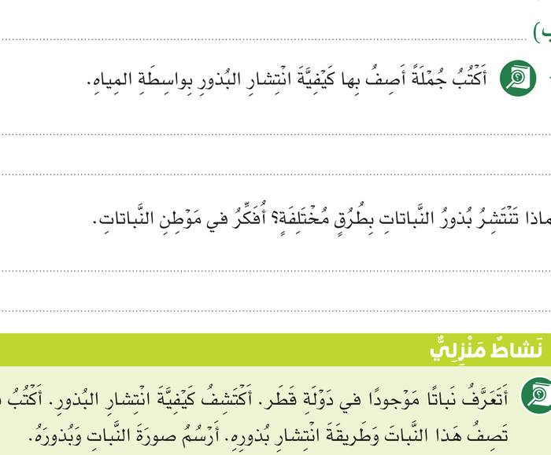
   - أ) الشكل 5.44
   - ب) الشكل 5.45
   - ج) الشكل 5.46
   - د) الشكل 5.47

#### أولًا: اختر الإجابة الصحيحة (أسئلة محوّلة)

1. ما المقصود بانتشار البذور؟
   - أ) انتقال البذور بعيدًا عن النبتة الأمّ
   - ب) جمع البذور في مكانٍ واحد
   - ج) هضم البذور
   - د) غرس البذور
2. أيّ هذه الطرق ليست طريقةً لانتشار البذور بواسطة الحيوانات؟
   - أ) دفن البذور
   - ب) التصاق البذور بالفراء
   - ج) أكل الثمار ونثر البذور بالفضلات
   - د) انفجار القرون
3. أيّ طرق الانتشار هذه تنقل البذور بالرياح؟
   - أ) بذور ثقيلة لها أشواك
   - ب) بذور خفيفة لها أجنحة أو مظلّات
   - ج) ثمار لحميّة ملوّنة
   - د) بذور تطفو على الماء
4. أيّ البذور تنتشر بالحيوانات عن طريق الالتصاق بالفراء؟
   - أ) بذور مفرطحة خفيفة
   - ب) بذور بأجنحة
   - ج) بذور تطفو
   - د) بذور ذات خطّاطيف أو أشواك
5. كيف تنتشر ثمار جوز الهند غالبًا؟
   - أ) بالماء
   - ب) بالرياح الخفيفة
   - ج) بالالتصاق بالفراء
   - د) بانفجار القرون
6. ما المقصود بالانتشار الميكانيكيّ؟
   - أ) حمل الماء للبذور
   - ب) التصاق البذور بالفراء
   - ج) حمل الرياح للبذور
   - د) انفجار الثمرة لقذف البذور
7. أيّ البذور تنتشر أبعد في الرياح العالية؟
   - أ) الثقيلة جدًّا
   - ب) الخفيفة ذات المظلّات
   - ج) المغطّاة بأشواك
   - د) اللحميّة الكبيرة
8. أيّ الحيوانات تساعد على نشر البذور بأكل الثمار؟
   - أ) الطيور
   - ب) الأسماك الكبيرة في المحيط
   - ج) الصخور
   - د) السحب
9. لماذا تكون ثمار بعض النباتات لذيذةً وملوّنة؟
   - أ) لتختبئ
   - ب) لتبعد الحيوانات
   - ج) لتجذب الحيوانات فتنشر بذورها
   - د) لتصبح صلبة
10. أيّ البذور الآتية تنتشر بالرياح؟
   - أ) بذور القيقب المجنّحة
   - ب) بذور جوز الهند
   - ج) بذور الشوك اللاصقة
   - د) بذور الفاصولياء المنفجرة
11. ما فائدة ابتعاد البذور عن النبتة الأمّ؟
   - أ) موت البذور
   - ب) زيادة الازدحام
   - ج) عدم الإنبات
   - د) قلّة التنافس على الماء والضوء
12. أيّ العبارات الآتية صحيحة؟
   - أ) البذور تنتشر بالحيوانات فقط
   - ب) البذور لا تنتشر
   - ج) البذور تنتشر بالرياح فقط
   - د) البذور قد تنتشر بالرياح أو الماء أو الحيوانات أو الانفجار
13. أيّ البذور تستطيع الطفو؟
   - أ) بذور صغيرة جدًّا بلا هواء
   - ب) بذور ثقيلة جدًّا
   - ج) بذور لها أشواك
   - د) بذور تحتوي هواءً أو ألياف عازلة
14. في تجربة نمذجة انتشار البذور بالرياح، ما المتغيّر المستقلّ؟
   - أ) لون المروحة
   - ب) المسافة التي تقطعها
   - ج) زمن الهبوط فقط
   - د) نوع تصميم البذرة
15. في تجربةٍ لنموذج بذرةٍ مجنّحةٍ تُرمى في الهواء لتنتشر، ما المتغيّر التابع؟
   - أ) نوع الورق
   - ب) شكل الجناح
   - ج) وزن النموذج
   - د) المسافة التي تنتشر إليها البذرة
16. أيّ الثمار تنتشر بالانفجار؟
   - أ) التفّاحة
   - ب) ثمرة جوز الهند
   - ج) ثمرة الهندباء
   - د) قرون البازلاء الجافّة
17. أيّ الجمل الآتية تصف انتشار البذور بالماء؟
   - أ) بذور تحملها الريح فقط
   - ب) بذور تلتصق بالفراء
   - ج) بذور تُقذَف بقوّة
   - د) بذور خفيفة أو لها غلاف طافٍ تنقلها التيّارات
18. أيّ هذه الطرق تتطلّب جسمًا حيًّا لنقل البذور؟
   - أ) الانتشار بالحيوانات
   - ب) الانتشار بالرياح
   - ج) الانتشار بالماء
   - د) الانتشار بالانفجار

### الدرس 5.5: كيف يساعد تركيب البذور على انتشارها؟

#### أولًا: اختر الإجابة الصحيحة

1. أيّ من العبارات الآتية تصف طريقة انتشار البذور بواسطة الحيوانات؟
   - أ) يمكن أن تسقط البذور في البحر وتطفو.
   - ب) يمكن إخراج البذور في الفضلات أو حملها بواسطة الريش أو الفراء.
   - ج) تخرج البذور من القرن بعيدًا عن النبات الأم.
   - د) تنتشر البذور بعيدًا عن النبات الأم.
2. أيّ الخصائص الآتية هي خصائص البذور المنتشرة بالطرق الميكانيكية؟
   - أ) البذور التي تنمو في القرون.
   - ب) البذور التي تنمو على الأشجار.
   - ج) البذور التي تنمو بالقرب من المياه.
   - د) البذور الموجودة داخل الثمار.
3. ما تركيب العديد من البذور التي تنتشر بواسطة الماء؟
   - أ) بذور صغيرة ثقيلة.
   - ب) بذور صغيرة خفيفة.
   - ج) بذور كبيرة جوفاء.
   - د) بذور صغيرة شوكية.
4. أيّ من البذور الآتية لا تنتشر بواسطة الحيوانات؟
   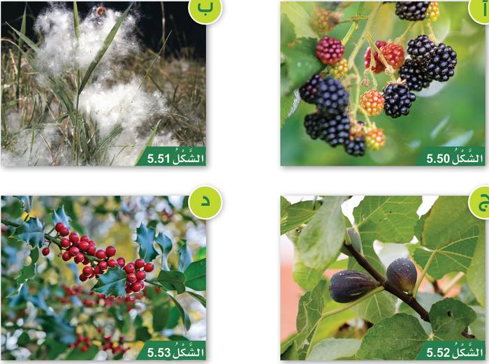
   - أ) الشكل 5.50
   - ب) الشكل 5.51
   - ج) الشكل 5.52
   - د) الشكل 5.53

#### رابعًا: أجب عن الأسئلة الآتية (مسائل وتفكير)

5. أكتب خاصيتين من خصائص البذور التي تنتشر بواسطة الرياح.

#### أولًا: اختر الإجابة الصحيحة (أسئلة محوّلة)

1. أيّ العبارات تصف انتشار البذور بواسطة الحيوانات؟
   - أ) تطفو على الماء فقط
   - ب) تنقلها الرياح فقط
   - ج) تنفجر الثمرة
   - د) تلتصق البذور بفراء الحيوان أو تؤكل ثمّ تخرج في مكانٍ آخر
2. أيّ الخصائص الآتية خصائص البذور المنتشرة بالطرق الميكانيكيّة؟
   - أ) توجد في قرون جافّة تنفجر
   - ب) لها أجنحة خفيفة
   - ج) لها خطّاطيف
   - د) تطفو على الماء
3. اختر الإجابة الصحيحة: ما تركيب العديد من البذور التي تنتشر بواسطة الماء؟
   - أ) غلاف يحتوي على هواء أو ألياف تساعد على الطفو
   - ب) أشواك
   - ج) أجنحة
   - د) قرون جافّة
4. أيّ البذور الآتية لا تنتشر بواسطة الحيوانات؟
   - أ) بذور الشوك اللاصقة
   - ب) بذور الهندباء المظلّيّة
   - ج) بذور التوت اللحميّة
   - د) بذور التفّاح
5. ما خاصّيّتان من خصائص البذور التي تنتشر بالرياح؟
   - أ) خفيفة الوزن ولها أجنحة أو ريش
   - ب) ثقيلة ولها أشواك
   - ج) كبيرة لحميّة
   - د) تحتوي على هواء للطفو فقط
6. لماذا تكون أجنحة بذور القيقب مفيدة؟
   - أ) تساعدها على الطفو
   - ب) تجعلها أثقل
   - ج) تجذب الحشرات
   - د) تجعلها تدور وتطير بعيدًا
7. لماذا تكون للبذور المنتشرة بالالتصاق خطّاطيف؟
   - أ) لتطير
   - ب) لتطفو
   - ج) لتلتصق بفراء الحيوانات
   - د) لتنفجر
8. لماذا تكون ثمار التوت وغيرها لحميّةً وحلوة؟
   - أ) لتطفو
   - ب) لتحمي نفسها من الحيوانات
   - ج) لتأكلها الحيوانات وتنشر البذور
   - د) لتطير
9. أيّ البذور تُنتج في قرونٍ تنفجر؟
   - أ) الهندباء
   - ب) جوز الهند
   - ج) الفاصولياء والبازلاء
   - د) الشوك
10. أيّ هذه الصفات يساعد البذرة على الطفو؟
   - أ) قشرة ثقيلة جدًّا
   - ب) جناح رقيق
   - ج) خطّاف
   - د) غلاف ليفيّ مملوء بالهواء
11. أيّ البذور تنتشر عادةً بأبعد مسافة في يومٍ عاصف؟
   - أ) البذور ذات الأشواك
   - ب) البذور الثقيلة
   - ج) البذور اللحميّة
   - د) البذور الصغيرة الخفيفة ذات الريش
12. ما الذي يحدث لبذور الثمار التي يأكلها الطائر؟
   - أ) تعود إلى النبتة
   - ب) تُهضَم كلّها دائمًا
   - ج) تتحوّل إلى ريش
   - د) قد تخرج مع فضلاته بعيدًا عن النبتة الأمّ
13. أيّ البذور الآتية تنتشر بالأجنحة؟
   - أ) بذور المشمش
   - ب) بذور جوز الهند
   - ج) بذور الشوك
   - د) بذور الصنوبر
14. ما الفرق بين انتشار البذور بالرياح وانتشارها بالماء؟
   - أ) بالرياح تحتاج البذور إلى الأشواك
   - ب) لا فرق
   - ج) بالرياح تحتاج البذور إلى الخفّة، وبالماء تحتاج إلى الطفو
   - د) بالماء تحتاج إلى الأجنحة
15. ما الذي يضمن بقاء البذور حيّةً أثناء انتشارها؟
   - أ) ضوء الشمس
   - ب) قشرة واقية
   - ج) الجفاف الشديد دائمًا
   - د) أكل الحيوانات لها كلّها
16. بذور الهندباء لها زغب خفيف كالمظلّة. كيف تنتشر هذه البذور في الغالب؟
   - أ) تحملها الرياح
   - ب) تعلق بفرو الحيوانات
   - ج) تنفجر الثمرة وترميها
   - د) تطفو على الماء

## الوحدة 6: النظام الشمسي

### الدرس 6.1: ما النظام الشمسي؟

#### أولًا: اختر الإجابة الصحيحة

1. ما الذي يقع في مركز نظامنا الشمسي؟
   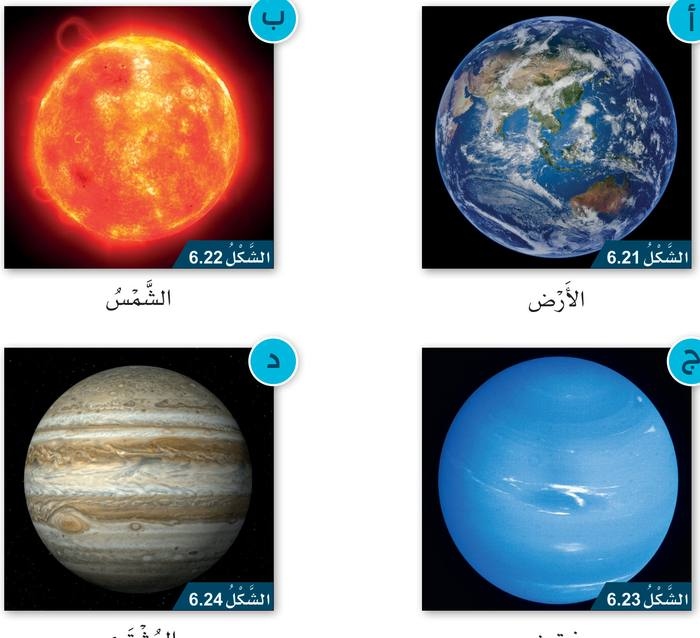
   - أ) الأرض
   - ب) الشمس
   - ج) نبتون
   - د) المشتري
2. ما الوحدة المناسبة لقياس المسافات بين الكواكب؟
   - أ) الكيلومتر
   - ب) مئات الكيلومترات
   - ج) آلاف الكيلومترات
   - د) ملايين الكيلومترات
3. ما القوة التي تحافظ بها مدارات الكواكب على موقعها؟
   - أ) مقاومة الهواء
   - ب) الجاذبية
   - ج) الاحتكاك
   - د) المغناطيسية

#### رابعًا: أجب عن الأسئلة الآتية (مسائل وتفكير)

4. أضع الكواكب الآتية وفق ترتيبها الصحيح بدءًا من الكوكب الأقرب إلى الشمس: الأرض، المشتري، عطارد، المريخ، الزهرة، أورانوس، نبتون، زحل.

#### أولًا: اختر الإجابة الصحيحة (أسئلة محوّلة)

1. بحسب ما تعلّمتَ، ما الذي يقع في مركز نظامنا الشمسيّ؟
   - أ) الأرض
   - ب) الشمس
   - ج) القمر
   - د) المشتري
2. ما القوّة التي تحافظ على مدارات الكواكب حول الشمس؟
   - أ) مقاومة الهواء
   - ب) الاحتكاك
   - ج) المغناطيسيّة
   - د) الجاذبيّة
3. من بين الخيارات الآتية، ما الوحدة المناسبة لقياس المسافات بين الكواكب؟
   - أ) السنتيمترات
   - ب) الملّيمترات
   - ج) ملايين الكيلومترات
   - د) الأمتار
4. كم كوكبًا في نظامنا الشمسيّ؟
   - أ) ثمانية كواكب
   - ب) تسعة كواكب
   - ج) سبعة كواكب
   - د) عشرة كواكب
5. أيّ الكواكب الآتية أقرب إلى الشمس؟
   - أ) عطارد
   - ب) الأرض
   - ج) المريخ
   - د) زحل
6. أيّ الكواكب الآتية أبعد عن الشمس؟
   - أ) الزهرة
   - ب) الأرض
   - ج) المريخ
   - د) نبتون
7. ما ترتيب الكواكب الأربعة الأولى بدءًا من الأقرب إلى الشمس؟
   - أ) الأرض، المريخ، المشتري، زحل
   - ب) عطارد، الزهرة، الأرض، المريخ
   - ج) المريخ، الأرض، الزهرة، عطارد
   - د) الزهرة، عطارد، المريخ، الأرض
8. ما أكبر كواكب النظام الشمسيّ؟
   - أ) عطارد
   - ب) الأرض
   - ج) زحل
   - د) المشتري
9. ما أصغر كواكب النظام الشمسيّ؟
   - أ) عطارد
   - ب) الأرض
   - ج) الزهرة
   - د) المريخ
10. ما الكواكب الصخريّة الأربعة الداخليّة؟
   - أ) عطارد والزهرة والأرض والمريخ
   - ب) المشتري وزحل وأورانوس ونبتون
   - ج) الأرض والقمر والشمس والمريخ
   - د) الزهرة والمشتري وزحل ونبتون
11. ما الكواكب الغازيّة العملاقة؟
   - أ) عطارد والزهرة
   - ب) المشتري وزحل وأورانوس ونبتون
   - ج) الأرض والمريخ
   - د) القمر والشمس
12. ما مسار حركة الكوكب حول الشمس؟
   - أ) الدائرة الاستوائيّة
   - ب) المدار
   - ج) المحور
   - د) الخطّ المستقيم
13. ما شكل مدارات الكواكب تقريبًا؟
   - أ) مثلّث
   - ب) مربّع
   - ج) مستقيم
   - د) بيضاويّ قريب من الدائريّ
14. ما الشمس؟
   - أ) قمر
   - ب) كوكب
   - ج) نجم
   - د) مذنّب
15. أيّ الأجرام الآتية يدور حول كوكب؟
   - أ) القمر
   - ب) الشمس
   - ج) النجم
   - د) المجرّة
16. أيّ الكواكب يسمّى الكوكب الأحمر؟
   - أ) المريخ
   - ب) الزهرة
   - ج) المشتري
   - د) أورانوس
17. أيّ الكواكب له حلقاتٌ واضحة؟
   - أ) الأرض
   - ب) عطارد
   - ج) زحل
   - د) المريخ

### الدرس 6.2: ما الأقمار؟

#### أولًا: اختر الإجابة الصحيحة

1. ما أكبر قمر معروف في نظامنا الشمسي؟
   - أ) تيتان
   - ب) تريتون
   - ج) جانيميد
   - د) قمر الأرض
2. أيّ من العبارات الآتية تمثل تعريفًا صحيحًا لمصطلح "القمر"؟
   - أ) تابع اصطناعي للنجم.
   - ب) تابع طبيعي للنجم.
   - ج) تابع اصطناعي للكوكب.
   - د) تابع طبيعي للكوكب.
3. ما أفضل نسبة تصف حجم القمر مقارنة بحجم الأرض؟
   - أ) النصف
   - ب) الربع
   - ج) ثلاثة أرباع
   - د) الثلث
4. أيّ من القياسات الآتية تخبرني عن حجم الكرة الذي يجب اختياره عند صنع نموذج لأقمار في نظامنا الشمسي؟
   - أ) المسافة عن الكوكب الذي تدور حوله.
   - ب) طول المدة الزمنية اللازمة لدورانه حول الكوكب.
   - ج) قطر القمر.
   - د) درجة حرارة سطح القمر.

#### أولًا: اختر الإجابة الصحيحة (أسئلة محوّلة)

1. اختر الإجابة الصحيحة: ما أكبر قمرٍ معروفٍ في نظامنا الشمسيّ؟
   - أ) القمر (قمر الأرض)
   - ب) تيتان
   - ج) غانيميد
   - د) تريتون
2. أيّ العبارات الآتية تمثّل تعريفًا صحيحًا لمصطلح القمر؟
   - أ) نجمٌ صغير
   - ب) جسمٌ اصطناعيّ يدور حول نجم
   - ج) جسمٌ طبيعيّ يدور حول كوكب
   - د) كوكب بلا مدار
3. كم قمرًا طبيعيًّا للأرض؟
   - أ) قمران
   - ب) قمر واحد
   - ج) ثلاثة أقمار
   - د) لا قمر
4. ما القمر الاصطناعيّ؟
   - أ) جسم صنعه الإنسان يدور حول الأرض أو كوكب آخر
   - ب) قمر طبيعيّ كبير
   - ج) نجم صغير
   - د) كويكب
5. ما أفضل نسبة تصف قطر القمر مقارنةً بقطر الأرض؟
   - أ) ثلاثة أرباع
   - ب) النصف
   - ج) الربع
   - د) الضعف
6. أيّ القياسات تحدّد حجم الكرة عند صنع نموذج لأقمار؟
   - أ) زمن دورانه
   - ب) درجة حرارة سطحه
   - ج) قطر القمر
   - د) لونه
7. أيّ الكواكب لا قمر له؟
   - أ) المشتري
   - ب) الأرض
   - ج) المريخ
   - د) عطارد
8. ما اسم القمر الطبيعيّ الذي يدور حول الأرض؟
   - أ) فوبوس
   - ب) غانيميد
   - ج) القمر
   - د) تيتان
9. أيّ الأقمار يتبع المشتري؟
   - أ) القمر
   - ب) غانيميد
   - ج) فوبوس
   - د) تريتون
10. ما الذي يجعل القمر يدور حول الأرض؟
   - أ) الرياح
   - ب) الاحتكاك
   - ج) المغناطيسيّة
   - د) جاذبيّة الأرض
11. هل للقمر ضوءٌ خاصّ به؟
   - أ) نعم في الأطوار الكاملة فقط
   - ب) نعم دائمًا
   - ج) نعم في الليل فقط
   - د) لا، يعكس ضوء الشمس
12. أيّ الكواكب له عدد أقمارٍ كبير؟
   - أ) المشتري وزحل
   - ب) عطارد والزهرة
   - ج) الأرض فقط
   - د) المريخ فقط
13. أيّ الأقمار الآتية يتبع كوكب زحل؟
   - أ) غانيميد
   - ب) تيتان
   - ج) القمر
   - د) فوبوس
14. كم قمرًا للمريخ؟
   - أ) لا قمر
   - ب) قمر واحد
   - ج) قمران
   - د) عشرة أقمار
15. أيّ العبارات الآتية صحيحة؟
   - أ) الأقمار كواكب
   - ب) الأقمار تدور حول الشمس مباشرةً فقط
   - ج) الأقمار نجوم
   - د) الأقمار تدور حول الكواكب
16. أيّ هذه الأجسام ليس قمرًا طبيعيًّا؟
   - أ) قمر الأرض
   - ب) غانيميد
   - ج) تيتان
   - د) محطّة الفضاء الدوليّة

### الدرس 6.3: لماذا لا توجد حياة على الكواكب الأخرى؟

#### أولًا: اختر الإجابة الصحيحة

1. ما الذي يحتويه الخط الأزرق الرفيع الذي يغلف كوكب الأرض؟
   - أ) مجموعة من الغازات.
   - ب) مجموعة من السوائل.
   - ج) مجموعة من الصخور.
   - د) ماء مالح.
2. أيّ من الكواكب الآتية لا يملك غلافًا جويًّا؟
   - أ) المريخ
   - ب) المشتري
   - ج) عطارد
   - د) الزهرة
3. أحدّد سبب عدم إمكانية الحياة على الكواكب الأبعد من الأرض في نظامنا الشمسي.
   - أ) درجة الحرارة مرتفعة جدًّا.
   - ب) درجة الحرارة منخفضة جدًّا.
   - ج) الرطوبة مرتفعة جدًّا.
   - د) العواصف كثيرة جدًّا.

#### رابعًا: أجب عن الأسئلة الآتية (مسائل وتفكير)

4. أصنّف الكواكب الآتية بحسب درجة حرارة سطحها (ساخن جدًّا، معتدل، بارد جدًّا): عطارد، الأرض، نبتون، زحل، أورانوس، الزهرة.

#### أولًا: اختر الإجابة الصحيحة (أسئلة محوّلة)

1. ما الذي يحتويه الخطّ الأزرق الرفيع الذي يغلّف الأرض في صور الفضاء؟
   - أ) الغلاف الجوّيّ
   - ب) الماء السائل فقط
   - ج) التربة
   - د) الجليد
2. أيّ الكواكب الآتية لا غلاف جوّيّ له تقريبًا؟
   - أ) الأرض
   - ب) عطارد
   - ج) الزهرة
   - د) المشتري
3. ما الذي تحتاج إليه الكائنات الحيّة لتعيش؟
   - أ) ماء سائل وأكسجين ودرجة حرارة مناسبة
   - ب) حرارة شديدة جدًّا
   - ج) برودة شديدة جدًّا
   - د) لا غاز في الجوّ
4. لماذا لا يمكن الحياة على الكواكب الأبعد من الأرض؟
   - أ) لأنّ فيها هواءً كثيرًا
   - ب) لأنّها شديدة الحرارة
   - ج) لأنّ فيها أنهارًا كثيرة
   - د) لأنّها شديدة البرودة
5. أيّ الكواكب شديد الحرارة بسبب غلافه الجوّيّ الكثيف؟
   - أ) نبتون
   - ب) الزهرة
   - ج) أورانوس
   - د) زحل
6. أيّ الكواكب الآتية ساخن جدًّا؟
   - أ) أورانوس
   - ب) نبتون
   - ج) الزهرة
   - د) زحل
7. أيّ الكواكب الآتية بارد جدًّا؟
   - أ) عطارد في النهار
   - ب) الزهرة
   - ج) نبتون
   - د) الأرض
8. أيّ كوكبٍ درجة حرارة سطحه معتدلة تسمح بالحياة؟
   - أ) نبتون
   - ب) الزهرة
   - ج) الأرض
   - د) عطارد
9. ما الغاز الذي نحتاج إليه في الغلاف الجوّيّ للأرض؟
   - أ) الهيليوم فقط
   - ب) الأكسجين
   - ج) الميثان
   - د) الأمونيا
10. لماذا يحمينا الغلاف الجوّيّ؟
   - أ) يوقف دوران الأرض
   - ب) يمنع المطر
   - ج) يمنع الضوء كلّه
   - د) يمنع أضرارًا من الإشعاع ويحفظ الحرارة
11. ما الذي يجعل الأرض ملائمةً للحياة؟
   - أ) قربها الشديد من الشمس
   - ب) وجود الماء السائل والغلاف الجوّيّ وحرارة معتدلة
   - ج) بعدها عن الشمس كثيرًا
   - د) غياب الغلاف الجوّيّ
12. أيّ الكواكب بعيدٌ جدًّا عن الشمس وحرارته منخفضة؟
   - أ) المريخ
   - ب) عطارد
   - ج) الزهرة
   - د) أورانوس
13. أين تقع الأرض بين الكواكب بالنسبة إلى الشمس؟
   - أ) الأوّل
   - ب) الثالث
   - ج) الخامس
   - د) الثامن
14. ما صفة درجة حرارة سطح المريخ؟
   - أ) معتدلة تمامًا كالأرض
   - ب) ساخنة جدًّا
   - ج) باردة
   - د) لا حرارة له
15. أيّ المواد الأساسيّة غير متوفّرة بالشكل الكافي على كواكب كثيرة؟
   - أ) الهيدروجين
   - ب) الصخور
   - ج) الغبار
   - د) الماء السائل
16. كيف نصنّف عطارد بحسب حرارة سطحه؟
   - أ) رطب
   - ب) معتدل
   - ج) بارد جدًّا دائمًا
   - د) شديد الحرارة نهارًا وشديد البرودة ليلًا
17. ما الكوكب الوحيد المعروف في المجموعة الشمسية بوجود حياة عليه؟
   - أ) الزهرة
   - ب) المريخ
   - ج) الأرض
   - د) المشتري

### الدرس 6.4: كيف يحدث الليل والنهار؟

#### أولًا: اختر الإجابة الصحيحة

1. ما الاتجاه الذي تدور فيه الأرض؟
   - أ) شمالًا
   - ب) شرقًا
   - ج) جنوبًا
   - د) غربًا
2. محور الأرض هو خط وهمي. ما اتجاه مروره؟
   - أ) يمر حول منتصف الأرض.
   - ب) يمر عبر الأرض من الشرق إلى الغرب.
   - ج) يمر عبر الأرض من الشمال إلى الجنوب.
   - د) يوضح مسار الأرض حول الشمس.
3. ما المدة الزمنية التي تستغرقها الأرض للدوران حول محورها؟
   - أ) 24 ساعة
   - ب) 50 ساعة
   - ج) 100 ساعة
   - د) 365 ساعة

#### رابعًا: أجب عن الأسئلة الآتية (مسائل وتفكير)

4. أذكر الطريقتين اللتين تتحرك بهما الأرض في الفضاء.
5. ما الخطأ الوارد في المخطط الآتي؟ أشرح لمَ لا يمكن أن يكون المخطط صحيحًا. (مخطط الأرض والشمس)
   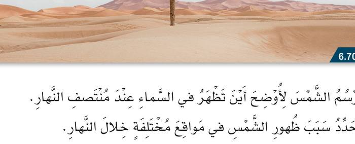
6. لمَ لا يكون منتصف اليوم عند التوقيت نفسه في كل من دولتي قطر وكندا؟

#### أولًا: اختر الإجابة الصحيحة (أسئلة محوّلة)

1. ما الاتّجاه الذي تدور فيه الأرض حول محورها؟
   - أ) من الغرب إلى الشرق
   - ب) من الشرق إلى الغرب
   - ج) من الشمال إلى الجنوب
   - د) لا تدور
2. ما محور الأرض؟
   - أ) خطّ وهميّ يمرّ من القطب الشماليّ إلى القطب الجنوبيّ
   - ب) خطّ حقيقيّ في الأرض
   - ج) خطّ الاستواء
   - د) مدار الأرض
3. كم تستغرق الأرض لتدور حول محورها دورةً كاملة؟
   - أ) 12 ساعة
   - ب) 24 ساعة
   - ج) 365 يومًا
   - د) 30 يومًا
4. ما سبب حدوث الليل والنهار؟
   - أ) دوران الأرض حول الشمس
   - ب) دوران الأرض حول محورها
   - ج) دوران القمر حول الأرض
   - د) حركة الشمس حول الأرض
5. ما الجزء من الأرض الذي يكون فيه نهار؟
   - أ) الجزء المواجه للشمس
   - ب) الجزء المعاكس للشمس
   - ج) القطبان فقط
   - د) خطّ الاستواء فقط
6. ما الجزء من الأرض الذي يكون فيه ليل؟
   - أ) الجزء المواجه للشمس
   - ب) الجزء البعيد عن الشمس
   - ج) القطب الشماليّ فقط
   - د) الجزء المواجه للقمر
7. ما الطريقتان اللتان تتحرّك بهما الأرض في الفضاء؟
   - أ) تسير في خطّ مستقيم فقط
   - ب) تدور حول القمر وتدور حول الكواكب
   - ج) تدور حول محورها وتدور حول الشمس
   - د) تبقى ثابتة
8. كم تستغرق الأرض لتدور حول الشمس دورةً كاملة؟
   - أ) سنة (نحو 365 يومًا)
   - ب) 24 ساعة
   - ج) 30 يومًا
   - د) 7 أيّام
9. لماذا لا يكون منتصف النهار في الوقت نفسه في قطر وكندا؟
   - أ) لأنّ الشمس تتحرّك حولهما
   - ب) لأنّهما في مواقع مختلفة على الأرض الدوّارة
   - ج) لأنّ الساعات مختلفة فقط
   - د) لأنّ القمر يغيّر الوقت
10. أيّ الجمل الآتية صحيحة؟
   - أ) الشمس لا تُرى أبدًا
   - ب) الشمس تدور حول الأرض فعلًا
   - ج) الشمس تبدو متحرّكة بسبب دوران الأرض
   - د) الأرض ثابتة
11. ماذا يحدث عندما تغرب الشمس عن منطقةٍ ما؟
   - أ) يتوقّف دوران الأرض
   - ب) يبدأ النهار
   - ج) يبدأ الليل فيها
   - د) يختفي القمر
12. في أيّ اتّجاه تشرق الشمس؟
   - أ) الشرق
   - ب) الغرب
   - ج) الشمال
   - د) الجنوب
13. في أيّ اتّجاه تغرب الشمس؟
   - أ) الشرق
   - ب) الغرب
   - ج) الشمال
   - د) الجنوب
14. كم ساعة تقريبًا يستمرّ الليل والنهار معًا (يوم كامل)؟
   - أ) 6 ساعات
   - ب) 12 ساعة
   - ج) 48 ساعة
   - د) 24 ساعة
15. أيّ الأجسام الآتية تدور حول محورها فيحدث الليل والنهار؟
   - أ) الأرض
   - ب) الشمس حول الأرض
   - ج) القمر حول الشمس مباشرةً
   - د) الغيوم
16. أيّ الشواهد تدلّ على أنّ الأرض تدور؟
   - أ) أطوار القمر فقط
   - ب) تغيّر الفصول فقط
   - ج) تعاقب الليل والنهار
   - د) تغيّر الطقس
17. أين تظهر الشمس في السماء عند منتصف النهار؟
   - أ) عند الأفق في الغرب
   - ب) عند الأفق في الشرق
   - ج) في أعلى نقطة تقريبًا فوق الرؤوس
   - د) لا تظهر في السماء

### الدرس 6.5: لماذا تبدو لنا الشمس في حركة ظاهرية؟

#### أولًا: اختر الإجابة الصحيحة

1. ما الوقت الذي يوجد فيه أقصر طول للظلال؟
   - أ) الصباح الباكر
   - ب) منتصف النهار
   - ج) الغروب
   - د) المساء
2. من أين تشرق الشمس؟
   - أ) الشمال
   - ب) الجنوب
   - ج) الشرق
   - د) الغرب
3. كيف تظهر حركة الشمس خلال النهار؟
   - أ) تتبع الأفق.
   - ب) تتحرك ضمن قوس عبر السماء.
   - ج) تنتقل من الشمال إلى الجنوب.
   - د) تتحرك بطريقة غير متوقعة.

#### رابعًا: أجب عن الأسئلة الآتية (مسائل وتفكير)

4. أذكر أسباب حركة الشمس الظاهرية.
5. أقارن ظلال الجمال في الصور الآتية. أذكر إن كانت الظلال تتكون عندما تظهر الشمس عالية أو منخفضة في السماء. أذكر كيف يمكنني أن أعرف موقع الشمس في كل صورة.
   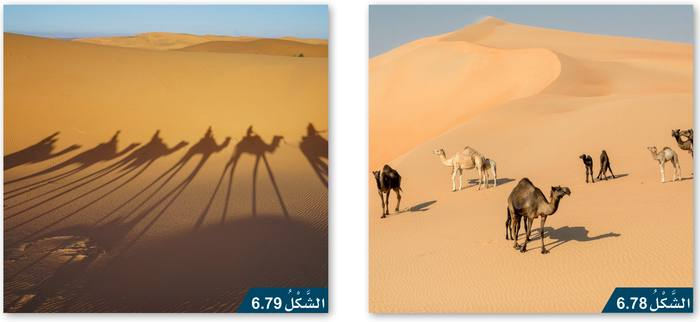

#### أولًا: اختر الإجابة الصحيحة (أسئلة محوّلة)

1. متى يكون أقصر طولٍ للظلال؟
   - أ) عند منتصف الليل
   - ب) عند الشروق
   - ج) عند الغروب
   - د) عند الظهيرة
2. بحسب ما تعلّمتَ، من أين تشرق الشمس؟
   - أ) من الشرق
   - ب) من الغرب
   - ج) من الشمال
   - د) من الجنوب
3. كيف تبدو حركة الشمس خلال النهار؟
   - أ) ترتفع في السماء ثمّ تنخفض
   - ب) تبقى ثابتةً في مكان واحد
   - ج) تتحرّك للخلف فقط
   - د) تختفي ثمّ تظهر
4. ما سبب حركة الشمس الظاهريّة؟
   - أ) دوران الأرض حول محورها
   - ب) دوران الشمس حول الأرض
   - ج) رياح الفضاء
   - د) الجاذبيّة فقط
5. أيّ الظلال أطول؟
   - أ) ظلال الصباح الباكر والمساء
   - ب) ظلال الظهيرة
   - ج) لا فرق
   - د) لا ظلال في الصباح
6. عندما تكون الشمس عالية في السماء، كيف تكون الظلال؟
   - أ) طويلة
   - ب) قصيرة
   - ج) معدومة دائمًا
   - د) ثابتة الطول دائمًا
7. عندما تكون الشمس منخفضةً قرب الأفق، كيف تكون الظلال؟
   - أ) قصيرة
   - ب) طويلة
   - ج) معدومة
   - د) لا تتغيّر
8. في أيّ اتّجاه يشير الظلّ عند الظهيرة في نصف الكرة الشماليّ؟
   - أ) نحو الشمال
   - ب) نحو الجنوب
   - ج) نحو الشرق
   - د) لا اتّجاه
9. كيف يتغيّر اتّجاه الظلّ خلال اليوم؟
   - أ) يتحرّك من الشرق إلى الغرب فقط
   - ب) يبقى ثابتًا
   - ج) يتحرّك من الغرب إلى الشرق
   - د) يختفي
10. ما الذي يسبّب تغيّر طول الظلّ؟
   - أ) ارتفاع الشمس في السماء
   - ب) الريح
   - ج) القمر
   - د) الغيوم فقط
11. أيّ الجمل الآتية صحيحة؟
   - أ) الأرض لا تدور
   - ب) الشمس تدور حول الأرض كلّ يوم
   - ج) الشمس لا تتحرّك حول الأرض بل تبدو كذلك
   - د) القمر يسبّب الشروق
12. أيّ وقتٍ من اليوم تكون فيه الشمس في أعلى نقطةٍ لها؟
   - أ) منتصف الليل
   - ب) الصباح الباكر
   - ج) المساء
   - د) الظهيرة
13. ما الأداة القديمة التي تستعمل ظلّ عمودٍ لتعرف الوقت؟
   - أ) المزولة الشمسيّة
   - ب) الساعة الرقميّة
   - ج) الترمومتر
   - د) المقياس
14. لماذا تبدو النجوم أيضًا وكأنّها تتحرّك في السماء ليلًا؟
   - أ) بسبب الرياح
   - ب) لأنّها تدور حول الأرض
   - ج) بسبب دوران الأرض
   - د) بسبب القمر
15. بعد أن تغرب الشمس في الغرب، أين تظهر في اليوم التالي؟
   - أ) في الشمال
   - ب) في الغرب
   - ج) في الشرق
   - د) في الجنوب
16. أيّ الأوقات تكون الشمس فيها منخفضة؟
   - أ) لا وقت
   - ب) الظهيرة
   - ج) منتصف النهار
   - د) الشروق والغروب
17. في صورة لجمال في الصحراء تبدو ظلالها طويلة جدًّا. متى تتكوّن الظلال الطويلة؟
   - أ) عندما تغيب الشمس تمامًا
   - ب) عندما تكون الشمس في أعلى نقطة في السماء
   - ج) عندما تكون الشمس منخفضة في السماء
   - د) عندما تكون الشمس فوق الجمل مباشرةً

### الدرس 6.6: ما أطوار القمر؟

#### أولًا: اختر الإجابة الصحيحة

1. أحدّد الصورة التي تظهر قمرًا في طور التربيع.
   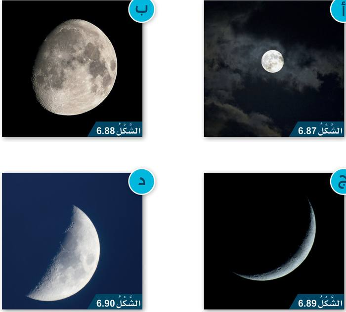
   - أ) الشكل 6.87
   - ب) الشكل 6.88
   - ج) الشكل 6.89
   - د) الشكل 6.90
2. ما مقدار سطح القمر الذي يمكن رؤيته من سطح الأرض عندما يكون القمر في طور المحاق؟
   - أ) كامل سطح القمر المواجه للأرض.
   - ب) ربع سطح القمر المواجه للأرض.
   - ج) نصف سطح القمر المواجه للأرض.
   - د) لا يمكن رؤية أي مقدار من سطح القمر المواجه للأرض.
3. ما عدد الأيام التقريبي الذي يستغرقه القمر ليتم دورة واحدة حول الأرض؟
   - أ) 7
   - ب) 14
   - ج) 21
   - د) 28

#### رابعًا: أجب عن الأسئلة الآتية (مسائل وتفكير)

4. يظهر المخطط مدارًا غير مكتمل للقمر. أكمل مدار القمر. أرسم وجه القمر المفقود على المخطط. أفسّر سبب اختياري.
   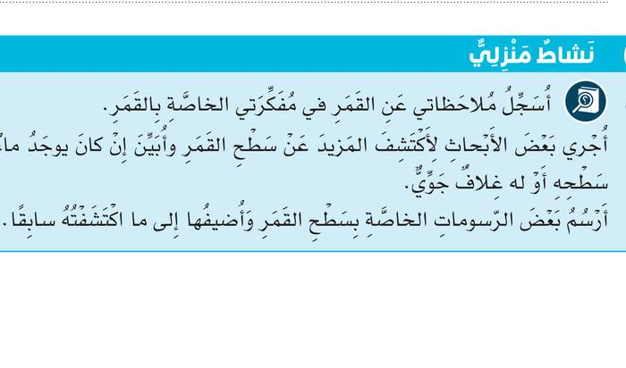

#### أولًا: اختر الإجابة الصحيحة (أسئلة محوّلة)

1. ما الطور الذي يظهر فيه نصف القمر مضيئًا؟
   - أ) الهلال
   - ب) المحاق
   - ج) البدر
   - د) التربيع
2. ما مقدار سطح القمر المضاء الذي نراه من الأرض في طور المحاق؟
   - أ) كلّه
   - ب) نصفه
   - ج) لا نرى شيئًا منه تقريبًا
   - د) ربعه
3. ما طور القمر الذي يبدو فيه دائرةً كاملةً مضيئة؟
   - أ) التربيع
   - ب) المحاق
   - ج) الهلال
   - د) البدر
4. كم يومًا تقريبًا يستغرق القمر ليدور دورةً واحدة حول الأرض؟
   - أ) نحو يومين
   - ب) نحو 7 أيّام
   - ج) نحو 365 يومًا
   - د) نحو 28 يومًا
5. لماذا تتغيّر أطوار القمر؟
   - أ) لأنّ القمر يتقلّص ويكبر
   - ب) لأنّ الأرض تظلّله دائمًا
   - ج) لأنّه يدور حول الأرض فنرى أجزاءً مختلفة من نصفه المضاء
   - د) لأنّ الشمس تتحرّك
6. ما الذي يضيء القمر؟
   - أ) ضوء الأرض فقط
   - ب) ضوءٌ يصنعه القمر
   - ج) ضوء الشمس المنعكس عليه
   - د) النجوم
7. أيّ الأطوار الآتية يسبق البدر؟
   - أ) الهلال المتناقص
   - ب) المحاق
   - ج) الأحدب المتزايد
   - د) التربيع الأخير
8. ما اسم الطور الذي لا نرى فيه القمر؟
   - أ) المحاق
   - ب) البدر
   - ج) التربيع
   - د) الهلال
9. ما شكل القمر في طور الهلال؟
   - أ) قوسٌ رفيع مضيء
   - ب) دائرة كاملة
   - ج) نصف دائرة
   - د) لا شيء
10. كم طورًا رئيسًا يمرّ به القمر في الدورة؟
   - أ) طور واحد
   - ب) ثمانية أطوار تقريبًا
   - ج) طوران
   - د) ثلاثة أطوار
11. في أيّ طورٍ يكون القمر والشمس على جانبين متقابلين من الأرض؟
   - أ) البدر
   - ب) المحاق
   - ج) التربيع
   - د) الهلال
12. في أيّ طورٍ يكون القمر بين الأرض والشمس؟
   - أ) التربيع
   - ب) البدر
   - ج) المحاق
   - د) الأحدب
13. ما الطور الذي يلي المحاق مباشرةً؟
   - أ) البدر
   - ب) الهلال المتزايد
   - ج) التربيع الأخير
   - د) الأحدب المتناقص
14. أيّ العبارات الآتية صحيحة؟
   - أ) القمر يتغيّر شكله فعلًا
   - ب) نرى كلّ سطح القمر يوميًّا
   - ج) لا نرى القمر أبدًا
   - د) نرى دائمًا النصف نفسه من القمر
15. ماذا يحدث لجزء القمر المضاء الذي نراه بعد البدر؟
   - أ) لا يتغيّر
   - ب) يتزايد
   - ج) يتناقص تدريجيًّا
   - د) يختفي فجأةً
16. ما اسم الدورة الكاملة لأطوار القمر؟
   - أ) السنة
   - ب) الشهر القمريّ
   - ج) اليوم
   - د) الأسبوع
17. ما اسم طور القمر الذي يظهر فيه الوجه المضيء كاملًا على شكل دائرة؟
   - أ) التربيع الأول
   - ب) المحاق
   - ج) الهلال
   - د) البدر

### الدرس 6.7: كيف تتشكل الفصول الأربعة؟

#### أولًا: اختر الإجابة الصحيحة

1. ما المدة التي تفصل بين سنة كبيسة وأخرى؟
   - أ) سنتان
   - ب) 4 سنوات
   - ج) 8 سنوات
   - د) 12 سنة
2. ما زاوية الميل المحوري للأرض؟
   - أ) °13
   - ب) °23
   - ج) °32
   - د) °45
3. ما الفصل الذي سيكون في نصف الكرة الشمالي عندما يكون القطب الشمالي متجهًا بعيدًا عن الشمس؟
   - أ) الصيف
   - ب) الخريف
   - ج) الشتاء
   - د) الربيع

#### رابعًا: أجب عن الأسئلة الآتية (مسائل وتفكير)

4. أذكر أوجه الشبه بين الاعتدالين الربيعي والخريفي.
5. أقرأ الجدول الذي يبين عدد ساعات النهار في أوقات مختلفة من السنة في مدينة فانكوفر. (شروق الشمس / غروب الشمس: 5:06 صباحًا / 9:20 بعد الظهر؛ 7:20 صباحًا / 7:21 بعد الظهر؛ 7:10 صباحًا / 4:40 بعد الظهر؛ 8:05 صباحًا / 4:16 بعد الظهر) أذكر الوقت الذي يسجل الشروق خلال الانقلاب الشتوي. أذكر كيف عرفت ذلك.

#### أولًا: اختر الإجابة الصحيحة (أسئلة محوّلة)

1. من بين الخيارات الآتية، ما المدّة التي تفصل بين سنةٍ كبيسةٍ وأخرى؟
   - أ) أربع سنوات
   - ب) سنتان
   - ج) عشر سنوات
   - د) سنة واحدة
2. اختر الإجابة الصحيحة: ما زاوية الميل المحوريّ للأرض؟
   - أ) 45 درجة
   - ب) 90 درجة
   - ج) نحو 23.5 درجة
   - د) صفر
3. ما سبب حدوث الفصول؟
   - أ) الرياح
   - ب) بُعد الأرض الدائم عن الشمس
   - ج) دوران القمر
   - د) ميل محور الأرض مع دورانها حول الشمس
4. أيّ الفصول يكون في نصف الكرة الشماليّ عندما يميل القطب الشماليّ نحو الشمس؟
   - أ) الربيع
   - ب) الشتاء
   - ج) الخريف
   - د) الصيف
5. أيّ الفصول يكون في نصف الكرة الشماليّ عندما يميل القطب الشماليّ بعيدًا عن الشمس؟
   - أ) الصيف
   - ب) الشتاء
   - ج) الربيع
   - د) لا فصل
6. ماذا يحدث لعدد ساعات النهار في الصيف؟
   - أ) لا يتغيّر
   - ب) يقلّ
   - ج) يزداد
   - د) يختفي
7. ماذا يحدث لعدد ساعات النهار في الشتاء؟
   - أ) لا يتغيّر
   - ب) يزداد
   - ج) يقلّ
   - د) يصبح 24 ساعة
8. ما الاعتدالان؟
   - أ) يومان يتساوى فيهما النهار والليل تقريبًا
   - ب) أطول يوم وأقصر يوم
   - ج) يوما الحرّ الشديد
   - د) يومان بلا شمس
9. ما وجه الشبه بين الاعتدالين الربيعيّ والخريفيّ؟
   - أ) لا ليل فيهما
   - ب) طول النهار أكبر دائمًا
   - ج) الحرارة الأعلى في السنة
   - د) تساوي طول الليل والنهار تقريبًا
10. ما الانقلابان؟
   - أ) يومان باردان
   - ب) يومان متساويان
   - ج) يومان ممطران
   - د) أطول نهار في السنة وأقصر نهار فيها
11. كم يومًا في السنة الكبيسة؟
   - أ) 366 يومًا
   - ب) 365 يومًا
   - ج) 360 يومًا
   - د) 400 يوم
12. كم يومًا في السنة العاديّة؟
   - أ) 360 يومًا
   - ب) 366 يومًا
   - ج) 365 يومًا
   - د) 364 يومًا
13. لماذا تكون الحرارة أعلى عندما تكون أشعّة الشمس أكثر عموديّةً؟
   - أ) لأنّها تتركّز على مساحة أصغر
   - ب) لأنّها أقوى بسبب بُعد الشمس
   - ج) لأنّها تتوقّف
   - د) لأنّها أبرد
14. أيّ العبارات الآتية صحيحة؟
   - أ) الشتاء في كلّ مكان
   - ب) الفصول متشابهة في نصفي الكرة
   - ج) لا يوجد صيف في الجنوب
   - د) عندما يكون الصيف في الشمال يكون الشتاء في الجنوب
15. ما الفصل الذي يأتي بعد الشتاء؟
   - أ) لا فصل
   - ب) الصيف
   - ج) الخريف
   - د) الربيع
16. أيّ فصلٍ تتساقط فيه أوراق الأشجار المتساقطة غالبًا؟
   - أ) الصيف
   - ب) الربيع
   - ج) الخريف
   - د) الشتاء فقط
17. ما سبب حدوث الفصول الأربعة على الأرض؟
   - أ) تغيّر حجم الشمس
   - ب) بُعد الأرض عن القمر
   - ج) دوران الأرض حول محورها فقط
   - د) ميلان محور دوران الأرض وحركتها حول الشمس

## الوحدة 7: التصنيف

### الدرس 7.1: النباتات اللازهرية

#### أولًا: اختر الإجابة الصحيحة

1. أتأمل الصورة أدناه. ما الوصف الأفضل لهذا النبات؟
   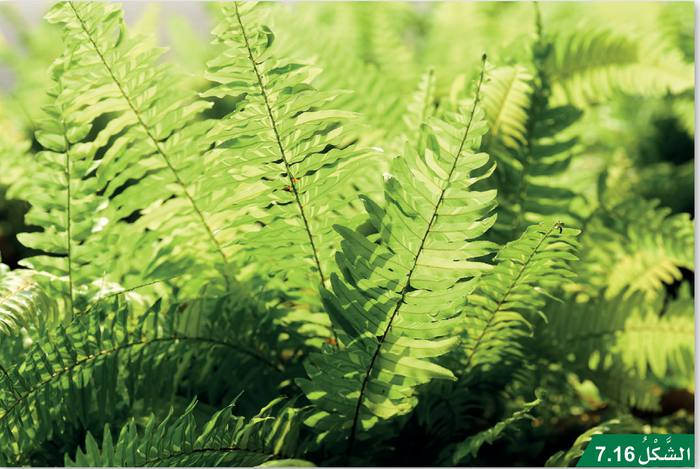
   - أ) نبات زهري، صنوبري.
   - ب) نبات زهري، كوميلينا.
   - ج) نبات لازهري وصنوبري.
   - د) نبات لازهري، سرخس.
2. ما الوصف الأفضل لهذا النبات؟
   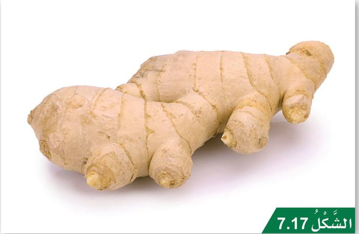
   - أ) جزء شحمي لتخزين الطعام تحت الأرض.
   - ب) ساق تحت الأرض.
   - ج) جذع مسطح مع حراشف لتخزين الطعام.
   - د) ساق أفقي فوق الأرض.
3. ما طريقة التكاثر اللاجنسي المختلفة عن بقية الطرق؟ أشرح إجابتي.
   - أ) التجزئة
   - ب) التطعيم
   - ج) السيقان الجارية
   - د) العقلة

#### رابعًا: أجب عن الأسئلة الآتية (مسائل وتفكير)

4. أشرح سبب عدم وجود السرخس والحزازيات في دولة قطر.

#### أولًا: اختر الإجابة الصحيحة (أسئلة محوّلة)

1. أيّ النباتات الآتية لا تُنتج أزهارًا؟
   - أ) السرخس والحزاز
   - ب) الورد
   - ج) النخيل
   - د) الياسمين
2. كيف تتكاثر السراخس؟
   - أ) بالتلقيح بالنحل
   - ب) بالبذور داخل الثمار
   - ج) بالحيوانات المنويّة
   - د) بالأبواغ
3. ما الأبواغ؟
   - أ) خلايا صغيرة تنمو إلى نباتات جديدة
   - ب) بذور داخل ثمرة
   - ج) أوراق
   - د) جذور
4. أين تنمو الحزازيّات عادةً؟
   - أ) في الصحراء الجافّة
   - ب) في الأماكن الرطبة الظليلة
   - ج) في المحيط
   - د) في الهواء
5. ما العضو الذي تفتقر إليه الحزازيّات؟
   - أ) أبواغ
   - ب) أوراق صغيرة
   - ج) جذور حقيقيّة
   - د) سيقان صغيرة
6. لماذا لا يوجد السرخس والحزازيّات في بيئة قطر الصحراويّة عادةً؟
   - أ) لأنّها تحتاج إلى حرارة شديدة
   - ب) لأنّها تحتاج إلى الرطوبة والماء
   - ج) لأنّها تحبّ الجفاف
   - د) لأنّها تنمو في الرمال
7. أيّ النباتات الآتية تتكاثر بالأبواغ؟
   - أ) الذرة
   - ب) الورد
   - ج) القمح
   - د) السرخس
8. ما الأشجار المخروطيّة؟
   - أ) أشجار بلا بذور
   - ب) أشجار بذورها في مخاريط
   - ج) أشجار بأزهار كبيرة
   - د) أشجار بثمار لحميّة
9. أيّ النباتات الآتية مخروطيّ؟
   - أ) الصنوبر
   - ب) النخلة
   - ج) الورد
   - د) الموز
10. ما طريقة التكاثر اللاجنسيّ المختلفة عن بقيّة الطرق؟
   - أ) لا يوجد تكاثر لاجنسيّ
   - ب) التكاثر بالبذور فقط
   - ج) التكاثر بالأبواغ يختلف عن التكاثر بالبذور
   - د) التكاثر بالأزهار
11. أيّ الأجزاء تجعل السراخس تبدو مختلفةً عن بقيّة النباتات؟
   - أ) ثمار حلوة
   - ب) أزهار ملوّنة
   - ج) أوراق كبيرة مقسّمة (سعف)
   - د) بتلات
12. أيّ النباتات يحتاج إلى الماء ليتكاثر بالأبواغ؟
   - أ) السراخس والحزازيّات
   - ب) الصنوبر
   - ج) القمح
   - د) النخيل
13. أيّ الجمل الآتية تصف الحزازيّات؟
   - أ) نباتات طويلة جدًّا بأزهار
   - ب) نباتات صغيرة قصيرة تنمو في أماكن رطبة
   - ج) نباتات بثمار كبيرة
   - د) نباتات صحراويّة
14. أيّ النباتات الآتية لها أزهار؟
   - أ) السرخس
   - ب) الورد
   - ج) الحزاز
   - د) الصنوبر
15. ما الفرق بين السرخس والنباتات الزهريّة؟
   - أ) النباتات الزهريّة لا بذور لها
   - ب) لا فرق
   - ج) السرخس له أزهار
   - د) السرخس يتكاثر بالأبواغ والنباتات الزهريّة بالبذور
16. أيّ المجموعات الآتية جميعها نباتات لا تنتج أزهارًا وتتكاثر بالأبواغ؟
   - أ) القمح والذرة
   - ب) الورد والنخيل
   - ج) السرخس والحزاز
   - د) الياسمين والفلّ
17. أين توجد الأبواغ في السرخس؟
   - أ) على السطح السفليّ للأوراق
   - ب) في الجذور
   - ج) في الأزهار
   - د) في الثمار
18. ما الذي تحتاج إليه الأبواغ لتنمو؟
   - أ) جليد
   - ب) ضوء القمر فقط
   - ج) ملح
   - د) رطوبة ودفء

### الدرس 7.2: ما الفرق بين الأشجار المتساقطة الأوراق والأشجار الدائمة الخضرة؟

#### أولًا: اختر الإجابة الصحيحة

1. ما الذي يسبب تساقط أوراق الأشجار المتساقطة الأوراق؟
   - أ) النهار القصير.
   - ب) الجو حار جدًّا صيفًا.
   - ج) النهار الطويل.
   - د) سقوط الكثير من الأمطار شتاءً.
2. أين توجد الأشجار الدائمة الخضرة؟
   - أ) في المناخات المعتدلة فقط.
   - ب) في كل مكان على سطح الأرض.
   - ج) في جميع المناطق ما عدا المناطق القطبية.
   - د) في المناخات الاستوائية فقط.
3. أتأمل صورة شجرة الجهنمية وصورة ورقتها. إنها شجرة متساقطة الأوراق. أيّ من العبارات الآتية تصح لمعظم الأشجار المتساقطة الأوراق؟
   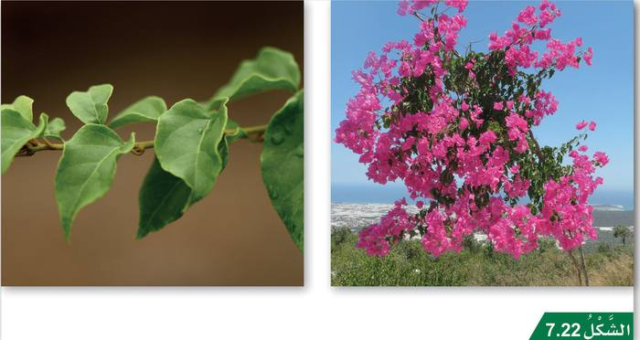
   - أ) تتساقط أوراقها كل سنتين.
   - ب) لا تتساقط أوراقها.
   - ج) تسمى ذات الأوراق الإبرية.
   - د) أوراقها مسطحة وعريضة.

#### رابعًا: أجب عن الأسئلة الآتية (مسائل وتفكير)

4. كيف يمكن أن تنمو الأشجار المتساقطة الأوراق، مثل شجرة اللبخ، في دولة قطر؟ ولماذا تستخدم أحيانًا أنظمة الري للأشجار المتساقطة الأوراق؟
   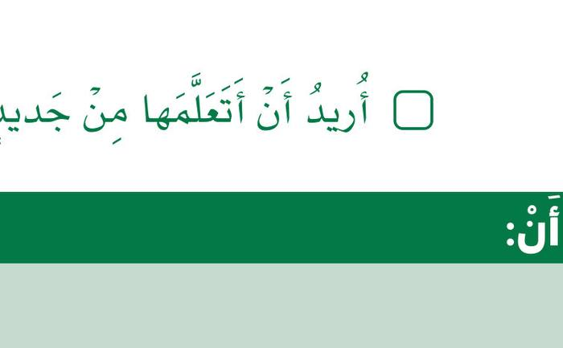
5. أذكر اختلافين بين الأشجار الدائمة الخضرة والأشجار المتساقطة الأوراق.
6. ما نوع الأشجار التي تعيش في المناطق الاستوائية؟ أشرح السبب.

#### أولًا: اختر الإجابة الصحيحة (أسئلة محوّلة)

1. بحسب ما تعلّمتَ، ما الذي يسبّب تساقط أوراق الأشجار المتساقطة الأوراق؟
   - أ) البرد وقلّة الضوء في الخريف والشتاء
   - ب) الحرّ الشديد دائمًا
   - ج) كثرة الأمطار فقط
   - د) الرياح فقط
2. من بين الخيارات الآتية، أين توجد الأشجار الدائمة الخضرة؟
   - أ) في مناطق مختلفة منها الباردة والاستوائيّة
   - ب) في القطب فقط
   - ج) في الصحراء فقط
   - د) في الماء فقط
3. ما الأشجار الدائمة الخضرة؟
   - أ) أشجار تحتفظ بأوراقها طوال السنة
   - ب) أشجار تتساقط أوراقها كلّ خريف
   - ج) أشجار بلا أوراق
   - د) أشجار تموت كلّ سنة
4. ما الأشجار المتساقطة الأوراق؟
   - أ) أشجار تفقد أوراقها في موسم معيّن
   - ب) أشجار خضراء دائمًا
   - ج) أشجار بلا جذور
   - د) أشجار تعيش في الماء
5. أيّ الأشجار الآتية دائمة الخضرة؟
   - أ) الصنوبر
   - ب) شجرة التفّاح
   - ج) شجرة الدلب (في الخريف)
   - د) شجرة الكرز
6. ما نوع الأشجار التي تعيش في المناطق الاستوائيّة الدافئة الرطبة؟
   - أ) متساقطة كلّ خريف فقط
   - ب) دائمة الخضرة غالبًا
   - ج) لا أشجار هناك
   - د) أشجار بلا أوراق
7. لماذا تتساقط أوراق بعض الأشجار في الجوّ البارد؟
   - أ) لأنّها تموت كلّها
   - ب) لتوفّر الماء والطاقة
   - ج) لتصبح أكبر
   - د) لتتحوّل إلى جذور
8. ما الاختلاف بين الأشجار المتساقطة والدائمة الخضرة؟
   - أ) لا اختلاف
   - ب) المتساقطة تفقد أوراقها في موسم محدّد والدائمة تحتفظ بها
   - ج) الدائمة تفقد أوراقها دائمًا
   - د) المتساقطة بلا أوراق
9. أيّ الأشجار تتساقط أوراقها عادةً في الخريف؟
   - أ) أشجار التفّاح
   - ب) الصنوبر
   - ج) النخيل
   - د) أشجار الزيتون
10. كيف يمكن لشجرة متساقطة الأوراق أن تنمو في قطر؟
   - أ) بتجميدها
   - ب) بتركها بلا ماء
   - ج) بريّها المنتظم وتوفير الماء
   - د) بتغطيتها بالجليد
11. أيّ الأشجار مناسبة للمناخ الجافّ في قطر؟
   - أ) السدر والغاف
   - ب) الصنوبر الألبيّ
   - ج) القيقب
   - د) الأرز
12. ما الذي تفعله الأوراق الخضراء في الشجرة؟
   - أ) تمتصّ الماء
   - ب) تصنع الغذاء بالضوء
   - ج) تخزّن الماء فقط
   - د) تحمي الجذع
13. لماذا تحتفظ الأشجار الدائمة الخضرة بأوراقها؟
   - أ) لأنّها لا تنمو
   - ب) لأنّها لا تحتاج إلى الضوء
   - ج) لأنّها بلا أوراق
   - د) تستطيع العيش بأوراقها طوال السنة
14. ما شكل أوراق معظم الأشجار الصنوبريّة؟
   - أ) إبريّة
   - ب) عريضة جدًّا
   - ج) كروية
   - د) بلا أوراق
15. أيّ العبارات الآتية خاطئة؟
   - أ) الأشجار المتساقطة تفقد أوراقها
   - ب) الأشجار الدائمة الخضرة تفقد كلّ أوراقها في الخريف
   - ج) الصنوبر دائم الخضرة
   - د) التفّاح متساقط الأوراق
16. أيّ المواسم تنمو فيها أوراق الأشجار المتساقطة من جديد؟
   - أ) الشتاء
   - ب) الربيع
   - ج) الخريف
   - د) كلّ المواسم
17. أيّ الصفات تتّصف بها أشجار المناطق الاستوائيّة؟
   - أ) بلا جذور
   - ب) أوراقها إبريّة وتتساقط
   - ج) بلا أوراق
   - د) أوراقها كبيرة وتبقى خضراء

### الدرس 7.3: ما النباتات التي نزرعها من أجل الغذاء؟

#### أولًا: اختر الإجابة الصحيحة

1. أتأمل الأطعمة الغذائية في الشكل 7.27. لأيّ جزء من النباتات تنتمي هذه الأطعمة؟
   
   - أ) الجذور
   - ب) السيقان
   - ج) الأوراق
   - د) الثمار
2. أتأمل الأطعمة الغذائية في الشكل 7.28. أيّ النباتات الآتية تؤكل ساقها؟
   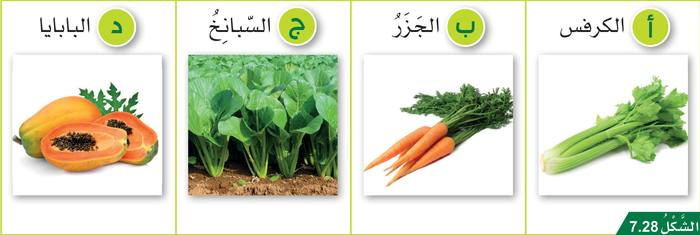
   - أ) الكرفس
   - ب) الجزر
   - ج) السبانخ
   - د) البابايا
3. أنظر إلى الشكل 7.28 مرة أخرى. أيّ النباتات الآتية تؤكل أوراقها؟
   
   - أ) الكرفس
   - ب) الجزر
   - ج) السبانخ
   - د) البابايا

#### رابعًا: أجب عن الأسئلة الآتية (مسائل وتفكير)

4. أسمّي جميع أجزاء النباتات التي يمكن أن نأكلها.

#### أولًا: اختر الإجابة الصحيحة (أسئلة محوّلة)

1. أيّ الأطعمة الآتية تُؤخَذ من جذور النبات؟
   - أ) الخسّ
   - ب) الجزر
   - ج) الطماطم
   - د) الأرز
2. أيّ الأطعمة الآتية تُؤخَذ من أوراق النبات؟
   - أ) الجزر
   - ب) الخسّ والسبانخ
   - ج) الأرز
   - د) التفّاح
3. أيّ الأطعمة الآتية تُؤخَذ من سيقان النباتات؟
   - أ) الجزر
   - ب) الكرفس
   - ج) الفراولة
   - د) القمح
4. أيّ الأطعمة الآتية ثمرة؟
   - أ) الكرفس
   - ب) الجزر
   - ج) الطماطم
   - د) السبانخ
5. أيّ الأطعمة الآتية بذور؟
   - أ) الأرز والقمح
   - ب) الجزر
   - ج) الخسّ
   - د) الكرفس
6. أيّ الأطعمة الآتية أزهار؟
   - أ) القرنبيط والبروكلي
   - ب) الجزر
   - ج) الخسّ
   - د) القمح
7. ما الجزء الذي نأكله من البطاطا؟
   - أ) زهرة
   - ب) ورقة
   - ج) ساق تحت الأرض متضخّمة (درنة)
   - د) ثمرة
8. ما الجزء الذي نأكله من البصل؟
   - أ) بذرة
   - ب) ثمرة
   - ج) زهرة
   - د) بصلة متضخّمة تحت الأرض
9. أيّ هذه النباتات تُؤكل أوراقها؟
   - أ) الملفوف
   - ب) الذرة
   - ج) الجزر
   - د) الأرز
10. أيّ النباتات الآتية تُؤكل بذوره؟
   - أ) الكرفس
   - ب) الجزر
   - ج) الخسّ
   - د) العدس
11. أيّ النباتات الآتية تُؤكل ثماره؟
   - أ) الكرفس
   - ب) الجزر
   - ج) السبانخ
   - د) الخيار
12. أيّ هذه النباتات تُؤكل جذوره؟
   - أ) الفجل
   - ب) الخيار
   - ج) الخسّ
   - د) الذرة
13. لماذا نزرع النباتات من أجل الغذاء؟
   - أ) لنغيّر لون التربة
   - ب) لتزيد الحرارة
   - ج) لنتخلّص من الماء
   - د) لتزوّدنا بالمواد الغذائيّة
14. أيّ المحاصيل الآتية حبوب؟
   - أ) الخسّ
   - ب) الجزر
   - ج) القمح والذرة
   - د) الفجل
15. ما الجزء الذي نأكله من قصب السكّر؟
   - أ) الزهرة
   - ب) الجذر
   - ج) الساق
   - د) الثمرة
16. أيّ النباتات الآتية يمكن أن نأكل أكثر من جزء منه؟
   - أ) الخيار فقط
   - ب) القمح فقط
   - ج) الأرز فقط
   - د) الشمندر (الجذر والأوراق)
17. أيّ العبارات الآتية صحيحة؟
   - أ) لا نأكل أيّ جزء
   - ب) نأكل الأوراق فقط
   - ج) نأكل الجذور فقط
   - د) نأكل من النباتات جذورًا وسيقانًا وأوراقًا وأزهارًا وثمارًا وبذورًا

### الدرس 7.4: ما أوجه الشبه والاختلاف بين الحيوانات الفقارية المختلفة؟

#### أولًا: اختر الإجابة الصحيحة

1. إلى أيّ صف ينتمي الحيوان الفقاري في الشكل الآتي؟
   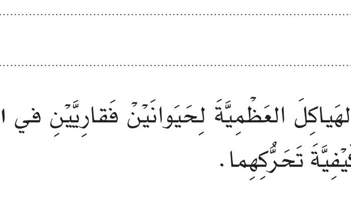
   - أ) الطيور
   - ب) الأسماك
   - ج) الثدييات
   - د) الزواحف
2. ما السبب وراء تكيف الحيوانات الفقارية بطرق مختلفة؟
   - أ) الطعام الذي تأكله.
   - ب) الطعام الذي تأكله وموطنها.
   - ج) موطنها ومناخه.
   - د) فئة الفقاريات التي تنتمي إليها وموطنها.
3. إلى أيّ صف ينتمي الحيوان الفقاري في الشكل 7.35؟
   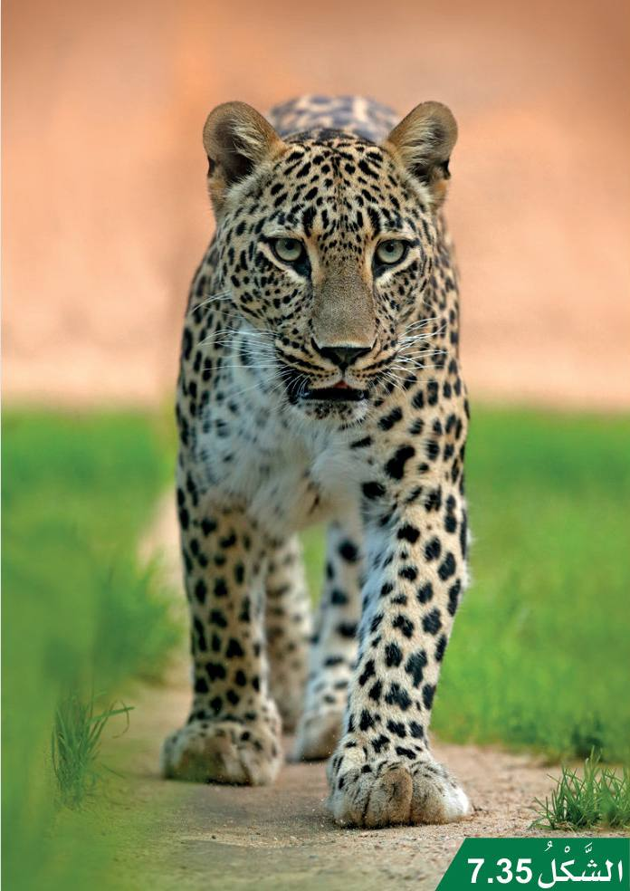
   - أ) البرمائيات
   - ب) الطيور
   - ج) الأسماك
   - د) الثدييات

#### رابعًا: أجب عن الأسئلة الآتية (مسائل وتفكير)

4. أتأمل الصور الآتية. أذكر طريقتين تبينان كيف تتشابه الهياكل العظمية.
   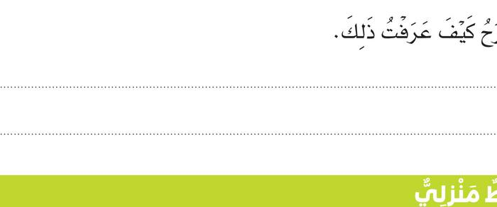

#### أولًا: اختر الإجابة الصحيحة (أسئلة محوّلة)

1. ما الحيوانات الفقاريّة؟
   - أ) حيوانات بلا عمود فقريّ
   - ب) حيوانات لها عمود فقريّ
   - ج) حيوانات بلا عظام فقط
   - د) حيوانات تعيش في الماء فقط
2. ما صفوف الحيوانات الفقاريّة الخمسة؟
   - أ) الثدييّات والطيور والزواحف والبرمائيّات والأسماك
   - ب) الحشرات والعناكب والديدان والقشريّات والرخويّات
   - ج) الأشجار والنباتات والأعشاب
   - د) الحيوانات الأليفة والبرّيّة فقط
3. أيّ الحيوانات الآتية من الثدييّات؟
   - أ) الأسد
   - ب) النسر
   - ج) الأفعى
   - د) الضفدع
4. أيّ الحيوانات الآتية من الطيور؟
   - أ) الأرنب
   - ب) الصقر
   - ج) التمساح
   - د) السمكة
5. أيّ الحيوانات الآتية من الزواحف؟
   - أ) الضفدع
   - ب) الأفعى
   - ج) الدلفين
   - د) البطّة
6. أيّ الحيوانات الآتية من البرمائيّات؟
   - أ) الحصان
   - ب) السحلية
   - ج) الضفدع
   - د) النسر
7. أيّ الحيوانات الآتية من الأسماك؟
   - أ) الضفدع
   - ب) الدلفين
   - ج) السلحفاة
   - د) القرش
8. ما الميزة المشتركة بين جميع الثدييّات؟
   - أ) ترضع صغارها وفيها شعر أو فراء
   - ب) تضع بيضًا ولها ريش
   - ج) تعيش في الماء فقط
   - د) لها قشور جافّة
9. ما الذي يغطّي أجسام الطيور؟
   - أ) القشور
   - ب) الريش
   - ج) الفراء
   - د) الجلد العاري الرطب
10. ما الذي يغطّي أجسام الزواحف؟
   - أ) فراء
   - ب) ريش
   - ج) قشور جافّة
   - د) جلد رطب عارٍ
11. ما صفة جلد البرمائيّات؟
   - أ) قشور جافّة
   - ب) رطب وناعم
   - ج) ريش
   - د) فراء
12. كيف تتنفّس الأسماك؟
   - أ) بالخياشيم
   - ب) بالرئتين فقط
   - ج) بالجلد الجافّ فقط
   - د) بالأنف
13. اختر الإجابة الصحيحة: ما السبب وراء تكيّف الحيوانات الفقاريّة بطرقٍ مختلفة؟
   - أ) لتغيّر ألوانها فقط
   - ب) لتعيش في بيئات مختلفة
   - ج) لتصبح أكبر
   - د) لتكون أخفّ
14. أيّ الحيوانات الآتية تضع بيضًا بقشرة صلبة؟
   - أ) الطيور
   - ب) الحصان
   - ج) البقرة
   - د) القطّة
15. ما أوجه التشابه بين هياكل الفقاريّات العظميّة؟
   - أ) كلّها بنفس الحجم
   - ب) كلّها بلا عظام
   - ج) كلّها لها عمود فقريّ وجمجمة
   - د) كلّها بلا أطراف
16. أيّ الحيوانات الآتية من الثدييّات التي تعيش في الماء؟
   - أ) القرش
   - ب) الدلفين
   - ج) السمكة الذهبيّة
   - د) الضفدع
17. أيّ الحيوانات الآتية يمرّ بمرحلة يرقة في الماء ثمّ يعيش على اليابسة؟
   - أ) الصقر
   - ب) الأسد
   - ج) الضفدع
   - د) الأفعى
18. أيّ مجموعات الحيوانات الفقارية يغطّي الريش أجسامها؟
   - أ) الزواحف
   - ب) الطيور
   - ج) الأسماك
   - د) البرمائيات

### الدرس 7.5: ما أوجه الشبه والاختلاف بين الحيوانات اللافقارية المختلفة؟

#### أولًا: اختر الإجابة الصحيحة

1. أيّ مما يأتي من خصائص الحشرات؟
   - أ) لديها أربعة أزواج من الأرجل.
   - ب) ليس لديها قرون استشعار.
   - ج) لديها زوجان من الأجنحة.
   - د) لديها جسم مقسم إلى قسمين.
2. ما الهيكل الهيدروستاتيكي؟
   - أ) تجاويف مملوءة بالسوائل داخل الجسم.
   - ب) قشرة صلبة حول الجسم.
   - ج) الدعم من الماء الذي يعيش فيه الحيوان.
   - د) عملية أخذ الماء ثم إخراجه.
3. أيّ العبارات الآتية صحيحة؟
   - أ) قنديل البحر له هيكل داخلي.
   - ب) الرخويات البحرية لها هيكل خارجي وهيكل هيدروستاتيكي.
   - ج) الرخويات البرية لها دائمًا هيكل خارجي (قوقعة).
   - د) الحشرات لها هيكل هيدروستاتيكي.

#### رابعًا: أجب عن الأسئلة الآتية (مسائل وتفكير)

4. أنظر إلى الشكل 7.42. أحدّد إحدى إيجابيات وإحدى سلبيات هذا النوع من الهيكل الداعم مقارنة بالهيكل العظمي الداخلي.
   
5. أنظر إلى الشكل 7.44. أربط الهيكل الداعم لهذا الحيوان بموطنه ونطاق حركته.
   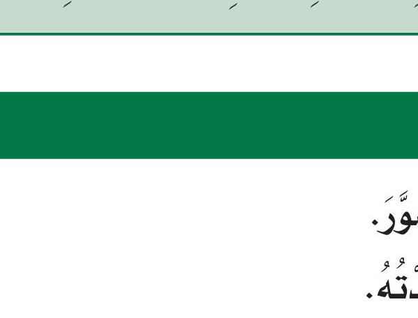
6. أكتب نقطتين إيجابيتين للهيكل الداعم في الشكل 7.42 مقارنة بالهيكل الداعم في الشكل 7.43.
   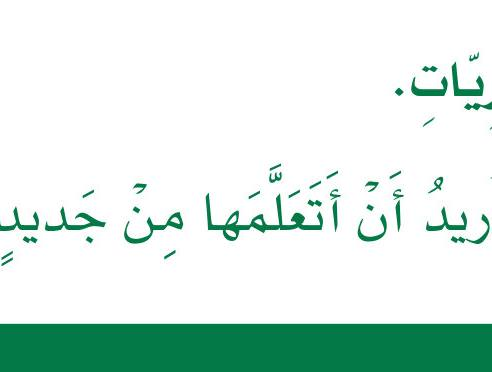

#### أولًا: اختر الإجابة الصحيحة (أسئلة محوّلة)

1. ما الحيوانات اللافقاريّة؟
   - أ) حيوانات لها عمود فقريّ
   - ب) حيوانات بلا عمود فقريّ
   - ج) حيوانات لها ريش
   - د) حيوانات لها فراء
2. بحسب ما تعلّمتَ، أيّ مما يأتي من خصائص الحشرات؟
   - أ) ستّ أرجل وثلاثة أجزاء للجسم
   - ب) ثماني أرجل
   - ج) لا أرجل لها
   - د) عمود فقريّ
3. كم رجلًا للعناكب؟
   - أ) أربع أرجل
   - ب) ستّ أرجل
   - ج) ثماني أرجل
   - د) عشر أرجل
4. من بين الخيارات الآتية، ما الهيكل الهيدروستاتيكيّ؟
   - أ) هيكل داعم يتكوّن من سائل محصور داخل الجسم
   - ب) هيكل صلب خارجيّ
   - ج) عمود فقريّ
   - د) جمجمة
5. أيّ الحيوانات الآتية لها هيكل هيدروستاتيكيّ؟
   - أ) النحلة
   - ب) دودة الأرض
   - ج) السرطان
   - د) الأسد
6. ما الهيكل الخارجيّ؟
   - أ) سائل داخل الجسم
   - ب) عظام داخل الجسم
   - ج) غلاف صلب يغطّي الجسم من الخارج
   - د) عمود فقريّ
7. أيّ الحيوانات الآتية لها هيكل خارجيّ؟
   - أ) النمل
   - ب) الدلفين
   - ج) دودة الأرض
   - د) الأرنب
8. ما إحدى مزايا الهيكل الخارجيّ؟
   - أ) ينمو مع الجسم دائمًا
   - ب) يحمي الجسم
   - ج) يساعد على السباحة فقط
   - د) لا يحتاج إلى استبدال
9. ما إحدى سلبيّات الهيكل الخارجيّ؟
   - أ) لا يحمي
   - ب) ليّن جدًّا
   - ج) لا ينمو مع الحيوان فيجب أن يتخلّص منه ويبدّله
   - د) يُصدر صوتًا
10. اختر الإجابة الصحيحة: أيّ العبارات الآتية صحيحة؟
   - أ) اللافقاريّات أكثر عددًا من الفقاريّات
   - ب) الفقاريّات أكثر عددًا
   - ج) لا لافقاريّات على الأرض
   - د) اللافقاريّات بلا أرجل دائمًا
11. أيّ الحيوانات الآتية من القشريّات؟
   - أ) النحلة
   - ب) السلطعون
   - ج) العنكبوت
   - د) الدودة
12. أيّ الحيوانات الآتية من الرخويّات؟
   - أ) الحلزون
   - ب) النحلة
   - ج) الذبابة
   - د) الجرادة
13. أيّ الحيوانات الآتية من الحشرات؟
   - أ) العنكبوت
   - ب) الفراشة
   - ج) السلطعون
   - د) الحلزون
14. أيّ الحيوانات الآتية من العنكبيّات؟
   - أ) النحلة
   - ب) العقرب
   - ج) الفراشة
   - د) النمل
15. كيف يرتبط الهيكل الداعم للحيوان بموطنه؟
   - أ) يحدّد لونه فقط
   - ب) لا علاقة له
   - ج) يغيّر موطنه
   - د) يتناسب مع بيئته وطريقة حركته
16. ما الميزة المشتركة بين الحشرات والعناكب؟
   - أ) ريش
   - ب) عمود فقريّ
   - ج) هيكل خارجيّ وأرجل مفصليّة
   - د) فراء
17. أيّ الحيوانات الآتية بلا هيكل صلب يدعمه ويحرّكه بسائل داخليّ؟
   - أ) السلحفاة
   - ب) الأسد
   - ج) الصقر
   - د) قنديل البحر

### الدرس 7.6: كيف يمكن تصنيف الفقاريات واللافقاريات؟

#### أولًا: اختر الإجابة الصحيحة

1. إلى أيّ صف من الحيوانات ينتمي الحيوان في الشكل الآتي؟
   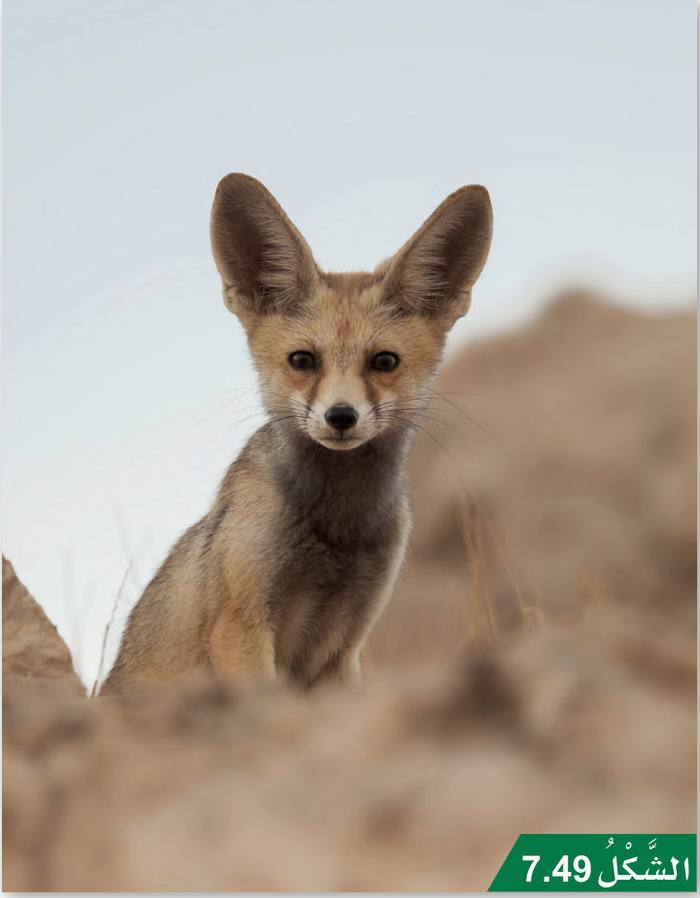
   - أ) الطيور
   - ب) الزواحف
   - ج) الأسماك
   - د) الثدييات
2. ما اسم الحيوان في الشكل الآتي؟
   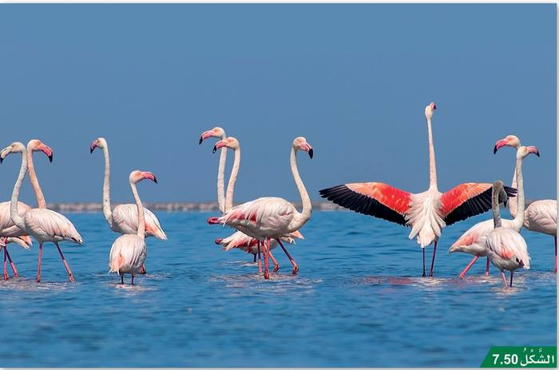
   - أ) الدعسوقة
   - ب) السلحفاة الخضراء
   - ج) الفلامنغو
   - د) المحار
3. لمَ تعد البرمائيات نادرة الوجود في دولة قطر؟
   - أ) منطقة جافة جدًّا.
   - ب) تمّ أكلها من الثدييات.
   - ج) يوجد الكثير من البحيرات.
   - د) الليالي شديدة البرودة.

#### رابعًا: أجب عن الأسئلة الآتية (مسائل وتفكير)

4. هل هذا الحيوان من الفقاريات أم من اللافقاريات؟ أشرح إجابتي. (الشكل 7.51)
   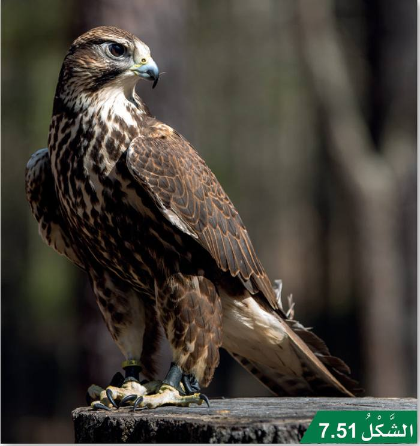
5. أنظر إلى صور الحيوانات في الشكل 7.52. أذكر طريقة واحدة تبين التشابه بين هذه الحيوانات. أذكر طريقة واحدة تبين الاختلاف بين هذه الحيوانات.
   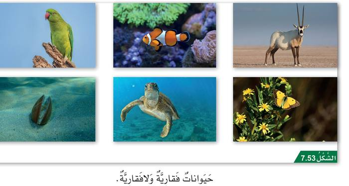

#### أولًا: اختر الإجابة الصحيحة (أسئلة محوّلة)

1. ما معنى التصنيف في العلوم؟
   - أ) وزن الكائنات
   - ب) عدّ الكائنات الحيّة
   - ج) تسمية الكائنات بأسماء عشوائيّة
   - د) ترتيب الكائنات الحيّة في مجموعات بحسب خصائصها
2. بحسب ما تعلّمتَ، لمَ تُعدّ البرمائيّات نادرة الوجود في دولة قطر؟
   - أ) لأنّ لقطر أنهارًا كثيرة
   - ب) لأنّها تحبّ الجفاف
   - ج) لأنّها تحتاج إلى الماء والرطوبة وقطر مناخها جافّ
   - د) لأنّها لا تعيش على اليابسة
3. ما الأداة التي تساعد على تصنيف كائنٍ مجهول بأسئلة نعم أو لا؟
   - أ) المفتاح التصنيفيّ
   - ب) الميزان
   - ج) المسطرة
   - د) الترمومتر
4. السؤال: هل للحيوان عمود فقريّ؟ إذا كانت الإجابة لا، فالحيوان:
   - أ) لافقاريّ
   - ب) فقاريّ
   - ج) ثدييّ
   - د) سمكة
5. حيوانٌ له ريش وجناحان ويضع بيضًا. إلى أيّ صفٍّ ينتمي؟
   - أ) الزواحف
   - ب) الثدييّات
   - ج) الطيور
   - د) الأسماك
6. حيوانٌ له شعر ويُرضع صغاره. إلى أيّ صفٍّ ينتمي؟
   - أ) الثدييّات
   - ب) الطيور
   - ج) الزواحف
   - د) البرمائيّات
7. حيوانٌ له قشور جافّة ويضع بيضًا على اليابسة. إلى أيّ صفٍّ ينتمي؟
   - أ) الثدييّات
   - ب) الطيور
   - ج) الأسماك
   - د) الزواحف
8. حيوانٌ جلده رطب ويعيش جزءًا من حياته في الماء وجزءًا على اليابسة. إلى أيّ صفٍّ ينتمي؟
   - أ) الزواحف
   - ب) البرمائيّات
   - ج) الطيور
   - د) الأسماك
9. حيوانٌ يعيش في الماء ويتنفّس بالخياشيم وله زعانف. إلى أيّ صفٍّ ينتمي؟
   - أ) الطيور
   - ب) الثدييّات
   - ج) الزواحف
   - د) الأسماك
10. حيوانٌ له ستّ أرجل وجسمه من ثلاثة أجزاء. إلى أيّ صفٍّ ينتمي؟
   - أ) العناكب
   - ب) الحشرات
   - ج) القشريّات
   - د) الدودة
11. حيوانٌ له ثماني أرجل. إلى أيّ صفٍّ ينتمي؟
   - أ) الدودة
   - ب) الحشرات
   - ج) الرخويّات
   - د) العنكبيّات
12. أيّ الحيوانات الآتية فقاريّ؟
   - أ) الحصان
   - ب) النحلة
   - ج) الحلزون
   - د) الدودة
13. أيّ الحيوانات الآتية لافقاريّ؟
   - أ) القطّة
   - ب) النحلة
   - ج) الصقر
   - د) الضفدع
14. ما الذي يتشابه فيه الأسد والنمر والفهد؟
   - أ) جميعها أسماك
   - ب) جميعها طيور
   - ج) جميعها زواحف
   - د) جميعها من الثدييّات اللاحمة
15. لماذا نستخدم مفاتيح التصنيف؟
   - أ) لنتجنّب دراستها
   - ب) لنغيّر أسماءها
   - ج) لنخفيها
   - د) لنتعرّف على الكائنات الحيّة بسهولة
16. أيّ الحيوانات الآتية من الثدييّات ومن الفقاريّات معًا؟
   - أ) الفراشة
   - ب) الخفّاش
   - ج) السلطعون
   - د) الدودة
17. السؤال: هل للحيوان ريش؟ إذا كانت الإجابة نعم، فالحيوان من:
   - أ) الزواحف
   - ب) الثدييّات
   - ج) الأسماك
   - د) الطيور
